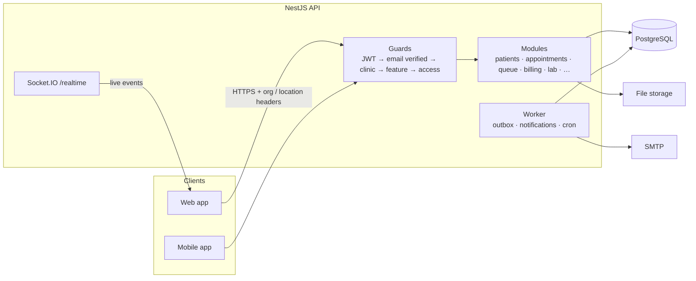
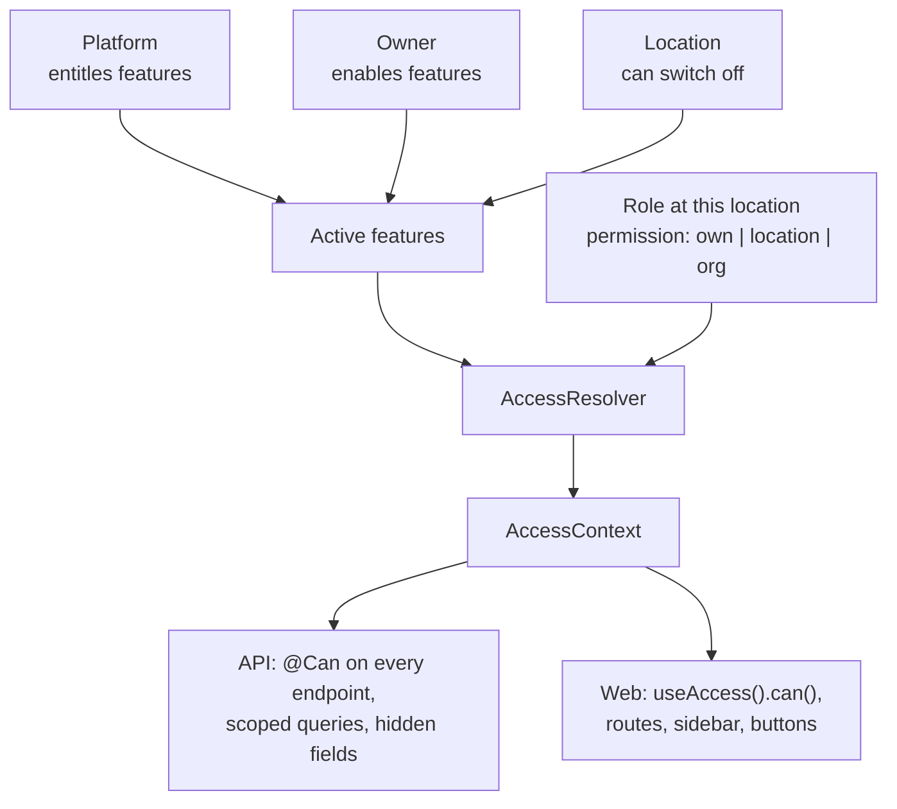

<div align="center">


<h1>Clinic Management Platform</h1>

<p><b>Run the whole clinic from one place: front desk, doctor's room and back office.</b></p>

<p>Appointments &nbsp;•&nbsp; Live queue &nbsp;•&nbsp; Consultations &nbsp;•&nbsp; Billing &nbsp;•&nbsp; Lab &nbsp;•&nbsp; Inventory &nbsp;•&nbsp; Payroll &nbsp;•&nbsp; Reports</p>

<p>


</p>

<p>
<a href="#overview"><b>Overview</b></a> &nbsp;·&nbsp;
<a href="#features"><b>Features</b></a> &nbsp;·&nbsp;
<a href="#screenshots"><b>Screenshots</b></a> &nbsp;·&nbsp;
<a href="#architecture"><b>Architecture</b></a> &nbsp;·&nbsp;
<a href="#getting-started"><b>Getting started</b></a> &nbsp;·&nbsp;
<a href="#testing"><b>Testing</b></a> &nbsp;·&nbsp;
<a href="#documentation"><b>Docs</b></a>
</p>

<br />


</div>

<br />

## Overview

A multi-tenant SaaS for single- and multi-location clinics: dental, skin, general practice and more. Each clinic is an **organization** with one or more **locations**; staff, patients and appointments belong to them, and every request carries the active organization and location.

<table>
<tr>
<td width="33%" valign="top">
<h4>Clinic staff</h4>
Front desk, doctors, assistants and accountants each get a workspace shaped by their role, on the web and on mobile.
</td>
<td width="33%" valign="top">
<h4>Clinic owners</h4>
Build roles, switch modules on or off per location, arrange the sidebar, brand the app, invite staff with a link and set notification rules.
</td>
<td width="33%" valign="top">
<h4>Platform admin</h4>
Approves new clinics, entitles features (with optional trials), manages subscriptions and can step into any clinic.
</td>
</tr>
</table>

<table>
<tr>
<td align="center" width="25%"><h2>37</h2>reports with Excel / PDF</td>
<td align="center" width="25%"><h2>15+</h2>parts of the patient record</td>
<td align="center" width="25%"><h2>156</h2>database tables</td>
<td align="center" width="25%"><h2>166</h2>access acceptance cases</td>
</tr>
</table>

> **About the name:** *MedTrackr* (codename *DentalFlow*) is a working name. The final product name is not decided yet.

<br />

## Features

<table>
<tr>
<td width="50%" valign="top">

<h3>Appointments &amp; queue</h3>

- Calendar booking with doctor schedules, booking rules and conflict detection
- Check-in hands over to a **doctor-wise live queue**: tokens, walk-ins, skip, rejoin, transfer, send for test
- Reception board, doctor screen and a public **TV display**
- Live updates over Socket.IO

</td>
<td width="50%" valign="top">

<h3>Clinical</h3>

- Patient record: vitals, documents, consents, recalls, referrals, insurance
- One-screen **consultation workspace** per visit
- Five-surface **teeth chart** (existing vs planned) that fills in treatment plans
- Prescriptions with medicine directory, templates, print layouts and signatures

</td>
</tr>
<tr>
<td valign="top">

<h3>Billing &amp; finance</h3>

- Charges, invoices, payments, refunds, discounts, credit packages, cash close
- Thermal (80 mm) and A4 printing, Urdu PDFs
- Doctor commissions with an append-only ledger
- P&amp;L dashboard, clinic overview and **37 reports**

</td>
<td valign="top">

<h3>Lab</h3>

- Lab directory, clinic ↔ lab links, price lists, order templates
- Orders run on versioned **workflow templates**
- Lab portal and magic links: labs work without a clinic login
- Patient lab billing, vendor bills, payables, statements

</td>
</tr>
<tr>
<td valign="top">

<h3>Team &amp; operations</h3>

- Employees, multi-location assignments, schedules, leave
- Monthly payroll with payslips
- Inventory: items, suppliers, purchase orders, stock, consumption
- **Notifications**: in-app bell with live toasts and sound, plus email

</td>
<td valign="top">

<h3>Access &amp; sign-in</h3>

- Permissions with `own` / `location` / `org` scope; roles from None / Basic / Full bundles
- Features entitled by the platform, enabled by the owner, switched off per location
- Email + password with verification, or **Google sign-in**
- New clinics wait for approval; staff join with invite links

</td>
</tr>
<tr>
<td valign="top">

<h3>Customization</h3>

- Clinic **theme**: logo, brand colour, sidebar style
- Sidebar layout builder and a home page per role
- Settings that cascade platform → clinic → location
- **Ctrl+K** quick search across patients and pages

</td>
<td valign="top">

<h3>Platform</h3>

- Clinic approval, feature entitlements and trials
- Subscriptions with manual payments and expiry reminders
- Config Studio for workflow templates and form schemas
- Audit trail for key records

</td>
</tr>
</table>

<br />

## Screenshots

<table>
<tr>
<td width="50%" align="center"><br /><b>Appointments</b><br /><sub>Tokens, check-in and walk-ins</sub></td>
<td width="50%" align="center"><br /><b>Billing desk</b><br /><sub>Payment, receipt and invoice</sub></td>
</tr>
<tr>
<td align="center"><br /><b>Lab order</b><br /><sub>Items, teeth, lab vs patient price</sub></td>
<td align="center"><br /><b>Profit &amp; loss</b><br /><sub>One of 37 reports</sub></td>
</tr>
<tr>
<td align="center"><br /><b>Roles</b><br /><sub>None / Basic / Full per module</sub></td>
<td align="center"><br /><b>Theme builder</b><br /><sub>Logo, colour, sidebar, live preview</sub></td>
</tr>
<tr>
<td align="center"><br /><b>Login</b><br /><sub>Uses the clinic's theme</sub></td>
<td align="center"><br /><b>No access</b><br /><sub>Clear message for blocked pages</sub></td>
</tr>
</table>

<br />

## Architecture

The repository holds four apps that share one API.

| App | Folder | Built with |
| --- | --- | --- |
| **API** | [`backend/`](backend) | NestJS 11, TypeORM, PostgreSQL, Socket.IO |
| **Web app** | [`web-app/`](web-app) | React 19, TanStack Start / Router / Query / Form / Table, shadcn/ui, Tailwind 4, Zustand |
| **Mobile app** | [`mobile-app/`](mobile-app) | Expo 58, Expo Router, TanStack Query + Form, Uniwind |
| **Landing site** | [`landing/`](landing) | Astro, Tailwind 4 |



<table>
<tr>
<td width="50%" valign="top">

**One process, no Redis**
The default `all` process serves HTTP and Socket.IO and runs the worker jobs. To scale out, run several `api` processes and one `worker`, connected through Redis.

</td>
<td width="50%" valign="top">

**Schema as SQL**
The app never changes the database. The schema is hand-written SQL in [`backend/database/`](backend/database); there is no `synchronize` and no TypeORM migrations.

</td>
</tr>
<tr>
<td valign="top">

**Clinic time**
The server runs in UTC. Days and times are shown and entered in the **location's** timezone (`ClockService` on the API, `@/lib/datetime` on the web).

</td>
<td valign="top">

**Safe queue changes**
Every queue change goes through `QueueOrchestrator`: transaction, row lock, allowed-transition check, audit event and outbox.

</td>
</tr>
</table>

<details>
<summary><b>How access is decided</b></summary>

<br />



Code never checks a role name; it asks `can('billing.invoice.void')`. Full guide: [`docs/access-control/README.md`](docs/access-control/README.md).

</details>

<br />

## Getting started

**You need:** Node.js 22 and PostgreSQL 13+. Optional: an SMTP login (email), a Cloudinary account (uploads) and a Google OAuth client id (Google sign-in). Redis is not needed for local work.

### 1 · Install

```bash
git clone https://github.com/moinuddin2004/cms.git && cd cms
```

Then, from the repo root, install the API and the web app:

```bash
cd backend && npm install
```

```bash
cd web-app && npm install
```

### 2 · Create the database

Run the schema once on an empty database, from `backend/database/`:

```bash
psql "$DATABASE_URL" -v ON_ERROR_STOP=1 -1 -f schema/run_all.sql
```

For an existing database, run the new files in `backend/database/changes/` in date order. See [`backend/database/README.md`](backend/database/README.md).

### 3 · Configure

```bash
cd backend && cp .env.example .env
```

<details>
<summary><b>Environment variables</b></summary>

<br />

| Variable | Required | Purpose |
| --- | :---: | --- |
| `DATABASE_URL` | ✓ | PostgreSQL connection string |
| `DATABASE_SSL` | | `true` (default) · `verify` · `false` for local Postgres |
| `JWT_ACCESS_SECRET` · `JWT_REFRESH_SECRET` | ✓ | Token signing |
| `EMAIL_TOKEN_SECRET` · `RESET_TOKEN_SECRET` | ✓ | Email verification and password reset links |
| `PORT` | | API port, default `5000` |
| `FRONTEND_URL` | | Web app address for email links and CORS, default `http://localhost:3000` |
| `GOOGLE_CLIENT_ID` | | Google sign-in; unset hides the button |
| `SMTP_HOST` · `SMTP_PORT` · `SMTP_SECURE` · `SMTP_USER` · `SMTP_PASS` · `SMTP_FROM` | | Any SMTP. Only user + pass means Gmail app password. Unset means emails are only logged |
| `EMAIL_DAILY_CAP` | | Notification emails per day, default 450, `0` = no cap |
| `STORAGE_DRIVER` | | File storage provider, default `cloudinary` |
| `CLOUDINARY_CLOUD_NAME` · `CLOUDINARY_API_KEY` · `CLOUDINARY_API_SECRET` | | Cloudinary uploads |
| `REDIS_URL` | | Only for split `api` / `worker` processes |

Web app: `VITE_API_BASE_URL` (default `http://localhost:5000`). Mobile app: `EXPO_PUBLIC_API_URL` (see `mobile-app/.env.example`).

</details>

### 4 · Run

| What | Command | Address |
| --- | --- | --- |
| API | `cd backend && npm run start:dev` | `http://localhost:5000` |
| Web app | `cd web-app && npm run dev` | `http://localhost:3000` |
| Mobile app | `cd mobile-app && npx expo start` | Expo Go / emulator |
| Landing site | `cd landing && npm run dev` | `http://localhost:4321` |
| API + web in Docker | `docker compose up --build` | ports 5000 and 3000 |

On first start the API adds its own catalog rows (features, permissions, notification events).

### 5 · First login

1. Open `http://localhost:3000/register` and create an account.
2. Make that account the platform admin. Super admins skip the email check, so this also works without SMTP:
   ```sql
   UPDATE users SET global_role = 'super_admin' WHERE email = 'you@example.com';
   ```
3. Sign in, approve or create a clinic, add locations and employees, and give staff roles under **Settings → Roles** or invite them from **Employees**.

<details>
<summary><b>Running in production</b></summary>

<br />

```bash
cd backend && npm run build
```

| Setup | Command | Notes |
| --- | --- | --- |
| Single process | `npm run start:prod` | API, realtime and worker together; no Redis |
| Scaled out | `npm run start:api` | Run 2 or more; needs `REDIS_URL` |
| | `npm run start:worker` | Run exactly one |

Before each deploy, back up the database and run any new `backend/database/changes/*.sql` files.

</details>

<br />

## Testing

| Suite | Command | Covers |
| --- | --- | --- |
| API unit | `cd backend && npm test` | Services, guards, queue engine; fails if any endpoint has no access rule |
| Web | `cd web-app && npm test` | Components and hooks (Vitest + Testing Library) |
| Access acceptance | `cd backend && npm run test:int:acceptance` | 166 access cases on a real database |
| Other DB suites | `npm run test:int:labs` · `test:int:tenancy` · `test:int:access` | Lab, tenant isolation, access core |
| Mobile | `cd mobile-app && npm run typecheck` | Type check |

Database suites share one test database and each uses its own schema, so run them one at a time. [CI](.github/workflows/ci.yml) type-checks, builds and tests the API and web app on every push to `master` and every pull request.

<br />

## Repository layout

```text
cms/
├── backend/            NestJS API
│   ├── database/       SQL schema: schema/ for a new DB, changes/ for existing ones
│   ├── scripts/        access:export (permission catalog → web app)
│   ├── test/           integration and acceptance test setup
│   └── src/            one folder per module (see below) + common/ and bootstrap/
├── web-app/            React web app
│   └── src/
│       ├── routes/     file-based routes, each renders a feature page
│       ├── features/   one folder per feature: pages, components, hooks, api, schemas, types
│       ├── components/ shadcn ui, shared and layout components
│       └── lib/        api client, dates, money, query client
├── mobile-app/         Expo app for clinic staff
├── landing/            Astro marketing site
├── docs/               guides, ERDs, handbook, screenshots, archive
├── docker-compose.yml  API + web app containers
└── CLAUDE.md           coding conventions
```

<details>
<summary><b>API modules</b></summary>

<br />

| Area | Modules | What they do |
| --- | --- | --- |
| Sign-in | `auth` · `user` · `session` · `clinic-access` | Tokens, Google sign-in, email verification, password reset, sessions, clinic approval, invite links |
| Clinic setup | `organizations` · `locations` · `settings-registry` · `subscriptions` | Clinics, locations, timezones, cascading settings, plans |
| Access | `access` · `feature-flags` | Permissions, roles, sidebar layouts, feature switches |
| Staff | `employees` · `payroll` | Staff, schedules, leave, pay, monthly payroll |
| Patients | `patients` · `encounters` · `treatments` · `treatment-plans` · `prescriptions` · `plan-templates` | Records, visits, teeth chart, plans, prescriptions |
| Front desk | `appointments` · `queue` | Booking, conflict checks, live queue, TV display |
| Money | `billing` · `reports` | Charges, invoices, payments, commissions, printing, reports |
| Lab | `labs` · `lab-*` · `engine` | Lab orders, production, portal, billing, workflow templates |
| Other | `inventory` · `notifications` · `search` | Stock, notifications, quick search |
| Shared | `common` | Guards, decorators, audit, clock, mail, storage |

</details>

<br />

## Documentation

| | Doc | About |
| --- | --- | --- |
| 📘 | [`docs/README.md`](docs/README.md) | Index of every doc |
| 🧭 | [`CLAUDE.md`](CLAUDE.md) | Coding conventions: layout, forms, listings, design system, dates, access |
| 🗄️ | [`backend/database/README.md`](backend/database/README.md) | Creating and changing the schema |
| 🔐 | [`docs/access-control/README.md`](docs/access-control/README.md) | Permissions, roles, features, sidebar, theme |
| 📅 | [`docs/appointments-and-queue.md`](docs/appointments-and-queue.md) | Booking and the live queue |
| 🔔 | [`docs/notifications-email-plan.md`](docs/notifications-email-plan.md) | Notifications and email |
| 💰 | [`docs/commissions.md`](docs/commissions.md) | Doctor commissions |

<br />

## Contributing

Read [`CLAUDE.md`](CLAUDE.md) before writing code. The rules that matter most:

| Rule | Why |
| --- | --- |
| Every endpoint has `@Can`, `@AnyMember`, `@Public`, `@RequireSuperAdmin` or `@ContextFree` | A test fails otherwise; access is closed by default |
| Ask `can('…')`, never check a role name | Each clinic defines its own roles |
| A schema change edits the entity, `database/schema/` and a new `database/changes/` file | The app never changes the database itself |
| Use `bg-primary`, never `blue-*` | The brand colour comes from the clinic theme |
| Dates go through `ClockService` / `@/lib/datetime` | Clinic time is the location's timezone |
| Notify only through `NotificationService` | One path for in-app and email |

<br />

<div align="center">

<br />
<sub>Built for clinics in Pakistan and beyond: PKR, location timezones, Urdu and English.</sub>
</div>
