<div align="center">

# 🦷 MedTrackr

### Multi-tenant clinic management for dental & medical practices

Appointments · doctor-wise queue · consultations · billing · dental lab · inventory · payroll · reports.
Each clinic configures its own roles, features, sidebar and branding.

<br />


<br />

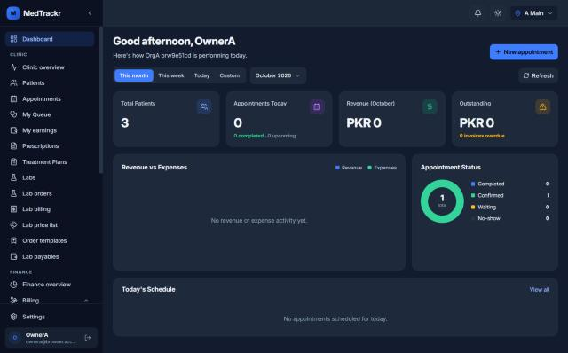

<br />

[Features](#-features) · [Screenshots](#-screenshots) · [Architecture](#-architecture) · [Getting started](#-getting-started) · [Project structure](#-project-structure) · [Docs](#-documentation)

</div>

---

## 📖 Overview

MedTrackr (codename **DentalFlow**) is a SaaS platform that runs the day-to-day of multi-location clinics. It covers everything from the front desk (booking, check-in, a live doctor-wise queue) to the chair (consultation workspace, dental chart, prescriptions, lab orders) and the back office (charge-based billing, doctor commissions, payroll, inventory, 37+ reports with Excel/PDF export).

The tenancy model is **Organization → Locations → staff, patients and appointments**. Every row is scoped to its organization, and every request carries the active organization and location.

<table>
<tr>
<td width="33%" valign="top">

**🏥 For clinics**
Front desk, doctors, assistants and accountants each see a workspace shaped by their role.

</td>
<td width="33%" valign="top">

**🧑‍💼 For owners**
Owners build their own roles from permission bundles, switch modules on and off per location, rearrange the sidebar and brand the app.

</td>
<td width="33%" valign="top">

**🛠️ For the platform**
The super admin entitles features per clinic (including trials) and can step into any clinic.

</td>
</tr>
</table>

---

## ✨ Features

<table>
<tr>
<td width="50%" valign="top">

### 📅 Appointments & queue
- Calendar booking with doctor schedules, booking rules and conflict detection (enforced by a DB exclusion constraint)
- Check-in hands over to a **doctor-wise live queue**: tokens, smart selection, walk-ins, skip / rejoin / transfer, send-for-test
- Reception board, doctor screen, public **TV display**
- Realtime over Socket.IO, fed by a transactional outbox

</td>
<td width="50%" valign="top">

### 🩺 Clinical
- Patient records with 15+ sub-entities: vitals, dental info, FDI teeth chart, documents, consents, recalls, referrals, insurance
- One-screen **consultation workspace** per visit
- Prescriptions with a medicine directory, templates, print layouts and doctor signatures
- Treatment plans and plan templates

</td>
</tr>
<tr>
<td valign="top">

### 💳 Billing & finance
- Charge-based billing: charges, invoices, payments, refunds, discounts, credit packages, cash close
- Thermal (80 mm) and A4 printing of invoices and receipts
- Doctor commissions and compensation plans with a ledger
- Finance P&L dashboard, clinic overview, **37 reports** with Excel/PDF export

</td>
<td valign="top">

### 🧪 Dental lab
- Lab directory, clinic↔lab links, price lists, order templates
- Lab orders driven by versioned **workflow templates** (configurable states and stages)
- Lab portal and magic links: labs work on orders without a clinic login
- Patient lab billing, vendor bills, lab payables, statements

</td>
</tr>
<tr>
<td valign="top">

### 👥 Team & operations
- Employees, multi-location assignments, schedules, leave
- Monthly payroll (cron) with payslips
- Inventory: items, suppliers, purchase orders, stock movements, consumption
- Notifications with rules, quiet hours and multi-language templates

</td>
<td valign="top">

### 🔐 Access control & customization
- **70 permissions**, each tied to a feature, with `own` / `location` / `org` scopes
- Roles built from **None / Basic / Full bundles** plus an Advanced mode; 5 system templates
- Feature **entitlement** (super admin) vs **enable** (owner), per-location overrides
- Sidebar layout builder, per-role home page, clinic **theme & branding**
- Fail-closed by default. Every endpoint is guarded, and a test enforces it

</td>
</tr>
</table>

---

## 📸 Screenshots

<table>
<tr>
<td width="50%">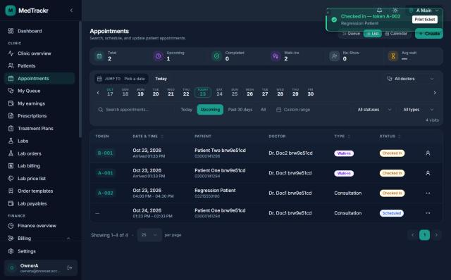<br /><sub><b>Appointments</b>: tokens, check-in, walk-ins</sub></td>
<td width="50%">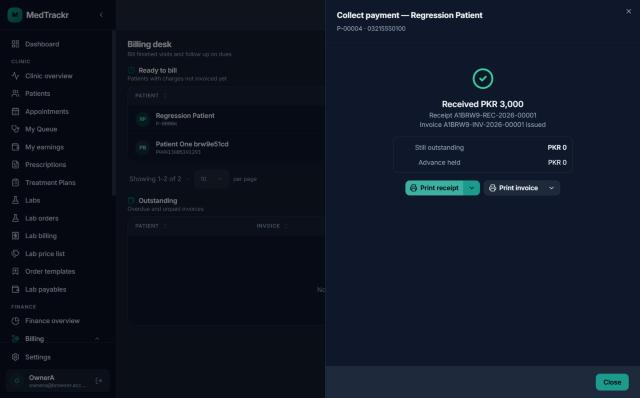<br /><sub><b>Billing desk</b>: payment collected, receipt and invoice issued</sub></td>
</tr>
<tr>
<td>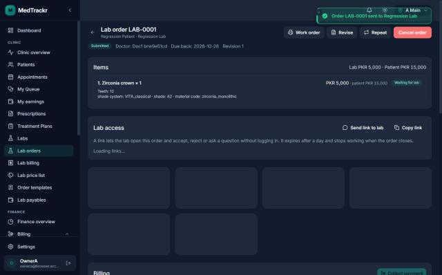<br /><sub><b>Lab order</b>: items, teeth, lab vs patient price, lab access link</sub></td>
<td>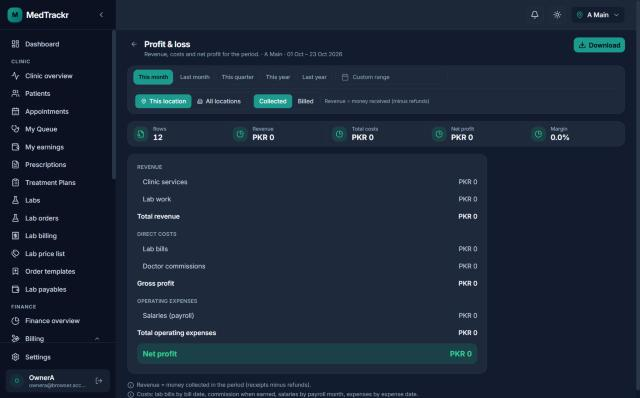<br /><sub><b>Profit &amp; loss</b>: one of 37 reports, Excel/PDF export</sub></td>
</tr>
<tr>
<td>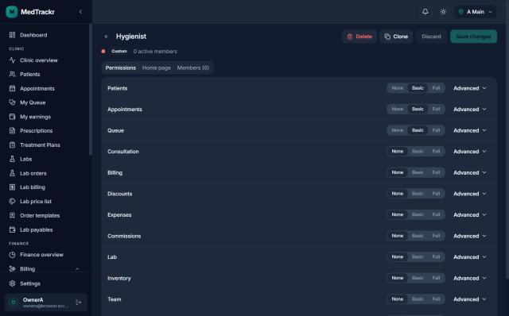<br /><sub><b>Roles</b>: None / Basic / Full per module, Advanced for fine control</sub></td>
<td>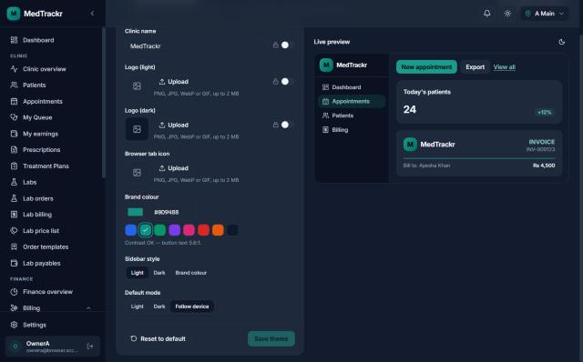<br /><sub><b>Theme builder</b>: logo, brand colour, sidebar style, live preview</sub></td>
</tr>
<tr>
<td>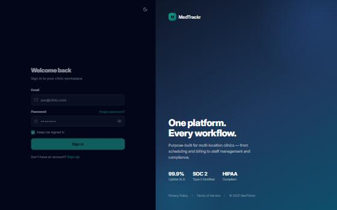<br /><sub><b>Login</b>: picks up the clinic's theme before sign-in</sub></td>
<td>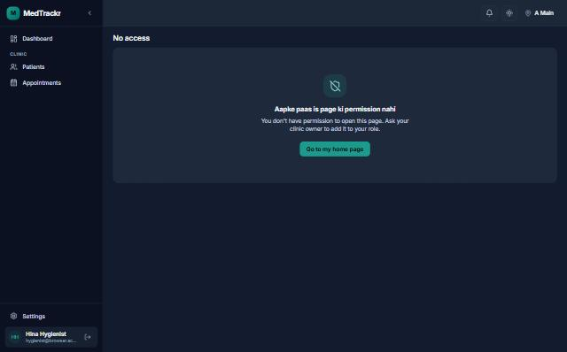<br /><sub><b>Route guard</b>: pages the role can't open show a clear message</sub></td>
</tr>
</table>

---

## 🏗 Architecture

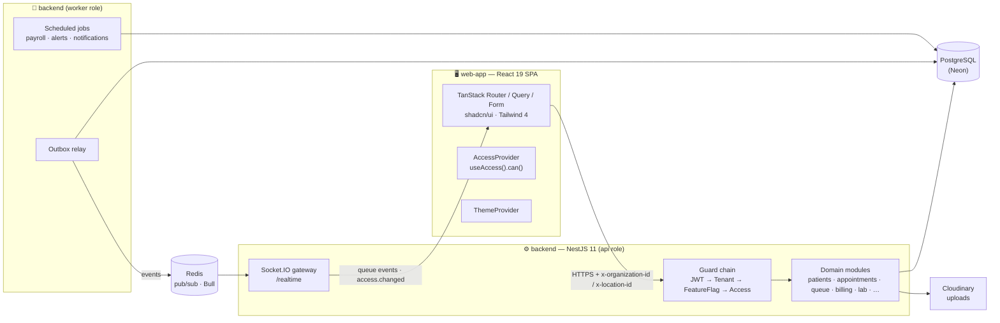

**Highlights**
- **Modular monolith, split by process role.** `api` serves HTTP and Socket.IO and scales horizontally. `worker` runs the outbox relay and cron jobs; run exactly one. `all` does both, which is the dev default and needs no Redis.
- **Multi-tenancy.** Every request carries `x-organization-id` and `x-location-id`, and `TenantContextGuard` validates membership. Clinic days and times always come from the **location's** timezone (`ClockService`).
- **Queue consistency.** Every queue mutation goes through `QueueOrchestrator`: a transaction, a row lock on the session, a transition map, an audit event, and the outbox. The selection engine is a pure function.
- **Data-driven workflows.** Lab orders and production run on versioned workflow templates and form schemas, edited in the super-admin *Config Studio*.

### Access control in one picture

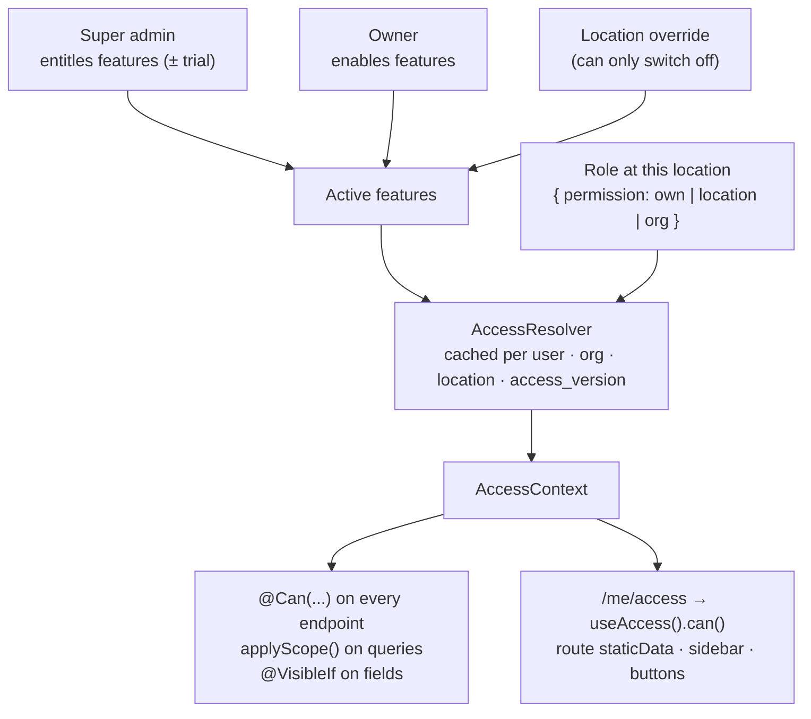

Code never checks a role name. It asks `can('billing.invoice.void')`. Read the full guide in [`docs/access-control/README.md`](docs/access-control/README.md).

---

## 🧰 Tech stack

| Layer | Technology |
| --- | --- |
| **Backend** | NestJS 11, TypeScript 5, TypeORM 0.3, PostgreSQL (Neon), Passport (JWT + Google / GitHub OAuth), Socket.IO, ioredis, Bull, `@nestjs/schedule`, class-validator, Cloudinary, ExcelJS, pdf-lib, Nodemailer |
| **Frontend** | React 19, TanStack Start · Router · Query · Form · Table, Zustand 5, shadcn/ui, Tailwind CSS 4, Zod 4, Recharts, FullCalendar, dnd-kit, socket.io-client, axios |
| **Testing** | Jest (unit + DB integration suites on isolated schemas), Vitest + Testing Library |
| **Tooling** | Vite 7, ESLint, Prettier |

---

## 🚀 Getting started

### Prerequisites

- **Node.js 20+** (developed on Node 22)
- **PostgreSQL 14+**, local or [Neon](https://neon.tech)
- **Redis**: optional in development (single `all` process), required when running separate `api` and `worker` processes
- A **Cloudinary** account for file uploads (logos, documents)

### 1. Clone and install

```bash
git clone https://github.com/moinuddin2004/cms.git
cd cms
cd backend && npm install
cd ../web-app && npm install
```

### 2. Configure the backend

```bash
cd backend
cp .env.example .env
```

<details>
<summary><b>Environment variables</b></summary>

| Variable | Required | Purpose |
| --- | :---: | --- |
| `DATABASE_URL` | ✅ | PostgreSQL connection string (SSL works with Neon) |
| `PORT` | | API port (default `5000`) |
| `NODE_ENV` | | `production` turns TypeORM `synchronize` off (it is on otherwise) |
| `JWT_ACCESS_SECRET` / `JWT_REFRESH_SECRET` | ✅ | Token signing |
| `MAGIC_LINK_SECRET` | | Signs lab magic links (falls back to `JWT_ACCESS_SECRET`) |
| `CORS_ORIGIN` / `FRONTEND_URL` | | Web app origin (default `http://localhost:3000`) |
| `REDIS_URL` | | Redis for pub/sub, cross-instance cache invalidation, Bull |
| `CLOUDINARY_CLOUD_NAME` / `CLOUDINARY_API_KEY` / `CLOUDINARY_API_SECRET` | | File uploads |
| `SMTP_USER` / `SMTP_PASS` | | Outgoing email |
| `GOOGLE_CLIENT_ID` / `GOOGLE_CLIENT_SECRET`, `GITHUB_CLIENT_ID` / `GITHUB_CLIENT_SECRET` | | OAuth sign-in |
| `RATE_LIMIT_LOGIN_MAX` / `RATE_LIMIT_LOGIN_WINDOW_SECONDS` | | Login rate limiting |
| `LAB_MAGIC_LINK_TTL_HOURS` / `LAB_LINK_RATE_LIMIT` | | Lab magic links |

The web app reads one variable, `VITE_API_BASE_URL`, which defaults to `http://localhost:5000`. Put it in `web-app/.env` if your API runs elsewhere.

</details>

### 3. Run

```bash
# terminal 1 — API + worker in one process, watch mode (http://localhost:5000)
cd backend && npm run start:dev

# terminal 2 — web app (http://localhost:3000)
cd web-app && npm run dev
```

In development the database schema is created and updated from the entities (`synchronize`). Hand-written, idempotent migrations in `backend/src/migrations/` then run on startup. See [`docs/database-migrations.md`](docs/database-migrations.md) for how production differs.

### 4. First login

1. Open `http://localhost:3000/register` and create your account.
2. To make it the platform **super admin**, which can create organizations, entitle features and use Config Studio, run this once:
   ```sql
   UPDATE users SET global_role = 'super_admin' WHERE email = 'you@example.com';
   ```
3. Sign in, create an organization and its locations, and add employees. Then give staff logins and roles under **Clinic setup → Roles**.

<details>
<summary><b>Production processes</b></summary>

```bash
cd backend && npm run build
npm run start:api      # HTTP + Socket.IO — scale to 2+ (needs REDIS_URL)
npm run start:worker   # outbox relay + scheduled jobs — run exactly one
```

`synchronize` is off in production. Apply schema changes with the reviewed `npm run schema:sync:prod`; migrations still run on startup.

</details>

---

## 🧪 Testing

| Suite | Command | What it covers |
| --- | --- | --- |
| Backend unit | `cd backend && npm test` | ~700 tests, including `access-coverage.spec.ts`, which fails if any endpoint lacks an access decorator |
| Web | `cd web-app && npm test` | ~325 Vitest + Testing Library tests |
| Access acceptance | `cd backend && npm run test:int:acceptance` | 166-case plan against a real DB on its own schema (`acceptit`) |
| Other DB suites | `npm run test:int:labs`, `test:int:tenancy`, `test:int:access` | Lab module, tenant isolation, access core |

> Integration suites share one database. Each uses its own schema, so run them one at a time.

---

## 📁 Project structure

```text
cms/
├── backend/                     NestJS API
│   └── src/
│       ├── access/              permission catalog, resolver, @Can guard, /me/access, nav layouts
│       ├── auth/  user/  session/
│       ├── organizations/  locations/  employees/  payroll/
│       ├── feature-flags/       entitlement + per-location overrides
│       ├── settings-registry/   config_values cascade (theme)
│       ├── patients/  encounters/  treatments/  prescriptions/  plan-templates/
│       ├── appointments/  queue/                booking → doctor-wise queue (+ realtime)
│       ├── billing/             charges, invoices, payments, discounts, commissions
│       ├── labs/  lab-*/        directory, catalog, orders, production, billing, payables, portal
│       ├── engine/              versioned workflows + form schemas
│       ├── inventory/  notifications/  reports/
│       ├── common/              guards, decorators, audit, clock, redis, storage
│       ├── main.api.ts  main.worker.ts  main.ts
│       └── migrations/
├── web-app/                     React 19 SPA
│   └── src/
│       ├── routes/              file-based routes (thin — render a feature page)
│       ├── features/<name>/     pages · components · hooks · services · types
│       ├── components/          ui (shadcn) · shared · layout
│       ├── lib/  store/  styles.css
├── docs/                        feature docs, test plans, images
└── CLAUDE.md                    coding conventions for contributors and AI assistants
```

<details>
<summary><b>Backend modules at a glance</b></summary>

| Module | Responsibility |
| --- | --- |
| `auth`, `user`, `session` | JWT access + refresh tokens, OAuth, sessions, rate limiting, security log, user admin and staff logins |
| `organizations`, `locations` | Tenants, locations, operating hours, settings |
| `access` | Permissions, roles, `/me/access`, `/admin/roles`, `/admin/navigation` |
| `feature-flags` | Feature catalog, entitlement, owner switches, location overrides |
| `settings-registry` | Cascading settings (platform → org → location) with locks — theme |
| `employees`, `payroll` | Staff, assignments, schedules, leave, compensation, monthly payroll |
| `patients`, `encounters`, `treatments` | Patient record, visits, treatments, scoped by doctor where needed |
| `prescriptions`, `plan-templates` | Prescriptions, medicine directory, print layouts, plan templates |
| `appointments`, `queue` | Booking rules + conflict detection, live queue, display, realtime |
| `billing` | Charges, invoices, payments, refunds, discounts, credit packages, cash close, commissions |
| `labs`, `lab-access`, `lab-catalog`, `lab-orders`, `lab-production`, `lab-billing`, `lab-payables`, `lab-finance` | End-to-end dental lab workflow, portal and finance |
| `engine` | Workflow templates, form schemas, specialties |
| `inventory` | Items, suppliers, purchase orders, stock, consumption |
| `notifications` | Rules, templates, outbox, quiet hours |
| `reports` | Finance / clinic dashboards and 37 exportable reports |

</details>

---

## 📚 Documentation

| Doc | About |
| --- | --- |
| [`docs/access-control/README.md`](docs/access-control/README.md) | Permissions, roles, features, sidebar, theme: the full guide, API reference and go-live checklist |
| [`docs/appointments-and-queue.md`](docs/appointments-and-queue.md) | Booking and the doctor-wise queue: states, rules, realtime |
| [`docs/commissions.md`](docs/commissions.md) | Doctor compensation and commission ledger |
| [`docs/database-migrations.md`](docs/database-migrations.md) | Schema sync, migrations, deploy procedure |
| [`docs/access-control/test-cases.md`](docs/access-control/test-cases.md) · [`test-results.md`](docs/access-control/test-results.md) | Acceptance plan and its results |
| [`CLAUDE.md`](CLAUDE.md) | Conventions: folder layout, forms, listings, design system, access rules |

---

## 🤝 Contributing

- **Read [`CLAUDE.md`](CLAUDE.md) first.** It defines the frontend rules (TanStack Form only, forms in sheets, card + list views, filters, tooltips on icon buttons, loading / empty / error states) and the backend patterns.
- **Protect every endpoint** with `@Can(...)` or `@AnyMember()`. The coverage spec fails otherwise. Never check role names; ask `can()`.
- **Theme colours.** Brand colour comes from the clinic theme, so use `bg-primary` and friends, never `blue-*`.
- **Dates.** Clinic dates and times come from `ClockService` (the location's timezone), not `new Date()`.

---

<div align="center">
<sub>Built for clinics in Pakistan and beyond: PKR, location timezones, and Urdu / English content where it matters.</sub>
</div>
