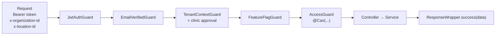

<h1>API</h1>

<b>The NestJS backend behind the web app and the mobile app.</b>

<a href="#quick-start"><b>Quick start</b></a> &nbsp;·&nbsp;
<a href="#how-a-request-is-handled"><b>Requests</b></a> &nbsp;·&nbsp;
<a href="#processes"><b>Processes</b></a> &nbsp;·&nbsp;
<a href="#modules"><b>Modules</b></a> &nbsp;·&nbsp;
<a href="#database"><b>Database</b></a> &nbsp;·&nbsp;
<a href="#testing"><b>Testing</b></a> &nbsp;·&nbsp;
<a href="#rules"><b>Rules</b></a>

<a href="../README.md">← Back to the main README</a>

 

## Quick start

**You need:** Node.js 22 and PostgreSQL 13+. Redis is not needed for local work.

| Step | Command |
| --- | --- |
| 1 · Install | `npm install` |
| 2 · Create the schema (empty DB) | `psql "$DATABASE_URL" -v ON_ERROR_STOP=1 -1 -f database/schema/run_all.sql` |
| 3 · Configure | `cp .env.example .env`, then fill in `DATABASE_URL` and the secrets |
| 4 · Run | `npm run start:dev` |

The API listens on `http://localhost:5000`. On first start it adds its own catalog rows: features, permissions and notification events.

<b>Environment variables</b>

 

| Variable | Required | Purpose |
| --- | :---: | --- |
| `DATABASE_URL` | ✓ | PostgreSQL connection string |
| `DATABASE_SSL` | | `true` (default) · `verify` · `false` for local Postgres |
| `JWT_ACCESS_SECRET` · `JWT_REFRESH_SECRET` | ✓ | Token signing |
| `EMAIL_TOKEN_SECRET` · `RESET_TOKEN_SECRET` | ✓ | Email verification and password reset links |
| `PORT` · `NODE_ENV` | | Port (default `5000`) and environment |
| `FRONTEND_URL` | | Web app address for email links and CORS |
| `GOOGLE_CLIENT_ID` | | Google sign-in; unset hides the button |
| `SMTP_HOST` · `SMTP_PORT` · `SMTP_SECURE` · `SMTP_USER` · `SMTP_PASS` · `SMTP_FROM` · `SMTP_FROM_NAME` | | Any SMTP. Only user + pass means Gmail app password. Unset means emails are only logged |
| `EMAIL_DAILY_CAP` | | Notification emails per day, default 450, `0` = no cap |
| `STORAGE_DRIVER` | | File storage provider, default `cloudinary` |
| `CLOUDINARY_CLOUD_NAME` · `CLOUDINARY_API_KEY` · `CLOUDINARY_API_SECRET` | | Cloudinary uploads |
| `REDIS_URL` | | Only when `api` and `worker` run as separate processes |

 

## How a request is handled

<table>
<tr>
<td width="50%" valign="top">

**Guards, in order**
1. `JwtAuthGuard` checks the token (skips `@Public()`).
2. `EmailVerifiedGuard` blocks password accounts whose email is still unverified after the grace period.
3. `TenantContextGuard` checks the user belongs to the org and location, and that the clinic is approved.
4. `FeatureFlagGuard` checks `@RequireFeature(...)`.
5. `AccessGuard` checks `@Can(...)` against the user's role at that location.

</td>
<td width="50%" valign="top">

**What every handler gets**
- `@ActiveTenant()` → `{ organizationId, locationId }`
- `@Access()` → `can()`, `scope()`, `applyScope(qb, ...)` to filter queries by `own` / `location` / `org`
- DTOs validated by `class-validator`; unknown fields are rejected
- Responses wrapped as `{ data, message }`; the web app reads `res.data.data`

</td>
</tr>
</table>

 

## Processes

The same code runs in three roles. Pick one per process.

| Role | Command (after `npm run build`) | Runs | Redis |
| --- | --- | --- | :---: |
| `all` | `npm run start:prod` (dev: `start:dev`) | HTTP, Socket.IO, outbox relay, notification dispatcher, cron | not needed |
| `api` | `npm run start:api` | HTTP and Socket.IO. Run 2 or more | needed |
| `worker` | `npm run start:worker` | Outbox relay, notification dispatcher, cron. Run exactly one | needed |

Every entry point imports `bootstrap/utc.ts` first, so the process always runs in UTC. The [Dockerfile](Dockerfile) runs `all` by default; override the command to run `api` or `worker`.

 

## Modules

Each folder in `src/` is one NestJS module.

| Area | Modules | What they do |
| --- | --- | --- |
| Sign-in | `auth` · `user` · `session` · `clinic-access` | Access + refresh tokens, Google sign-in, email verification, password reset, rate limits, sessions, clinic approval, invite links, join requests |
| Clinic setup | `organizations` · `locations` · `settings-registry` · `subscriptions` | Clinics, locations and timezones, cascading settings (theme), plans and reminders |
| Access | `access` · `feature-flags` | Permission catalog, roles, `/me/access`, sidebar layouts, feature entitlement and switches |
| Staff | `employees` · `payroll` | Staff, assignments, schedules, leave, pay, monthly payroll |
| Patients | `patients` · `encounters` · `treatments` · `treatment-plans` · `prescriptions` · `plan-templates` | Records, visits, teeth chart, plans, prescriptions, medicine directory |
| Front desk | `appointments` · `queue` | Booking and conflict checks; live doctor-wise queue, TV display, realtime |
| Money | `billing` · `reports` | Charges, invoices, payments, refunds, commissions, printing, 37 reports |
| Lab | `labs` · `lab-access` · `lab-catalog` · `lab-orders` · `lab-production` · `lab-billing` · `lab-payables` · `lab-finance` · `engine` | Lab orders, production, portal, finance, workflow templates and form schemas |
| Other | `inventory` · `notifications` · `search` | Stock, notifications (in-app + email), Ctrl+K search |

<b>Shared code in <code>src/common/</code></b>

 

| Folder | What |
| --- | --- |
| `decorators/` | `@Public`, `@ContextFree`, `@RequireSuperAdmin`, `@RequireFeature`, `@ActiveTenant` |
| `clock/` | `ClockService`: "now" and "today" in the location's timezone |
| `audit/` | Audit log writes |
| `idempotency/` | Stores `Idempotency-Key` results so a retried request is not applied twice (lab orders, lab payments, workflows) |
| `mail/` | SMTP transport and the `email_log` |
| `storage/` | File storage behind one interface (Cloudinary by default) |
| `redis/` · `runtime/` | Optional Redis pub/sub and the process role |
| `tenancy/` · `middleware/` · `interceptors/` · `exceptions/` | Tenant context, request plumbing, error responses |

 

## Database

The schema is **hand-written SQL** in [`database/`](database). The app never changes it: `synchronize` is off and there are no TypeORM migrations.

| Folder | Use it for |
| --- | --- |
| [`database/schema/`](database/schema) | Building an empty database (`run_all.sql` runs 01 → 05) |
| [`database/changes/`](database/changes) | Updating an existing database, one dated file per change |

A schema change always touches three places in one commit: the entity, its block in `schema/`, and a new `changes/YYYY-MM-DD_name.sql`. Full guide: [`database/README.md`](database/README.md). Entity reference: [`docs/data-model/ENTITY_CATALOG.md`](docs/data-model/ENTITY_CATALOG.md).

 

## Testing

| Suite | Command | Covers |
| --- | --- | --- |
| Unit | `npm test` | Services, guards, queue selection engine, and `access-coverage.spec.ts` |
| Access acceptance | `npm run test:int:acceptance` | 166 access cases on a real database |
| Access core | `npm run test:int:access` | Resolver, guard, roles |
| Tenancy | `npm run test:int:tenancy` | Data never leaks between clinics |
| Labs | `npm run test:int:labs` | Lab module end to end |
| Other DB tests | `npm run test:int` | Billing, patients and more |

Database suites share one test database and each uses its own schema, so run them one at a time. They build throw-away schemas with `synchronize`; the app itself never does.

 

## Scripts

| Command | What |
| --- | --- |
| `npm run start:dev` | Watch mode, single `all` process |
| `npm run build` | Compile to `dist/` |
| `npm run lint` · `npm run format` | ESLint fix · Prettier |
| `npm run access:export` | Writes the permission catalog to the web app and mobile app. Run after editing `src/access/catalog/permissions.ts` |

 

## Rules

| Rule | Why |
| --- | --- |
| Every handler has `@Can`, `@AnyMember`, `@Public`, `@RequireSuperAdmin` or `@ContextFree` | `access-coverage.spec.ts` fails otherwise |
| Ask `ctx.can('…')`, never check a role name | Each clinic defines its own roles |
| Use `ClockService` for clinic days and times; columns are `timestamptz` | Clinic time is the location's timezone |
| Queue changes go through `QueueOrchestrator` | Locks, transition checks, audit and outbox in one place |
| Notify only through `NotificationService` | One path for in-app and email |
| Never return the raw `User` entity | Use `toUserAdminView` / `UserDto` |
| Never rename constraints the code catches (`no_doctor_overlap`, `uq_*_idempotency`, `one_active_entry_*`) | Services match errors by these names |

More detail in the root [`CLAUDE.md`](../CLAUDE.md).
