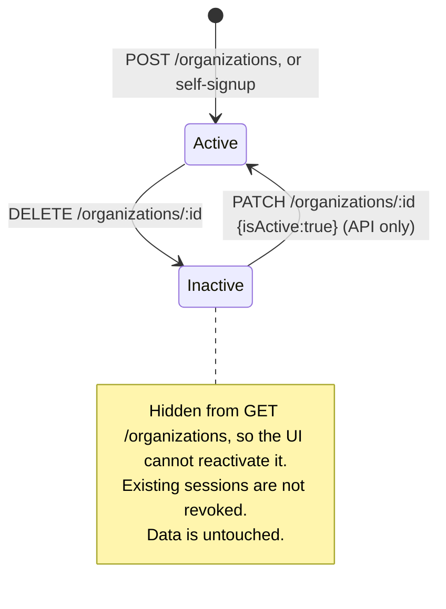
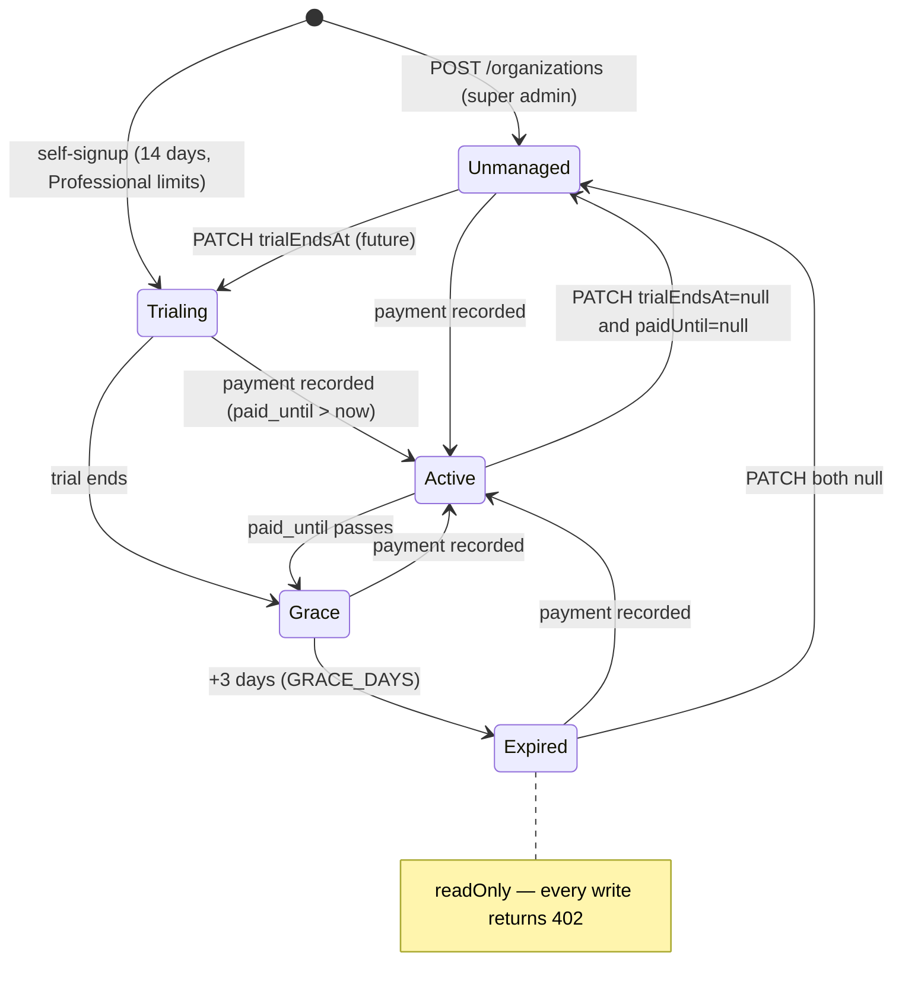
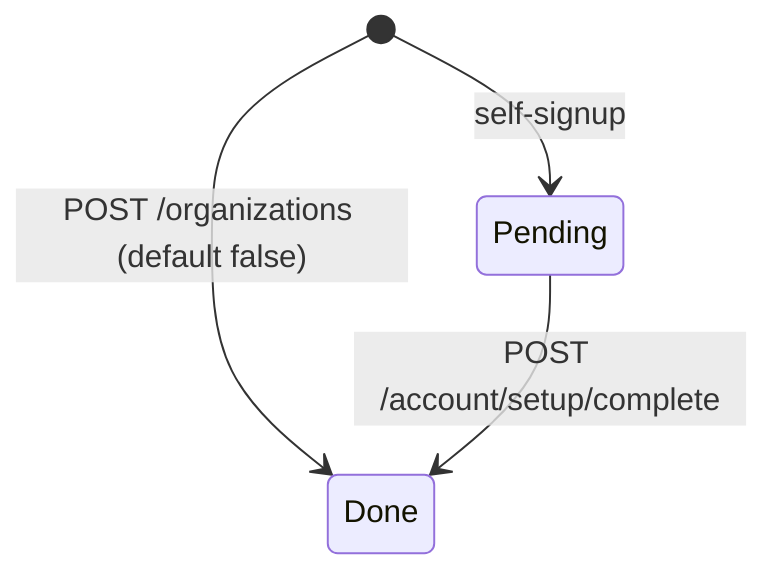
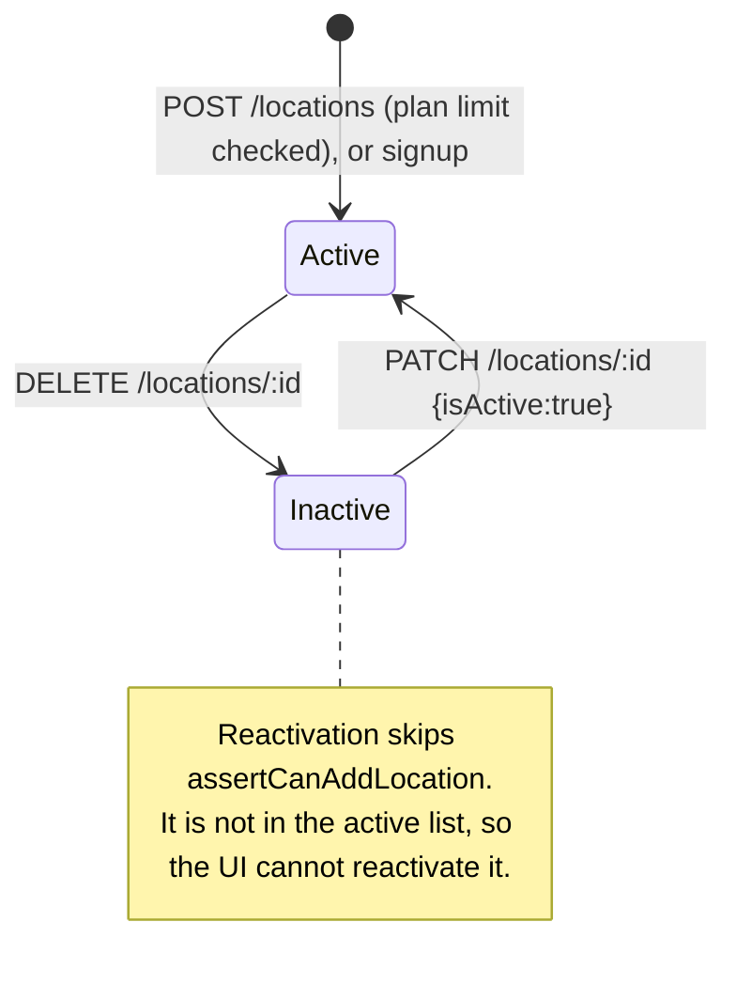

# 01 — Organizations, locations and clinic subscriptions

**Backend:** `src/organizations/`, `src/locations/`, `src/subscriptions/`
**Frontend:** `web-app/src/features/organizations/`, `features/locations/`, `features/account/`
**Status:** Verified by reading the code. Nothing was executed. Statements are **VERIFIED** (seen in code) unless they are marked **INFERRED**.

`subscriptions` is documented here, not separately. It creates organizations and locations through self-signup and the setup wizard, and it gates both through plan limits and read-only mode.

---

## 1. Purpose

A clinic business (the **organization**, or tenant) runs one or more **branches** (**locations**). Every patient, appointment, invoice and staff assignment belongs to one organization. Most of them also belong to one location.

This module answers four questions:

- **Who is the clinic?** Name, contact details, timezone and currency, and which specialties it practices (general, dental, skin, ortho, physio, eye).
- **Where does it operate?** Each branch has an address, a short code (`MAIN`, `KHI`), a timezone (which decides what "today" means for queues and reports), a currency and per-branch settings such as tax rate and daily appointment cap.
- **Is the clinic allowed to use the product right now?** Trial, paid period, grace period, read-only after expiry, and limits on branches and logins per plan.
- **How does a new clinic start?** A self-signup creates the clinic, its main branch and the owner link in one step. A one-time setup wizard then collects the details.

## 2. Entities

ERD: `../data-model/erd/01-organizations-users.png`. **Pending:** the image is rendered in data-model Phase 3 and does not exist yet. Field-level detail: [ENTITY_CATALOG.md](../data-model/ENTITY_CATALOG.md#module-organizations).

### 2.1 `Organization` → `organizations`

One row is one clinic business. A dental group with three branches is one organization.

| Field | Meaning |
|---|---|
| `name`, `slug` | Display name. `slug` is unique and generated from the name; it is never regenerated when the name changes. |
| `email`, `phone`, `website` | Contact details. |
| `subscription_plan` | `free` \| `starter` \| `professional` \| `enterprise` (enum `SubscriptionPlan`). Default `free`. Plan definitions live in code (`subscriptions/plans.ts`), not in a table. |
| `clinic_type` | Free text, up to 100 characters. No API writes it (see Gaps). |
| `specialty_tags` | jsonb array of `general`, `dental`, `skin`, `ortho`, `physio`, `eye`. The setup DTO validates the values (`CLINIC_SPECIALTIES`). Default `["general"]`. |
| `timezone`, `currency` | Org defaults: `Asia/Karachi`, `PKR`. The setup wizard copies them to every location of the org. |
| `max_locations`, `max_users` | Per-org overrides of the plan limits. `null` means the plan's limit applies. |
| `trial_ends_at`, `paid_until` | Subscription period. Both `null` means an **unmanaged** clinic: no expiry and no limits. |
| `onboarding_pending` | `true` for self-signup clinics until the owner finishes `/setup`. |
| `access_version` | Counter bumped by `AccessVersionService` (raw SQL) on every access change. Entity saves never write it (`insert: false, update: false`). |
| `is_active` | Soft delete. A deactivated org is excluded from login and access resolution (`authorization.service.ts:189`, `:223`). |

### 2.2 `OrganizationOwnership` → `organization_ownership`

One row means "this login owns this clinic". The owner has every permission at every location of the org; the access resolver checks this table.

- `is_primary_owner`: `true` for the person who signed up. Extra owners are added with `false` by `user/user.service.ts:275` (module 02).
- Unique on (`user_id`, `organization_id`).

### 2.3 `OrganizationSettings` → `organization_settings`

One row per org (unique `organization_id`). It is created lazily on first read. It holds:

- Legacy feature switches: `feature_appointments`, `feature_inventory`, `feature_finance`, `feature_reminders`, `feature_whatsapp`, `feature_patient_portal`.
- `allow_location_override`.
- Booking defaults: `default_slot_duration`, `advance_booking_days`, `cancellation_notice_hours`.

**No backend code reads any of these columns** (grep over `src/`, excluding the entity and DTOs). The frontend uses them only to hide one card and grey out three inputs on the location-settings page. Real feature gating lives in `org_feature_flags` (feature-flags module).

### 2.4 `Location` → `locations`

One row is one branch, for example "Clifton branch, code KHI".

| Field | Meaning |
|---|---|
| `code` | Short branch code, unique per org (DB unique index and a service check). It cannot be changed after creation, because `UpdateLocationDto` has no `code`. |
| `token_prefix` | Prefix of daily queue tokens ("KHI-007"). It falls back to `code`. The queue token engine reads it; no API writes it. |
| `timezone`, `currency` | Entity defaults are `UTC` and `USD`, which differ from the org defaults. `ClockService` uses `timezone` for every "today" computation. |
| `is_main_branch` | Flag only; several branches can have it. The setup wizard edits the first active branch, ordered by `is_main_branch DESC, created_at ASC`. |
| `total_chairs`, `capacity_per_day`, `operating_hours`, `manager_id`, `business_model` | Stored, but no backend code reads them. |
| `is_active` | Soft delete. Inactive branches are skipped by access resolution (`authorization.service.ts:247`, `:318`). |

### 2.5 `LocationSettings` → `location_settings`

One row per branch (unique `location_id`). It is created with the branch, or lazily on first read.

| Field | Used by |
|---|---|
| `max_appointments_per_day` | **Used.** Booking cap in `appointments.service.ts:1126`. `0` means no cap. |
| `tax_rate` | **Used.** Sales tax applied when an invoice is issued (`billing/tax/location-tax-rate.ts`), and by lab billing and purchase orders. |
| `logo_url` | **Used.** Fallback logo for printed invoices when the theme has none (`billing/print/print-data.service.ts:213`). |
| `appointment_slot_duration` | Read only by the **frontend** as the booking form's default length (`useLocationSlotDuration.ts`). |
| `advance_booking_days`, `cancellation_notice_hours`, `reminder_*`, `payment_gateway`, `late_fee_percentage`, `primary_color`, `theme` | Stored, but no code reads them. |
| `organization_id` | Nullable. It stays `null` when the row is created lazily by `LocationsService.getSettings`, which omits it. |

### 2.6 `SubscriptionPayment` → `subscription_payments`

One row is one manual payment a super admin recorded, for example "PKR 29,997, 3 months Professional, bank transfer, ref TXN123".

- `method`: `bank_transfer` \| `jazzcash` \| `easypaisa` \| `cash` \| `cheque` \| `other`. Validated by `@IsIn`; stored as varchar, not as a DB enum.
- `period_start`, `period_end`: the paid window this payment bought. It starts where the current trial or paid period ends, so paying early loses no days (`nextPaidPeriod`).
- `amount`: PKR, numeric(12,2).
- `recorded_by`: the super admin who recorded it (`actor.userId`).
- Rows are never updated or deleted: no endpoint does either.

## 3. Relationships explained

| Relation | Plain language | Example |
|---|---|---|
| Organization 1 — 0..* Location (FK, ON DELETE CASCADE) | A clinic has any number of branches. Each branch belongs to exactly one clinic. | "Smile Dental" has Clifton (KHI) and DHA (DHA) branches. A Smile Dental patient can visit either. |
| Location 1 — 0..1 LocationSettings (FK, unique, CASCADE) | Each branch has its own settings card. | Clifton charges 5% tax; DHA charges 0%. |
| Organization 1 — 0..* LocationSettings (FK, nullable, CASCADE) | Denormalized copy of the branch's clinic. It can be `null` (see 2.5). | — |
| Organization 1 — 0..1 OrganizationSettings (FK, unique, CASCADE) | One clinic-wide settings card. | — |
| User 1 — 0..* OrganizationOwnership — 0..* Organization (both FK, CASCADE) | A login can own several clinics, and a clinic can have several owners. Owners can do everything everywhere in their clinic. | Dr. Ahmed signs up and owns "Smile Dental". Later he adds his partner as a second (non-primary) owner. |
| Organization 1 — 0..* SubscriptionPayment (FK, CASCADE) | Every payment the clinic made for the product. | Three monthly payments extend `paid_until` three times. |
| `locations.manager_id` → ? (logical, no FK) | Intended to point to a branch manager. Never written or read. | — |

Because of the CASCADE rules, a **hard** delete of an organization removes its locations, settings, ownership rows and payments in the database. The API only soft-deletes (`is_active = false`).

## 4. Functionality catalog

**Common request path for every endpoint.**

1. Express → `bootstrap/http.ts`: JSON body parser (5 MB), then the global `ValidationPipe` with `whitelist` + **`forbidNonWhitelisted`** + `transform`.
2. Global guards in order (`app.module.ts:138-154`): `JwtAuthGuard` → `TenantContextGuard` → `FeatureFlagGuard` → `AccessGuard` → `SubscriptionGuard`.
3. Controller → service → TypeORM repository.
4. Every response uses `ResponseWrapper.success(data, message)`. Errors pass through `GlobalExceptionFilter`. For validation errors it returns the first message (for example "property id should not exist"), which the web app shows as a toast.

`TenantContextMiddleware` (`common/middleware/tenant-context.middleware.ts`) is **not applied** anywhere. No module registers it.

**Endpoint count: 25.**

| Controller | Endpoints |
|---|---|
| `organizations` | 7 |
| `locations` | 7 |
| `account` | 5 |
| `admin/subscriptions` | 6 |

`POST /auth/register` also creates clinics; it belongs to module 02 and is summarized in F-22.

### Organizations (super admin)

All handlers are in `organizations/organizations.controller.ts` → `OrganizationsService`. The class has `@UseGuards(JwtAuthGuard)`. The handlers carry `@RequireSuperAdmin()`, which `TenantContextGuard` enforces: non-super-admins get 403 "Super admin access required". There is no tenant scoping; a super admin acts on any org.

The UI is `/organizations` → `routes/organizations.tsx`. It redirects non-super-admins to `/dashboard` → `OrganizationsPage` → `OrganizationManagementView.tsx`.

| # | Capability | API | Execution path | Rules and validation | Tables | Side effects | Errors |
|---|---|---|---|---|---|---|---|
| F-01 | Create clinic | `POST /organizations` | `create` → `OrganizationsService.create` → `orgRepo.save` | `CreateOrganizationDto`: name (required, ≤255), email, phone ≤20, website ≤500, subscriptionPlan. Slug comes from the name. **No transaction.** | W `organizations`; then seeding writes `org_feature_flags` and role tables | `FeatureFlagsService.seedFlagsForOrg`, `AccessTemplatesService.seedForOrg` (system roles). **No owner, no location, no subscription dates**: the clinic is "unmanaged". No audit log. | 409 duplicate slug. 400 if the UI sends `clinicType` / `timezone` / `currency` (the form has those inputs; the DTO does not). |
| F-02 | List clinics | `GET /organizations` | `findAll` | Active orgs only, ordered by name | R `organizations` | — | — |
| F-03 | View clinic | `GET /organizations/:id` | `findOne` | No `ParseUUIDPipe` | R | — | 404. A malformed id probably reaches Postgres and returns 500 (INFERRED). |
| F-04 | Edit clinic | `PATCH /organizations/:id` | `update` → `Object.assign` + save | `UpdateOrganizationDto`: name, email, phone, website, subscriptionPlan, isActive | W `organizations` | Changing `subscriptionPlan` here is **not audited**, unlike F-19. No access-version bump. | **The UI edit dialog sends the whole org object** (`setFormData(org)`), including `id`, `slug`, `createdAt` and `accessVersion`. With `forbidNonWhitelisted`, this should always fail with 400 "property id should not exist" (by reading; not executed). |
| F-05 | Deactivate clinic | `DELETE /organizations/:id` | `deactivate` → `isActive=false` | Confirm dialog in the UI | W `organizations` | Its users can no longer select it at login. Running sessions are not revoked. No audit log. | 404 |
| F-06 | Read clinic settings | `GET /organizations/:id/settings` | `getSettings` (`@ContextFree`) | Super admin **or** owner of that org (`AuthorizationService.isOwner`); `ParseUUIDPipe` | R, or W lazily: `organization_settings` | Creates the row on first read | 403 "You cannot access settings for this organization"; 404 |
| F-07 | Edit clinic settings | `PATCH /organizations/:id/settings` | `updateSettings(id, dto: any)` | `UpdateOrganizationSettingsDto`: booleans, slot 5–480, advance 1–365, notice 0–168 | W `organization_settings` | None. No code reads these values. | The UI sends the whole settings row, including `id`, `organizationId` and timestamps, so it should fail with 400 (by reading). |

The UI at `/organizations/$id/settings` (`OrganizationSettingsFeature.tsx`) covers F-06 and F-07. `/organizations/$id/features` belongs to the feature-flags module (documented under customization).

### Locations (owner, Admin role, super admin)

All handlers are in `locations/locations.controller.ts` → `LocationsService`. The class is `@ContextFree()`, so `TenantContextGuard` and `AccessGuard` do not check the tenant. Each handler checks the permission itself:

- `authorize(req, orgId, locationId)` → `AccessResolver.resolve(user, org, location).can('admin.locations.manage')`, or 403 (`noPermission`).
- The org comes from the location being acted on, or for create and list from `dto.organizationId` / the `x-organization-id` header.
- An invalid org id gives 400 "Select an organization first".

Who holds `admin.locations.manage`: owners and super admins always; the system **Admin** role template (all bundles); any custom role that grants it.

The UI is `/locations` → `routes/locations.tsx` (`staticData.can = 'admin.locations.manage'`) → `LocationsPage` → `LocationManagementView.tsx`.

| # | Capability | API | Execution path | Rules and validation | Tables | Side effects | Errors |
|---|---|---|---|---|---|---|---|
| F-08 | Add branch | `POST /locations` | `create` → plan check `SubscriptionsService.assertCanAddLocation` (skipped for super admins) → `LocationsService.create` | `CreateLocationDto`: name, code (≤50) required; address, city, state, postal, country, phone, email, timezone, currency, totalChairs ≥1, isMainBranch, businessModel. Code unique per org. **No transaction**: the location and settings rows are two separate saves. | W `locations`, `location_settings`; R `organizations`, `organization_ownership`, `employee_org_location_assignments` (usage count) | Default settings row. Timezone and currency default to `UTC` / `USD` because the UI form has no timezone or currency field (INFERRED impact: wrong "today" for a Pakistani clinic). No audit log. No access-version bump. | 409 duplicate code. 403 `PLAN_LIMIT` ("Your Professional plan allows 3 locations…"). 402 `SUBSCRIPTION_EXPIRED`. |
| F-09 | List branches | `GET /locations` | `findAll` | Super admin: every active location of every org (with `organization`). Otherwise the active org (header), or every org where the user holds the permission org-wide. | R `locations` | — | 403 when the user manages no org |
| F-10 | View branch | `GET /locations/:id` | `authorizedLocation` → `findOne` | Permission in the branch's org | R | — | 404, 403 |
| F-11 | Edit branch | `PATCH /locations/:id` | `update` → `Object.assign` + save | `UpdateLocationDto` (same fields as create minus `code` and `organizationId`, plus `isActive`) | W `locations` | Setting `isActive: true` **re-activates without the plan-limit check**. No audit log. | **The UI sends the whole location row** (`setFormData(loc)`), so it should fail with 400 (by reading). |
| F-12 | Deactivate branch | `DELETE /locations/:id` | `deactivate` → `isActive=false` | Confirm dialog. No check for the last branch, the main branch, future appointments or an open queue. | W `locations` | Access resolution skips the branch. Staff assignments, appointments and queue sessions stay as they are. | 404, 403 |
| F-13 | Read branch settings | `GET /locations/:id/settings` | `getSettings` (lazy create) | Permission | R, or W lazily: `location_settings` | Lazy create leaves `organization_id` null | 403 for staff **without** `admin.locations.manage`. That includes the booking form's `useLocationSlotDuration`, so receptionists always fall back to 30 minutes. |
| F-14 | Edit branch settings | `PATCH /locations/:id/settings` | `updateSettings` → `Object.assign` + save | `UpdateLocationSettingsDto` | W `location_settings` | Changes the tax on the next invoice issued and the daily booking cap | **Its field names do not match the entity.** The DTO has `defaultSlotDuration`, `maxDailyAppointments`, `enableReminders`, `reminderBeforeHours`, `followUpAfterDays`; the entity has `appointmentSlotDuration`, `maxAppointmentsPerDay`, `reminderEnabled`, `reminderHoursBefore`, … The UI sends the entity names plus `id` / timestamps, so it should get 400. If a client sent the DTO names, they would be accepted but silently not stored. |

The UI at `/locations/$id/settings` (`LocationSettingsFeature.tsx`) covers F-13 and F-14. It also loads F-06 to apply `allowLocationOverride`; for a non-owner Admin that call returns 403 and the page treats the override as allowed. The same page embeds `QueueSettingsSection`, which belongs to the queue module (module 04). A comment says the reminders card is hidden "until SMS/WhatsApp delivery exists".

### Clinic account and setup wizard (owner)

All handlers are in `subscriptions/account.controller.ts`. Each one is `@AnyMember()`, so the normal tenant context applies (the active org and location from the headers). The handler checks `assertOwner` (owner or super admin, else 403 "Only the clinic owner can do this"). `/account` writes are on `SubscriptionGuard`'s always-writable list, so an expired clinic can still finish setup.

| # | Capability | Role | UI | API | Path | Tables | Notes |
|---|---|---|---|---|---|---|---|
| F-15 | Plan and billing summary | Any member. Owners also get plans, payment instructions and payment history. | `/settings/subscription` → `SubscriptionPage.tsx`; banner `AccountBanner.tsx` inside `DashboardLayout` | `GET /account` | `summary` → `SubscriptionsService.summary` + `ClinicSetupService.get` | R `organizations`, `locations`, `location_settings`, `organization_ownership`, `employee_org_location_assignments`, `subscription_payments`, `config_values` | Usage counts active locations, and owners plus active staff with a `user_id`. The banner shows expired, grace and trial states; owners with `onboardingPending` are redirected to `/setup`. |
| F-16a | Read setup | Owner | `/setup` → `SetupWizardPage.tsx` | `GET /account/setup` | `ClinicSetupService.get` | R | Returns the main branch: first active, `is_main_branch DESC, created_at ASC`. |
| F-16b | Save clinic step | Owner | same | `PATCH /account/setup/clinic` | `saveClinic` (**transaction**) | W `organizations`; W `locations` (all of them) | `SetupClinicDto`: name, phone, email, website, specialtyTags ⊂ `CLINIC_SPECIALTIES`, timezone, currency (upper-cased). **Overwrites timezone and currency on every branch of the org.** The timezone is free text; it is not checked against IANA names. |
| F-16c | Save branch step | Owner | same | `PATCH /account/setup/location` | `saveLocation` (**transaction**) | W `locations` (main branch), `location_settings` | name, address, city, phone, email, taxRate 0–100 |
| F-16d | Finish setup | Owner | same | `POST /account/setup/complete` | `complete` → `onboarding_pending=false` | W `organizations` | Does not check that the earlier steps were saved |

### Platform subscriptions (super admin)

All handlers are in `subscriptions/admin-subscriptions.controller.ts`, with class-level `@RequireSuperAdmin()`. The UI is `/subscriptions` → `routes/subscriptions.tsx` (redirects non-super-admins) → `AdminSubscriptionsPage.tsx`, with `ManageSubscriptionSheet.tsx`. It calls `account.api.ts`.

| # | Capability | API | Path | Tables | Transaction | Side effects |
|---|---|---|---|---|---|---|
| F-17 | List every clinic's subscription | `GET /admin/subscriptions` | `list` | R `organizations` (including inactive) | — | — |
| F-18 | View one clinic | `GET /admin/subscriptions/:orgId` | `summary` + `payments` | R | — | — |
| F-19 | Change plan, dates or limits | `PATCH /admin/subscriptions/:orgId` | `update`: row lock `pessimistic_write` | W `organizations`; W `audit_logs` (`organization_subscription`, before/after) | **Yes** | Clears the 30 s read-only cache. `null` dates are allowed: setting both to null makes the clinic unmanaged. |
| F-20 | Record a payment | `POST /admin/subscriptions/:orgId/payments` | `recordPayment`: lock → `nextPaidPeriod` → insert payment → `paid_until = period end`, `subscription_plan = dto.plan` | W `subscription_payments`, `organizations`, `audit_logs` ×2 | **Yes** | Lifts read-only. `RecordSubscriptionPaymentDto`: plan, months 1–36, amount ≥0 (2 dp), method, reference ≤120, paidAt, notes. |
| F-21 | Read / set payment instructions | `GET` / `PUT /admin/subscriptions/payment-instructions` | `SettingsRegistryService.get/set` (`subscription.payment_instructions`, platform scope, ≤2000 chars) | R/W `config_values` (+ registry audit, INFERRED) | per registry | Text shown to owners in F-15 |

### Related capability owned elsewhere

| # | Capability | Where |
|---|---|---|
| F-22 | **Self-signup.** `POST /auth/register` → `AuthService.register` → `UserService.createLocalUser` → `ClinicSetupService.createClinicForOwner`. In **one transaction** it creates the org (slug with a random suffix on collision, plan `professional`, `trial_ends_at = now + 14 days`, `onboarding_pending = true`, PKR / Asia/Karachi), the `MAIN` location (`is_main_branch`), its settings row and the primary ownership, and sets `users.last_accessed_*`. Feature-flag and role seeding run **after** the commit; a failure there is only logged. If clinic creation fails, the new user row is deleted. | Module 02 (auth) |
| F-23 | **Plan limit on logins.** `assertCanAddUser`, called by `user/user.service.ts:241`. | Module 02 |
| F-24 | **Read-only enforcement.** `SubscriptionGuard`, the last global guard, rejects every non-GET with **402 `SUBSCRIPTION_EXPIRED`** once a managed clinic's period plus 3 grace days has passed. Exempt: super admins, `@Public`, paths `/auth/`, `/account`, `/me/`, `/admin/subscriptions`, and requests without an org. The org comes from `req.access` or the `x-organization-id` header. The result is cached per process for 30 s. | Applies to every module |

## 5. Status lifecycles

### 5.1 `organizations.is_active`

What looks wrong:

- A deactivated org can only be reactivated through the API.
- Deactivation does not stop SubscriptionGuard, AccessGuard or open sessions. Only access resolution at login and location selection skips it.

### 5.2 Subscription status (derived, not stored)

`subscriptionState()` (`subscription-state.ts`) computes it on every call from `trial_ends_at`, `paid_until` and the current time.

What looks wrong:

- A super admin can return any clinic to **Unmanaged**: no limits and no expiry, forever.
- `PATCH /organizations/:id` can change `subscription_plan` with no audit and no dates.
- Recording a payment **sets the plan to the payment's plan**. Paying for "starter" while on a "professional" trial downgrades the limits immediately.

### 5.3 `organizations.onboarding_pending`

What looks wrong: "complete" does not check that the clinic and branch steps were saved, and nothing can set the flag back to pending.

### 5.4 `locations.is_active`

What looks wrong:

- Reactivation bypasses the plan limit: deactivate, add a new branch, then reactivate the old one.
- The last active branch, or the main branch, can be deactivated. Owners then have no location to select (INFERRED effect).

`subscription_payments` has no status and is never changed after insert.

## 6. Dependencies

**This module uses:**

- **auth:** `JwtAuthGuard`, `AuthorizationService` (`isSuperAdmin`, `isOwner`, `resolveUserAccess`).
- **access:** `AccessResolver`, the `noPermission` helper, `AccessTemplatesService.seedForOrg`.
- **feature-flags:** `FeatureFlagsService.seedFlagsForOrg`.
- **settings-registry:** platform setting `subscription.payment_instructions`.
- **common:** `AuditService` (subscriptions only), `ResponseWrapper`, `RequestActor`.

**Used by:**

- Nearly every module reads `locations` for `timezone`: `common/clock/ClockService` and its callers (queue, appointments, reports, billing, payroll).
- billing: `location_settings.tax_rate`, `logo_url`, and the location and org for printing.
- appointments: `max_appointments_per_day`.
- queue: `token_prefix` / `code`, and org and location names for the TV display.
- engine, labs, theme: org lookups.
- auth: ownership and the org and location lists at login.
- user: `assertCanAddUser` and ownership creation.

The `SubscriptionGuard` runs on every write in the app.

## 7. Background jobs, scheduled tasks, webhooks, events

- **None.** Trial and paid expiry is computed lazily on each request; no cron moves states (grep for `@Cron`, `@Interval` and Bull processors found nothing related).
- **No notifications**: nothing emails or alerts about trial ending, grace or expiry. Owners see it only in the in-app banner.
- **No realtime events.** Creating or deactivating a location does not bump `access_version` or emit `access.changed`.
- **No payment gateway or webhook.** Payments are recorded by hand (`plans.ts` comment).

## 8. Gaps

**UI calls that are broken by reading the code (not executed).** The global `forbidNonWhitelisted: true` rejects unknown body properties.

| UI action | Sends | Expected result |
|---|---|---|
| Edit organization | the whole org row (`id`, `slug`, `createdAt`, `accessVersion`, `clinicType`, `timezone`, `currency`, …) | 400 |
| Create organization, with Clinic Type / Timezone / Currency filled | fields not in `CreateOrganizationDto` | 400. Also, `handleCreateNew` does not reset `formData`, so a create opened after an edit carries the old org's `id`. |
| Edit location | the whole row | 400 |
| Save location settings | entity field names plus `id` and timestamps | 400 |
| Save organization settings | the whole row | 400 |

**API without UI:**

- Reactivating an organization or a location (both lists hide inactive rows).
- Writing `token_prefix`, `operating_hours`, `manager_id`, `capacity_per_day`, `clinic_type`, `specialty_tags` (except in setup), `max_locations`, `max_users` (only through F-19).

**UI without API:**

- The org form's Clinic Type, Timezone and Currency fields.
- The location settings reminder card (hidden).
- The location form has no timezone or currency field at all.

**Stored but unused:**

- The entire `organization_settings` table.
- Location settings: `advance_booking_days`, `cancellation_notice_hours`, `reminder_*`, `payment_gateway`, `late_fee_percentage`, `primary_color`, `theme`.
- Location: `total_chairs`, `operating_hours`, `capacity_per_day`, `business_model`, `manager_id`.

**DTO / entity mismatch:** `UpdateLocationSettingsDto` names five fields that do not exist on the entity, and lacks `appointmentSlotDuration`, `maxAppointmentsPerDay`, `reminderEnabled`, `reminderDaysBefore`, `reminderHoursBefore`. **As written, there is no working way to change the daily appointment cap or the slot duration.**

**Permission problems:**

- `GET /locations/:id/settings` needs `admin.locations.manage`, so the booking form's slot-duration lookup fails for receptionists and doctors.
- Location settings for non-owner Admins call `GET /organizations/:id/settings`, which allows owners only.

**Validation:**

- Org and location `timezone` are not validated as IANA zones.
- `currency` is free text.
- `:id` params on organizations and locations (except settings) have no `ParseUUIDPipe`.
- `isMainBranch` is not exclusive.

**Consistency:**

- Branches created through `POST /locations` default to `UTC` / `USD` instead of the org's timezone and currency.
- Creating a location and its settings is not atomic (two saves, no transaction). Super-admin org creation and seeding are not atomic either.

**Audit:** organization and location create, update and deactivate write no audit rows. Only subscription changes are audited.

**Stale docs:** CLAUDE.md says `TenantContextGuard` skips `/organizations` and `/locations` by path prefix. The guard explicitly has no prefix list; it relies on `@RequireSuperAdmin` and `@ContextFree` (`tenant-context.guard.ts:25`).

## 9. Questions for you

1. Should a super-admin-created clinic start on a trial, or stay "unmanaged" (no expiry, no limits) as it does today?
2. When a clinic pays for a lower plan during a higher-plan trial, should the payment downgrade it immediately?
3. Should deactivating a clinic also make it read-only, end active sessions, or block the subscription guard? Today it only hides the clinic at login.
4. Can a clinic have more than one main branch? If not, which branch should become main when the current one is deactivated?
5. Should new branches inherit the clinic's timezone and currency? And should changing the clinic's timezone after setup update existing branches, as the setup wizard does?
6. Is `organization_settings` (legacy feature switches and booking defaults) meant to be removed in favour of feature flags and `location_settings`, or wired up?
7. What should `advance_booking_days`, `cancellation_notice_hours` and `late_fee_percentage` do? Should they be enforced at booking and invoicing?
8. Who is `locations.manager_id` meant to be, an employee or a login? And what powers would a branch manager have?
9. Should staff without `admin.locations.manage` be able to read the booking-related parts of location settings (slot duration, daily cap)?
10. Should owners get trial-ending and expiry notifications (email / WhatsApp), and how many days ahead?
