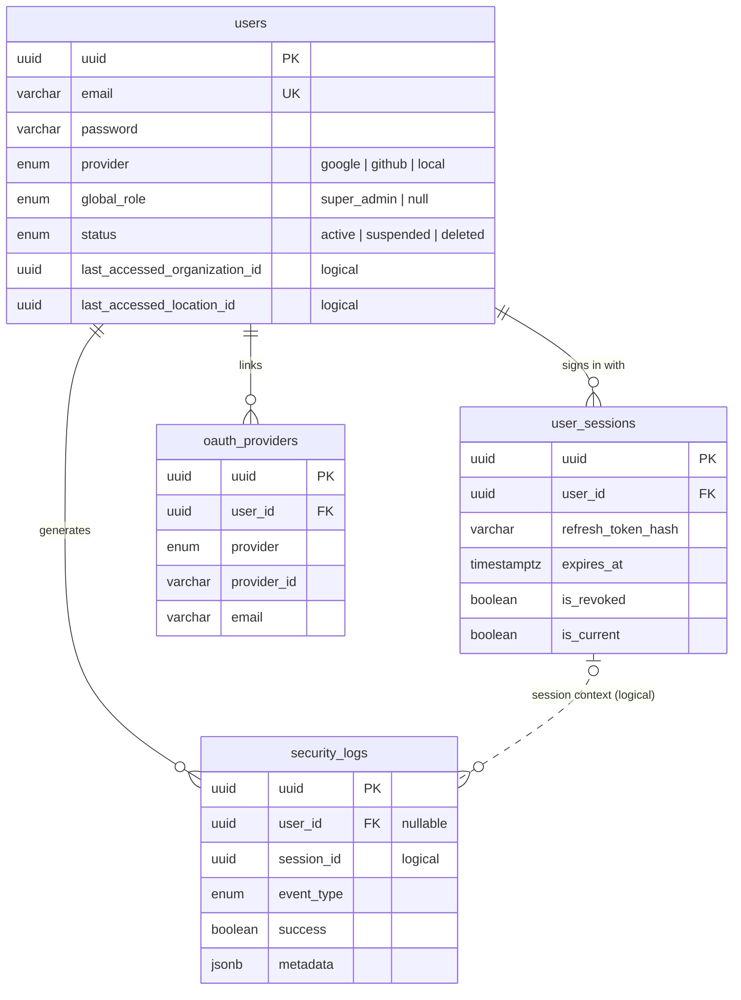
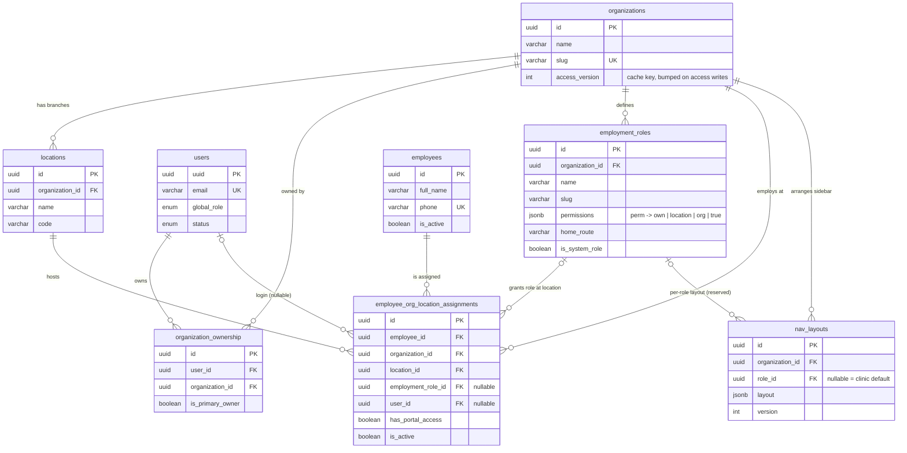
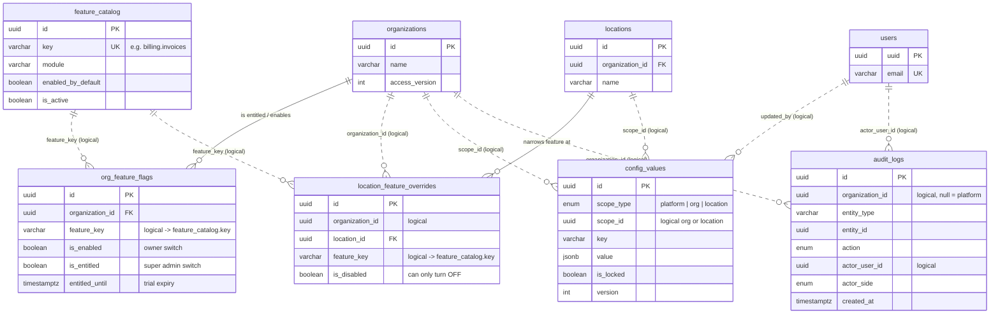

# Auth, Identity & Role Access — ERD

Generated from the live TypeORM entities (the schema source of truth) and cross-checked with
[`backend/docs/data-model/ENTITY_CATALOG.md`](../backend/docs/data-model/ENTITY_CATALOG.md).
Real table names, real column names, PostgreSQL types.

**Legend**

- Solid line (`||--o{`) = **enforced foreign key** (FK).
- Dotted line (`||..o{`) = **logical reference only** — no DB constraint; the column name or entity comment states the target.
- Only PK, FK/UQ and the 2–4 columns that matter for access are shown.

---

## 1. Identity, credentials and sessions



**What this says**

- `users` is **global / platform-wide**: one person, one email, many clinics. Access is not stored on the user.
- `user_sessions` holds one row per device. Only `refresh_token_hash` is stored; revocation is soft (`is_revoked`).
- `security_logs` is the authentication audit trail. `session_id` is a logical link (no FK) so a log row survives session deletion.
- `oauth_providers` exists in the schema but OAuth is **not wired** (the table is registered, no code reads/writes it).
- `users.global_role = 'super_admin'` is a platform-level privilege; ordinary users have `NULL`.
- Password reset / email verification are columns on `users`, not separate tables.

---

## 2. Tenancy, membership and roles



**What this says**

- **Owner** is `organization_ownership` (a user can own several orgs; `is_primary_owner` marks the main one).
- **Staff** are `employees` (a global person record) linked to an org + location through
  `employee_org_location_assignments`. That row is the unit of membership.
- The **role is per employee per location**: `employee_org_location_assignments.employment_role_id`.
  A doctor can be Doctor at one branch and Assistant at another.
- The **login link** is also on the assignment (`user_id`), with `has_portal_access` as the on/off switch.
  Creating a staff login links the user to all of the employee's active assignments.
- `employment_roles.permissions` is a jsonb map: `{ "patients.view": "location", "billing.invoice.void": true }`.
  A **missing key means no access** (fail-closed). Legacy boolean keys are ignored by the resolver.
- `nav_layouts` only *arranges* the sidebar; it never grants access. `role_id IS NULL` is the clinic default
  (the only kind v1 writes); per-role layouts are reserved for later.
- `organizations.access_version` is the cache-invalidation key for the resolved access context.

> **Legacy, not live:** `organization_admins` and `user_locations` appear only in the never-executed baseline
> migration `1776356529788-create-table`. They have no entity and are replaced by `organization_ownership`
> and `employee_org_location_assignments`.

---

## 3. Features, settings and audit



**What this says**

- A **feature** is `feature_catalog.key`. Activation for one clinic is:
  `catalog.is_active` **and** `org_feature_flags.is_entitled` (trial not expired) **and** `org_feature_flags.is_enabled`
  **and** not disabled by a `location_feature_overrides` row.
- `feature_key` is **denormalized** in both flag tables — it is not an FK. Catalog seeding never deletes keys,
  so a stale flag is harmless.
- A location override can only **turn a feature off**; there is no "force on".
- `config_values` is the settings registry (theme, branding, etc.). `scope_id` is polymorphic
  (platform = `NULL`, otherwise org or location id), so it is a logical reference. A locked value at a
  higher scope wins.
- `audit_logs` is **append-only** (UPDATE/DELETE blocked by a trigger). It records role, feature, nav, theme
  and patient-export changes with before/after JSON. `organization_id` is `NULL` for platform-level actions;
  `actor_side` distinguishes `platform` from clinic actors.

---

## 4. How one permission is resolved

```
features  = catalog active
          ∧ org entitled (trial not expired)
          ∧ org enabled
          ∧ not disabled at this location

granted   = owner (organization_ownership)
            or super_admin (users.global_role)
              ? every permission, scoped at `org`
            : employment_roles.permissions
              for the active assignment at this location
              (has_portal_access = true) + everything it `implies`

effective = granted minus every permission whose feature is not in `features`
```

The result is cached per `(user, org, location, organizations.access_version)` for at most 5 minutes.
Writes to `employment_roles`, `employee_org_location_assignments`, `org_feature_flags` or
`organization_ownership` bump `organizations.access_version` through the entity subscriber, which invalidates
every API/worker cache and pushes `access.changed` over Socket.IO.

Practical consequences visible in this ERD:

| Question | Where the answer lives |
| --- | --- |
| Can this user sign in? | `users.status`, `user_sessions.is_revoked` / `expires_at` |
| Is this user an owner of the clinic? | `organization_ownership` |
| Is this user a platform super admin? | `users.global_role = 'super_admin'` |
| Which clinics/branches can they work in? | `employee_org_location_assignments` (`is_active`, `has_portal_access`) |
| What may they do there? | `employment_roles.permissions` of the assignment's role |
| Is a module switched on? | `feature_catalog` + `org_feature_flags` + `location_feature_overrides` |
| What sidebar do they see? | `nav_layouts` (arrangement only) + code `can()` filtering |
| What is their landing page? | `employment_roles.home_route`, else layout home, else `/dashboard` |
| Who changed access? | `audit_logs` |

---

## 5. Other access surfaces (separate realms)

Not part of clinic auth, but worth knowing when reading the schema:

| Table | Purpose |
| --- | --- |
| `lab_members` | A user's membership + `LabMemberRole` in a dental lab. Lab users hold **no clinic membership**, so clinic queries cannot return their data. |
| `magic_links` | No-login, single-order links for lab partners. Only `token_hash` is stored; scoped to one `lab_id` + `order_id`, with expiry, max uses and revocation. |

---

## Source files

| Area | File |
| --- | --- |
| User | `backend/src/user/entities/user.entity.ts` |
| Sessions | `backend/src/session/entities/user-session.entity.ts` |
| Security log | `backend/src/auth/entities/SecurityLog.ts` |
| OAuth | `backend/src/auth/entities/OAuthProvider.ts` |
| Ownership | `backend/src/organizations/entities/organization-ownership.entity.ts` |
| Organization | `backend/src/organizations/entities/organization.entity.ts` |
| Location | `backend/src/locations/entities/location.entity.ts` |
| Employee / assignments | `backend/src/employees/entities/employee.entity.ts`, `employee-org-location-assignment.entity.ts` |
| Roles | `backend/src/employees/entities/employment-role.entity.ts` |
| Sidebar layout | `backend/src/access/nav/nav-layout.entity.ts` |
| Features | `backend/src/feature-flags/entities/*.entity.ts` |
| Settings | `backend/src/settings-registry/entities/config-value.entity.ts` |
| Audit | `backend/src/common/audit/entities/audit-log.entity.ts` |
| Access rules | `backend/src/access/access.resolver.ts`, `docs/access-control/README.md` |
| Lab access | `backend/src/labs/entities/lab-member.entity.ts`, `backend/src/lab-access/entities/magic-link.entity.ts` |
