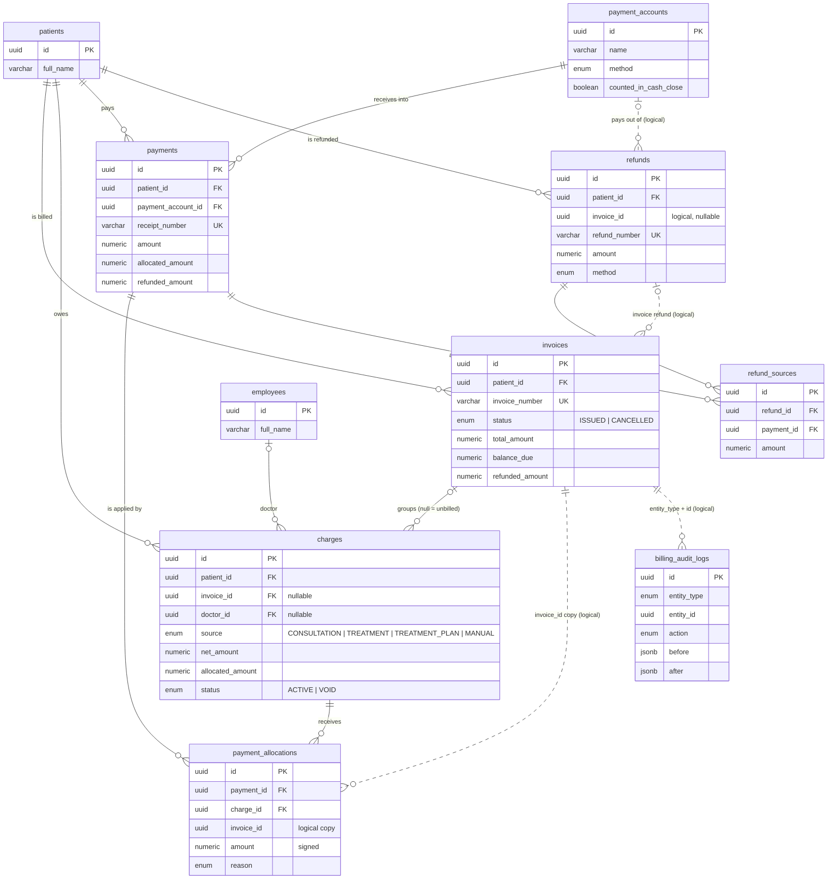
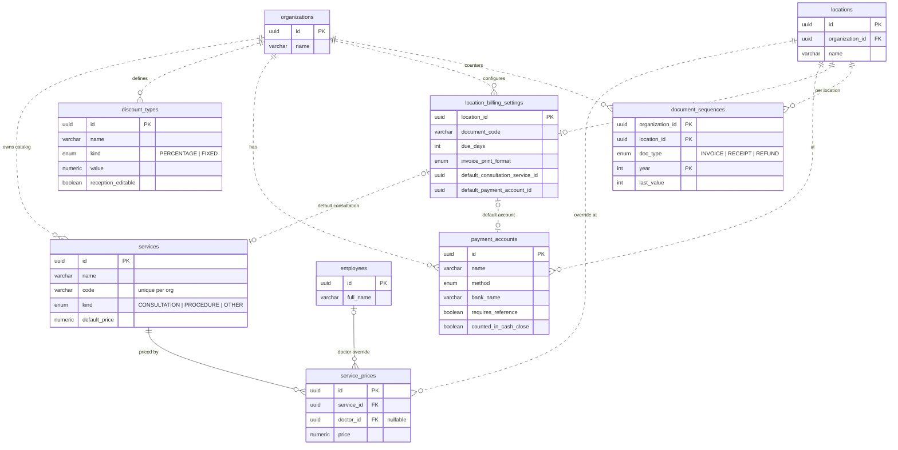
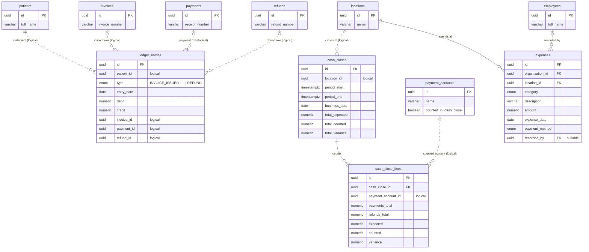
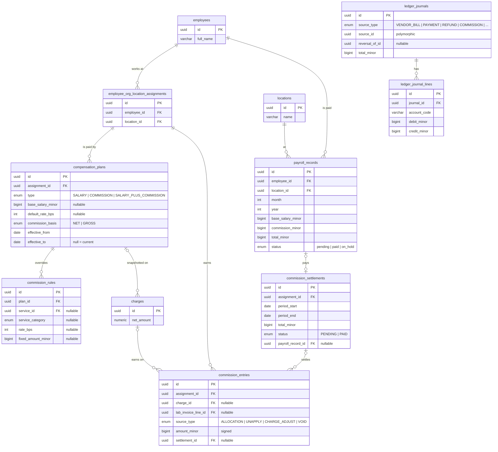
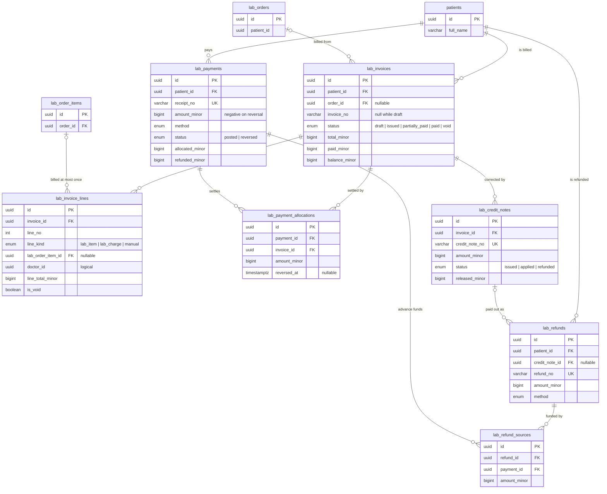
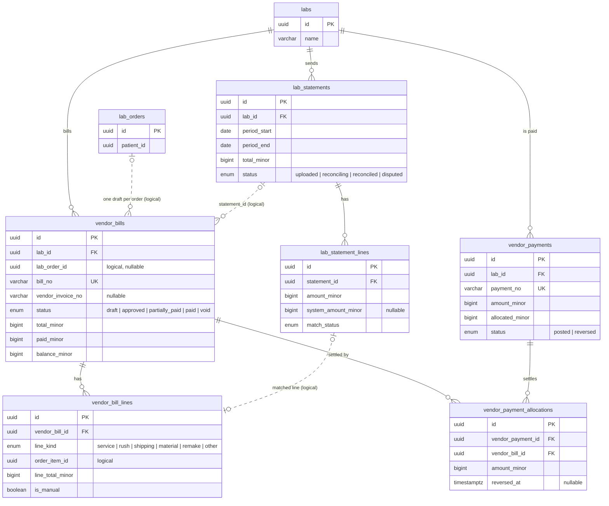
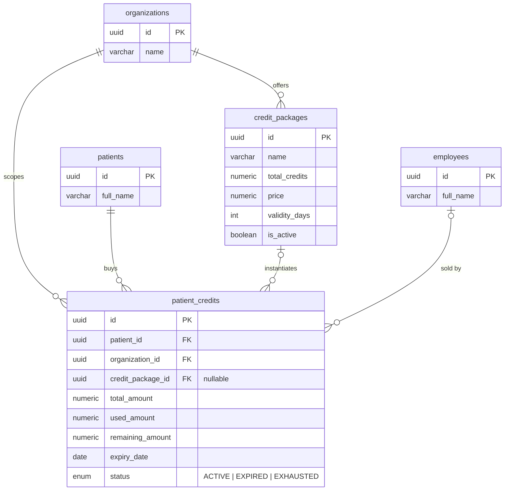
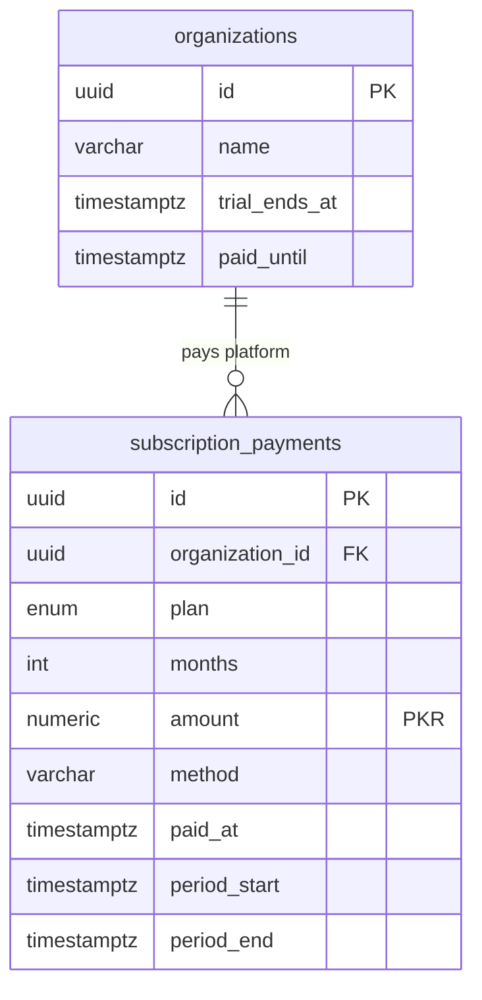

# Billing, Invoices, Expenses, Commissions & Finance — ERD

Generated from the live TypeORM entities (schema source of truth), cross-checked with
[`backend/docs/data-model/ENTITY_CATALOG.md`](../backend/docs/data-model/ENTITY_CATALOG.md),
[`billing-feature-context.md`](billing-feature-context.md) and [`commissions.md`](commissions.md).

**Legend**

- Solid line (`||--o{`) = **enforced foreign key**.
- Dotted line (`||..o{`) = **logical reference only** (no DB constraint).
- Billing v2 tables carry `organization_id` / `location_id` as **plain tenant columns (no FK)**.
  Those tenant links are drawn only where they aid reading; the same applies to every table unless
  the note says otherwise.
- Actor columns (`created_by`, `issued_by`, `received_by`, …) are logical references to `users`;
  they are not FK-constrained.
- Money: billing v2 uses `numeric(12,2)` **rupees**; commissions, payroll and the lab module use
  `bigint` **paisa** (100 paisa = 1 rupee).

---

## 1. Billing core — charges, invoices, payments, refunds

**Meaning**

- `charges` is the **atomic billable line**. `invoice_id = NULL` means it is still unbilled.
  Price, discount and service kind are snapshots, so catalog changes never rewrite past bills.
- `invoices` has **no draft**: it is created and issued together. Stored status is only
  `ISSUED` / `CANCELLED`; `UNPAID / PARTIALLY_PAID / PAID / OVERDUE` are **computed** from amounts
  and dates, never stored.
- `payments` belongs to the **patient**, not to an invoice. The part not allocated or refunded is
  the patient's **advance**: `amount − allocated_amount − refunded_amount`.
- `payment_allocations` is append-only and signed. A positive row applies money to a charge; a
  negative row releases it back to advance. `invoice_id` is a denormalized copy for fast queries,
  not an FK.
- `refunds` is always paid **out of advance**. `refund_sources` records which payments funded it,
  and `SUM(refund_sources.amount) = refunds.amount`.
- `billing_audit_logs` is the billing-specific append-only trail. `EDITED` invoice rows hold full
  before/after snapshots used for invoice revisions.

---

## 2. Service catalog, discounts, billing settings & numbering

**Meaning**

- `services` is the **org-level price catalog** (`consultation`, `procedure`, `other`).
  `service_prices` overrides the price per location, optionally per doctor.
- `discount_types` are owner-defined presets (percentage/fixed, min/max, which services, who may
  edit, required note). The applied discount is **snapshotted onto the charge**, so editing a preset
  never rewrites history.
- `location_billing_settings` holds the printable format, due days, document code and defaults.
  `location_id` is the PK, so it is strictly one row per location.
- `document_sequences` is the **atomic counter** behind invoice/receipt/refund numbers. Composite PK
  `(organization_id, location_id, doc_type, year)`; only touched inside a transaction.

---

## 3. Patient statement, cash close & expenses

**Meaning**

- `ledger_entries` is the **patient statement** (one-sided): exactly one of `debit` / `credit` is
  positive. Sign convention: `+` patient owes, `−` clinic holds advance. It is **not** double-entry.
- `cash_closes` is an immutable count of the counter since the previous close; `cash_close_lines`
  snapshots each payment account (expected, counted, variance). A close cannot be edited.
- `expenses` is the clinic's own spending (rent, utilities, supplies, salary, …), separate from
  patient money. `paid_by`/`recorded_by` is the employee who entered it. Lab-related expenses can
  carry `lab_id` / `lab_order_id` (plain columns).

---

## 4. General ledger, compensation & payroll

**Meaning**

- `compensation_plans` is **versioned per assignment** (employee × location), valid for
  `[effective_from, effective_to]`; a GiST exclusion constraint forbids overlap.
- `commission_rules` override one plan for one service or one service category. Resolution order:
  service rule → category rule → plan default.
- `charges` stores a **snapshot** of the plan and rate at creation. Changing a plan never changes
  past commission.
- `commission_entries` is an **append-only signed ledger**. Every change inserts only the
  difference; a trigger blocks deletes and all updates except setting `settlement_id`. An entry
  earns on **either** a clinic `charge` **or** a `lab_invoice_line` (exactly one).
- `commission_settlements` batches one assignment's unsettled entries for one payroll period.
  `payroll_records` holds `base_salary_minor + commission_minor = total_minor` and is unique per
  employee × location × month.
- `ledger_journals` + `ledger_journal_lines` are the **double-entry general ledger** (balanced,
  paisa, chart of accounts in code). This is separate from the patient statement
  `ledger_entries` in diagram 3. Journals are append-only; corrections are mirror journals via
  `reversal_of_id`. `source_type` + `source_id` are polymorphic (no FK).

---

## 5. Lab receivables — what patients owe for lab work

**Meaning**

- The lab module has its **own** invoice/payment/refund numbering and its own money columns, all in
  **paisa**. It is separate from the clinic `invoices` / `payments` / `refunds` in diagram 1.
- A `draft` lab invoice is only an estimate: no number, editable, owes nothing. Issuing freezes it.
- `lab_payments` belongs to the patient. Unallocated + unrefunded money is the patient's advance.
  A wrong payment is never deleted — it gets a mirror row (`amount_minor < 0`, `reversal_of_id`).
- `lab_payment_allocations` is never deleted; a reversal or credit note sets `reversed_at`.
- `lab_credit_notes` correct an issued invoice downwards. Money already paid above the new total is
  released back to advance (`released_minor`) and can then be refunded.
- A lab order item can sit on **at most one non-void line** (partial unique index), so it can never
  be billed twice.
- `lab_invoice_lines.doctor_id` / `performing_assignment_id` / `commission_plan_id` are the
  commission snapshot. `commission_entries.lab_invoice_line_id` links into this realm.

---

## 6. Lab payables — what the clinic owes labs

**Meaning**

- A `draft` vendor bill is generated from a lab order's frozen costs. Approving it posts the
  double-entry journal (Lab Cost / Lab Payable); the `journal_id` is on the bill.
- `vendor_payments` is money paid to a lab. The unallocated rest is an **advance to the lab**.
  Mistakes are reversed, never deleted.
- `lab_statements` + `lab_statement_lines` reconcile what the lab claims against the clinic's
  bills; `match_status` says whether a line matched, mismatched or was missing on either side.

---

## 7. Prepaid credit packages (legacy, separate from advances)

**Meaning**

- This is the **old prepaid package** model. `patient_credits` tracks total/used/remaining and
  expiry, but it is **not connected** to invoice payments or to the patient advance in diagram 1.
  Billing v2 advances (`payments − allocations − refunds`) are the live wallet.
- `purchased_by` is an employee; `credit_package_id` is nullable so deleting a package does not
  delete sold credits.

---

## 8. Platform subscription revenue

**Meaning**

- A super admin records a clinic's subscription payment **outside** the app. Each row extends
  `organizations.paid_until`. This is platform revenue, not clinic billing — it never appears in
  clinic invoices or reports.

---

## 9. Money rules that the diagrams encode

| Rule | Where it lives |
| --- | --- |
| A charge is the atomic billable unit; `invoice_id = NULL` = unbilled | `charges` |
| Invoice money is cached by a totals service, never incremented ad hoc | `invoices.*_amount` |
| Payment status (`UNPAID/PAID/OVERDUE`) and refund status are **computed** | not stored |
| A payment belongs to the patient; overpayment becomes advance | `payments` |
| Allocations are append-only and signed; negative = release | `payment_allocations` |
| Refunds come out of advance; sources name the funding payments | `refunds`, `refund_sources` |
| Numbering is an atomic counter per org + location + type + year | `document_sequences` |
| Cash close is an immutable period count per payment account | `cash_closes`, `cash_close_lines` |
| Patient statement ≠ general ledger | `ledger_entries` vs `ledger_journals` + lines |
| Commission snapshot is taken on the charge; entries are append-only and signed | `charges.commission_*`, `commission_entries` |
| Salary + commission are settled through one payroll record | `commission_settlements` → `payroll_records` |
| Lab billing is a separate realm with its own tables and paisa columns | `lab_*` tables |
| Two money units coexist: rupees in billing v2, paisa in commission/payroll/lab | `numeric(12,2)` vs `bigint` |

---

## 10. Source files

| Area | File |
| --- | --- |
| Invoice / charge / payment | `backend/src/billing/entities/{invoice,charge,payment,payment-allocation,refund,refund-source}.entity.ts` |
| Catalog / discounts / settings | `backend/src/billing/entities/{catalog-service,service-price,discount-type,payment-account,location-billing-settings,document-sequence}.entity.ts` |
| Statement / cash close / expenses | `backend/src/billing/entities/{ledger-entry,cash-close,expense,billing-audit-log}.entity.ts` |
| General ledger | `backend/src/billing/ledger/journal/ledger-journal.entity.ts` |
| Commissions | `backend/src/billing/commissions/entities/*.entity.ts` |
| Payroll | `backend/src/payroll/entities/payroll-record.entity.ts` |
| Lab receivables | `backend/src/lab-billing/entities/{lab-invoice,lab-payment,lab-credit}.entity.ts` |
| Lab payables | `backend/src/lab-payables/entities/{vendor-bill,vendor-payment,lab-statement}.entity.ts` |
| Prepaid credits | `backend/src/billing/entities/{credit-package,patient-credit}.entity.ts` |
| Subscriptions | `backend/src/subscriptions/entities/subscription-payment.entity.ts` |
| Rules | `docs/billing-feature-context.md`, `docs/commissions.md` |
