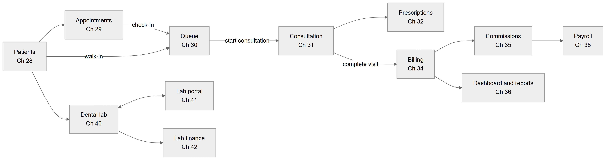

# Chapter 1 — What the Platform is

This chapter explains what the Platform is, who it serves and which parts are built today. It is the first chapter of the System Owner's Handbook and is written for the product owner, who is a software engineer and needs a clear picture before reading the detailed chapters. It ends with a map of the 18 module chapters, so a reader can find any topic.

## 1.1 One paragraph summary

The Platform is a **multi-tenant** web application that runs the daily work of clinics. "Multi-tenant" means one running system serves many separate clinic businesses, and each business sees only its own data. One clinic business is an **organization**. An organization has one or more **locations** (branches). Staff log in, and what they see depends on their **role** and on the **features** the organization has switched on. The backend is a NestJS API with a PostgreSQL database. The front end is a React web app. Chapter 4 describes the stack, and Chapter 8 describes how tenants are kept apart.

## 1.2 What a clinic gets

A clinic uses the Platform to do these jobs:

- keep a **patient** record, including clinical history, vitals, documents and signed consents (Chapter 28);
- book **appointments** and manage the calendar (Chapter 29);
- run a doctor-wise waiting line with **tokens** after the patient arrives (Chapter 30);
- let the doctor work from one screen, the **consultation workspace** (Chapter 31);
- write and print **prescriptions** (Chapter 32);
- plan treatment in steps with a **treatment plan** (Chapter 33);
- bill patients, take **payments**, issue **invoices** and close the cash counter (Chapter 34);
- calculate doctor **commission** (Chapter 35), run reports (Chapter 36), manage **employees** (Chapter 37), **payroll** (Chapter 38) and **inventory** (Chapter 39);
- send work to a dental **lab** and track it, including a separate **lab portal** for the lab (Chapters 40 to 42);
- manage subscription and sign-up (Chapter 45).

## 1.3 Specialties: general, dental and others

An organization carries one or more **specialty tags**. The code lists six: general, dental, skin, ortho, physio and eye. The sign-up form offers them as choices, for example "Skin / dermatology", "Orthopaedics", "Physiotherapy" and "Eye care". The tags describe which **features** are relevant to a clinic.

**What is general.** Patients, appointments, the queue, consultation, prescriptions, treatment plans, billing, commissions, reports, employees, payroll and inventory work for any clinic type. Their feature keys carry the tag "general".

**What is dental-specific.** Two parts are built for dental clinics:

- the **teeth chart** (FDI tooth numbering), whose feature `patients.teeth_chart` is tagged dental and ortho, and the "dental info" record of a patient;
- the **dental lab** ordering and production flow, whose feature is `dental.lab_orders`, tagged dental and ortho. The Platform ships dental lab workflows (for example "Try-in stage" and "Complete denture" stage lists) as seed data for the workflow engine.

**Honest summary.** Dental is the most developed specialty. A clinic of another type can use every general module today. The tags for skin, ortho, physio and eye exist as labels, but this chapter found no screens or rules written only for skin, physio or eye care **[Partial]**. The workflow engine (Chapter 43) is designed so a new specialty can be added as data, not code, but only dental data is seeded.

## 1.4 Market defaults visible in the code

The first customers are clinics in Pakistan. Several defaults show this. They are **defaults, not limits**.

| Default | What the code does | Can it change? |
|---|---|---|
| Currency | An organization's currency column defaults to PKR. Billing screens show "Rs". | It is a column per organization (and one per location), so it can be set. |
| Timezone | Every location has its own timezone. Clinic dates and times (queue day, "today", no-show times) follow the location's timezone. | Yes, per location. |
| Urdu on prescriptions | A prescription PDF prints Urdu text in Nastaliq script, right to left. | It applies to typed text; printed labels stay English. |
| Tax | Sales tax is **exclusive**: it is added on top of the price. | Tax is configured in billing settings. |
| Roman-Urdu text | The "No access" page shows the headline "Aapke paas is page ki permission nahi", with English text under it. | It is fixed text in the web app. |

The table lists the visible regional choices. They show the product is built first for Pakistani clinics, but nothing in them blocks another market. One point is **[Unverified]**: the location record has its own currency column whose database default is USD, while the organization default is PKR, and this chapter did not trace which one each billing screen reads.

## 1.5 What is and is not built

Every feature in this handbook carries one of four labels: **[Implemented]** (built end to end), **[Partial]** (some of it exists), **[Not implemented]** (planned or only mentioned) and **[Unverified]** (not confirmed from code). The table is the one-page summary of the largest items.

| Area | Status | Note |
|---|---|---|
| Patients, appointments, queue, consultation, prescriptions | [Implemented] | Some sub-features are backend only; each module chapter lists them. |
| Billing, payments, invoices, cash close, refunds | [Implemented] | The invoice is issued when payment is collected. |
| Commissions, payroll, employees | [Implemented] | Payroll records are generated by a monthly job. |
| Dental lab, lab portal, lab finance | [Implemented] | A lab order is not linked to a consultation. |
| Reports and dashboards | [Implemented] | Reports can be exported. |
| Inventory | [Partial] | The screen exists but has no sidebar entry; the daily alert job only writes a server log. |
| Patient portal | [Not implemented] | Patients cannot log in. |
| SMS, email and WhatsApp messages to patients | [Not implemented] | SMS and email feature keys are retired. A WhatsApp key exists in the feature catalog, but no patient messaging is built. |
| Online booking | [Not implemented] | Retired feature key. |
| Recurring appointments | [Not implemented] | Retired feature key. |
| Appointment reminders | [Not implemented] | Retired feature key. |
| Sign-in with Google or GitHub (OAuth) | [Not implemented] | The sign-in is disabled. |
| Notifications | [Partial] | In-app only. |
| Chairs | [Not implemented] | A database entity only; no screen or API. |
| Insurance claims and online payments | [Not implemented] | Retired feature keys. |

The table shows that the core clinic workflow from booking to payment is built, while everything that reaches out to the patient (portal, messages, online booking) is not. Self-sign-up with a 14-day trial of the Professional plan exists in the backend and a register page exists in the web app; subscription payments are recorded by a super admin by hand (Chapter 45).

## 1.6 How a patient flows through the Platform

Figure 1.1 shows the main modules and the usual path of a patient.

*Figure 1.1 — Main modules and the usual flow of a patient, with chapter numbers.*

The flowchart reads from left to right. The box "Patients (Ch 28)" has three arrows out of it. One goes to "Appointments (Ch 29)", and an arrow labelled "check-in" leads from Appointments to "Queue (Ch 30)". A second arrow, labelled "walk-in", goes straight from Patients to Queue, because a patient without a booking joins the queue directly. The third goes down to "Dental lab (Ch 40)". From Queue, an arrow labelled "start consultation" leads to "Consultation (Ch 31)". Consultation has two arrows out: one to "Prescriptions (Ch 32)", and one labelled "complete visit" to "Billing (Ch 34)". Billing has two arrows out: one to "Commissions (Ch 35)", which continues to "Payroll (Ch 38)", and one to "Dashboard and reports (Ch 36)". The Dental lab box has a two-way arrow with "Lab portal (Ch 41)", since the clinic and the lab both act on the same order, and a one-way arrow to "Lab finance (Ch 42)".

## 1.7 Map of the 18 module chapters

| Chapter | Module | One line |
|---|---|---|
| 28 | Patients | The patient record and everything attached to it. |
| 29 | Appointments | Booking, rescheduling, check-in. |
| 30 | Queue | Doctor-wise live waiting line with tokens and a TV display. |
| 31 | Consultation | The doctor's one-screen workspace for a visit. |
| 32 | Prescriptions | Writing, signing and printing prescriptions, with Urdu. |
| 33 | Treatment plans | Planned work per patient and reusable plan templates. |
| 34 | Billing | Charges, payments, invoices, refunds, cash close. |
| 35 | Commissions | Doctor compensation plans and earnings. |
| 36 | Dashboard and reports | The home dashboard, finance overview and reports. |
| 37 | Employees | Staff records, assignments, schedules, leave. |
| 38 | Payroll | Monthly payroll records and payments. |
| 39 | Inventory | Stock, suppliers and purchase orders. |
| 40 | Dental lab | The clinic side of lab orders and production. |
| 41 | Lab portal | The lab's own login and screens. |
| 42 | Lab finance | Lab pricing, bills, statements and payables. |
| 43 | Workflow engine | Configurable forms and stages behind lab orders. |
| 44 | Notifications | In-app notifications and their rules. |
| 45 | Subscriptions and onboarding | Sign-up, trial, plans and subscription status. |

The table gives the whole module list in chapter order. The roles that use these modules are described in Chapter 2, and a sample clinic day that touches most of them is told in Chapter 3. Chapters 4 to 27 explain the architecture, tenancy and data model that every module relies on.

## 1.8 Limitations and known gaps

- The product name is not final. The Platform is the name used in this handbook, and each clinic sets its own display name; the default is "Clinic Portal".
- Non-dental specialties have tags but no specialty-specific screens.
- Everything that reaches the patient directly is missing: no portal, no messages, no online booking.
