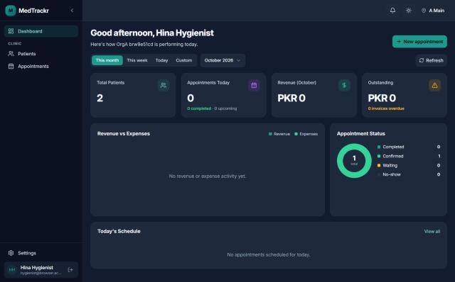

# Chapter 2 — Roles: who uses the Platform

This chapter lists every kind of person who touches the Platform, from the super admin who runs the whole system to the waiting-room TV that needs no login. It is written for the product owner and answers three questions for each audience: what they do day to day, which sidebar entries they use, and what they cannot do. The detailed permission model is in Chapter 11, and the access mechanics are in Chapter 57.

## 2.1 The audiences at a glance

The Platform checks **permissions**, never role names (Chapter 11). A **role** is only a named bundle of permissions. The audiences in this chapter are therefore described by what their default bundle allows.

| Audience | Has a role? | Home page | Sidebar entries (labels) | Cannot do |
|---|---|---|---|---|
| Super admin | No, platform-wide | Dashboard | Organizations, Subscriptions, Lab Directory, Config Studio (Form schemas, Workflows, Stage templates), plus every clinic entry | Nothing is blocked inside a clinic. |
| Owner | No, owns one organization | Dashboard | Every clinic entry, including Locations, User Admin and the four "Clinic setup" pages | Platform-only pages: Organizations, Subscriptions, Lab Directory, Config Studio. Cannot enable a feature the super admin has not entitled. |
| Admin (system role) | Yes | Dashboard | Most clinic entries | Doctor acts: conduct consultations, write prescriptions, own queue and own earnings. |
| Doctor (system role) | Yes | My Queue | My Queue, Patients (own), Appointments (own), Prescriptions, Lab orders, My earnings, Clinic overview (the page refuses the Doctor role's own scope; see Chapter 36) | Billing, payments, employees, payroll, administration. |
| Receptionist (system role) | Yes | Appointments | Patients, Appointments, Billing desk, Invoices, Payments, Lab orders | Clinical records, consultation, refunds, voiding invoices, reports. |
| Assistant (system role) | Yes | Appointments | Patients, Appointments, Lab orders | Billing, prescriptions, consultation. |
| Accountant (system role) | Yes | Billing desk | Billing desk, Invoices, Payments, Expenses, Reports, Finance overview, Doctor earnings, Billing activity, Lab billing, Lab payables | Patient records beyond prices, queue, booking. |
| Custom role | Yes, built by the owner | Set per role | Whatever the permissions allow | Anything the owner did not tick; an owner cannot grant what they do not hold. |
| Lab admin | Lab membership | Lab portal | Lab portal | Anything inside a clinic. |
| Lab technician | Lab membership | Lab portal | Lab portal | Team management, accepting or rejecting orders. |
| Magic-link contact | No login | One order page | None | Anything except the one order the link opens. |
| TV display | No login | Display screen | None | Shows no patient names or phone numbers. |
| Patient | None | None | None | Cannot log in **[Not implemented]**. |

The table puts every audience on one page. Doctor, Receptionist, Assistant and Accountant sidebars are deduced from each template's permissions and the sidebar registry, so a clinic that renames or hides entries (Chapter 58) sees a different sidebar. The sections that follow give the day-to-day view of each audience.

**Sidebar labels.** The sidebar items come from a registry in the web app. Each item appears only when the user holds its permission. The default layout has the groups Clinic, Finance (with Billing and Reports sub-groups), Team, Admin and Clinic setup. Settings is pinned at the bottom for everyone.

## 2.2 Super admin

The super admin is the person who operates the Platform itself, not a clinic. They are exempt from the tenant checks, the feature check and the permission check.

**Day to day.** They create and review **organizations**, set which **features** each organization is **entitled** to (optionally with a trial end date), record subscription payments by hand in **Subscriptions**, manage the shared **Lab Directory**, and edit forms, workflows and stage templates in **Config Studio**.

**Sidebar.** Organizations, Subscriptions, Lab Directory, and the Config Studio group with Form schemas, Workflows and Stage templates. These five entries are marked super admin only in the registry. They also see the clinic entries when they are working inside an organization.

**Cannot do.** Nothing is blocked by permission. In practice a super admin has no clinic role, so clinic-facing personal screens such as a doctor's own earnings have no staff record behind them.

## 2.3 Owner

The **owner** is the person who owns one organization. The owner has no role record: they get every permission at its widest scope, and permissions are still dropped when their feature is not active.

**Day to day.** Setting up the clinic and watching it: **Locations**, **User Admin** (staff logins), and the four setup pages **Roles & permissions**, **Features** (switch features on or off within what the super admin granted), **Sidebar** and **Theme**. They can also use every clinic module.

**Cannot do.** The owner cannot reach the five platform-only pages, cannot enable a feature that is not entitled, and cannot create permissions that do not exist in the catalog.

## 2.4 The five system roles

Every organization is seeded with five **system roles**: Admin, Doctor, Receptionist, Assistant and Accountant. They are read-only templates; to change one, the owner clones it into a custom role.

**Admin.** Runs the clinic day to day. It holds the Full bundle of every module except four clinical acts (conducting consultations, creating prescriptions, own queue, own earnings), but it can run and force-complete any doctor's queue. Home page: Dashboard. Uses: Dashboard, Clinic overview, Patients, Appointments, Billing, Reports, Employees, Payroll, Locations, User Admin and setup pages. Cannot: write prescriptions or conduct a consultation unless the owner clones Doctor for them.

**Doctor.** Consults patients. Home page: My Queue. A doctor sees only their own patients (scope `own`: people they have an appointment or queue entry with) and their own appointments. Day to day: start the queue, call the next patient, work in the consultation workspace, write and print prescriptions, create lab orders, check My earnings. Uses: My Queue, Patients, Appointments, Prescriptions, Lab orders, Order templates, My earnings, Clinic overview. Cannot: collect payments, see invoices, manage employees, change settings.

**Receptionist.** The front desk. Home page: Appointments. Day to day: register patients, book and reschedule, check patients in, add walk-ins on the reception queue board, run the TV display, collect payments, apply preset discounts. Uses: Patients, Appointments, Billing desk, Invoices, Payments, Lab orders. Cannot: read clinical notes, issue refunds, void invoices, give custom discounts, run reports.

**Assistant.** Chairside help. Home page: Appointments. Day to day: view patients at this location including clinical records, edit the teeth chart, book appointments, check patients in, view stock. Uses: Patients, Appointments, Lab orders. Cannot: take payments, write prescriptions, edit patient details.

**Accountant.** Money. Home page: Billing desk. Day to day: view and edit invoices, void them, issue refunds, close the cash counter, record expenses, see every doctor's earnings, read financial reports, manage lab billing and payables. Uses: Billing desk, Invoices, Payments, Expenses, Finance overview, Reports, Doctor earnings, Billing activity, Lab billing, Lab payables. Cannot: open patient clinical records, run the queue, book appointments.

The **home page** is where a user lands after login. If the user may not open it, the web app falls back to the Dashboard.

## 2.5 Custom roles

An owner (or a staff member with the roles permission) builds a **custom role** on the Roles & permissions screen. For each module the role gets None, Basic or Full, or an Advanced list of single permissions with a scope. A role also has a home page and members. Custom roles are the way to model a hygienist, a branch manager or a billing clerk. A holder of the roles permission cannot grant anything they do not hold themselves.

Figure 2.1 shows what a restricted custom role looks like on the dashboard.

*Figure 2.1 — The dashboard for a custom role with only Patients and Appointments.*

The screenshot was captured on 2026-10-23 in dark theme and shows the former working name "MedTrackr" in the corner. The dashboard layout predates the redesign of that same date, so it is used only to show the sidebar. The sidebar lists Dashboard, then under the group Clinic only Patients and Appointments, with Settings and the user at the bottom. Entries for billing, reports, employees and administration are absent because the role holds none of their permissions. If this user types the address of a hidden page, the web app shows a "No access" page instead (Chapter 11).

## 2.6 Lab-side users

Labs are separate from clinics. A **lab** has its own members, who sign in with a normal login but hold a **lab membership** instead of a clinic assignment. They see the **Lab portal** entry in the sidebar (marked for users with at least one lab membership).

- **Lab admin.** Accepts or rejects a submitted order, asks the clinic a question (clarification), moves production steps, manages the lab team (add people, change roles, deactivate), and sees clinics, billing and profile.
- **Lab technician.** Works the production steps (for example finishing an order into quality check and passing it). Cannot accept or reject orders in the seeded dental workflow, and cannot manage the team.
- **Magic-link contact.** A person at the lab with no login. The clinic issues a **magic link** for one order. The link opens one page where the person can read the order, accept it, reject it with a reason or ask a clarification, within the link's expiry and use limit. Chapter 41 covers the lab portal in full.

These users cannot see anything inside a clinic apart from what the order and the clinic-lab link show them. The clinic decides how much patient identity the lab sees: full name or a code only.

## 2.7 Public and unauthenticated audiences

- **The TV display.** A screen in the waiting room opens the display page for a location. It shows, per doctor, the token being served and the next few tokens. It needs no login and by design shows no patient names or phones. Managing the TV display from a screen is **[Not implemented]**: there is no admin page for it, and the receptionist role only holds the permission to manage it.
- **Visitors before login.** Login, register, forgot password, reset password and verify email pages are public.
- **Patients.** There is **no patient portal [Not implemented]**. Patients appear in the Platform only as records that staff create and as tokens on a ticket.

## 2.8 Limitations and known gaps

- Sidebar labels per role in the table were deduced from permissions and the registry, not observed in a running app.
- A staff member with no assignment at the active location gets no role permissions there, even if they hold a role elsewhere.
- Super admins have no staff record, so screens built on the employee record do not apply to them.
