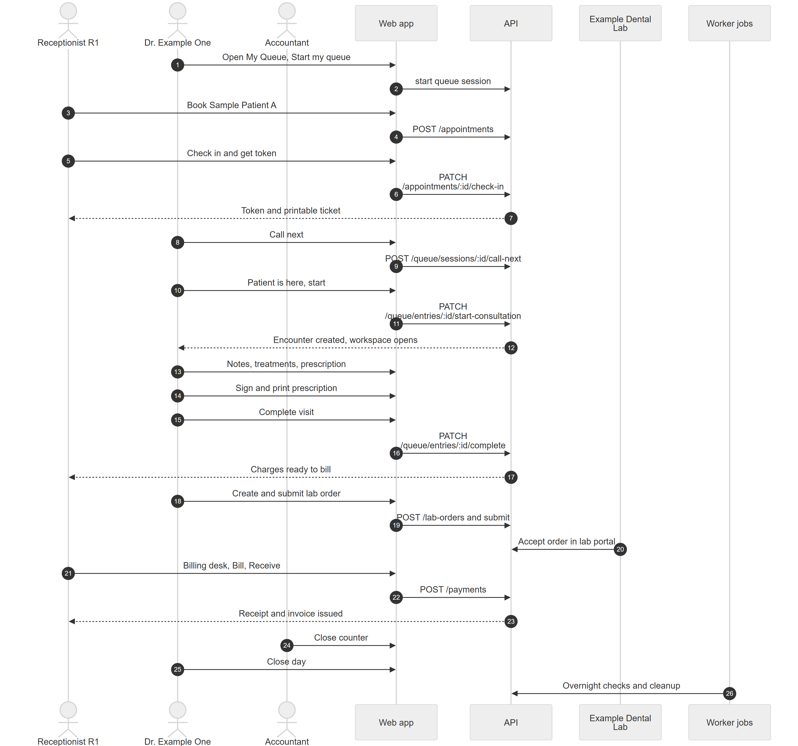

# Chapter 3 — A day in the clinic

This chapter tells the story of one working day at a clinic that uses the Platform, from opening the queue in the morning to the jobs that run overnight. It is written for the product owner, so that the modules described one by one in later chapters can be seen working together. Every person in the story is fictional, and every step names the module, its status and the chapter that explains it.

**The cast.** Receptionist R1 works the front desk. Dr. Example One is the doctor. Sample Patient A is a patient. The Accountant closes the cash. Example Dental Lab is an outside lab. The clinic is Example Clinic, with a Main location.

Figure 3.1 summarises the whole day before the narrative starts.

*Figure 3.1 — One clinic day from opening the queue to the overnight jobs.*

The sequence diagram has seven participants from left to right: Receptionist R1, Dr. Example One, the Accountant, the Web app, the API, Example Dental Lab and Worker jobs. It has 26 numbered messages. In messages 1 and 2 the doctor opens My Queue and starts the queue, and the web app calls the API. Messages 3 and 4 show R1 booking Sample Patient A with a call to create an appointment. Messages 5 to 7 show the check-in: R1 clicks Check in and get token, the web app sends the check-in call, and the API returns a token and a printable ticket to R1. Messages 8 and 9 are the doctor's Call next. Messages 10 to 12 are the doctor starting the consultation, after which the API creates the encounter and the workspace opens. Messages 13 and 14 are notes, treatments and the signed, printed prescription. Messages 15 to 17 are Complete visit, after which charges become ready to bill for R1. Messages 18 to 20 are the lab order: the doctor creates and submits it, and the lab accepts it in the lab portal. Messages 21 to 23 are R1 using the Billing desk to receive the payment, after which the API returns a receipt and issues the invoice. Message 24 is the Accountant closing the counter, message 25 is the doctor closing the day, and message 26 is the worker jobs running overnight checks and cleanup.

## 3.1 Opening: sign in and start the queue

Receptionist R1 signs in. If R1 may work at more than one location, the app first asks which location to use (Chapter 8, the multi-tenant model). R1's role is Receptionist, so the home page is **Appointments** (Chapter 11, roles and permissions).

Dr. Example One signs in and lands on **My Queue**, the Doctor home page. Opening that page creates the doctor's **queue session** for today if it does not exist yet. A queue session is one doctor's waiting line for one clinic day at one location, and the clinic day follows the Main location's timezone, not the server's. The doctor clicks **Start my queue**. A new session begins in the state "Doctor not started": reception can already add patients, but nobody can be called until the doctor starts. The Queue chapter (Chapter 30) describes the states Doctor not started, Open and Paused.

Status: **[Implemented]**. Module: Queue.

## 3.2 A booking is made

Earlier, R1 opened **Appointments** and booked Sample Patient A with Dr. Example One. The booking form checks the chosen time slot live and suggests another time when the slot is taken. The booking is saved as an **appointment**. Booking is only about reserving a time; it does not create a queue entry. The Appointments chapter (Chapter 29) covers booking, rescheduling and the status changes of a booking. Reminders to the patient and online booking are **[Not implemented]**.

Status: **[Implemented]**. Module: Appointments.

## 3.3 Arrival: check-in and token

Sample Patient A arrives. R1 finds the booking and clicks **Check in**, then **Check in & get token**. The Queue chapter (Chapter 30) explains that check-in is the moment the patient joins the doctor's line. The patient gets a **token** that belongs to Dr. Example One's queue for the day. A token is the short number printed on the ticket, such as "E-001": a letter prefix that comes from the doctor's name (or a prefix set on the doctor's assignment), then a three-digit counter. R1 clicks **Print ticket** in the success message, and the browser prints a small slip with the token, the doctor and roughly how many people are ahead.

If the patient has unpaid dues, a red "Rs … due" badge appears next to the patient in the queue, so R1 can ask about it (Billing, Chapter 34, feature "Show dues at check-in"). A person who arrives without a booking is a **walk-in**: R1 clicks **Walk-in** on the reception queue board, picks the doctor, and the patient gets a token the same way.

In the waiting room, the TV display shows the token being served and the next few tokens for each doctor. It needs no login and shows no patient names. The Platform pushes every change to the reception board, the doctor's screen and the TV live, through a realtime connection (Chapter 63).

Status: **[Implemented]**. Modules: Appointments (check-in) and Queue (token, board, TV).

## 3.4 The doctor's queue

Dr. Example One is on **My Queue**. The doctor clicks **Call next**. The button shows who will be called and why, for example "(E-001 · Appointment due)". The Queue chapter (Chapter 30) explains that a rule engine picks the next patient, either by smart rules or by first come, first served, depending on the clinic's setting (urgent patients go first in both modes). The called token flashes on the TV. When the patient walks in, the doctor clicks **Patient is here — start**.

If a called patient does not come, the receptionist or doctor can skip them, and they can rejoin later. A patient can also be sent for a test and return, or be transferred to another doctor. These actions are described in Chapter 30.

Status: **[Implemented]**. Module: Queue.

## 3.5 The consultation workspace

Starting the consultation creates the **encounter**, the clinical record of this one visit, and opens the **consultation workspace** at the consultation page. The Consultation chapter (Chapter 31) explains that the clinical record begins only when the doctor really starts, never at booking or check-in. In the workspace the doctor sees the patient at a glance, with allergy and medical alerts built from free-text fields (a structured allergy list is **[Partial]**), writes visit notes that auto-save, and records the **treatments** done today. The doctor can open the patient record without leaving the page.

The doctor does not see treatment prices unless the doctor's role holds the price permission; the default Doctor role does not.

Status: **[Implemented]**. Module: Consultation.

## 3.6 Prescription and printing

In the same workspace the **Prescription** panel lets the doctor search a medicine, set dose, frequency and duration, or choose a preset. The Prescriptions chapter (Chapter 32) explains the full module. The doctor clicks **Sign & print**. The Platform signs the prescription and shows a PDF preview on the clinic's print layout, with a **Print** button. Urdu text typed by the doctor is printed in Nastaliq script, right to left; the labels stay in English.

Status: **[Implemented]**. Module: Prescriptions.

## 3.7 Completing the visit

The doctor clicks **Complete**. The toast says "Visit completed" and the doctor returns to My Queue. At the same moment, in the same database transaction, the booked appointment becomes completed and the Platform creates **charges** for the visit: a consultation charge, plus one charge per treatment recorded in the encounter, priced from the clinic's price list. This happens only when the organization has the feature `billing.invoices` enabled. The Consultation chapter (Chapter 31) and the Billing chapter (Chapter 34) describe the automatic charges. No invoice exists yet: the charges wait on the Billing desk.

Status: **[Implemented]**. Modules: Queue (complete), Consultation, Billing (automatic charges).

## 3.8 A lab order

Sample Patient A needs a crown, so Dr. Example One orders it from Example Dental Lab. The doctor opens **Lab orders**, creates a **lab order** with an item (for example a zirconia crown), and submits it, so its status becomes Submitted. The Dental lab chapter (Chapter 40) covers the clinic side. In this version a lab order is **not** created from inside the consultation workspace and is not linked to an encounter **[Not implemented]**, so the doctor orders it from the separate Lab orders page.

The lab sees the order in its own **lab portal** (Chapter 41). A lab admin there can accept it with an expected date, reject it with a reason or ask a question. Instead of an account, the lab can also receive a **magic link** for the single order: a link that opens one page where the person can accept, reject or ask a clarification without logging in. The clinic can copy that link. The code can also queue the link for delivery through the notification outbox when the lab has a contact number or email (Chapter 44); whether a WhatsApp message actually leaves the Platform is **[Unverified]**, since notifications are in-app only. When the lab accepts, the order moves on, and its later stages are tracked through the workflow engine (Chapter 43).

Status: **[Implemented]**, except that a lab order has no link to the consultation. Modules: Dental lab, Lab portal.

## 3.9 Collecting payment and the invoice

Sample Patient A goes to the front desk. R1 opens the **Billing desk**. The first section, **Ready to bill**, lists Sample Patient A with the count of charges and the unbilled amount. R1 clicks **Bill**, and the **Collect payment** sheet slides in. R1 can give a discount (the Receptionist role holds the permission for preset discount types only), confirm the amount, choose the **Received in** payment account (for example cash) and click **Receive Rs …**.

The Billing chapter (Chapter 34) explains that the **invoice is issued at this moment**: when payment is collected for charges that have no invoice yet, the Platform numbers and issues the invoice in the same transaction as the receipt. The result shows the receipt number and the invoice number, with **Print receipt** and **Print invoice** buttons. Exclusive tax, if configured, is added on top of the price. If the patient pays more than the charges, the extra money is held as **advance**. The same transaction records the doctor's **commission entries** (Chapter 35), which the doctor later sees under My earnings.

Status: **[Implemented]**. Module: Billing.

## 3.10 Cash close

At the end of the shift the cash is closed by someone who holds the cash-close permission. The default Receptionist role does not hold it; the Accountant and Admin roles do. In this story the Accountant opens **Payments** and clicks **Close counter**. The Platform shows the expected amount (payments minus refunds since the previous close). For a cash account the Accountant types the counted amount, adds a note if there is a difference, and clicks the close button. The close is an immutable record with a printable slip, and a difference above the alert amount shows a "Flagged" badge. Each close starts where the previous one ended, so no payment is counted twice. Closing never blocks taking payments (Billing, Chapter 34).

Status: **[Implemented]**. Module: Billing.

## 3.11 Closing the day

The doctor clicks **Close day** on My Queue. The button is disabled while a patient is still with the doctor. A dialog lists every patient still waiting, skipped or at a test, and for each one the doctor chooses to cancel them or transfer them to another doctor. When the list is settled the session closes and no more tokens are issued (Chapter 30). A session that is left open with patients still waiting is not cancelled automatically; the system logs an alert for an admin.

Status: **[Implemented]**. Module: Queue.

## 3.12 Overnight: jobs that run by themselves

When the clinic is closed, scheduled jobs run in the one **worker** process (Appendix E lists them and Chapter 6 explains the process roles). Their schedules are in server time, not in the clinic's timezone. The ones that matter to this day:

| Job | When | What it does for the clinic |
|---|---|---|
| Queue session day-end | Every 5 minutes | Closes the previous day's queue sessions that are empty. Sessions with waiting patients stay open and log an alert. |
| Patient credit expiry | Every day at 01:00 | Marks prepaid patient credits past their expiry date as expired. |
| Billing invariant check | Every day at 02:30 | Recomputes billing totals, checks the money rules and logs any break. It only logs. |
| Queue cleanup | Every day at 03:15 | Deletes old idempotency keys and published realtime events. |
| Inventory alerts | Every day at 08:00 | Counts low-stock and soon-expiring items and writes to the server log. Nobody is notified **[Partial]**. |
| Month-end payroll | 05:00 on the 1st of each month | Generates payroll records for the month that ended (Chapter 38). |
| Queue no-show marker | Every 60 seconds, all day | Marks a booked patient as a no-show once they are too late to check in. |

The table shows that the Platform does its housekeeping without any user clicking anything. Realtime delivery of queue changes and in-app notifications also runs continuously in the worker, as loops rather than scheduled jobs (Chapter 63).

Status: **[Implemented]**, except inventory alerts, which are **[Partial]**.

## 3.13 What the day did not include

Some things a reader may expect are not built. The patient received no reminder message, and cannot book online or see anything in a portal. Notifications reach only logged-in staff, in the app. Insurance claims and online payments are not built. These gaps are listed in Chapter 1.

## 3.14 Limitations and known gaps

- This chapter follows the default flow. A clinic with fewer features enabled, for example without `billing.invoices`, would not get the automatic charges at the end of the visit.
- The ticket prefix example "E-001" is deduced from the token rule (first letter of the doctor's name unless a prefix is set); the actual prefix depends on clinic data.
- The lab order stages after acceptance are described in Chapters 40 to 43, not here.
