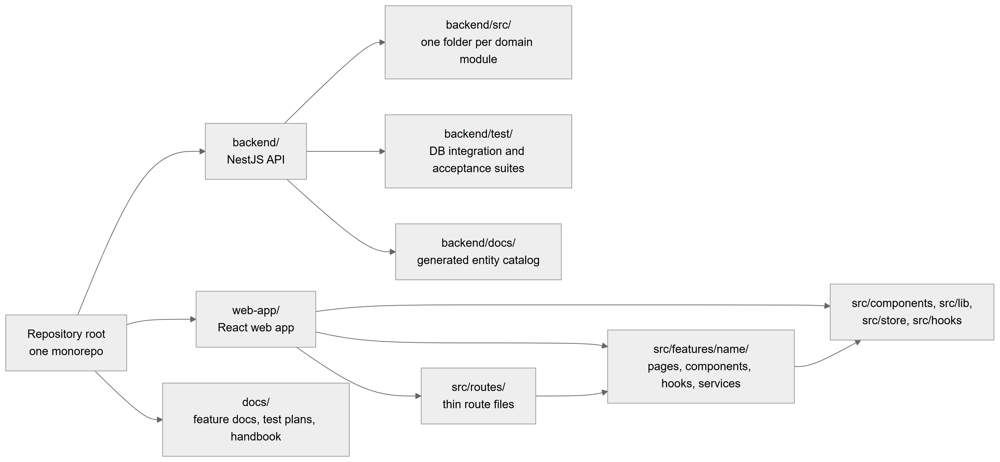

# Chapter 4 — Repository and tech stack

This chapter explains how the source code of the Platform is organised and which technologies it is built on. It is written for the product owner, who is a software engineer and needs a map of the code before reading any module chapter. Everything here was read from the repository itself: the folder tree, the two `package.json` files and the module registrations in the backend.

## 4.1 One repository, two applications

**Status:** [Implemented]

The Platform lives in a single Git repository (a "monorepo"). It holds two applications that are built and run separately:

- **`backend/`** — the API server. It is a NestJS application written in TypeScript. It talks to a PostgreSQL database through TypeORM, and, only when it runs as separate `api` and `worker` processes, to Redis for cross-process messages.
- **`web-app/`** — the web application that clinic staff, owners and super admins use in the browser. It is a React 19 application built with TanStack Start and Vite.

Next to them, `docs/` holds feature documents, test plans and this handbook. The backend also has its own `backend/docs/` folder with the generated entity catalog (`backend/docs/data-model/ENTITY_CATALOG.md`) and one generated module chapter.

*Figure 4.1 — The repository layout at the top level, and the main folders inside each application.*

The figure reads from left to right. A single box, "Repository root, one monorepo", has three arrows to its three main folders: `backend/` (the NestJS API), `web-app/` (the React web app) and `docs/` (feature docs, test plans and the handbook). The backend box branches into three folders: `backend/src/` with one folder per domain module, `backend/test/` with the database integration and acceptance suites, and `backend/docs/` with the generated entity catalog. The web-app box branches into `src/routes/` (thin route files), `src/features/<name>/` (pages, components, hooks and services) and the shared folders `src/components`, `src/lib`, `src/store` and `src/hooks`. Two further arrows show the direction of dependencies in the web app: route files point to feature folders, and feature folders point to the shared folders.

There is no workspace tool joining the two applications (no root `package.json`). Each one has its own `package.json`, its own `node_modules` and its own commands.

**Technical references:** `backend/package.json` · `web-app/package.json` · `README.md` (root)

## 4.2 The web application's real folder layout

**Status:** [Implemented]

The web app keeps business logic out of route files. A route file only declares the URL, an optional permission requirement and which feature page to render. The real layout under `web-app/src/` is:

| Folder | What it holds |
|---|---|
| `routes/` | 92 file-based route files for TanStack Router. Each one wraps a feature page in `DashboardLayout` and may declare `staticData: { can: … }`, the permission needed to open it (54 routes do). `__root.tsx` is the root route: it restores the session, redirects, and mounts the access providers. |
| `features/<name>/` | One folder per feature (about 30, for example `patients`, `appointments`, `queue`, `billing`, `roles`, `access`). Inside: `pages/`, `components/`, `hooks/` (TanStack Query and form hooks), `services/` (axios calls), and often `schemas/` (Zod), `types`, `lib/` and `utils/`. A feature's `index.ts` is its public barrel. |
| `components/` | Shared UI: `ui/` (shadcn/ui primitives), `layout/` (`DashboardLayout`, `Sidebar`, `Topbar`, `LocationSwitcher`), `shared/` (`DataTable`, `ConfirmDialog`, `TooltipButton`, `BackButton`, `DatePicker` and more), `feedback/` (`EmptyState`, `ErrorState`, `LoadingSkeleton`, `NoResultsState`), `forms/`, `data-display/`, `feature/`. |
| `lib/` | `api.ts` (the configured axios instance), `query-client.ts` (TanStack Query defaults), `currency.ts`, `formatters.ts`, `utils.ts`. |
| `store/` | Zustand stores: `useAuthStore.ts` (token, active organization and location, kept in memory only), plus small UI stores for patients, appointments, employees, navigation history and general UI. |
| `hooks/` | Cross-feature hooks such as `useBackNavigation`, `useDebounce`, `useTheme`. |
| `context/` | `FeatureFlagsContext.tsx` (the active features and the organization's specialty tags). |
| `test/` | Vitest setup. |

The table lists each top-level folder of `web-app/src/` and its role. The pattern to remember is: a route file is thin, a feature folder owns its screens and its API calls, and anything used by many features lives in `components/`, `lib/`, `store/` or `hooks/`.

**Where the CLAUDE.md conventions file differs.** The root `CLAUDE.md` describes a different, planned layout: route files under `src/app/`, shared code under `src/shared/`, and an `api/` folder in each feature. None of those folders exist. The code uses `src/routes/`, `src/components/`, `src/lib/`, `src/store/` and feature `services/` folders, as the table shows. Some feature folders also deviate from the planned shape (for example `organizations/` and `locations/` keep their views at the folder root, and a few components call the axios instance directly). This handbook always describes the real layout.

**Technical references:** `web-app/src/routes/__root.tsx` · `web-app/src/features/` · `web-app/src/lib/api.ts` · `web-app/src/store/useAuthStore.ts`

## 4.3 Backend module map

**Status:** [Implemented]

The backend is a "modular monolith": one NestJS application whose code is split into modules, one folder per business area under `backend/src/`. All modules are loaded by `AppModule` (`backend/src/app.module.ts`). Every folder is listed here with one line.

| Folder | One-line purpose |
|---|---|
| `access` | Permission catalog (70 permissions), bundles, the 5 system role templates, `AccessResolver`, `AccessGuard`, `GET /me/access`, sidebar layouts (`/admin/navigation`). |
| `appointments` | Booking: scheduling, validation, booking rules, doctor double-booking protection, appointment status changes. |
| `auth` | Sign-in, tokens, refresh, sessions endpoints, password reset, email verification, rate limiting, the JWT and tenant guards, `AuthorizationService`. OAuth code exists but is not registered. |
| `billing` | Charges, invoices, payments, allocations, refunds, discounts, expenses, cash close, ledgers, credit packages, doctor commissions. |
| `bootstrap` | `http.ts`: starts an HTTP process (body limits, validation pipe, exception filter, CORS, cookies). |
| `chairs` | One entity file only. No module registers it, so it does nothing at runtime. |
| `common` | Shared building blocks: audit, clock (`ClockService`), database helpers and migrations runner, decorators, `ResponseWrapper`, exception filter, idempotency, Redis connection helper, number sequences, file storage, request context. |
| `employees` | The employee person record, assignments, employment roles (including the `/admin/roles` screen API), schedules, leave, doctor availability overrides. |
| `encounters` | Patient encounters: the clinical record of one consultation. |
| `engine` | Generic workflow engine: specialties, versioned form schemas, versioned workflows, stage templates (Config Studio). |
| `feature-flags` | Feature catalog, entitlement, owner switches, location overrides, `FeatureFlagGuard`. |
| `inventory` | Items, suppliers, purchase orders, stock movements, consumption, low-stock job. |
| `lab-access` | A lab's answers to orders through the lab portal, magic links or a clinic proxy; work-order QR. |
| `lab-billing` | Billing the patient for lab work. |
| `lab-catalog` | Lab services, price windows, clinic-to-lab service mappings, order templates. |
| `lab-finance` | Glue between lab billing, lab payables, commissions and the journals (no endpoints of its own). |
| `lab-orders` | Lab orders: drafts, submit, revisions, messages, attachments, work-order print. |
| `lab-payables` | Vendor bills from labs, lab payments, statements, payables reports. |
| `lab-production` | Production stages, technician assignments, shipments, remakes, warranties. |
| `labs` | Platform lab directory, lab staff, each clinic's lab list, lab portal foundation. |
| `locations` | Locations (branches) and location settings. |
| `migrations` | Three migration files; the first is a legacy baseline that never runs. |
| `notifications` | In-app notification rules, templates, outbox, quiet hours, the sending loop. |
| `organizations` | Organizations (clinics), ownership, legacy organization settings. |
| `patients` | The patient record and its sub-records (vitals, dental info, teeth chart, documents, consents, recalls, referrals, insurance, feedback, plans), import and export, patient audit trail. |
| `payroll` | Monthly payroll records and the month-end payroll job. |
| `plan-templates` | Treatment plan templates. |
| `prescriptions` | Prescriptions, medicine directory, templates, presets, doctor signatures, print layouts. |
| `queue` | Doctor-wise queue: sessions, entries, tokens, `QueueOrchestrator`, selection engine, policies, Socket.IO gateway, outbox relay, queue jobs. |
| `reports` | Finance dashboard, clinic overview and 37 report definitions with Excel and PDF export (owns no tables). |
| `session` | User session records (the refresh-token sessions). |
| `settings-registry` | `config_values` cascade (platform, organization, location) used by the theme and newer settings. |
| `subscriptions` | Plans, trial, grace, read-only mode, manual subscription payments, self-signup and the setup wizard, `SubscriptionGuard`. |
| `treatments` | Treatments: clinical work performed. |
| `user` | User accounts (logins), user admin, staff logins, owner creation. |

The table names every folder in `backend/src/` and what it is responsible for. Besides the folders, `backend/src/` holds the entry points `main.ts`, `main.api.ts` and `main.worker.ts` (one per process role, explained in Chapter 6), `app.module.ts`, a placeholder `app.controller.ts` / `app.service.ts` (a hello endpoint) and `data-sourse.ts`, the TypeORM command-line data source (the misspelling is the real file name).

**Note on CLAUDE.md.** `CLAUDE.md` describes inventory, invoices, reports and notifications as stubs. In the code all four are built. Only `chairs` is an entity with no module.

**Technical references:** `backend/src/app.module.ts` · `AppModule` · `backend/src/*/*.module.ts`

## 4.4 Backend technology

**Status:** [Implemented] (with the exceptions noted in the table)

| Package (major version) | Purpose in the Platform |
|---|---|
| NestJS 11 (`@nestjs/core`, `common`, `platform-express`) | The application framework: modules, controllers, dependency injection, guards, pipes, interceptors, running on Express. |
| `@nestjs/typeorm` 11 + TypeORM 0.3 + `pg` 8 | Database access to PostgreSQL: entities, repositories, transactions, schema synchronize, migrations. `pg` is also used directly for `LISTEN` connections. |
| `@nestjs/config` 4 | Reads environment variables. |
| `@nestjs/jwt` 11, `@nestjs/passport` 11, `passport-jwt`, `passport-local` | Access tokens and the JWT strategy behind `JwtAuthGuard`. |
| `passport-google-oauth20`, `passport-github2` | OAuth strategies. Present but not registered, so OAuth sign-in is off [Not implemented]. |
| `bcrypt` 6 | Password hashing. |
| `cookie-parser` | Reads the httpOnly refresh-token cookie. |
| `class-validator`, `class-transformer` | DTO validation and conversion in the global `ValidationPipe`. |
| `@nestjs/websockets` 11, `@nestjs/platform-socket.io`, `socket.io` 4 | The realtime gateway at `/realtime`. |
| `ioredis` 5 | Redis pub/sub for realtime events and cache invalidation across processes (split `api`/`worker` mode only). |
| `@nestjs/schedule` 6 | Scheduled jobs (`@Cron`, `@Interval`), loaded only in processes that run jobs. |
| `@nestjs/cache-manager`, `cache-manager` | Listed as dependencies; no source file imports them [Not implemented]. |
| `@nestjs/mongoose`, `mongoose` | Listed as dependencies; no source file imports them [Not implemented]. |
| `@nestjs/swagger` | Listed; no source file imports it, so there is no generated API documentation [Not implemented]. |
| `cloudinary` 2, `multer` 2 | File uploads (logos, documents, attachments). |
| `nodemailer` 7 | Outgoing email (verification and password reset). |
| `exceljs` 4 | Excel export of reports. |
| `pdf-lib`, `pdfmake`, `fontkit`, `@fontsource/noto-nastaliq-urdu`, `@fontsource/noto-naskh-arabic` | PDF generation, including Urdu text. |
| `axios`, `slugify`, `useragent`, `rxjs`, `reflect-metadata` | HTTP client, slug generation, user-agent parsing for sessions, and NestJS runtime needs. |

The table lists the backend's runtime dependencies by name and what each is for. Development dependencies are the usual NestJS set: the Nest CLI, TypeScript 5, Jest 29 with `ts-jest`, Supertest, `socket.io-client` (for tests), ESLint 9 and Prettier 3.

**Technical references:** `backend/package.json` · `backend/src/app.module.ts`

## 4.5 Web application technology

**Status:** [Implemented]

| Package (major version) | Purpose in the Platform |
|---|---|
| React 19, `react-dom` 19 | The UI library. |
| TanStack Start 1 (`@tanstack/react-start`) with Vite 7 and the Nitro plugin | The application framework and build. Vite builds the app; the TanStack Start and Nitro plugins produce the server bundle that serves it. |
| TanStack Router 1 (`@tanstack/react-router`, `router-plugin`) | File-based routing from `src/routes/`; the generated route tree is `routeTree.gen.ts`. |
| TanStack Query 5 | Server-state cache: queries, mutations, invalidation. |
| TanStack Form 1 | Forms. |
| TanStack Table 8 | Tables in list views. |
| Zustand 5 | Client state: the auth store and small UI stores. |
| Zod 4 | Form schemas. |
| axios 1 | HTTP client with interceptors (`src/lib/api.ts`). |
| `socket.io-client` 4 | Realtime connection to `/realtime`. |
| Tailwind CSS 4, shadcn/ui (Radix UI primitives), `class-variance-authority`, `clsx`, `tailwind-merge`, `lucide-react` | Styling, components and icons. |
| FullCalendar 6 | Appointment calendar views. |
| Recharts 3 | Charts. |
| `@dnd-kit` | Drag and drop (for example the sidebar builder). |
| `date-fns` 4, `react-day-picker` | Dates and the date picker. |
| `sonner` | Toast messages. |

The table lists the web app's runtime dependencies and their roles. For tests the web app uses Vitest 3 with Testing Library and jsdom; formatting and linting use Prettier and ESLint.

**Technical references:** `web-app/package.json` · `web-app/vite.config.ts` · `web-app/vitest.config.ts`

## 4.6 What the repository does not contain

**Status:** [Not implemented]

There is no Dockerfile, no container compose file, no CI pipeline configuration (no `.github/` folder) and no hosting configuration in the repository. How the Platform is deployed is therefore not described by code. Chapter 6 explains what the code expects from a deployment.

**Technical references:** repository root listing
