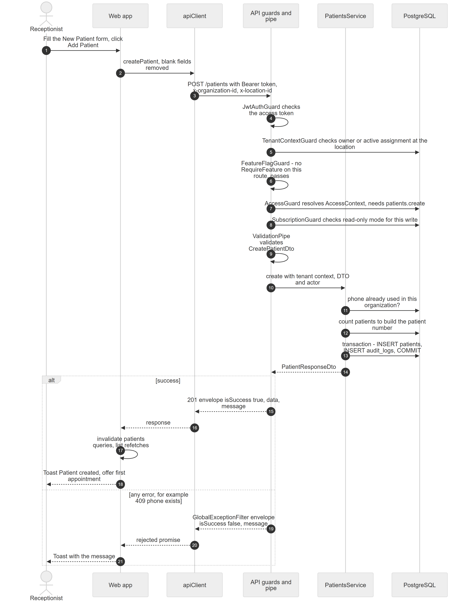
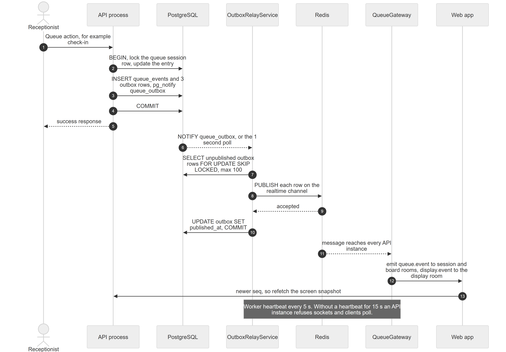

# Chapter 5 — Request lifecycle: from a click to the database and back

This chapter follows one real request through the whole Platform: from a button in the web app, through the API's security checks, into a database transaction, and back to the screen. It is written for the product owner who wants to know exactly which layers every request passes and where an error can stop it. A second part follows a realtime event from a database commit to every open screen.

## 5.1 The example: registering a patient

**Status:** [Implemented]

The traced request is the one a receptionist makes when registering a new patient. On the Patients page the receptionist clicks **Create**, fills the multi-step **New Patient** form and clicks **Add Patient** on the last step. The web app sends `POST /patients`, the API stores the patient and an audit record, and the web app shows the toast "Patient created" and offers to book a first appointment.

This request is a good example because it touches every common layer: the token and tenant headers, all five global guards, DTO validation, a permission check (`patients.create`), a database transaction with an audit row, the response envelope and the cache refresh in the web app. It does not use realtime events; section 5.8 covers those with a queue action instead.

*Figure 5.1 — Sequence of one write request, `POST /patients`, from the receptionist's click to the toast.*

The diagram has six participants from left to right: the Receptionist, the Web app, the `apiClient` axios instance, the API's guards and validation pipe, `PatientsService`, and PostgreSQL. (1) The receptionist fills the New Patient form and clicks Add Patient. (2) The web app calls `createPatient`, which first removes blank optional fields. (3) The axios instance sends `POST /patients` with the Bearer token and the `x-organization-id` and `x-location-id` headers. (4) `JwtAuthGuard` checks the access token. (5) `TenantContextGuard` checks in the database that the user owns the organization or has an active assignment at that location. (6) `FeatureFlagGuard` finds no `@RequireFeature` on this route and lets it pass. (7) `AccessGuard` resolves the user's access context and requires `patients.create`. (8) `SubscriptionGuard` checks that the clinic is not in read-only mode, because this is a write. (9) The `ValidationPipe` validates the body against `CreatePatientDto`. (10) The controller calls `PatientsService.create` with the tenant context, the DTO and the actor. (11) The service checks that the phone number is not already used in the organization, (12) counts existing patients to build the next patient number, and (13) inserts the patient and an `audit_logs` row in one transaction and commits. (14) It returns a `PatientResponseDto`. An "alt" box then shows two outcomes. On success the API returns a 201 response whose body is the envelope with `isSuccess: true`, `data` and `message`; the web app invalidates its cached patient lists, which refetch, and shows the toast "Patient created" with the option to book a first appointment. On any error, for example 409 because the phone exists, the `GlobalExceptionFilter` returns the envelope with `isSuccess: false` and a message; the axios promise rejects and the web app shows the message in a toast.

**Technical references:** `web-app/src/features/patients/components/CreatePatientModal.tsx` · `useCreatePatient` · `backend/src/patients/patients.controller.ts` · `PatientsService.create`

## 5.2 In the browser: hook, service and the axios instance

**Status:** [Implemented]

**In simple terms.** The screen never talks to the server directly. It asks a small "mutation hook" to do the work; the hook calls a service function; the service function uses one shared HTTP client that adds the user's credentials and the clinic and branch the user is working in.

**Technically.**

- The form component calls `useCreatePatient().mutateAsync(data)`. This is a TanStack Query mutation whose `mutationFn` is `createPatient` from `features/patients/services/patients.api.ts`.
- `createPatient` drops fields that are empty strings (the API would reject an empty `dob` or `email`) and calls `api.post('/patients', body)`. It returns `data.data`, the payload inside the response envelope.
- `api` is the axios instance `apiClient` in `web-app/src/lib/api.ts`:
  - Base URL: the `VITE_API_BASE_URL` build variable, default `http://localhost:5000`.
  - Timeout: 15 seconds. `withCredentials: true`, so the browser sends the refresh-token cookie.
- **Request interceptor.** Before every request it reads the Zustand auth store (`useAuthStore`), which lives in memory only and is never written to browser storage:
  - adds `Authorization: Bearer <access token>` when a token exists;
  - for lab portal URLs (`/lab-portal/...`) adds only `x-lab-id` and no clinic headers;
  - otherwise adds `x-organization-id` (the active organization) and `x-location-id` (the active location).
- **Response interceptor.** Described with the error path in section 5.7.

TanStack Query is configured once in `web-app/src/lib/query-client.ts`: queries are fresh for 5 minutes, are kept for 10 minutes, retry twice and do not refetch when the window regains focus; mutations retry once. Individual hooks may override these values (the access query, for example, uses 30 seconds and refetches on focus).

**Technical references:** `web-app/src/lib/api.ts` · `apiClient` · `web-app/src/lib/query-client.ts` · `web-app/src/store/useAuthStore.ts`

## 5.3 Arriving at the API: process start-up and Express middleware

**Status:** [Implemented]

An HTTP process is started by `bootstrapHttp(role)` in `backend/src/bootstrap/http.ts` (Chapter 6 explains the roles). It configures, in this order:

1. The NestJS application with Nest's own body parser switched off.
2. JSON and URL-encoded body parsers with a **5 MB** limit (consent signatures are sent as inline images).
3. The global `ValidationPipe` (section 5.5).
4. The global exception filter `GlobalExceptionFilter`.
5. CORS for one origin, `CORS_ORIGIN` (default `http://localhost:3000`), with credentials allowed.
6. `cookie-parser`, so the refresh cookie can be read.
7. A small middleware that opens a per-request context (`RequestContextService`, based on Node's AsyncLocalStorage).
8. Listening on `PORT` (default 5000).

Two middleware classes exist in `common/middleware/` (`ContextMiddleware` and `TenantContextMiddleware`) but **no module registers them** [Not implemented]. Tenant checks are done by a guard instead.

For every request NestJS then runs its fixed pipeline: Express middleware → global guards → interceptors (on the way in) → pipes → controller method → interceptors (on the way out) → exception filter if anything threw. The next sections walk this pipeline.

**Technical references:** `backend/src/bootstrap/http.ts` · `bootstrapHttp` · `backend/src/common/services/request-context.service.ts`

## 5.4 The five global guards

**Status:** [Implemented]

Five guards are registered as global guards (`APP_GUARD`) in `backend/src/app.module.ts`. NestJS runs them in registration order, and the first one that refuses stops the request.

| # | Guard | Question it answers | Skips when | Refusal |
|---|---|---|---|---|
| 1 | `JwtAuthGuard` | Is there a valid, unexpired access token? | The method and path match an entry in `PUBLIC_ROUTES` (login, register, refresh, password reset, email verification, logout, the public theme, the TV display state, lab magic links). | 401 with a message such as "Token has expired. Please refresh your token." |
| 2 | `TenantContextGuard` | Does this user have access to the organization and location in the headers? | `@Public()`; `@ContextFree()`; super admins. `@RequireSuperAdmin()` routes are checked here instead (non-super-admins get 403 "Super admin access required"). | 400 "Missing tenant context. Please select an organization and location." or 403 "You do not have access to this organization/location". |
| 3 | `FeatureFlagGuard` | Is every feature named by `@RequireFeature` active for this organization and location? | No `@RequireFeature` on the route; `@Public()`; super admins. | 403 'The "<key>" feature is not enabled for this location'. |
| 4 | `AccessGuard` | Does the user hold every permission in `@Can(...)`, or is the user a member for `@AnyMember()`? | `@Public()`; routes with neither marker pass (but still get the access context attached when an organization is known). | 403 with `{ code: 'NO_PERMISSION', missing: [...] }`. |
| 5 | `SubscriptionGuard` | If this is a write, is the clinic out of read-only mode? | Reads (`GET`, `HEAD`, `OPTIONS`); `@Public()`; super admins; paths starting `/auth/`, `/account`, `/me/`, `/admin/subscriptions`; requests with no organization. | 402 with `code: 'SUBSCRIPTION_EXPIRED'`. |

The table lists the guards in the order they run, what each checks, when it steps aside, and what the caller receives when it refuses. In the patient example all five apply: the route is not public, it carries `@Can('patients.create')`, and it is a write.

Details worth knowing:

- **Access check for the tenant.** `TenantContextGuard` calls `AuthorizationService.validateAccess`. An owner passes for any active location of the organization. Anyone else needs an active assignment at that exact location with portal access switched on. When it passes, the guard stores `request.tenantContext = { organizationId, locationId }`.
- **`@Public()` and the JWT guard.** `JwtAuthGuard` only reads the `PUBLIC_ROUTES` list (`auth/constants/public-routes.ts`). The `@Public()` decorator alone does not let an unauthenticated request through; a route without a token must also be listed there.
- **No path-prefix skips.** `TenantContextGuard` deliberately has no list of path prefixes that bypass it; it relies only on the decorators.
- **Caching.** The access context is cached per user, organization, location and access version (Chapter 11); the enabled-feature set for 30 seconds (Chapter 10); read-only status for 30 seconds per process.

**Technical references:** `backend/src/app.module.ts` · `JwtAuthGuard` · `TenantContextGuard` · `FeatureFlagGuard` · `AccessGuard` · `SubscriptionGuard` · `backend/src/auth/constants/public-routes.ts`

## 5.5 Validation pipe and the controller

**Status:** [Implemented]

**Validation.** One global `ValidationPipe` validates every request body, query and parameter that is typed as a DTO class with `class-validator` rules. Its settings:

| Setting | Effect |
|---|---|
| `transform: true` | The plain JSON body becomes an instance of the DTO class. |
| `whitelist: true` | Properties without a validation decorator are removed. |
| `forbidNonWhitelisted: true` | Instead of silently removing unknown properties, the request is refused with 400 (for example "property id should not exist"). |
| `enableImplicitConversion: true` | Query strings such as `page=2` become numbers when the DTO says so. |

The table lists the four options and their effect. The strict `forbidNonWhitelisted` rule matters for owners: a screen that sends a whole database row back (with `id` or timestamps) is refused, which is why some older edit screens fail (the Organizations and Locations chapter, Chapter 9, lists them).

**Controller.** In the example, `PatientsController.create` receives:

- `@Body() dto: CreatePatientDto` — the validated body;
- `@ActiveTenant() ctx` — `{ organizationId, locationId }` from `request.tenantContext` (or the headers);
- `@RequestActor(ActorSide.CLINIC) actor` — who is acting, for the audit trail.

Other handlers also take `@Access() access`, the resolved access context, when they need scope rules (Chapter 11). Controllers contain no business rules; they call a service and wrap the result.

**Technical references:** `backend/src/bootstrap/http.ts` · `backend/src/common/decorators/active-tenant.decorator.ts` · `backend/src/common/audit/request-actor.decorator.ts`

## 5.6 Service, transaction and database

**Status:** [Implemented]

`PatientsService.create` shows the usual service pattern:

1. **Checks that read.** The phone must be unique inside the organization (409 "A patient with this phone number already exists in this organization"). The next patient number is built from a count of the organization's patients, including deleted ones (`P-00001`, `P-00002`, …).
2. **One transaction for the write.** `dataSource.transaction(...)` saves the `patients` row and writes the audit record through `recordPatientChange` with the same entity manager. Both rows commit together or not at all.
3. **A response DTO.** The saved entity is mapped to `PatientResponseDto`.

Other modules follow the same shape with stronger guarantees where money or queues are involved: row locks (`pessimistic_write`), optimistic version checks, idempotency keys for queue actions, and outbox rows written in the same transaction (section 5.8). All tenant data is filtered by `organization_id` in the service; data that has a scoped permission is filtered further with `applyScope` (Chapter 11).

The database is PostgreSQL. The API connects with the `DATABASE_URL` connection string and always requests an SSL connection.

**Technical references:** `backend/src/patients/patients.service.ts` · `PatientsService.create` · `recordPatientChange`

## 5.7 The response envelope and the error path

**Status:** [Implemented]

**Success.** Every controller returns `ResponseWrapper.success(data, message)`. The JSON body is always the same envelope:

| Field | Meaning |
|---|---|
| `data` | The payload (here the new patient). |
| `message` | A human-readable message, for example "Patient created successfully". |
| `isSuccess` | `true`. |
| `httpStatusCode` | Always `200` inside a success envelope, even when the HTTP status is 201. |
| `error`, `devMessage` | Empty on success. |

The table describes the five fields of the envelope. The web app reads `res.data.data` for the payload. On the way out, the global `VisibleIfInterceptor` removes fields marked `@VisibleIf` that the caller may not see (for example treatment prices without `patients.price.view`); patient records have no such fields.

Back in the browser, the mutation's `onSuccess` invalidates every query whose key starts with `patients`, so open patient lists refetch, and shows the toast "Patient created". The modal then switches to an optional "Book First Appointment" step.

**Errors.** Any exception, anywhere after the middleware, reaches `GlobalExceptionFilter`. It logs the error and answers with the HTTP status of the exception (500 for unexpected errors) and an envelope with `isSuccess: false`, `message` (the first message when there are several, such as validation errors; "Something went wrong" for unexpected errors), `error` (the exception body, for example `{ code: 'NO_PERMISSION', missing: [...] }`) and `devMessage`.

| Status | Typical cause |
|---|---|
| 400 | Validation failed, or tenant headers missing. |
| 401 | No token, invalid token or expired token. |
| 402 | `SUBSCRIPTION_EXPIRED`: the clinic is read-only. |
| 403 | No access to the organization or location, feature not active, `NO_PERMISSION`, or super admin required. |
| 404 | Record not found in this organization. |
| 409 | Business conflict, such as a duplicate phone number. |
| 500 | Unexpected error. |

The table maps the common status codes to their causes. Screens show `err.response.data.message` in a toast, or a fallback text such as "Failed to create patient".

**Automatic token refresh.** The access token lives 15 minutes. When any request gets **401**, the axios response interceptor:

1. ignores 401s from `/auth/login` and `/auth/refresh` themselves;
2. if a refresh is already running, parks the request in a queue;
3. otherwise calls `POST /auth/refresh` (the httpOnly cookie carries the session id and refresh token), stores the new token and context in the auth store, replays the queued requests and retries the original request once;
4. if the refresh fails, or the retried request gets 401 again, clears the auth store and sends the browser to `/login`.

**Technical references:** `backend/src/common/dtos/ResponseWrapper.ts` · `backend/src/common/exceptions/HttpExceptionHandler.ts` · `GlobalExceptionFilter` · `VisibleIfInterceptor` · `web-app/src/lib/api.ts`

## 5.8 The realtime path: from a commit to every open screen

**Status:** [Implemented]

**In simple terms.** When something changes in a doctor's queue, every screen showing that queue (the doctor screen, the reception board, the waiting-room TV) must update within moments, even when the Platform runs several API servers. The Platform does this with a "transactional outbox": the change and a "please announce this" note are saved together; a separate worker reads the notes and broadcasts them; every API server pushes them to the browsers that are listening.

*Figure 5.2 — Sequence of a queue change travelling from the database transaction, through the outbox relay and Redis, to the web app.*

The diagram has seven participants: the Receptionist, the API process, PostgreSQL, the `OutboxRelayService` (in the worker), Redis, the `QueueGateway` (the Socket.IO gateway in every API process) and the Web app. (1) The receptionist performs a queue action, for example a check-in. (2) The API begins a transaction, locks the queue session row and updates the queue entry. (3) In the same transaction it inserts a `queue_events` audit row and three `outbox` rows, and calls `pg_notify('queue_outbox')`. (4) It commits. (5) The receptionist gets the success response. (6) PostgreSQL delivers the `queue_outbox` notification to the relay (if the notification is missed, the relay also polls every second). (7) The relay selects up to 100 unpublished outbox rows with `FOR UPDATE SKIP LOCKED`. (8) It publishes each row to Redis on the realtime channel, and (9) Redis confirms. (10) The relay stamps `published_at` on those rows and commits. (11) Redis delivers the message to every API instance. (12) Each gateway emits `queue.event` to the session room and the location board room, and `display.event` to the location's display room. (13) The web app sees a newer sequence number and refetches the screen's snapshot over HTTP. A note across the relay and the gateway says that the worker sends a heartbeat every 5 seconds, and that an API instance that has heard no heartbeat for 15 seconds refuses socket connections, so clients fall back to polling.

Facts behind the figure:

- **Three outbox rows per change**, one per room: `session:<sessionId>` (one doctor's queue), `location:<locationId>:board` (the reception board) and `location:<locationId>:display` (the TV). Payloads carry ids, statuses, tokens and a sequence number, never patient names.
- **At-least-once delivery.** If Redis does not accept the batch, the relay's transaction rolls back and the rows are retried. Clients drop duplicates by sequence number.
- **Rooms and access.** Clients connect to the `/realtime` Socket.IO namespace with their access token and `subscribe` to rooms. The gateway checks access per room: display rooms are open without login; session and board rooms need access to that location; `org:<organizationId>` needs access to the organization.
- **Access changes use the same sockets.** When an organization's access version changes (a role edit, a feature switch), every process hears it over a separate Redis channel and the gateway emits `access.changed` to the `org:<id>` room. The web app then refetches `GET /me/access` (Chapter 11).
- **Single-process mode.** In the `all` role (development), the relay hands rows straight to the local gateway and Redis is not needed for realtime.
- **Notifications** use the same pattern with their own outbox table (`notification_outbox`) and relay loop (Chapter 6).

**Technical references:** `backend/src/queue/services/queue-orchestrator.service.ts` · `QueueOrchestrator.emit` · `backend/src/queue/realtime/outbox-relay.service.ts` · `RedisRealtimePublisher` · `RedisRealtimeSubscriber` · `QueueGateway` · `web-app/src/features/access/hooks/useAccessSocket.ts`

## 5.9 Requests that take a different path

**Status:** [Implemented]

- **Public requests** (login, register, refresh, password reset, verify email, logout, the login-page theme, the TV display state, lab magic links) skip the token check because they are listed in `PUBLIC_ROUTES`, and skip the other guards because they carry `@Public()`.
- **Context-free requests** (`@ContextFree()`) skip the tenant and access checks and check access themselves in the handler. Examples: `/auth/select-location`, `/auth/switch-location`, `GET /me/access`, `GET /feature-flags/my-features`, every `/locations` endpoint.
- **Super-admin requests** (`@RequireSuperAdmin()`) need no tenant headers; the tenant guard checks the super-admin role instead.
- **Lab portal requests** (`/lab-portal/...`) carry `x-lab-id` instead of clinic headers and are protected by their own lab portal guard.

**Technical references:** `backend/src/common/decorators/` · `backend/src/auth/auth.controller.ts` · `backend/src/labs/`
