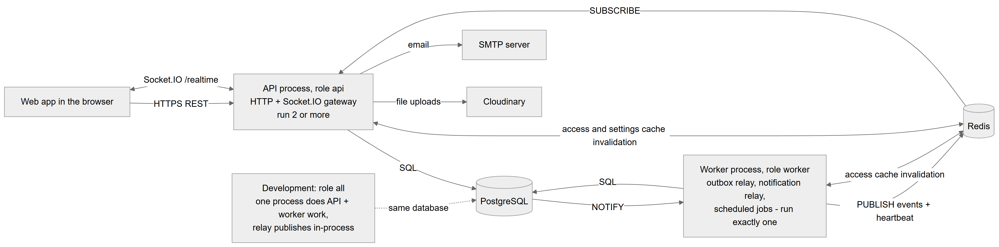

# Chapter 6 — Processes, deployment and environments

This chapter explains how the backend of the Platform runs as operating-system processes, what each process does, what Redis is used for, who owns the database schema, and which environment variables the code reads. It is written for the product owner who has to run or deploy the Platform. Everything comes from the backend code and the database folder. **Updated 2026-11-19:** the repository now has Dockerfiles, a compose file and a CI workflow (Section 6.5), the schema is hand-written SQL (Section 6.4), and the job list and environment-variable table below were refreshed. Hosting and process-manager configuration are still not in the repository.

## 6.1 One codebase, three process roles

**Status:** [Implemented]

The backend is one NestJS application, but it can start in one of three **process roles**. The role decides which parts are switched on. The roles are defined in `backend/src/common/runtime/process-role.ts`.

| Role | Entry file | Start command | What it runs | How many |
|---|---|---|---|---|
| `all` | `main.ts` | `npm run start:dev` (watch mode), `npm run start:prod` (after a build) | Everything: HTTP API, Socket.IO gateway, outbox relay, notification relay, scheduled jobs. The relay hands realtime events straight to the local gateway, so Redis is not needed at all. | One. The development default and the low-cost production setup. |
| `api` | `main.api.ts` | `npm run start:api` (after a build) | HTTP API and the Socket.IO gateway. Receives realtime events from the worker through Redis. Runs no background jobs. | Two or more, each with its own port. |
| `worker` | `main.worker.ts` | `npm run start:worker` (after a build) | Outbox relay, notification relay and every scheduled job. No HTTP server at all. | **Exactly one.** |

The table lists each role with its entry file, its npm script, what it runs and how many copies should run. The split exists so that the API can be scaled out without running the background jobs more than once: scheduled jobs are only loaded where jobs run (`runsJobs(role)` is true for `all` and `worker`), and HTTP is only started where it is needed (`runsHttp(role)` is true for `all` and `api`).

How the role reaches the code: each entry file calls `AppModule.forRole(role)`. That method adds, per role, the TypeORM connection (it never changes the schema: `synchronize` and migrations are off for every role), the `ScheduleModule` (only where jobs run), `QueueRuntimeModule.forRole(role)` (gateway, Redis subscriber, relay and queue jobs as needed), `NotificationsRuntimeModule.forRole(role)` (the notification sending loop only where jobs run) and `PatientRetentionRuntimeModule.forRole(role)` (the patient-data retention job, only where jobs run).

The `start:prod`, `start:api` and `start:worker` scripts run the compiled `dist/src/...` files, so `npm run build` must run first. The `api` and `worker` roles refuse to start without `REDIS_URL`.

**Technical references:** `backend/src/common/runtime/process-role.ts` · `ProcessRole` · `runsHttp` · `runsJobs` · `backend/src/main.ts` · `backend/src/main.api.ts` · `backend/src/main.worker.ts` · `AppModule.forRole`

*Figure 6.1 — The production process layout: API processes, one worker, PostgreSQL, Redis and the outside services, plus the single development process.*

The figure shows the web app in the browser on the left. It sends HTTPS REST requests to the "API process, role api", which runs HTTP and the Socket.IO gateway and is meant to run two or more times; a two-way arrow labelled "Socket.IO /realtime" connects the same two boxes. The API process sends SQL to PostgreSQL, uploads files to Cloudinary and sends email through an SMTP server. The "Worker process, role worker" runs the outbox relay, the notification relay and the scheduled jobs, and must run exactly once; it also sends SQL to PostgreSQL, and PostgreSQL sends it NOTIFY messages. The worker publishes realtime events and a heartbeat to Redis, and Redis delivers them to the API process through a subscription. Two more two-way arrows connect Redis with the API process (access and settings cache invalidation) and with the worker (access cache invalidation). A separate box at the bottom, "Development: role all", shows that in development one process does the work of both API and worker and publishes realtime events in-process; a dotted line shows that it uses the same database.

## 6.2 What runs where

**Status:** [Implemented]

| Component | `all` | `api` | `worker` |
|---|:---:|:---:|:---:|
| HTTP API (Express, port `PORT`) | yes | yes | no |
| Socket.IO gateway `/realtime` (`QueueGateway`) | yes | yes | no |
| Redis realtime subscriber (`RedisRealtimeSubscriber`) | no | yes | no |
| Queue outbox relay (`OutboxRelayService`) | yes, publishes in-process | no | yes, publishes to Redis |
| Notification relay (`NotificationRelayService`) | yes | no | yes |
| Scheduled jobs (`@Cron`, `@Interval`) | yes | no | yes |
| Schema changes at start-up | no | no | no (the app never changes the schema) |
| Feature catalog seeding and role template seeding at boot | yes | yes | yes |
| Access and settings cache invalidation bus (Redis, only if `REDIS_URL` is set) | local only | yes | yes |

The table shows, for each running component, in which role it is active. Seeding runs in every process because every process loads every domain module; both seeders insert only missing rows and ignore conflicts, so concurrent processes are safe.

**The relays.** Both relays are woken by PostgreSQL `LISTEN`/`NOTIFY` on a dedicated database connection and also poll as a fallback: the queue relay every second, the notification relay every two seconds (which also picks up retries and messages held back by quiet hours). If the `LISTEN` connection fails, they poll only.

**Scheduled jobs.** There are now twelve (eight at the 2026-10-28 snapshot; the new ones are marked). None of them sets a cron timezone. The backend forces its process timezone to UTC (`bootstrap/utc.ts`), so every cron time in the next table is **UTC**, not the location's.

| Job | Schedule | What it does |
|---|---|---|
| `queue-no-show-marker` | every 60 seconds | Marks booked patients who never checked in, past start time plus the allowed lateness, as no-show. |
| `queue-call-timeout` | every 15 seconds | Skips a called patient who never came, when that queue setting is on. |
| `queue-session-day-end` | every 5 minutes | Closes empty queue sessions from a past clinic day; sessions with waiting patients are left for an admin and logged. |
| `queue-cleanup` | every day at 03:15 UTC | Deletes idempotency keys older than 24 hours and published outbox rows older than 7 days. |
| Patient credits expiry | every day at 01:00 UTC | Marks active patient credits whose expiry date is before today (UTC midnight) as expired. |
| `billing-invariants` | every day at 02:30 UTC | Checks the money invariants for every patient with billing rows and logs violations. Read-only. |
| Inventory alerts | every day at 08:00 UTC | Finds low-stock and expiring items where inventory and inventory alerts are on, writes a log line and, since the notification project, sends the `inventory.low_stock` and `inventory.expiring` digests to the owners and inventory managers (in-app and email) [Implemented]. |
| `month-end-payroll` | on the 1st of each month at 05:00 UTC | Generates payroll for the previous month for every active location. |
| `subscription-reminders` (new) | every day at 04:00 UTC | Notifies clinic owners 7, 3 and 1 days before a trial or plan ends, and when it ended. |
| `lab-order-overdue` (new) | every hour at minute 5 | Sends `order.overdue` to the ordering doctor when a lab order passes its expected date. |
| `patient-retention` (new) | every day at 03:15 UTC | Deletes ended patient sessions, product events and expired login codes after their retention periods (env vars in 6.6). |
| Medication sweep (new) | every 5 minutes, and 30 s after start | Repairs missed medication-schedule syncs for recently finalized prescriptions of patients linked to the patient app. |

The table lists each job, how often it runs and its effect. The queue jobs re-check state under the session lock through `QueueOrchestrator`, so running one twice is harmless. The queue jobs decide "which clinic day" with the location's timezone through `ClockService`; the cron trigger times themselves follow the UTC process clock. The appointment reminder for the patient app is not a cron job: it is a delayed outbox row (`scheduled_for`, 24 hours before the appointment) created at booking time. The payroll job's code comment says 00:05, but the cron expression means 05:00.

**Technical references:** `backend/src/queue/queue-runtime.module.ts` · `backend/src/notifications/notifications-runtime.module.ts` · `backend/src/queue/jobs/queue-jobs.service.ts` · `BillingInvariantJob` · `InventoryAlertService` · `PayrollService.runMonthEndPayroll` · `PatientCreditsService.checkExpiredCredits`

## 6.3 What Redis is used for

**Status:** [Implemented]

Redis is used only for messages between processes. No business data is stored in it.

| Use | Channel or name | Publishers → listeners | Without Redis |
|---|---|---|---|
| Realtime queue events | the queue realtime channel | Worker relay → every API instance; worker heartbeat every 5 s | In `all` mode not needed. In split mode the relay keeps rows unpublished and retries; API instances refuse sockets after 15 s without a heartbeat and clients poll. |
| Access changes | the access-changed channel | Any process that bumps an organization's access version → every process (access cache, feature cache, socket `access.changed`) | Only the process that made the change hears it; others catch up through their cache lifetimes (15 s for the access version, 30 s for features). |
| Settings cache invalidation | `settings-registry:invalidate` | Any process → every process | Other processes catch up through the settings cache lifetime. |

The table lists the three uses of Redis, the channel names, who talks to whom and what happens when Redis is unavailable. Redis connections are created to fail fast (no offline queue) and reconnect with back-off. The connection string is `REDIS_URL`. When it is unset (single `all` process) no Redis connection is opened at all: the access and settings buses deliver only inside the process, which is the only one. The `api` and `worker` roles refuse to start without it. The exact channel names are defined in `realtime-bus.ts` and `access-change-bus.ts`.

Login rate limiting does not use Redis: attempts are counted in each process's memory, so with several API instances each instance counts on its own.

**Technical references:** `backend/src/common/redis/redis-connection.ts` · `backend/src/queue/realtime/realtime-bus.ts` · `AccessChangeBus` · `backend/src/settings-registry/settings-cache-bus.ts` · `backend/src/auth/guards/rate-limiter.guard.ts`

## 6.4 Who owns the database schema

**Status:** [Implemented] (rewritten 2026-11-19; the 2026-10-28 text described TypeORM `synchronize` and runtime migrations, which no longer exist)

**In simple terms.** The table structure is written by hand as SQL files in `backend/database/`. The application never creates or alters a table. An operator runs the scripts against the database, once for a new database and then one change script per later change.

**Technically.**

- **Where.** `backend/database/schema/` builds an empty database: `01_extensions_functions.sql` (`btree_gist`, `pg_trgm`, `uuid_generate_v7()`, trigger functions), `02_tables.sql` (every table, with enum types, constraints, foreign keys and indexes), `03_foreign_keys_circular.sql`, `04_search_indexes.sql` (Ctrl+K trigram indexes) and `05_triggers.sql` (append-only triggers for the audit log, status history and commission ledger). `run_all.sql` runs them in order and `00_reset_public_schema.sql` wipes a dev database. `backend/database/changes/YYYY-MM-DD_*.sql` are ALTER scripts for databases that already exist. `backend/database/README.md` is the procedure.
- **The app never changes the schema.** TypeORM `synchronize` is off in every role and environment, `migrationsRun` is off, there are no TypeORM migrations, and no start-up code creates extensions or tables. The `backend/src/migrations/` folder and `data-sourse.ts` were removed.
- **Rule for developers.** An entity change must come with the matching edit to `schema/02_tables.sql` (or 04/05) and a `changes/` script in the same commit. Constraint names that the code catches by name (for example `no_doctor_overlap`) must not be renamed.
- **Seeding.** Only the feature catalog and the role templates are seeded at boot (insert-missing). A demo database is filled by `npm run seed`; `seed:demo` builds the store-review demo; `seed:check` verifies. The integration test suites still use throw-away schemas that they create with `synchronize`.
- **Connection.** `DATABASE_SSL` decides SSL (default on and unverified for managed hosts such as Neon; `verify` checks the certificate; `false` for a local PostgreSQL). It applies to the TypeORM pool and to the relays' `LISTEN` connections.

**Technical references:** `backend/database/README.md` · `backend/database/schema/*.sql` · `backend/database/changes/*.sql` · `backend/src/app.module.ts` · `backend/src/common/database/pg-ssl.ts`

## 6.5 Environments

**Status:** [Partial]

The code knows only one environment switch: `NODE_ENV`. When it equals `production` the refresh-token cookie is marked `secure` (sent over HTTPS only). (TypeORM `synchronize` used to depend on it; it is now always off.)

Everything else is the same in every environment. There is no separate staging configuration, no environment-specific config file and no feature that behaves differently per environment. The README describes a production database hosted on Neon (managed PostgreSQL); the SSL settings work with Neon.

**In the repository since 2026-11-19:**

- `backend/Dockerfile` (Node 22, runs the single `all` process by default; override the command for `start:api` / `start:worker`), `web-app/Dockerfile` (static build behind nginx) and a root `docker-compose.yml` (backend on 5000, web on 3000);
- a GitHub Actions workflow `.github/workflows/ci.yml`: on push to master and on pull requests it type-checks, builds and tests the backend and the web app. It does not deploy.

**Still not in the repository [Not implemented]:**

- no deploy job, hosting, process-manager or load-balancer configuration;
- no build or release configuration committed for `desktop-app` beyond its Tauri project; the mobile app has its own EAS configuration (`mobile-app/eas.json`).

Whoever deploys the Platform must therefore provide, outside the repository: a PostgreSQL database with the SQL from `backend/database/` applied, either one `all` process (`npm run start:prod`, no Redis) or, to scale out, a Redis server plus two or more `api` processes behind a load balancer and exactly one `worker`, HTTPS, and the web app build. The Socket.IO gateway allows both WebSocket and long-polling transports; the web app connects with WebSocket only, and a code comment notes that long-polling behind several API instances would need sticky sessions.

**Technical references:** `backend/src/app.module.ts` · `backend/src/auth/auth.service.ts` (`REFRESH_TOKEN_COOKIE_OPTIONS`) · `backend/src/queue/realtime/queue.gateway.ts`

## 6.6 Environment variables

**Status:** [Implemented]

Values are never shown in this handbook. The backend reads its variables through `@nestjs/config` (which loads `backend/.env`) or `process.env`. The template file `backend/.env.example` lists most of them. The 2026-10-28 `GOOGLE_CLIENT_SECRET`, `GITHUB_*` and `RATE_LIMIT_LOGIN_*` rows were removed: the code no longer reads them.

| Variable | Purpose | In `.env.example` |
|---|---|---|
| `DATABASE_URL` | PostgreSQL connection string for the API, the worker, the relays' `LISTEN` connections and the seed scripts. | yes |
| `DATABASE_SSL` | `true` (default: SSL, certificate not verified), `verify`, or `false` (local PostgreSQL). | yes |
| `PORT` | HTTP port of an API process (default 5000). | yes |
| `NODE_ENV` | `production` makes the refresh cookie secure. | yes |
| `JWT_ACCESS_SECRET` | Signs and checks staff access tokens (also used by the Socket.IO gateway). | yes |
| `JWT_PATIENT_ACCESS_SECRET` | Signs patient-space access tokens. Required at start-up in every process role; at least 32 characters and different from `JWT_ACCESS_SECRET`. | yes |
| `JWT_REFRESH_SECRET`, `EMAIL_TOKEN_SECRET`, `RESET_TOKEN_SECRET` | Listed in the template, but no code reads them: refresh, verification and reset tokens are random values stored hashed. | yes |
| `PATIENT_CODE_PEPPER` | Optional pepper for stored patient login-code hashes. | yes (commented) |
| `PATIENT_LOGIN_CODES_PER_HOUR`, `PATIENT_LOGIN_CODES_PER_DAY`, `PATIENT_LOGIN_CODES_PER_IP_PER_DAY`, `PATIENT_FAILED_VERIFY_PER_24H` | Caps on patient login-code emails and failed code guesses. | no |
| `PATIENT_SESSION_MAX_DAYS` | Absolute patient session lifetime (default 180). | no |
| `PATIENT_SESSION_RETENTION_MONTHS`, `PRODUCT_EVENT_RETENTION_DAYS`, `PATIENT_LOGIN_CODE_RETENTION_DAYS` | Retention periods for the daily `patient-retention` job; `0` keeps data forever. | no |
| `REDIS_URL` | Redis for the realtime bus and the access and settings buses between split processes. Unset = no Redis (single `all` process); required by the `api` and `worker` roles. | no |
| `CORS_ORIGIN` | Web origin(s) allowed by CORS and by the Socket.IO gateway, comma separated (default `http://localhost:3000`). The desktop shell's Tauri origins are always allowed. | yes |
| `TAURI_ORIGINS`, `TAURI_DEV_ORIGIN` | Override or extend the desktop shell origins. | yes (first) |
| `TRUST_PROXY` | Express proxy trust, so the rate limiter and security log see the real client IP behind a proxy. | no |
| `RATE_LIMIT_GLOBAL_PER_MINUTE` | Global per-IP request cap (default 3000). The older login limit variables were removed; login limits are fixed in code. | no |
| `FRONTEND_URL` | Base URL of the web app used in email links (default `http://localhost:3000`). | yes |
| `SMTP_HOST`, `SMTP_PORT`, `SMTP_SECURE`, `SMTP_USER`, `SMTP_PASS`, `SMTP_FROM`, `SMTP_FROM_NAME` | Outgoing email over any SMTP. Only `SMTP_USER` + `SMTP_PASS` = Gmail app password. Nothing set = emails are only logged. | yes |
| `EMAIL_DAILY_CAP` | Notification emails per day (default 450, `0` = no cap). | yes |
| `APP_NAME` | Display name in emails (default "Clinic Portal"). | no |
| `EXPO_ACCESS_TOKEN` | Optional Expo push access token. | yes |
| `GOOGLE_CLIENT_ID` | Google sign-in for staff and the web app (ID token verification). Unset = the Google button is hidden. | yes |
| `GOOGLE_ANDROID_CLIENT_ID`, `GOOGLE_IOS_CLIENT_ID` | Extra Google client ids accepted by patient sign-in from the mobile app. | yes |
| `MOBILE_MIN_VERSION_ANDROID`, `MOBILE_MIN_VERSION_IOS`, `MOBILE_MIN_VERSION_MESSAGE` | Minimum supported mobile build and the message shown to older builds. | yes |
| `STORAGE_DRIVER`, `CLOUDINARY_CLOUD_NAME`, `CLOUDINARY_API_KEY`, `CLOUDINARY_API_SECRET` | File storage provider (default `cloudinary`) and its credentials. | yes |
| `MAGIC_LINK_SECRET` | Signs lab magic links; falls back to `JWT_ACCESS_SECRET`, then `JWT_SECRET`. | no |
| `JWT_SECRET` | Last fallback for the magic-link secret only. | no |
| `LAB_MAGIC_LINK_TTL_HOURS` | Lifetime of a lab magic link (default 24 hours, at most 7 days). | no |
| `LAB_LINK_RATE_LIMIT` | Request limit for magic-link pages (default 120). | no |
| `VITE_API_BASE_URL` (web app) | Base URL of the API for the browser (default `http://localhost:5000`). | `web-app/.env.example` |
| `VITE_APP_SCHEME`, `VITE_PLAY_STORE_URL`, `VITE_APP_STORE_URL` (web app) | Deep-link scheme and store links on the patient-app landing pages. | `web-app/.env.example` |

The table lists every environment variable the code reads, with its purpose and whether the template file mentions it. Variables only used by the integration test suites (for example `BILLING_IT_DATABASE_URL` and the `*_KEEP_SCHEMA` switches) are described in Chapter 7.

**Technical references:** `backend/.env.example` (names only) · `backend/src/bootstrap/http.ts` · `backend/src/lab-access/magic-links/magic-link-token.ts` · `backend/src/common/mail/mail-transport.service.ts` · `backend/src/patient-auth/patient-config.ts` · `web-app/src/lib/api.ts`
