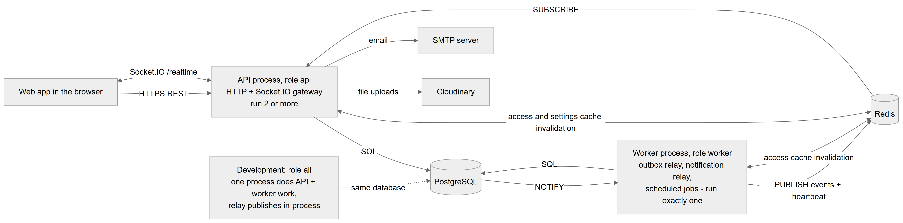

# Chapter 6 — Processes, deployment and environments

This chapter explains how the backend of the Platform runs as operating-system processes, what each process does, what Redis is used for, who owns the database schema, and which environment variables the code reads. It is written for the product owner who has to run or deploy the Platform. Everything comes from the backend code and the current migrations document; no deployment configuration exists in the repository, and that gap is stated where it matters.

## 6.1 One codebase, three process roles

**Status:** [Implemented]

The backend is one NestJS application, but it can start in one of three **process roles**. The role decides which parts are switched on. The roles are defined in `backend/src/common/runtime/process-role.ts`.

| Role | Entry file | Start command | What it runs | How many |
|---|---|---|---|---|
| `all` | `main.ts` | `npm run start:dev` (watch mode) | Everything: HTTP API, Socket.IO gateway, outbox relay, notification relay, scheduled jobs. The relay hands realtime events straight to the local gateway, so Redis is not needed for realtime. | One. The development default. |
| `api` | `main.api.ts` | `npm run start:api` (after a build) | HTTP API and the Socket.IO gateway. Receives realtime events from the worker through Redis. Runs no background jobs. | Two or more, each with its own port. |
| `worker` | `main.worker.ts` | `npm run start:worker` (after a build) | Outbox relay, notification relay and every scheduled job. No HTTP server at all. | **Exactly one.** |

The table lists each role with its entry file, its npm script, what it runs and how many copies should run. The split exists so that the API can be scaled out without running the background jobs more than once: scheduled jobs are only loaded where jobs run (`runsJobs(role)` is true for `all` and `worker`), and HTTP is only started where it is needed (`runsHttp(role)` is true for `all` and `api`).

How the role reaches the code: each entry file calls `AppModule.forRole(role)`. That method adds, per role, the TypeORM connection (with schema ownership only for HTTP roles), the `ScheduleModule` (only where jobs run), `QueueRuntimeModule.forRole(role)` (gateway, Redis subscriber, relay and queue jobs as needed) and `NotificationsRuntimeModule.forRole(role)` (the notification sending loop only where jobs run).

Two oddities in the npm scripts:

- `npm run start:prod` runs `node dist/main`, but the build writes `dist/src/main.js`. Use `start:api` and `start:worker` for built code [Partial].
- The `start:api` and `start:worker` scripts run the compiled `dist/src/...` files, so `npm run build` must run first.

**Technical references:** `backend/src/common/runtime/process-role.ts` · `ProcessRole` · `runsHttp` · `runsJobs` · `backend/src/main.ts` · `backend/src/main.api.ts` · `backend/src/main.worker.ts` · `AppModule.forRole`

*Figure 6.1 — The production process layout: API processes, one worker, PostgreSQL, Redis and the outside services, plus the single development process.*

The figure shows the web app in the browser on the left. It sends HTTPS REST requests to the "API process, role api", which runs HTTP and the Socket.IO gateway and is meant to run two or more times; a two-way arrow labelled "Socket.IO /realtime" connects the same two boxes. The API process sends SQL to PostgreSQL, uploads files to Cloudinary and sends email through an SMTP server. The "Worker process, role worker" runs the outbox relay, the notification relay and the scheduled jobs, and must run exactly once; it also sends SQL to PostgreSQL, and PostgreSQL sends it NOTIFY messages. The worker publishes realtime events and a heartbeat to Redis, and Redis delivers them to the API process through a subscription. Two more two-way arrows connect Redis with the API process (access and settings cache invalidation) and with the worker (access cache invalidation). A separate box at the bottom, "Development: role all", shows that in development one process does the work of both API and worker and publishes realtime events in-process; a dotted line shows that it uses the same database.

## 6.2 What runs where

**Status:** [Implemented]

| Component | `all` | `api` | `worker` |
|---|:---:|:---:|:---:|
| HTTP API (Express, port `PORT`) | yes | yes | no |
| Socket.IO gateway `/realtime` (`QueueGateway`) | yes | yes | no |
| Redis realtime subscriber (`RedisRealtimeSubscriber`) | no | yes | no |
| Queue outbox relay (`OutboxRelayService`) | yes, publishes in-process | no | yes, publishes to Redis |
| Notification relay (`NotificationRelayService`) | yes | no | yes |
| Scheduled jobs (`@Cron`, `@Interval`) | yes | no | yes |
| Postgres extensions, schema synchronize (dev), startup migrations | yes | yes | no |
| Feature catalog seeding and role template seeding at boot | yes | yes | yes |
| Access and settings cache invalidation bus (Redis) | yes | yes | yes |

The table shows, for each running component, in which role it is active. Seeding runs in every process because every process loads every domain module; both seeders insert only missing rows and ignore conflicts, so concurrent processes are safe.

**The relays.** Both relays are woken by PostgreSQL `LISTEN`/`NOTIFY` on a dedicated database connection and also poll as a fallback: the queue relay every second, the notification relay every two seconds (which also picks up retries and messages held back by quiet hours). If the `LISTEN` connection fails, they poll only.

**Scheduled jobs.** There are eight. None of them sets a timezone, so every cron time below is in the **server's** timezone, not the location's.

| Job | Schedule | What it does |
|---|---|---|
| `queue-no-show-marker` | every 60 seconds | Marks booked patients who never checked in, past start time plus the allowed lateness, as no-show. |
| `queue-call-timeout` | every 15 seconds | Skips a called patient who never came, when that queue setting is on. |
| `queue-session-day-end` | every 5 minutes | Closes empty queue sessions from a past clinic day; sessions with waiting patients are left for an admin and logged. |
| `queue-cleanup` | every day at 03:15 server time | Deletes idempotency keys older than 24 hours and published outbox rows older than 7 days. |
| Patient credits expiry | every day at 01:00 server time | Marks active patient credits whose expiry date is before today (server-local midnight) as expired. |
| `billing-invariants` | every day at 02:30 server time | Checks the money invariants for every patient with billing rows and logs violations. Read-only. |
| Inventory alerts | every day at 08:00 server time | Finds low-stock and expiring items where inventory and inventory alerts are on, and only writes a log line; no notification is created [Partial]. |
| `month-end-payroll` | on the 1st of each month at 05:00 server time | Generates payroll for the month that just ended for every active location. |

The table lists each job, how often it runs and its effect. The queue jobs re-check state under the session lock through `QueueOrchestrator`, so running one twice is harmless. The queue jobs decide "which clinic day" with the location's timezone through `ClockService`; the cron trigger times themselves follow the server clock. The payroll job's code comment says 00:05, but the cron expression means 05:00.

**Technical references:** `backend/src/queue/queue-runtime.module.ts` · `backend/src/notifications/notifications-runtime.module.ts` · `backend/src/queue/jobs/queue-jobs.service.ts` · `BillingInvariantJob` · `InventoryAlertService` · `PayrollService.runMonthEndPayroll` · `PatientCreditsService.checkExpiredCredits`

## 6.3 What Redis is used for

**Status:** [Implemented]

Redis is used only for messages between processes. No business data is stored in it.

| Use | Channel or name | Publishers → listeners | Without Redis |
|---|---|---|---|
| Realtime queue events | `dentalflow:queue:realtime` | Worker relay → every API instance; worker heartbeat every 5 s | In `all` mode not needed. In split mode the relay keeps rows unpublished and retries; API instances refuse sockets after 15 s without a heartbeat and clients poll. |
| Access changes | `dentalflow:access:changed` | Any process that bumps an organization's access version → every process (access cache, feature cache, socket `access.changed`) | Only the process that made the change hears it; others catch up through their cache lifetimes (15 s for the access version, 30 s for features). |
| Settings cache invalidation | `settings-registry:invalidate` | Any process → every process | Other processes catch up through the settings cache lifetime. |
| Bull queue `submissions` | Bull connection | Registered, but no producer or consumer exists | Nothing depends on it. |

The table lists the four uses of Redis, the channel names, who talks to whom and what happens when Redis is unavailable. Redis connections are created to fail fast (no offline queue) and reconnect with back-off. The connection string is `REDIS_URL`; the default is a Redis on the local machine. The channel names still contain a former working name of the product; they are internal identifiers only.

Login rate limiting does not use Redis: attempts are counted in each process's memory, so with several API instances each instance counts on its own.

**Technical references:** `backend/src/common/redis/redis-connection.ts` · `backend/src/queue/realtime/realtime-bus.ts` · `AccessChangeBus` · `backend/src/settings-registry/settings-cache-bus.ts` · `backend/src/auth/guards/rate-limiter.guard.ts`

## 6.4 Who owns the database schema

**Status:** [Implemented]

**In simple terms.** The table structure is defined by the entity classes in the code. In development the API adjusts the database to the entities automatically on start. In production nothing changes the tables automatically: an operator first reviews the planned changes and then applies them. Hand-written migrations add what entities cannot express, such as triggers.

**Technically.**

- **Entities own table shapes.** Only processes that serve HTTP own the schema (`api` and `all`); the worker never touches it.
- **Start-up order in a schema-owning process:**
  1. `ensurePostgresExtensions` installs the `btree_gist` extension (needed by the doctor double-booking constraint) and a `uuid_generate_v7()` function (default primary key of the lab tables).
  2. The TypeORM connection starts. `synchronize` is **on** unless `NODE_ENV` is `production`.
  3. `runPendingMigrations` records the legacy baseline as applied, then runs pending migrations, each in its own transaction. If one fails, start-up fails.
- **Migrations.** `backend/src/migrations/` holds three files. `1776356529788-create-table.ts` is a legacy baseline that is recorded as applied and never executed. The other two (`doctor-compensation`, `lab-management-foundation`) are hand-written and idempotent: they skip tables that already exist and add triggers and backfills.
- **Production.** `synchronize` is off. The documented procedure is: build; review the SQL with `npm run schema:log:prod`; apply it with `npm run schema:sync:prod` after a backup; start **one** API instance so it runs the migrations; only then start further API instances and the worker (concurrent start-ups take no migration lock). Alternatively run `npm run migration:run:prod` as a release step.
- **CLI data source.** The TypeORM command-line tools use `backend/src/data-sourse.ts`, which loads entities by file pattern. It therefore also sees entity files that no module registers (`chairs` and the old single `inventory` entity), which can show up in `schema:log` output.

**Technical references:** `backend/src/app.module.ts` · `backend/src/common/database/ensure-extensions.ts` · `backend/src/common/database/migrations.ts` · `runPendingMigrations` · `backend/src/data-sourse.ts` · `docs/database-migrations.md`

## 6.5 Environments

**Status:** [Partial]

The code knows only one environment switch: `NODE_ENV`. When it equals `production`:

- TypeORM `synchronize` is off;
- the refresh-token cookie is marked `secure` (sent over HTTPS only).

Everything else is the same in every environment. There is no separate staging configuration, no environment-specific config file and no feature that behaves differently per environment. The README and the migrations document describe a production database hosted on Neon (managed PostgreSQL); the code's SSL settings are written to work with Neon.

**Not in the repository [Not implemented]:**

- no Dockerfile or container compose file;
- no CI pipeline (no `.github/` folder or other CI configuration);
- no hosting, process-manager or load-balancer configuration.

Whoever deploys the Platform must therefore provide, outside the repository: a PostgreSQL database, a Redis server (required as soon as `api` and `worker` run as separate processes), a way to run two or more `api` processes behind a load balancer and exactly one `worker`, HTTPS, and the web app build. The Socket.IO gateway allows both WebSocket and long-polling transports; the web app connects with WebSocket only, and a code comment notes that long-polling behind several API instances would need sticky sessions.

**Technical references:** `backend/src/app.module.ts` · `backend/src/auth/auth.service.ts` (`REFRESH_TOKEN_COOKIE_OPTIONS`) · `backend/src/queue/realtime/queue.gateway.ts`

## 6.6 Environment variables

**Status:** [Implemented]

Values are never shown in this handbook. The backend reads its variables through `@nestjs/config` (which loads `backend/.env`) or `process.env`. The template file `backend/.env.example` lists some of them.

| Variable | Purpose | In `.env.example` |
|---|---|---|
| `DATABASE_URL` | PostgreSQL connection string for the API, the worker, the relays' `LISTEN` connections and the CLI. | yes |
| `PORT` | HTTP port of an API process (default 5000). | yes |
| `NODE_ENV` | `production` turns `synchronize` off and makes the refresh cookie secure. | yes |
| `JWT_ACCESS_SECRET` | Signs and checks access tokens (also used by the Socket.IO gateway). | yes |
| `JWT_REFRESH_SECRET` | Listed in the template, but no code reads it: refresh tokens are random values stored with the session, not JWTs. | yes |
| `EMAIL_TOKEN_SECRET`, `RESET_TOKEN_SECRET` | Listed in the template, but no code reads them: verification and reset tokens are random values. | yes |
| `REDIS_URL` | Redis for the realtime bus, the access and settings buses and Bull (default: local Redis). | no |
| `CORS_ORIGIN` | The one web origin allowed by CORS and by the Socket.IO gateway (default `http://localhost:3000`). | no |
| `FRONTEND_URL` | Base URL of the web app used in email links (default `http://localhost:3000`). | no |
| `SMTP_USER`, `SMTP_PASS` | Credentials of the outgoing mail account. | yes |
| `CLOUDINARY_CLOUD_NAME`, `CLOUDINARY_API_KEY`, `CLOUDINARY_API_SECRET` | File uploads to Cloudinary. | yes |
| `MAGIC_LINK_SECRET` | Signs lab magic links; falls back to `JWT_ACCESS_SECRET`, then `JWT_SECRET`. | no |
| `JWT_SECRET` | Last fallback for the magic-link secret only. | no |
| `LAB_MAGIC_LINK_TTL_HOURS` | Lifetime of a lab magic link (default 24 hours, at most 7 days). | no |
| `LAB_LINK_RATE_LIMIT` | Request limit for magic-link pages (default 120). | no |
| `RATE_LIMIT_LOGIN_MAX`, `RATE_LIMIT_LOGIN_WINDOW_SECONDS` | Login rate limit (default 5 attempts per 900 seconds). | no |
| `GOOGLE_CLIENT_ID`, `GOOGLE_CLIENT_SECRET`, `GITHUB_CLIENT_ID`, `GITHUB_CLIENT_SECRET` | OAuth sign-in. OAuth is not registered, so these have no effect [Not implemented]. | yes |
| `VITE_API_BASE_URL` (web app) | Base URL of the API for the browser (default `http://localhost:5000`). | no web template exists |

The table lists every environment variable the code reads, with its purpose and whether the template file mentions it. Variables only used by the integration test suites (for example `BILLING_IT_DATABASE_URL` and the `*_KEEP_SCHEMA` switches) are described in Chapter 7.

**Technical references:** `backend/.env.example` (names only) · `backend/src/bootstrap/http.ts` · `backend/src/lab-access/magic-links/magic-link-token.ts` · `backend/src/common/services/mail.service.ts` · `web-app/src/lib/api.ts`
