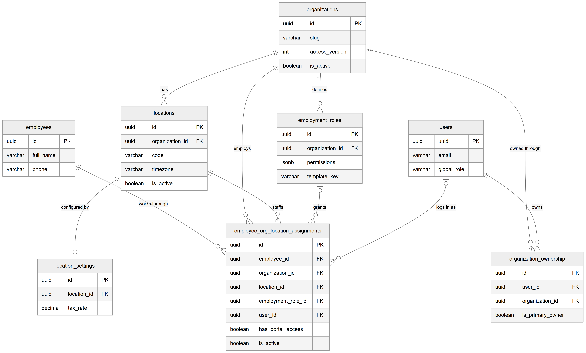
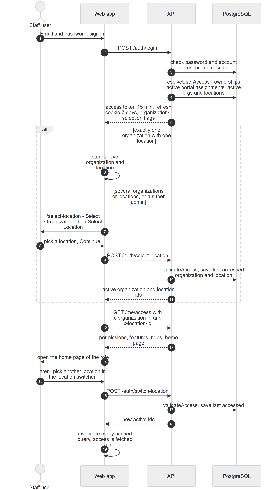
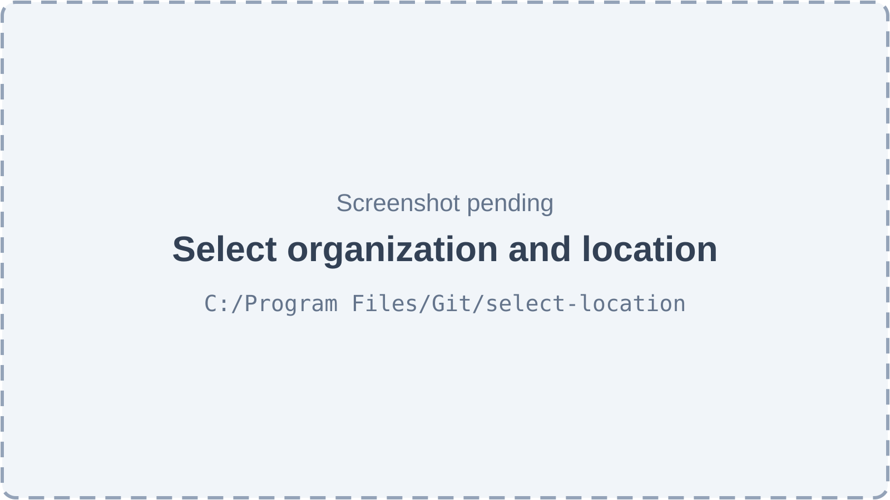

# Chapter 8 — The multi-tenant model

The Platform serves many clinic businesses from one installation and one database, and each business can have several branches. This chapter explains how the data of one clinic is kept apart from another, how a person can work for clinics, how a signed-in user ends up "inside" one clinic and one branch, and how the Platform decides what "today" means for a clinic. It is written for the product owner, who needs this model to reason about every other chapter.

## 8.1 Organizations, locations and the tenant boundary

**Status:** [Implemented]

**In simple terms.** An **organization** is one clinic business; it is the tenant. A **location** is one branch of that business. A dental group with three branches is one organization with three locations. Almost every record in the Platform (patients, appointments, invoices, staff assignments, queue sessions) carries the organization it belongs to, and most also carry a location.

**Technically.**

- `organizations` is the tenant table. `locations` belongs to exactly one organization (`organization_id`, deleted with it by `ON DELETE CASCADE`). Each location has one `location_settings` row.
- Tenant tables carry an `organization_id` column, and services always filter by the active organization. Data that differs per branch also carries `location_id`.
- All tenants share one database and one schema. Isolation is done in application code (guards plus `organization_id` filters in every query), not by separate databases or database row-level security.
- The **super admin** sits above all tenants (`users.global_role = 'super_admin'`) and can enter any active organization.

*Figure 8.1 — The tables that define who belongs to which organization and location.*

The diagram shows eight tables and their relationships. `organizations` (with `id`, `slug`, `access_version`, `is_active`) "has" zero or more `locations` (with `organization_id`, `code`, `timezone`, `is_active`). Each location is "configured by" at most one `location_settings` row (with `location_id` and `tax_rate`). `users` (with `uuid`, `email`, `global_role`) "owns" organizations through `organization_ownership` rows (with `user_id`, `organization_id`, `is_primary_owner`); an organization can have several owners and a user can own several organizations. An organization "defines" zero or more `employment_roles` (with `organization_id`, the `permissions` map and `template_key`). The `employees` table (with `id`, `full_name`, `phone`) has no organization column; a person "works through" zero or more `employee_org_location_assignments`. Each assignment links one employee to one organization ("employs") and one location ("staffs"), optionally to one employment role ("grants"), and optionally to one user account ("logs in as"); it also holds `has_portal_access` and `is_active`.

**Technical references:** `backend/src/organizations/entities/organization.entity.ts` · `backend/src/locations/entities/location.entity.ts` · `backend/src/auth/services/authorization.service.ts`

## 8.2 Ownership

**Status:** [Implemented]

An **owner** is a user linked to an organization through an `organization_ownership` row. Owners are not employees and have no role: the access resolver gives an owner **every permission at its widest scope at every location** of the organization (Chapter 11).

- **How owners are created.** Self-signup creates the clinic and makes the new user its primary owner (`is_primary_owner = true`). Further owners are created from user administration with the "owner" account type and are stored with `is_primary_owner = false`.
- **Several owners, several clinics.** A clinic can have several owners and one user can own several clinics; the pair (`user_id`, `organization_id`) is unique.
- **What an owner can enter.** Every active location of every active organization the owner owns.

**Technical references:** `backend/src/organizations/entities/organization-ownership.entity.ts` · `backend/src/user/user.service.ts` · `AuthorizationService.isOwner`

## 8.3 The employee person record and assignments

**Status:** [Partial] — the data model supports one person at several locations and clinics, but the API only ever creates one assignment per employee.

**In simple terms.** The Platform separates the **person** from the **job**. The **employee** record holds who the person is (name, phone, national ID number, gender, date of birth, photo). Each **assignment** says where and how that person works: in which organization, at which location, in which role, with which salary, and whether the person may sign in there.

**Technically.**

- `employees` has **no** `organization_id`. Phone is unique across the whole Platform, and so is the national ID number when given.
- `employee_org_location_assignments` holds, per job: `organization_id`, `location_id`, `employment_role_id` (the **role**, may be empty), `designation`, `employee_code` (unique per organization), an optional queue `token_prefix`, salary fields, `has_portal_access`, `user_id` (the **staff login**, may be empty), `is_primary` and `is_active`. One person can have at most one assignment per location (unique on `employee_id`, `location_id`).
- Permissions are tied to the assignment, not to the person: the same person can be a Doctor at one location and have no role at another.
- **What the API does today.** `POST /employees` creates the person and exactly one assignment, at the location the creator is working in. It refuses a phone number that already exists anywhere on the Platform ("An employee with this phone number already exists"). No endpoint adds a second location or a second clinic to an existing employee; the multi-location model can only be filled outside the API [Partial].
- **Staff logins.** User administration can create a login for an existing employee; that login is linked to all of the person's active assignments in the organization. A login only grants entry where the assignment is active and `has_portal_access` is on.

**Technical references:** `backend/src/employees/entities/employee.entity.ts` · `backend/src/employees/entities/employee-org-location-assignment.entity.ts` · `EmployeesService.create` · `backend/src/user/user.service.ts`

## 8.4 Who can enter which clinic and branch

**Status:** [Implemented]

At sign-in, and whenever a location is selected, the Platform works out the list of places a user may enter (`AuthorizationService.resolveUserAccess`):

| Kind of user | Organizations offered | Locations offered |
|---|---|---|
| Super admin | Every active organization | Every active location of each |
| Owner | Every active organization the user owns | Every active location of each |
| Employee with a staff login | Organizations where the user has an active assignment with portal access, if the organization is active | Exactly those assigned locations that are active |

The table shows the three ways to gain entry. When one user is both owner and employee in the same organization, the owner entry wins. Deactivated organizations and locations simply disappear from the list. The same rules are checked again on every request by `validateAccess` (section 8.5): an owner passes for any active location of the organization, an employee needs an active, portal-enabled assignment at exactly that location.

**Technical references:** `AuthorizationService.resolveUserAccess` · `AuthorizationService.validateAccess`

## 8.5 The tenant context on every request

**Status:** [Implemented]

**In simple terms.** The web app always tells the API which clinic and which branch the user is working in. The API checks that the user is allowed there before doing anything else.

**Technically.**

- The access token (a JWT, valid 15 minutes) carries only the user id, email, global role and session id. **It does not carry the organization or location.**
- The web app's axios instance adds two headers to every request from the in-memory auth store: `x-organization-id` and `x-location-id` (lab portal requests carry `x-lab-id` instead).
- `TenantContextGuard`, the second of the five global guards, reads the headers and calls `validateAccess`. Missing headers give 400 "Missing tenant context. Please select an organization and location."; no access gives 403. On success it stores `request.tenantContext`.
- Controllers read the context with `@ActiveTenant()` and pass the organization id (and, where relevant, the location id) to the service, which filters every query by it.
- The guard steps aside for `@Public()` and `@ContextFree()` routes and for super admins, and checks the super-admin role for `@RequireSuperAdmin()` routes. It has **no** path-prefix exceptions.
- The organization and location in the headers also select the access context (Chapter 11) and the active features (Chapter 10).

**Technical references:** `backend/src/auth/guards/tenant-context.guard.ts` · `TenantContextGuard` · `backend/src/common/decorators/active-tenant.decorator.ts` · `web-app/src/lib/api.ts`

## 8.6 Sign-in, choosing a location and switching

**Status:** [Implemented]

*Figure 8.2 — Sequence from sign-in to the first page, and a later location switch.*

The diagram has four participants: the Staff user, the Web app, the API and PostgreSQL. (1) The user enters email and password and signs in. (2) The web app calls `POST /auth/login`. (3) The API checks the password and account status and creates a session. (4) It resolves the user's access: ownerships, active portal assignments, active organizations and locations. (5) It returns an access token valid for 15 minutes, sets a refresh cookie valid for 7 days, and returns the list of organizations with two flags saying whether an organization or a location must still be chosen. An "alt" box shows two paths. If the user has exactly one organization with one location, the web app stores them as active. Otherwise, or for any super admin, the web app shows `/select-location` with "Select Organization" and then "Select Location"; the user picks a location and clicks Continue; the web app calls `POST /auth/select-location`; the API runs `validateAccess` and saves the last accessed organization and location; it returns the active ids. After the box, the web app calls `GET /me/access` with the two tenant headers and receives the permissions, features, roles and home page, then opens the role's home page. The last part shows a later switch: the user picks another location in the location switcher, the web app calls `POST /auth/switch-location`, the API checks access and saves the choice, returns the new ids, and the web app invalidates every cached query so all data and the access context are fetched again.

Rules behind the figure:

- **Automatic choice.** One organization with one location is selected automatically. A super admin always chooses an organization first. When a choice is needed, the API pre-fills the last organization and location the user worked in (`users.last_accessed_organization_id` / `last_accessed_location_id`), if they are still allowed.
- **Where the browser goes.** The root route (`__root.tsx`) redirects: not signed in → `/login`; signed in but no location chosen → `/select-location`. Super admins may open the setup pages (Organizations, Locations, Lab Directory, Config Studio, Subscriptions) without a location. Users who only belong to a lab go to the lab portal.
- **Session restore.** The auth store is in memory only. On page load the web app calls `POST /auth/refresh`; the refresh cookie returns a new token and the same selection data.
- **Switching.** The location switcher in the top bar lists every organization and location the user may enter, grouped by organization. With only one location it shows the name without a menu.

*Figure 8.3 — Select organization and location (screenshot pending).*

The page appears after sign-in when a choice is needed. Its header reads "Select Organization" or "Select Location", with a welcome line using the user's name ("Choose an organization to continue" or "Choose where you'd like to work today"). The organization step shows one card per organization; picking an organization with a single location selects it at once. The location step shows one card per location of the chosen organization and a **Continue** button. If the organization has no locations yet, the page says "No locations yet" and offers **Create First Location**, which opens the Locations page. On success a toast says "Location selected" and the user lands on the home page. (The only existing screenshot of this page is excluded from the handbook because it shows compliance badges that the current code no longer displays.)

**Technical references:** `backend/src/auth/auth.service.ts` (`login`, `selectLocation`, `switchLocation`) · `web-app/src/routes/__root.tsx` · `web-app/src/features/auth/components/LocationSelector.tsx` · `web-app/src/components/layout/LocationSwitcher.tsx`

## 8.7 Clinic time: the location's timezone

**Status:** [Implemented]

**In simple terms.** A clinic's day starts at midnight where the branch is, not where the server is. Each location stores its own timezone, and every "today", "now" and opening-hours check uses it.

**Technically.**

- `locations.timezone` holds an IANA timezone name. New locations created through `POST /locations` default to `UTC`; the setup wizard copies the organization's timezone (default `Asia/Karachi`) to every location. The value is not validated; an unknown name falls back to UTC.
- `ClockService` (`common/clock/`) is the single source of clinic time. `timezoneFor(locationId)` reads the timezone (cached for 60 seconds); `today(tz)` gives the local date; `dayRange(tz, date)` gives the UTC start and end of a local day; `at(tz, date, time)` converts a local wall-clock time; `wallClock(tz, instant)` gives the local weekday and time.
- It is used by appointments (working hours, availability, same-day checks), the queue (the queue day and token day), billing, payroll, reports, notifications, employees and the lab modules.
- Scheduled jobs are triggered by the **server** clock (Chapter 6); jobs that need a clinic day compute it through `ClockService`.

**Technical references:** `backend/src/common/clock/clock.service.ts` · `ClockService` · `backend/src/common/clock/tz.util.ts`

## 8.8 Limitations and known gaps

- One person cannot be given a second location or clinic through the API (section 8.3) [Partial].
- Deactivating an organization or a location hides it at the next sign-in or selection, but does not end sessions that are already working there; requests keep passing the tenant guard for an owner of a deactivated organization, because `validateAccess` checks the location but not the organization's status for owners [Partial].
- Locations created from the Locations screen get timezone `UTC` and currency `USD` unless changed, because that form has no timezone or currency field (Chapter 9).
- Isolation relies on every service filtering by organization; there is no database-level row security.
