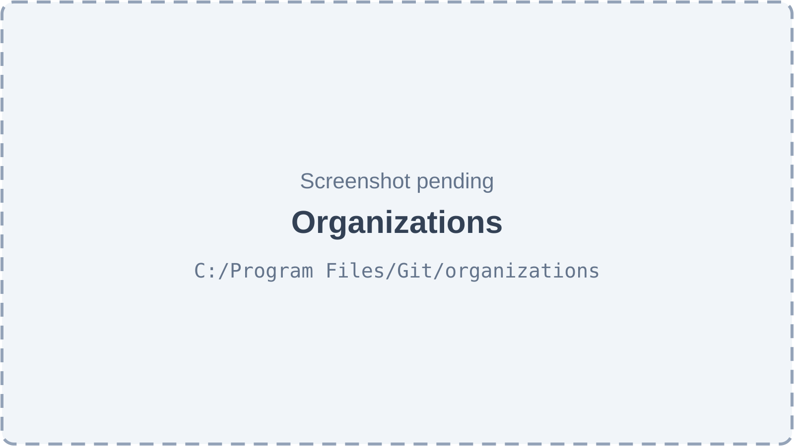
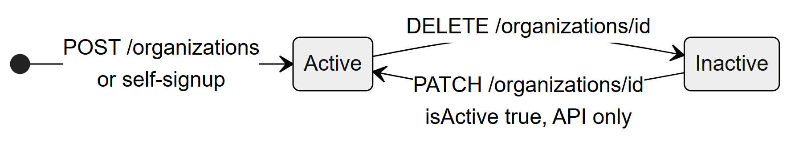
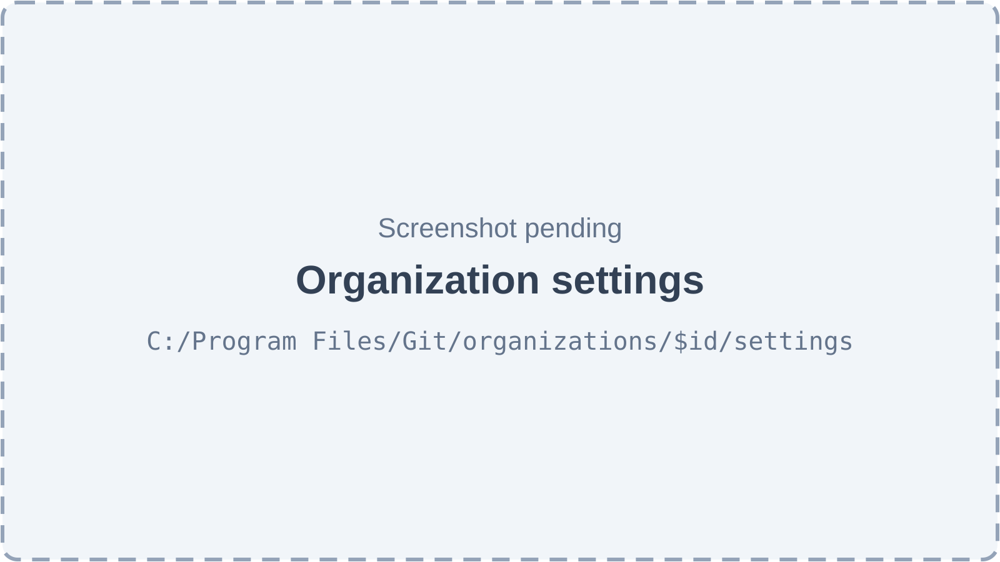
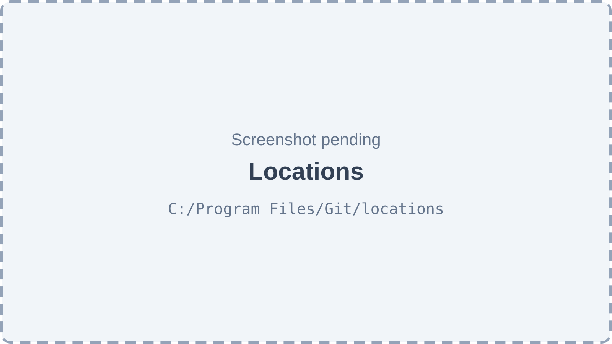
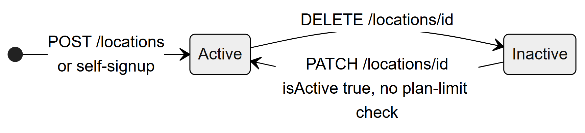
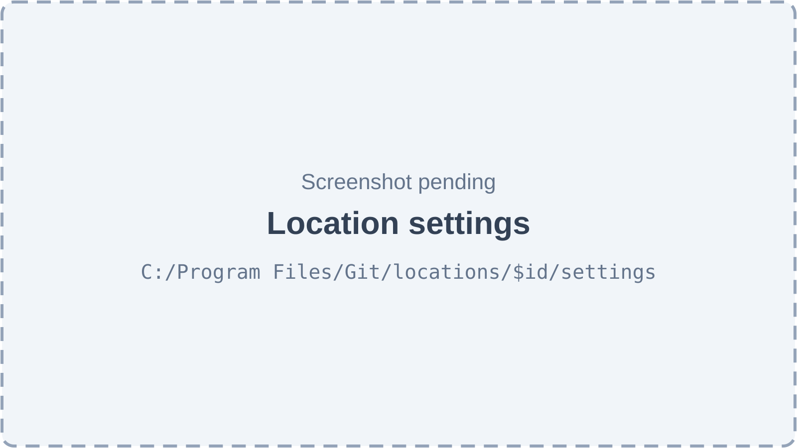

# Chapter 9 — Organizations and locations

This chapter describes the two records that frame every clinic on the Platform: the **organization** (the clinic business, the tenant) and its **locations** (the branches). It covers their fields, who can create and change them, their settings, and how they are switched off. It is written for the product owner; subscriptions, trials and plan limits get their own chapter (Chapter 45), and only read-only mode is summarised here.

## 9.1 What these records are for

**Status:** [Implemented]

- An **organization** answers "who is the clinic?": name, contact details, default timezone and currency, specialties, plan and subscription dates.
- A **location** answers "where does it operate?": address, a short branch code, its own timezone (which defines "today" for queues and reports), its own currency, and per-branch settings such as the tax rate.

The **super admin** manages organizations. Locations are managed by anyone holding the permission `admin.locations.manage` in that organization: owners and super admins always hold it, the system **Admin** role holds it, and a custom role can be given it. The owner's one-time setup wizard (`/setup`, Chapter 45) also edits the organization and its main location.

**Sidebar:** "Organizations" (super admin only, `/organizations`) and "Locations" (`/locations`, needs `admin.locations.manage`).

**Technical references:** `backend/src/organizations/` · `backend/src/locations/` · `web-app/src/features/organizations/` · `web-app/src/features/locations/` · `backend/docs/modules/01-organizations-locations.md`

## 9.2 Organization fields

**Status:** [Implemented]

| Field | Meaning |
|---|---|
| `name`, `slug` | Display name; `slug` is unique, generated from the name on creation and never regenerated. |
| `email`, `phone`, `website` | Contact details. |
| `subscription_plan` | `free`, `starter`, `professional` or `enterprise`. Default `free`. The plan limits are defined in code (`subscriptions/plans.ts`). |
| `clinic_type` | Free text. No API writes it. |
| `specialty_tags` | List of `general`, `dental`, `skin`, `ortho`, `physio`, `eye`. Default `general`. Written by the setup wizard; the web app uses it to show specialty-specific screens. |
| `timezone`, `currency` | Organization defaults: `Asia/Karachi` and `PKR`. The setup wizard copies them to every location. |
| `max_locations`, `max_users` | Per-organization overrides of the plan limits; empty means "use the plan's limit". |
| `trial_ends_at`, `paid_until` | Subscription period. Both empty means an **unmanaged** clinic: no expiry and no limits. |
| `onboarding_pending` | True for self-signup clinics until the owner finishes `/setup`. |
| `access_version` | Counter raised on every access change (roles, assignments, features, ownership); used to invalidate access caches (Chapter 11). Never written by normal saves. |
| `is_active` | Soft switch-off. |

The table explains each column of `organizations` in business terms. Three related tables hang off an organization: `organization_ownership` (its owners), `organization_settings` (legacy settings, section 9.4) and `subscription_payments` (Chapter 45).

**Technical references:** `backend/src/organizations/entities/organization.entity.ts` · `Organization`

## 9.3 Managing organizations (super admin)

All endpoints are in `OrganizationsController` and carry `@RequireSuperAdmin()`, so only the super admin can call them, for any organization.

### 9.3.1 Create an organization

**Status:** [Partial] — the endpoint works; the screen's form has fields the API refuses.

**What it does.** Creates a clinic with a name and optional contact details and plan.

**How the user does it.** On the Organizations page, click **Create**, fill the form and save.

**Behind the scenes.** `POST /organizations` saves the row, then seeds the organization's feature flags from the catalog defaults (Chapter 10) and the 5 system roles (Chapter 11). The two steps are not one transaction. No owner, no location and no subscription dates are created: the clinic is "unmanaged" until the super admin sets dates or records a payment.

**Rules.** Name is required (at most 255 characters); email must be valid; phone at most 20, website at most 500 characters; plan must be one of the four enum values. Duplicate slug gives 409.

**Known problems (by reading the code, not executed).** The form also offers Clinic Type, Timezone and Currency, which the create DTO does not accept, so filling them makes the request fail with 400. The plan selector offers "FREE", "BASIC", "PREMIUM" and "ENTERPRISE", which do not match the API's lower-case values, so choosing a plan also fails with 400. No audit row is written.

**Technical references:** `OrganizationsController.create` · `OrganizationsService.create` · `CreateOrganizationDto` · `web-app/src/features/organizations/OrganizationManagementView.tsx`

### 9.3.2 List and view organizations

**Status:** [Implemented]

`GET /organizations` lists active organizations by name; `GET /organizations/:id` returns one. Deactivated organizations do not appear in the list.

**Technical references:** `OrganizationsController.findAll` · `OrganizationsController.findOne`

### 9.3.3 Edit an organization

**Status:** [Partial] — the endpoint works; the screen sends fields the API refuses.

`PATCH /organizations/:id` accepts name, email, phone, website, plan and `isActive`. The edit dialog sends the whole organization row (including `id`, `slug` and timestamps), which the strict validation pipe refuses with 400 (by reading the code, not executed). A plan change made here is not audited and does not touch the subscription dates.

**Technical references:** `OrganizationsController.update` · `UpdateOrganizationDto`

### 9.3.4 Deactivate an organization

**Status:** [Implemented]

The trash action asks "Deactivate organization?" and calls `DELETE /organizations/:id`, which sets `is_active = false`. Data is kept. The organization disappears from sign-in and selection lists. Sessions that are already working in it are not ended. There is no screen to reactivate it; only `PATCH /organizations/:id` with `isActive: true` does that.

**Technical references:** `OrganizationsController.deactivate` · `OrganizationsService.deactivate`

*Figure 9.1 — Organizations (screenshot pending).*

The page is titled "Organizations" with the subtitle "Manage clinic organizations and their settings" and a **Create** button at the top right. A table lists active organizations with the columns Name, Slug, Plan and Status, and an actions column with four icon buttons, each with a tooltip: "Manage features" (opens the feature entitlement page, Chapter 10), "Organization settings", "Edit organization" and "Deactivate organization". The create and edit dialog contains Name, a read-only Slug, Clinic Type, Timezone, Currency and Subscription Plan. Non-super-admins who open the URL are sent to the dashboard.

*Figure 9.2 — The two states of an organization's `is_active` flag.*

The diagram reads left to right. From the start point an organization becomes **Active**, either by `POST /organizations` or by self-signup. `DELETE /organizations/id` moves it to **Inactive**. `PATCH /organizations/id` with `isActive true`, which only the API offers, moves it back to Active. There is no final state: the API never hard-deletes an organization.

## 9.4 Organization settings (legacy)

**Status:** [Not implemented] — the settings are stored and editable, but no backend code reads them.

`organization_settings` has one row per organization, created on first read. It holds old feature switches (`feature_appointments`, `feature_inventory`, `feature_finance`, `feature_reminders`, `feature_whatsapp`, `feature_patient_portal`), `allow_location_override`, and booking defaults (`default_slot_duration`, `advance_booking_days`, `cancellation_notice_hours`).

- `GET /organizations/:id/settings` is allowed to the super admin and to owners of that organization.
- `PATCH /organizations/:id/settings` is super-admin only. Limits: slot duration 5–480 minutes, advance booking 1–365 days, notice 0–168 hours.
- **No backend code reads any of these values.** Real feature gating is the feature system (Chapter 10). The web app uses `allow_location_override` only to grey out three inputs on the location settings page.
- The settings screen sends the whole row, which the API should refuse with 400 (by reading the code).

*Figure 9.3 — Organization settings (screenshot pending).*

The page has a back button to Organizations and two cards. "Global Overrides" holds one switch, **Allow Location Override**. "Booking Defaults" holds three number inputs: Default Slot Duration (mins), Advance Booking Days and Cancellation Notice (hours). A Save button stores the card values. None of these values changes how bookings behave.

**Technical references:** `backend/src/organizations/entities/organization-settings.entity.ts` · `OrganizationsController.getSettings` · `OrganizationsController.updateSettings` · `web-app/src/features/organizations/OrganizationSettingsFeature.tsx`

## 9.5 Location fields

**Status:** [Implemented]

| Field | Meaning |
|---|---|
| `name` | Branch name, for example "Main location". |
| `code` | Short branch code, unique within the organization. Cannot be changed after creation. |
| `token_prefix` | Prefix of the daily queue tokens; falls back to `code`. Read by the queue's token engine; no API writes it. |
| `address`, `city`, `state`, `postal_code`, `country`, `phone`, `email` | Contact details. |
| `timezone`, `currency` | Defaults `UTC` and `USD` (different from the organization defaults). `ClockService` uses `timezone` for every clinic "today". |
| `is_main_branch` | A flag; several locations can carry it. The setup wizard treats the first active main branch as "the" main location. |
| `total_chairs`, `capacity_per_day`, `operating_hours`, `manager_id`, `business_model` | Stored, but no backend code reads them. |
| `is_active` | Soft switch-off. |

The table explains each column of `locations`. Note the timezone default: a location created from the Locations screen gets `UTC`, because that form has no timezone or currency field; only the setup wizard sets the clinic's timezone and currency on locations.

**Technical references:** `backend/src/locations/entities/location.entity.ts` · `Location`

## 9.6 Managing locations

All location endpoints are in `LocationsController`. The controller is `@ContextFree()`, because an owner manages locations before choosing one; each handler therefore checks `admin.locations.manage` itself, in the organization of the location being acted on (or, for create and list, the organization in the body or the `x-organization-id` header). An invalid organization gives 400 "Select an organization first"; a missing permission gives 403 `NO_PERMISSION`.

### 9.6.1 Add a location

**Status:** [Implemented]

**How the user does it.** On the Locations page, click **Create Location** and fill Name, Code, Address, City, Country, Phone and Email. A super admin also picks the organization ("Organization (Required)").

**Behind the scenes.** `POST /locations` first checks the plan's location limit (`SubscriptionsService.assertCanAddLocation`, skipped for super admins), then saves the location and a default settings row as two separate saves (not one transaction). No audit row is written.

**Rules and errors.** Name and code are required; code at most 50 characters and unique in the organization (409 on duplicates). Plan limit reached gives 403 `PLAN_LIMIT`; an expired subscription gives 402 `SUBSCRIPTION_EXPIRED`.

**Technical references:** `LocationsController.create` · `LocationsService.create` · `CreateLocationDto`

### 9.6.2 List, view and edit locations

**Status:** [Partial] — list and view work; the edit screen sends fields the API refuses.

`GET /locations` returns, for a super admin, every active location of every organization; otherwise the active locations of the active organization (or of every organization where the user holds the permission organization-wide). `GET /locations/:id` returns one. `PATCH /locations/:id` accepts the create fields except `code` and the organization, plus `isActive`. The edit dialog sends the whole row, which the API should refuse with 400 (by reading the code). Setting `isActive: true` reactivates a location **without** the plan-limit check.

**Technical references:** `LocationsController.findAll` · `LocationsController.findOne` · `LocationsController.update` · `UpdateLocationDto`

### 9.6.3 Deactivate a location

**Status:** [Implemented]

The trash action asks "Deactivate location?" and calls `DELETE /locations/:id` (`is_active = false`). Nothing stops deactivating the last location or the main one. Staff assignments, appointments and queue sessions at that location are left as they are; the location stops being offered at sign-in and in the switcher. The list hides inactive locations, so the screen cannot reactivate one.

**Technical references:** `LocationsController.deactivate` · `LocationsService.deactivate`

*Figure 9.4 — Locations (screenshot pending).*

The page is titled "Locations" with the subtitle "Manage clinic locations and their settings" and a **Create Location** button. A table lists active locations with the columns Name, Organization, City, Phone and Status, and three icon actions with tooltips: "Location settings", "Edit location" and "Deactivate location". The create and edit dialog holds the fields listed in section 9.6.1; its code field shows the example "e.g. NYC-01". Toasts confirm "Location created successfully", "Location updated successfully" and "Location deactivated".

*Figure 9.5 — The two states of a location's `is_active` flag.*

The diagram reads left to right. A location becomes **Active** through `POST /locations` or self-signup. `DELETE /locations/id` moves it to **Inactive**. `PATCH /locations/id` with `isActive true` moves it back to Active, and the label notes that this path does not check the plan's location limit. There is no final state.

## 9.7 Location settings

**Status:** [Partial] — the tax rate and a few other values are used; the edit screen's save is expected to fail, and several stored values do nothing.

Each location has one `location_settings` row, created with the location or on first read.

| Setting | Used by |
|---|---|
| `tax_rate` (percent, two decimals, default 0) | **Used.** Sales tax applied when an invoice is issued (tax is added on top of prices), and by lab billing and purchase orders. |
| `max_appointments_per_day` (default 50; 0 means no cap) | **Used.** Daily booking cap for the location. |
| `logo_url` | **Used.** Fallback logo for printed invoices when the clinic theme has none. |
| `appointment_slot_duration` (default 30) | Read only by the web app, as the default length in the booking form. |
| `advance_booking_days`, `cancellation_notice_hours`, `reminder_enabled`, `reminder_days_before`, `reminder_hours_before`, `reminder_channels`, `payment_gateway`, `late_fee_percentage`, `primary_color`, `theme` | Stored; no code reads them. |

The table lists each setting and whether anything uses it.

- `GET /locations/:id/settings` and `PATCH /locations/:id/settings` both need `admin.locations.manage`. Staff without it (receptionists, doctors) cannot read the slot duration, so their booking form falls back to 30 minutes.
- **Field-name mismatch.** The update DTO names several fields differently from the stored columns (for example `defaultSlotDuration` against `appointmentSlotDuration`, `maxDailyAppointments` against `maxAppointmentsPerDay`). The screen sends the stored names plus `id` and timestamps, so its save should fail with 400; a client sending the DTO names would get success but nothing stored for those fields. In practice, the daily cap and slot duration cannot be changed through the API (by reading the code, not executed). The tax rate has the same name on both sides.
- The tax rate can also be set in the setup wizard's location step (0–100).

*Figure 9.6 — Location settings (screenshot pending).*

The page has a back button to Locations. An "Appointment Settings" card holds Slot Duration (mins), Max Appointments / Day, Advance Booking Days and Cancellation Notice (hours); the organization's legacy "Allow Location Override" switch can grey out three of these. A "Payment & Billing" card holds Tax Rate (%) and Late Fee (%). The page also embeds the queue settings section for this location (the Queue chapter, Chapter 30, covers it). A "Reminder Settings" card exists in the code but is hidden until message delivery exists. Users without the permission see "No access — You don't have permission to manage this location's settings." On success a toast says "Location settings updated successfully".

**Technical references:** `backend/src/locations/entities/location-settings.entity.ts` · `UpdateLocationSettingsDto` · `LocationsController.getSettings` · `LocationsController.updateSettings` · `backend/src/billing/tax/location-tax-rate.ts` · `web-app/src/features/locations/LocationSettingsFeature.tsx`

## 9.8 Subscriptions and read-only mode (summary)

**Status:** [Implemented]

An organization with subscription dates is "managed": it is on a trial (self-signup gives 14 days with Professional limits) or paid until a date, and after that date it gets 3 grace days. When the grace days have passed, the clinic is in **read-only mode**: the fifth global guard, `SubscriptionGuard`, refuses every write with 402 `SUBSCRIPTION_EXPIRED`, while reads, sign-in, the account and setup pages and the super admin keep working. Recording a subscription payment (a manual super-admin action) lifts read-only mode at once; the status is computed on each request and cached for 30 seconds per process. Chapter 45 covers plans, limits, payments and the setup wizard in full.

**Technical references:** `backend/src/subscriptions/subscription.guard.ts` · `backend/src/subscriptions/plans.ts` · `SubscriptionsService.isReadOnly`

## 9.9 Limitations and known gaps

- Several edit screens (organization edit, organization settings, location edit, location settings) send whole rows and are expected to fail with 400 under the strict validation pipe; this was found by reading the code and not executed.
- Organizations and locations cannot be reactivated from any screen.
- New locations default to `UTC` and `USD`; timezone and currency are not validated.
- `is_main_branch` is not exclusive, and the last or main location can be deactivated.
- Organization and location create, edit and deactivate write no audit rows; only subscription changes are audited.
- `organization_settings` and most location settings are stored but unused.

## 9.10 Owner's FAQ

**Can an owner create a new organization?** No. Only the super admin can, or a new owner through self-signup, which creates a separate clinic.

**Can an owner add a branch?** Yes, from Locations, as long as the plan's location limit allows it and the subscription has not expired.

**Can a branch code be changed?** No. The code is fixed at creation; the token prefix falls back to it.

**Where is the sales tax rate set?** In the location's settings (Tax Rate %) or in the setup wizard's location step. Each branch has its own rate.

**What happens to patients and staff when a branch is deactivated?** Nothing is deleted or moved. The branch is no longer offered at sign-in and in the location switcher.

**What does "unmanaged" mean?** An organization with neither trial end nor paid-until date. It never expires and has no plan limits. Organizations created by the super admin start this way.
