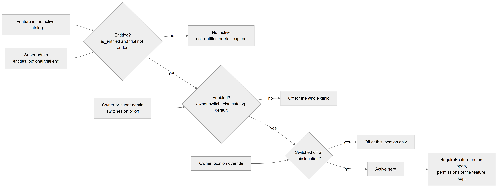
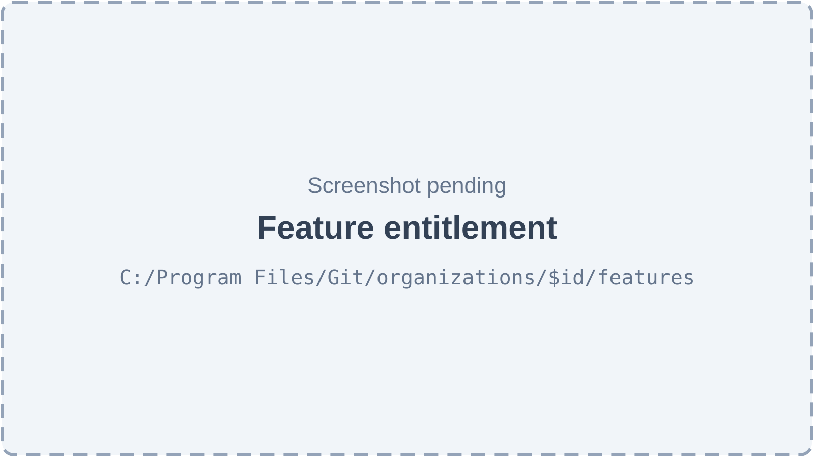
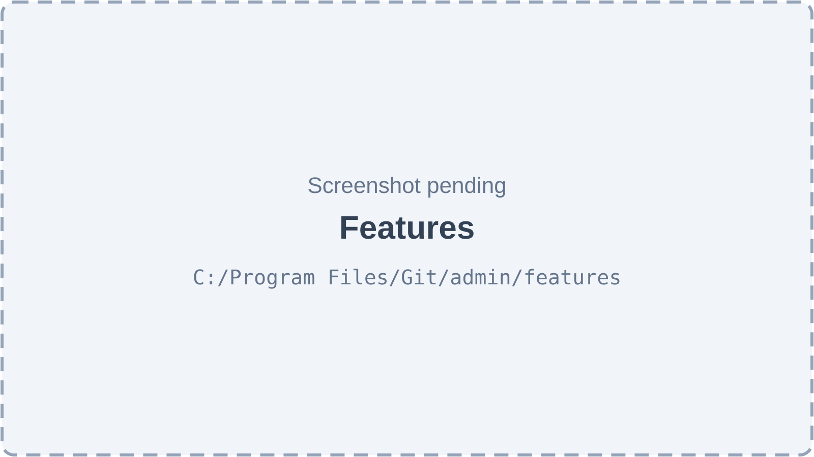

# Chapter 10 — Features: entitlement, enablement and location overrides

A **feature** is a named part of the Platform, such as "Invoices" or "Lab Management", that can be on for one clinic and off for another. This chapter explains the three switches that decide whether a feature is active (the super admin's entitlement, the owner's switch and a per-location override), the 24 features that exist, how the backend enforces them and which screens control them. It is written for the product owner, who sells and configures features per clinic.

## 10.1 The three switches

**Status:** [Implemented]

**In simple terms.** The platform operator decides what a clinic is allowed to have; the clinic owner decides what the clinic actually uses; and the owner can switch a feature off at one branch. A feature works at a branch only when all three agree.

| Switch | Who sets it | Stored in | Meaning |
|---|---|---|---|
| **Entitled** | Super admin | `org_feature_flags.is_entitled`, optional `entitled_until` | The feature is part of this clinic's plan. With `entitled_until`, it is a trial that ends at that moment. |
| **Enabled** | Owner (or anyone with `admin.features.manage`); the super admin can also set it | `org_feature_flags.is_enabled` | The clinic has switched the feature on. Only possible while entitled. |
| **Location override** | Owner (same permission) | `location_feature_overrides.is_disabled` | Switches the feature off at one location. It can never switch on something the organization has off. |

The table lists the three switches, who controls each, where it is stored and what it means. A feature is **active** for an organization when its catalog entry is active, it is entitled (and the trial has not ended), and it is enabled. It is active at a location when, in addition, that location has not switched it off.

**Defaults and missing rows.**

- When an organization is created (by the super admin or by self-signup), the Platform writes one `org_feature_flags` row per active catalog feature: features that are "on by default" in the catalog are both entitled and enabled; all others are neither.
- If an organization has **no** row for a feature, it counts as entitled, and enabled according to the catalog default. This keeps organizations that predate entitlement working.
- A trial end date must be in the future when set. When it passes, the feature becomes "not entitled" with the reason `trial_expired`; the owner sees it locked.

*Figure 10.1 — The decision path from a catalog feature to "active at this location".*

The flowchart reads left to right. It starts from "Feature in the active catalog" and reaches the first decision, "Entitled? is_entitled and trial not ended", which the super admin controls by entitling with an optional trial end. If the answer is no, the feature is "Not active" with the reason `not_entitled` or `trial_expired`. If yes, the second decision asks "Enabled? owner switch, else catalog default"; the owner (or the super admin) controls this switch. If no, the feature is "Off for the whole clinic". If yes, the third decision asks "Switched off at this location?", controlled by the owner's location override. If yes, the feature is "Off at this location only". If no, the feature is "Active here", and the final box says what that means: routes marked `@RequireFeature` open, and the permissions that belong to the feature are kept.

**Technical references:** `backend/src/feature-flags/feature-state.ts` · `featureState` · `resolveEnabledFeatures` · `narrowByLocation` · `FeatureFlagsService.seedFlagsForOrg`

## 10.2 The feature catalog

**Status:** [Implemented]

The catalog (`feature_catalog`) lists every feature key with a name, a module, a description, specialty tags, a default and a sort order. It is seeded from code on every start: keys that are missing are inserted, existing rows are never changed (so super-admin edits stay), and keys that are not built are deactivated.

There are **24 active features**:

| Key | Name | On by default | Specialty tags | What it controls |
|---|---|:---:|---|---|
| `appointments.core` | Appointments | yes | general | 12 permissions: booking and the whole queue. |
| `patients.core` | Patient Records | yes | general | 9 permissions, including viewing, registering, clinical records and conducting consultations. |
| `patients.teeth_chart` | Teeth Chart | no | dental, ortho | `patients.chart.edit`; one endpoint marked `@RequireFeature`. |
| `patients.treatment_plans` | Treatment Plans | yes | general | `plans.manage`, `plans.templates.manage`; three endpoints marked `@RequireFeature`. |
| `patients.prescriptions` | Prescriptions | yes | general | `prescriptions.create`, `prescriptions.library.manage`; six endpoints marked `@RequireFeature`. |
| `patients.documents` | Documents | yes | general | `patients.documents.manage`. |
| `patients.insurance` | Insurance | no | general | No permission; the three patient insurance endpoints are marked `@RequireFeature`. |
| `billing.invoices` | Invoices | no | general | 9 billing permissions (desk, invoices, payments, refunds, cash close). |
| `billing.discounts` | Discounts & Coupons | no | general | `billing.discount.apply`, `billing.discount.custom`. Coupons no longer exist; discounts work through discount types. |
| `billing.expenses` | Expense Tracking | no | general | `expenses.view`, `expenses.manage`. |
| `billing.financial_summary` | Financial Dashboard | no | general | The financial summary endpoints (`@RequireFeature`) and the dashboard's finance widgets. |
| `billing.credit_packages` | Credit Packages | no | general | The credit package endpoints (`@RequireFeature`); no page uses them. |
| `billing.commissions` | Doctor Commissions | no | general | `earnings.own.view`, `earnings.all.view`, `compensation.manage`. |
| `comms.whatsapp` | WhatsApp | no | general | Nothing. No WhatsApp sending exists. |
| `comms.in_app` | In-App Notifications | yes | general | Nothing reads this key; in-app notifications work whether it is on or off. |
| `inventory.core` | Inventory | no | general | `inventory.view`, `inventory.stock.adjust`, `inventory.po.manage`. |
| `inventory.alerts` | Inventory Alerts | no | general | Read by the daily inventory alert job, which only writes a log line. |
| `hr.payroll` | Payroll | yes | general | `payroll.manage`. |
| `hr.leave` | Leave Management | no | general | `leave.approve`. |
| `hr.commissions` | Commissions | no | general | Nothing. Doctor commissions use `billing.commissions`. |
| `reports.financial` | Financial Reports | no | general | `reports.financial.view`, `finance.overview.view`. |
| `reports.clinical` | Clinical Reports | no | general | `reports.clinical.view`. |
| `reports.exports` | Data Exports | no | general | `reports.export`. |
| `dental.lab_orders` | Lab Management | no | dental, ortho | 7 lab permissions (orders, billing, catalog, payables, links, templates). |

The table lists each active key, its display name, whether new clinics get it entitled and enabled, its specialty tags and what it actually controls in the code. Most features work through permissions: when a feature is not active, every permission tied to it is dropped from every role at resolution time (Chapter 11). Eleven permissions belong to no feature ("core") and are always available: staff management and the nine Admin permissions.

**Status of individual keys:**

- [Implemented]: every key in the table whose "What it controls" names permissions or `@RequireFeature` endpoints.
- [Partial]: `billing.credit_packages` (backend only, no page), `inventory.alerts` (the job only logs), `billing.discounts` (the name still says "Coupons").
- [Not implemented]: `comms.whatsapp` and `hr.commissions` (switching them on changes nothing); `comms.in_app` (the switch has no effect).

**Twelve keys are retired** [Not implemented]. Their seed entries are commented out, and on every start the Platform deactivates any catalog row with these keys so nobody can switch on a feature that does nothing: `appointments.reminders`, `appointments.recurring`, `appointments.online_booking`, `appointments.waiting_room`, `patients.portal`, `patients.crm`, `billing.pdf_receipts`, `billing.insurance_claims`, `billing.online_payments`, `comms.sms`, `comms.email`, `dental.before_after`. (Some of the underlying ideas exist in other forms, such as the doctor-wise queue and the patient CRM tab, but these keys gate nothing.)

**Catalog editing.** `GET`, `POST /feature-flags/catalog` and `PATCH /feature-flags/catalog/:id` let the super admin read, add and edit catalog rows [Partial: backend only, no screen calls them].

**Technical references:** `backend/src/feature-flags/feature-catalog.seed.ts` · `FEATURE_CATALOG_SEED` · `RETIRED_FEATURE_KEYS` · `FeatureFlagsService.seedCatalog` · `backend/src/access/catalog/permissions.ts`

## 10.3 How the backend enforces features

**Status:** [Implemented]

There are two mechanisms.

1. **Through permissions (the common case).** Every permission names one feature. `AccessResolver` keeps a permission only if its feature is active at the request's organization and location (`filterByFeatures`). Turning a feature off therefore takes the permission away from every role **without changing the roles**; turning it back on restores access exactly as it was.
2. **Through `@RequireFeature(key)`.** Used where no permission expresses the feature, mainly on `@AnyMember()` routes. `FeatureFlagGuard`, the third global guard, collects every `@RequireFeature` key on the handler and its controller (both apply) and refuses with 403 'The "<key>" feature is not enabled for this location' if any is not active. Super admins and `@Public()` routes skip the check. The location header narrows the set; the guard trusts it without a membership check, which is safe because a location can only remove features.

**Caching.** `FeatureFlagsService` keeps the active set per organization, and per organization and location, in process memory for 30 seconds. Every change clears the cache in the process that made it. The change also raises the organization's **access version** (automatically for `org_feature_flags` writes, explicitly for location overrides), which is broadcast over Redis so every other process drops its cache at once, and the web app gets `access.changed` and refetches. If Redis is down, other processes catch up within the 30-second lifetime.

**Every change is audited** in `audit_logs` (entity types `org_feature_flag` and `location_feature_override`), in the same transaction as the change, with the before and after values.

**Technical references:** `backend/src/feature-flags/guards/feature-flag.guard.ts` · `FeatureFlagGuard` · `requiredFeaturesOf` · `FeatureFlagsService.getEnabledFeatures` · `FEATURE_CACHE_TTL_MS` · `AccessVersionSubscriber` · `FeatureAdminService`

## 10.4 Super admin: entitle features for a clinic

**Status:** [Implemented]

**What it does.** Decides which features a clinic may use, optionally as a trial, and can also flip the clinic's own switch.

**How the user does it.** On the Organizations page, click the "Manage features" action of a clinic. The page lists features by module. Per feature, the **Entitled** switch grants or withdraws it, a date picker ("No trial end") sets a trial end, and the **Enabled** switch flips the owner's switch. Per module, **Entitle module** and **Withdraw module** act on all features of that module at once.

**Behind the scenes — technically.**

| Action | Endpoint |
|---|---|
| Load the page | `GET /feature-flags/org/:organizationId` |
| Entitle or withdraw one feature, with optional trial end | `PATCH /feature-flags/org/:organizationId/:featureKey/entitlement` |
| Entitle or withdraw a module or a list of keys | `POST /feature-flags/org/:organizationId/entitlement/bulk` |
| Flip the enabled switch (no entitlement check) | `PATCH /feature-flags/org/:organizationId/:featureKey` |
| Flip many enabled switches | `POST /feature-flags/org/:organizationId/bulk` |
| Create missing rows from catalog defaults | `POST /feature-flags/org/:organizationId/seed` |

The table maps each action on the screen to its endpoint. All carry `@RequireSuperAdmin()`. Rows are locked (`pessimistic_write`) while being changed, and each changed row writes an audit entry recorded as a platform action.

**Rules.** The trial end must be a valid date in the future; it is ignored when withdrawing. Re-entitling keeps a running trial; an ended trial is dropped. Unknown keys give 404.

*Figure 10.2 — Feature entitlement (screenshot pending).*

The page is titled "Feature entitlement" with a back button to Organizations and the subtitle "Entitled = in this clinic's plan (optionally a trial). Enabled = the clinic owner's switch." A search box ("Search features") filters the list. Each module is a card with **Entitle module** and **Withdraw module** buttons. Each feature row shows its name, specialty tags as small badges, a state badge ("Not entitled", "Trial ended" or "Off by clinic" when it applies), the description, a trial-end date picker, and two labelled switches, **Entitled** and **Enabled**, each with a tooltip. Empty and error states read "No features in the catalog" and "Could not load this organization's features."

**Technical references:** `backend/src/feature-flags/feature-flags.controller.ts` · `FeatureAdminService.setEntitlement` · `FeatureAdminService.bulkSetEntitlement` · `web-app/src/features/feature-flags/components/OrgFeatureEntitlements.tsx` · `EntitlementRow`

## 10.5 Owner: switch features on or off

**Status:** [Implemented]

**What it does.** Lets the clinic turn the features in its plan on or off for the whole clinic, or off at single locations.

**How the user does it.** Open **Features** in the clinic setup part of the sidebar (`/admin/features`). Each feature has a switch. Locked features (not entitled, or trial ended) show a lock, a "Locked" badge and a Roman-Urdu note asking the user to contact the platform admin, and their switch is disabled. Turning a feature off opens a confirmation, "Turn off <feature>?", that lists the permissions that stop working and the roles that lose them ("No role uses this feature." when none). A location icon opens "Per-location settings for <feature>", where each location can be switched off or back on.

**Behind the scenes — technically.**

| Action | Endpoint | Rule |
|---|---|---|
| Load the page | `GET /admin/features` | Returns modules, features with entitled, enabled, active, trial end, locked reason, permission count, and the locations where each is off; plus the active locations. |
| Show the impact before turning off | `GET /admin/features/:key/impact` | Lists the feature's permissions and the active roles that grant any of them. |
| Turn on or off for the clinic | `PATCH /admin/features/:key` | Refused with 403 `NOT_ENTITLED` (with the reason `not_entitled` or `trial_expired`) when the clinic is not entitled. |
| Switch off or back on at one location | `PUT /admin/features/:key/locations/:locationId` | The location must belong to the clinic. "Back on" only removes the override; it never turns on a feature the clinic has off. |

The table maps each owner action to its endpoint and rule. The whole controller requires `admin.features.manage`, a core permission that owners, super admins and the system Admin role hold. The organization always comes from the active tenant, never from the URL. A super admin acting here is recorded in the audit log as a platform action.

*Figure 10.3 — Features (screenshot pending).*

The page is titled "Features" with the subtitle "Turn the features in your plan on or off for the clinic, or for one location." A filter row has a search box ("Search features") and two selectors, "All modules" and "All states". Features are grouped by module. Each row shows the name, an "On", "Off" or "Locked" badge, a "Trial until <date>" badge during a trial, an "Off at N locations" badge when overrides exist, the description, a per-location icon button and the main switch with a tooltip such as "Turn <feature> off for the clinic". Locked rows show "Plan mein nahi — super admin se rabta karein" or "Trial khatam ho gaya — super admin se rabta karein". The per-location sheet lists each location as "Follows the clinic (on)" or "Off at this location" with a switch. Empty states read "No features yet — The platform has not set up any features for this clinic." and "No locations".

**Technical references:** `backend/src/feature-flags/admin-features.controller.ts` · `AdminFeaturesController` · `FeatureAdminService.setEnabled` · `FeatureAdminService.setLocationOverride` · `FeatureAdminService.getImpact` · `web-app/src/features/feature-settings/`

## 10.6 How the web app uses features

**Status:** [Implemented]

- `GET /me/access` returns the active feature keys for the active organization and location together with the permissions (Chapter 11). Because permissions are already filtered by feature, most screens only ask `can(...)`.
- An older endpoint, `GET /feature-flags/my-features`, returns the same active set; `FeatureFlagsContext` loads it and offers `useFeature(key)` and a `RequireFeaturePage` wrapper, used by six pages and some widgets (for example the dashboard's finance widgets check `billing.financial_summary`).
- When features change, the `access.changed` socket event makes the web app refetch both.

**Technical references:** `web-app/src/context/FeatureFlagsContext.tsx` · `web-app/src/components/feature/RequireFeaturePage.tsx` · `FeatureFlagsController.getMyFeatures`

## 10.7 Limitations and known gaps

- Three active keys (`comms.whatsapp`, `comms.in_app`, `hr.commissions`) have no effect; an owner can switch them without any change in behaviour.
- `inventory.alerts` only produces a server log line, no notification.
- Catalog editing has no screen.
- The legacy `organization_settings.feature_*` switches (Chapter 9) are unrelated to this system and do nothing.

## 10.8 Owner's FAQ

**What happens to roles when I turn a feature off?** Nothing is deleted. The feature's permissions stop working for everyone; turning the feature back on restores them exactly.

**Can I turn a feature on at one branch only?** Not directly. Turn it on for the clinic and switch it off at the other branches.

**Why can't I switch a feature on?** It is not in your plan, or its trial has ended. Only the super admin can entitle it.

**What happens when a trial ends?** The feature becomes inactive at once (within the 30-second cache), and the owner's switch shows it locked with "trial ended".

**Does turning a feature off log people out?** No. Open screens receive an access update and lose the related menu items and buttons.
