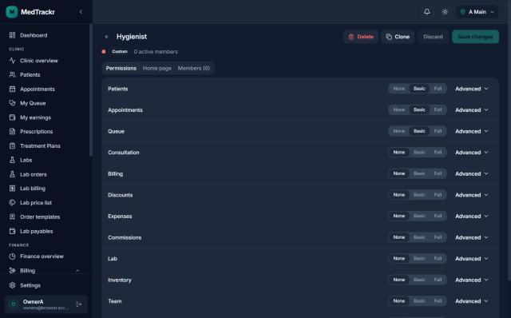
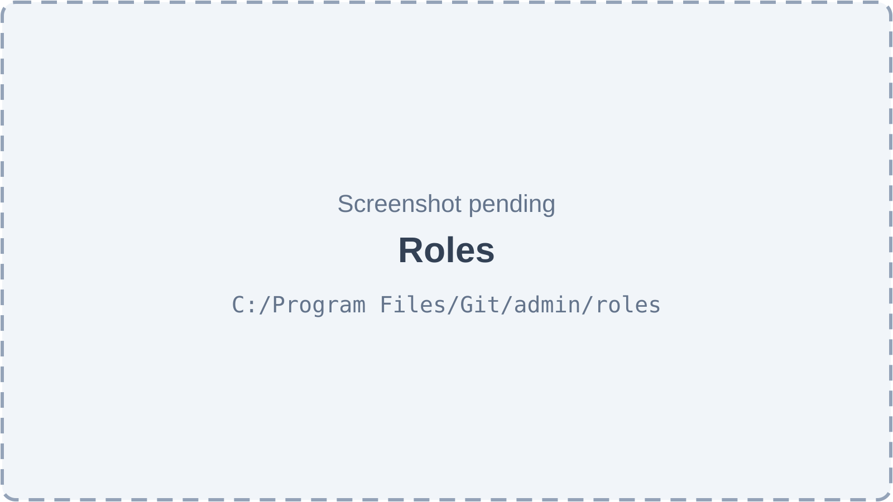
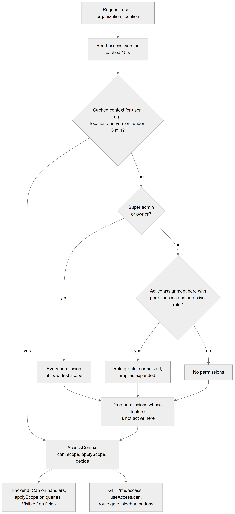
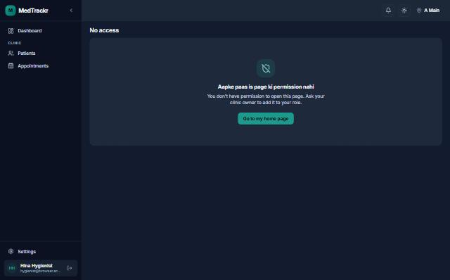
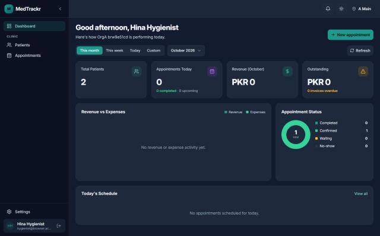

# Chapter 11 — Roles and permissions

This chapter explains who may do what inside a clinic on the Platform. It covers the fixed list of 70 permissions, how they are grouped into roles, the five system roles every clinic starts with, how a clinic builds its own roles safely, and how the backend and the web app check permissions on every request and every screen. It is written for the product owner; the deeper customization screens (sidebar builder, theme, the owner's Features page) are covered in the Customization chapter, Chapter 58.

## 11.1 The model in one paragraph

**Status:** [Implemented]

The Platform never checks role names. It checks **permissions**, such as `billing.invoice.void`. A **role** is a clinic-owned bundle of permissions, stored as a map `{ permission: scope or true }` in `employment_roles.permissions`. An employee gets a role through an **assignment** at one location (Chapter 8), so the same person can have different roles at different branches. **Owners and super admins** have no role: they always get every permission at its widest scope. A permission whose **feature** is not active (Chapter 10) is dropped at resolution time. Anything not granted is denied (**fail-closed**).

**Technical references:** `backend/src/access/` · `backend/src/access/catalog/permissions.ts` · `docs/access-control/README.md`

## 11.2 The 70 permissions

**Status:** [Implemented]

The catalog is fixed in code; clinics combine its keys into roles but can never invent new ones. Each permission has a label, a module group, a feature, optionally a list of permissions it **implies**, optionally a set of **scopes**, and optionally a **high-risk** mark.

| Module (group) | Permissions | Feature |
|---|---|---|
| Patients (12) | `patients.view`*, `patients.create`, `patients.edit`, `patients.delete`!, `patients.export`!, `patients.price.view`, `patients.clinical.view`, `patients.clinical.edit`, `patients.documents.manage`, `patients.chart.edit`, `plans.manage`, `plans.templates.manage` | `patients.core`; documents → `patients.documents`; chart → `patients.teeth_chart`; plans → `patients.treatment_plans` |
| Appointments (5) | `appointments.view`*, `appointments.book`, `appointments.reschedule`, `appointments.cancel`, `appointments.override_rules`! | `appointments.core` |
| Queue (7) | `queue.board.view`, `queue.checkin`, `queue.entry.manage`, `queue.entry.reprioritize`, `queue.doctor.own`, `queue.doctor.any`, `queue.display.manage` | `appointments.core` |
| Consultation (3) | `consultation.conduct`*, `prescriptions.create`, `prescriptions.library.manage` | `patients.core`; prescriptions → `patients.prescriptions` |
| Billing (9) | `billing.desk.use`, `billing.invoice.view`*, `billing.invoice.edit`, `billing.invoice.void`!, `billing.payment.collect`, `billing.refund.issue`!, `billing.price.override`!, `billing.cash_close`, `billing.activity.view` | `billing.invoices` |
| Discounts (2) | `billing.discount.apply`, `billing.discount.custom`! | `billing.discounts` |
| Expenses (2) | `expenses.view`, `expenses.manage` | `billing.expenses` |
| Commissions (3) | `earnings.own.view`, `earnings.all.view`, `compensation.manage`! | `billing.commissions` |
| Lab (7) | `lab.orders.view`*, `lab.orders.create`, `lab.billing.manage`, `lab.catalog.manage`, `lab.payables.manage`, `lab.links.manage`, `lab.templates.share` | `dental.lab_orders` |
| Inventory (3) | `inventory.view`, `inventory.stock.adjust`, `inventory.po.manage` | `inventory.core` |
| Team (4) | `employees.view`, `employees.manage`, `payroll.manage`!, `leave.approve` | core; payroll → `hr.payroll`; leave → `hr.leave` |
| Reports (4) | `reports.clinical.view`*, `reports.financial.view`*, `reports.export`!, `finance.overview.view` | `reports.clinical`, `reports.financial`, `reports.exports` |
| Admin (9) | `admin.features.manage`!, `admin.roles.manage`!, `admin.users.manage`!, `admin.nav.manage`, `admin.settings.manage`, `admin.locations.manage`, `admin.audit.view`, `admin.theme.manage`, `notifications.settings.manage` | core (always on) |

The table lists every permission by module, with its feature. An asterisk (*) marks the 7 **scoped** permissions; an exclamation mark (!) marks the 13 **high-risk** permissions. "Core" permissions belong to no feature and can never be switched off.

**Scopes.** A scoped permission is granted with how far it reaches:

- `own` — only records tied to the user as an employee (for example patients the doctor has seen through an appointment or the queue);
- `location` — records of the active location;
- `org` — every record of the organization.

A wider scope includes the narrower ones. Unscoped permissions are stored as `true` and reach the whole organization.

**Implies.** Granting a permission also grants what it implies, transitively. Examples: `patients.create` implies `patients.view`; `consultation.conduct` implies `patients.clinical.edit`, which implies `patients.clinical.view`; `queue.doctor.any` implies `queue.doctor.own`; `compensation.manage` implies `earnings.all.view`, which implies `earnings.own.view`; `appointments.override_rules` implies `appointments.book`. An implied scoped permission takes the granting permission's scope when it supports it, otherwise its narrowest scope.

**Technical references:** `backend/src/access/catalog/permissions.ts` · `PERMISSIONS` · `expandImplies` · `normalizeGrants` · `filterByFeatures`

## 11.3 Bundles: None, Basic and Full, and Advanced mode

**Status:** [Implemented]

So that owners do not tick 70 boxes, the roles screen offers three ready levels per module:

- **None** — nothing from the module.
- **Basic** — a sensible everyday set. For example: Patients Basic = view at location, register, edit, manage documents; Appointments Basic = view at location, book, reschedule, cancel; Queue Basic = board, check-in, manage entries; Consultation Basic = conduct at `own`, write prescriptions; Billing Basic = desk, view invoices at location, collect payments; Reports Basic = clinical reports at location; Admin Basic = clinic settings and audit log.
- **Full** — every permission of the module at its widest scope.

**Advanced** opens the module's full list of permissions, each with a checkbox and, for scoped ones, a scope selector. When a role's grants in a module match no level exactly, the module shows **Custom**.

**Technical references:** `backend/src/access/catalog/bundles.ts` · `BUNDLES` · `matchBundle` · `web-app/src/features/roles/components/ModuleBundleRow.tsx`

## 11.4 The five system roles

**Status:** [Implemented]

Every organization gets five **system roles** (templates). They are inserted when the organization is created and checked again on every start, insert-missing only: an existing system role is never changed, and one that is missing is recreated. System roles are **read-only**; to customise one, clone it.

| Role | Home page | What it can do by default |
|---|---|---|
| **Admin** | `/dashboard` | Runs the clinic: the Full bundle of every module, minus the clinical acts `consultation.conduct`, `prescriptions.create` and `queue.doctor.own` and minus `earnings.own.view` (it still gets `queue.doctor.own` and `earnings.own.view` back through `queue.doctor.any` and `earnings.all.view`). It can run and force-complete any doctor's queue, manage roles, users, features, locations, the sidebar and the theme. |
| **Doctor** | `/queue/doctor` | Own patients (`patients.view` own), clinical records view and edit, dental chart, documents, treatment plans; own appointments; own queue; conduct consultations (own); write prescriptions; own earnings; lab orders (view own, create); clinical reports (own). |
| **Receptionist** | `/appointments` | Patients at the location (view, register, edit, see prices, documents); appointments at the location (view, book, reschedule, cancel); queue board, check-in, manage entries, TV display; billing desk, invoices at the location, collect payments, apply preset discounts; view lab orders at the location. |
| **Assistant** | `/appointments` | Patients at the location with clinical view and dental chart editing; appointments view and booking; queue board and check-in; inventory view; lab orders view at the location. |
| **Accountant** | `/billing` | Treatment prices; billing desk; invoices at the location (view, edit, void); payments, refunds, cash close, billing activity; expenses view and manage; every doctor's earnings; financial reports at the location, finance overview, report export; lab billing and lab payables. |

The table lists the five templates with their home page and default powers. The **home page** is where a member of that role lands after sign-in; the web app only uses it if the user may open that page, otherwise it falls back to `/dashboard`. Owners and super admins are not shown here because they have no role.

**Technical references:** `backend/src/access/catalog/templates.ts` · `ROLE_TEMPLATES` · `AccessTemplatesService`

## 11.5 Custom roles and the roles screen

**Status:** [Implemented]

**What it does.** Lets the clinic create its own roles (for example "Hygienist"), copy a system role and change it, set its home page and see who has it.

**How the user does it.** Open **Roles & permissions** (`/admin/roles`). The list shows system roles first, then custom ones, each with a "System" or "Custom" badge and its member count; a search box ("Search roles…") and a type filter narrow it. **New role** asks for a name ("e.g. Hygienist") and a description and starts empty. Opening a role shows three tabs:

- **Permissions** — one row per module with None / Basic / Full and **Advanced**;
- **Home page** — the page members land on ("Default (dashboard)" when empty);
- **Members** — everyone with this role, per location ("Nobody has this role yet" when empty; roles are assigned on each employee's page).

The header offers **Delete**, **Clone**, **Discard** and **Save changes**. Leaving with unsaved changes asks "Leave without saving?". Granting a high-risk permission opens a "Grant high-risk" dialog that requires a **Reason**.

*Figure 11.1 — The role editor for a custom role, showing None / Basic / Full per module.*

The screenshot was taken on 2026-10-23 in dark theme and shows the former working name "MedTrackr" in the corner; the product is now called the Platform and each clinic sets its own name. The left sidebar shows the full owner menu (Dashboard, the Clinic section with Clinic overview, Patients, Appointments, My Queue, My earnings, Prescriptions, Treatment Plans, Labs, Lab orders, Lab billing, Lab price list, Order templates, Lab payables, and the Finance section with Finance overview and Billing), with Settings and the signed-in test owner at the bottom. The top bar shows the notification bell, the theme toggle and the active location. The main area shows a custom role named "Hygienist" with a back arrow, a "Custom" badge and "0 active members", and the buttons Delete, Clone, Discard and Save changes. Under the header are the tabs Permissions (selected), Home page and Members (0). Each module (Patients, Appointments, Queue, Consultation, Billing, Discounts, Expenses, Commissions, Lab, Inventory, Team) has a None / Basic / Full selector and an "Advanced" expander; in this role Patients, Appointments and Queue are set to Basic and the other modules to None.

*Figure 11.2 — Roles (screenshot pending).*

The page is titled "Roles" with the subtitle "What each role can see and do. System roles are templates — clone one to customise it." A **New role** button sits at the top right, and a filter row holds the search box and the "All roles / System / Custom" type filter. Roles appear as cards or table rows with name, badge, description and member count, and row actions for opening, cloning and deleting. Empty state: "No roles yet — Create a role and pick what it can do, module by module."

**Behind the scenes — technically.**

| Action | Endpoint |
|---|---|
| List roles with bundle summary and member counts | `GET /admin/roles` |
| One role with its members | `GET /admin/roles/:id` |
| Create | `POST /admin/roles` |
| Clone (any role, including system roles) | `POST /admin/roles/:id/clone` |
| Edit name, description, permissions, home page, active flag | `PATCH /admin/roles/:id` |
| Delete | `DELETE /admin/roles/:id` |
| Catalog, bundles and templates for the editor | `GET /access/catalog` |

The table maps each action to its endpoint. All need `admin.roles.manage`. Each write runs in one transaction with an `audit_logs` row (entity type `employment_role`) holding before and after values and the reason. A legacy `/employment-roles` controller serves the employee form's role picker (`employees.view`) and applies the same rules to writes.

**Rules and validations.**

- **Escalation protection.** A user who is not an owner or super admin cannot grant a permission they do not hold, or a wider scope than they hold. Only newly added or widened grants are checked, implies included. Refusal: 403 `ESCALATION` listing the permissions.
- **Reason for high-risk grants.** Newly granted high-risk permissions need a reason, or 400 `REASON_REQUIRED`.
- **Valid maps only.** Unknown keys, a missing scope on a scoped permission, or a scope on an unscoped one give 400 `INVALID_PERMISSIONS`.
- **System roles are read-only** (403 `SYSTEM_ROLE_READ_ONLY`) and cannot be deleted.
- **Unique names** per organization (409 `ROLE_NAME_TAKEN`). A clone without a name becomes "<name> (copy)", "(copy 2)" and so on.
- **No delete while in use.** A role with active members cannot be deleted (409 `ROLE_HAS_MEMBERS`). Deletion is permanent.
- **Home page** must be an in-app path starting with a single `/`.

**Technical references:** `backend/src/employees/employment-roles.admin.controller.ts` · `EmploymentRolesService` · `backend/src/employees/employment-roles.rules.ts` · `findEscalations` · `highRiskAdded` · `AccessCatalogController` · `web-app/src/features/roles/`

## 11.6 Resolving access: AccessResolver, cache and access version

**Status:** [Implemented]

**In simple terms.** For each user, clinic and branch, the Platform works out once what the user may do, remembers the answer, and throws the answer away as soon as anything relevant changes.

*Figure 11.3 — The access resolution path from a request to the permission checks in the backend and the web app.*

The flowchart reads top to bottom. A request brings a user, an organization and a location. The resolver first reads the organization's `access_version` (cached for 15 seconds). It then asks whether a cached context exists for this user, organization, location and version that is less than 5 minutes old; if yes, it goes straight to the AccessContext. If not, it asks "Super admin or owner?". If yes, the user gets every permission at its widest scope. If no, it asks whether the user has an active assignment at this location with portal access and an active role. If no, the user gets no permissions; if yes, the role's grants are normalized and expanded with everything they imply. All three branches meet at "Drop permissions whose feature is not active here", which produces the AccessContext, offering `can`, `scope`, `applyScope` and `decide`. The context feeds two final boxes: the backend (`@Can` on handlers, `applyScope` on queries, `@VisibleIf` on fields) and the web app (`GET /me/access`, `useAccess().can`, the route gate, the sidebar and the buttons).

**Technically.**

- `AccessResolver.resolve(user, organization, location)` builds an `AccessContext` holding: the user, organization, location, version, `isSuperAdmin`, `isOwner`, `isMember` (super admin, owner or portal-enabled assignment), the employee id, active features, granted permissions, the role and its home page.
- The cache lives in process memory: at most 10,000 entries, 5 minutes each, keyed on user, organization, location and **access version**.
- `organizations.access_version` is raised by one after any committed change to employment roles, assignments (role, location, organization, active flag, portal access, login), organization feature flags or ownership. An entity subscriber does this automatically for TypeORM writes, once per transaction after commit; location overrides and raw SQL bump it explicitly.
- A bump is broadcast over Redis to every process, which drop their cached contexts and feature sets, and the Socket.IO gateway emits `access.changed` to the room `org:<id>`; open browser tabs refetch their access. If Redis is down, other processes catch up within 15 seconds (the version cache).
- **Fail-closed.** A missing key is no access. Roles with only old-style boolean flags give nothing. A role that is inactive, or belongs to another organization, gives nothing. A location header that is not a valid id means no location, so staff get no role permissions.

**Technical references:** `backend/src/access/access.resolver.ts` · `AccessResolver` · `backend/src/access/access-context.ts` · `AccessContext` · `backend/src/access/version/` · `AccessVersionService` · `AccessVersionSubscriber` · `AccessChangeBus`

## 11.7 Checking access in the backend

**Status:** [Implemented]

Every HTTP handler must say who may call it, with exactly one of these markers (on the method or its controller):

| Marker | Meaning | Checked by |
|---|---|---|
| `@Can('perm', ...)` | All listed permissions are required; class and method lists merge. | `AccessGuard` (403 `NO_PERMISSION` with the missing keys) |
| `@AnyMember()` | Any active member of the location (owners and super admins too). | `AccessGuard` |
| `@Public()` | No sign-in (the route must also be in `PUBLIC_ROUTES`). | `JwtAuthGuard` list, all guards skip |
| `@RequireSuperAdmin()` | Super admin only. | `TenantContextGuard` |
| `@ContextFree()` | The handler checks access itself (for example `/locations`, `GET /me/access`). | the handler |

The table lists the five markers, what they mean and which component enforces them. A controller protected by its own `@UseGuards(...)` (lab portal, magic links) also counts.

- **The coverage test.** `access-coverage.spec.ts` loads every controller and fails if any handler outside the auth and session controllers has none of the markers, or still uses the removed `@Roles()`. At runtime, a handler without a marker would pass the access guard, so this test is the safety net.
- **Row scope.** Handlers that list data take `@Access() access` and call `access.applyScope(queryBuilder, 'patients.view', columns)`. For `own` it adds the caller's employee condition, for `location` the active location condition, for `org` nothing extra; with no grant it adds a condition that matches no rows. Patients, for example, are "own" when the doctor has an appointment or queue entry with them, and "location" when their primary location or an appointment or queue entry is at the active location.
- **Field hiding.** A response property marked `@VisibleIf('perm')` is removed by a global interceptor when the caller lacks the permission; with no access context every guarded field is removed. It is used today for treatment and treatment-plan prices (`patients.price.view`).
- **Range decisions.** `access.decide(perm, { value, min, max })` returns allow, deny or "needs approval". It is used for discounts: changing a preset discount outside its range needs `billing.discount.custom`.
- **Rule for developers.** Code never checks role names; it asks `can(...)`.

**Technical references:** `backend/src/access/access.guard.ts` · `AccessGuard` · `backend/src/access/decorators/access.decorators.ts` · `backend/src/access/access-coverage.spec.ts` · `backend/src/access/visible-if/visible-if.ts` · `backend/src/patients/access/patient-scope.ts`

## 11.8 Checking access in the web app

**Status:** [Implemented]

- **`GET /me/access`** returns, for the active organization and location: the version, owner and super-admin flags, active features, granted permissions with scopes, the role, the employee id, the home page and the clinic's sidebar layout. `AccessProvider` loads it (fresh for 30 seconds, refetched on window focus and on every `access.changed` event) and serves it through `useAccess()`.
- **Buttons and widgets** ask `useAccess().can('perm')` or wrap content in `<Can perm="...">`.
- **Routes** declare `staticData: { can: ... }` (one permission, or an array meaning any of them). One gate in the root route, `RouteAccessGate`, checks every matched route and shows the **No access** page instead of the screen when the check fails.
- **The sidebar** is built from a developer-owned registry of 39 items, each with its own requirement (a permission, super admin only, owner or super admin, or lab member). Items the user may not open are hidden. The clinic's saved sidebar layout only arranges items; it never grants access.
- **The permission list in the web app** is a generated copy of the backend catalog (`features/access/generated/catalog.ts`), refreshed with `npm run access:export`.

*Figure 11.4 — The page shown when a role lacks a page's permission.*

The screenshot was taken on 2026-10-23 in dark theme and shows the former working name of the product in the corner. A test user in a custom role opened a page their role does not allow. The sidebar is short: Dashboard, and under "Clinic" only Patients and Appointments, with Settings and the user at the bottom. The main area is titled "No access" and shows a shield icon, the Roman-Urdu headline "Aapke paas is page ki permission nahi" ("You do not have permission for this page"), the English text "You don't have permission to open this page. Ask your clinic owner to add it to your role." and a button "Go to my home page", which opens the role's home page, or the dashboard when none is set.

*Figure 11.5 — The sidebar of a user in a restricted custom role.*

This screenshot from 2026-10-23 (dark theme, former working name in the corner) is used only to show the sidebar; the dashboard content in it predates the dashboard redesign of 2026-10-23. The user holds a custom "Hygienist" role with the Basic level for Patients, Appointments and Queue. The sidebar therefore shows only Dashboard and, under "Clinic", Patients and Appointments, plus Settings at the bottom. Every other menu item is hidden because the role lacks its permission or the item needs an owner or super admin.

**Technical references:** `backend/src/access/access.controller.ts` · `MeAccessController` · `web-app/src/features/access/components/AccessProvider.tsx` · `RouteAccessGate` · `web-app/src/features/access/components/NoAccess.tsx` · `web-app/src/features/access/nav/nav.registry.ts` · `web-app/src/features/access/nav/resolveNav.ts` · `useAccess`

## 11.9 Limitations and known gaps

- A system role deleted directly in the database is recreated on the next start; a clinic cannot permanently remove a system role (the API refuses to delete one anyway).
- Missing markers are caught by a unit test, not at runtime.
- `POST /auth/switch-location` still returns eight old permission flags derived from the new permissions; the web app ignores them.
- Permissions follow the assignment's location: a staff member with no assignment at the active location gets no role permissions there.

## 11.10 Owner's FAQ

**Can a receptionist see treatment prices?** Yes with the default Receptionist role, which holds `patients.price.view`. Without it, prices are removed from the API responses, not only hidden on screen.

**Can I give my manager the right to edit roles without making them all-powerful?** Yes: grant `admin.roles.manage`. They still cannot grant anything they do not hold themselves.

**Why can't I edit the Doctor role?** System roles are read-only templates. Clone it and edit the copy, then assign the copy.

**How quickly does a role change take effect?** On the next request: the change raises the access version, every server drops its cached answer, and open screens refetch their access.

**What does a doctor see with `patients.view` at scope own?** Only patients they have an appointment or queue entry with.

**Where is the history of role changes?** In the audit log, as `employment_role` entries with before and after values and the reason given for high-risk grants.
