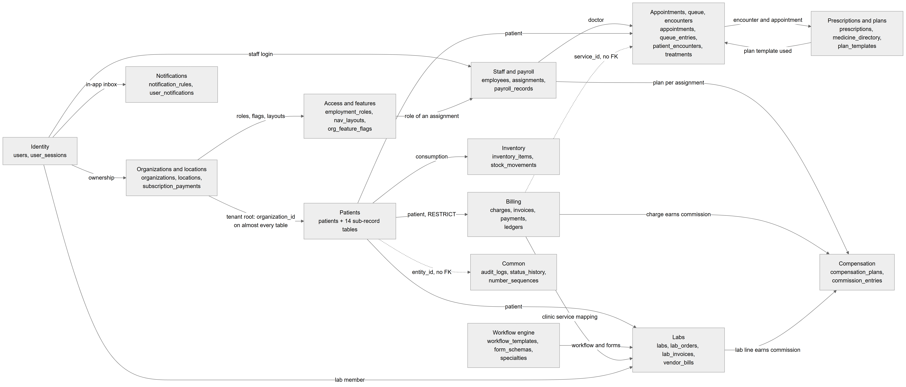

# Chapter 12 — Data model overview

This chapter explains how the Platform's database is organised as a whole: who owns the schema, which naming and money conventions the tables follow, and how tenant data is kept apart. It is written for the product owner who needs to reason about the data before changing a feature or answering a support question. Chapters 13 to 27 then walk through each business domain table by table; this chapter is the map they share.

## 12.1 The database in numbers

The Platform stores all of its data in one PostgreSQL database. The backend defines **153 entity classes, one per table**, spread across **31 owning modules** (a module "owns" a table when the table's entity class lives in that module's folder). The schema has 278 enforced foreign keys. It has no views, no table inheritance and no many-to-many junction tables generated by the ORM; every link between two tables is an ordinary column.

The field-level reference for every table is the generated entity catalog, `backend/docs/data-model/ENTITY_CATALOG.md`. It lists every column, type, default, index, constraint and foreign key, and it was produced from the same metadata the ORM uses to build the schema. This handbook names only the key columns of each table; when you need the full column list, open the catalog. The catalog has two known defects: the "Notes" column of the ten inventory tables is shifted one row down, and one note claims a trigger on `form_schema_versions` that does not exist.

## 12.2 Who owns the schema

### 12.2.1 Entities are the source of truth

**Status:** [Implemented]

The shape of every table — its columns, primary key, foreign keys, unique keys, indexes, CHECK constraints and EXCLUDE constraints — is declared in TypeORM entity classes in the backend code. Nobody writes `CREATE TABLE` statements by hand for normal tables.

- **In development**, the API process builds and updates the schema itself on start-up. The setting in `app.module.ts` is `synchronize: true` whenever the process owns the schema and `NODE_ENV` is not `production`. The ORM compares the entities with the database and applies the difference.
- **In production**, `synchronize` is off. An engineer runs `npm run schema:log:prod` to print the SQL the entity changes would need, reviews every statement (watching especially for `DROP COLUMN`, `DROP TABLE` and type changes), takes a backup, and then applies it with `npm run schema:sync:prod`.

Only the API process owns the schema. The background worker process never synchronizes and never runs migrations.

Two entity classes are not registered by any running module: `chairs` and `inventory`. The running app only knows tables that some module registers, so in development these two tables are not created. The command-line data source used by `schema:sync:prod` loads entity files by file pattern, so it does include them. A development database and a production database can therefore differ by exactly these two tables.

### 12.2.2 Migrations: three files, two that run

**Status:** [Implemented]

The folder `backend/src/migrations/` holds three files. Migrations do the work that `synchronize` cannot do: triggers, SQL functions and data backfills.

| File | What it does | Runs? |
|---|---|---|
| `1776356529788-create-table` | A partial schema diff taken from an early development database. Describes 17 tables in a shape that no longer exists. | Never. Start-up records it as already applied without executing it. |
| `1792403456699-doctor-compensation` | Creates the commission tables if they are missing, installs the append-only trigger on `commission_entries`, and backfills data. | Yes, once. Hand-written and idempotent. |
| `1792490000000-lab-management-foundation` | Creates `audit_logs`, `status_history`, `number_sequences`, `labs`, `lab_members` and `lab_clinic_links` if missing, installs `uuid_generate_v7()` and the append-only triggers on `audit_logs` and `status_history`. | Yes, once. Hand-written and idempotent. |

The table lists the three migration files, what each contains and whether it executes. The first file is the "legacy baseline": it is kept in the folder, recorded as applied by a helper called `recordLegacyBaseline`, and must never be edited or deleted. The other two are written so that they give the same result whether or not `synchronize` already created the tables; they skip table creation when the table exists and always (re)install their triggers.

On API start-up the order is fixed: first the required database extensions and functions are created, then `synchronize` runs (development only), then pending migrations run, each in its own transaction. Because 136 of the 153 tables appear in no migration at all, the migration folder cannot be used to rebuild the schema; the entities are the only complete description.

### 12.2.3 Database objects that live outside the entities

A few database objects cannot be expressed in an entity class. They are created by start-up code or by the two running migrations:

- **`btree_gist` extension.** Needed by the GiST EXCLUDE constraints that compare uuids, such as the rule that stops one doctor from having two overlapping appointments (`appointments.no_doctor_overlap`). Created at start-up before `synchronize`.
- **`uuid_generate_v7()` SQL function.** Produces time-ordered uuids; it is the primary-key default of the newer tables. Created at start-up and also by the lab-management migration.
- **`commission_entries` append-only trigger.** Blocks every DELETE and blocks UPDATE except setting or releasing the settlement link while the settlement is still pending.
- **`audit_logs` and `status_history` append-only triggers.** Block every UPDATE and DELETE.
- **`migrations` table.** TypeORM's bookkeeping of which migrations ran.

There are no views, no row-level security policies and no other triggers anywhere in the backend. Several other tables are described as "append-only" or "immutable" in code comments (for example `queue_events`, `patient_consents`, `prescription_history`, `ledger_entries`), but for those the rule is kept by the application only; the database would accept an update.

## 12.3 Conventions

### 12.3.1 Primary keys

| Kind of primary key | Tables | Where it is used |
|---|---|---|
| uuid v4, generated by TypeORM (`uuid_generate_v4()`) | 84 | The older modules: identity, organizations, locations, staff, patients, appointments, queue, prescriptions, billing, inventory and others. |
| uuid v7, default `uuid_generate_v7()` | 55 | The newer modules: every lab table, the workflow engine, notifications, the general-ledger journals, `audit_logs`, `status_history` and `config_values`. |
| bigint identity | 2 | `outbox` and `queue_events`, where strict insertion order matters. |
| Supplied by the application (natural or composite key) | 12 | For example `idempotency_keys` (organization + key), `location_billing_settings` (the location id), `notification_events` (an event code), `patient_comm_prefs` (the patient id). |

The table counts the four kinds of primary key across all 153 tables and names where each appears. A uuid v7 starts with a timestamp, so new rows sort by creation time and indexes stay compact; a uuid v4 is fully random. Both look the same to the application. One naming quirk: the four identity tables (`users`, `oauth_providers`, `security_logs`, `user_sessions`) call their primary-key column `uuid`; every other table calls it `id`.

### 12.3.2 Column naming

Columns use `snake_case` (`organization_id`, `created_at`) in every module except one. Ten of the eleven tables of the inventory module use `camelCase` column names such as `organizationId`, `locationId` and `inventoryItemId`. Queries written by hand against these tables must quote the names. The eleventh table, the unregistered `inventory` table, uses snake_case. The Inventory chapter (Chapter 23) covers those tables.

### 12.3.3 Money

The Platform stores money in two ways, and a reader must check which one a column uses:

- **Integer paisa** (`bigint` or `integer` columns whose names end in `_paisa`). One rupee is 100 paisa, so 1,250.50 PKR is stored as `125050`. The newer money-handling code uses this form: payroll breakdowns, commissions and compensation plans, the general-ledger journals, and every lab billing and payables table.
- **Numeric with two decimals** (`numeric(12,2)` or `numeric(10,2)`). The amount is stored in rupees with two decimal places. Billing v2 (charges, invoices, payments, refunds), subscriptions, inventory, insurance, treatment plans and the legacy `treatments.cost` use this form.

Some tables carry both. `payroll_records` keeps `base_salary_paisa`, `commission_paisa` and `total_paisa` in paisa and also `salary_amount` in rupees, which mirrors the total for older screens. "PKR" is the default currency of a new organization, not a limit: `organizations.currency` and `locations.currency` hold the currency code.

### 12.3.4 Timestamps and dates

Most tables have `created_at` and many have `updated_at`, filled automatically by the ORM. Older tables store these as `timestamp without time zone` (about 50 tables); newer tables use `timestamp with time zone` (about 70 tables). Business moments that matter to the clinic — appointment start and end, check-in, payment time — are `timestamp with time zone` throughout. Calendar days that belong to a clinic day, such as `queue_sessions.service_date`, are stored as `date` and are computed in the **location's** timezone (`locations.timezone`), not the server's.

### 12.3.5 Soft delete

The Platform hides records in three ways:

- **`is_active` flag.** Organizations, locations, employees, assignments, roles, catalogs and templates are switched off with `is_active = false`; the row stays. Deactivating an organization or a location is always a soft delete.
- **`deleted_at` column.** Three tables use TypeORM's soft-delete column: `patients`, `patient_documents` and `patient_treatment_plans`. A row with `deleted_at` set is excluded from normal ORM reads.
- **Hard delete.** Some actions really delete rows and rely on `ON DELETE CASCADE` to remove children. For example, permanently deleting a patient deletes the patient row and every child row whose foreign key cascades. Child rows whose foreign key is `RESTRICT` block the delete instead.

`patients` has both a `deleted_at` column and an `is_active` flag. The user-facing activate/deactivate switch uses `is_active`.

### 12.3.6 Tenant columns

Every row that belongs to one clinic carries `organization_id`, and every row that belongs to one branch also carries `location_id`. The column names are the same in every snake_case module. Whether the column has a foreign key varies by module:

- The older modules (organizations, staff, patients, appointments, encounters, treatments, prescriptions) declare real foreign keys to `organizations` and `locations`, almost always with `ON DELETE CASCADE`.
- The queue tables, nearly all billing v2 tables, the lab tables, `plan_templates`, `audit_logs` and `status_history` keep `organization_id` (and often `location_id`) **without** a foreign key. The database accepts any uuid there; the application is responsible for writing the right one.

## 12.4 Tenant scope rules

The catalog classifies every table by which tenant columns it carries. The classes are:

| Scope class | Meaning | Examples |
|---|---|---|
| Global — platform | Shared by all tenants; no tenant column. | `users`, `user_sessions`, `feature_catalog`, `specialties`, `notification_events`, `workflow_effects` |
| Global — person or lab | Shared across organizations by design. | `employees` (one person can work for several clinics), `labs`, `lab_members`, `lab_services` |
| Organization | `organization_id` only. | `patients`, `employment_roles`, `org_feature_flags`, `medicine_directory`, `services` |
| Organization + location | Both columns. | `appointments`, `queue_sessions`, `charges`, `invoices`, `payroll_records`, `prescriptions` |
| Location only | `location_id` only; the organization is reached through `locations`. | `chairs` (unregistered) |
| Cascading scope | A `scope_type` + `scope_id` pair that points to the platform, an organization or a location. | `config_values` |
| Platform or organization | Nullable `organization_id`: null means a platform default shared by all, a value means a clinic's own copy. | `form_schemas`, `workflow_templates`, `stage_templates`, `notification_templates` |
| No tenant column | A child table scoped only through its parent. | the ten tables listed after this table |

The table shows each scope class, what it means and typical tables. Ten tenant-data tables have no organization column and are isolated only through their parent: `treatment_plan_items` (through `patient_treatment_plans`), `prescription_history` and `prescription_medicines` (through `prescriptions`), `treatment_plan_template_medicines` (through `treatment_plan_templates`), `cash_close_lines` (through `cash_closes`), `commission_rules` (through `compensation_plans`), and the inventory children `consumption_template_items`, `patient_consumption_items` and `purchase_order_items`. Any query on these tables must join the parent to stay inside one tenant.

The rule that keeps tenants apart at runtime is not in the database. The guard chain resolves the active organization and location from the request headers, and every service filters by `organization_id` (and `location_id` where relevant). The multi-tenant model is described in Chapter 8; this chapter only describes the columns that make it possible.

## 12.5 The domains and how they connect

*Figure 12.1 — Domains of the data model and the key links between them.*

The figure draws the 153 tables as fourteen domain boxes, each labelled with the domain name and two to four of its most important tables. Arrows point from the side that is referenced (the parent) to the side that holds the reference (the child). Solid arrows are links backed by a foreign key; the two dotted arrows are logical links that have no foreign key. The left side holds the foundation: Identity, Organizations and locations, and Access and features. The middle holds the clinic's daily work: Staff and payroll, Patients, Appointments-queue-encounters, Prescriptions and plans, Billing, Inventory, Common and the Workflow engine. The right side holds Compensation and Labs, which consume data from several middle domains. Notifications sits near Identity because its main link is the user's in-app inbox. Every link drawn is explained in the next section.

### 12.5.1 Every link in the figure

- **Identity → Organizations and locations ("ownership").** `organization_ownership.user_id` links a user account to the organization it owns. Deleting the user or the organization deletes the ownership row (CASCADE).
- **Identity → Staff and payroll ("staff login").** `employee_org_location_assignments.user_id` links an employee's assignment to the user account they log in with. The link is optional; deleting the user sets it to null.
- **Organizations and locations → Patients ("tenant root").** `patients.organization_id` is a foreign key with CASCADE. The same kind of link, `organization_id` and often `location_id`, exists on almost every tenant table in every domain; the figure draws it once to keep the picture readable.
- **Organizations and locations → Access and features ("roles, flags, layouts").** `employment_roles`, `org_feature_flags` and `nav_layouts` each belong to one organization (CASCADE); `location_feature_overrides` belongs to one location (CASCADE).
- **Access and features → Staff and payroll ("role of an assignment").** `employee_org_location_assignments.employment_role_id` names the role a person has at a location. Deleting the role sets it to null.
- **Staff and payroll → Appointments, queue, encounters ("doctor").** `appointments.doctor_id` and `queue_sessions.doctor_id` point to `employees`, both with RESTRICT, so a doctor who has appointments or queue sessions cannot be hard-deleted.
- **Patients → Appointments, queue, encounters ("patient").** `appointments`, `queue_entries`, `patient_encounters` and `treatments` all carry `patient_id` with CASCADE.
- **Appointments, queue, encounters → Prescriptions and plans ("encounter and appointment").** `prescriptions.encounter_id` and `prescriptions.appointment_id` are optional links; deleting the encounter or appointment sets them to null.
- **Prescriptions and plans → Appointments, queue, encounters ("plan template used").** `treatments.plan_template_id` points to `plan_templates`; deleting the template sets it to null.
- **Patients → Billing ("patient, RESTRICT").** `charges`, `invoices`, `payments` and `refunds` carry `patient_id` with RESTRICT. A patient who has any billing row cannot be hard-deleted.
- **Staff and payroll → Compensation ("plan per assignment").** `compensation_plans.assignment_id` ties a salary-and-commission plan to one assignment (CASCADE). In the other direction, `commission_settlements.payroll_record_id` links a settlement to the payroll record that paid it (RESTRICT).
- **Billing → Compensation ("charge earns commission").** `commission_entries.charge_id` points to the charge that earned a commission (RESTRICT), and `charges.commission_plan_id` records which plan applied.
- **Labs → Compensation ("lab line earns commission").** `commission_entries.lab_invoice_line_id` points to a lab invoice line (RESTRICT).
- **Patients → Labs ("patient").** `lab_orders`, `lab_invoices`, `lab_payments` and `lab_refunds` carry `patient_id` with RESTRICT.
- **Workflow engine → Labs ("workflow and forms").** `lab_services` and `lab_orders` point to workflow templates, workflow template versions, stage templates and form schemas (all RESTRICT).
- **Billing → Labs ("clinic service mapping").** `service_mappings.clinic_treatment_id` maps a clinic billing service in `services` to a lab service (RESTRICT).
- **Patients → Inventory ("consumption").** `patient_consumptions.patientId` records materials used for a patient (CASCADE).
- **Identity → Notifications ("in-app inbox").** `user_notifications.user_id` delivers an in-app notification to a user (CASCADE).
- **Identity → Labs ("lab member").** `lab_members.user_id` makes a user a member of a lab (RESTRICT).
- **Patients ⇢ Common ("entity_id, no FK", dotted).** `audit_logs` and `status_history` record history for many kinds of rows through an `entity_type` + `entity_id` pair (and a `subject_id` that groups a patient's sub-records under the patient). The pair is polymorphic, so no foreign key is possible.
- **Billing ⇢ Appointments, queue, encounters ("service_id, no FK", dotted).** `treatments.service_id` names the catalog service billing uses to price the treatment, without a foreign key. `charges.encounter_id` and `charges.appointment_id` are also logical links without foreign keys.

## 12.6 Where to read next

Each domain has its own chapter with an entity-relationship diagram and every relationship explained: identity (Chapter 13), organizations, locations and subscriptions (Chapter 14), access and features (Chapter 15), staff and payroll (Chapter 16), patients (Chapter 17), appointments, queue and encounters (Chapter 18), prescriptions and plans (Chapter 19), billing (Chapters 20 and 21), compensation (Chapter 22), inventory (Chapter 23), notifications (Chapter 24), labs (Chapter 25), and the workflow engine and common tables (Chapter 26). Overlapping concepts — two prescription tables, four "visit" tables, two outboxes, two sequence mechanisms — are compared in Chapter 27.
