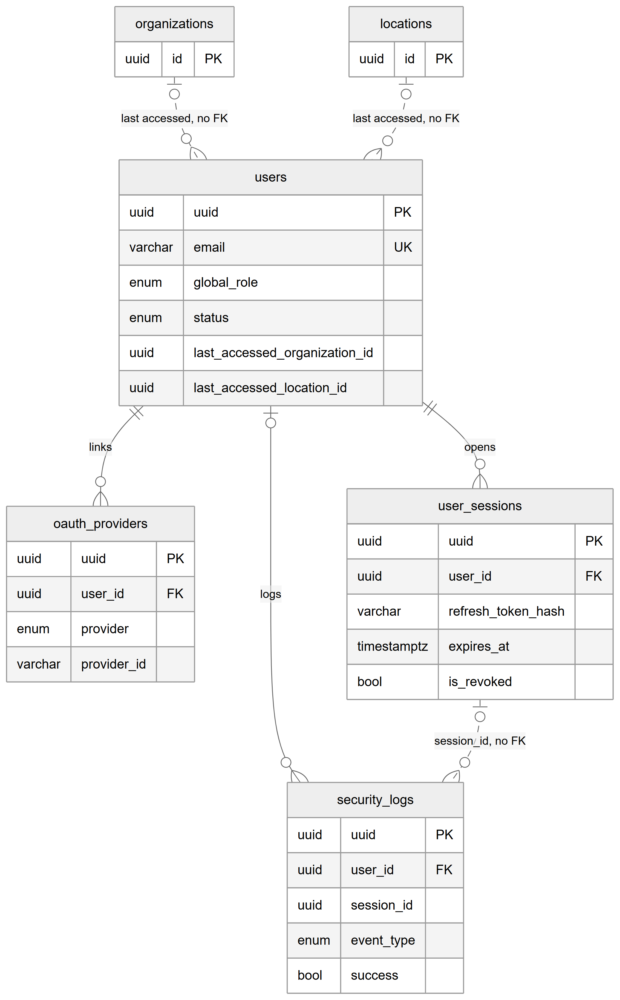

# Chapter 13 — Identity and sessions

This chapter describes the four tables that hold the people who can sign in to the Platform and the record of what happened when they did. It is for the product owner who needs to know where a login account lives, how a session is kept, and how sign-in events are logged. These tables sit underneath every other domain: a staff login, an owner, a super admin and a lab member are all rows in `users`.

## 13.1 Context

The identity domain is global. Its tables carry no `organization_id` or `location_id`, because one person has one account and may work for several organizations. What a user may do inside a clinic is not stored here; it comes from ownership (Chapter 14) and from the user's assignments and roles (Chapters 15 and 16). The tables are owned by three small modules: `user` owns `users`, `auth` owns `oauth_providers` and `security_logs`, and `session` owns `user_sessions`. Every column of every table is listed in the entity catalog, `backend/docs/data-model/ENTITY_CATALOG.md`.

## 13.2 The tables

### 13.2.1 `users` — user account

**Status:** [Implemented]

One row per login account on the whole Platform. The key columns are:

- `uuid` — the primary key. This table, and the other three in this chapter, name the key column `uuid` instead of `id`.
- `email` — unique across the whole Platform. Two accounts can never share an email address.
- `password` — the stored password hash; the column is nullable.
- `global_role` — null for normal users; the value `super_admin` marks a super admin. No other value exists.
- `status` — `active`, `suspended` or `deleted`, with `suspended_at`, `suspension_reason` and `deleted_at` recording when and why. The account is never removed by this flag; it is a status.
- `email_verification_token`, `email_verification_expires`, `email_verified_at` — used only for self-signup accounts, so accounts created by an administrator are never asked to verify.
- `last_accessed_organization_id`, `last_accessed_location_id` — the organization and location the user last worked in, so the next login can return there.
- `provider` — `local`, `google` or `github`; defaults to `local`.
- `refresh_token` — a deprecated single refresh token kept for backward compatibility. Sessions now keep their own refresh tokens in `user_sessions`.

There is an index on `status` for listing accounts by state.

### 13.2.2 `oauth_providers` — linked external sign-in

**Status:** [Not implemented] (table exists, nothing reads or writes it)

Designed to record external sign-in identities (Google, GitHub) linked to an account: `user_id`, `provider`, `provider_id` (the provider's own id for the person), and the email, display name, avatar and raw profile the provider returned. A user can have at most one row per provider (unique `user_id` + `provider`), and lookups by `provider` + `provider_id` are indexed.

The auth module registers the table, so it is created in the database, but no service injects or queries it. External sign-in itself is disabled: the Google and GitHub strategies exist as files but are not registered, and the module comment says Google/GitHub sign-in is disabled. Expect this table to be empty.

### 13.2.3 `security_logs` — security event log

**Status:** [Implemented]

One row per security-relevant event: a successful or failed login, logout, logout of all devices, password change or reset, email verification, session created, revoked or expired, token refreshed, account suspended, deleted or restored, a login from a new device, and suspicious activity. Key columns:

- `user_id` — the account concerned; nullable, because a failed login for an unknown email has no account.
- `event_type` — one of twenty event codes such as `LOGIN_SUCCESS`, `LOGIN_FAILED`, `SESSION_REVOKED`.
- `success` and `error_message` — whether the event succeeded and why not.
- `session_id` — the session involved, when the event concerns a session.
- `metadata` — free-form JSON with event-specific detail.
- The table also records the network address and browser string of the request. Those values are personal data and are not reproduced in this handbook.

Indexes on `created_at` and on `user_id` + `event_type` support "recent events" and "events of this kind for this user" queries. The table has only `created_at`; rows are never updated by design, but the database does not enforce that.

### 13.2.4 `user_sessions` — login session

**Status:** [Implemented]

One row per signed-in device or browser. Each session has its own refresh token, so a user can be signed in on several devices and sign one out without affecting the others. Key columns:

- `user_id` — the account.
- `refresh_token_hash` — a hash of this session's refresh token; the token itself is never stored.
- `expires_at` — after this moment the session is expired.
- `is_revoked` — a soft revocation flag: when true the session is no longer valid, and the row stays as history.
- `device`, `browser`, `os` and a free-text `location` describe the device; an `is_current` flag is also stored.
- `last_active_at` — updated on every save of the row.

An index on `user_id` + `is_revoked` makes "this user's live sessions" fast.

## 13.3 Entity-relationship diagram

*Figure 13.1 — Identity and session tables.*

The diagram has `users` in the centre, with the key columns `uuid` (primary key), `email` (unique), `global_role`, `status`, `last_accessed_organization_id` and `last_accessed_location_id`. Under it are three child tables. On the left, `oauth_providers` (`uuid`, `user_id`, `provider`, `provider_id`) hangs from `users` with a solid line labelled "links": one user, zero or more provider rows, and every provider row must have a user. In the middle, `security_logs` (`uuid`, `user_id`, `session_id`, `event_type`, `success`) hangs from `users` with a solid line labelled "logs" whose user end is optional. On the right, `user_sessions` (`uuid`, `user_id`, `refresh_token_hash`, `expires_at`, `is_revoked`) hangs from `users` with a solid line labelled "opens". A dashed line labelled "session_id, no FK" runs from `user_sessions` to `security_logs`. At the top, `organizations` and `locations` are drawn as context boxes with only their `id`; each has a dashed line to `users` labelled "last accessed, no FK". Solid lines are foreign keys; dashed lines are logical references the database does not enforce.

## 13.4 Relationships explained

Foreign-key relationships:

- **`oauth_providers.user_id` → `users`.** Each provider row belongs to exactly one user; a user has zero or more (at most one per provider). Deleting the user deletes their provider rows (ON DELETE CASCADE).
- **`security_logs.user_id` → `users`.** Each log row belongs to zero or one user; a user has zero or more log rows. Deleting the user keeps the log rows and sets `user_id` to null (ON DELETE SET NULL), so the security history survives the account.
- **`user_sessions.user_id` → `users`.** Each session belongs to exactly one user; a user has zero or more sessions. Deleting the user deletes their sessions (ON DELETE CASCADE).

Logical relationships (no foreign key; the database accepts any value):

- **`security_logs.session_id` → `user_sessions`.** The session an event concerns. Zero or one session per log row. If the session row disappears, the log keeps a dangling id.
- **`users.last_accessed_organization_id` → `organizations`** and **`users.last_accessed_location_id` → `locations`.** A convenience pointer for the next login. If the organization or location is removed, the pointer is not cleared by the database.

Links into `users` from other domains (described in their own chapters):

- `organization_ownership.user_id` (CASCADE) makes a user an owner of an organization (Chapter 14).
- `employee_org_location_assignments.user_id` (SET NULL) gives an employee's assignment a staff login (Chapter 16).
- `lab_members.user_id` (RESTRICT) makes a user a member of a lab (Chapter 25). Because of RESTRICT, a user who is a lab member cannot be hard-deleted.
- `user_notifications.user_id` (CASCADE) is the user's in-app inbox (Chapter 24).
- Many tables keep "actor" columns such as `created_by`, `updated_by`, `approved_by` or `recorded_by`. They hold a `users.uuid` but have no foreign key (see Chapter 12).

## 13.5 Tenant scope

All four tables are global: no `organization_id`, no `location_id`. A user's link to clinics is indirect, through `organization_ownership` and through assignments. This is why `users.email` is unique across the whole Platform rather than per organization. Only the super admin has a platform-wide role, stored in `users.global_role`.

## 13.6 Ownership and ambiguities

- **`oauth_providers` is registered but unused.** The table is created, but no code path reads or writes it, and external sign-in is disabled. It is a leftover of a planned feature.
- **Two places for a refresh token.** `users.refresh_token` is marked deprecated; the live mechanism is one hashed token per row in `user_sessions`.
- **`security_logs.session_id` has no foreign key**, so a log row can point to a session that no longer exists. This is acceptable for a log but means joins must be outer joins.
- **Append-only by convention.** Nothing in the database prevents an update or delete of `security_logs` rows.
