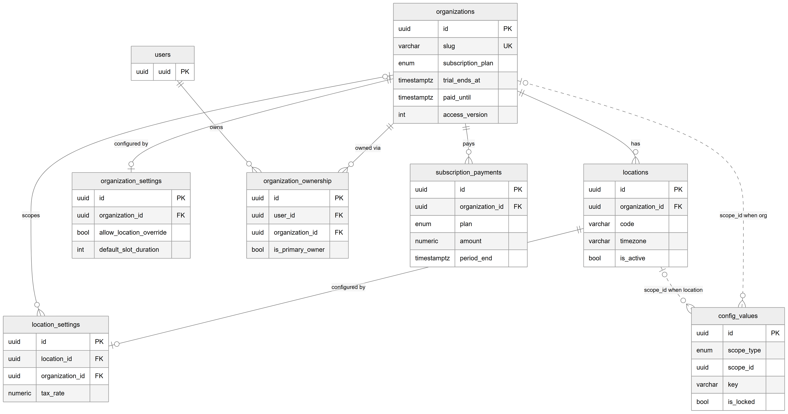

# Chapter 14 — Organizations, locations, subscriptions and settings

This chapter describes the tables that define a tenant: the organization (one clinic business), its locations (branches), who owns it, how it pays for the Platform, and where its settings are stored. It is for the product owner who needs to know what a "clinic" is in the database and which table to look at for a given setting. Almost every other table in the Platform points back to `organizations`, and most point to `locations` as well.

## 14.1 Context

Seven tables belong to this domain. `organizations`, `organization_ownership` and `organization_settings` are owned by the `organizations` module; `locations` and `location_settings` by the `locations` module; `subscription_payments` by the `subscriptions` module; and `config_values` by the `settings-registry` module. The business behaviour of organizations and locations is covered in Chapter 9 and subscriptions in Chapter 45; this chapter covers only the data. Every column is listed in the entity catalog, `backend/docs/data-model/ENTITY_CATALOG.md`.

## 14.2 The tables

### 14.2.1 `organizations` — organization (the tenant)

**Status:** [Implemented]

One row per clinic business. This is the root of tenancy: no other table sits over it. Key columns:

- `name` and `slug` — the display name and a short machine name. `slug` is unique across the Platform.
- `clinic_type` and `specialty_tags` — what kind of clinic this is. `specialty_tags` is a JSON list such as `["general"]` or `["dental"]` and is used to decide which features are relevant.
- `timezone` (default `Asia/Karachi`) and `currency` (default `PKR`) — the organization-wide defaults.
- `subscription_plan` — `free`, `starter`, `professional` or `enterprise`.
- `trial_ends_at` and `paid_until` — the subscription window. When both are null the clinic is "unmanaged" (created by a super admin before subscriptions existed) and has no expiry.
- `max_locations` and `max_users` — optional limits.
- `onboarding_pending` — true for a self-signup clinic that has not yet finished the setup wizard.
- `access_version` — a counter increased by one on every access change in the organization (roles, assignments, feature flags, ownership). Access caches use it as their key; it is written only by the access-version service.
- `is_active` — the soft-delete flag. Deactivating an organization sets it to false; the application does not hard-delete organizations.

Indexes: unique `slug`, and an index on `is_active`.

### 14.2.2 `organization_ownership` — owner link

**Status:** [Implemented]

Links a user account to an organization it owns: `user_id`, `organization_id` and `is_primary_owner`. The pair (`user_id`, `organization_id`) is unique, so a user is listed at most once per organization. An owner holds every permission in the organization (Chapter 11). An organization can have more than one owner row; `is_primary_owner` marks the main one.

### 14.2.3 `organization_settings` — organization-wide settings

**Status:** [Partial] — stored and editable; the feature switches only hide sections on the location settings screen

One row per organization at most (`organization_id` is unique). It holds:

- Booking defaults: `default_slot_duration` (30 minutes), `advance_booking_days` (30), `cancellation_notice_hours` (24).
- `allow_location_override` — whether locations may set their own booking values. The location settings screen shows the organization's values instead when this is false.
- Six older feature switches: `feature_appointments`, `feature_inventory`, `feature_finance`, `feature_reminders` (all default true), `feature_whatsapp` and `feature_patient_portal` (default false).

The feature switches predate the feature-flag system. Today the location settings screen reads them only to hide its appointments, reminders and finance sections. The guards that actually allow or block a feature read `org_feature_flags` (Chapter 15), not these columns. The row is created with defaults the first time the settings are read.

### 14.2.4 `locations` — location (branch)

**Status:** [Implemented]

One row per branch of an organization. Key columns:

- `organization_id` — the owning organization.
- `name` and `code` — the code is unique within the organization (`organization_id` + `code`).
- `token_prefix` — a short prefix for daily tokens (for example "MAIN" giving "MAIN-007"); falls back to `code` when empty.
- `timezone` (default `UTC`) and `currency` (default `USD`). The location's timezone is the one the Platform uses to decide what "today" is for appointments, queues and reports at that branch.
- Address fields, contact fields, `operating_hours` (JSON), `capacity_per_day`, `total_chairs`, `business_model`.
- `is_main_branch` — marks the main branch.
- `manager_id` — a reference to the branch manager with no foreign key; the code does not say whether it holds an employee id or a user id.
- `is_active` — the soft-delete flag; deactivating a location sets it to false.

Indexes: unique (`organization_id`, `code`) and (`organization_id`, `is_active`).

Note that the column defaults for a new location (`UTC`, `USD`) differ from the defaults of a new organization (`Asia/Karachi`, `PKR`). Whatever the creating screen sends overrides the default.

### 14.2.5 `location_settings` — per-location settings

**Status:** [Implemented]

One row per location at most (`location_id` is unique). It holds booking values (`appointment_slot_duration`, `max_appointments_per_day`, `advance_booking_days`, `cancellation_notice_hours`), reminder values (`reminder_enabled`, `reminder_days_before`, `reminder_hours_before`, `reminder_channels`), money values (`tax_rate` and `late_fee_percentage` as `numeric(5,2)` percentages, `payment_gateway`) and branding (`logo_url`, `primary_color`, `theme`). Billing reads `tax_rate` as the sales-tax rate of the active location, and the appointments service reads the booking values. The row is created with defaults the first time the settings are read. `organization_id` is nullable here, unlike most tenant tables, and the auto-create path in the locations service sets only `location_id`, so rows created that way have no organization.

### 14.2.6 `subscription_payments` — subscription payment

**Status:** [Implemented]

A clinic pays for the Platform outside the app; a super admin then records the payment here. One row per recorded payment: `organization_id`, `plan`, `months`, `amount` (numeric, in rupees), `method`, an optional `reference`, `paid_at`, the covered period `period_start` and `period_end`, `notes`, and `recorded_by` (the super admin's user id, no foreign key). In the same transaction the service sets `organizations.paid_until` to the period end and `organizations.subscription_plan` to the paid plan. An index on (`organization_id`, `paid_at`) supports the payment history list.

### 14.2.7 `config_values` — settings registry value

**Status:** [Implemented] for the keys the code registers

A generic store for settings that cascade from the Platform to an organization to a location. Each row is one setting key at one scope:

- `scope_type` — `platform`, `org` or `location`.
- `scope_id` — the organization id or location id; null for the platform.
- `key` — the setting name, for example `theme.brand_color`.
- `value` — JSON; null means "nothing set here, inherit from the wider scope". A row can therefore exist only to carry a lock.
- `is_locked` — freezes the effective value at this scope so lower scopes cannot override it.
- `version` — increased on every write.

Two unique indexes keep one row per scope and key: (`scope_type`, `scope_id`, `key`), and a partial unique index on `key` where `scope_type = 'platform'`. The partial index is needed because PostgreSQL treats nulls as distinct, so two platform rows with a null `scope_id` would otherwise both be allowed. The keys registered in code today are the theme keys (`theme.app_name`, `theme.brand_color`, `theme.sidebar_style`, `theme.default_mode`, `theme.logo_url`, `theme.logo_dark_url`, `theme.favicon_url`) and `subscription.payment_instructions`. The default of `theme.app_name` is "Clinic Portal". The primary key uses the time-ordered `uuid_generate_v7()` default.

## 14.3 Entity-relationship diagram

*Figure 14.1 — Organizations, locations, ownership, subscriptions and settings.*

The diagram places `organizations` at the top, showing `id`, the unique `slug`, `subscription_plan`, `trial_ends_at`, `paid_until` and `access_version`. A small `users` box with only its `uuid` key sits to its left. Solid lines run from `organizations` to five children: `organization_settings` ("configured by", at most one per organization), `organization_ownership` ("owned via"), `subscription_payments` ("pays"), `locations` ("has") and `location_settings` ("scopes", optional on the settings side). `users` also has a solid line to `organization_ownership` labelled "owns". `locations` has a solid line to `location_settings` labelled "configured by", at most one per location. At the bottom right, `config_values` (`id`, `scope_type`, `scope_id`, `key`, `is_locked`) is connected by two dashed lines, one from `organizations` labelled "scope_id when org" and one from `locations` labelled "scope_id when location". Dashed lines mean there is no foreign key.

## 14.4 Relationships explained

Foreign-key relationships:

- **`locations.organization_id` → `organizations`.** Every location belongs to exactly one organization; an organization has zero or more locations. Deleting the organization deletes its locations (CASCADE).
- **`organization_ownership.organization_id` → `organizations`** and **`organization_ownership.user_id` → `users`.** Each ownership row joins exactly one user to exactly one organization; a user can own several organizations and an organization can have several owners. Deleting either side deletes the ownership row (CASCADE).
- **`organization_settings.organization_id` → `organizations`.** One-to-one: each organization has zero or one settings row, and each settings row belongs to exactly one organization. Deleting the organization deletes the row (CASCADE).
- **`location_settings.location_id` → `locations`.** One-to-one: each location has zero or one settings row. Deleting the location deletes it (CASCADE).
- **`location_settings.organization_id` → `organizations`.** Optional: a settings row may carry its organization. Deleting the organization deletes the row (CASCADE).
- **`subscription_payments.organization_id` → `organizations`.** Each payment belongs to exactly one organization; an organization has zero or more payments. Deleting the organization deletes its payment history (CASCADE).

Logical relationships (no foreign key):

- **`config_values.scope_id` → `organizations` or `locations`.** Polymorphic: `scope_type` says which table the id belongs to, so no single foreign key is possible. Deleting an organization or location leaves its `config_values` rows behind.
- **`locations.manager_id` → `employees` or `users`** (the target is not stated in the code).
- **Actor columns** — `locations.created_by`, `locations.updated_by`, `subscription_payments.recorded_by` and `config_values.updated_by` — hold a user id without a foreign key.
- **`users.last_accessed_organization_id` / `last_accessed_location_id`** point into this domain without a foreign key (Chapter 13).

Links into `organizations` and `locations` from other domains:

- Almost every tenant table in the older modules has `organization_id` → `organizations` with CASCADE, and often `location_id` → `locations` with CASCADE.
- Some newer links use RESTRICT instead: `lab_clinic_links`, `lab_orders` (organization and location), `magic_links`, `order_templates`, `service_mappings`, `lab_service_prices`, `notification_outbox`, and the clinic-specific rows of `form_schemas`, `workflow_templates` and `stage_templates`. An internal lab also points to its owner organization with RESTRICT.
- The queue, billing v2 and lab tables mostly keep `organization_id` with no foreign key at all (Chapter 12).

Because of the RESTRICT links, a hard delete of an organization that has lab, notification or engine rows would be refused by the database; a hard delete of one without them would cascade into most of its data. The application never hard-deletes an organization or a location: it only sets `is_active` to false.

## 14.5 Tenant scope

- `organizations` is the tenant root and has no tenant column itself.
- `organization_ownership`, `organization_settings`, `locations` and `subscription_payments` are organization-scoped.
- `location_settings` is organization + location scoped.
- `config_values` uses its own cascading scope (`scope_type` + `scope_id`) and is classified as global in the catalog, because platform rows belong to no tenant.

## 14.6 Ownership and ambiguities

- **Two kinds of feature switch.** `organization_settings.feature_*` columns and `org_feature_flags` rows both describe "is this feature on". Only `org_feature_flags` is enforced (Chapter 15).
- **Two kinds of settings storage.** Typed settings tables (`organization_settings`, `location_settings`, `queue_policies`, `location_billing_settings`) coexist with the generic `config_values` registry. The project's rule is that typed tables stay as they are and new long-tail settings go into the registry.
- **Default mismatch.** A new location defaults to `UTC` and `USD`, while a new organization defaults to `Asia/Karachi` and `PKR`.
- **Specialties stored twice.** `organizations.specialty_tags` and `organizations.clinic_type` describe the clinic's specialties, and the engine's `organization_specialties` table does too (Chapter 26).
- **Legacy baseline.** The never-executed baseline migration describes `organization_admins` and `user_locations` tables that no longer exist; they were replaced by `organization_ownership` and by assignments.
