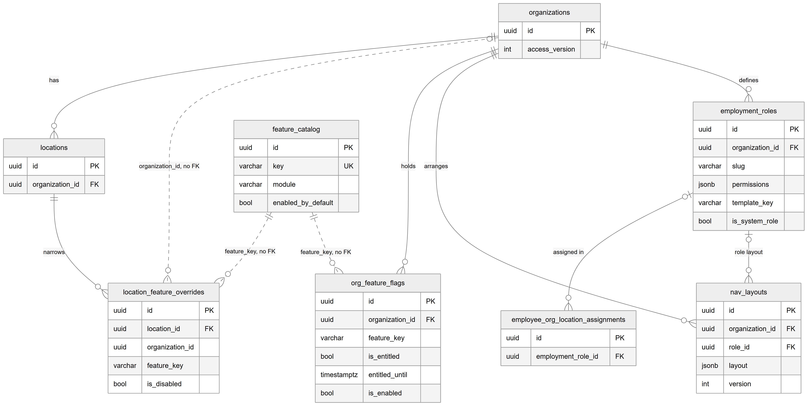

# Chapter 15 — Access and features

This chapter describes the tables behind two questions the Platform asks on every request: "is this feature switched on for this clinic and this location?" and "what may this person do here?". It is for the product owner who configures roles and features for clinics, or who needs to explain why a screen is hidden. The behaviour built on these tables — the guards, the permission catalog, the role editor — is explained in Chapters 10 and 11; this chapter covers the stored data.

## 15.1 Context

Five tables belong to this domain. `feature_catalog`, `org_feature_flags` and `location_feature_overrides` are owned by the `feature-flags` module. `nav_layouts` is owned by the `access` module. `employment_roles` is defined in the `employees` module folder, although the permission model that reads it lives in the `access` module; three modules register it (`employees`, `access` and `feature-flags`). Every column is listed in the entity catalog, `backend/docs/data-model/ENTITY_CATALOG.md`.

## 15.2 The tables

### 15.2.1 `feature_catalog` — feature catalog entry

**Status:** [Implemented]

The master list of every feature the Platform offers, one row per feature. It is global: the same list for all clinics. Key columns:

- `key` — the feature key, unique, for example `billing.invoices`.
- `name` and `description` — the human label.
- `module` — a grouping such as `billing`, `appointments` or `patients`.
- `specialty_tags` — the clinic types the feature is relevant to (for example `["general"]`, `["dental"]`).
- `enabled_by_default` — whether a clinic gets it switched on when its flags are created.
- `sort_order` and `is_active` — display order, and whether the feature is still offered at all.

The catalog is seeded from code (`backend/src/feature-flags/feature-catalog.seed.ts`); seeding inserts missing keys and does not overwrite existing rows.

### 15.2.2 `org_feature_flags` — organization feature state

**Status:** [Implemented]

One row per organization per feature, unique on (`organization_id`, `feature_key`). It holds two independent switches:

- **Entitled** — `is_entitled`, set by the super admin: the organization may use the feature. It defaults to true so that organizations created before entitlements existed kept every feature they had. `entitled_until` turns an entitlement into a trial: from that moment the feature is no longer entitled. `entitled_by` and `entitled_at` record who and when.
- **Enabled** — `is_enabled`, set by the owner within what is entitled. `enabled_by` records who last switched it.

A feature is **active** for an organization only when its catalog entry is active, it is entitled (and the trial has not expired) and it is enabled. `feature_key` is a copy of `feature_catalog.key`, not a foreign key. An index on (`organization_id`, `is_enabled`) supports "all enabled features of this clinic".

### 15.2.3 `location_feature_overrides` — location override

**Status:** [Implemented]

The owner's way to switch an organization-active feature off at one location. One row per location per feature, unique on (`location_id`, `feature_key`). `is_disabled = true` turns the feature off at that location. There is no way to turn a feature on at a location if it is off for the organization; the table can only narrow. `organization_id` is copied from the location for tenant-scoped reads and has no foreign key; `feature_key` is a copy of the catalog key; `updated_by` is the user who last changed it.

### 15.2.4 `employment_roles` — role

**Status:** [Implemented]

One row per role in an organization: the five system roles seeded from templates (Admin, Doctor, Receptionist, Assistant, Accountant) and any custom roles the clinic creates. Key columns:

- `name` and `slug` — the slug is unique within the organization (`organization_id` + `slug`).
- `permissions` — a JSON object of granted permissions only, `{ permission: 'own' | 'location' | 'org' | true }`. A missing key means no access. The value is the scope at which the permission applies.
- `template_key` — the system template the role was seeded from, such as `doctor` or `receptionist`; empty for custom roles.
- `is_system_role` — true for seeded roles (the column default is true).
- `home_route` — where members of the role land after login, for example `/queue/doctor`.
- `description` and `is_active`.

An index on (`organization_id`, `is_active`) lists a clinic's live roles. The role a person has is not stored on the person: it is the `employment_role_id` of each of their assignments (Chapter 16), so one person can hold different roles at different locations.

### 15.2.5 `nav_layouts` — sidebar layout

**Status:** [Implemented] for the clinic default layout; [Not implemented] for per-role layouts

A clinic's arrangement of the sidebar: which navigation keys go into which section, renamed labels and hidden keys, stored as JSON in `layout`. It only arranges keys that the web app's navigation registry defines; it never grants access. `version` increases on every save and `updated_by` records the user.

`role_id` null means the clinic default layout, which is the only kind the current version writes. A row with a `role_id` would be a layout for one role. Two unique indexes keep at most one default per organization (a partial unique index on `organization_id` where `role_id` is null) and at most one layout per role (`organization_id` + `role_id`).

## 15.3 Entity-relationship diagram

*Figure 15.1 — Access and feature tables.*

The diagram puts `organizations` (with `id` and `access_version`) at the top. Solid lines run from it to `locations` ("has"), `org_feature_flags` ("holds"), `nav_layouts` ("arranges") and `employment_roles` ("defines"). `employment_roles` (`id`, `organization_id`, `slug`, `permissions`, `template_key`, `is_system_role`) has two solid lines going down: to `nav_layouts` labelled "role layout" and to a context box `employee_org_location_assignments` (only `id` and `employment_role_id`) labelled "assigned in"; both are optional on the role side. `locations` has a solid line to `location_feature_overrides` labelled "narrows". In the middle, `feature_catalog` (`id`, unique `key`, `module`, `enabled_by_default`) has two dashed lines labelled "feature_key, no FK", one to `org_feature_flags` and one to `location_feature_overrides`. A dashed line labelled "organization_id, no FK" also runs from `organizations` to `location_feature_overrides`. Dashed lines are logical links without a foreign key.

## 15.4 Relationships explained

Foreign-key relationships:

- **`employment_roles.organization_id` → `organizations`.** Each role belongs to exactly one organization; an organization has zero or more roles. Deleting the organization deletes its roles (CASCADE).
- **`nav_layouts.organization_id` → `organizations`.** Each layout belongs to exactly one organization. Deleting the organization deletes its layouts (CASCADE).
- **`nav_layouts.role_id` → `employment_roles`.** Optional: a layout belongs to zero or one role (zero means the clinic default). Deleting a role deletes its own layout (CASCADE); the default layout is unaffected.
- **`employee_org_location_assignments.employment_role_id` → `employment_roles`.** Optional: an assignment has zero or one role; a role is held by zero or more assignments. Deleting a role keeps the assignments and sets their role to null (SET NULL), leaving those people with no role permissions at that location.
- **`org_feature_flags.organization_id` → `organizations`.** Each flag belongs to exactly one organization. Deleting the organization deletes its flags (CASCADE).
- **`location_feature_overrides.location_id` → `locations`.** Each override belongs to exactly one location. Deleting the location deletes its overrides (CASCADE).

Logical relationships (no foreign key):

- **`org_feature_flags.feature_key` → `feature_catalog.key`** and **`location_feature_overrides.feature_key` → `feature_catalog.key`.** The flag and the override refer to a catalog entry by its key text. The database does not stop a flag for a key that is not in the catalog, and removing a catalog row would not remove its flags.
- **`location_feature_overrides.organization_id` → `organizations`.** A copy of the location's organization, for filtering.
- **Actor columns** — `org_feature_flags.enabled_by` and `entitled_by`, `location_feature_overrides.updated_by`, `nav_layouts.updated_by` — hold a user id without a foreign key.

## 15.5 Tenant scope

- `feature_catalog` is global (one list for the whole Platform).
- `org_feature_flags`, `employment_roles` and `nav_layouts` are organization-scoped.
- `location_feature_overrides` is organization + location scoped.

Every change to roles, assignments, feature flags or ownership increases `organizations.access_version` (Chapter 14). The resolver that turns these tables into a user's permissions caches its result per user, organization, location and access version, so a change takes effect as soon as the version moves.

## 15.6 Ownership and ambiguities

- **Where `employment_roles` lives.** The entity file is in `employees/`, the permission logic that reads `permissions` is in `access/`, and the project's own overview once described "employee role definitions" as part of `organizations/`. Treat `access` as the functional owner and `employees` as the place the file sits.
- **Feature keys are text, not foreign keys.** A typo in a key would not be caught by the database.
- **Older feature switches.** `organization_settings` has six `feature_*` columns that the guards do not read (Chapter 14).
- **Per-role sidebar layouts** are supported by the schema (`role_id`, its foreign key and its unique index) but the current version only writes the clinic default.
