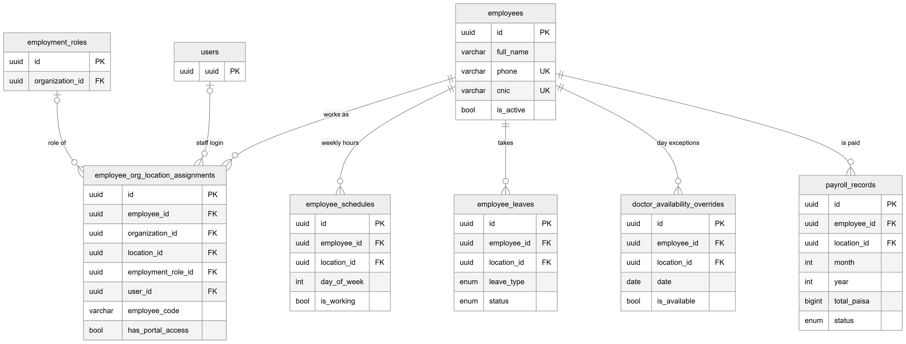

# Chapter 16 — Staff and payroll

This chapter describes the tables that record the clinic's staff: the person, where and in which role they work, their weekly hours, leave and day-by-day availability, and the monthly payroll record. It is for the product owner who needs to know how one person can work at several clinics, where a doctor's working hours come from, and what a payroll row contains. The employee and payroll modules are described in Chapters 37 and 38; salary and commission plans are in Chapter 22.

## 16.1 Context

The domain separates the **person** from the **job**. `employees` holds the person once for the whole Platform. Each place the person works — one organization and one location, with one role — is an **assignment** in `employee_org_location_assignments`. Schedules, leave, availability overrides and payroll all hang from the person and name the location they apply to. Six of the tables are owned by the `employees` module (it also owns `employment_roles`, which Chapter 15 describes) and `payroll_records` is owned by the `payroll` module. Every column is listed in the entity catalog, `backend/docs/data-model/ENTITY_CATALOG.md`.

## 16.2 The tables

### 16.2.1 `employees` — employee (the person)

**Status:** [Implemented]

One row per person who works at any clinic on the Platform. It holds only personal data: `full_name`, `phone`, an optional national identity number (`cnic`), `gender`, `dob`, `profile_picture_url` and `is_active`. There is no `organization_id`: the same person record is shared by every organization they work for. For that reason `phone` and `cnic` are **unique across the whole Platform**, not per clinic.

### 16.2.2 `employee_org_location_assignments` — assignment

**Status:** [Implemented]

One row per person per location they work at. This is where the job lives. Key columns:

- `employee_id`, `organization_id`, `location_id` — who and where. (`employee_id`, `location_id`) is unique: a person has at most one assignment per location.
- `employment_role_id` — the role at this location (Chapter 15); nullable.
- `user_id` — the staff login used for this assignment; nullable, because not every employee logs in.
- `has_portal_access` — whether this person may log in at this location.
- `designation` and `employment_type` (`full_time`, `part_time`, `visiting`, `contract`).
- `employee_code` — unique within the organization (`organization_id` + `employee_code`).
- `joining_date`, `is_primary` and `is_active` (the soft-delete flag for this job).
- `token_prefix` — the doctor's queue-token prefix at this location (for example "A" giving "A-007"); empty means the first letter of the doctor's name.
- `gross_salary` — deprecated. Salary now lives in versioned compensation plans (Chapter 22); the column is kept for old rows and no longer written once a plan exists.

Indexes support lookups by user, by location and active flag, and by employee and organization.

### 16.2.3 `employee_schedules` — weekly working hours

**Status:** [Implemented]

The regular week of a person at one location: one row per weekday (`day_of_week`), with `is_working`, `start_time`, `end_time` and `slot_duration` (default 30 minutes). (`employee_id`, `location_id`, `day_of_week`) is unique, so there is one row per weekday per location. The appointments service reads these rows when it works out a doctor's availability.

### 16.2.4 `employee_leaves` — leave request

**Status:** [Implemented]

One row per leave request: `leave_type` (`annual`, `sick`, `unpaid`, `maternity`, `paternity`, `other`), `start_date`, `end_date`, `total_days`, `status` (`pending`, `approved`, `rejected`, `cancelled`), the reason, a review note, `approved_by` and `reviewed_at`. Indexes support "leave in this date range", "pending leave at this location" and "this person's leave by status".

### 16.2.5 `doctor_availability_overrides` — availability exception

**Status:** [Partial] — recorded and edited on the employee's availability tab; the appointments and queue services do not read it

An exception to the weekly schedule for one date at one location: `date`, `is_available` (default false, meaning "not available that day"), a reason and optional `override_hours` (JSON) for different hours that day. (`employee_id`, `location_id`, `date`) is unique: one exception per person, location and day. Only the employees module reads this table; the appointments service builds availability from `employee_schedules` without consulting these exceptions.

### 16.2.6 `payroll_records` — payroll record

**Status:** [Implemented]

One row per person per location per month. (`employee_id`, `location_id`, `month`, `year`) is unique, so the same person can have a separate record at each location for the same month. Key columns:

- `month`, `year` and `period_label`.
- `base_salary_minor`, `commission_minor`, `total_minor` — the breakdown in integer paisa, where total = base salary + commission.
- `salary_amount` — the total in rupees (`numeric(10,2)`), kept for older screens.
- `status` (`pending`, `paid`, `on_hold`), `paid_at`, `payment_method` (`cash`, `bank_transfer`, `cheque`), `payment_reference`, `paid_by`, `notes`.

The unique key changed over time. The doctor-compensation migration drops the older key (`employee_id`, `month`, `year`) and adds the location-aware one; the entity matches the new key.

## 16.3 Entity-relationship diagram

*Figure 16.1 — Staff and payroll tables.*

The diagram has `employees` at the top centre, showing `id`, `full_name`, `phone` and `cnic` (both marked unique) and `is_active`. Five solid lines fan out from it to its children, each "one employee to zero or more rows": `employee_org_location_assignments` ("works as"), `employee_schedules` ("weekly hours"), `employee_leaves` ("takes"), `doctor_availability_overrides` ("day exceptions") and `payroll_records` ("is paid"). The assignment box, on the left, lists `id`, `employee_id`, `organization_id`, `location_id`, `employment_role_id`, `user_id`, `employee_code` and `has_portal_access`; over it two context boxes, `employment_roles` and `users`, connect to it with optional lines labelled "role of" and "staff login". Each child box shows its `employee_id` and `location_id` foreign keys plus its key business columns (`day_of_week` and `is_working`; `leave_type` and `status`; `date` and `is_available`; `month`, `year`, `total_minor` and `status`). The links from these tables to `organizations` and `locations` are not drawn, to keep the picture readable; they are listed in the next section.

## 16.4 Relationships explained

Foreign-key relationships inside the domain:

- **`employee_org_location_assignments.employee_id` → `employees`.** Each assignment belongs to exactly one person; a person has zero or more assignments. Deleting the person deletes the assignments (CASCADE).
- **`employee_org_location_assignments.employment_role_id` → `employment_roles`.** Optional, zero or one role. Deleting the role sets it to null (SET NULL).
- **`employee_org_location_assignments.user_id` → `users`.** Optional, zero or one staff login; a user can be linked to several assignments. Deleting the user sets it to null (SET NULL).
- **`employee_schedules.employee_id`, `employee_leaves.employee_id`, `doctor_availability_overrides.employee_id`, `payroll_records.employee_id` → `employees`.** Each row belongs to exactly one person; a person has zero or more of each. Deleting the person deletes them all (CASCADE).

Tenant foreign keys (not drawn in the figure):

- **`organization_id` → `organizations`** on assignments, schedules, leaves, availability overrides and payroll records: mandatory, CASCADE.
- **`location_id` → `locations`** on the same five tables: mandatory, CASCADE. Deactivating a location never triggers this, because the application only soft-deletes locations.

Logical relationships (no foreign key): the actor columns `created_by` (on assignments, schedules, leaves, overrides and payroll), `approved_by` on leaves and `paid_by` on payroll hold a user id.

Links into this domain from other domains:

- **Into `employees`:** `appointments.doctor_id` and `queue_sessions.doctor_id` (RESTRICT), `charges.doctor_id`, `service_prices.doctor_id` and `lab_orders.doctor_id` (RESTRICT), `prescriptions.doctor_id` (SET NULL), `expenses.recorded_by` and `patient_credits.purchased_by` (SET NULL), and the inventory columns `patient_consumptions.performedBy`, `purchase_orders.createdBy` and `stock_movements.performedBy` (NO ACTION, which behaves like RESTRICT).
- **Into `employee_org_location_assignments`:** `compensation_plans.assignment_id` (CASCADE), and `charges.performing_assignment_id`, `commission_entries.assignment_id` and `commission_settlements.assignment_id` (RESTRICT).
- **Into `payroll_records`:** `commission_settlements.payroll_record_id`, one-to-one and RESTRICT: a payroll record that settled commissions cannot be deleted while the settlement exists.

Because of these RESTRICT links, a person who is the doctor on any appointment, queue session, charge, special price or lab order, or who appears in inventory records, cannot be hard-deleted; the database refuses. The employee service catches that refusal and replies that the employee "has linked inventory records" and should be deactivated instead — the message names inventory even when the blocking row is an appointment or a charge.

## 16.5 Tenant scope

- `employees` is global: one person record for the whole Platform. The tenant link lives on the assignment.
- `employee_org_location_assignments`, `employee_schedules`, `employee_leaves`, `doctor_availability_overrides` and `payroll_records` are organization + location scoped, with real foreign keys on both columns.

## 16.6 Ownership and ambiguities

- **Platform-wide uniqueness of personal data.** Because `employees.phone` and `employees.cnic` are unique across the Platform, the database refuses a second person record with the same phone or national identity number, even in a different clinic. The design intends one person record shared by many clinics; how the employee screens handle a person already known elsewhere is covered in Chapter 37.
- **Code comment versus schema.** The comment on the employee delete method says that appointments and invoices keep their rows with the doctor set to null. The schema says otherwise: `appointments.doctor_id`, `queue_sessions.doctor_id` and `charges.doctor_id` are RESTRICT, so such a delete is refused.
- **Deprecated salary column.** `employee_org_location_assignments.gross_salary` is superseded by `compensation_plans`.
- **Two money forms on one row.** `payroll_records` keeps the total in paisa and in rupees; the paisa columns are authoritative for new code.
