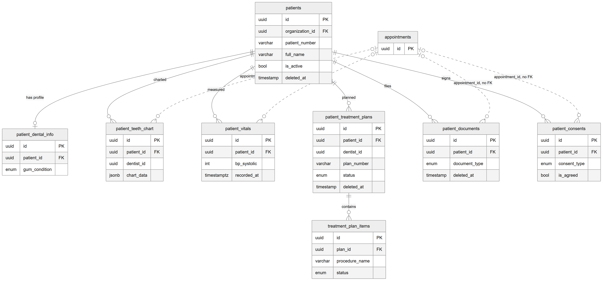
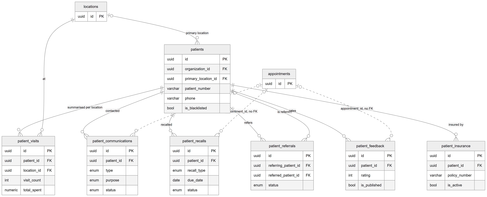

# Chapter 17 — Patients

This chapter describes the patient record and the fourteen sub-record tables that hang from it: clinical history, charts, vitals, plans, documents, consents, contacts, recalls, referrals, feedback, insurance and the per-location visit summary. It is for the product owner who needs to know where a given piece of patient information is stored and what happens to it when a patient is deactivated or deleted. The patient module itself — screens, import, export and permissions — is described in Chapter 28.

## 17.1 Context

All fifteen tables are owned by the `patients` module. The patient is an organization-level record: one clinic business has one record per patient, shared by all of its locations. Most sub-records also remember the location where they were created. One of the fourteen sub-record tables, `patient_prescriptions`, is the legacy prescription table; it is summarised here and described in full in Chapter 19 next to the current prescription tables. Every column is listed in the entity catalog, `backend/docs/data-model/ENTITY_CATALOG.md`.

## 17.2 The patient record

### 17.2.1 `patients` — patient

**Status:** [Implemented]

One row per patient per organization. Key columns:

- `organization_id` — the owning organization.
- `patient_number` — the clinic's own patient number, unique within the organization (`organization_id` + `patient_number`).
- `full_name`, `dob`, `gender`, `blood_group`, `marital_status`, `occupation`.
- Contact fields: `phone` (required, **not** unique — two patients can share a family phone), a WhatsApp number, email, address and city. A national identity number column also exists. These hold personal data and are never reproduced in this handbook.
- `preferred_language` (`urdu` or `english`, default `urdu`) and `communication_pref` (`whatsapp`, `sms`, `call`, `email`, default `whatsapp`).
- `primary_location_id` — the patient's home branch; nullable.
- `source` (`walk_in`, `referral`, `online`, `social_media`, `google`, `other`) and a free-text `referred_by_text`.
- Minor and guardian fields, `medical_history` and `allergies` as free text, emergency-contact fields, `internal_notes` and `tags` (a JSON list).
- `is_active` — the activate/deactivate switch used by the patient screens.
- `is_blacklisted` and `blacklist_reason`.
- `deleted_at` — a TypeORM soft-delete column. The permanent-delete action does not use it; it removes the row.
- `user_id` — a reference to a user account for the patient, with no foreign key. The code does not say what fills it.

Indexes support search by name, phone and national identity number, the active list (`organization_id` + `is_active`), the blacklist filter (`organization_id` + `is_blacklisted`) and lookups by primary location.

## 17.3 Clinical sub-records

### 17.3.1 `patient_dental_info` — dental profile

**Status:** [Implemented]

At most one row per patient (`patient_id` is unique): last check-up date, gum condition, sensitivity, brushing and flossing habits, smoking and tobacco chewing, orthodontic history, prosthetics, previous extractions and surgeries, X-ray notes and dentist notes. It carries `organization_id` but no location: the profile belongs to the patient, not to a branch.

### 17.3.2 `patient_teeth_chart` — teeth chart snapshot

**Status:** [Implemented]

One row per charting. `chart_data` is JSON keyed by tooth number in FDI notation (for example `"11"`), each holding condition, treatment, surface and notes; `periodontal_chart` is optional JSON. `is_initial_chart` marks the first chart, `recorded_at` the moment. `dentist_id` records who charted (target table not stated in the code) and `appointment_id` the visit, both without a foreign key.

### 17.3.3 `patient_vitals` — vitals reading

**Status:** [Implemented]

One row per measurement: blood pressure (`bp_systolic`, `bp_diastolic`), pulse, temperature, oxygen saturation, weight, height, BMI, risk flags (diabetic, hypertensive, pregnant, on blood thinners, on antibiotics), anaesthesia type and dose, notes and `recorded_at`. `recorded_by` and `anesthesia_administered_by` are user ids without a foreign key; `appointment_id` links the visit without a foreign key.

### 17.3.4 `patient_treatment_plans` — treatment plan

**Status:** [Partial] — backend endpoints exist and billing reads the table; no web screen calls the create or update endpoints

A planned course of work for a patient: `plan_number` (unique within the organization), `plan_name`, description, `estimated_cost`, `discount_amount` and `final_estimated_cost` (numeric, rupees), `status` (`draft`, `active`, `completed`, `cancelled`, `on_hold`), start, expected end and actual end dates, `patient_accepted` and `patient_accepted_at`, notes, and `dentist_id` (no foreign key). It has a `deleted_at` soft-delete column. Planned work is different from performed work, which is stored in `treatments` (Chapter 18).

### 17.3.5 `treatment_plan_items` — treatment plan item

**Status:** [Partial] — as for its parent plan

One procedure inside a plan: `procedure_name`, `procedure_code`, `tooth_number`, `tooth_surface`, `estimated_sessions` and `completed_sessions`, `estimated_cost`, `status` (`pending`, `in_progress`, `completed`, `skipped`, `postponed`), `sequence_order`, `assigned_to` (a user id, no foreign key) and notes. This table has **no organization column**; it is isolated only through its plan. An index on (`plan_id`, `sequence_order`) returns items in order.

### 17.3.6 `patient_documents` — patient document

**Status:** [Implemented]

One row per uploaded file: `document_type` (X-ray, CBCT scan, report, prescription, consent form, insurance card, identity-card copy, before photo, after photo, other), file name, file URL, thumbnail URL, size, MIME type, `tooth_number`, `taken_date`, `is_visible_to_patient`, notes and `uploaded_by` (a user id, no foreign key). It has a `deleted_at` soft-delete column.

### 17.3.7 `patient_consents` — signed consent

**Status:** [Implemented]

One row per consent signed: `consent_type` (general treatment, extraction, implant, root canal, orthodontic, sedation, photo release), `consent_version`, the full `consent_text`, `is_agreed`, `agreed_at`, `signed_by_name`, `signed_by_type` (default `patient`), an optional signature image URL and `witnessed_by`. The entity comment declares the table immutable: a revoked consent is a new row with `is_agreed = false`, never an update. The database does not enforce this; it is an application rule.

### 17.3.8 `patient_prescriptions` — legacy quick prescription

**Status:** [Implemented] (legacy; still readable and writable from the patient's Clinical tab)

The older, simpler prescription table, with medicines stored as a JSON list. The patient's Clinical tab shows it in a collapsed "Legacy quick-Rx history" section next to the current prescription list. Its columns and its relation to the current `prescriptions` table are described in Chapter 19.

## 17.4 Relationship and administrative sub-records

### 17.4.1 `patient_visits` — per-location visit summary

**Status:** [Partial] — the table exists and a read endpoint returns it; no code writes it and no screen calls the endpoint

Designed as one summary row per patient per location (`patient_id` + `location_id` unique): `first_visit_date`, `last_visit_date`, `visit_count`, `total_spent` (numeric, rupees) and `is_preferred_location`. The encounter entity's comment calls it a patient-to-location aggregate that is "left untouched". No service inserts or updates rows, so on a new database it stays empty. The clinical record of each consultation is `patient_encounters` (Chapter 18), not this table.

### 17.4.2 `patient_communications` — communication log

**Status:** [Implemented]

One row per contact with the patient: `type` (`sms`, `whatsapp`, `call`, `email`, `in_person`), `direction` (inbound or outbound), `purpose` (reminder, confirmation, cancellation, recall reminder, follow-up, billing, general, marketing, emergency), subject, message body, `status` (`pending`, `sent`, `delivered`, `read`, `failed`, `received`), sent, delivered and read times, `sent_by`, `is_automated`, `automation_trigger` and an external message id. Rows are written only through the patient module's create endpoint; nothing on the Platform sends these messages. Notifications on the Platform are in-app only and use their own tables (Chapter 24).

### 17.4.3 `patient_recalls` — recall

**Status:** [Partial] — backend endpoints exist; no web screen calls them

A reminder that the patient is due back: `recall_type` (six-month check-up, annual cleaning, post-treatment follow-up, implant review, orthodontic review, custom), `custom_name`, `due_date`, up to three reminder-sent timestamps, `status` (`scheduled`, `reminder_sent`, `contacted`, `booked`, `completed`, `ignored`, `overdue`), notes, `dentist_id` and `appointment_id` (no foreign keys).

### 17.4.4 `patient_referrals` — patient referral

**Status:** [Partial] — the patient screen lists referrals; no screen creates them

Records that one patient referred another: `referring_patient_id` (required), `referred_patient_id` (set once the referred person is registered), the referred person's name and phone before registration, `referral_date`, reward fields (`reward_given`, `reward_amount` in numeric rupees, `reward_type`, `reward_given_at`) and `status` (`pending`, `registered`, `rewarded`, `cancelled`). It is organization-scoped with no location.

### 17.4.5 `patient_feedback` — patient feedback

**Status:** [Partial] — the patient screen lists feedback; no screen creates it

One row per rating: `rating` (integer), `category` (doctor, service, facility, billing, waiting time, general), text, `is_anonymous`, `is_published`, a staff response with `responded_by` and `responded_at`, and `dentist_id` and `appointment_id` without foreign keys.

### 17.4.6 `patient_insurance` — insurance policy

**Status:** [Partial] — backend endpoints exist; no web screen calls them

One row per policy: provider name, plan name, policy number, policy holder, group number, coverage details and percentage, `max_annual_benefit` and `used_benefit` (numeric, rupees), valid-from and valid-until dates, card images and `is_active`. It is organization-scoped with no location.

## 17.5 Entity-relationship diagrams

The fifteen tables are drawn in two diagrams so that each stays readable.

*Figure 17.1 — Patient clinical sub-records.*

The first diagram has `patients` at the top centre with `id`, `organization_id`, `patient_number`, `full_name`, `is_active` and `deleted_at`. Six solid lines go down from it to `patient_dental_info` ("has profile", at most one per patient), `patient_teeth_chart` ("charted"), `patient_vitals` ("measured"), `patient_treatment_plans` ("planned"), `patient_documents` ("files") and `patient_consents` ("signs"). Under `patient_treatment_plans`, a solid line labelled "contains" leads to `treatment_plan_items` (`id`, `plan_id`, `procedure_name`, `status`). A small `appointments` context box with only `id` sits to the right of `patients`; four dashed lines labelled "appointment_id, no FK" run from it to the teeth chart, vitals, documents and consents boxes. Each child box shows its `patient_id` foreign key and one to three business columns such as `chart_data`, `bp_systolic`, `plan_number`, `document_type` or `consent_type`. The legacy `patient_prescriptions` table is drawn in Figure 19.3, and the tenant links to `organizations` and `locations` are not drawn.

*Figure 17.2 — Patient relationship and administrative sub-records.*

The second diagram again centres on `patients`, this time showing `primary_location_id`, `phone` and `is_blacklisted`. A `locations` context box at the top left has an optional solid line to `patients` labelled "primary location" and a solid line to `patient_visits` labelled "at". From `patients`, solid lines go down to `patient_visits` ("summarised per location", with `visit_count` and `total_spent`), `patient_communications` ("contacted"), `patient_recalls` ("recalled"), `patient_referrals` (two lines: "refers" for the referring patient and an optional "is referred" for the referred patient), `patient_feedback` ("rates") and `patient_insurance` ("insured by"). An `appointments` context box connects with dashed "appointment_id, no FK" lines to communications, recalls and feedback.

## 17.6 Relationships explained

Foreign-key relationships inside the domain:

- **`patient_dental_info.patient_id` → `patients`.** One-to-one: a patient has zero or one dental profile. Deleting the patient deletes it (CASCADE).
- **`patient_teeth_chart`, `patient_vitals`, `patient_treatment_plans`, `patient_documents`, `patient_consents`, `patient_prescriptions`, `patient_visits`, `patient_communications`, `patient_recalls`, `patient_feedback`, `patient_insurance` → `patients` (`patient_id`).** Each row belongs to exactly one patient; a patient has zero or more rows in each. Deleting the patient deletes them all (CASCADE).
- **`treatment_plan_items.plan_id` → `patient_treatment_plans`.** Each item belongs to exactly one plan; a plan has zero or more items. Deleting the plan row deletes its items (CASCADE). A soft delete of the plan (`deleted_at`) does not touch the items.
- **`patient_referrals.referring_patient_id` → `patients`.** Mandatory. Deleting the referring patient deletes the referral (CASCADE).
- **`patient_referrals.referred_patient_id` → `patients`.** Optional. Deleting the referred patient keeps the referral and sets the link to null (SET NULL).
- **`patients.primary_location_id` → `locations`.** Optional. Deleting the location sets it to null (SET NULL).
- **`patient_visits.location_id` → `locations`.** Mandatory; deleting the location deletes its summary rows (CASCADE). The pair (`patient_id`, `location_id`) is unique.

Tenant foreign keys (not drawn):

- **`organization_id` → `organizations`** on every table except `treatment_plan_items`: mandatory, CASCADE.
- **`location_id` → `locations`** on teeth charts, vitals, treatment plans, documents, consents, legacy prescriptions, visits, communications, recalls and feedback: mandatory, CASCADE. `patients`, `patient_dental_info`, `patient_referrals` and `patient_insurance` have no location column.

Logical relationships (no foreign key):

- **`appointment_id` → `appointments`** on communications, consents, documents, feedback, legacy prescriptions, recalls, teeth charts and vitals. The database accepts an appointment id that does not exist.
- **`dentist_id`** on teeth charts, treatment plans, recalls and feedback. The code does not say whether it holds an employee id or a user id.
- **`patients.user_id` → `users`.**
- **Actor columns** — `created_by`, `sent_by`, `witnessed_by`, `uploaded_by`, `responded_by`, `prescribed_by`, `recorded_by`, `anesthesia_administered_by`, `assigned_to` — hold user ids.

Links into `patients` from other domains:

- **CASCADE** (deleted with the patient): `appointments`, `queue_entries`, `patient_encounters`, `treatments`, `prescriptions`, `patient_credits`, `patient_consumptions` (inventory) and `patient_comm_prefs` (notifications, one-to-one).
- **RESTRICT** (block the delete): `charges`, `invoices`, `payments`, `refunds`, `lab_orders`, `lab_invoices`, `lab_payments` and `lab_refunds`.
- **No foreign key:** `ledger_entries.patient_id`, `payment_allocations.patient_id`, `ledger_journal_lines.patient_id`, `lab_credit_notes.patient_id`, and the polymorphic history columns of `audit_logs` and `status_history`.

What a permanent delete does. Deleting a patient removes the patient row and every cascading child listed in this section, inside one transaction that first writes an audit row with the patient's last state and a count of linked records. If the patient has any billing or lab-billing row, the RESTRICT links make the database refuse the delete. Deactivating (`is_active = false`) removes nothing.

## 17.7 Tenant scope

- `patients`, `patient_dental_info`, `patient_referrals` and `patient_insurance` are organization-scoped.
- The other ten sub-record tables are organization + location scoped.
- `treatment_plan_items` has no tenant column and is scoped only through `patient_treatment_plans`; queries must join the plan.

## 17.8 Ownership and ambiguities

- **Four "visit" concepts.** `patient_visits` (an unused per-location summary), `appointments` (bookings), `queue_entries` (a place in the queue) and `patient_encounters` (the clinical record of a consultation) all describe visits. Chapter 27 compares them.
- **Three planning tables.** `patient_treatment_plans` holds planned work, `treatments` holds performed work, and `plan_templates` holds reusable plans (Chapter 19).
- **Code comment versus schema.** The comment on the patient delete method says invoices and payments are removed by cascade. In the schema, `invoices`, `charges`, `payments` and `refunds` reference the patient with RESTRICT, so a patient with billing history cannot be deleted. No code catches this refusal; what the user sees is [Unverified].
- **Uncertain targets.** The `dentist_id` columns may hold employee ids or user ids.
- **Immutability by convention.** `patient_consents` is declared immutable only in a comment.
- **Two soft-delete mechanisms on one table.** `patients` has both `is_active` and `deleted_at`; the screens use `is_active`.
