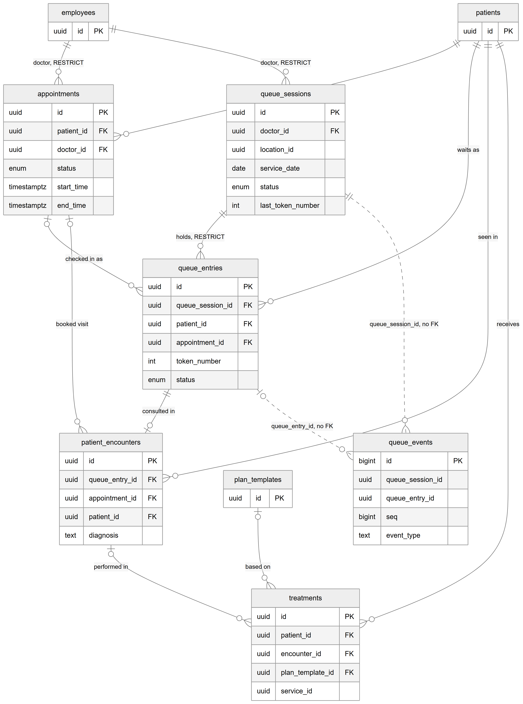
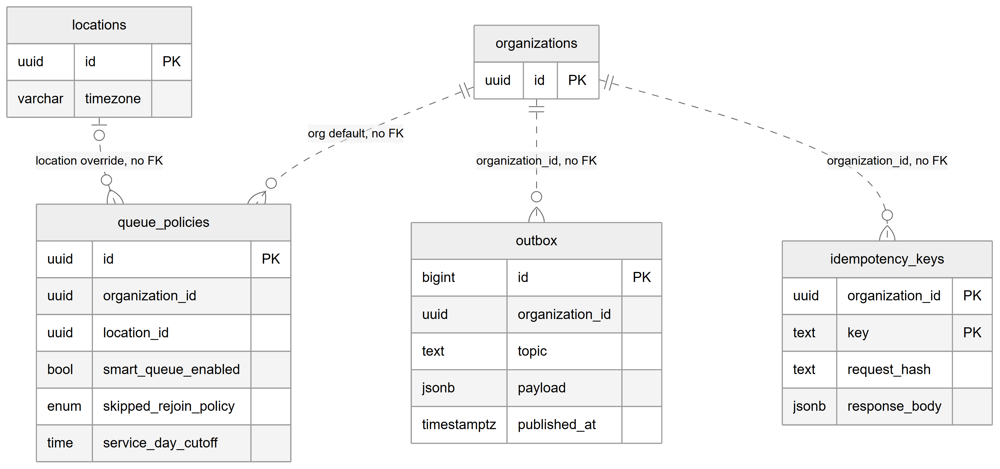

# Chapter 18 — Appointments, queue and encounters

This chapter describes the tables that follow a patient through one visit: the booking, the place in a doctor's queue, the realtime and safety tables the queue needs, the clinical record of the consultation, and the treatments performed. It is for the product owner who needs to know how a visit is stored at each step and which database rules stop double bookings or two patients being with one doctor at once. The behaviour is described in Chapters 29 (appointments), 30 (queue) and 31 (consultation); this chapter covers the data.

## 18.1 Context

Nine tables belong to this domain, owned by four modules: `appointments` owns `appointments`; `queue` owns `queue_sessions`, `queue_entries`, `queue_events`, `queue_policies`, `outbox` and `idempotency_keys`; `encounters` owns `patient_encounters`; and `treatments` owns `treatments`. A visit moves through them in order: an appointment is booked, at check-in (or walk-in registration) a queue entry is created in the doctor's queue session for that day, when the doctor starts the consultation an encounter is created, and treatments performed are recorded against the encounter. All queue changes go through one service, the `QueueOrchestrator`, which writes the queue tables, an event and an outbox message in one transaction. Every column is listed in the entity catalog, `backend/docs/data-model/ENTITY_CATALOG.md`.

## 18.2 The tables

### 18.2.1 `appointments` — appointment

**Status:** [Implemented]

One row per booking. Key columns:

- `organization_id`, `location_id`, `patient_id`, `doctor_id` (an employee).
- `type` (`consultation`, `follow_up`, `treatment`, `checkup`, `emergency`, `cleaning`) and `is_emergency`.
- `status` — `scheduled`, `confirmed`, `checked_in`, `completed`, `cancelled` or `no_show`.
- `start_time`, `end_time` (with time zone) and `duration_minutes`.
- `reason_for_visit` (shown in the queue row) and `notes`.
- `cancel_reason_code` (`no_show`, `patient_left`, `other`) and a free-text `cancel_reason`.
- Moment columns: `checked_in_at`, `completed_at`, `cancelled_at`, `no_show_at`.

The key database rule is the EXCLUDE constraint `no_doctor_overlap`: for the same `doctor_id`, no two appointments may have overlapping time ranges `[start_time, end_time)`, unless the appointment is `cancelled` or `no_show`. It needs the `btree_gist` extension. This is why a doctor can never be double-booked, even if two receptionists book at the same moment. Indexes support the doctor's calendar (`doctor_id`, `start_time`, `end_time`), the location's day (`location_id`, `start_time`), and filters by status, patient and organization.

### 18.2.2 `queue_sessions` — queue session

**Status:** [Implemented]

One doctor's queue for one service day at one location. Key columns:

- `organization_id`, `location_id`, `doctor_id`.
- `service_date` — the location-local date of the service day.
- `status` — `waiting_for_doctor`, `open`, `paused`, `closed`, with `pause_reason`, `started_at` and `closed_at`.
- `last_token_number` — the token counter (CHECK: never negative). Because every queue change first locks this row, tokens are gap-free and never duplicated.
- `token_prefix` — the doctor's token prefix, copied when the session is created.
- `smart_queue_enabled` — copied from the queue policy when the session is created; afterwards it changes only through the mode endpoint.
- `last_call_reason`, `event_seq` (the counter that numbers `queue_events`) and `version` (for optimistic checks).

(`organization_id`, `location_id`, `doctor_id`, `service_date`) is unique: one session per doctor per location per day.

### 18.2.3 `queue_entries` — queue entry

**Status:** [Implemented]

A patient's place in one queue session. It is created only at check-in of a booked appointment or at walk-in registration — never at booking. Key columns:

- `queue_session_id`, `patient_id`, and `appointment_id` (set for booked visits, null for walk-ins).
- `token_number` and `queue_type` (`appointment` or `walk_in`).
- `status` — `waiting`, `called`, `in_consultation`, `on_hold`, `skipped`, `completed`, `cancelled`, `transferred`, `aborted`.
- `priority_class` (`normal` or `authorized_urgent`) with `urgent_since` and `urgent_reason`.
- `checked_in_at` and `sort_anchor_at` (the first-in-first-out position: the check-in time, or the rejoin time after a rejoin at the end).
- Moment columns: `called_at`, `consultation_started_at`, `hold_started_at`, `returned_from_hold_at`, `skipped_at`, `finished_at`.
- `converted_from_appt_id` (the appointment a walk-in was converted from) and `transferred_from_id` (the entry this one replaced on a transfer to another doctor).
- `version` for optimistic checks.

The database rules on this table are the strongest in the Platform:

- **Unique token per session** — (`queue_session_id`, `token_number`).
- **One active entry per appointment** — a partial unique index on `appointment_id` where the status is waiting, called, in consultation, on hold or skipped.
- **One active entry per patient per session** — a partial unique index on (`queue_session_id`, `patient_id`) for the same statuses.
- **At most one patient with the doctor** — a partial unique index on `queue_session_id` where the status is `called` or `in_consultation`.
- **CHECK: token number greater than zero.**
- **CHECK: type matches appointment** — `queue_type = 'appointment'` exactly when `appointment_id` is set.
- **CHECK: urgent needs a reason** — `priority_class` is `normal`, or both `urgent_since` and `urgent_reason` are set.

A partial index on (`queue_session_id`, `sort_anchor_at`) for waiting entries makes "who is next" fast.

### 18.2.4 `queue_events` — queue event

**Status:** [Implemented]

An audit log of every queue change, written in the same transaction as the change. Key columns: `queue_session_id`, `queue_entry_id`, `seq` (from the session's `event_seq`, unique per session, so screens can apply events in order and notice gaps), `event_type` (for example `CHECKED_IN`, `CALLED`, `SKIPPED`, `MODE_CHANGED`), `from_status`, `to_status`, reason code and text, `suggested_entry_id` (when staff selected a patient manually, the entry the selection engine would have called), `actor_id`, `actor_role`, `metadata` and `occurred_at`. The primary key is a bigint identity. The entity comment calls the table append-only (corrections are new events); the database does not enforce it.

### 18.2.5 `queue_policies` — queue policy

**Status:** [Implemented]

Queue settings. A row with `location_id` null is the organization default; a row with a location overrides it for that location. Two partial unique indexes keep one default per organization and one override per location. Columns and their CHECK rules:

- `smart_queue_enabled` — smart or manual selection for new sessions.
- `early_window_min` (CHECK 0 to 240), `late_grace_min` (CHECK at least 0), `max_late_min` (CHECK at least `late_grace_min`) — how early and how late a booked patient may check in.
- `walkin_starvation_min` (CHECK greater than 0) — the walk-in waiting threshold, in minutes, used by the selection engine (Chapter 30 explains the rule).
- `skipped_rejoin_policy` — `end`, `original_position` or `manual`.
- `call_timeout_sec` — null turns automatic skip-after-call off; otherwise at least 30 seconds.
- `manual_select_reason_required`.
- `service_day_cutoff` — the local time a service day starts, for example "04:00" for a clinic that works past midnight.

The timezone is not stored here; it is always the location's own `locations.timezone`.

### 18.2.6 `outbox` — realtime outbox

**Status:** [Implemented]

The transactional outbox for realtime screens. A queue change writes its realtime message here in the same transaction; a relay later publishes it to the socket room named in `topic` (for example a session room or a location's display room) and sets `published_at`. Screens therefore never see a change that rolled back and never miss one that committed. A partial index on `id` where `published_at` is null lets the relay find unpublished rows quickly. A cleanup job deletes published rows older than 7 days, every day at 03:15 server time. This table is separate from `notification_outbox` (Chapter 24).

### 18.2.7 `idempotency_keys` — idempotency record

**Status:** [Implemented]

Stores the result of a mutation keyed by the client's `Idempotency-Key` header, so a retried request returns the saved answer instead of doing the work twice (for example, a check-in whose reply was lost returns the same token). The primary key is (`organization_id`, `key`); other columns are `request_hash`, `response_status`, `response_body` and `created_at`. The queue writes it, and the shared idempotency service used by the lab modules and the workflow engine writes to the same table with keys namespaced as `scope:key`. The same daily 03:15 cleanup job deletes every row older than 24 hours.

### 18.2.8 `patient_encounters` — encounter

**Status:** [Implemented]

The clinical record of one consultation, created when the doctor starts the consultation on a queue entry. `queue_entry_id` is unique: exactly one encounter per queue entry. `appointment_id` is set for booked visits and null for walk-ins. Other key columns: `patient_id`, `organization_id`, `location_id`, `encounter_date`, `reason` (why the patient actually came, which can differ from the booking), `chief_complaint`, `examination`, `diagnosis`, `advice` and `follow_up_date`.

### 18.2.9 `treatments` — treatment (work performed)

**Status:** [Implemented]

A treatment actually carried out. It always belongs to a patient and may be linked to the encounter it was performed in. Key columns: `patient_id`, `encounter_id`, `plan_template_id` (the plan template it was based on), `treatment_name`, `notes`, `date`, `service_id` (the catalog service billing uses to price the charge) and `cost` (a legacy fee in numeric rupees, used by billing only when no service is set). Planned work lives in `patient_treatment_plans` (Chapter 17), not here.

## 18.3 Entity-relationship diagrams

*Figure 18.1 — From booking to treatment.*

The diagram has two context boxes at the top, `employees` on the left and `patients` on the right, each showing only `id`. From `employees`, two solid lines labelled "doctor, RESTRICT" go to `appointments` and `queue_sessions`. From `patients`, solid lines go to `appointments` ("books"; this label is hidden behind the `queue_sessions` box in the rendered image), `queue_entries` ("waits as"), `patient_encounters` ("seen in") and `treatments` ("receives"). `appointments` (`id`, `patient_id`, `doctor_id`, `status`, `start_time`, `end_time`) has optional solid lines to `queue_entries` ("checked in as") and to `patient_encounters` ("booked visit"). `queue_sessions` (`id`, `doctor_id`, `location_id`, `service_date`, `status`, `last_token_number`) has a solid line labelled "holds, RESTRICT" to `queue_entries` (`id`, `queue_session_id`, `patient_id`, `appointment_id`, `token_number`, `status`). `queue_entries` has a solid line labelled "consulted in" to `patient_encounters` (at most one encounter per entry). `queue_events` (`id`, `queue_session_id`, `queue_entry_id`, `seq`, `event_type`) is joined by two dashed lines, "queue_session_id, no FK" from `queue_sessions` and "queue_entry_id, no FK" from `queue_entries`. At the bottom, `treatments` (`id`, `patient_id`, `encounter_id`, `plan_template_id`, `service_id`) has optional solid lines from `patient_encounters` ("performed in") and from a `plan_templates` context box ("based on"). Tenant links are not drawn.

*Figure 18.2 — Queue support tables.*

The second diagram shows the three queue tables that have no foreign key at all. `organizations` (with `id`) is joined by dashed lines to `queue_policies` ("org default, no FK"), `outbox` ("organization_id, no FK") and `idempotency_keys` ("organization_id, no FK"). `locations` (with `id` and `timezone`) is joined by a dashed line to `queue_policies` labelled "location override, no FK". The boxes show `queue_policies` with `organization_id`, `location_id`, `smart_queue_enabled`, `skipped_rejoin_policy` and `service_day_cutoff`; `outbox` with a bigint `id`, `organization_id`, `topic`, `payload` and `published_at`; and `idempotency_keys` with its two-part key `organization_id` + `key`, `request_hash` and `response_body`.

## 18.4 Relationships explained

Foreign-key relationships:

- **`appointments.patient_id` → `patients`.** Each appointment has exactly one patient; a patient has zero or more. Deleting the patient deletes the appointments (CASCADE).
- **`appointments.doctor_id` → `employees`.** Each appointment has exactly one doctor. A doctor with appointments cannot be deleted (RESTRICT).
- **`appointments.organization_id` → `organizations`** and **`appointments.location_id` → `locations`.** Mandatory, CASCADE.
- **`queue_sessions.doctor_id` → `employees`.** Each session has exactly one doctor. RESTRICT.
- **`queue_entries.queue_session_id` → `queue_sessions`.** Each entry belongs to exactly one session; a session has zero or more entries. A session with entries cannot be deleted (RESTRICT).
- **`queue_entries.patient_id` → `patients`.** Mandatory. CASCADE.
- **`queue_entries.appointment_id` → `appointments`.** Optional; an appointment has zero or more entries over time (only one active, by the partial unique index). Deleting the appointment deletes its entries (CASCADE).
- **`patient_encounters.queue_entry_id` → `queue_entries`.** Each encounter has exactly one queue entry; an entry has zero or one encounter (unique). Deleting the entry deletes the encounter (CASCADE).
- **`patient_encounters.appointment_id` → `appointments`.** Optional. Deleting the appointment keeps the encounter and sets the link to null (SET NULL).
- **`patient_encounters.patient_id` → `patients`**, **`organization_id` → `organizations`**, **`location_id` → `locations`.** Mandatory, CASCADE.
- **`treatments.patient_id` → `patients`.** Mandatory, CASCADE.
- **`treatments.encounter_id` → `patient_encounters`.** Optional; an encounter has zero or more treatments. Deleting the encounter keeps the treatments with the link set to null (SET NULL).
- **`treatments.plan_template_id` → `plan_templates`.** Optional. SET NULL.
- **`treatments.organization_id` → `organizations`** and **`location_id` → `locations`.** Mandatory, CASCADE.

Logical relationships (no foreign key):

- **`queue_events.queue_session_id` → `queue_sessions`**, **`queue_entry_id` → `queue_entries`**, **`suggested_entry_id` → `queue_entries`**, **`actor_id` → `users`.**
- **`queue_entries.converted_from_appt_id` → `appointments`** and **`transferred_from_id` → `queue_entries`** (a link to another entry of the same table).
- **`treatments.service_id` → `services`** (billing's catalog, Chapter 20).
- **Tenant columns without a foreign key:** `organization_id` on `queue_sessions`, `queue_entries`, `queue_events`, `queue_policies` and `outbox`; `location_id` on `queue_sessions` and `queue_policies`. `idempotency_keys.organization_id` is part of its primary key, also without a foreign key.
- **Actor columns** — `created_by` and `updated_by` on appointments and encounters, `created_by` on treatments.

Links into this domain from other domains:

- `prescriptions.appointment_id` and `prescriptions.encounter_id` (SET NULL) — Chapter 19.
- `patient_consumptions.appointmentId` (SET NULL) — Chapter 23.
- Logical only: `charges.encounter_id` and `charges.appointment_id`, `lab_orders.appointment_id` and `lab_orders.treatment_id`, `order_item_stages.appointment_id`, and the `appointment_id` columns of the patient sub-records.

## 18.5 Tenant scope

- `appointments`, `queue_sessions`, `queue_policies`, `patient_encounters` and `treatments` are organization + location scoped.
- `queue_entries`, `queue_events`, `outbox` and `idempotency_keys` carry only `organization_id`; an entry's location is the location of its session.
- The queue tables keep their tenant columns without foreign keys; the orchestrator writes them.

## 18.6 Ownership and ambiguities

- **Four "visit" tables.** An appointment is the booking, a queue entry is a place in line, an encounter is the clinical record, and `patient_visits` is an unused summary (Chapter 17). Chapter 27 compares them.
- **Two outboxes.** `outbox` carries realtime screen updates; `notification_outbox` carries notifications.
- **Shared idempotency table.** `idempotency_keys` lives in the queue module, but the shared idempotency service used by labs and the workflow engine writes to it too, and the queue's daily cleanup removes those rows after 24 hours as well.
- **Append-only by convention.** `queue_events` is declared append-only only in a comment.
- **RESTRICT on the doctor.** Because sessions and appointments block deletion of their doctor, a doctor who has worked cannot be hard-deleted; deactivation is the only option (Chapter 16).
