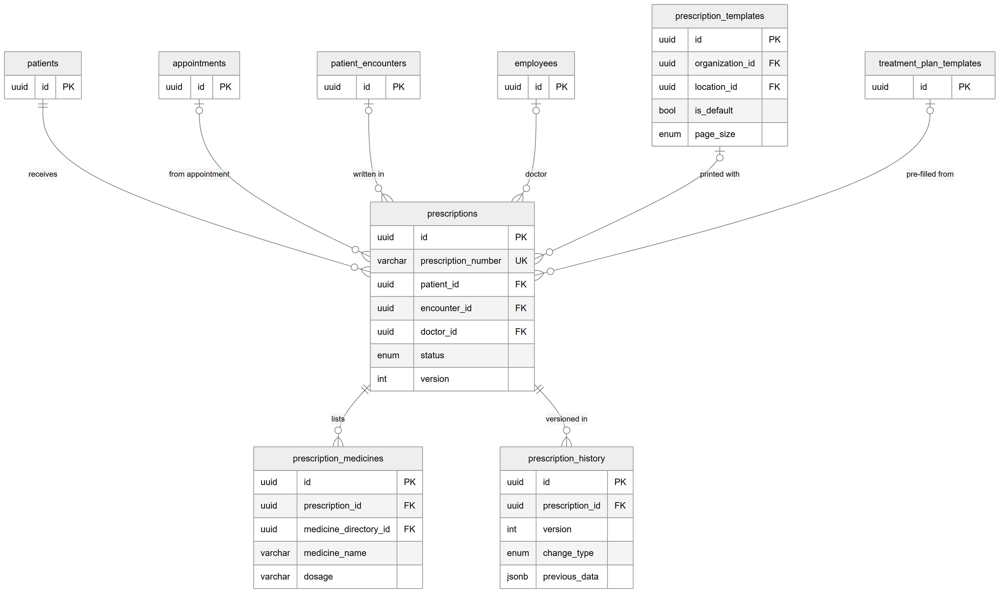
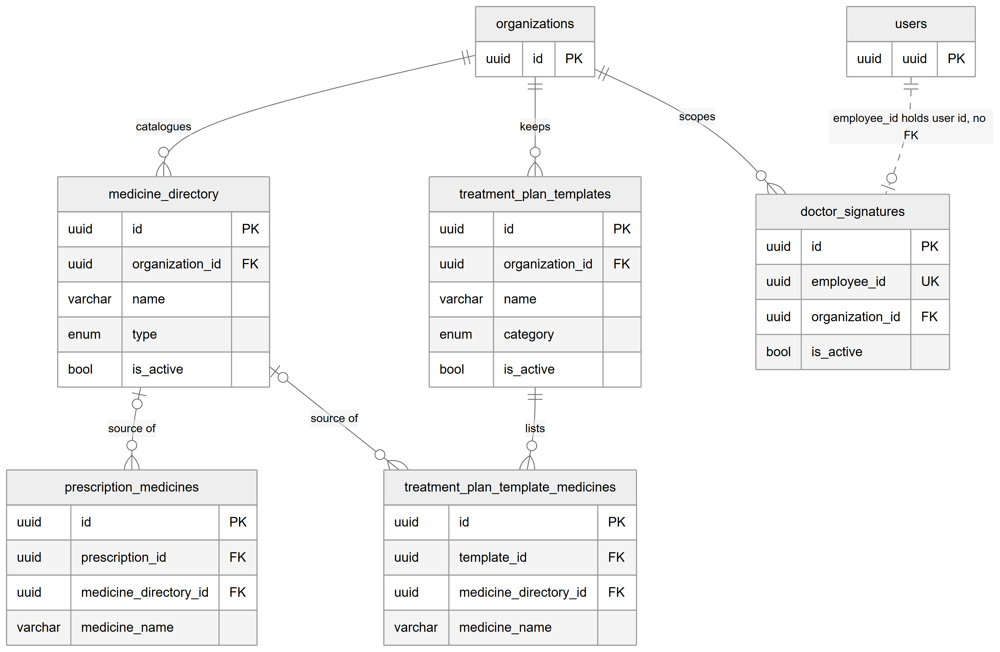
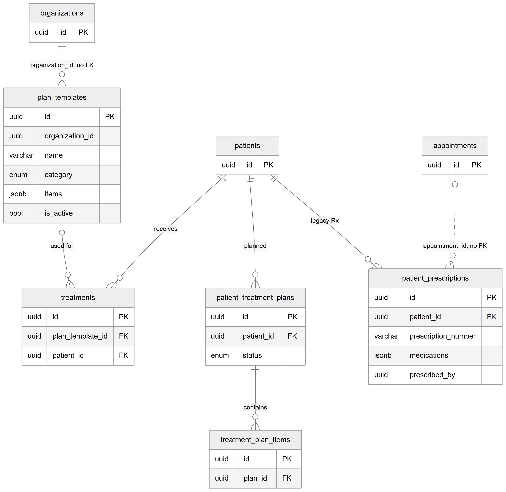

# Chapter 19 — Prescriptions and plans

This chapter describes the tables behind prescriptions and the clinic's reusable libraries: the prescription itself with its medicine lines and version history, the medicine directory, prescription presets, print layouts, doctors' saved signatures, plan templates, and the older prescription table that still exists. It is for the product owner who needs to know where a printed prescription's data comes from and why several tables have "plan" or "template" in their name. The prescription module is described in Chapter 32 and treatment plans in Chapter 33.

## 19.1 Context

Ten tables are covered here. Eight are owned by the `prescriptions` module: `prescriptions`, `prescription_medicines`, `prescription_history`, `prescription_templates`, `doctor_signatures`, `medicine_directory`, `treatment_plan_templates` and `treatment_plan_template_medicines`. `plan_templates` is owned by the `plan-templates` module. The legacy `patient_prescriptions` table is owned by the `patients` module. The patient's own planned work, `patient_treatment_plans` and `treatment_plan_items`, also belongs to the patients domain and is described in Chapter 17.

The names are easy to confuse, so here is the mapping from screen to table. In the web app's prescription library, **Medicines** is `medicine_directory`, **Presets** (ready-made medicine sets) is `treatment_plan_templates` despite its name, and **Print layouts** is `prescription_templates`. The sidebar entry **Treatment Plans** opens the plan template library, which is `plan_templates`. Every column is listed in the entity catalog, `backend/docs/data-model/ENTITY_CATALOG.md`.

## 19.2 The prescription record

### 19.2.1 `prescriptions` — prescription

**Status:** [Implemented]

The prescription a doctor writes, signs and shares. Key columns:

- `prescription_number` — formatted `RX-<year>-<5 digits>`, for example `RX-2026-00001`.
- `organization_id`, `location_id`, `patient_id` (all required).
- `appointment_id`, `encounter_id`, `doctor_id` — the visit and the doctor; all optional.
- `prescription_template_id` (the print layout) and `treatment_plan_template_id` (the preset it was pre-filled from); both optional.
- Clinical text: `diagnosis`, `chief_complaint`, `further_plan`, and instructions in English and in Urdu.
- `vitals` — a JSON copy of the readings (blood pressure, pulse, temperature, oxygen, weight, height, BMI, respiratory rate).
- `signature_image_url` and `signed_at`.
- `status` — `DRAFT`, `FINALIZED` or `AMENDED`; `version` starts at 1.
- `pdf_url` — a cached generated PDF, cleared when the record is amended.

`prescription_number` is unique across the whole Platform, while the number generator counts per organization (it reads the organization's latest number and adds one). Indexes support lookups by patient, appointment, encounter, doctor and by (`organization_id`, `location_id`).

### 19.2.2 `prescription_medicines` — prescription medicine line

**Status:** [Implemented]

One line per medicine on a prescription: `medicine_name` and its Urdu name, `type`, `dosage`, `frequency`, `frequency_timing` (a JSON list such as `["morning","evening"]`), `meal_relation` (before, after or with a meal, empty stomach, none), `duration`, special instructions in English and Urdu, and `sort_order`. `medicine_directory_id` keeps a link to the directory entry it came from, but the name and every other value are copied onto the line, so a finalized prescription stays a faithful record even if the directory entry is renamed or switched off later. This table has no tenant column; it is isolated through its prescription.

### 19.2.3 `prescription_history` — prescription change history

**Status:** [Implemented]

One row per change event: `version`, `change_type` (`CREATED`, `AMENDED`, `FINALIZED`, `PRINTED`, `SHARED`), `changed_by` (a user id), `change_notes`, and `previous_data` — a full JSON snapshot of the prescription and its medicines before the change (null for `CREATED`). Any past version can be shown from this table alone. The entity comment calls it immutable; the database does not enforce that. It has no tenant column and is isolated through its prescription.

## 19.3 The libraries

### 19.3.1 `medicine_directory` — medicine directory

**Status:** [Implemented] (screen label "Medicines")

The clinic's own medicine catalogue, which powers the search while writing a prescription. Each row: `name`, `generic_name`, `name_urdu`, `type` (tablet, capsule, syrup, injection, cream, drops and others), `strength`, `manufacturer`, default dosage, frequency, duration and meal relation, Urdu instructions, and `is_active`. Entries are switched off with `is_active`, never hard-deleted, so old prescriptions still resolve. Indexes cover (`organization_id`, `name`) and (`organization_id`, `is_active`).

### 19.3.2 `treatment_plan_templates` — prescription preset

**Status:** [Implemented] (screen label "Presets")

A reusable prescription protocol, for example "Root canal aftercare": `name`, `description`, `category` (forty categories such as pain relief, post-extraction, implant, pregnancy-safe), `specialty_tags`, `further_plan`, instructions in English and Urdu, and `is_active`. Choosing a preset in the prescription builder pre-fills the medicines and texts; the doctor can still edit before finalizing. Despite the name, it is not a treatment plan.

### 19.3.3 `treatment_plan_template_medicines` — preset medicine line

**Status:** [Implemented]

The medicine lines of a preset, with the same columns as `prescription_medicines` and the same denormalized copy of the directory values. It has no tenant column and is isolated through its preset.

### 19.3.4 `prescription_templates` — print layout

**Status:** [Implemented] (screen label "Print layouts")

The look of the printed prescription: `name`, `is_default`, `page_size` (`A4`, `A5`, `LETTER`, `CUSTOM`), `orientation`, custom width and height in millimetres, and JSON blocks for `header` (logo, clinic and doctor names in English and Urdu, qualifications, registration number), `footer` (address, timings, disclaimer) and `styling` (colours, fonts, toggles, margins). `location_id` null means an organization-wide layout usable at any location; a location can also have its own default, and several layouts per location are allowed. Nothing in the database limits a location to one default; an index on (`location_id`, `is_default`) only speeds the lookup.

### 19.3.5 `doctor_signatures` — saved doctor signature

**Status:** [Implemented]

A doctor's saved signature image (`signature_image_url`, optional `signature_data`), attached to prescriptions they finalize unless they draw a new one. `employee_id` is unique: one signature per owner, and saving again updates the row in place. Despite its name, the column holds the signed-in **user's** id, not an employee id — the controller passes the user id from the login token. Because the uniqueness is on that id alone, a user who works for two organizations has one signature row, stored with the organization where it was first saved, and the read path does not filter by organization.

### 19.3.6 `plan_templates` — plan template

**Status:** [Implemented] (sidebar label "Treatment Plans")

A predefined treatment plan a doctor can pick, for example a root canal with its usual steps: `name`, `category` (seventeen dental categories such as endodontics, prosthodontics, orthodontics, emergency), `description`, `items` (a JSON list of procedures) and `is_active` (inactive templates are hidden from the picker but kept). When a treatment is recorded from the patient screen, the chosen template is saved in `treatments.plan_template_id`. `organization_id` has no foreign key.

### 19.3.7 `patient_prescriptions` — legacy quick prescription

**Status:** [Implemented] (legacy; shown and still creatable in the "Legacy quick-Rx history" section of the patient's Clinical tab)

The older prescription table, which coexists with `prescriptions` while consumers move to the newer schema. Each row has `prescription_number` (unique within the organization), `prescription_date`, chief complaint, diagnosis, `medications` as one JSON list, special instructions, `follow_up_date`, print tracking (`is_printed`, `printed_at`, `print_count`), `prescribed_by` (a user id) and `appointment_id`, both without foreign keys. It is organization + location scoped with foreign keys to `patients`, `organizations` and `locations`, all CASCADE.

## 19.4 Entity-relationship diagrams

*Figure 19.1 — The prescription record.*

The diagram centres on `prescriptions`, showing `id`, the unique `prescription_number`, `patient_id`, `encounter_id`, `doctor_id`, `status` and `version`. Six context boxes sit in a row over it, each with an optional or mandatory solid line into `prescriptions`: `patients` ("receives", mandatory), `appointments` ("from appointment"), `patient_encounters` ("written in"), `employees` ("doctor"), `prescription_templates` ("printed with", shown with `organization_id`, `location_id`, `is_default` and `page_size`) and `treatment_plan_templates` ("pre-filled from"). Under `prescriptions`, two solid lines lead to its children: `prescription_medicines` ("lists", with `prescription_id`, `medicine_directory_id`, `medicine_name` and `dosage`) and `prescription_history` ("versioned in", with `prescription_id`, `version`, `change_type` and `previous_data`).

*Figure 19.2 — Prescription libraries.*

The second diagram shows the libraries. `organizations` has solid lines to `medicine_directory` ("catalogues"), `treatment_plan_templates` ("keeps") and `doctor_signatures` ("scopes"). `medicine_directory` (`id`, `organization_id`, `name`, `type`, `is_active`) has two optional solid lines labelled "source of", one to `prescription_medicines` and one to `treatment_plan_template_medicines`. `treatment_plan_templates` has a solid line labelled "lists" to `treatment_plan_template_medicines`. A `users` box is joined to `doctor_signatures` (`id`, the unique `employee_id`, `organization_id`, `is_active`) by a dashed line labelled "employee_id holds user id, no FK".

*Figure 19.3 — Plan templates and the legacy prescription table.*

The third diagram groups the remaining tables. `organizations` is joined to `plan_templates` (`id`, `organization_id`, `name`, `category`, `items`, `is_active`) by a dashed line labelled "organization_id, no FK". `plan_templates` has an optional solid line labelled "used for" to `treatments`. `patients` has solid lines to `treatments` ("receives"), to `patient_treatment_plans` ("planned") and to `patient_prescriptions` ("legacy Rx", showing `prescription_number`, `medications` and `prescribed_by`). `patient_treatment_plans` has a solid line labelled "contains" to `treatment_plan_items`. `appointments` is joined to `patient_prescriptions` by a dashed line labelled "appointment_id, no FK".

## 19.5 Relationships explained

Foreign-key relationships:

- **`prescriptions.patient_id` → `patients`.** Each prescription has exactly one patient; deleting the patient deletes the prescriptions (CASCADE).
- **`prescriptions.organization_id` → `organizations`** and **`location_id` → `locations`.** Mandatory, CASCADE.
- **`prescriptions.appointment_id` → `appointments`**, **`encounter_id` → `patient_encounters`**, **`doctor_id` → `employees`**, **`prescription_template_id` → `prescription_templates`**, **`treatment_plan_template_id` → `treatment_plan_templates`.** All optional (zero or one); deleting the referenced row keeps the prescription and sets the link to null (SET NULL).
- **`prescription_medicines.prescription_id` → `prescriptions`.** Each line belongs to exactly one prescription; deleting the prescription deletes its lines (CASCADE).
- **`prescription_medicines.medicine_directory_id` → `medicine_directory`.** Optional; deleting the directory entry keeps the line with the link set to null (SET NULL). The copied name keeps the line readable.
- **`prescription_history.prescription_id` → `prescriptions`.** Mandatory; deleting the prescription deletes its history (CASCADE).
- **`medicine_directory.organization_id`**, **`treatment_plan_templates.organization_id`**, **`doctor_signatures.organization_id` → `organizations`.** Mandatory, CASCADE.
- **`treatment_plan_template_medicines.template_id` → `treatment_plan_templates`.** Mandatory, CASCADE.
- **`treatment_plan_template_medicines.medicine_directory_id` → `medicine_directory`.** Optional, SET NULL.
- **`prescription_templates.organization_id` → `organizations`** (mandatory, CASCADE) and **`location_id` → `locations`** (optional; deleting the location deletes its layouts, CASCADE).
- **`treatments.plan_template_id` → `plan_templates`.** Optional, SET NULL.
- **`patient_prescriptions.patient_id` → `patients`**, **`organization_id` → `organizations`**, **`location_id` → `locations`.** Mandatory, CASCADE.

Logical relationships (no foreign key):

- **`doctor_signatures.employee_id` → `users`** (holds the user id despite the column name).
- **`plan_templates.organization_id` → `organizations`.**
- **`patient_prescriptions.prescribed_by` → `users`** and **`appointment_id` → `appointments`.**
- **Actor columns:** `prescription_history.changed_by`, `created_by` on `prescription_templates`, `treatment_plan_templates` and `plan_templates`.

## 19.6 Tenant scope

- `prescriptions`, `prescription_templates` and `patient_prescriptions` are organization + location scoped.
- `medicine_directory`, `treatment_plan_templates`, `doctor_signatures` and `plan_templates` are organization-scoped.
- `prescription_medicines`, `prescription_history` and `treatment_plan_template_medicines` have no tenant column and are isolated through their parent; queries must join it.

## 19.7 Ownership and ambiguities

- **Two prescription tables.** `prescriptions` is current; `patient_prescriptions` is legacy but still writable from the patient screen. Their numbers come from two different generators, and a prescription can exist in either.
- **Number uniqueness mismatch.** `prescriptions.prescription_number` is unique Platform-wide while numbering restarts in each organization, so the second organization to issue a given number would hit the unique key. The legacy table's number is unique per organization and does not have this problem. The runtime effect has not been tested and is [Unverified].
- **Names that mislead.** `treatment_plan_templates` are prescription presets, not treatment plans; `plan_templates` are treatment plan templates; `prescription_templates` are print layouts.
- **Plan template use differs from its comment.** The `plan_templates` entity comment says using a template copies its procedures into the patient's own plan. In the code, the link that is written is `treatments.plan_template_id`; no screen creates `patient_treatment_plans` rows (Chapter 17).
- **Signature owner.** `doctor_signatures.employee_id` holds a user id, is unique across organizations, and is read without an organization filter.
- **Immutability by convention.** `prescription_history` is declared immutable only in a comment.
