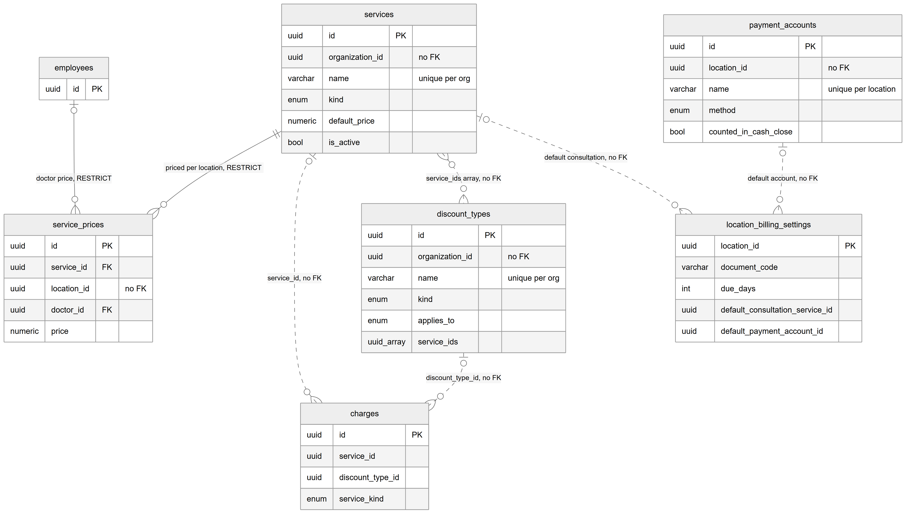
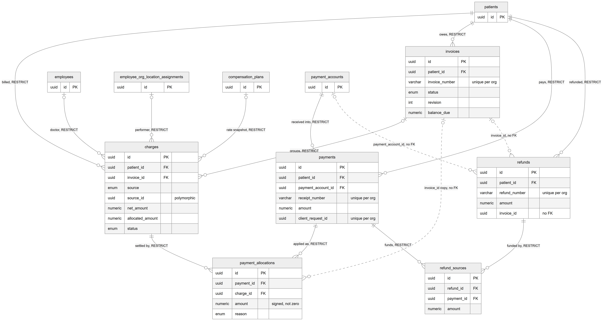

# Chapter 20 — Billing core

This chapter describes the tables that hold a clinic's money for treatment work: the service catalog, prices, charges, invoices, payments, allocations, refunds, discount types, payment accounts and per-location billing settings. It is written for the product owner who needs to know where every rupee is recorded and which database rules protect it. The design is called "billing v2" in the code; it replaced an older single-table invoice model. The entity catalog (`backend/docs/data-model/ENTITY_CATALOG.md`) remains the field-level reference; this chapter explains meaning, keys and relationships only.

## 20.1 The idea in one paragraph

A **charge** is one billable line for a patient, for example one consultation or one filling. It is the atomic unit of billing. An **invoice** is an issued document that groups some of the patient's charges; there are no draft invoices. A **payment** is money received from the patient. It belongs to the patient, not to an invoice. An **allocation** says how much of a payment went to which charge. Money that has been received but not allocated is the patient's **advance**. A **refund** always gives back advance money, and refund sources record which payments funded it. Prices, discounts and the service type are copied onto each charge when it is created, so later catalog edits never change old bills.

**Money convention.** Every amount in this chapter is a `numeric(12,2)` column in rupees (major units), not paisa. The commission snapshot columns on `charges` are the exception: they use basis points and paisa, because they feed the commission ledger (the Compensation chapter, Chapter 22, explains it).

**Key generation.** All tables in this chapter use random UUID (version 4) primary keys generated by the database, except `location_billing_settings`, whose key is the location id supplied by the application.

**Status:** [Implemented]. All tables in this chapter are written by the billing module (`backend/src/billing/`) and shown on billing screens (billing desk, invoices, payments, billing settings).

## 20.2 Catalog and pricing tables

*Figure 20.1 — The service catalog, location prices, discount types, payment accounts and location billing settings.*

The figure shows seven boxes. `services` is at the centre. A solid line runs from `services` to `service_prices` labelled "priced per location, RESTRICT", and a second solid line runs from `employees` to `service_prices` labelled "doctor price, RESTRICT". Dotted lines, which mean the column has no foreign key, run from `services` to `charges` (service_id), from `discount_types` to `charges` (discount_type_id), from `services` to `discount_types` (the `service_ids` array, a many-to-many link), and from `services` and `payment_accounts` to `location_billing_settings` (the default consultation service and default payment account). Each box lists its primary key and a few key columns; the notes "unique per org" and "unique per location" mark business-unique names, and "no FK" marks tenant columns without a database constraint.

### `services` — the service catalog

Code class name: `CatalogService` (the table name and class name differ). One row is something the clinic sells: a consultation, a procedure or "other". It belongs to an organization, not a location. Key columns: `name`, optional `code`, `kind` (CONSULTATION, PROCEDURE, OTHER), `default_price`, `is_active` (soft delete) and `sort_order`.

Constraints that matter:
- The name is unique per organization (`uq_services_org_name`).
- The code is unique per organization when present (`uq_services_org_code`, a partial unique index that ignores rows with no code).

### `service_prices` — location and doctor price overrides

One row overrides a service's default price at one location, and optionally for one doctor at that location. Doctors are identified by their employee record, the same way queue sessions identify them.

Constraints that matter:
- At most one location-wide price per service and location (`uq_service_prices_loc`, partial: only rows with no doctor).
- At most one doctor-specific price per service, location and doctor (`uq_service_prices_loc_doc`, partial: only rows with a doctor).

### `discount_types` — discount presets

An owner-defined discount, such as "Staff family 20%" or "Senior citizen PKR 500 off". It replaced the older coupon idea. Key columns: `kind` (PERCENTAGE or FIXED), `value`, an optional cap `max_amount`, and `applies_to` (ALL, SERVICE_KINDS or SERVICES) with the matching `service_kinds` or `service_ids` arrays. `reception_editable`, `min_value` and `max_value` let the front desk adjust the value within a range. `requires_note` forces a written reason. `valid_from` and `valid_to` limit the period. `is_active` is the soft-delete flag.

Constraints that matter: the name is unique per organization, and the code is unique per organization when present.

### `payment_accounts` — ways a location receives money

One row is one way a location can take money: cash drawer, a bank account, a mobile wallet. Key columns: `name`, `method` (CASH, CARD, BANK_TRANSFER, CHEQUE, ONLINE_WALLET), optional bank details, `requires_reference` (the cashier must type a transaction reference), `counted_in_cash_close` (the account is counted at the end-of-day cash close), `is_active` and `sort_order`.

Constraint that matters: the name is unique per organization and location (`uq_payment_accounts_loc_name`).

### `location_billing_settings` — one settings row per location

The primary key is the location id itself, so each location has at most one row. The row is created with defaults the first time it is needed. Key columns:
- `document_code`: the 2–6 character location code printed inside invoice, receipt and refund numbers. It lives here, not on `locations.code`, because the location code is free-form and up to 50 characters.
- `due_days` (default 7): days from issue to due date.
- `invoice_print_format` and `receipt_print_format` (A4 or THERMAL_80).
- Display switches: `show_logo`, `show_previous_balance`, `show_outstanding_at_check_in`, and a `footer_note`.
- `default_consultation_service_id` and `default_payment_account_id`.
- `cash_variance_alert_amount`: the cash-close difference that triggers an alert.

## 20.3 Charges, invoices, payments and refunds

*Figure 20.2 — How charges, invoices, payments, allocations, refunds and refund sources connect.*

The figure shows `patients` at the top with four solid lines down to `charges` ("billed"), `invoices` ("owes"), `payments` ("pays") and `refunds` ("refunded"), all marked RESTRICT. `invoices` connects to `charges` with "groups, RESTRICT". Three small boxes on the left, `employees`, `employee_org_location_assignments` and `compensation_plans`, each connect to `charges` with "doctor", "performer" and "rate snapshot" (all RESTRICT). `payment_accounts` connects to `payments` with "received into, RESTRICT". At the bottom, `payment_allocations` hangs from both `payments` ("applied as") and `charges` ("settled by"), and `refund_sources` hangs from both `refunds` ("funded by") and `payments` ("funds"). Dotted lines show the logical links without foreign keys: `invoices` to `payment_allocations` (a copied invoice id), `invoices` to `refunds` (invoice_id) and `payment_accounts` to `refunds` (payment_account_id).

### `charges` — billable lines

One row is one billable line for one patient at one location. Charges come from four sources (`source`): CONSULTATION, TREATMENT, TREATMENT_PLAN and MANUAL; `source_id` points at the originating record. Key columns:
- Pricing snapshot: `service_id`, `service_kind`, `description`, `quantity`, `unit_price`, `gross_amount`.
- Discount snapshot: `discount_type_id`, `discount_name`, `discount_kind`, `discount_value`, `discount_amount`, `discount_note`, `is_custom_discount`.
- Results: `net_amount`, `tax_amount` (this charge's share of its invoice's sales tax; zero while unbilled) and `allocated_amount` (a cached sum of allocations).
- Billing state: `invoice_id` (null means the charge is not yet invoiced), `status` (ACTIVE or VOID), void details, `needs_pricing` and `source_removed_at` (set when the doctor removed the source treatment after billing).
- Commission snapshot: `doctor_id`, `performing_assignment_id`, `commission_plan_id`, `commission_rate_bps`, `commission_fixed_minor`.
- Links to the visit: `encounter_id` and `appointment_id`.

The balance of a charge is never stored. The code computes it as net + tax − allocated.

Constraints that matter:
- `uq_charges_source` (partial unique index): an active charge can exist only once per organization, source and source id. This stops the same consultation or treatment being charged twice. Voided charges are excluded, so a corrected charge can be created after a void.
- `chk_charges_commission_rate`: the rate is null or between 0 and 10,000 basis points (0–100%).

### `invoices` — issued documents

One row is one issued invoice for one patient at one location. There is no draft state: an invoice is created and issued in one step. Key columns: `invoice_number`, `status` (ISSUED or CANCELLED), `revision` (an edit after issue increases it), `issue_date`, `due_date`, and the cached money columns `subtotal`, `discount_total`, `tax_rate` (copied from the location's settings at issue), `tax_amount`, `total_amount`, `paid_amount`, `balance_due`, `released_amount` and `refunded_amount`. Only the billing totals service writes the cached columns.

Constraint that matters: the invoice number is unique per organization (`uq_invoices_org_number`). Numbers are produced by the document numbering table described in the Billing ledgers chapter (Chapter 21).

### `payments` — money received

One row is money received from one patient. It belongs to the patient, not to an invoice. Apart from the cached `allocated_amount` and `refunded_amount`, a payment row never changes. The patient's advance from a payment is amount − allocated − refunded. Key columns: `receipt_number`, `amount`, `payment_account_id`, snapshots of the account's `method` and name, `reference_number`, `payment_date`, `received_at`, `received_by` and `client_request_id`.

Constraints that matter:
- The receipt number is unique per organization.
- `client_request_id` is unique per organization (`uq_payments_org_client_request`). The web app sends a fresh id with each "collect payment" action, so a double click or a network retry cannot record the same payment twice.

### `payment_allocations` — which payment paid which charge

One row says "this much of payment P was applied to charge C" (positive amount) or "this much was released back to advance" (negative amount). The table is designed as append-only: rows are never updated or deleted, and corrections are new rows with the opposite sign. The `reason` column records why: PAYMENT, ADVANCE_APPLIED, INVOICE_EDIT_RELEASE or UNAPPLY. `invoice_id` is a copy of the charge's invoice at the time of writing, kept for fast invoice queries.

Constraint that matters: `chk_payment_allocations_amount_nonzero` forbids zero-amount rows. The append-only rule itself is enforced by the application, not by a database trigger.

### `refunds` — money returned

One row is money returned to a patient. A refund always comes out of advance money. If `invoice_id` is set, it is an invoice refund; if it is null, it is a plain advance refund. Key columns: `refund_number`, `amount`, `payment_account_id` with method and name snapshots, `reason` (required), `refund_date`, `refunded_at`, `refunded_by` and `client_request_id`.

Constraints that matter: the refund number and the client request id are each unique per organization.

### `refund_sources` — which payments funded a refund

One row says how much of one payment's advance was used for one refund. The rows of one refund add up to the refund amount; the application enforces this sum.

## 20.4 Relationships explained

Foreign-key relationships (the database enforces these):

- **Service → service prices.** Each service price belongs to exactly one service; a service has zero or more prices. A service with prices cannot be deleted (ON DELETE RESTRICT).
- **Doctor → service prices.** A service price may name one doctor (an employee); a doctor can have many prices. Deleting an employee who has prices is blocked (RESTRICT).
- **Patient → charges, invoices, payments, refunds.** Each of these rows belongs to exactly one patient, and a patient can have many of each. A patient with any billing history cannot be deleted (RESTRICT on all four).
- **Invoice → charges.** A charge belongs to zero or one invoice; an invoice groups one or more charges. An invoice that still has charges cannot be deleted (RESTRICT).
- **Doctor → charges.** A charge may name the doctor (employee) who did the work; deleting that employee is blocked (RESTRICT).
- **Assignment → charges.** A charge may name the performing assignment, which is the doctor's link to the organization and location; deleting that assignment is blocked (RESTRICT).
- **Compensation plan → charges.** A charge may record the compensation plan whose rate was copied onto it; that plan cannot be deleted (RESTRICT).
- **Payment account → payments.** Each payment was received into exactly one payment account; an account with payments cannot be deleted (RESTRICT). This is why accounts are switched off with `is_active` instead.
- **Payment → allocations** and **charge → allocations.** Each allocation row belongs to exactly one payment and exactly one charge. A payment or charge with allocations cannot be deleted (RESTRICT).
- **Refund → refund sources** and **payment → refund sources.** Each refund source belongs to exactly one refund and exactly one payment; neither parent can be deleted while sources exist (RESTRICT).

Logical relationships (an id column with no foreign key; the database accepts ids that do not exist):

- `charges.service_id` → `services`; `charges.discount_type_id` → `discount_types`; `charges.encounter_id` → `patient_encounters`; `charges.appointment_id` → `appointments`. Each charge refers to at most one of each.
- `charges.source_id` is polymorphic: its meaning depends on `source` (for example a treatment or an encounter).
- `discount_types.service_ids` is an array of service ids, a many-to-many link with no constraint.
- `location_billing_settings.default_consultation_service_id` → `services` and `default_payment_account_id` → `payment_accounts`.
- `payment_allocations.invoice_id` and `payment_allocations.patient_id` are copies for fast reads.
- `refunds.invoice_id` → `invoices` and `refunds.payment_account_id` → `payment_accounts`. Note that, unlike payments, refunds have no foreign key to the payment account.
- Actor columns (`created_by`, `voided_by`, `discount_applied_by`, `issued_by`, `last_edited_by`, `cancelled_by`, `received_by`, `refunded_by`) hold a user id with no foreign key.

## 20.5 Tenant scope

- **Organization and location:** `charges`, `invoices`, `payments`, `payment_allocations`, `refunds`, `service_prices`, `payment_accounts`, `location_billing_settings`.
- **Organization only:** `services`, `discount_types` (both shared by every location), and `refund_sources`.
- **No foreign key on the tenant columns.** In every table of this chapter, `organization_id` and `location_id` are plain columns without a foreign key to `organizations` or `locations` (the one exception is that `location_billing_settings.location_id` is the primary key). Tenant isolation therefore depends entirely on the application always filtering by the active organization and location. The Overlaps chapter (Chapter 27) discusses this choice.

## 20.6 What an owner should remember

- Deleting a patient who has any billing history is impossible by design. Patients are deactivated instead.
- A charge's price and discount never change when the catalog changes, because they are copied at creation.
- The patient's balance and advance are always derived from charges, allocations and refunds; the cached totals are recomputed by one service.
- Duplicate protection exists at three levels: one active charge per source, unique document numbers per organization, and one payment or refund per client request id.
