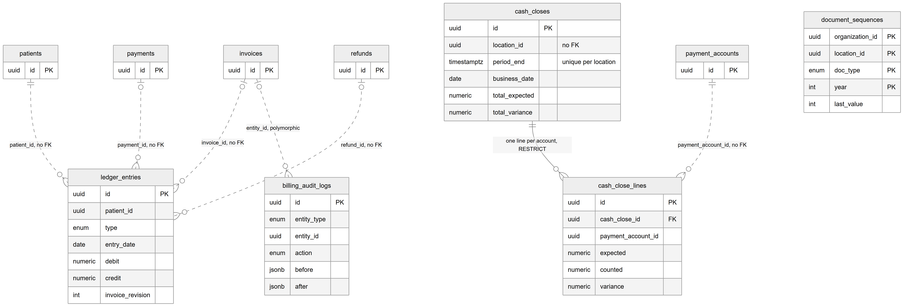
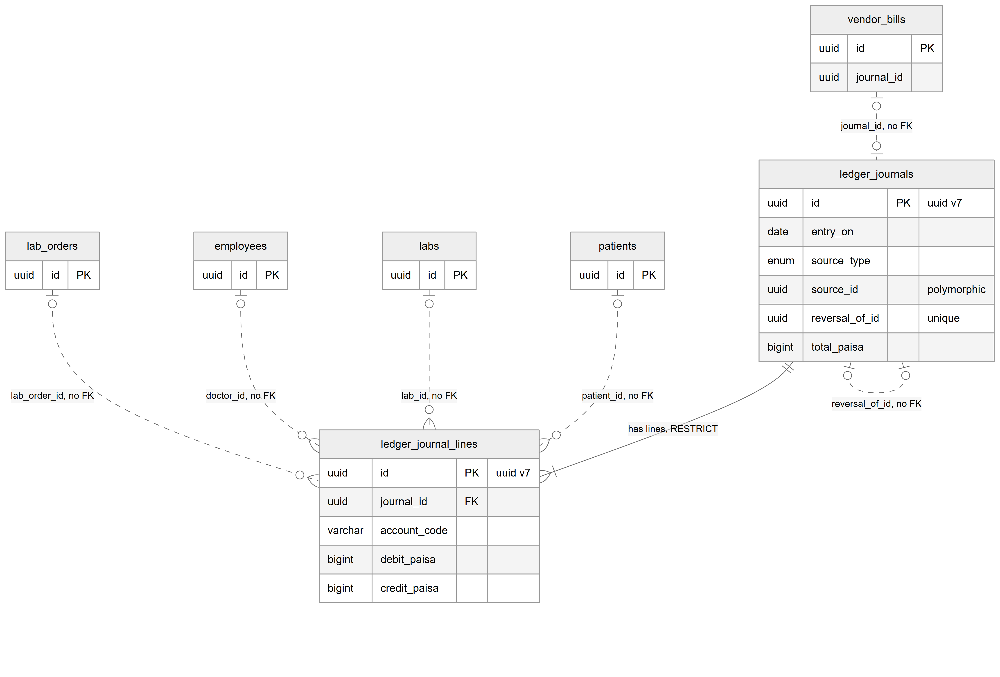
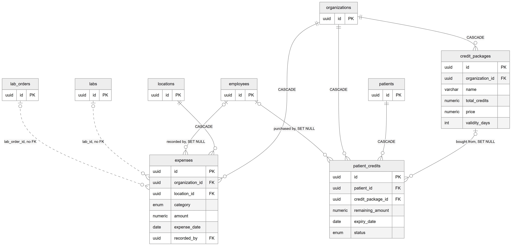

# Chapter 21 — Billing ledgers and closing

This chapter describes the record-keeping tables that sit around the core billing tables: the patient statement, the double-entry general ledger, the end-of-day cash close, document numbering, the billing audit log, clinic expenses and prepaid credit packages. It is for the product owner who needs to know which tables are the books of the clinic, which are history, and which features are only partly built. The core billing tables (charges, invoices, payments, allocations, refunds) are covered in the Billing core chapter (Chapter 20). The entity catalog (`backend/docs/data-model/ENTITY_CATALOG.md`) remains the field-level reference.

## 21.1 Two different "ledgers"

The Platform has two tables with "ledger" in their names, and they are not the same thing:

- **`ledger_entries` is the patient statement.** It is one-sided, in rupees (`numeric(12,2)`), and has one line per invoice, adjustment, cancellation, payment or refund for a patient. It answers "what does this patient owe us?".
- **`ledger_journals` with `ledger_journal_lines` is the general ledger.** It is true double-entry bookkeeping in paisa (`bigint`), with debits and credits on named accounts. It answers "what are the clinic's balances by account?".

Both are described in this chapter. The Overlaps chapter (Chapter 27) explains why both exist.

## 21.2 Patient statement, cash close, numbering and audit

*Figure 21.1 — The patient statement, the cash close with its lines, the document counter and the billing audit log.*

The figure shows `ledger_entries` connected by dotted lines (no foreign key) to `patients` (patient_id), `invoices` (invoice_id), `payments` (payment_id) and `refunds` (refund_id). `cash_closes` connects with a solid line to `cash_close_lines`, labelled "one line per account, RESTRICT", and `payment_accounts` connects to `cash_close_lines` with a dotted line (payment_account_id, no FK). `billing_audit_logs` receives a dotted line from `invoices` labelled "entity_id, polymorphic", which stands for all the record types the log can point at. `document_sequences` stands alone: its four-part primary key (organization, location, document type, year) and a `last_value` counter are shown, and it has no links.

### `ledger_entries` — the patient statement

**Status:** [Implemented]. Written by the billing ledger service; read by the patient statement endpoints and the printed statement.

One row is one line on a patient's statement at one location. `type` is INVOICE_ISSUED, INVOICE_ADJUSTED, INVOICE_CANCELLED, PAYMENT or REFUND. Exactly one of `debit` and `credit` is above zero. A positive running balance means the patient owes money; a negative one means the clinic holds the patient's advance. `invoice_revision` records which invoice revision an adjustment line belongs to. The table is designed as append-only, but no database trigger enforces it; the application never updates or deletes rows.

### `cash_closes` and `cash_close_lines` — end-of-day count

**Status:** [Implemented]. Written from the cash close sheet on the payments page.

A cash close is an immutable count of a location's counter since the previous close. `cash_closes` holds the period (`period_start`, `period_end`), the clinic `business_date`, the totals `total_expected`, `total_counted` and `total_variance`, an optional `note` and who closed it. `cash_close_lines` holds one line per payment account in that close, with that account's payment and refund totals and counts, `expected`, `counted` and `variance`. The account's name is copied onto the line, so renaming an account later does not change old closes.

Constraint that matters: `uq_cash_closes_loc_end` makes `period_end` unique per organization and location, so two closes cannot end at the same moment.

### `document_sequences` — invoice, receipt and refund numbers

**Status:** [Implemented].

One row is a counter for one organization, location, document type (INVOICE, RECEIPT or REFUND) and year. The primary key is those four columns, and there is no generated id: the application supplies all four values. The numbering service increments `last_value` with a single atomic statement inside the caller's transaction, so two cashiers can never get the same number. The resulting number has the form `<location code>-<INV|REC|RFD>-<year>-<five-digit counter>`, where the location code is `document_code` from `location_billing_settings` and the year is the clinic's year in the location's timezone. Because the counter is per location and per year, numbering restarts at 1 each year at each location. If a location has no document code yet, numbering refuses with the error `BILLING_LOCATION_CODE_MISSING` ("Set a document code for this location in billing settings first").

### `billing_audit_logs` — billing's own audit trail

**Status:** [Implemented]. Read by the billing activity screen.

One row records one billing state change. `entity_type` names what changed (CHARGE, INVOICE, PAYMENT, REFUND, DISCOUNT_TYPE, SERVICE, SERVICE_PRICE, SETTINGS, PAYMENT_ACCOUNT or CASH_CLOSE), `entity_id` points at that record, and `action` names the change (for example CREATED, VOIDED, DISCOUNT_APPLIED, ISSUED, EDITED, CANCELLED, ALLOCATED, REFUNDED, CLOSED). `before` and `after` hold JSON snapshots; for an edited invoice they hold the full snapshot used for invoice revisions. `amount` records the money moved, for activity totals, and `actor_role` records the role of the person who did it. `location_id` is null only for organization-level records such as services and discount types.

The table is described as append-only, but no database trigger protects it. The Platform also has a generic `audit_logs` table (the Workflow engine and common tables chapter, Chapter 26), which billing does not use for these events.

## 21.3 The general ledger

*Figure 21.2 — Journals, journal lines and their logical links.*

The figure shows `ledger_journals` connected to `ledger_journal_lines` by a solid line labelled "has lines, RESTRICT"; the crow's foot shows that a journal has one or more lines. A dotted loop from `ledger_journals` back to itself is labelled "reversal_of_id, no FK", meaning a journal can be the reversal of one earlier journal. `vendor_bills` points to `ledger_journals` with a dotted line (journal_id, no FK). Four dotted lines run into `ledger_journal_lines` from `patients`, `labs`, `employees` and `lab_orders`; these are optional tags on a line. Both ledger boxes note that their keys are UUID version 7.

### `ledger_journals` and `ledger_journal_lines`

**Status:** [Partial]. The tables and the posting service exist, but in the code only lab money posts journals: lab patient invoices, lab payments, lab credit notes, lab refunds, commission on lab invoice lines, vendor bills and vendor payments. Clinic (non-lab) invoices and payments from Chapter 20 do not post journals, the `expense` source type is never posted, and no screen or report reads the general ledger.

A journal is one balanced double-entry posting. `entry_on` is the accounting date, `source_type` and `source_id` name the business record that caused it (vendor_bill, vendor_payment, expense, invoice, payment, credit_note, refund or commission), `memo` describes it, and `total_minor` equals the sum of debits, which equals the sum of credits. A mistake is never edited: the application writes a mirror journal whose `reversal_of_id` points at the original.

A journal line is one side of a journal. `account_code` is a code from a fixed chart of accounts kept in the code, not in a table: CASH, BANK, LAB_COST, LAB_PAYABLE, LAB_ADVANCES, PATIENT_RECEIVABLE, PATIENT_ADVANCES, LAB_REVENUE, TAX_PAYABLE, COMMISSION_EXPENSE and COMMISSION_PAYABLE. Each line also carries optional tags: `patient_id`, `lab_id`, `doctor_id` and `lab_order_id`.

Constraints that matter:
- `chk_ledger_journal_lines_side`: each line is either a debit or a credit, never both and never zero.
- `uq_ledger_journals_reversal` (partial unique index): a journal can be reversed at most once.
- The rule "debits equal credits" is checked by the posting service, not by the database.
- No trigger stops updates or deletes; append-only is an application rule.

## 21.4 Expenses and credit packages

*Figure 21.3 — Clinic expenses, credit packages and the credits patients buy.*

The figure shows `expenses` with solid lines from `organizations` and `locations` (both CASCADE) and from `employees` ("recorded by, SET NULL"). Dotted lines from `labs` and `lab_orders` reach `expenses` (lab_id and lab_order_id, no FK). On the right, `organizations` connects to `credit_packages` (CASCADE). `credit_packages` connects to `patient_credits` with "bought from, SET NULL". `patients` and `organizations` both connect to `patient_credits` with CASCADE, and `employees` connects with "purchased by, SET NULL".

### `expenses` — clinic running costs

**Status:** [Implemented]. Shown on the expenses page and used by finance reports.

One row is one clinic expense at one location: rent, utilities, supplies, salary, equipment, marketing, maintenance or other (`category`). Key columns: `description`, `amount` (`numeric(10,2)`), `expense_date`, `payment_method`, `reference_number`, `receipt_url` and `recorded_by`. The optional `lab_id` and `lab_order_id` mark an expense as the cost of a lab case. Timestamps in this table are stored without time zone, unlike the rest of billing.

### `credit_packages` and `patient_credits` — prepaid credit

**Status:** [Partial]. The backend has endpoints to manage packages and to record a patient's purchase (feature `billing.credit_packages`), but no web page uses them, and credits are not a payment method at the billing desk.

`credit_packages` is an organization's offer: `name`, `total_credits`, `price` and `validity_days`, with `is_active` as a soft delete. `patient_credits` is one purchase by one patient: `total_amount`, `used_amount`, `remaining_amount`, `purchase_date`, `expiry_date` and `status` (ACTIVE, EXPIRED or EXHAUSTED). Money columns are `numeric(10,2)` and timestamps have no time zone.

## 21.5 Relationships explained

Foreign-key relationships:

- **Cash close → cash close lines.** Each line belongs to exactly one cash close; a close has one line per counted account. A close with lines cannot be deleted (RESTRICT).
- **Journal → journal lines.** Each line belongs to exactly one journal; a journal has two or more lines. A journal with lines cannot be deleted (RESTRICT).
- **Organization → expenses** and **location → expenses.** Each expense belongs to one organization and one location. Deleting the organization or the location deletes its expenses (CASCADE).
- **Employee → expenses.** An expense may name the employee who recorded it; deleting that employee keeps the expense and clears the link (SET NULL).
- **Organization → credit packages.** Deleting the organization deletes its packages (CASCADE).
- **Credit package → patient credits.** A patient credit may come from one package; deleting the package keeps the credit and clears the link (SET NULL).
- **Patient → patient credits** and **organization → patient credits.** Deleting the patient or the organization deletes the credits (CASCADE).
- **Employee → patient credits.** The employee who sold the credit; deleting that employee clears the link (SET NULL).

Logical relationships (no foreign key):

- `ledger_entries.patient_id`, `invoice_id`, `payment_id` and `refund_id` point at the patient and at the billing record behind each line.
- `cash_close_lines.payment_account_id` → `payment_accounts`.
- `billing_audit_logs.entity_id` is polymorphic, discriminated by `entity_type`.
- `ledger_journals.source_id` is polymorphic, discriminated by `source_type`; `reversal_of_id` points at another journal.
- `ledger_journal_lines.patient_id`, `lab_id`, `doctor_id` (an employee) and `lab_order_id` are optional tags.
- `vendor_bills.journal_id` → `ledger_journals` (the Labs chapter, Chapter 25, covers vendor bills).
- `expenses.lab_id` → `labs` and `expenses.lab_order_id` → `lab_orders`.
- Actor columns (`created_by`, `closed_by`, `actor_id`) hold a user id with no foreign key.

## 21.6 Tenant scope

- **Organization and location:** `ledger_entries`, `cash_closes`, `document_sequences`, `billing_audit_logs`, `ledger_journals`, `ledger_journal_lines` (location is optional on the journal tables) and `expenses`.
- **Organization only:** `credit_packages`, `patient_credits`.
- **No tenant column:** `cash_close_lines`, which is scoped only through its cash close. Any query on it must join `cash_closes` to enforce isolation.
- Only `expenses`, `credit_packages` and `patient_credits` have foreign keys on their tenant columns; every other table here stores the organization and location ids without a constraint.
