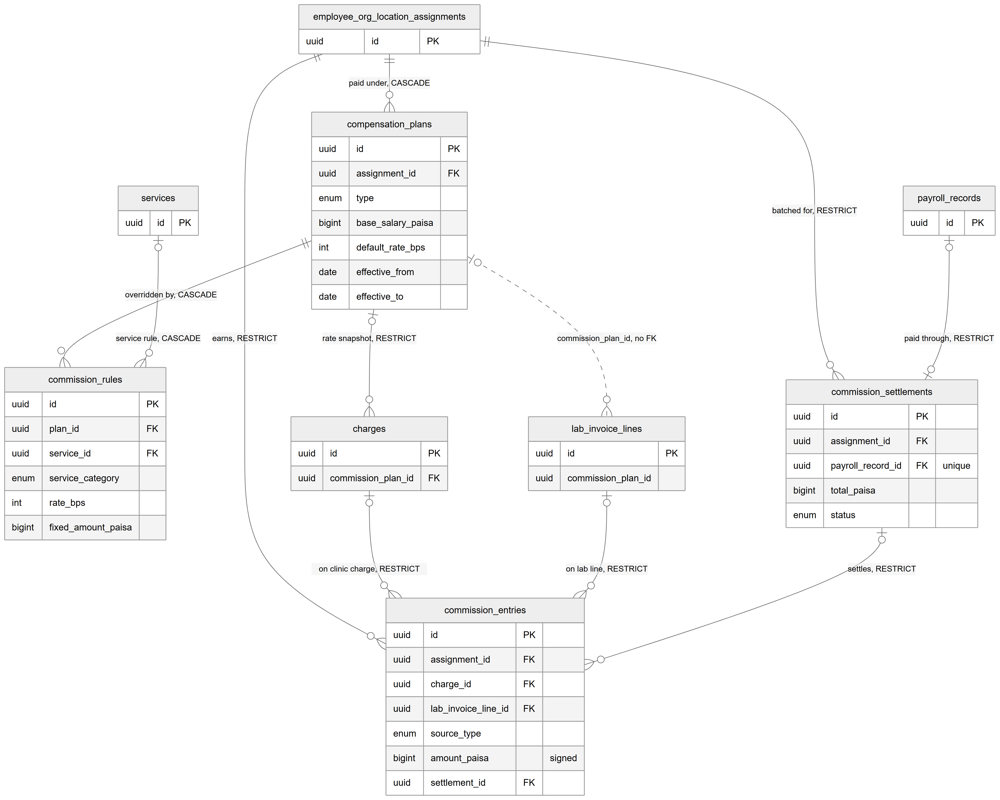

# Chapter 22 — Compensation

This chapter describes the four tables that decide how a doctor or other employee is paid: compensation plans, commission rules, the commission ledger and commission settlements. It is for the product owner who needs to understand how commission is recorded, why its amounts can never be edited, and how it reaches payroll. The tables live in the billing module (`backend/src/billing/commissions/`) and connect billing charges, lab invoice lines and payroll records. The entity catalog (`backend/docs/data-model/ENTITY_CATALOG.md`) remains the field-level reference.

**Status:** [Implemented]. Plans and rules are edited from the employee screens; commission entries are written automatically when money is collected; settlements are created and paid through payroll; the commission pages show earnings.

## 22.1 The idea in one paragraph

Pay is set per **assignment**, which is an employee's link to one organization and location, because the same doctor can be paid differently at two branches. A **compensation plan** says how the assignment is paid during a date range: salary, commission, or both. **Commission rules** override the plan's default rate for one service or one service category. Commission is earned only on money actually collected. Every time collection on a charge changes, the Platform writes a **commission entry** with only the difference, positive or negative. When payroll is generated, the unsettled entries of the assignment are grouped into a **settlement**, which is paid through one **payroll record**.

**Money convention.** All amounts here are `bigint` paisa (integer minor units). Rates are basis points: 4000 means 40.00%.

*Figure 22.1 — Compensation plans, commission rules, the commission ledger and settlements, with their links to billing and payroll.*

The figure shows `employee_org_location_assignments` with three solid lines: to `compensation_plans` ("paid under, CASCADE"), to `commission_entries` ("earns, RESTRICT") and to `commission_settlements` ("batched for, RESTRICT"). `compensation_plans` connects to `commission_rules` ("overridden by, CASCADE") and to `charges` ("rate snapshot, RESTRICT"), and has a dotted line to `lab_invoice_lines` (commission_plan_id, no FK). `services` connects to `commission_rules` ("service rule, CASCADE"). `commission_entries` receives solid lines from `charges` ("on clinic charge"), `lab_invoice_lines` ("on lab line") and `commission_settlements` ("settles"), all RESTRICT. `payroll_records` connects one-to-one with `commission_settlements` ("paid through, RESTRICT"). Each main box shows its key columns, and `amount_paisa` on the entry is marked "signed".

## 22.2 Tables

### `compensation_plans` — how an assignment is paid

One row is one version of an assignment's pay, valid from `effective_from` to `effective_to` (both inclusive; an empty `effective_to` means "current"). `type` is SALARY, COMMISSION or SALARY_PLUS_COMMISSION. `base_salary_paisa` holds the salary, `default_rate_bps` the default commission rate, and `commission_basis` (NET by default, or GROSS) which charge amount the commission rate is applied to. A change of pay closes the current version and adds a new one, so old charges keep the rate that was copied onto them.

Constraints that matter:
- `excl_compensation_plans_overlap` (an EXCLUDE constraint using the `btree_gist` extension): two versions of the same assignment can never have overlapping date ranges.
- `chk_compensation_plans_fields`: a SALARY plan must have a salary and no rate; a COMMISSION plan must have a rate and no salary; SALARY_PLUS_COMMISSION must have both.
- `chk_compensation_plans_dates`, `chk_compensation_plans_salary`, `chk_compensation_plans_rate`: the end date is not before the start, the salary is not negative, and the rate is between 0 and 10,000 basis points.

### `commission_rules` — per-service and per-category overrides

One row overrides the plan's default for either one catalog service (`service_id`) or one service category (`service_category`: CONSULTATION, PROCEDURE or OTHER), never both. It holds either a rate (`rate_bps`) or a fixed amount per fully paid charge (`fixed_amount_paisa`), never both. When the Platform looks up the rate for a charge, it tries the service rule first, then the category rule, then the plan default.

Constraints that matter:
- `chk_commission_rules_target` and `chk_commission_rules_amount`: exactly one target and exactly one kind of amount.
- `chk_commission_rules_rate` and `chk_commission_rules_fixed`: valid ranges.
- `uq_commission_rules_service` and `uq_commission_rules_category` (partial unique indexes): at most one rule per plan and service, and at most one per plan and category.

### `commission_entries` — the commission ledger

One row is one change in what an assignment has earned on one source line. The source line is either a clinic charge (`charge_id`) or a lab invoice line (`lab_invoice_line_id`), never both. `source_type` says what caused the entry: ALLOCATION (new money), UNAPPLY, CHARGE_ADJUST, VOID or MANUAL; `source_id` is the payment or operation behind it. `base_paisa` is how much had been collected on the line (capped at its net amount) when the entry was written, `rate_bps` the rate used, and `amount_paisa` the signed difference. For each line, the sum of its entries always equals the commission due on what has been collected so far. `settlement_id` is empty until the entry is settled.

Constraints that matter:
- `chk_commission_entries_target`: exactly one of `charge_id` and `lab_invoice_line_id` is set.
- `uq_commission_entries_source` (source type, source id, charge) and `uq_commission_entries_lab_source` (partial, for lab lines): the same operation cannot write commission twice for the same line.
- `idx_commission_entries_unsettled`: a partial index over unsettled entries, used when payroll collects them.

**The append-only trigger.** This table is protected in the database by the trigger `trg_commission_entries_append_only`, installed by the hand-written migration `1792403456699-doctor-compensation`. The trigger:
- refuses every DELETE;
- refuses any UPDATE that changes a column other than `settlement_id`;
- allows `settlement_id` to be set once, from empty to a settlement;
- allows `settlement_id` to be cleared back to empty only while that settlement is still PENDING. Once the settlement is PAID, the entry can no longer move.

It is one of only three tables in the Platform whose append-only rule is enforced by the database itself (the others are `audit_logs` and `status_history`).

### `commission_settlements` — a payout batch

One row groups unsettled commission entries of one assignment for a period (`period_start`, `period_end`) and links them to one payroll record. `total_paisa` is the sum of the entries; it is signed, because a period with only reversals can be negative. `status` is PENDING, then PAID, with `paid_at` and `paid_by`.

How it is used in the code:
- When payroll is generated, the unsettled entries created before the cut-off are locked (`SELECT … FOR UPDATE`), so one entry can never land in two settlements. A PENDING settlement is created and the entries are pointed at it.
- When the payroll record is marked paid, the settlement becomes PAID in the same transaction.
- If the payroll record is deleted before payment, the entries are released back to the unsettled pool and the settlement row is deleted. Once PAID, release is refused.

Constraint that matters: `payroll_record_id` is unique, so one payroll record has at most one settlement.

## 22.3 Relationships explained

- **Assignment → compensation plans.** Each plan belongs to exactly one assignment; an assignment has zero or more plan versions. Deleting an assignment deletes its plans (ON DELETE CASCADE). In practice this cascade is blocked as soon as any charge has copied one of those plans, because charges point at plans with RESTRICT.
- **Compensation plan → commission rules.** Each rule belongs to exactly one plan; deleting the plan deletes its rules (CASCADE).
- **Service → commission rules.** A rule may target one catalog service; deleting the service deletes its rules (CASCADE). Services are normally switched off with `is_active` rather than deleted.
- **Compensation plan → charges.** A charge may record the plan whose rate it copied; that plan cannot be deleted (RESTRICT). The rate and fixed amount themselves are also copied onto the charge.
- **Assignment → commission entries.** Each entry belongs to exactly one assignment; an assignment with entries cannot be deleted (RESTRICT).
- **Charge → commission entries.** An entry may belong to one charge; a charge has zero or more entries. A charge with entries cannot be deleted (RESTRICT).
- **Lab invoice line → commission entries.** An entry may belong to one lab invoice line instead; that line cannot be deleted (RESTRICT). Lab invoice lines are covered in the Labs chapter (Chapter 25).
- **Settlement → commission entries.** An entry belongs to zero or one settlement; a settlement groups many entries. A settlement that still has entries cannot be deleted (RESTRICT); the release step clears the entries first.
- **Assignment → commission settlements.** Each settlement belongs to exactly one assignment (RESTRICT).
- **Payroll record → commission settlement.** One-to-one: a settlement may be paid through one payroll record, and a payroll record has at most one settlement. A payroll record with a settlement cannot be deleted at database level (RESTRICT); the payroll service releases the settlement first, and only while it is PENDING.

Logical relationships (no foreign key):
- `lab_invoice_lines.commission_plan_id` → `compensation_plans` and `lab_invoice_lines.performing_assignment_id` → `employee_org_location_assignments`: the same snapshot as on charges, but without constraints.
- `commission_entries.source_id` is polymorphic, discriminated by `source_type`.
- Actor columns `compensation_plans.created_by` and `commission_settlements.paid_by` hold a user id.

## 22.4 Tenant scope

- **Organization and location:** `commission_entries`, `commission_settlements`.
- **Organization only:** `compensation_plans` (the location is implied by the assignment).
- **No tenant column:** `commission_rules`, scoped only through its plan. Queries must join `compensation_plans`.
- None of the tenant columns here has a foreign key; isolation is enforced by the application.

## 22.5 What an owner should remember

- Commission follows cash, not invoices: nothing is earned until money is allocated to a charge or lab line.
- Commission amounts cannot be edited or deleted by any ordinary SQL statement, because the trigger rejects it. Corrections are new signed entries.
- Tax is not part of the commission base. The base is the collected amount capped at the line's net amount.
- A rate change never rewrites history: old charges keep the rate copied onto them.
