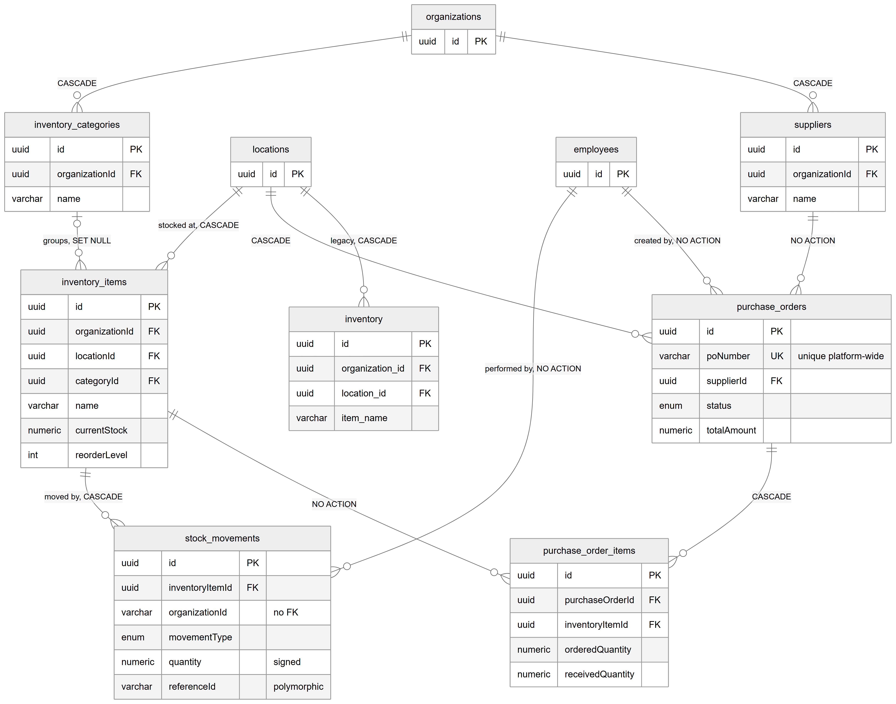
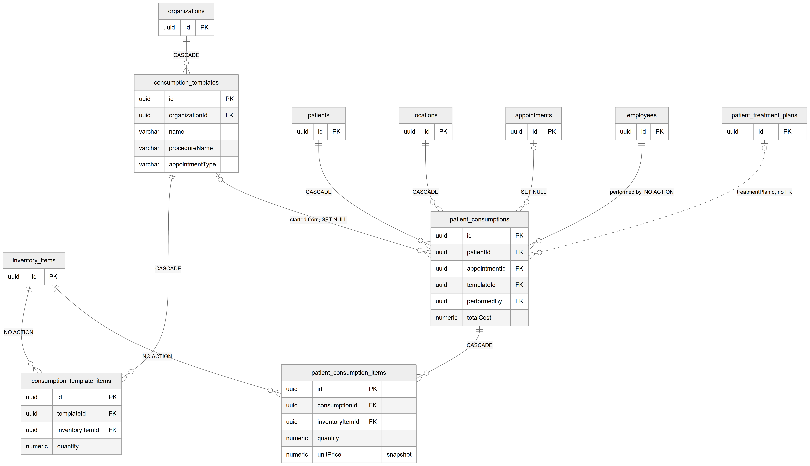

# Chapter 23 — Inventory

This chapter describes the eleven tables of the inventory module: stock items and their categories, stock movements, suppliers, purchase orders, consumption templates and the record of materials used on a patient. It is for the product owner who wants to know how stock is tracked and where the module is incomplete. The module lives in `backend/src/inventory/` and is reached in the web app at `/inventory`. The entity catalog (`backend/docs/data-model/ENTITY_CATALOG.md`) remains the field-level reference.

## 23.1 Two things to know first

**camelCase column names.** Unlike every other module, the inventory tables use camelCase column names in the database, for example `organizationId`, `locationId`, `currentStock` and `treatmentPlanId`. In SQL these names must be written in double quotes. The legacy `inventory` table is the only exception: it uses snake_case.

**A note on the catalog.** In the entity catalog, the "Notes" column of the inventory tables is shifted one row down: the comment shown next to a column belongs to the column listed above it. For example, the comment "NEVER update directly — always through StockMovement" belongs to `currentStock`, not to `unit`. This chapter was checked against the entity files in `backend/src/inventory/entities/`.

**Money convention.** Prices and totals are `numeric(10,2)` in rupees. Quantities are `numeric(10,2)`, so fractional quantities such as 1.5 ml are allowed. Timestamps are stored without time zone.

**Status overview:**
- Stock items, categories, suppliers, purchase orders, stock movements and consumption templates: [Partial]. The backend and the `/inventory` page (tabs for items, suppliers, purchase orders and templates) exist and are permission-gated, but `/inventory` has no sidebar entry, so users reach it only by URL.
- Recording materials used on a patient (`patient_consumptions`): [Partial]. The backend endpoints (`POST /patient-consumptions` and its read endpoints) exist, and the web app has a `ConsumptionRecorder` component, but no page renders that component.
- The legacy `inventory` table: [Not implemented]. It is not registered by any module.

## 23.2 Stock and purchasing

*Figure 23.1 — Items, categories, stock movements, suppliers, purchase orders and the legacy inventory table.*

The figure shows `organizations` connected to `inventory_categories` and `suppliers` (both CASCADE). `inventory_categories` connects to `inventory_items` with "groups, SET NULL", and `locations` connects to `inventory_items` with "stocked at, CASCADE". `inventory_items` connects to `stock_movements` ("moved by, CASCADE") and to `purchase_order_items` (NO ACTION). `employees` connects to `stock_movements` ("performed by") and to `purchase_orders` ("created by"), both NO ACTION. `suppliers` connects to `purchase_orders` (NO ACTION), `locations` to `purchase_orders` (CASCADE), and `purchase_orders` to `purchase_order_items` (CASCADE). A separate box, `inventory`, hangs from `locations` with "legacy, CASCADE". The `poNumber` column on `purchase_orders` carries the note "unique platform-wide".

### `inventory_categories` — item groups

An organization's grouping of items, such as disposables, dental materials, medicines, instruments or office supplies. Key columns: `name`, `description`, `sortOrder`, and `isActive` as a soft delete.

### `inventory_items` — one stocked item at one location

One row is one item kept at one location, with its current stock. Key columns:
- Identity: `name`, optional `sku` (an internal stock code) and `barcode` (kept for a future scanning feature).
- Stock: `currentStock` and `unit` (pieces, boxes, pairs, rolls, bottles, packets, cartridges, tubes, ml, gm, kg or liters). The code comment says `currentStock` must never be updated directly, only through a stock movement.
- Price: `unitPrice` is the last purchase cost per unit and is updated when purchase-order items are received; `sellingPrice` is used when the item is billed to a patient.
- Reorder: `reorderLevel` (alert when stock falls to or below it, default 10), `reorderQuantity` (suggested order quantity, default 50) and optional `maxStock`.
- Expiry: `expiryDate` (the nearest expiry among current batches) and `expiryAlertDays` (alert this many days before, default 30).
- Flags: `isBillable` (the item may be added to a patient invoice) and `isActive`.

There is no unique constraint on the SKU. The code comment says SKU uniqueness per organization is enforced in the service, not in the database.

### `stock_movements` — the stock history

One row is one change to one item's stock. `movementType` is PURCHASE_IN, MANUAL_ADJUSTMENT, CONSUMPTION, WASTAGE, TRANSFER_IN, TRANSFER_OUT, RETURN_TO_SUPPLIER or INITIAL_STOCK. `quantity` is signed: positive for stock coming in, negative for stock going out. `previousStock` and `newStock` snapshot the item's stock before and after, so `newStock = previousStock + quantity`. `referenceType` names what triggered the movement ('purchase_order', 'appointment', 'treatment_plan', 'manual' or 'transfer') and `referenceId` holds that record's id. `batchNumber` and `expiryDate` describe the batch.

Two oddities: `organizationId` and `locationId` here are `varchar`, not `uuid`, and have no foreign key; `referenceId` is also `varchar`.

### `suppliers` — vendors of stock

An organization's supplier: name, contact person, phone, email, address, city, website, notes, and `isActive`.

### `purchase_orders` and `purchase_order_items` — buying stock

A purchase order is one order from one supplier for one location. `status` is DRAFT, ORDERED, PARTIALLY_RECEIVED, RECEIVED or CANCELLED. Money columns are `subtotal`, `taxRate`, `taxAmount` and `totalAmount`; dates are `orderDate`, `expectedDeliveryDate` and `receivedDate`. Each purchase-order item is one inventory item on the order, with `orderedQuantity`, `receivedQuantity`, `unitPrice`, `totalPrice`, and optional `batchNumber` and `expiryDate`.

**Constraint that matters, and a risk.** `poNumber` has a unique constraint on its own, across the whole Platform. The service generates numbers per organization in the form `PO-<year>-<five digits>`, starting from the organization's last order. Two organizations will therefore both try to create `PO-<year>-00001`, and the second insert will fail on the unique constraint. This is recorded as a defect for the owner; the module chapter for inventory (Chapter 39) covers its user impact.

### `inventory` — legacy single table

**Status:** [Not implemented]. A simple item table (`item_name`, `quantity`, `unit_price`, `expiry_date`) for an organization and location. No module registers it, so the running application never creates or uses it in development. It exists only because the command-line schema tools load every entity file, so a production schema built with `schema:sync:prod` may contain it while a development database does not. It looks superseded by `inventory_items` and `stock_movements`.

## 23.3 Consumption

*Figure 23.2 — Consumption templates and the record of materials used on a patient.*

The figure shows `organizations` connected to `consumption_templates` (CASCADE). `consumption_templates` connects to `consumption_template_items` (CASCADE) and to `patient_consumptions` ("started from, SET NULL"). `inventory_items` connects to both `consumption_template_items` and `patient_consumption_items` with NO ACTION. `patients` and `locations` connect to `patient_consumptions` with CASCADE, `appointments` with SET NULL, and `employees` with "performed by, NO ACTION". `patient_consumptions` connects to `patient_consumption_items` (CASCADE). A dotted line from `patient_treatment_plans` to `patient_consumptions` is labelled "treatmentPlanId, no FK". The `unitPrice` column on the consumption item is marked "snapshot".

### `consumption_templates` and `consumption_template_items` — standard kits

A consumption template is an organization's standard kit for a procedure, for example a root canal kit. Key columns: `name`, `procedureName`, optional `appointmentType` (used to suggest the template automatically when that type of visit starts) and `isActive`. Each template item names one inventory item and a default `quantity`, with optional `notes` as hints for the doctor and a `sortOrder`.

### `patient_consumptions` and `patient_consumption_items` — what was used on a patient

A patient consumption records the materials used on one patient at one location, optionally for one appointment, and optionally based on a template. `performedBy` is the doctor (an employee). `totalCost` is the sum of the item totals, calculated by the service. Each consumption item records one inventory item, the `quantity` actually used, `unitPrice` copied from the item at the time of use, `totalPrice` (quantity × unit price, calculated by the service) and `wasFromTemplate` (true if the item was suggested by the template, false if added by hand).

`treatmentPlanId` has no foreign key. The code comment says this was done "to avoid circular" imports. The intended target is probably `patient_treatment_plans`, but the code does not say so.

## 23.4 Relationships explained

Foreign-key relationships:

- **Organization → categories, items, suppliers, purchase orders, consumption templates, patient consumptions.** Each belongs to one organization; deleting the organization deletes them (CASCADE).
- **Location → items, purchase orders, patient consumptions.** Each belongs to one location; deleting the location deletes them (CASCADE).
- **Category → items.** An item belongs to zero or one category; deleting the category keeps the items and clears the link (SET NULL).
- **Item → stock movements.** Each movement belongs to exactly one item; deleting the item deletes its whole stock history (CASCADE).
- **Employee → stock movements, purchase orders, patient consumptions.** Each names the employee who did it. Deleting that employee is blocked while such rows exist (NO ACTION, which behaves like RESTRICT at the end of the statement).
- **Supplier → purchase orders.** Each order belongs to exactly one supplier; a supplier with orders cannot be deleted (NO ACTION). Suppliers are deactivated with `isActive`.
- **Purchase order → purchase-order items.** Deleting an order deletes its items (CASCADE).
- **Item → purchase-order items, template items, consumption items.** Each refers to exactly one inventory item; an item used on any of these cannot be deleted (NO ACTION). Note the asymmetry: deleting an item would cascade its stock movements, but the delete is blocked first if the item appears on any order, template or consumption.
- **Template → template items.** Deleting a template deletes its items (CASCADE).
- **Template → patient consumptions.** A consumption may have started from one template; deleting the template keeps the consumption and clears the link (SET NULL).
- **Patient → patient consumptions.** Deleting the patient deletes the consumption records (CASCADE).
- **Appointment → patient consumptions.** Deleting the appointment keeps the consumption and clears the link (SET NULL).
- **Patient consumption → consumption items.** Deleting a consumption deletes its items (CASCADE).
- **Legacy `inventory`.** Belongs to one location and optionally one organization; both CASCADE.

Logical relationships (no foreign key):
- `patient_consumptions.treatmentPlanId` → probably `patient_treatment_plans` (not verified in the code).
- `stock_movements.referenceId` is polymorphic, discriminated by `referenceType`.
- `stock_movements.organizationId` and `locationId` → `organizations` and `locations`.

## 23.5 Tenant scope

- **Organization and location:** `inventory_items`, `stock_movements`, `purchase_orders`, `patient_consumptions`, and the legacy `inventory`.
- **Organization only:** `inventory_categories`, `suppliers`, `consumption_templates`.
- **No tenant column:** `purchase_order_items`, `consumption_template_items` and `patient_consumption_items`, scoped only through their parent order, template or consumption. Queries must join the parent to enforce isolation.
- Unlike the billing tables, most inventory tenant columns do have foreign keys. The exception is `stock_movements`, whose tenant columns are unconstrained `varchar`.
