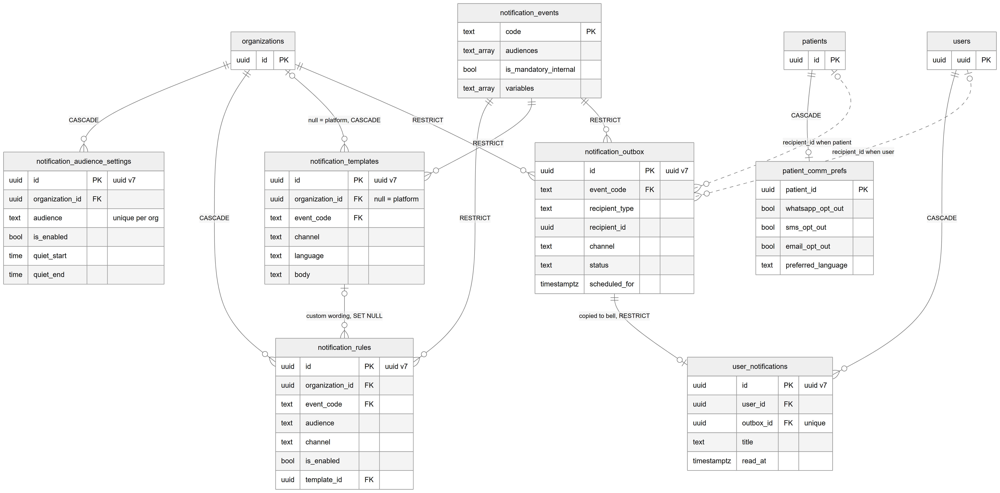

# Chapter 24 — Notifications

This chapter describes the seven tables of the notification system: the platform catalog of events, each clinic's on/off rules and wording, the outbox of messages to send, the in-app inbox (the bell), and each patient's messaging preferences. It is for the product owner who needs to know what is stored when "something notifies someone" and which channels really work today. The module lives in `backend/src/notifications/`; the sending mechanics are covered in the Notification mechanics chapter (Chapter 59). The entity catalog (`backend/docs/data-model/ENTITY_CATALOG.md`) remains the field-level reference.

## 24.1 The idea in one paragraph

The Platform defines a fixed list of **notification events** in code, such as an order being submitted or an item being ready. Each event can reach one or more **audiences**: patient, doctor, coordinator or lab. A clinic decides per event, audience and channel whether to send (**notification rules**), can switch a whole audience off or set quiet hours (**audience settings**), and can replace the default wording (**templates**). When something happens, the Platform writes one **outbox** row per recipient and channel in the same database transaction as the change itself, including rows it decided to skip, so the log can show why a message never went. A background relay then sends the queued rows. An in-app send also creates a row in the recipient's **bell**.

**Channels in practice.** The tables allow four channels: `in_app`, `whatsapp`, `sms` and `email`. In the code, only `in_app` is switched on for the doctor, coordinator and lab audiences; WhatsApp, SMS and email are commented out because no real provider is connected. The patient audience has no channel at all, so patients currently receive nothing.

**Status:**
- In-app notifications to staff and lab users (outbox, bell, settings, templates): [Implemented].
- WhatsApp, SMS and email delivery: [Not implemented]. The channel values exist in the tables and checks, but no provider sends them.
- Patient notifications: [Not implemented]. Patient preferences can be stored, but no channel reaches patients.

**Keys.** Every table here except `notification_events` and `patient_comm_prefs` uses a UUID version 7 primary key generated by the database function `uuid_generate_v7()`. Version 7 ids start with a timestamp, so they sort by creation time (the Labs chapter, Chapter 25, explains them in more detail).

*Figure 24.1 — The event catalog, clinic rules, templates, audience settings, the outbox, the bell and patient preferences.*

The figure shows `notification_events` at the centre, keyed by a text `code`. It connects with RESTRICT to `notification_rules`, `notification_templates` and `notification_outbox`. `organizations` connects to `notification_audience_settings` and `notification_rules` (CASCADE), to `notification_templates` ("null = platform, CASCADE") and to `notification_outbox` (RESTRICT). `notification_templates` connects to `notification_rules` with "custom wording, SET NULL". `notification_outbox` connects one-to-one to `user_notifications` ("copied to bell, RESTRICT"), and `users` connects to `user_notifications` (CASCADE). `patients` connects one-to-one to `patient_comm_prefs` (CASCADE). Two dotted lines run from `users` and from `patients` to `notification_outbox`, labelled "recipient_id when user" and "recipient_id when patient", showing that the recipient column has no foreign key.

## 24.2 Tables

### `notification_events` — the platform event catalog

One row is one kind of event that can notify someone. The primary key is a text `code`, for example `order.submitted` or `item.ready`. There is no organization column: this is a platform catalog, seeded from code on every start (missing rows are inserted, existing ones are kept). Key columns: `name`, `description`, `audiences` (the audiences it can reach), `is_mandatory_internal` (internal audiences always get it in-app and clinics cannot switch it off), `variables` (placeholders the event supplies) and `sort_order`.

### `notification_rules` — per-clinic on/off switches

One row says whether one event is sent to one audience on one channel for one organization, and optionally which template to use. Rows are created only when a clinic changes something. A missing row means the default from the code: on for an internal audience (doctor, coordinator, lab) on the in-app channel, off for everything else. The table has an optimistic `version` column, so two admins saving at once cannot silently overwrite each other.

Constraints that matter:
- Unique per organization, event, audience and channel.
- CHECKs limit `channel` to in_app, whatsapp, sms or email, and `audience` to patient, doctor, coordinator or lab.

### `notification_templates` — wording

One row is the wording of one event on one channel in one language (`en`, `ur` or `roman_ur`). If `organization_id` is empty, it is the platform default; a clinic's own row with the same event, channel and language overrides it. Key columns: `subject` (in-app title or email subject), `body` with `{placeholder}` markers, `variables` (computed on save) and `provider_template_ref` (for WhatsApp, the provider-approved template id).

Constraints that matter: two partial unique indexes allow exactly one platform template and one clinic template per event, channel and language.

### `notification_audience_settings` — master switch and quiet hours

One row per organization and audience. `is_enabled` is the master switch for that audience. `quiet_start` and `quiet_end` define quiet hours as local wall-clock times, which may wrap past midnight (for example 22:00 to 08:00). `timezone` is the zone for quiet hours; if empty, the location's timezone is used. A missing row means the default: patients off, internal audiences on.

Constraints that matter: unique per organization and audience; quiet start and end must both be set or both be empty.

### `notification_outbox` — one message to one recipient on one channel

One row is one message. It is written in the same transaction as the change that caused it. Key columns:
- Who: `audience`, `recipient_type` (user, patient or lab) and `recipient_id`.
- What: `event_code`, `channel`, `payload` (the rendered data), and `entity_type` with `entity_id` (the record that caused it, so a screen can show "messages about this order").
- State: `status`, `scheduled_for`, `attempts`, `provider_message_id`, `last_error` and `sent_at`.

`status` values: `queued`, `held_quiet_hours`, `sent`, `delivered`, `failed`, `skipped_disabled` and `skipped_opt_out`. The relay polls about every two seconds. When the worker claims a row, it increases `attempts` and moves `scheduled_for` five minutes ahead as a lease, so a crashed send is retried later.

Constraints that matter:
- CHECKs on `channel`, `audience` and `status`.
- A partial index over rows in `queued` or `held_quiet_hours`, which keeps the worker's search fast.
- The table is described as never deleted, but no database trigger enforces that.

### `user_notifications` — the bell

One row is a user's in-app copy of one sent `in_app` outbox row. Key columns: `title`, `body`, `link`, `event_code`, `organization_id` (so a user who works for several clinics can filter) and `read_at`.

Constraints that matter: `outbox_id` is unique, so a re-delivered send never shows twice; a partial index over unread rows serves the unread count.

### `patient_comm_prefs` — a patient's opt-outs

The primary key is the patient id, so each patient has at most one row. Key columns: `whatsapp_opt_out`, `sms_opt_out`, `email_opt_out`, `preferred_language` and `opted_out_at`. It has an optimistic `version` column.

## 24.3 Relationships explained

- **Organization → audience settings, rules, templates.** Each belongs to one organization (templates: zero or one, because platform defaults have none). Deleting the organization deletes them (CASCADE).
- **Organization → outbox.** Each outbox row belongs to one organization. An organization with outbox rows cannot be deleted (RESTRICT), which keeps the message log.
- **Event → rules, templates, outbox.** Each refers to exactly one event code. An event that is referenced cannot be deleted (RESTRICT). Events are seeded insert-if-missing and are never removed by the code.
- **Template → rules.** A rule may point at one template; deleting the template keeps the rule and clears the link (SET NULL), so the default wording is used again.
- **Outbox → bell entry.** One-to-one: a bell entry belongs to exactly one outbox row, and an outbox row has at most one bell entry. An outbox row with a bell entry cannot be deleted (RESTRICT).
- **User → bell entries.** Each bell entry belongs to one user; deleting the user deletes their bell entries (CASCADE).
- **Patient → preferences.** One-to-one; deleting the patient deletes the preferences (CASCADE).

Logical relationships (no foreign key):
- `notification_outbox.recipient_id` is polymorphic, discriminated by `recipient_type` (a user, a patient or a lab).
- `notification_outbox.entity_id` is polymorphic, discriminated by `entity_type`.
- `notification_outbox.location_id` → `locations`.
- `user_notifications.organization_id` and `patient_comm_prefs.organization_id` → `organizations`.
- Actor columns (`created_by`, `updated_by`) hold a user id.

## 24.4 Tenant scope

- **Global (platform catalog):** `notification_events`.
- **Organization and location:** `notification_outbox` (location optional).
- **Organization only:** `notification_audience_settings`, `notification_rules`, `notification_templates` (or platform-wide when empty), `user_notifications`, `patient_comm_prefs`.
- `user_notifications` belongs to a user, not a clinic, but carries the organization id so the bell can be filtered per clinic.
