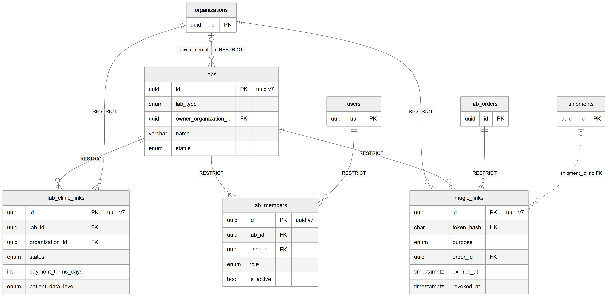
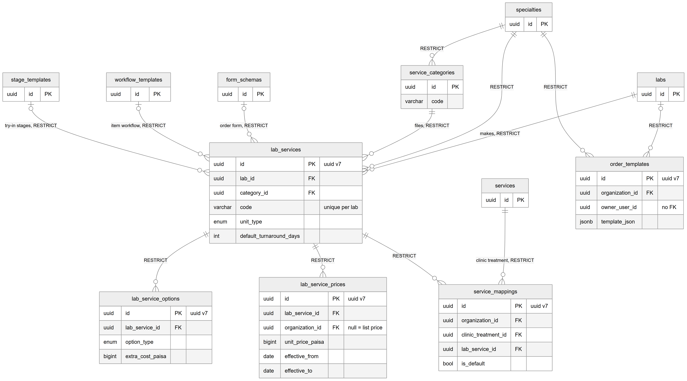
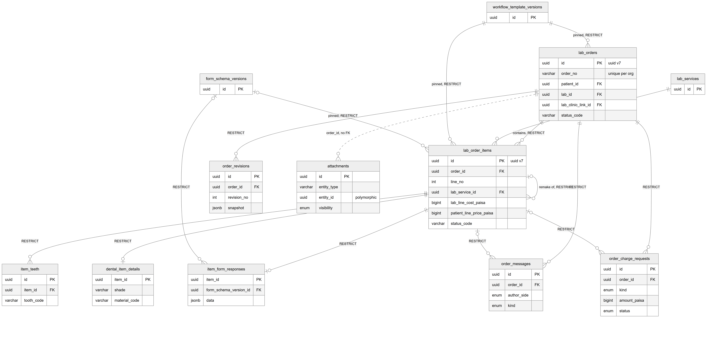
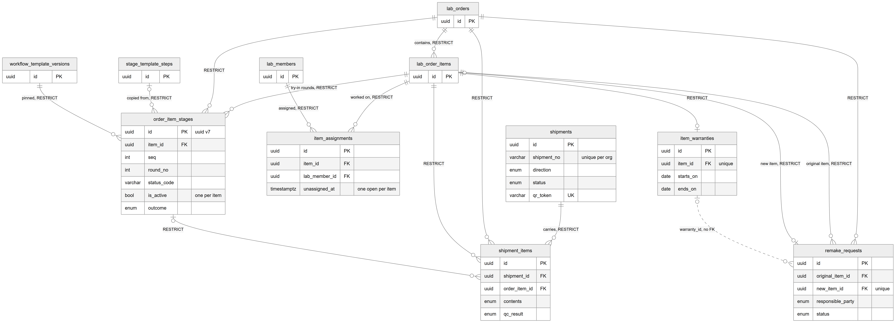
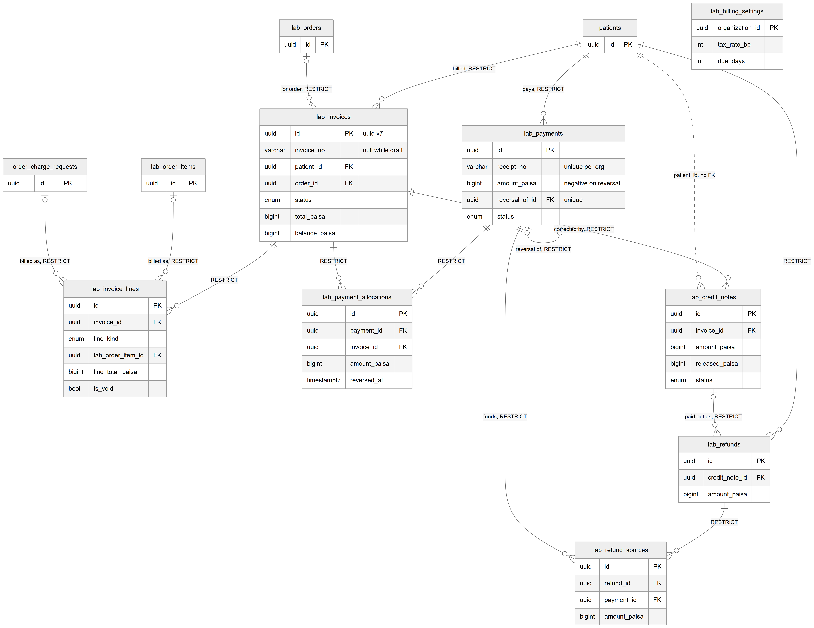
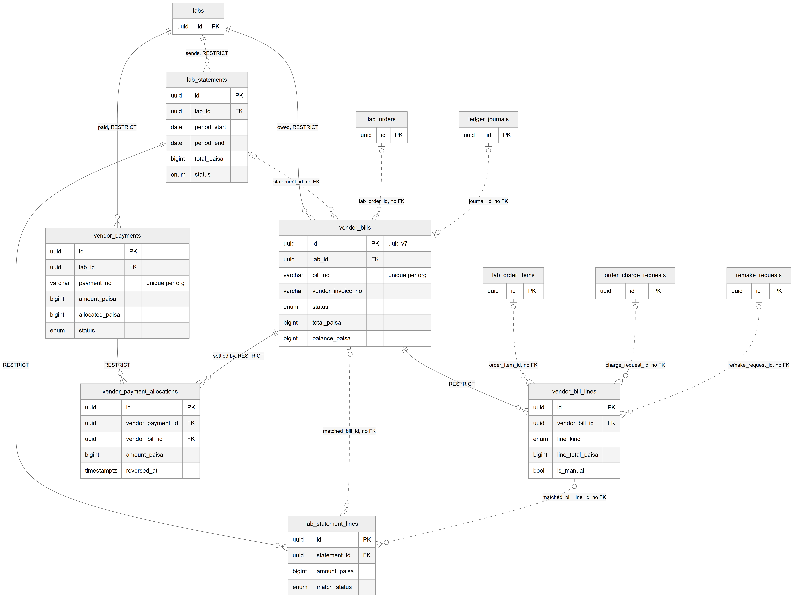

# Chapter 25 — Labs

This chapter describes the data model of dental-lab work: the lab directory and how clinics connect to labs, the lab's service catalog and prices, lab orders and their items, production (try-in stages, technicians, shipments, remakes, warranties), and the money on both sides: what the patient pays the clinic for lab work, and what the clinic owes the lab. It is for the product owner who needs to know how the roughly fifty lab tables fit together. "Lab" here always means a dental laboratory that makes crowns, bridges and dentures, not a diagnostic test lab. The entity catalog (`backend/docs/data-model/ENTITY_CATALOG.md`) remains the field-level reference.

## 25.1 Three ideas that run through every lab table

**A lab is not a tenant.** A clinic is an organization (the tenant). An external lab works for many clinics, so `labs` has no organization column. A clinic connects to a lab through a **lab link** (`lab_clinic_links`). Lab users are **lab members**: they have no clinic membership at all, so no clinic query can return their data. An internal lab, run by one clinic, records its owner in `owner_organization_id`.

**Snapshots and versions.** A lab order item copies the service name, options and prices when the order is submitted, and pins the exact form version and workflow version it runs on. Later catalog or workflow changes never alter work already ordered. Changes after submit become a new order revision, never an overwrite.

**UUID version 7 keys.** Every lab table, and the workflow engine, notification and general-ledger tables, uses a primary key generated by the database function `uuid_generate_v7()`, installed at start-up and by the hand-written migration `1792490000000-lab-management-foundation`. A version 7 UUID is still a normal 128-bit `uuid`, but its first 48 bits are the creation time in milliseconds. Ids therefore sort roughly by creation time, and indexes on append-heavy tables stay compact because new keys land at the end of the index instead of at random places. The remaining bits are still random. Older modules use random version 4 UUIDs.

**Money convention.** All lab money is `bigint` paisa. Tax rates are basis points (`tax_rate_bp`, `tax_bp`).

**Status.** The lab module is [Implemented] end to end: clinic screens (labs, lab price list, order templates, lab orders, lab billing, lab payables) and the lab portal for lab members. Exceptions are labelled where they occur.

## 25.2 Directory, links, members and magic links

*Figure 25.1 — Labs, the clinic-to-lab link, lab members and magic links.*

The figure shows `labs` with solid lines to `lab_clinic_links`, `lab_members` and `magic_links`, all RESTRICT. `organizations` connects to `labs` ("owns internal lab, RESTRICT"), to `lab_clinic_links` and to `magic_links` (RESTRICT). `users` connects to `lab_members` (RESTRICT), and `lab_orders` connects to `magic_links` (RESTRICT). A dotted line from `shipments` to `magic_links` is labelled "shipment_id, no FK". All four main boxes note UUID version 7 keys, and `token_hash` on `magic_links` is marked unique.

### `labs` — the lab directory

One row is one dental lab. `lab_type` is external or internal; `status` is active or suspended. Contact columns (`phone`, `whatsapp_phone`, `email`, `city`, `address`) hold the lab's business contact. Constraint that matters: `chk_labs_owner` requires `owner_organization_id` to be set exactly when the lab is internal.

### `lab_clinic_links` — a clinic working with a lab

One row connects one organization to one lab. `status` is invited, active or suspended. `payment_terms_days` (0–365, default 30) sets the clinic's payment terms. `patient_data_level` decides how much patient identity the lab sees: `full_name` or `code_only`. `activated_at` records the first activation. Status changes go through one service and are logged in `status_history`. Constraint that matters: one link per lab and organization.

### `lab_members` — people who work at a lab

One row makes a user a member of a lab, with `role` lab_admin or lab_technician, and `is_active` as a soft delete. Lab-side access is resolved from these rows only. Constraint that matters: one membership per lab and user.

### `magic_links` — no-login links for a lab

A magic link lets a lab view or update one order without logging in. The token itself is never stored: the table keeps only `token_hash` (a SHA-256 hash, unique) and a random `nonce` from which the server can re-derive the token at send time. Key columns: `purpose` (lab_view_order, lab_update_order or receive_shipment), `lab_id`, `order_id`, `delivery` (sent as a notification or copied by the user), `expires_at`, `max_uses` with `used_count`, `last_used_at`, `last_viewed_at`, and the revocation columns `revoked_at`, `revoked_reason` and `revoked_by`. Constraint that matters: `chk_magic_links_uses` keeps `used_count` within `max_uses`.

**Status of shipment links:** [Not implemented]. The `receive_shipment` purpose and the `shipment_id` column exist, but no code creates such links; clinics receive shipments by scanning the shipment's own QR token. The column comment says the foreign key would be added "until that table exists here"; the `shipments` table now exists but the foreign key was never added.

## 25.3 Lab catalog

*Figure 25.2 — Lab services, options, prices, categories, mappings to clinic services and order templates.*

The figure shows `lab_services` at the centre. Solid RESTRICT lines run into it from `labs` ("makes"), `specialties`, `service_categories` ("files"), `form_schemas` ("order form"), `workflow_templates` ("item workflow") and `stage_templates` ("try-in stages"). `specialties` also connects to `service_categories` and to `order_templates`. `lab_services` connects down to `lab_service_options`, `lab_service_prices` and `service_mappings`. `services` (the clinic's billing catalog) connects to `service_mappings` with "clinic treatment, RESTRICT". `labs` connects to `order_templates`. Notes mark `lab_services.code` as "unique per lab", `lab_service_prices.organization_id` as "null = list price", and `order_templates.owner_user_id` as "no FK".

### `service_categories` — shared categories

A platform-level grouping of lab services within a specialty, such as CROWN, BRIDGE or DENTURE. Every lab files its services under the same categories, so clinics can compare labs like for like. Unique per specialty and code.

### `lab_services` — what a lab makes

One row is one product of one lab, for example a zirconia crown. It has no organization column; clinics see it through their lab link. Key columns: `code` (upper-case, unique per lab), `name`, `unit_type` (per_tooth, per_unit, per_arch or per_case), `default_turnaround_days` (0–365) and `is_active` (archived services are hidden from new orders; old orders keep them). Three optional links point at the workflow engine: the order form the doctor fills (`form_schema_id`), the item workflow (`workflow_template_id`) and the try-in stage template (`stage_template_id`).

### `lab_service_options` — materials and variants

A material or variant of a service, such as "Emax" on a crown, with `extra_cost_paisa` (not negative) added to the resolved price. Unique per service and code.

### `lab_service_prices` — price windows

One row is a price for a service over a date window (`effective_from` to `effective_to`, inclusive; an empty end means open-ended). If `organization_id` is empty, it is the lab's list price; if set, it is a negotiated price for that clinic, which wins over the list price. Columns include `unit_price_paisa`, `rush_surcharge_paisa` and `currency` (default PKR). A price entered by mistake is voided (`voided_at`, `void_reason`), not deleted.

Constraint that matters: `excl_lab_service_prices_overlap`, an EXCLUDE constraint (using `btree_gist`), forbids two non-voided windows for the same service and clinic (or the same list price) from overlapping.

### `service_mappings` — which lab service makes which clinic treatment

One row says that a lab service fulfils one of the clinic's billable treatments. The clinic treatment is a row of the billing catalog `services`, held in a column named `clinic_treatment_id`. Constraints that matter:
- One row per organization, treatment and lab service.
- At most one active default lab service per treatment (partial unique index).
- An active lab service can be mapped to only one treatment per organization (partial unique index).

### `order_templates` — saved orders

A doctor's saved starting point for an order ("my usual zirconia crown"). `owner_user_id` empty means shared with every doctor in the clinic; `lab_id` empty means the doctor picks the lab when ordering. `template_json` holds the order body; `use_count` and `last_used_at` track use.

## 25.4 Lab orders

*Figure 25.3 — Lab orders, items and their teeth, details, form answers, messages, revisions, charge requests and attachments.*

The figure shows `lab_orders` connected to `lab_order_items` ("contains, RESTRICT"). `lab_order_items` has a loop to itself labelled "remake of, RESTRICT". `lab_services` connects to `lab_order_items`; `workflow_template_versions` connects to both `lab_orders` and `lab_order_items` ("pinned"); `form_schema_versions` connects to `lab_order_items` ("pinned") and to `item_form_responses`. From `lab_order_items`, lines run to `item_teeth` (many), `dental_item_details` (one-to-one) and `item_form_responses` (one-to-one). `lab_orders` connects to `order_messages`, `order_revisions` and `order_charge_requests`; items also connect optionally to messages and charge requests. A dotted line from `lab_orders` to `attachments` is labelled "order_id, no FK". All lines are RESTRICT.

### `lab_orders` — a lab case

One row is one case: a container of items for one patient, one doctor and one lab, sent from one location. Key columns: `order_no` (for example LAB-0001, assigned at submit from the organization's number sequence), `status_code` (a state of the order workflow version pinned at creation, which never changes), `priority` (normal or urgent), `requested_on` and `lab_expected_on`, the time stamps `submitted_at`, `accepted_at`, `completed_at` and `cancelled_at`, `current_revision_no` (0 for drafts, 1 at submit, +1 per revision) and `idempotency_key`. Optional logical links point at the appointment, the patient's treatment record and the order template the draft started from.

Constraints that matter: `order_no` is unique per organization; the idempotency key is unique per organization, so repeating a create request returns the same draft.

### `lab_order_items` — one piece of work

One row is one piece of work in an order, such as a crown or a bridge, numbered by `line_no` (unique per order). Key columns:
- Snapshots frozen at submit: `service_code_snap`, `service_name_snap`, `unit_type`, `options_snap`.
- Prices frozen at submit: `lab_unit_cost_paisa`, `lab_line_cost_paisa` (what the lab charges the clinic), `patient_unit_price_paisa`, `patient_line_price_paisa` (what the clinic charges the patient), `priced_on`, `currency`.
- Draft inputs: `lab_service_id`, `option_ids`, `rush`, `quantity` (above zero), `clinic_treatment_id`.
- Engine: the pinned `form_schema_version_id` and `workflow_template_version_id`, the copied `stage_template_id`, `status_code` (empty while the order is a draft) and `current_stage_seq`.
- `remake_of_item_id`: set when this item remakes an earlier one.

Only a revision or an approved charge request may change the frozen columns. CHECKs keep all paisa columns non-negative and the quantity above zero.

### Item parts: `item_teeth`, `dental_item_details`, `item_form_responses`

- `item_teeth`: one row per tooth of an item; a three-unit bridge has three rows. `numbering_system` is FDI (default), UNIVERSAL or PALMER; `tooth_code` is unique per item; `surfaces` lists tooth surfaces. Rows are written at submit from the form answers, which remain the source of truth.
- `dental_item_details`: one row per item (its primary key is the item id) with typed columns copied from the form answers at submit, such as shade, material and implant details, so reports read columns instead of JSON.
- `item_form_responses`: one row per item (primary key = item id) with the form answers in `data` (JSON) against the pinned form version. Drafts store whatever was typed; `validated_at` is set when submit validates them.

### `order_messages`, `order_revisions`, `order_charge_requests`, `attachments`

- `order_messages`: the clinic-to-lab conversation on an order or one item. `author_side` is clinic or lab; `kind` is note, clarification_request or reply; a clarification is resolved by the clinic's reply (`resolved_at`).
- `order_revisions`: what the lab was asked to make, as of one revision. Revision 1 is written at submit; each later change adds a revision with a full `snapshot` and a `reason`. The lab acknowledges each one (`lab_acknowledged_at`). Unique per order and revision number.
- `order_charge_requests`: an extra charge the lab asks for after submit (`kind` rush, material, shipping or other) with `amount_paisa` above zero, a required `reason`, and `status` pending, approved or rejected. An approved item-level request is added to the item's lab line cost.
- `attachments`: a file on an order or item. The file itself is in private storage; the row keeps `storage_key`, `file_name`, `mime_type`, `size_bytes` and `sha256`. `entity_type` is limited by a CHECK to `lab_order` or `lab_order_item`. `visibility` is internal, lab_shared or patient_shared (the lab sees only lab_shared), and `uploaded_side` is clinic or lab. Downloads use short-lived signed URLs.

## 25.5 Production

*Figure 25.4 — Try-in stages, technician assignments, shipments, remakes and warranties.*

The figure shows `lab_orders` and `lab_order_items` at the top. `lab_order_items` connects to `order_item_stages` ("try-in rounds"), `item_assignments` ("worked on"), `shipment_items`, `remake_requests` twice ("original item" many, and "new item" one-to-one) and `item_warranties` (one-to-one). `lab_orders` also connects to `order_item_stages`, `shipment_items` and `remake_requests`. `stage_template_steps` connects to `order_item_stages` ("copied from"), `workflow_template_versions` connects to it ("pinned"), and `lab_members` connects to `item_assignments` ("assigned"). `shipments` connects to `shipment_items` ("carries"), and `order_item_stages` connects optionally to `shipment_items`. A dotted line from `item_warranties` to `remake_requests` is labelled "warranty_id, no FK". All solid lines are RESTRICT. Notes mark `is_active` "one per item" on stages and `unassigned_at` "one open per item" on assignments.

### `order_item_stages` — try-in rounds

One row is one round of one stage of an item, for example "metal try-in, round 2". Rows are created from the item's stage template when the lab accepts the order. A correction closes the round and adds a new row with `round_no + 1`; rounds are never overwritten. Key columns: `seq`, `round_no`, copied `code_snap` and `name_snap`, `is_final` (the last stage, finished work rather than a try-in), `requires_patient_visit`, `status_code`, `lab_expected_on`, an optional try-in `appointment_id`, `outcome` (approved, correction or rejected), notes, and who decided.

Constraints that matter: unique per item, sequence and round; at most one active stage per item (partial unique index); round and sequence above zero.

### `item_assignments` — which technician works on an item

One row assigns a lab member to an item. Reassigning closes the open row (`unassigned_at`) and adds a new one. Constraint: at most one open assignment per item (partial unique index).

### `shipments` and `shipment_items` — parcels between clinic and lab

A shipment is one parcel in either direction (`direction` to_lab or to_clinic) between one clinic and one lab; it can carry items of several orders. `shipment_no` (for example SHP-0001) is unique per organization. `status` is dispatched, partially_received, received or lost. `qr_token` is unique platform-wide and printed on the slip; scanning it opens the receive screen. A shipment item is one item in a parcel, with `contents` (impression, model, framework, tryin, final or other), `quantity`, `received_qty` (CHECK: not above quantity), `condition`, `qc_result` and `qc_notes`. An item appears at most once per shipment.

### `remake_requests` — asking for work to be redone

One row asks to remake an item. `reason_code` is shade, fit, fracture, design, damaged or other. `responsible_party` (lab, clinic, patient or undetermined) decides pricing: if the lab is at fault, both the lab charge and the patient charge are zero. `status` is requested, agreed, disputed or closed. If agreed, a new item is created in the same order and linked through `new_item_id`. An active warranty marks the request as a warranty claim automatically.

Constraints that matter: `new_item_id` is unique; at most one open (requested or disputed) request per original item.

### `item_warranties` — warranty after delivery

One row per item (the item id is unique) with `starts_on`, `ends_on` (CHECK: not before the start), `terms`, and void columns. The warranty starts when the item is delivered.

## 25.6 Lab finance: what the patient owes the clinic

*Figure 25.5 — Patient lab invoices, lines, payments, allocations, credit notes, refunds and settings.*

The figure shows `patients` with solid lines to `lab_invoices` ("billed"), `lab_payments` ("pays") and `lab_refunds`, and a dotted line to `lab_credit_notes` (patient_id, no FK). `lab_orders` connects to `lab_invoices` ("for order"). `lab_invoices` connects to `lab_invoice_lines`, `lab_payment_allocations` and `lab_credit_notes` ("corrected by"). `lab_order_items` and `order_charge_requests` connect to `lab_invoice_lines` ("billed as"). `lab_payments` has a one-to-one loop to itself ("reversal of") and connects to `lab_payment_allocations` and `lab_refund_sources` ("funds"). `lab_credit_notes` connects to `lab_refunds` ("paid out as"), and `lab_refunds` connects to `lab_refund_sources`. `lab_billing_settings` stands alone with its key `organization_id`. All solid lines are RESTRICT.

This side mirrors the clinic billing design (the Billing core chapter, Chapter 20) but with its own tables and in paisa. The UI calls these **patient lab invoices**.

- **`lab_invoices`.** A patient invoice for lab work, optionally for one order. A `draft` is an estimate: it has no number, can be edited and owes nothing. Issuing gives it an `invoice_no` (unique per organization) and freezes the lines. `status` is draft, issued, partially_paid, paid or void. Cached totals (`subtotal_paisa`, `discount_paisa`, `tax_paisa`, `total_paisa`, `credited_paisa`, `paid_paisa`, `balance_paisa`) are recomputed from source rows by one service. CHECK `chk_lab_invoices_math`: total = subtotal − discount + tax, and balance, paid and credited are not negative.
- **`lab_invoice_lines`.** One billed thing: `line_kind` lab_item, lab_charge or manual. CHECK `chk_lab_invoice_lines_math` enforces quantity × unit − discount + tax = line total. Two partial unique indexes make sure a lab order item or charge request sits on at most one non-void line, so it is never billed twice; voiding the invoice copies `is_void` onto the lines and frees them. Lines also carry a commission snapshot (`doctor_id`, `performing_assignment_id`, `commission_plan_id`, rate and fixed amount), all without foreign keys; the commission ledger links to these lines (the Compensation chapter, Chapter 22).
- **`lab_payments`.** Money received from a patient for lab work. It belongs to the patient; the unallocated, unrefunded part is the patient's advance. A wrong payment is never deleted: a reversal row with a negative amount points at it through `reversal_of_id` (unique). `received_on` is the location-local day. `receipt_no` and `idempotency_key` are each unique per organization. CHECK `chk_lab_payments_amounts` ties the sign of the amount to whether it is a reversal and keeps allocated + refunded within the amount.
- **`lab_payment_allocations`.** "This much of payment P settles invoice I", always positive. A reversal or credit note stops it counting by setting `reversed_at` and `release_reason`; rows are not deleted.
- **`lab_credit_notes`.** Corrects an issued invoice downwards. Money the patient already paid above the new total is released back to advance (`released_paisa`) and may then be refunded (`refunded_paisa`). `credit_note_no` is unique per organization. CHECK: refunded ≤ released ≤ amount.
- **`lab_refunds`** and **`lab_refund_sources`.** A refund pays money back out of advance; refund sources say which payments funded it. `credit_note_id` set means the refund pays out a credit note. `refund_no` and `idempotency_key` are unique per organization.
- **`lab_billing_settings`.** One row per organization (primary key = organization id): `tax_rate_bp` (0–10,000, default 0 until the accountant confirms) and `due_days`. A missing row means defaults.

## 25.7 Lab finance: what the clinic owes the lab

*Figure 25.6 — Vendor bills, vendor payments, allocations and lab statements.*

The figure shows `labs` with solid lines to `vendor_bills` ("owed"), `vendor_payments` ("paid") and `lab_statements` ("sends"). `vendor_bills` connects to `vendor_bill_lines` and `vendor_payment_allocations` ("settled by"); `vendor_payments` connects to `vendor_payment_allocations`; `lab_statements` connects to `lab_statement_lines`. Dotted lines (no foreign key) run from `lab_statements` to `vendor_bills` (statement_id), from `vendor_bills` and `vendor_bill_lines` to `lab_statement_lines` (matched bill and matched bill line), from `lab_orders` to `vendor_bills` (lab_order_id), from `ledger_journals` to `vendor_bills` (journal_id), and from `lab_order_items`, `order_charge_requests` and `remake_requests` to `vendor_bill_lines`. All solid lines are RESTRICT.

- **`vendor_bills`.** What the clinic owes a lab. One draft per lab order is created when the lab accepts the order, from the items' frozen lab costs (a partial unique index allows only one draft per order). Nothing reaches the general ledger until approval, which posts a Lab Cost / Lab Payable journal (`journal_id`). `status` is draft, approved, partially_paid, paid or void. `bill_no` is unique per organization; the lab's own invoice number (`vendor_invoice_no`), entered at approval, is unique per organization and lab among non-void bills. CHECK: total = subtotal + tax, and paid and balance are not negative. Bills are voided, never deleted.
- **`vendor_bill_lines`.** One cost on a bill: `line_kind` service, rush, shipping, material, remake or other. Lines of a draft follow the order and are re-synced; after approval they are frozen. `is_manual` marks lines added by hand. Links to the order, item, charge request and remake request have no foreign keys.
- **`vendor_payments`** and **`vendor_payment_allocations`.** Money the clinic paid a lab, split over approved bills by allocations. An unallocated rest is an advance to the lab. `payment_no` is unique per organization. A mistake is reversed (`status` reversed, `reversed_at`), with a mirror journal; allocations are reversed with `reversed_at`, never deleted.
- **`lab_statements`** and **`lab_statement_lines`.** A lab's monthly statement, typed in by the clinic and reconciled against the bills of the period. `status` is uploaded, reconciling, reconciled or disputed. Each line has the lab's reference, date and amount, the clinic's `system_amount_paisa` for the same reference, and `match_status` (matched, amount_mismatch, missing_in_system or missing_in_statement).

**Status of statement files:** [Not implemented]. `lab_statements.attachment_id` exists, but the column comment says there is no storage for statement files yet, because attachments are order-scoped.

## 25.8 Relationships explained

Every foreign key in the lab tables uses ON DELETE RESTRICT: no lab record can be deleted while anything refers to it. Records are voided, reversed, archived or switched off instead.

Directory, links and magic links:
- An internal lab belongs to zero or one owner organization; an organization can own many labs.
- Each lab link belongs to exactly one lab and one organization; one link per pair.
- Each lab member belongs to exactly one lab and one user; one membership per pair.
- Each magic link belongs to exactly one organization, one lab and one lab order; an order can have many links.

Catalog:
- Each lab service belongs to exactly one lab, one specialty and one service category, and optionally to one form schema, one workflow template and one stage template.
- Each service category belongs to exactly one specialty.
- Each option and each price row belongs to exactly one lab service. A price row belongs to zero or one organization (empty = list price).
- Each service mapping belongs to exactly one organization, one clinic service (`services`) and one lab service.
- Each order template belongs to exactly one organization and one specialty, and optionally to one lab.

Orders:
- Each lab order belongs to exactly one organization, location, specialty, patient, lab, lab link and pinned workflow version, and optionally to one doctor (employee).
- Each order item belongs to exactly one order, one lab service and one pinned workflow version, and optionally to one form version and to one earlier item it remakes.
- Each tooth row belongs to exactly one item; each item has at most one details row and at most one form-response row (both keyed by the item id). A form response may point at one form version.
- Each message, revision and charge request belongs to exactly one order; messages and charge requests may also point at one item.

Production:
- Each stage row belongs to exactly one order, one item and one pinned workflow version, and optionally to one stage-template step.
- Each assignment belongs to exactly one item and one lab member.
- Each shipment item belongs to exactly one shipment, one order and one item, and optionally one stage.
- Each remake request belongs to exactly one order and one original item, and to zero or one new item (one-to-one).
- Each warranty belongs to exactly one item (one-to-one through the unique item id).

Finance:
- Each patient lab invoice belongs to exactly one patient and optionally one order; each line belongs to exactly one invoice and optionally one item or one charge request.
- Each lab payment belongs to exactly one patient and may reverse exactly one earlier payment (one-to-one).
- Each allocation belongs to exactly one payment and one invoice. Each credit note belongs to exactly one invoice.
- Each lab refund belongs to exactly one patient and optionally one credit note; each refund source belongs to exactly one refund and one payment.
- Each vendor bill and vendor payment belongs to exactly one lab; each bill line belongs to exactly one bill; each vendor allocation belongs to exactly one vendor payment and one bill.
- Each lab statement belongs to exactly one lab; each statement line belongs to exactly one statement.

Logical relationships (no foreign key):
- `magic_links.shipment_id` → `shipments` (unused, see 25.2).
- `order_templates.owner_user_id` → `users`.
- `attachments.entity_id` is polymorphic (order or item); `attachments.order_id` → `lab_orders`.
- `lab_order_items.clinic_treatment_id` → `services`, `option_ids` → `lab_service_options` (array), `lab_price_id` → `lab_service_prices`, `stage_template_id` → `stage_templates`. Note that `service_mappings.clinic_treatment_id` has a foreign key to the same `services` table, but the item's copy does not.
- `lab_orders.appointment_id` → `appointments`, `treatment_id` → `treatments`, `order_template_id` → `order_templates`.
- `order_messages.author_user_id` → `users`.
- `item_assignments.lab_id`, `order_item_stages.lab_id`, `remake_requests.lab_id`, `shipments.lab_id` → `labs`. These copies let the lab portal filter by lab quickly.
- `order_item_stages.appointment_id` → `appointments`; `remake_requests.warranty_id` → `item_warranties`.
- `lab_credit_notes.patient_id` → `patients`.
- `lab_invoice_lines.clinic_treatment_id` → `services`, `doctor_id` → `employees`, `performing_assignment_id` → `employee_org_location_assignments`, `commission_plan_id` → `compensation_plans`.
- `vendor_bills.lab_order_id` → `lab_orders`, `statement_id` → `lab_statements`, `journal_id` → `ledger_journals`.
- `vendor_bill_lines.lab_order_id`, `order_item_id`, `charge_request_id`, `remake_request_id` → the matching lab tables.
- `lab_statement_lines.matched_bill_id` → `vendor_bills` and `matched_bill_line_id` → `vendor_bill_lines`.
- `lab_statements.attachment_id` → `attachments` (unused).
- Actor columns (`created_by`, `updated_by`, `decided_by`, `received_by` and others) hold a user id.

## 25.9 Tenant scope

- **Global, lab-side:** `labs` (internal labs carry an owner organization), `lab_members`, `lab_services`, `lab_service_options`. These are scoped by `lab_id`, not by organization.
- **Global, platform catalog:** `service_categories`.
- **Organization and location:** `lab_orders`, `lab_invoices`, `lab_payments`, `lab_credit_notes`, `lab_refunds`, `vendor_bills`, `vendor_payments`.
- **Organization only:** every other lab table, including items, item parts, messages, revisions, charge requests, attachments, all production tables, invoice lines, allocations, refund sources, settings, bill lines, vendor allocations, statements and statement lines. `lab_service_prices` is organization-scoped when a negotiated price, global when a list price.
- Only `lab_clinic_links`, `magic_links`, `lab_service_prices`, `service_mappings`, `order_templates` and `lab_orders` have foreign keys on their tenant columns. Everywhere else the organization id is stored without a constraint and the application enforces isolation.
