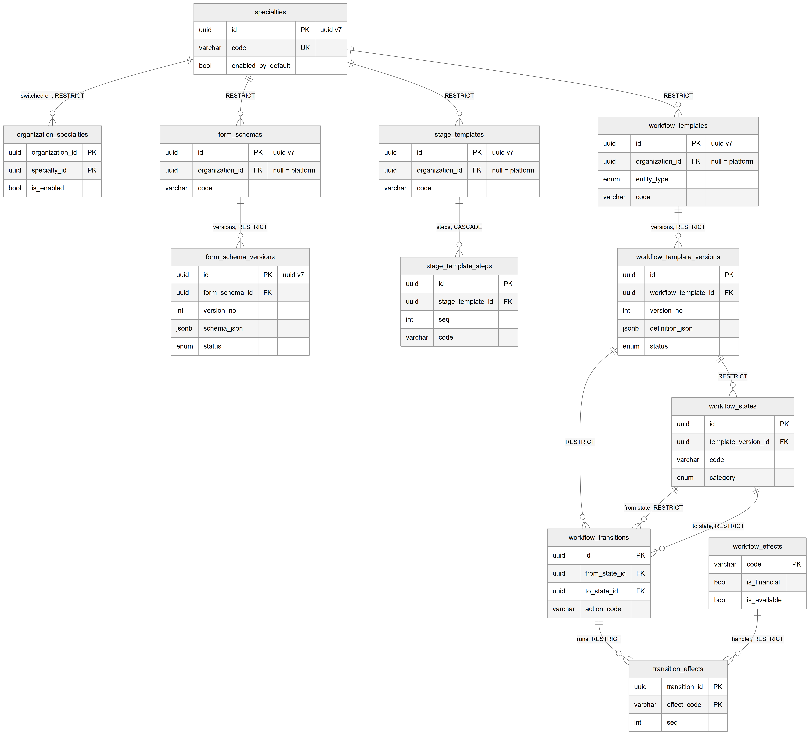
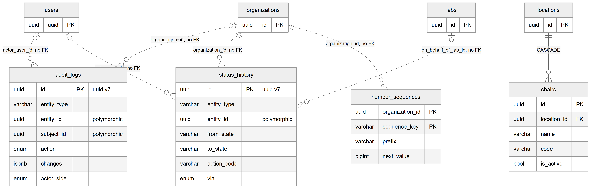

# Chapter 26 — Workflow engine and common tables

This chapter describes two groups of tables. The first is the workflow engine: twelve tables that store specialties, versioned forms, try-in stage templates and versioned state machines, which the lab module runs on. The second is the shared infrastructure in `backend/src/common/`: the generic audit log, the status history and the per-organization number counters, plus the unused `chairs` table. It is written for the product owner who needs to know which behaviour is configured as data rather than code, and which history can never be changed. The entity catalog (`backend/docs/data-model/ENTITY_CATALOG.md`) remains the field-level reference.

## 26.1 The workflow engine in one paragraph

A **specialty** (for example DENTAL) is the root. Under it, the Platform keeps **form schemas** (what the doctor fills in when ordering a lab item), **stage templates** (the try-in rounds a piece of work goes through) and **workflow templates** (state machines for lab orders, lab order items and stages). Forms and workflows are versioned: a version is a draft while it is edited, becomes published and then frozen, and is finally retired. Every lab order and item pins the exact version it started on, so editing a form or workflow never breaks work in progress. When a workflow version is published, its JSON definition is turned into rows of states, transitions and transition effects, which the runtime reads. Effects are code handlers listed in a registry; configuration can only choose among them, never add new code.

**Status:** [Implemented]. The super admin edits forms, workflows and stage templates in Config Studio (sidebar entries "Form schemas", "Workflows" and "Stage templates", super admin only). The lab order and production services run on the published versions.

**Keys.** All engine tables with an `id` use UUID version 7 keys (`uuid_generate_v7()`); the Labs chapter (Chapter 25) explains them. `organization_specialties`, `transition_effects` and `workflow_effects` have natural keys supplied by the application.

*Figure 26.1 — Specialties, form schemas and versions, stage templates and steps, workflow templates, versions, states, transitions and effects.*

The figure shows `specialties` at the top with four lines down: to `organization_specialties` ("switched on"), `form_schemas`, `stage_templates` and `workflow_templates`, all RESTRICT. `form_schemas` connects to `form_schema_versions` ("versions, RESTRICT"). `stage_templates` connects to `stage_template_steps` ("steps, CASCADE"). `workflow_templates` connects to `workflow_template_versions` ("versions, RESTRICT"). `workflow_template_versions` connects to `workflow_states` and to `workflow_transitions`. `workflow_states` connects twice to `workflow_transitions`, labelled "from state" and "to state". `workflow_transitions` and `workflow_effects` both connect to `transition_effects` ("runs" and "handler"). All lines except the stage steps are RESTRICT. The template boxes mark `organization_id` as "null = platform".

## 26.2 Engine tables

### `specialties` and `organization_specialties`

`specialties` is a platform catalog of clinical specialties, each with a unique upper-case `code`, a `name`, `is_active`, and `enabled_by_default` (new organizations get it switched on; DENTAL does). `organization_specialties` records which specialties one organization works in, with `is_enabled`. Its primary key is the pair (organization, specialty). Rows are created lazily from `enabled_by_default` the first time an organization is read.

### `form_schemas` and `form_schema_versions` — versioned order forms

A form schema is the stable identity of a form, such as CROWN or BRIDGE, within a specialty. If `organization_id` is empty, it is the platform default; an organization's own schema with the same code overrides the default for that organization. Partial unique indexes allow one platform schema and one per organization for each specialty and code.

A form schema version holds the content: `schema_json` (the field definitions), `ui_json` (layout, such as tooth-chart settings), `promotions` (which answers are copied into typed columns, for example into `dental_item_details`) and `status` (draft, published or retired) with `published_at` and `retired_at`.

Constraints that matter:
- `version_no` is unique per form and above zero.
- At most one draft and at most one published version per form (two partial unique indexes).
- `chk_form_schema_versions_published_at`: a draft has no publish date, and every non-draft has one.

**Correction to the catalog.** The entity's code comment, repeated in the catalog, says a database trigger makes published versions immutable. No such trigger exists. The rule is enforced by the form schemas service, which allows content changes only on drafts.

### `stage_templates` and `stage_template_steps` — try-in rounds

A stage template lists the try-in rounds a kind of work goes through, for example metal, then bisque, then final for a porcelain-fused-to-metal crown. It follows the same platform-or-organization pattern as forms. Each step has a `seq` (1-based, unique per template), a `code` (unique per template), a `name`, `requires_patient_visit`, `requires_doctor_approval` and `default_lab_days` (0–365). Lab orders copy step names into their own stage rows, so editing a template never changes work in progress.

### `workflow_templates`, `workflow_template_versions`, `workflow_states`, `workflow_transitions`

A workflow template is a state machine for one kind of record: `entity_type` is order, item or stage. It follows the platform-or-organization pattern. A workflow template version holds the draft definition as JSON (`definition_json`) and a `status` of draft, published or retired; as with forms, at most one draft and one published version exist per template, and `version_no` is unique and above zero. Published versions never change; this is enforced by the service, not the database.

Publishing a version writes its rows once:
- `workflow_states`: one row per state, with a `code` unique per version, a `name`, a `category` (initial, active, waiting, done or cancelled), `is_terminal` and `sort_order`.
- `workflow_transitions`: one row per allowed move from one state to another under an `action_code`, unique per version, from-state, action and to-state. `allowed_sides` and `allowed_roles` say who may perform it (an empty role list means any role of an allowed side), `required_fields` lists data that must be present and `requires_reason` forces a reason.

### `workflow_effects` and `transition_effects`

`workflow_effects` is a registry of effect handlers that exist in code, keyed by `code`. It is synced from the in-memory registry on every start. `is_financial` marks effects that validate money themselves; `is_available` is false when a handler was removed from code but old versions still mention it. `transition_effects` lists which effects a transition runs, in `seq` order (unique per transition), with optional JSON `params`; its primary key is the pair (transition, effect code). Effects run inside the transition's transaction.

## 26.3 Common tables

*Figure 26.2 — The audit log, status history, number sequences and the unused chairs table.*

The figure shows four main boxes. `audit_logs` receives dotted lines from `organizations` (organization_id) and `users` (actor_user_id). `status_history` receives dotted lines from `organizations`, `users` and `labs` (on_behalf_of_lab_id). `number_sequences` receives a dotted line from `organizations`. All dotted lines mean "no FK". `chairs` is the only box with a solid line, from `locations`, labelled CASCADE. `audit_logs` and `status_history` both show `entity_type` and an `entity_id` marked "polymorphic".

### `audit_logs` — the generic audit trail

**Status:** [Implemented]. Used by about eighteen modules, including patients, appointments, staff, payroll, organizations, the engine and every lab module.

One row records who changed what. `entity_type` and `entity_id` name the changed record. `subject_id` names the record whose history this row joins when that is different, for example a patient for a change to the patient's vitals. `action` is create, update, void, delete, export or view_sensitive. `changes` holds `{ before, after }` for the changed fields only. `actor_user_id` and `actor_side` (clinic, lab, platform or system) say who did it, and `ip` and `request_id` record where it came from. `organization_id` is empty for platform-level records, such as a lab edited by a super admin.

**Append-only trigger.** The hand-written migration `1792490000000-lab-management-foundation` installs `trg_audit_logs_append_only`, which calls `reject_append_only_mutation()` before any UPDATE or DELETE and raises an error. Rows can only be inserted.

### `status_history` — every status change

**Status:** [Implemented].

One row records one status change: `from_state` (empty for the creating transition), `to_state`, `action_code`, who did it (`actor_user_id`, `actor_side`), how (`via`: app, portal, magic_link, proxy or qr), an optional `reason` and `metadata`. `on_behalf_of_lab_id` is set when clinic staff updated something on the lab's behalf (`via = proxy`). States are free text, because workflow states are data, not code enums. The same migration installs `trg_status_history_append_only`, so rows cannot be updated or deleted.

### `number_sequences` — human-readable numbers per organization

**Status:** [Implemented].

One row is a gapless counter for one organization and one `sequence_key`, with a `prefix` and `next_value` (CHECK: above zero). The primary key is the pair (organization, sequence key), supplied by the application. It is only touched through the numbering service inside a transaction, which increments the counter in a single statement. It produces numbers such as LAB-0001 for lab orders and SHP-0001 for shipments, and also numbers patient lab invoices, lab receipts, credit notes, lab refunds, vendor bills and vendor payments. Clinic invoice, receipt and refund numbers use a different mechanism, `document_sequences` (the Billing ledgers chapter, Chapter 21).

### `chairs` — dental chairs

**Status:** [Not implemented]. Entity only.

The table would list the treatment chairs of a location: `name`, `code`, `description` and `is_active`. There is no module, service, controller or screen, and no module registers the entity, so the running application never creates the table in development. A production schema built with the command-line schema tools may contain it. An early link from appointments to chairs no longer exists.

## 26.4 Relationships explained

Engine:
- **Specialty → organization specialties, form schemas, stage templates, workflow templates.** Each belongs to exactly one specialty; a specialty in use cannot be deleted (RESTRICT).
- **Organization → organization specialties.** Deleting the organization deletes its specialty switches (CASCADE).
- **Organization → form schemas, stage templates, workflow templates.** Each belongs to zero or one organization (empty = platform default). An organization with its own definitions cannot be deleted (RESTRICT).
- **Form schema → versions.** Each version belongs to exactly one form; a form with versions cannot be deleted (RESTRICT).
- **Stage template → steps.** Each step belongs to exactly one template; deleting the template deletes its steps (CASCADE). Lab stage rows that point at a step block that delete in practice (RESTRICT from `order_item_stages`).
- **Workflow template → versions.** RESTRICT.
- **Workflow version → states and transitions.** Each belongs to exactly one version (RESTRICT).
- **State → transitions.** Each transition has exactly one from-state and one to-state (RESTRICT on both).
- **Transition → transition effects** and **effect → transition effects.** Each transition effect belongs to exactly one transition and one effect (RESTRICT on both).
- **Links from the lab tables.** Lab services point at form schemas, workflow templates and stage templates; lab orders, items and stages pin workflow versions; items and form responses pin form versions. All are RESTRICT (the Labs chapter, Chapter 25, lists them).

Common:
- **Location → chairs.** Each chair belongs to one location; deleting the location deletes its chairs (CASCADE).
- `audit_logs` and `status_history` have no foreign keys at all. `entity_id` and `subject_id` are polymorphic; `organization_id`, `actor_user_id` and `on_behalf_of_lab_id` are logical references. This is deliberate for an audit table: history must survive even if the record it describes is gone.
- `number_sequences.organization_id` has no foreign key.
- Actor columns in the engine (`created_by`, `updated_by`, `published_by`) hold a user id with no foreign key.

## 26.5 Tenant scope

- **Global, platform catalog:** `specialties`, `workflow_effects`.
- **Platform or organization:** `form_schemas`, `stage_templates`, `workflow_templates` (empty organization = platform default). Their child tables (`form_schema_versions`, `stage_template_steps`, `workflow_template_versions`, `workflow_states`, `workflow_transitions`, `transition_effects`) have no organization column and inherit the parent's scope.
- **Organization only:** `organization_specialties`, `audit_logs` (empty for platform records), `status_history`, `number_sequences`.
- **Location only:** `chairs` (the organization is reachable through `locations`).
