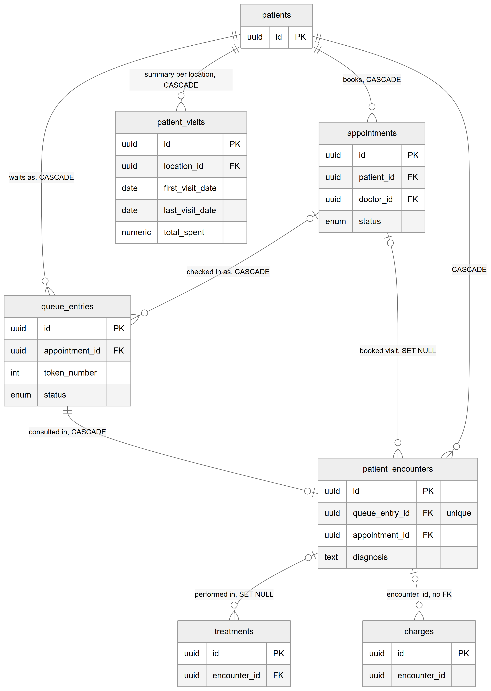
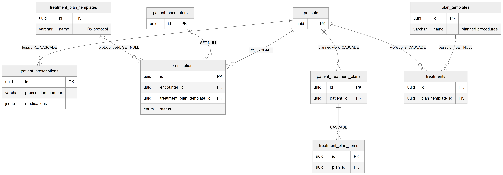

# Chapter 27 — Overlaps and ambiguities

This chapter collects the places where the Platform's data model is confusing, duplicated or weaker than it looks. It is written for the product owner, who will meet these questions when planning features, writing reports or reviewing a migration. Each item says what it is, why it matters, the risk, and a status label. The facts come from the entity catalog (`backend/docs/data-model/ENTITY_CATALOG.md`, sections 9 and 10) and were checked against the code; the other data-model chapters (Chapters 12 to 26) describe the tables themselves.

## 27.1 How to read this chapter

Each topic has the same four parts:
- **What it is.** The tables or columns involved.
- **Why it matters.** What goes wrong for a developer, a report writer or a user.
- **Risk.** Low, medium or high, with the reason.
- **Status.** One label. [Implemented] means both sides exist and work as designed; [Partial] means one side is incomplete; [Not implemented] means a planned link was never finished; [Unverified] means the code does not say which answer is right.

## 27.2 Two prescription tables

**What it is.** `prescriptions` (prescriptions module) is the current prescription record: draft and finalized states, medicines in their own table, change history, doctor signatures, templates and print layouts. `patient_prescriptions` (patients module) is the older, simpler record: one row with the medicines in a JSON array. The class comment of `prescriptions` says it "coexists with the legacy" table while consumers migrate.

**Why it matters.** The patient's Clinical tab shows both. The main card lists prescriptions from the new table, and a collapsible "Legacy quick-Rx history" section still reads the old table and still offers a form to add a legacy prescription. A report that counts prescriptions from only one table will be wrong.

**Risk.** Medium. Data is split, and new legacy rows can still be created.

**Status.** [Partial]. Migration to the new table is not finished; the legacy write path is still live.

## 27.3 Four "visit" concepts

*Figure 27.1 — Appointments, queue entries, encounters and the patient visit summary, with treatments and charges.*

The figure shows `patients` at the top, connected to `appointments` ("books"), `queue_entries` ("waits as"), `patient_encounters` and `patient_visits` ("summary per location"), all CASCADE. `appointments` connects optionally to `queue_entries` ("checked in as, CASCADE") and to `patient_encounters` ("booked visit, SET NULL"). `queue_entries` connects one-to-one to `patient_encounters` ("consulted in, CASCADE"). `patient_encounters` connects to `treatments` ("performed in, SET NULL") and, by a dotted line with no foreign key, to `charges` (encounter_id). `patient_visits` has no link to any of the other visit tables.

**What it is.**
- `appointments`: a booking for a future time with a doctor.
- `queue_entries`: a patient's place in one doctor's queue on one day. Created only at check-in or for a walk-in, never at booking.
- `patient_encounters`: the clinical record of one consultation, created when the doctor starts it. Exactly one per queue entry; it points at the appointment for booked visits and has none for walk-ins.
- `patient_visits`: a per-location summary for a patient (first and last visit date, total spent, preferred location).

**Why it matters.** "How many visits did we have?" has four possible answers. Appointments include no-shows and cancellations; queue entries include walk-ins and people who left; encounters are consultations that actually started. `patient_visits` gives no answer at all: in the code, the patients service only reads it (`GET /patients/:id/visits`), and nothing writes rows into it.

**Risk.** Medium. Reports and dashboards can disagree depending on which table they count. The visit summary will be empty for every patient.

**Status.** [Partial]. Appointments, queue entries and encounters are [Implemented]; `patient_visits` is read but never written.

## 27.4 Treatment-plan table families

*Figure 27.2 — The tables whose names suggest "plan" or "prescription", and what they really hold.*

The figure shows `patients` connected to `patient_prescriptions` ("legacy Rx"), `prescriptions` ("Rx"), `patient_treatment_plans` ("planned work") and `treatments` ("work done"), all CASCADE. `patient_treatment_plans` connects to `treatment_plan_items` (CASCADE). `plan_templates` connects to `treatments` ("based on, SET NULL"). `treatment_plan_templates` connects to `prescriptions` ("protocol used, SET NULL"), and `patient_encounters` connects to `prescriptions` (SET NULL). Notes on the template boxes say "Rx protocol" for `treatment_plan_templates` and "planned procedures" for `plan_templates`.

**What it is.**
- `patient_treatment_plans` with `treatment_plan_items`: planned work for a patient.
- `treatments`: work actually performed, optionally in an encounter.
- `plan_templates`: predefined treatment plans ("Root canal treatment" with its usual steps), copied into a patient's plan.
- `treatment_plan_templates`: despite the name, prescription protocols ("Root canal aftercare"), used by the prescription builder to pre-fill medicines and instructions.

**Why it matters.** The names invite mistakes. A developer asked to "add a step to the treatment plan template" could easily edit the prescription protocol table. The code comment on `plan_templates` itself warns against confusing the two.

**Risk.** Low for data, medium for development mistakes.

**Status.** [Implemented]. All four families work; the issue is naming. In prose the handbook uses **plan template** for `plan_templates` and calls `treatment_plan_templates` "prescription protocol templates".

## 27.5 Several audit tables

**What it is.** Change history lives in five places: `audit_logs` (generic, changed fields only), `status_history` (every status change of lab and workflow records), `billing_audit_logs` (billing's own log with full before and after snapshots), `prescription_history` (prescription changes) and `queue_events` (queue actions). The comment on `billing_audit_logs` says it exists because "the repo has no general audit module", which is no longer true.

**Why it matters.** "Who changed this invoice?" is answered by `billing_audit_logs`; "who changed this patient?" by `audit_logs`. A single audit screen or export must read all five.

**Risk.** Low. Each log is consistent within its area.

**Status.** [Implemented]. Consolidation is a design choice not yet made.

## 27.6 Two ledgers

**What it is.** `ledger_entries` is the patient statement: one-sided, in rupees. `ledger_journals` with `ledger_journal_lines` is a double-entry general ledger in paisa. Both are described in the Billing ledgers chapter (Chapter 21).

**Why it matters.** The general ledger is not a complete set of books. In the code, only lab money posts journals: patient lab invoices, lab payments, credit notes, lab refunds, commission on lab lines, vendor bills and vendor payments. Ordinary clinic invoices and payments, and expenses, do not post journals, and no report reads the general ledger.

**Risk.** Medium. Anyone who builds accounting reports from the journals will miss most clinic revenue.

**Status.** [Partial]. The patient statement is [Implemented]; the general ledger covers lab money only.

## 27.7 Two outboxes

**What it is.** `outbox` (queue module) carries realtime queue events to the Socket.IO relay. `notification_outbox` (notifications module) holds messages for people: in-app today, other channels later.

**Why it matters.** The names are similar but the purposes are separate. A developer adding a notification should never write to `outbox`, and a realtime screen update should never go through `notification_outbox`.

**Risk.** Low.

**Status.** [Implemented]. Both work as designed.

## 27.8 Two sequence mechanisms

**What it is.** `document_sequences` (billing) counts clinic invoices, receipts and refunds per organization, location, document type and year, giving numbers like `<location code>-INV-<year>-00001`. `number_sequences` (common) counts per organization and key, giving numbers like LAB-0001 and SHP-0001 for the lab module. The inventory module uses neither: it builds purchase-order numbers by reading the organization's last order.

**Why it matters.** Numbering rules differ by document: clinic documents restart every year at each location, lab documents run on per organization. The inventory approach reads the last number without a lock, so two orders created at the same moment can get the same number; and its purchase-order number is unique across the whole Platform while it is generated per organization, so a second organization's first purchase order collides with the first organization's (the Inventory chapter, Chapter 23, explains it).

**Risk.** Low for the two sequence tables; high for inventory purchase-order numbering.

**Status.** [Implemented] for the two sequence tables. The purchase-order numbering defect is recorded for the owner.

## 27.9 `services` versus `lab_services`

**What it is.** `services` (code class `CatalogService`) is the clinic's billable catalog: what the patient is charged for. `lab_services` is a lab's catalog: what the lab makes and charges the clinic for. `service_mappings` connects them. Lab tables call a `services` id `clinic_treatment_id`.

**Why it matters.** The class name, table name and column name all differ, which makes code search and SQL harder. The clinic price and the lab cost of the same crown live in different tables.

**Risk.** Low.

**Status.** [Implemented].

## 27.10 Logical references with uncertain targets

These columns hold an id but nothing in the code says for certain which table it belongs to:
- `dentist_id` on `patient_teeth_chart`, `patient_treatment_plans`, `patient_recalls` and `patient_feedback`: an employee id or a user id. Only the request formats mention it, as a plain string.
- `doctor_signatures.employee_id`: its code comment says it currently stores the signed-in **user's** id, despite the column name.
- `locations.manager_id`: an employee or a user.
- `patient_consumptions.treatmentPlanId` (inventory): probably a patient treatment plan.
- `notification_outbox.recipient_id` (by `recipient_type`) and `config_values.scope_id` (by `scope`): polymorphic by design.
- `stock_movements.referenceId`: polymorphic and stored as text, not as a UUID.

**Why it matters.** A join to the wrong table returns nothing or, worse, the wrong person. The employee-versus-user confusion is the most dangerous, because both tables use UUIDs and the mistake is silent.

**Risk.** Medium.

**Status.** [Unverified] for the `dentist_id`, `manager_id` and `treatmentPlanId` targets; the `doctor_signatures` case is confirmed by the code comment.

## 27.11 Foreign keys that look missing

**What it is.**
- `magic_links.shipment_id` has no foreign key. Its comment says "no FK until that table exists here", but `shipments` now exists. No code creates shipment magic links.
- `lab_order_items.clinic_treatment_id` has no foreign key, while `service_mappings.clinic_treatment_id`, pointing at the same `services` table, has one.
- Almost every billing v2 table, and most lab tables, store `organization_id` and `location_id` without foreign keys, while older modules constrain them. No comment explains the choice.

**Why it matters.** Without a foreign key the database accepts ids that do not exist, and deletes are not blocked. Tenant isolation in these tables rests entirely on the application.

**Risk.** Medium. Low today because the application always fills these columns, but a bug or a manual SQL fix can create orphan rows.

**Status.** [Not implemented] for the shipment link; the others are as designed but undocumented.

## 27.12 "Append-only" that the database does not enforce

**What it is.** Class comments call `ledger_entries`, `ledger_journals`, `ledger_journal_lines`, `payment_allocations`, `billing_audit_logs` and `notification_outbox` append-only. Only three tables have a trigger that rejects changes: `commission_entries` (deletes and amount changes refused), `audit_logs` and `status_history` (all updates and deletes refused). A comment on `form_schema_versions` also claims a trigger, but none exists; the service enforces it.

**Why it matters.** For the unprotected tables, append-only is a promise of the application code only. A manual SQL statement or a future bug can change history without any error.

**Risk.** Medium for the financial tables.

**Status.** [Partial]. Enforced in the database for three tables, by the application for the rest.

## 27.13 Naming inconsistency

**What it is.** The ten registered inventory tables use camelCase column names (`organizationId`, `currentStock`, `treatmentPlanId`). Every other module, including the legacy `inventory` table, uses snake_case.

**Why it matters.** In SQL, camelCase names must be quoted ("organizationId"); unquoted names fail. Report writers who move between modules trip over it. In `stock_movements` the tenant columns are also text instead of UUID.

**Risk.** Low.

**Status.** [Implemented] as is; renaming would need a migration.

## 27.14 Employee phone and CNIC are unique across the whole Platform

**What it is.** `employees` is a person record shared by every clinic the person works for; the link to a clinic is the assignment. Its `phone` and `cnic` columns are unique across the entire Platform, not per organization.

**Why it matters.** If two clinics enter the same doctor separately, the second insert fails. The design intends the second clinic to reuse the existing person record, but the clinic may not know that record exists, and its contact details are shared with the other clinic.

**Risk.** Medium. Expect support questions when a doctor works at two unrelated clinics.

**Status.** [Implemented] by design.

## 27.15 Primary keys with no default

**What it is.** These tables have keys that the application must supply: `document_sequences`, `number_sequences`, `organization_specialties`, `transition_effects` (composite keys); `location_billing_settings` (location id), `lab_billing_settings` (organization id), `dental_item_details` and `item_form_responses` (item id), `patient_comm_prefs` (patient id); `workflow_effects` and `notification_events` (a code); and `idempotency_keys`.

**Why it matters.** Most of these are "one row per parent" tables, where using the parent's id as the key is the point: it makes a second row impossible. An insert that forgets the key fails at once, which is safe.

**Risk.** Low.

**Status.** [Implemented] by design.

## 27.16 Entities the running application does not create

**What it is.** `chairs` and the legacy `inventory` table have entity files, but no module registers them. The development database, built by the running application, does not contain them; a production database built by the command-line schema tool, which loads every entity file, may contain them.

**Why it matters.** Development and production schemas can differ by these two tables, which confuses schema comparisons.

**Risk.** Low.

**Status.** [Not implemented] for both tables.
