# Chapter 28 — Patients

The Patients module is the clinic's register of people it treats: who they are, how to reach them, and every clinical and administrative record attached to them. Front-desk staff use it to register and find patients; doctors and assistants use it to read and add clinical records; the owner uses it to import an old register, export data and review who changed what. Almost every other part of the Platform (appointments, the queue, the consultation workspace, prescriptions, billing, labs) points at a patient record from this module.

## 28.1 What this module is for

A **patient** is a person registered with one **organization** (one clinic business). The patient record belongs to the whole organization, not to one **location**: a patient registered at the Main location can be booked at the Second location without registering again. Each patient gets a patient number such as `P-00042` that is unique inside the organization.

The module covers:

- registration, editing, activation and deactivation, and permanent deletion;
- the patient list with card and list views, search and filters;
- bulk import from an Excel or CSV file, and export of the list to CSV;
- the patient detail page with its tabs: Overview, Appointments, Visits, Treatments, Vitals & Dental, Teeth Chart, Clinical & Rx, Consents, Billing and Files;
- clinical sub-records: dental info, teeth charts (FDI notation), vitals, consents with a drawn signature, uploaded documents, and the legacy quick prescription;
- CRM-style sub-records (communications log, recalls, referrals, feedback, insurance), which exist in the backend but have no screen today;
- a per-patient change history built from the audit log.

**Who uses it** (system roles, by default): the Receptionist registers, edits and finds patients at their location; the Doctor reads and adds clinical records for their own patients; the Assistant reads clinical records and edits teeth charts at their location; the Admin can do everything, including delete, export and change history; the Accountant has no patient-list access by default and sees patients only through billing screens.

**Sidebar:** the entry **Patients** (route `/patients`) sits in the "Clinic" section of the default sidebar and is shown to anyone holding `patients.view`. The detail page `/patients/$patientId` has no sidebar entry; it is reached from the list, from search pickers in other modules, or by link. The old route `/patients/new` only redirects to `/patients`, because registration happens in a dialog on the list page.

## 28.2 Screens

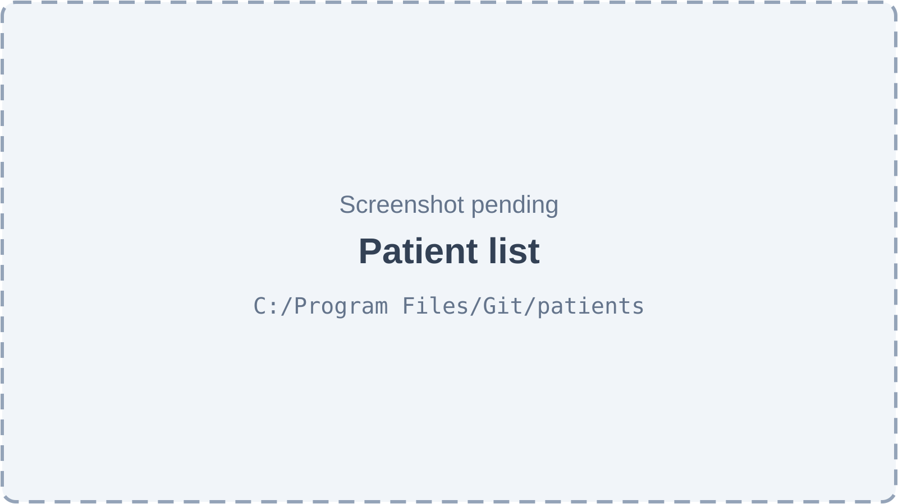

*Figure 28.1 — Patient list (screenshot pending).*

The patient list page has the title "Patients" with a subtitle giving the total count, for example "128 patients total". The top-right corner holds a card/table view toggle, an **Export** button (only for holders of `patients.export`), an **Import** button and a filled **Create** button (both only for holders of `patients.create`). Under the header is a filter row with a search box ("Search by name or phone...", debounced by 300 ms), a **Gender** select, a **Status** select (Active / Inactive) and a reset control. In table view the columns are Patient (initials avatar, name as a link, patient number underneath), Phone, Age, Gender, Blood, City, Status and an action column with a "View patient" eye button, an "Edit patient" pencil, an activate/deactivate switch and a red "Delete patient permanently" bin. The table has page-size and previous/next controls. Card view shows the same patients as cards in a responsive grid with the same actions. The page shows a loading skeleton while it loads, an error state with a retry button on failure, "No patients yet" with a **New Patient** button when the clinic has no patients, and a separate "no results" state with a clear-filters button when filters hide every patient.

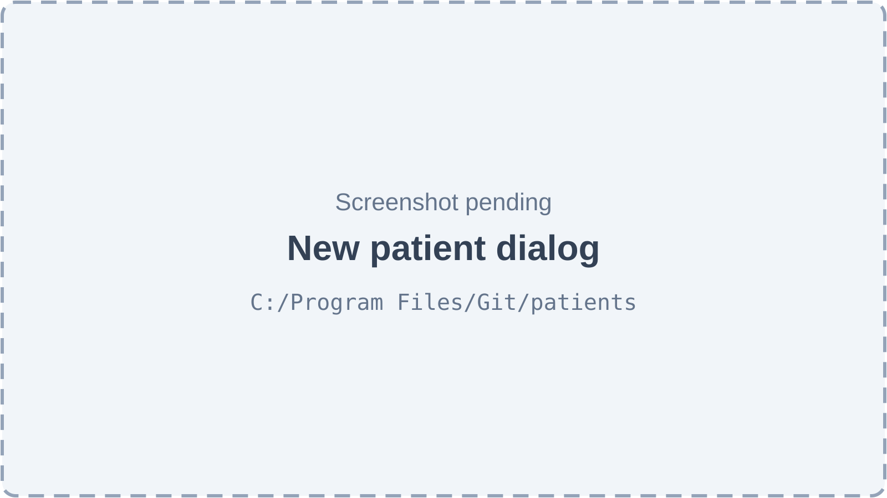

*Figure 28.2 — New patient dialog (screenshot pending).*

Pressing **Create** opens a wide dialog with a step indicator. Step 1, "Basic Info" (Personal, Guardian, Emergency & Medical), holds Full Name and Phone Number (both required), WhatsApp, Gender, Blood Group, Marital Status, Date of Birth, CNIC, Email, City, Address, a "minor" switch that reveals Guardian name, phone and relation, the emergency contact (Name, Phone, Relation), General Medical History and Known Allergies. Step 2, "Clinic Info" (Source & Clinic Notes), holds Source, Referral Notes, Preferred Language, Communication Preference, Occupation, "Patient Tags (VIP, Anxious, etc.)" and Internal Clinic Notes. The footer has **Cancel** / **Back**, **Next**, and on the last step **Add Patient**. Problems found when the user presses Next are listed at the top of the step. After a successful save the dialog moves to a third step, "Book Appointment", where the user can pick a doctor and time and press **Book Appointment**, or press **Skip**.

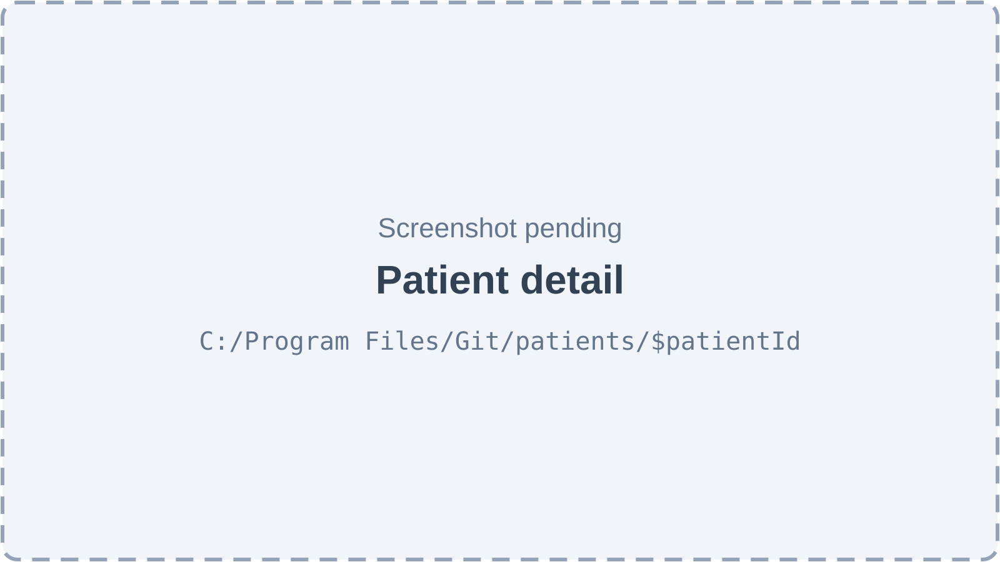

*Figure 28.3 — Patient detail page with its tabs (screenshot pending).*

The detail page header shows a back button ("Back to patients"), an initials avatar, the patient's name, an Active or Inactive badge, the patient number, an outstanding-dues badge (for holders of `billing.invoice.view`), age, gender, blood group, phone and email. A clock-style "Change history" button appears for holders of `admin.audit.view`. Under the header is a row of tabs; each tab appears only when the viewer holds the permission (and the feature) its data needs: **Overview** (always), **Appointments** (`appointments.view`), **Visits**, **Treatments**, **Vitals & Dental** and **Consents** (`patients.clinical.view`), **Teeth Chart** (`patients.clinical.view` and the `patients.teeth_chart` feature), **Clinical & Rx** (`patients.clinical.view` and the `patients.prescriptions` feature), **Billing** (`billing.invoice.view`) and **Files** (`patients.documents.manage`). The Overview tab has an **Edit Details** button (for `patients.edit`), the latest vitals card, "Medical Quick Access" (medical history and allergy chips), "Alerts & Tags" (tags plus a "Minor Patient" or "Blacklisted Patient" warning), "Emergency Contact" and "Demographics & Internal".

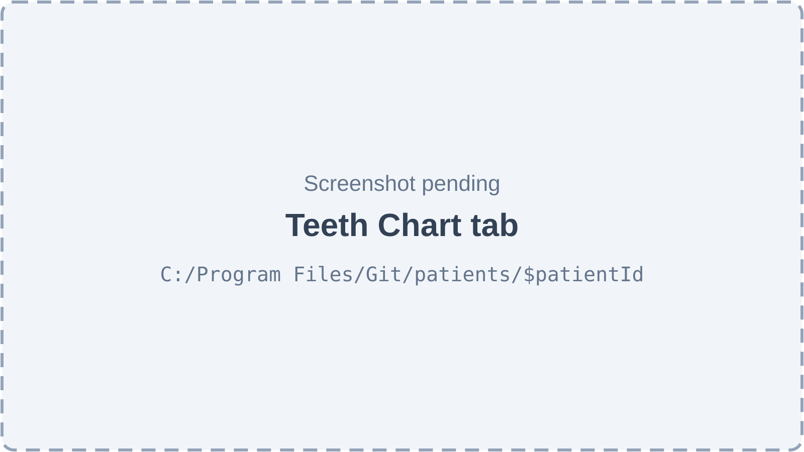

*Figure 28.4 — Teeth Chart tab (screenshot pending).*

The Teeth Chart tab is titled "FDI Teeth Charting". It shows two rows of drawn teeth numbered in FDI two-digit notation (upper 18 to 28, lower 48 to 38, as seen facing the patient) and a "Chart History" side list of saved snapshots, with the first one marked as the initial chart. Holders of `patients.chart.edit` see **New Chart**, which opens the "Interactive FDI Chart": the user picks a condition (Healthy, Caries, Filled, Crown, Extraction, Missing), clicks teeth to mark them, can add a note per tooth, sees a "N teeth marked" counter with **Clear all**, writes chart notes and presses **Save Immutable Snapshot**. Clicking a saved snapshot opens a read-only viewer with a legend of the conditions it contains.

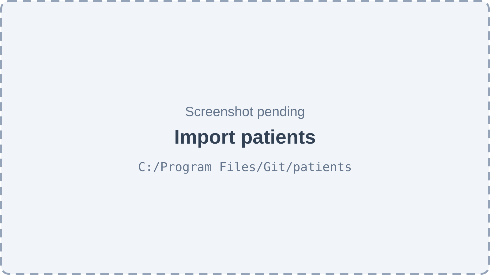

*Figure 28.5 — Import patients side panel (screenshot pending).*

The **Import** button opens a side panel with five steps shown as a step indicator: Upload, Map columns, Check, Import and Summary. Upload accepts one `.xlsx` or `.csv` file and offers **Download sample template**. Map columns shows a table with "Column in your file", "Example value" and "Import as", plus a preview of the first rows; the **Check N rows** button stays disabled until Full name (or First name) and Phone are mapped. Check shows counts of rows that will be created, duplicates and errors, two duplicate-rule cards ("Skip the row" and "Create anyway"), and a table of "Rows that will not be imported" with row number, status and reason; the **Import N patients** button starts the real import. Import shows a progress bar. Summary shows created, skipped-as-duplicate and failed counts, a **Download error report** button when any row failed, and **Done**.

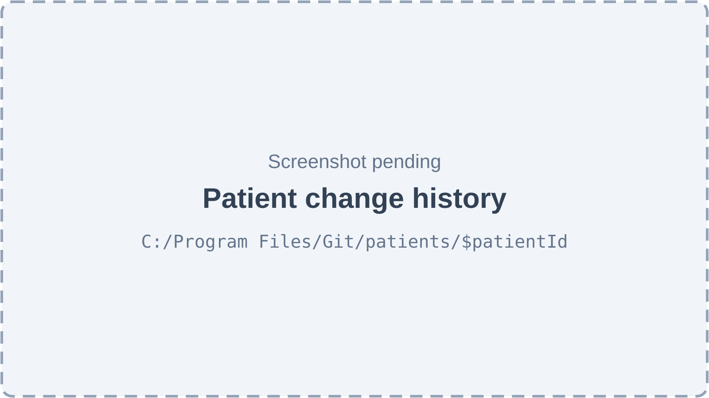

*Figure 28.6 — Patient change history side panel (screenshot pending).*

The change-history panel is titled "<patient name> — change history" with the line "Every edit to the patient and their records, with who made it." It lists events newest first: who acted, when, what kind of record changed (patient, vitals, consent, document and so on), and field-by-field before and after values. Events on records the reader cannot open still appear, but without their values.

## 28.3 Features

### 28.3.1 Register a patient

**Status:** [Implemented]

**What it does.** Creates a new patient in the organization, gives them the next patient number and, optionally, books their first appointment straight away.

**How the user does it.**
1. On `/patients`, press **Create**.
2. Fill step "Basic Info": Full Name and Phone Number are required; for a minor, turn on the minor switch and enter the guardian.
3. Press **Next**, fill "Clinic Info", and press **Add Patient**.
4. On the "Book Appointment" step, pick a doctor and a time and press **Book Appointment**, or press **Skip**.

**Behind the scenes — in simple terms.** The Platform checks that no other patient in the clinic has the same phone number, counts the clinic's patients to make the next number, saves the patient with the current location as their home location, and writes a "created" entry in the audit log.

**Behind the scenes — technically.** `POST /patients` → `PatientsService.create`. It calls `validatePhoneUnique` (exact match of `phone` inside the organization), then `generatePatientNumber` (`P-` plus the count of the organization's patients plus one, padded to five digits). `primaryLocationId` defaults to the active location; `createdBy` is the caller's user id. The insert and the audit row (`recordPatientChange`, action `create`) run in one database transaction. While the user moves between steps, the web app keeps a draft of the form in the patient store so going back does not lose input. The appointment step calls the Appointments module (the Appointments chapter, Chapter 29, covers booking).

**Rules and validations.**
- Full name: required, at most 150 characters. Phone: required, at most 20 characters; the form also checks 7–20 digits and the characters `+ - ( )` and space.
- Phone must be unique inside the organization (server rule, exact text match).
- Email must be a valid address; CNIC must look like `42101-1234567-1` (form rule); date of birth cannot be in the future (form rule).
- A minor needs a guardian name (form rule).
- Gender, blood group, marital status, language, communication preference and source must be values from fixed lists. Defaults: language Urdu, communication preference WhatsApp, source walk-in.
- Tags are free text chosen in a multi-select that can create new tags.

**Who can do it.** `patients.create` (no scope; implies `patients.view`), feature `patients.core`. Default holders: Admin, Receptionist.

**Data read and written.** Reads `patients`; writes `patients` and `audit_logs`.

**Effects on other modules.** The new patient can be booked, checked in to the queue, billed and searched from every patient picker.

**Error cases.**
- "A patient with this phone number already exists in this organization" (409) → another patient already has this exact phone.
- "Full name is required" / "Phone number is required" (400) → missing fields.
- The form's own messages (for example "Phone Number looks invalid (7–20 digits)") → shown at the top of the step before anything is sent.
- "Failed to create patient" toast → any other server error.

**Technical references:** `backend/src/patients/patients.service.ts` · `PatientsService.create`, `CreatePatientDto` · `web-app/src/features/patients/components/CreatePatientModal.tsx`, `PatientForm.tsx`, `AddAppointmentStep.tsx`

### 28.3.2 Check a phone number before saving

**Status:** [Partial] — the endpoint and a web hook exist, but no screen calls them; the duplicate is caught only when the user saves.

**What it does.** Answers "does another patient in this clinic already have this phone number?" without saving anything.

**How the user does it.** No screen uses it. The registration form relies on the server's check at save time, which answers 409 for a duplicate phone.

**Behind the scenes — in simple terms.** The Platform looks for a patient with the same phone in the organization, optionally ignoring one patient (the one being edited), and answers yes or no.

**Behind the scenes — technically.** `GET /patients/check-phone/:phone?excludeId=` → `PatientsService.checkPhoneExists` returns `{ exists: boolean }`. The web hook `useCheckPhone` and API function `checkPhoneUnique` are exported but not used by any component.

**Rules and validations.**
- Exact text match on `phone` inside the organization; no normalisation.
- The answer ignores the caller's patient scope, but only says yes or no.

**Who can do it.** `patients.view` (any scope), feature `patients.core`. Default holders: Admin, Doctor, Receptionist, Assistant.

**Data read and written.** Reads `patients`.

**Effects on other modules.** None.

**Error cases.** None specific.

**Technical references:** `backend/src/patients/patients.controller.ts` · `checkPhone`, `checkPhoneExists` · `web-app/src/features/patients/hooks/useCheckPhone.ts`

### 28.3.3 Browse, search and filter the patient list

**Status:** [Implemented]

**What it does.** Shows the patients the viewer is allowed to see, one page at a time, in a table or as cards, with search and filters.

**How the user does it.**
1. Open **Patients** in the sidebar.
2. Type in the search box to match name, phone or patient number.
3. Narrow with **Gender** and **Status**; clear with the reset control or the "no results" state's clear button.
4. Switch between table and card view with the view toggle; in table view change the page size or page.

**Behind the scenes — in simple terms.** The list only ever contains patients inside the viewer's reach: everyone in the organization, everyone connected to the current location, or only the doctor's own patients (those with an appointment or queue entry with that doctor).

**Behind the scenes — technically.** `GET /patients` → `PatientsService.findAll` → shared `listQuery`, which applies `access.applyScope(qb, 'patients.view', patientScope('p.id'))`, then the filters, then sorting, then paging (`page`, `limit`, default 10, maximum 100). Search uses case-insensitive `ILIKE` on `full_name`, `phone` and `patient_number`.

**Rules and validations.**
- The API also accepts `bloodGroup`, `source`, `city`, `tag`, `isBlacklisted`, `isMinor`, `sortBy` (`createdAt`, `fullName`, `patientNumber`) and `sortOrder`; the screen offers only search, gender and status.
- Default order is newest registration first. Column sorting in table view re-orders the rows of the current page only.
- Card view shows the current page only and has no paging controls.

**Who can do it.** `patients.view` with scope `own`, `location` or `org`, feature `patients.core`. Default holders: Admin (org), Receptionist (location), Assistant (location), Doctor (own).

**Data read and written.** Reads `patients` and, for scoped viewers, `appointments`, `queue_entries` and `queue_sessions`.

**Effects on other modules.** The same endpoint feeds the type-ahead patient pickers of other modules (`usePatientSearch`, two or more characters, 300 ms debounce, eight results).

**Error cases.** Error state with **Retry** → the list request failed.

**Technical references:** `backend/src/patients/patients.service.ts` · `findAll`, `listQuery`, `PatientQueryDto` · `web-app/src/features/patients/pages/PatientsPage.tsx`, `PatientTable.tsx`, `PatientCard.tsx`, `FiltersBar.tsx`

### 28.3.4 Open the patient detail page

**Status:** [Implemented]

**What it does.** Shows one patient's profile and the tabs of records the viewer may open.

**How the user does it.**
1. Click a patient's name or the "View patient" eye button in the list.
2. Pick a tab. Use the ← button to go back to where you came from.

**Behind the scenes — in simple terms.** Before answering, the Platform checks that the patient is inside the viewer's reach. A patient outside it is reported as "not found", exactly like a patient of another clinic, so the viewer cannot even learn that the patient exists.

**Behind the scenes — technically.** `GET /patients/:id` → `PatientsService.findOne`. The controller carries `@PatientInScope('id')`, so `PatientScopeGuard` runs `isPatientInScope` for every route with an `:id` parameter (every sub-record route too) and throws `NotFoundException('Patient not found')` when the patient is outside the `patients.view` scope. Tabs are chosen by `visiblePatientTabs` from the viewer's permissions and features.

**Rules and validations.**
- A malformed id returns 400 (UUID check).
- A tab appears only when the viewer holds the permission its data needs; for example Teeth Chart needs `patients.clinical.view` and the `patients.teeth_chart` feature, Files needs `patients.documents.manage`.

**Who can do it.** `patients.view` (scoped), feature `patients.core`; the route declares `staticData.can: 'patients.view'`.

**Data read and written.** Reads `patients`.

**Effects on other modules.** The header's dues badge reads the Billing module.

**Error cases.** "Failed to load patient details. Please try again." → patient missing, out of scope, or request failed.

**Technical references:** `backend/src/patients/access/patient-scope.ts` · `PatientScopeGuard`, `PatientInScope` · `web-app/src/routes/patients/$patientId.index.tsx`, `features/patients/utils/patientTabs.ts`

### 28.3.5 Edit patient details

**Status:** [Implemented]

**What it does.** Changes any demographic, contact, medical quick-access or clinic field of a patient.

**How the user does it.**
1. In the list, press the "Edit patient" pencil, or on the detail Overview tab press **Edit Details**.
2. Change fields in the same two-step form, shown in a side sheet.
3. Press **Update Details**.

**Behind the scenes — in simple terms.** If the phone changed, the Platform re-checks that no other patient has it. It then saves the changes and records exactly which fields changed, from what to what.

**Behind the scenes — technically.** `PUT /patients/:id` → `PatientsService.update`. A snapshot of the row is taken first; `Object.assign` applies the DTO; `saveAudited` saves the row and the audit row (`update`, with a field diff) in one transaction. An update that changes nothing writes no audit row.

**Rules and validations.**
- All fields optional; same limits as registration.
- Phone uniqueness is checked only when the phone actually changes, ignoring this patient.
- The DTO also accepts `isActive`, `isBlacklisted` and `blacklistReason`; the form does not send the blacklist fields.

**Who can do it.** `patients.edit`, feature `patients.core`. Default holders: Admin, Receptionist.

**Data read and written.** `patients`, `audit_logs`.

**Effects on other modules.** Name, phone and allergies changes appear immediately in appointments, queue, consultation and billing screens, which read the patient row.

**Error cases.** 409 phone duplicate (same message as registration); "Patient not found" (404).

**Technical references:** `backend/src/patients/patients.service.ts` · `update`, `UpdatePatientDto` · `web-app/src/features/patients/components/EditPatientSheet.tsx`

### 28.3.6 Activate or deactivate a patient

**Status:** [Implemented]

**What it does.** Marks a patient inactive (hidden from "Active" filters, but every record kept) or active again. It is the recommended alternative to deletion.

**How the user does it.**
1. In the list (table or card), flip the switch in the patient's action area. Its tooltip reads "Deactivate patient" or "Activate patient".

**Behind the scenes — in simple terms.** The Platform flips the active flag and writes a status-change entry saying who moved the patient from active to inactive or back.

**Behind the scenes — technically.** `PATCH /patients/:id/status` with `{ isActive }` → `PatientsService.setActive`. When the value already matches, nothing is written. Otherwise the save and `AuditService.recordStatus` (table `status_history`, action code `activate` or `deactivate`, subject = the patient) run in one transaction.

**Rules and validations.**
- Only the `isActive` boolean is accepted.
- Inactive patients are not blocked anywhere else: they can still be booked, checked in and billed. The flag is informational and a list filter.

**Who can do it.** `patients.edit`, feature `patients.core`. Default holders: Admin, Receptionist.

**Data read and written.** `patients`, `status_history`.

**Effects on other modules.** The dashboard's patient count asks for active patients only.

**Error cases.** "Could not update patient status" toast → request failed.

**Technical references:** `backend/src/patients/patients.service.ts` · `setActive`, `UpdatePatientStatusDto` · `web-app/src/features/patients/hooks/useSetPatientStatus.ts`

### 28.3.7 Blacklist a patient

**Status:** [Partial] — stored, filterable and displayed, but no screen can set it; only an API client can.

**What it does.** Flags a patient the clinic does not want to serve, with a reason.

**How the user does it.** No screen sets the flag. When it is set, the Overview tab's "Alerts & Tags" card shows "Blacklisted Patient" and "Reason: …" ("Not specified" when empty).

**Behind the scenes — in simple terms.** It is a yes/no flag plus a reason text on the patient row. Nothing in booking, the queue or billing reads it.

**Behind the scenes — technically.** Set through `PUT /patients/:id` (the patient edit endpoint) with `isBlacklisted` and `blacklistReason`, audited as a field change. Listable with `GET /patients?isBlacklisted=true`.

**Rules and validations.**
- No rule blocks a blacklisted patient from being booked, queued or billed.

**Who can do it.** `patients.edit`, feature `patients.core`. Default holders: Admin, Receptionist.

**Data read and written.** `patients` (`is_blacklisted`, `blacklist_reason`), `audit_logs`.

**Effects on other modules.** None.

**Error cases.** As for editing.

**Technical references:** `backend/src/patients/entities/patient.entity.ts` · `isBlacklisted`, `blacklistReason` · `web-app/src/features/patients/components/tabs/OverviewTab.tsx`

### 28.3.8 Delete a patient permanently

**Status:** [Partial] — works for patients without billing or lab records; for a patient with charges, invoices, payments, refunds or lab records the database refuses and the user sees a generic failure.

**What it does.** Removes the patient and every record that hangs off them, for good.

**How the user does it.**
1. In the list, press the red bin ("Delete patient permanently").
2. Read the dialog "Delete patient permanently?", which says the patient and all records will be deleted and suggests deactivating instead.
3. Press **Delete permanently**.

**Behind the scenes — in simple terms.** Before deleting, the Platform counts how many linked records of each kind will disappear and stores the patient's last state and those counts in the audit log, so the deletion itself stays on record. Then it deletes the row, and the database deletes the dependent records.

**Behind the scenes — technically.** `DELETE /patients/:id` → `PatientsService.remove`, in one transaction: `cascadeCounts` reads the Postgres catalog for every foreign key that cascades from `patients` and counts rows per table; `recordPatientChange` writes an audit row with action `delete`, `before` = snapshot plus `linkedRecords`; then a hard `DELETE`. Cascading tables include appointments, queue entries, encounters, treatments, prescriptions, inventory consumption, patient credits and every `patient_*` sub-record. Tables `charges`, `invoices`, `payments`, `refunds`, `lab_orders`, `lab_invoices`, `lab_payments` and `lab_credits` reference patients with `ON DELETE RESTRICT`, so the delete fails when any of them has a row, and the whole transaction (including the audit row) rolls back.

**Rules and validations.**
- Always behind a confirmation dialog.
- Hard delete: the entity has a `deleted_at` column but the service does not use soft delete.

**Who can do it.** `patients.delete` (high-risk permission), feature `patients.core`. Default holder: Admin.

**Data read and written.** Every table that cascades from `patients`; `audit_logs`.

**Effects on other modules.** The patient disappears from appointments, the queue history, consultation history and prescriptions. Patient numbering is count-based, so after a deletion the next new patient can be given a number that already exists, and that save then fails.

**Error cases.**
- "Could not delete patient" toast → the server failed, typically because of billing or lab records (the server answers with the generic "Something went wrong").
- "Patient not found" (404).

**Technical references:** `backend/src/patients/patients.service.ts` · `remove`, `cascadeCounts` · `web-app/src/features/patients/pages/PatientsPage.tsx` (ConfirmDialog)

### 28.3.9 Import patients from a spreadsheet

**Status:** [Implemented]

**What it does.** Brings an existing patient register (for example from an old system or an Excel sheet) into the Platform: read the file, match its columns to patient fields, check every row without saving, then create the valid rows.

**How the user does it.**
1. On `/patients`, press **Import**. Optionally press **Download sample template** to get a CSV with the recognised headers (Full Name, Phone, CNIC, Gender, Date of Birth, Age, Email, Address, City, Blood Group, Allergies, Medical History, Notes, Old File No).
2. Upload one `.xlsx` or `.csv` file.
3. In **Map columns**, check the suggested "Import as" field for each column; set unwanted columns to be ignored. Full name (or first name) and Phone must be mapped.
4. Press **Check N rows**. Review the counts and the "Rows that will not be imported" table. Choose **Skip the row** or **Create anyway** for duplicates.
5. Press **Import N patients**. Wait for the progress bar.
6. On **Summary**, press **Download error report** if any row failed, then **Done**.

**Behind the scenes — in simple terms.** The file is read in memory and never stored. Each row is cleaned up the way a careful receptionist would: extra phone numbers move into notes, an age becomes an estimated birth date, CNICs are reformatted, common spellings of blood groups and genders are understood. Every row is checked against the same rules as manual registration and against existing patients (same phone or CNIC). Each row is then created on its own, so one bad row never undoes the others. Every imported patient is tagged `imported`.

**Behind the scenes — technically.** Figure 28.7 shows the flow.

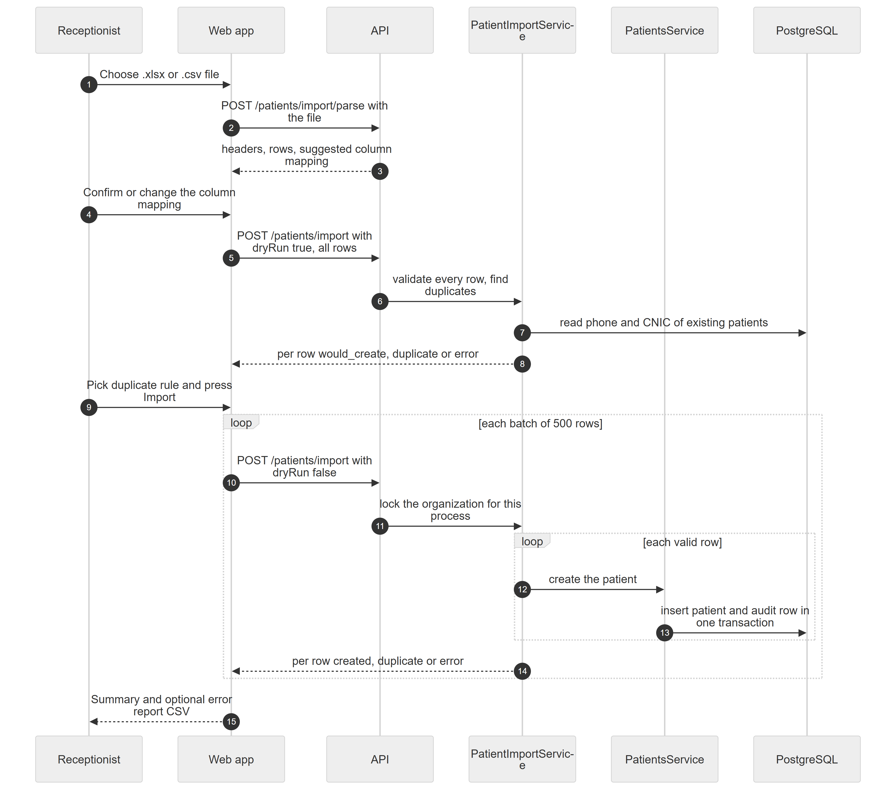

*Figure 28.7 — Sequence of a patient import, from file upload to summary.*

The diagram has six participants: Receptionist, Web app, API, PatientImportService, PatientsService and PostgreSQL. (1) The receptionist chooses a file. (2) The web app sends it to `POST /patients/import/parse`. (3) The API returns headers, rows and a suggested column mapping; nothing is stored. (4) The receptionist confirms the mapping. (5) The web app sends all mapped rows to `POST /patients/import` with `dryRun: true`. (6) The API hands them to `PatientImportService`, which (7) reads the phone and CNIC of every existing patient in the organization and (8) returns, per row, `would_create`, `duplicate` or `error`. (9) The receptionist picks the duplicate rule and presses Import. A loop then runs once per batch of 500 rows: (10) the web app posts the batch with `dryRun: false`; (11) the service marks the organization as "import running" in this server process; an inner loop runs per valid row, where (12) the service calls the normal patient create and (13) `PatientsService` inserts the patient and its audit row in one transaction; (14) the batch result comes back per row as `created`, `duplicate` or `error`. (15) The web app shows the summary and offers the error-report CSV.

Parsing uses `parseImportFile` (first non-empty worksheet of an `.xlsx`, or RFC-4180 CSV; the first non-empty row is the header; blank headers become "Column N"; repeated headers get "(2)", "(3)"). `suggestMapping` matches header names, including common local spellings, to the fields in `IMPORT_FIELDS`. `validateImportRow` runs `mapImportRow` and then the `CreatePatientDto` validators. Duplicate detection normalises phones to digits with a leading zero (so `+92…`, `0092…` and `0…` match) and CNICs to digits. "Today" for date-of-birth checks is the location's date (`ClockService`).

**Rules and validations.**
- File: `.xlsx` (checked by its zip signature) or `.csv`/`.txt`; at most 10 MB; at most 5,000 data rows. Old `.xls` files are rejected with a "Save as .xlsx" hint.
- A dry run accepts up to 5,000 rows in one request; a real import at most 1,000 per request (the web app sends 500).
- Only one real import per organization at a time in one server process.
- Mapping fields: full name, first name, last name, phone, WhatsApp, CNIC, gender, date of birth, age, email, address, city, blood group, marital status, occupation, allergies, medical history, notes, old file number, guardian name and phone, emergency contact name and phone, referred by.
- First phone number becomes the patient's phone; further numbers go to internal notes as "Other phone: …".
- An age (for example "35", "35 years", "6 months") becomes 1 January of the estimated birth year, with a note "Date of birth estimated from age …". Dates accept day-first formats, ISO, month names and Excel serial numbers. A birth date in the future or before 1900 is an error.
- "Old File No" goes into internal notes as "Old file no: …" (the patient has no legacy-number column).
- Source becomes referral when "referred by" is filled, otherwise other.
- Duplicates: same phone or same CNIC as an existing patient or a previous row of the same file. With **Skip the row** the row is reported as a duplicate. With **Create anyway**, a same-CNIC row is created, but a same-phone row is always an error because phones are unique per clinic.

**Who can do it.** `patients.create`, feature `patients.core`. Default holders: Admin, Receptionist.

**Data read and written.** Reads `patients`; writes `patients` and `audit_logs` (one create entry per imported patient).

**Effects on other modules.** Imported patients behave exactly like hand-registered ones.

**Error cases.**
- "No file provided" → upload without a file.
- "Unsupported file. Upload an Excel (.xlsx) or CSV file — for old .xls files use "Save as" .xlsx first." → wrong type.
- "Could not read the Excel file. Is it a valid .xlsx?", "The workbook has no sheets", "The file is empty", "The file has no patient rows", "The file has more than 5,000 patient rows. Split it into smaller files." → unreadable or oversized file.
- "Send at most 1000 rows per import request" → oversized real-import request.
- "Another patient import is running for this clinic. Try again when it finishes." (409) → parallel import.
- Per-row reasons such as "Phone number "…" looks invalid (7–20 digits)", "CNIC "…" must have 13 digits (e.g. 42101-1234567-1)", "Date of birth cannot be in the future", "Same phone number as P-00012 (…)".
- "The server could not import this batch" → a batch request failed; all its rows are reported as errors and the import continues with the next batch.

**Technical references:** `backend/src/patients/import/patient-import.service.ts`, `patient-import.ts` · `PatientImportService.import`, `parseImportFile`, `mapImportRow`, `findDuplicate` · `web-app/src/features/patients/components/ImportPatientsSheet.tsx`, `hooks/usePatientImport.ts`, `utils/patientImport.ts`

### 28.3.10 Export the patient list

**Status:** [Implemented]

**What it does.** Downloads the patients matching the current search and filters as a CSV file that opens correctly in Excel, including Urdu names.

**How the user does it.**
1. On `/patients`, set the search and filters you want.
2. Press **Export**. A toast says "Export downloaded", or "Export downloaded (first 10,000 patients only)" when the result was cut.

**Behind the scenes — in simple terms.** The export uses the same reach and filters as the list but no paging, stops at 10,000 patients, and is always written to the audit log because patient data is leaving the system.

**Behind the scenes — technically.** `GET /patients/export` → `PatientsService.exportCsv` (same `listQuery`, `take(10001)` to detect truncation). The controller writes an audit row with `entity_type = 'patient_export'`, action `export`, and `after = { rows, truncated, filters }`, then streams the CSV with headers `Content-Disposition: attachment; filename="patients-YYYY-MM-DD.csv"`, `X-Export-Truncated: true|false` (exposed to the browser) and `Cache-Control: no-store`.

**Rules and validations.**
- Columns: Patient number, Name, Phone, Email, Gender, Date of birth, Blood group, City, Source, Active, Registered on.
- At most 10,000 rows (`EXPORT_MAX_ROWS`).
- Cells that a spreadsheet would run as a formula get a leading apostrophe; phone-like values such as `+92…` are left as they are.
- The file starts with a UTF-8 byte-order mark.
- The date in the file name and the "Registered on" column are UTC dates, not the location's date.
- The button is disabled when the list is empty.

**Who can do it.** `patients.export` (high-risk; implies `patients.view`), feature `patients.core`. Default holder: Admin. The rows are limited by the caller's `patients.view` scope.

**Data read and written.** Reads `patients`; writes `audit_logs`.

**Effects on other modules.** None.

**Error cases.** "Could not export patients" toast → request failed.

**Technical references:** `backend/src/patients/patients.controller.ts`, `patients.service.ts` · `export`, `exportCsv`, `csvCell`, `EXPORT_MAX_ROWS` · `web-app/src/features/patients/services/patients.api.ts` (`exportPatientsCsv`)

### 28.3.11 See a patient's appointments and walk-in visits

**Status:** [Implemented]

**What it does.** The Appointments tab lists upcoming appointments and a history of past appointments and walk-in queue visits.

**How the user does it.**
1. Open the patient, then the **Appointments** tab.
2. Read "N upcoming · M past"; press **Book appointment** to open the scheduler.

**Behind the scenes — in simple terms.** Booked visits come from the Appointments module; walk-ins, which have no appointment, come from the patient's queue history.

**Behind the scenes — technically.** The tab calls the Appointments list with `patientId` (up to 100) and the Queue module's patient-visits query, keeping only `walk_in` entries. Future appointments that are not completed, cancelled or no-show count as upcoming. The Appointments chapter (Chapter 29) and the Queue chapter (Chapter 30) cover those endpoints.

**Rules and validations.** None specific to this module.

**Who can do it.** Tab shown with `appointments.view`. Default holders: Admin, Doctor (own), Receptionist and Assistant (location).

**Data read and written.** Reads `appointments`, `queue_entries`.

**Effects on other modules.** None.

**Error cases.** None specific.

**Technical references:** `web-app/src/features/patients/components/tabs/AppointmentsTab.tsx` · `useAppointments`, `usePatientVisits`

### 28.3.12 See visits and full clinical history

**Status:** [Implemented]

**What it does.** The Visits tab lists the patient's consultations (encounters), each with its treatments, and opens a "Visit Details" dialog. The same history feeds the patient snapshot in the consultation workspace.

**How the user does it.**
1. Open the **Visits** tab.
2. Each row shows the date, a summary (diagnosis, complaint or reason) and the treatments; press the "View visit details" arrow to open the visit.

**Behind the scenes — in simple terms.** The Platform gathers the patient, all their appointments, all their encounters with linked treatments, and treatments that were recorded without a visit. Prices are removed for viewers who may not see them.

**Behind the scenes — technically.** `GET /patients/:id/history` → `PatientsService.getHistory`: patient, `appointments` (newest first), `EncountersService.findByPatient`, and `TreatmentsService.findByPatient` filtered to `encounterId = null` as `standaloneTreatments`. `HideTreatmentPricesInterceptor` deletes `cost` from every treatment-shaped object when the caller lacks `patients.price.view`. Encounters are created when the doctor starts a consultation (the Consultation chapter, Chapter 31, covers this).

**Rules and validations.**
- No paging; everything is returned.
- Fees are hidden in the Visits tab when the viewer lacks `patients.price.view`.

**Who can do it.** `patients.clinical.view`, feature `patients.core`. Default holders: Admin, Doctor, Assistant.

**Data read and written.** Reads `patients`, `appointments`, `patient_encounters`, `treatments`.

**Effects on other modules.** None.

**Error cases.** "Patient not found" (404).

**Technical references:** `backend/src/patients/patients.service.ts` · `getHistory`, `HideTreatmentPricesInterceptor` · `web-app/src/features/patients/components/tabs/VisitsTab.tsx`, `EncounterDetailDialog.tsx`

### 28.3.13 Per-location visit statistics

**Status:** [Not implemented] — the table and a read endpoint exist, but no code ever writes to the table and no screen reads it.

**What it does.** Was meant to keep, per patient and location, the first and last visit date, the visit count, the total spent and a preferred-location flag.

**How the user does it.** Not available.

**Behind the scenes — in simple terms.** The endpoint always returns an empty list because nothing fills the table.

**Behind the scenes — technically.** `GET /patients/:id/visits` → `PatientsService.getVisits` reads `patient_visits` (unique per patient and location). The web function `fetchVisits`/`useVisits` exists but is not used. The encounter entity notes that `patient_visits` is "left untouched".

**Rules and validations.** None.

**Who can do it.** `patients.view`.

**Data read and written.** Reads `patient_visits`.

**Effects on other modules.** None.

**Error cases.** None.

**Technical references:** `backend/src/patients/entities/patient-visit.entity.ts` · `PatientVisit`, `getVisits` · `web-app/src/features/patients/hooks/usePatientSubEntities.ts` (`useVisits`)

### 28.3.14 View a patient's change history

**Status:** [Implemented]

**What it does.** Shows who created, changed, activated, deactivated or deleted the patient and any of their records, field by field.

**How the user does it.**
1. On the patient detail header, press the "Change history" button.
2. Read the timeline in the side panel.

**Behind the scenes — in simple terms.** Every write in this module also writes an audit entry in the same transaction, tagged with the patient as its subject, so one lookup reads the patient's whole history. File links (documents, X-rays, signatures, insurance cards, profile picture) are never copied into the log. When a reader lacks the right to open a kind of record, they still see that the event happened but not the values.

**Behind the scenes — technically.** `GET /patients/:id/audit-trail` → `PatientsService.getAuditTrail` → `AuditService.subjectTimeline` (merges `audit_logs` and `status_history` where `subject_id` = patient, newest first, at most 200 entries) → `redactPatientTimeline`. Values are removed for dental info, teeth charts, vitals, treatment plans, plan items, legacy prescriptions and consents unless the reader holds `patients.clinical.view`, and for documents unless they hold `patients.documents.manage`; medical history and allergies are removed from patient-row changes for readers without `patients.clinical.view`. What is logged:

| Record | `entity_type` | Logged on |
|---|---|---|
| Patient | `patient` | create, update (diff), delete (last state and linked-record counts); activate/deactivate in `status_history` |
| Dental info | `patient_dental_info` | create, update |
| Teeth chart, vitals, document, consent, communication, referral, feedback, legacy prescription | `patient_teeth_chart`, `patient_vitals`, `patient_document`, `patient_consent`, `patient_communication`, `patient_referral`, `patient_feedback`, `patient_prescription` | create |
| Treatment plan, plan item, recall, insurance | `patient_treatment_plan`, `treatment_plan_item`, `patient_recall`, `patient_insurance` | create, update |
| Patient export | `patient_export` | every export (row count, truncated flag, filters); not tied to a patient subject |

The table lists each kind of patient record, the `entity_type` value its audit rows carry, and which actions produce a row. Updates that change nothing are not logged. Identity and bookkeeping columns (ids, timestamps, created-by) are left out of every snapshot because the audit row already records who and when.

**Rules and validations.**
- The button and endpoint need `admin.audit.view` in addition to the patient being in the caller's scope.

**Who can do it.** `admin.audit.view` (feature `core`, always on). Default holder: Admin.

**Data read and written.** Reads `audit_logs`, `status_history`.

**Effects on other modules.** The Audit logging chapter (Chapter 60) describes the shared audit tables.

**Error cases.** Error state with retry in the panel.

**Technical references:** `backend/src/patients/patient-audit.ts` · `PATIENT_AUDIT_ENTITY`, `recordPatientChange`, `redactPatientTimeline` · `web-app/src/features/patients/components/PatientAuditSheet.tsx`

### 28.3.15 Record dental info

**Status:** [Implemented]

**What it does.** Keeps one "Dental Health & Habits" sheet per patient: last check-up, gum condition, sensitivity, brushing and flossing frequency, smoking, tobacco chewing, orthodontic history, prosthetics, previous extractions and surgeries, X-ray notes and dentist notes.

**How the user does it.**
1. Open **Vitals & Dental**.
2. Fill the "Dental Health & Habits" form (Gum Condition, Brushing Frequency, Flossing Frequency, checkboxes such as Teeth Sensitivity, Smoker, Tobacco Chewing, and notes fields).
3. Press **Save Dental Info** (first time) or **Update Dental Info**.

**Behind the scenes — in simple terms.** There is at most one sheet per patient; saving again overwrites it and the audit log keeps the old values.

**Behind the scenes — technically.** `GET /patients/:id/dental-info`; `POST /patients/:id/dental-info` → `upsertDentalInfo` (find, then update or create) → `saveAudited`.

**Rules and validations.**
- One row per patient (unique `patient_id`).
- Gum condition: healthy, mild gingivitis, moderate gingivitis, severe periodontitis.
- The form is read-only without `patients.clinical.edit`.

**Who can do it.** Read `patients.clinical.view`; write `patients.clinical.edit`; feature `patients.core`. Default writers: Admin, Doctor.

**Data read and written.** `patient_dental_info`, `audit_logs`.

**Effects on other modules.** None.

**Error cases.** "Patient not found" (404).

**Technical references:** `backend/src/patients/patients.service.ts` · `upsertDentalInfo`, `UpsertDentalInfoDto` · `web-app/src/features/patients/components/tabs/VitalsAndDentalTab.tsx`

### 28.3.16 Record vitals

**Status:** [Implemented]

**What it does.** Adds a dated set of vitals: blood pressure, pulse, temperature, SpO₂, weight, height and an automatically calculated BMI.

**How the user does it.**
1. Open **Vitals & Dental**.
2. Under "Record New Vitals", enter the values and notes.
3. Press **Save Vitals**. The new card appears in "Patient Vitals History", newest first.

**Behind the scenes — in simple terms.** Vitals are never edited; each save adds a new reading. The latest reading is shown on the Overview tab and in the consultation workspace.

**Behind the scenes — technically.** `GET /patients/:id/vitals` (newest first); `POST /patients/:id/vitals` → `createVitals`. BMI = weight ÷ (height in metres)², rounded to two decimals, when both are given. `recordedBy` is sent by the web app as the signed-in user's id; `locationId` is the active location.

**Rules and validations.**
- Form ranges: systolic 50–300, diastolic 30–200, pulse 20–250, temperature 30–45 °C, SpO₂ 50–100 %, weight 1–500 kg, height 20–300 cm.
- The API also accepts flags (diabetic, hypertensive, pregnant, on blood thinners, on antibiotics) and anaesthesia details; the form does not show them.
- No update or delete endpoint.

**Who can do it.** Read `patients.clinical.view`; write `patients.clinical.edit`; feature `patients.core`. Default writers: Admin, Doctor.

**Data read and written.** `patient_vitals`, `audit_logs`.

**Effects on other modules.** The consultation workspace shows the latest vitals (Chapter 31).

**Error cases.** Field messages from the range checks; "Patient not found" (404).

**Technical references:** `backend/src/patients/patients.service.ts` · `createVitals`, `CreateVitalsDto` · `web-app/src/features/patients/components/tabs/VitalsAndDentalTab.tsx`

### 28.3.17 Chart teeth (FDI)

**Status:** [Implemented]

**What it does.** Saves a snapshot of the condition of each tooth, in FDI notation, and keeps every previous snapshot.

**How the user does it.**
1. Open **Teeth Chart** and press **New Chart**.
2. Pick a condition, click teeth to mark them (click again with the same condition to unmark), add tooth notes and chart notes.
3. Press **Save Immutable Snapshot**. Pick any entry in "Chart History" to view it.

**Behind the scenes — in simple terms.** Charts are append-only: a correction is a new snapshot, never an edit. The first chart of a patient is marked as the initial chart.

**Behind the scenes — technically.** `GET /patients/:id/teeth-charts` (newest first); `POST /patients/:id/teeth-charts` → `createTeethChart`. `chart_data` is JSON keyed by tooth number with `{ condition, note }`; `is_initial_chart` defaults to true when the patient has no chart yet. The web app sends the signed-in user's id as `dentistId`. A `periodontal_chart` JSON column exists but the screen does not fill it.

**Rules and validations.**
- `chartData` is required; there is no update or delete endpoint.
- Conditions offered by the screen: Healthy, Caries, Filled, Crown, Extraction, Missing.

**Who can do it.** Read `patients.clinical.view` plus feature `patients.teeth_chart`; write `patients.chart.edit` (feature `patients.teeth_chart`). Default writers: Admin, Doctor, Assistant. The feature is off by default in the catalog (dental and orthodontic clinics switch it on).

**Data read and written.** `patient_teeth_chart`, `audit_logs`.

**Effects on other modules.** None.

**Error cases.** Feature-off error → the organization does not have `patients.teeth_chart` active (the tab is hidden in that case).

**Technical references:** `backend/src/patients/patients.service.ts` · `createTeethChart`, `CreateTeethChartDto` · `web-app/src/features/patients/components/tabs/TeethChartTab.tsx`

### 28.3.18 Record a treatment from the patient page

**Status:** [Implemented]

**What it does.** The Treatments tab lists all treatments performed (linked to a visit or standalone) and lets a user record one, optionally starting from a plan template.

**How the user does it.**
1. Open **Treatments** and press **Add Treatment**.
2. In "Record Treatment", optionally pick a "Treatment plan" (a plan template) and a "Procedure", which fills the name and cost; enter the date, optional visit link and notes.
3. Press **Save Treatment**.

**Behind the scenes — in simple terms.** Treatments belong to the Treatments module; this tab is a window on them. The Treatment Plans chapter (Chapter 33) explains how plan templates fill the form.

**Behind the scenes — technically.** `GET /treatments?patientId=`, `POST /treatments`. The button shows only for viewers with both `patients.clinical.edit` and `patients.price.view`.

**Rules and validations.** Treatment name and date required; cost cannot be negative.

**Who can do it.** `patients.clinical.edit` and `patients.price.view`. Default holder with both: Admin.

**Data read and written.** `treatments`.

**Effects on other modules.** Treatments can create charges (Chapters 31 and 34).

**Error cases.** "Treatment plan not found" → the chosen template was deleted.

**Technical references:** `backend/src/treatments/treatments.service.ts` · `TreatmentsService.create` · `web-app/src/features/patients/components/tabs/TreatmentsTab.tsx`, `TreatmentFormDialog.tsx`

### 28.3.19 Patient treatment plans

**Status:** [Partial] — backend only; no screen lists, creates or edits a patient's treatment plan.

**What it does.** Stores multi-step plans (for example a root canal over several sessions) with items, estimated costs and a status for each patient.

**How the user does it.** No screen. The Treatment Plans chapter (Chapter 33) describes the endpoints `GET/POST /patients/:id/treatment-plans`, `PATCH …/:planId`, `GET/POST …/:planId/items` and `PATCH …/items/:itemId` in full.

**Behind the scenes — in simple terms.** Plans and items are stored, numbered `TP-00001` and audited like every other patient record.

**Behind the scenes — technically.** `PatientsService.createTreatmentPlan`, `updateTreatmentPlan`, `createPlanItem`, `updatePlanItem`, each through `saveAudited`.

**Rules and validations.** Covered in Chapter 33.

**Who can do it.** Read `patients.clinical.view` plus feature `patients.treatment_plans`; write `plans.manage`. Default writers: Admin, Doctor.

**Data read and written.** `patient_treatment_plans`, `treatment_plan_items`, `audit_logs`.

**Effects on other modules.** Billing can turn plan items into charges (backend only).

**Error cases.** "Treatment plan not found", "Plan item not found" (404).

**Technical references:** `backend/src/patients/patients.service.ts` · `createTreatmentPlan` · `web-app/src/features/patients/hooks/usePatientSubEntities.ts` (unused hooks)

### 28.3.20 Prescriptions tab and the legacy quick prescription

**Status:** [Implemented]

**What it does.** The **Clinical & Rx** tab shows the patient's prescriptions from the Prescriptions module and, in a collapsed "Legacy quick-Rx history" section, the older simple prescriptions stored with the patient.

**How the user does it.**
1. Open **Clinical & Rx**. Press **New Prescription** to open the full prescription builder for this patient.
2. To use the legacy form, open "Legacy quick-Rx history" and press **New Rx**: enter Chief Complaint, Diagnosis, Medications (Name, Dosage, Frequency, Instructions) and General Special Instructions. Saved legacy prescriptions can be printed.

**Behind the scenes — in simple terms.** Two prescription stores exist side by side. The full one belongs to the Prescriptions module (Chapter 32). The legacy one is a single table with the medicines as a JSON list, numbered `RX-00001` per organization.

**Behind the scenes — technically.** `GET /patients/:id/prescriptions` (feature `patients.prescriptions`, newest first) and `POST /patients/:id/prescriptions` → `createPrescription`, writing `patient_prescriptions`. The web app sends the signed-in user's id as `prescribedBy`. The number is a count of the organization's legacy prescriptions plus one.

**Rules and validations.**
- `prescribedBy` and a `medications` list are required.
- No update or delete endpoint.

**Who can do it.** Read `patients.clinical.view` plus feature `patients.prescriptions`; write `prescriptions.create`. Default writer: Doctor (the Admin template does not include `prescriptions.create`; an owner has every permission).

**Data read and written.** `patient_prescriptions`, `audit_logs`; the main list reads `prescriptions`.

**Effects on other modules.** None for the legacy table.

**Error cases.** "Patient not found" (404).

**Technical references:** `backend/src/patients/entities/patient-prescription.entity.ts` · `createPrescription` · `web-app/src/features/patients/components/tabs/ClinicalTab.tsx`, `PrescriptionFormDialog.tsx`

### 28.3.21 Capture a signed consent

**Status:** [Implemented]

**What it does.** Records that the patient (or guardian) agreed to a procedure, with the consent text, the signer's name and a hand-drawn signature, and lets staff print it.

**How the user does it.**
1. Open **Consents** and press **Capture Signature**.
2. In "Capture Consent", choose the Consent Type, edit the Consent Terms, enter the signer's name, pick Signatory Type (Patient or Guardian; Guardian is preselected for a minor), draw the signature on the pad and tick the agreement box.
3. Save. Each saved consent shows Status, Agreed Date, Signed By, Signatory Type, Witnessed By and the signature image, with a print button.

**Behind the scenes — in simple terms.** Consents cannot be changed or deleted once saved. The drawn signature is stored inside the record as an image, not as a separate upload.

**Behind the scenes — technically.** `GET /patients/:id/consents`; `POST /patients/:id/consents` → `createConsent`. The signature is a PNG data URL in `signature_url` (text). The web app sends the signed-in user's id as `witnessedBy`. `ip_address` exists but the screen does not send it. The audit snapshot omits `signature_url`.

**Rules and validations.**
- Consent type, consent text, agreement flag and signer name are required (signer name at most 150 characters).
- The form refuses to save without a signer name ("Signatory name is required.") or without a drawn signature ("Please capture a signature before saving.").
- Consent types: general treatment, extraction, implant, root canal, orthodontic, sedation, photo release.
- No update or delete endpoint.

**Who can do it.** Read `patients.clinical.view`; write `patients.clinical.edit`; feature `patients.core`. Default writers: Admin, Doctor.

**Data read and written.** `patient_consents`, `audit_logs`.

**Effects on other modules.** None.

**Error cases.** The two form messages listed; "Patient not found" (404).

**Technical references:** `backend/src/patients/entities/patient-consent.entity.ts` · `createConsent`, `CreateConsentDto` · `web-app/src/features/patients/components/tabs/ConsentsTab.tsx`, `ConsentFormDialog.tsx`

### 28.3.22 Upload and view documents

**Status:** [Implemented]

**What it does.** Stores X-rays, scans, reports, photos and ID copies against the patient, with type, tooth number, date taken and notes.

**How the user does it.**
1. Open **Files** and press the upload button.
2. In "Upload Document", choose an image or PDF, the Document Type, an optional Tooth #, a Title / Description, Clinical Notes and the other fields, and save.
3. Each document in the list opens its file in a new tab.

**Behind the scenes — in simple terms.** The file goes first to the Platform's file-storage service (the Cloudinary storage provider), which returns a link; the Platform then saves a document record holding that link.

**Behind the scenes — technically.** Step one: `POST /uploads` (multipart, optional `folder`) → `UploadsController` → the configured `StorageProvider`. Step two: `POST /patients/:id/documents` → `createDocument` with `fileUrl`, `fileName`, size and MIME type. `GET /patients/:id/documents` lists them newest first.

**Rules and validations.**
- Allowed file types: JPEG, PNG, GIF, WebP, HEIC and PDF; at most 15 MB.
- Document types: X-ray, CBCT scan, report, prescription, consent form, insurance card, CNIC copy, photo before, photo after, other.
- No update or delete endpoint for documents.

**Who can do it.** `patients.documents.manage` for both reading and writing (feature `patients.documents`). Default holders: Admin, Doctor, Receptionist. The upload endpoint itself is open to any member of the organization.

**Data read and written.** `patient_documents`, `audit_logs` (without the file link).

**Effects on other modules.** None.

**Error cases.** "Please choose a file to upload."; storage messages such as "Unsupported file type …" or "File size exceeds the 15MB limit"; "File upload failed" toast.

**Technical references:** `backend/src/common/storage/uploads.controller.ts` · `createDocument`, `CreateDocumentDto` · `web-app/src/features/patients/components/tabs/FilesTab.tsx`, `DocumentFormDialog.tsx`

### 28.3.23 Communications log

**Status:** [Partial] — backend complete; the web component (`CrmTab` with a "log communication" dialog) exists but is not shown on any page.

**What it does.** Records calls, messages and visits with the patient: type (SMS, WhatsApp, call, email, in person), direction, purpose, subject, body and delivery status.

**How the user does it.** No reachable screen.

**Behind the scenes — in simple terms.** It is a manual log; the Platform does not send messages to patients (notifications are in-app only).

**Behind the scenes — technically.** `GET /patients/:id/communications`, `POST /patients/:id/communications` → `createCommunication`. Columns for automation and external message ids exist but nothing fills them.

**Rules and validations.** Type and direction required; subject at most 300 characters. No update endpoint, so the status set at creation never changes.

**Who can do it.** Read `patients.view`; write `patients.edit`; feature `patients.core`.

**Data read and written.** `patient_communications`, `audit_logs`.

**Effects on other modules.** None.

**Error cases.** "Patient not found" (404).

**Technical references:** `backend/src/patients/entities/patient-communication.entity.ts` · `createCommunication` · `web-app/src/features/patients/components/tabs/CrmTab.tsx`, `CommunicationFormDialog.tsx`

### 28.3.24 Recalls

**Status:** [Partial] — backend only; no component uses the recall hooks, and no job sends reminders or marks recalls overdue.

**What it does.** Schedules a future check-up for the patient (six-month check-up, annual cleaning, post-treatment follow-up, implant review, orthodontic review, custom) and tracks it through statuses.

**How the user does it.** No screen.

**Behind the scenes — in simple terms.** A recall is a due date plus a status that staff would update by hand. Columns for first, second and third reminder times exist but nothing fills them.

**Behind the scenes — technically.** `GET /patients/:id/recalls` (by due date), `POST /patients/:id/recalls` → `createRecall` (status `scheduled`), `PATCH /patients/:id/recalls/:recallId` → `updateRecall` (status, linked appointment, notes). Any status can be set at any time; there is no transition map.

**Rules and validations.** Recall type and due date required; any status can be set at any time.

**Who can do it.** Read `patients.view`; write `patients.edit`; feature `patients.core`.

**Data read and written.** `patient_recalls`, `audit_logs`.

**Effects on other modules.** None.

**Error cases.** "Recall not found" (404).

**Technical references:** `backend/src/patients/entities/patient-recall.entity.ts` · `createRecall`, `updateRecall` · `web-app/src/features/patients/hooks/usePatientSubEntities.ts` (`useRecalls`, unused)

### 28.3.25 Referrals

**Status:** [Partial] — backend create and list only; shown only in the unreachable `CrmTab`.

**What it does.** Records that this patient referred someone (an existing patient or a name and phone), with reward fields.

**How the user does it.** No reachable screen.

**Behind the scenes — in simple terms.** Each referral starts as pending; there is no endpoint to change its status or mark a reward given.

**Behind the scenes — technically.** `GET /patients/:id/referrals` (where the patient is the referrer), `POST /patients/:id/referrals` → `createReferral`. If the referred patient is deleted, the link is cleared (`ON DELETE SET NULL`).

**Rules and validations.** All fields optional; referred name at most 150 characters.

**Who can do it.** Read `patients.view`; write `patients.edit`; feature `patients.core`.

**Data read and written.** `patient_referrals`, `audit_logs`.

**Effects on other modules.** None.

**Error cases.** "Patient not found" (404).

**Technical references:** `backend/src/patients/entities/patient-referral.entity.ts` · `createReferral` · `web-app/src/features/patients/components/tabs/CrmTab.tsx`

### 28.3.26 Feedback

**Status:** [Partial] — backend create and list only; shown only in the unreachable `CrmTab`.

**What it does.** Stores a 1–5 rating with a category (doctor, service, facility, billing, waiting time, general), text and an anonymous flag.

**How the user does it.** No reachable screen.

**Behind the scenes — in simple terms.** Columns for publishing and for a clinic response exist, but no endpoint sets them.

**Behind the scenes — technically.** `GET /patients/:id/feedback`, `POST /patients/:id/feedback` → `createFeedback`.

**Rules and validations.** Rating required, whole number 1–5.

**Who can do it.** Read `patients.view`; write `patients.edit`; feature `patients.core`.

**Data read and written.** `patient_feedback`, `audit_logs`.

**Effects on other modules.** None.

**Error cases.** Rating out of range (400).

**Technical references:** `backend/src/patients/entities/patient-feedback.entity.ts` · `createFeedback` · `web-app/src/features/patients/components/tabs/CrmTab.tsx`

### 28.3.27 Insurance

**Status:** [Partial] — backend only; no component uses the insurance hooks.

**What it does.** Stores a patient's insurance policies: provider, plan, policy number, holder, coverage percentage, annual maximum, used benefit, validity dates, card images and an active flag.

**How the user does it.** No screen.

**Behind the scenes — in simple terms.** Policies are reference information only; billing does not read them and insurance claims are not built.

**Behind the scenes — technically.** `GET /patients/:id/insurance`, `POST /patients/:id/insurance`, `PATCH /patients/:id/insurance/:insuranceId`, all requiring feature `patients.insurance`.

**Rules and validations.** Provider name and policy number required; coverage 0–100 %.

**Who can do it.** Read `patients.view`; write `patients.edit`; feature `patients.insurance` (off by default).

**Data read and written.** `patient_insurance`, `audit_logs` (card links omitted).

**Effects on other modules.** None.

**Error cases.** "Insurance record not found" (404); feature-off error.

**Technical references:** `backend/src/patients/entities/patient-insurance.entity.ts` · `createInsurance`, `updateInsurance` · `web-app/src/features/patients/hooks/usePatientSubEntities.ts` (`useInsurance`, unused)

### 28.3.28 Billing tab

**Status:** [Implemented]

**What it does.** Shows the patient's money position (summary cards) and four sub-tabs: Open charges, Invoices, Payments and Statement, with collect-payment and, when the patient holds an advance, refund actions.

**How the user does it.** Open **Billing**. The Billing chapter (Chapter 34) describes every action.

**Behind the scenes — in simple terms.** This tab is the Billing module embedded in the patient page.

**Behind the scenes — technically.** `PatientBillingTab` from the billing feature.

**Rules and validations.** Covered in Chapter 34.

**Who can do it.** `billing.invoice.view`. Default holders: Admin, Receptionist, Accountant.

**Data read and written.** Billing tables.

**Effects on other modules.** Billing.

**Error cases.** Covered in Chapter 34.

**Technical references:** `web-app/src/features/billing/components/patient-billing/PatientBillingTab.tsx` · `PatientBillingTab`

### 28.3.29 Patient portal and the CRM feature key

**Status:** [Not implemented]

**What it does.** The feature keys `patients.portal` (patient self-service) and `patients.crm` (referrals, feedback and recalls as a switchable feature) are retired in the feature catalog: their entries are commented out and any existing row is deactivated so they cannot be switched on. The `patients.user_id` column reserved for a portal login is never filled.

**How the user does it.** Not available.

**Behind the scenes — in simple terms.** The communications, recall, referral and feedback endpoints are not gated by any CRM feature; they follow `patients.view` and `patients.edit`.

**Behind the scenes — technically.** `RETIRED_FEATURE_KEYS` in the feature catalog seed.

**Rules and validations.** None.

**Who can do it.** Nobody.

**Data read and written.** None.

**Effects on other modules.** None.

**Error cases.** None.

**Technical references:** `backend/src/feature-flags/feature-catalog.seed.ts` · `RETIRED_FEATURE_KEYS` · none in web-app

### 28.3.30 Who can see which patients (scope)

**Status:** [Implemented]

**What it does.** Limits every patient list, export and patient page to the viewer's reach, so a doctor sees only their own patients and front-desk staff only patients connected to their location.

**How the user does it.** Nothing to do; the owner sets the scope of `patients.view` per role on the roles screen (Chapter 11).

**Behind the scenes — in simple terms.** Figure 28.8 summarises the rules.

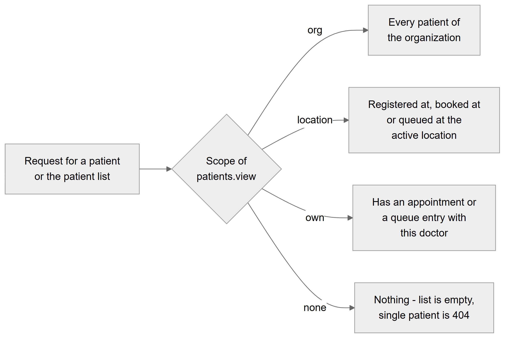

*Figure 28.8 — How the scope of `patients.view` decides which patients a user can reach.*

The flowchart starts from "Request for a patient or the patient list" and branches on the scope of `patients.view`. With `org`, the user reaches every patient of the organization. With `location`, the user reaches patients registered at the active location (their primary location), booked at it, or queued at it. With `own`, the user reaches patients who have an appointment or a queue entry with this doctor. With no grant, the list is empty and any single patient answers 404.

**Behind the scenes — technically.** `patientScope()` builds `EXISTS` sub-queries over `appointments`, `queue_entries`/`queue_sessions` and `patients.primary_location_id`; `AccessContext.applyScope` adds them to list and export queries; `PatientScopeGuard` checks single-patient routes. Prices are hidden separately: plan cost columns carry `@VisibleIf('patients.price.view')`, and the history endpoint strips treatment costs.

**Rules and validations.**
- A doctor with no employee record, or a user with no active location, gets an empty list under `own` or `location`.
- `GET /patients/check-phone` is not scope-limited (it only answers yes or no).

**Who can do it.** Applies to everyone except the owner and super admin, who hold every permission at `org` scope.

**Data read and written.** Reads `appointments`, `queue_entries`, `queue_sessions`, `patients`.

**Effects on other modules.** Other modules that list patients reuse `patientScope` or the patient-scope guard (encounters, treatments, prescriptions and inventory patient consumption).

**Error cases.** "Patient not found" (404) for an out-of-scope patient.

**Technical references:** `backend/src/patients/access/patient-scope.ts` · `patientScope`, `isPatientInScope`, `PatientScopeGuard` · `web-app/src/features/patients/utils/patientTabs.ts`

## 28.4 Entities and data model

The module owns fifteen tables. Two figures split them into clinical records and CRM-style records.

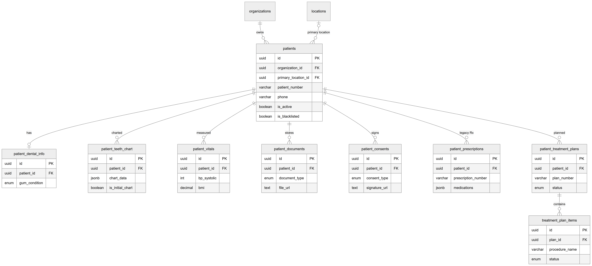

*Figure 28.9 — Entity-relationship diagram of the patient and its clinical sub-records.*

The diagram puts `patients` in the centre, with `organizations` and `locations` at the top and nine clinical tables along the bottom. Each patient belongs to exactly one organization; deleting the organization deletes its patients (ON DELETE CASCADE). A patient may have one primary location; deleting that location clears the link (ON DELETE SET NULL). A patient has at most one `patient_dental_info` row (unique `patient_id`). A patient has any number of `patient_teeth_chart`, `patient_vitals`, `patient_documents`, `patient_consents`, `patient_prescriptions` (legacy) and `patient_treatment_plans` rows; all of them are deleted with the patient (ON DELETE CASCADE), and most also carry `organization_id` and `location_id` foreign keys that cascade. Each treatment plan has any number of `treatment_plan_items`, deleted with the plan. Key columns shown: `patients.patient_number` (unique per organization), `phone`, `is_active`, `is_blacklisted`; `chart_data` and `is_initial_chart` on charts; `bp_systolic` and `bmi` on vitals; `document_type` and `file_url` on documents; `consent_type` and `signature_url` on consents; `prescription_number` and `medications` (JSON) on legacy prescriptions; `plan_number` and `status` on plans; `procedure_name` and `status` on items. Columns such as `dentist_id`, `recorded_by`, `uploaded_by`, `prescribed_by` and `witnessed_by` hold user or employee ids without a foreign key; the web app fills them with the signed-in user's id.

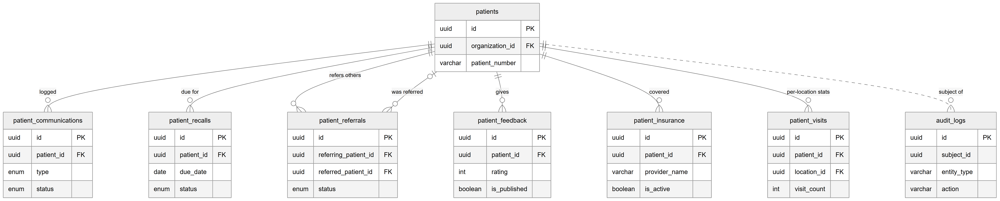

*Figure 28.10 — Entity-relationship diagram of the patient's CRM records, visit statistics and audit link.*

This diagram shows `patients` with seven related tables. A patient has any number of `patient_communications`, `patient_recalls`, `patient_feedback` and `patient_insurance` rows, all deleted with the patient. `patient_referrals` links to patients twice: `referring_patient_id` (the patient who referred; deleted with them) and an optional `referred_patient_id` (the person referred, if registered; cleared when that patient is deleted). `patient_visits` holds one row per patient and location (unique pair) with `visit_count`; nothing writes to it. The dotted line to `audit_logs` is a logical link without a foreign key: audit rows carry the patient id in `subject_id`, so they survive the patient's deletion.

Patients are also referenced from outside the module. Appointments, queue entries, encounters, treatments, prescriptions, inventory consumption and patient credits cascade on patient deletion; charges, invoices, payments, refunds, lab orders, lab invoices, lab payments and lab credits restrict it.

Money columns in this module (`patient_treatment_plans` costs, `treatment_plan_items.estimated_cost`, `patient_insurance` benefits, `patient_visits.total_spent`, referral reward) are decimal numbers in currency units (for example rupees), not paisa.

## 28.5 Status lifecycles

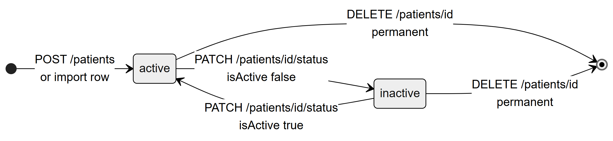

*Figure 28.11 — Lifecycle of a patient's active status.*

A patient is created **active** by `POST /patients` or by an import row. `PATCH /patients/:id/status` with `isActive: false` moves them to **inactive**, and with `isActive: true` back to **active**; each move writes a `status_history` row. From either state, `DELETE /patients/:id` removes the patient permanently (the end marker). Inactive patients keep all records and can still be booked and billed.

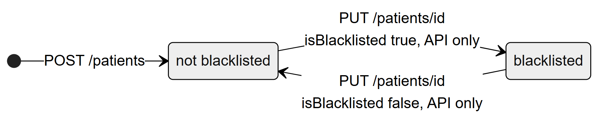

*Figure 28.12 — Lifecycle of the blacklist flag.*

The blacklist flag is independent of the active status. A new patient is **not blacklisted**. `PUT /patients/:id` with `isBlacklisted: true` (API only, no screen) makes them **blacklisted**, and `isBlacklisted: false` reverses it. The change is recorded as a normal field update in `audit_logs`, not in `status_history`.

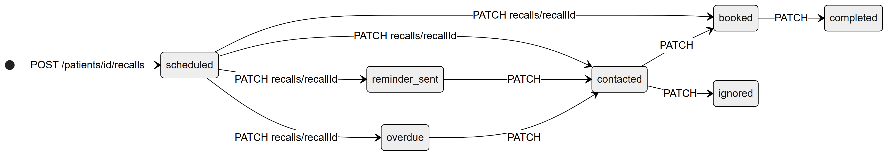

*Figure 28.13 — Typical path of a recall through its statuses.*

`POST /patients/:id/recalls` creates a recall in **scheduled**. The diagram shows the intended paths, each caused by `PATCH /patients/:id/recalls/:recallId`: from scheduled to **reminder_sent**, **contacted**, **booked** or **overdue**; reminder_sent to contacted; overdue to contacted; contacted to **booked** or **ignored**; booked to **completed**. The code has no transition map: the PATCH accepts any status from any status, and no background job sets reminder_sent or overdue. Recalls have no screen today.

Other status-like columns in the module have no transitions: referrals are always created as `pending` (no update endpoint), communications keep the status given at creation, and insurance `is_active` changes only through its PATCH. The treatment-plan and plan-item lifecycles are drawn in the Treatment Plans chapter (Chapter 33).

## 28.6 Connections to other modules

- **Appointments and Queue (Chapters 29–30):** booking and check-in pick a patient from this module; both appointment and queue rows define a doctor's `own` patient scope and a location's reach. Registration offers a "Book Appointment" step.
- **Consultation (Chapter 31):** the workspace shows the patient snapshot (history, latest vitals, allergies) from this module; encounters and treatments appear in the Visits and Treatments tabs.
- **Prescriptions (Chapter 32):** the Clinical & Rx tab links to the prescription builder; the legacy `patient_prescriptions` table lives here.
- **Treatment Plans (Chapter 33):** patient plans and items are stored by this module; plan templates fill the Record Treatment form.
- **Billing (Chapter 34):** the Billing tab and dues badge; billing tables block patient deletion.
- **Dental lab (Chapter 40):** lab orders reference a patient and block deletion.
- **Access control (Chapters 11 and 57):** permissions, scopes and features listed in each feature.
- **Audit logging (Chapter 60):** every write here produces an audit row tied to the patient.
- **Reports and dashboard (Chapter 36):** the dashboard counts active patients.

## 28.7 Limitations and known gaps

- **No screen for treatment plans, recalls, insurance, communications, referrals or feedback.** The backend endpoints work; the CRM tab component exists but is not mounted.
- **Blacklisting has no screen** and does not block booking, queueing or billing. Inactive patients are not blocked either.
- **Deleting a patient with billing or lab records fails** with a generic error, although the confirmation text says invoices and payments will be deleted.
- **Patient, plan and legacy prescription numbers come from a row count.** After a permanent deletion the count drops, so the next number can repeat an existing one; the unique index then makes the save fail with a server error. Two registrations at the same moment can also collide. Import guards against parallel imports only inside one server process.
- **The live phone check is not wired**, and phone uniqueness at registration is an exact text match, while import compares normalised phones. "0300 1234567" and "03001234567" are different to manual registration.
- **`patient_visits` is never filled**, so `GET /patients/:id/visits` is always empty.
- **No edit or delete for vitals, charts, consents, documents or legacy prescriptions** (by design for consents and charts; a mistaken upload cannot be removed from the screen).
- **The list screen exposes only search, gender and status filters**; card view has no paging; column sorting applies to the current page only.
- **Export uses UTC dates** for the file name and "Registered on" column.
- **Teeth charts store no periodontal data** from the screen, and vitals' medical flags are not in the form.

## 28.8 Owner's FAQ

**Can a receptionist delete a patient?**
Not with the default Receptionist role: `patients.delete` is in the Admin template only. An owner can add it to a role on the roles screen; it is marked high-risk.

**What happens to a patient's appointments and visits when I delete the patient?**
They are deleted with the patient, together with queue entries, encounters, treatments, prescriptions and all patient sub-records. If the patient has any charge, invoice, payment, refund or lab record, the delete is refused. Deactivating keeps everything and is the safer choice.

**Why can a doctor not find a patient who is registered in the clinic?**
The Doctor role sees only `own` patients: those with an appointment or a queue entry with that doctor. Once the patient is booked with or queued for the doctor, they appear.

**Can two patients share a phone number, for example a mother and child?**
No. The phone is unique per organization. Put the parent's number in the guardian phone and give the child another number, or leave the child's guardian details on a separate record.

**Where are uploaded X-rays stored?**
In the external file-storage service behind the Platform's storage provider (Cloudinary today). The Platform stores only the link, file name, size and type in `patient_documents`.

**Is every change to a patient recorded?**
Yes, for every write in this module: creation, edits with before/after values, activation changes, deletions and each sub-record. Exports are recorded too. Reads are not logged.

**Can I bring in my old patient register?**
Yes, with **Import** on the Patients page: Excel `.xlsx` or CSV, up to 5,000 rows and 10 MB per file. Run the check first; rows with problems are listed and can be downloaded as an error report.

**Who sees treatment prices on the patient page?**
Only holders of `patients.price.view` (Admin, Receptionist and Accountant by default). Doctors and assistants do not see fees in the Visits or Treatments tabs.

**Does the Platform send recall reminders to patients?**
No. Recalls can be stored through the API, but there is no screen, no reminder job, and notifications are in-app only.
