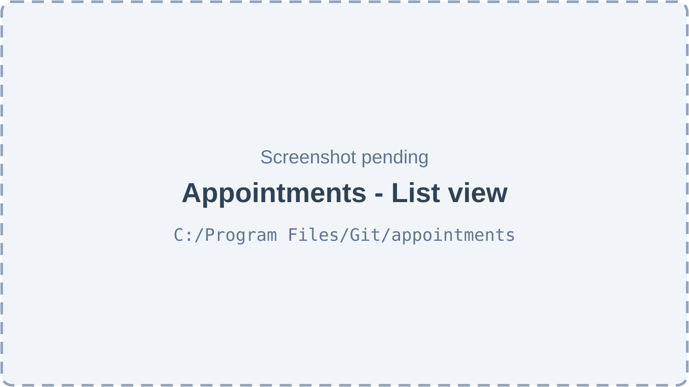
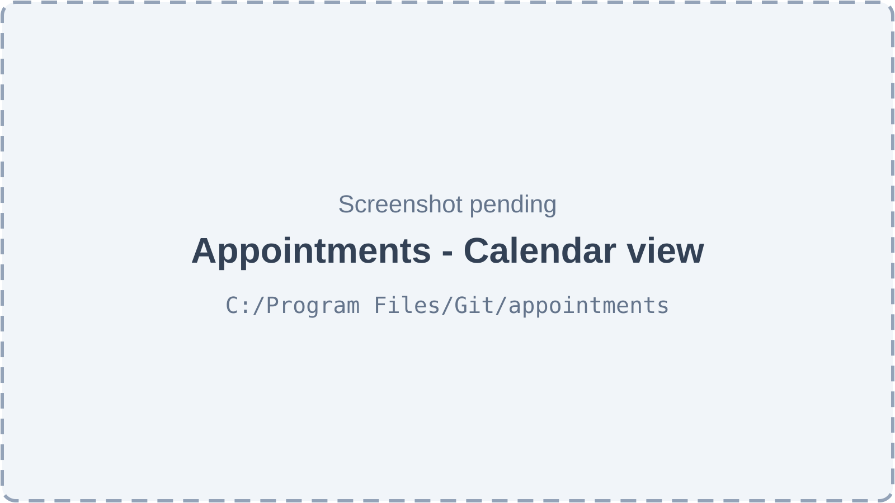
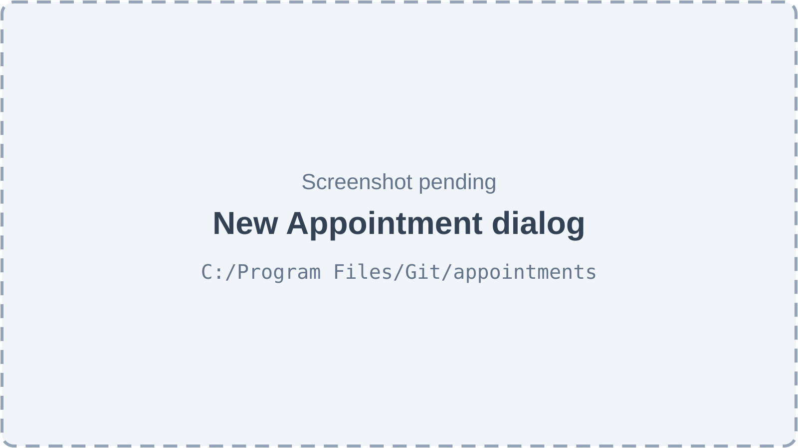
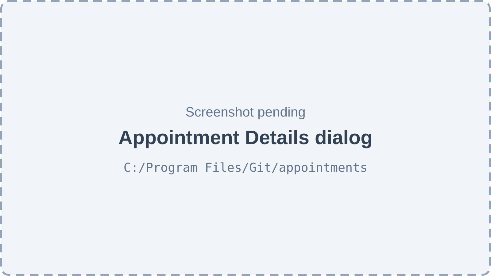
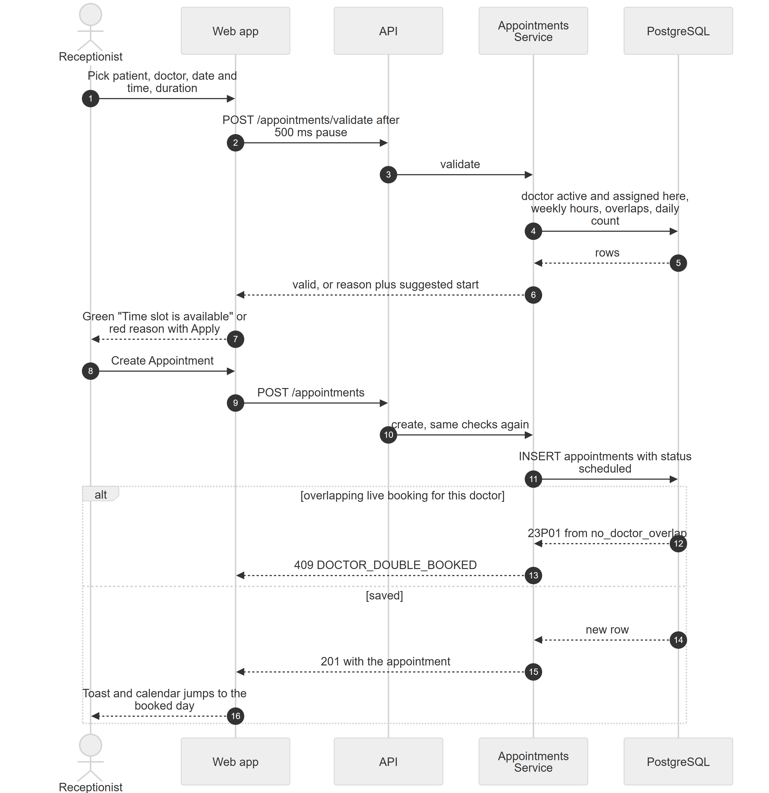
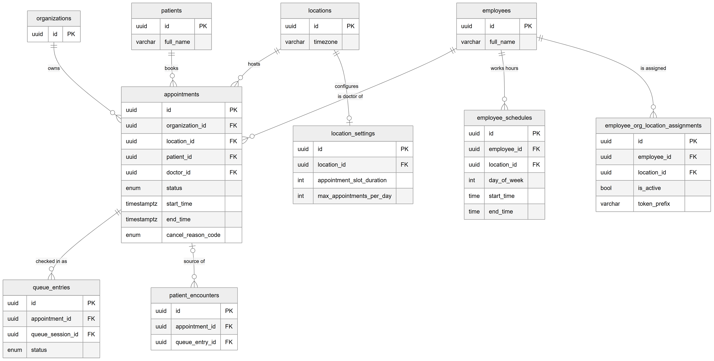
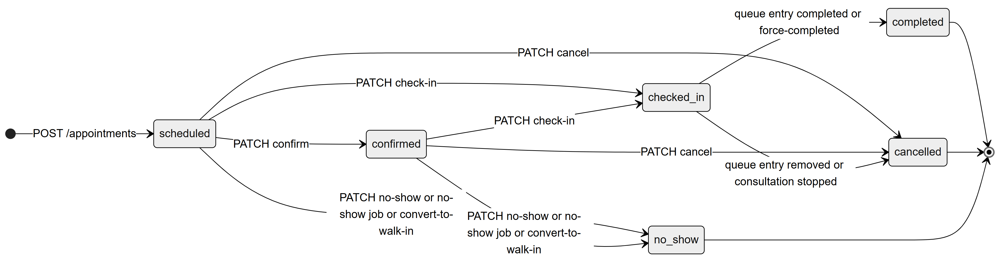

# Chapter 29 — Appointments

This chapter describes the Appointments module of the Platform: how a clinic books a patient with a doctor for a future time, and how that booking is managed until the patient arrives. It is written for the product owner, who needs to know exactly what the module does today, what rules it enforces and where it stops. The module ends at the moment of arrival: check-in hands the patient over to the doctor-wise queue, which the Queue chapter (Chapter 30) covers in full.

## 29.1 What this module is for

An **appointment** is a booking: one patient, one doctor, one location, a start time and a duration. The Appointments module lets front-desk staff create, confirm, reschedule and cancel bookings, mark patients who never came as no-shows, and check arriving patients in. It does not track what happens after arrival. Once a patient is checked in, the **queue entry** (a place in one doctor's queue for the day) drives everything else, and the appointment only records the final outcome (completed or cancelled).

Who uses it:

- **Receptionist**: the main user. Books, reschedules, confirms, cancels, marks no-shows and checks patients in.
- **Assistant**: can view bookings at the location, book new ones and check patients in, but cannot reschedule or cancel.
- **Doctor**: sees only their own bookings (scope `own`), in the list and calendar. A doctor cannot book or change bookings with the default role.
- **Admin** and the **owner**: everything, including overriding booking rules.

Where it appears: the sidebar item **Appointments** (key `nav.appointments`, route `/appointments`, shown to users with `appointments.view`). The same page also hosts the reception queue board as its **Queue** tab, which is why the route opens for users who hold either `appointments.view` or `queue.board.view`. A custom role that holds only `queue.board.view` can open the page, but the sidebar item is hidden for it, because the sidebar entry checks `appointments.view` only.

The whole module sits behind the feature **`appointments.core`** ("Appointments", enabled by default). Turning that feature off also removes every queue permission, because the queue permissions belong to the same feature.

## 29.2 Screens

The Appointments page (`/appointments`) has a title "Appointments", the subtitle "Search, schedule, and update patient appointments.", a view switch with up to three tabs (**Queue**, **List**, **Calendar**) and a **Create** button for users with `appointments.book`. Users with `queue.board.view` land on the Queue tab; others land on the List tab. On top of the selected view sits a KPI strip, shown to users with `appointments.view`. The Queue tab is the reception board and is described in Chapter 30.

*Figure 29.1 — Appointments, List view (screenshot pending).*

The List view starts with the KPI strip: six small tiles labelled Total, Upcoming, Completed, Walk-ins, No-Show and Avg wait (in minutes), computed for the calendar month of the selected date. Under it is a toolbar card. Its first row has a "Jump to" date picker, a **Today** button when another day is selected, and a doctor filter. Its second row is a scrollable strip of 14 days; clicking a day narrows the list to that single day. Its third row holds the filters: a search box ("Search appointments...", matching patient name, phone or patient number), a status filter, a type filter that also offers "Walk-in", date presets (**Today**, **Upcoming**, **Past 30 days**, **All**), a "Custom range" picker, a **Reset** link and a count such as "12 visits". The table has the columns Token, Date & Time, Patient (name, phone and an "Emergency" badge), Doctor, Type, Status and an actions column. Walk-ins appear in the same table, with "Arrived" before their time and a "Walk-in" type badge. Rows are paged on the server, with page sizes 10, 25, 50 and 100. Clicking a booking opens the appointment detail dialog; clicking a walk-in opens the patient record. Cancelled rows are dimmed.

*Figure 29.2 — Appointments, Calendar view (screenshot pending).*

The Calendar view uses FullCalendar and its premium resource views (the resource time-grid and resource day-grid plugins), so each doctor at the location gets a column with initials, name and designation. A switch offers **Month**, **Week** and **Day**; Day by doctor is the default. The same toolbar (date picker, day strip, doctor filter) and the same filters as the List view appear over the grid. The time grid covers the full 24 hours in 30-minute rows and scrolls to 08:00 on opening. Each doctor's working hours for the visible days are drawn as a light green background. Bookings are coloured by status, with cancelled and emergency bookings styled differently. The user can select an empty time range to start a booking with that doctor and time pre-filled, click a booking to open its details, drag a booking to another time or another doctor's column, and drag its bottom edge to change its length. Only scheduled and confirmed bookings can be dragged or resized.

*Figure 29.3 — The New Appointment dialog (screenshot pending).*

The booking form opens as a centred dialog titled "New Appointment" (or "Edit Appointment" when rescheduling). It contains: **Patient \*** (a search box, "Search by name or phone...", with a result list), **Doctor \*** (a list of staff at the location shown as "name — designation"), **Date & Time \*** (a browser date-and-time field), **Duration \*** (15 min, 30 min, 45 min, 1 hour, 1.5 hours, 2 hours, plus the location's default slot length), a live validation message, **Appointment Type** (Consultation, Follow Up, Treatment, Checkup, Emergency, Cleaning), an **Emergency** switch and **Notes**. The live message is green ("Time slot is available") or red with the reason; when the doctor is busy it may offer "Suggested: 10:30 Apply". The buttons are **Cancel** and **Create Appointment** (or **Update Appointment**). The submit button is disabled while saving and while the live check reports a problem.

*Figure 29.4 — The Appointment Details dialog (screenshot pending).*

The detail dialog shows the status badge, a large **Token** (or "Assigned at check-in" before arrival, because a booking has no token until the patient arrives), the queue status and doctor, the appointment type and an "Emergency" badge. Its body lists the patient (patient number and phone, clickable to open the patient record), the doctor and designation, the date, time and duration, notes and any cancellation reason. A "Quick actions" block offers **Confirm** (scheduled only), **Check in**, **No show** and **Cancel** for bookings not yet checked in. For a checked-in booking it shows the hint that calling, starting and finishing the visit happen on the Queue board or the doctor's screen. The footer has **Print ticket** (once a token exists), **Close** and **Edit**.

## 29.3 Features

### 29.3.1 See bookings and walk-ins in one list

**Status:** [Implemented]

**What it does.** Shows every booking at the active location, merged with that location's walk-ins, sorted by time and paged on the server. Staff can search and filter by date, doctor, status and type.

**How the user does it.**
1. Open **Appointments** in the sidebar and choose the **List** tab.
2. Pick a date preset (**Today**, **Upcoming**, **Past 30 days**, **All**), a custom range, or a day in the day strip.
3. Narrow with the doctor filter, the search box, the status filter or the type filter (choose "Walk-in" to see only walk-ins).
4. Click a row to open its details, or use the row menu (three dots).

**Behind the scenes — in simple terms.** Bookings and walk-ins live in two different tables. The server reads both, puts them in one time-ordered list and returns one page. A walk-in has no booking, so it is dressed up to look like a booking row, with its arrival time as its time. The doctor's own bookings are all a doctor sees.

**Behind the scenes — technically.** `GET /appointments` with `includeWalkIns=true` (the List view always sends it) runs `AppointmentsService.findAllWithWalkIns`: a SQL `UNION ALL` of `appointments` and walk-in `queue_entries` (joined to `queue_sessions` for doctor and location), counted and paged together, ordered by `sort_at` and id. Walk-in rows get `kind: 'walk_in'`; their status is mapped from the queue status (waiting, called, in consultation, on hold, skipped → `checked_in`; completed → `completed`; cancelled, aborted, transferred → `cancelled`). Every booking row is enriched with its latest queue entry (token such as "A-007", queue status, session id). Without `includeWalkIns`, a TypeORM query returns bookings only (the calendar uses this). The search box is debounced by 300 ms in the web app; the search runs as `ILIKE` on the patient's full name, phone and patient number.

**Rules and validations.**
- Always limited to the active location.
- Scope of `appointments.view`: `own` limits rows to the signed-in doctor's bookings and sessions; `location` and `org` show the whole location.
- A booking-only status filter (scheduled, confirmed, no-show) or a booking type filter leaves walk-ins out; the type filter "Walk-in" leaves bookings out.
- Default page size 50 on the server; the web app uses 25.

**Who can do it.** `appointments.view` (scoped `own` / `location` / `org`), feature `appointments.core`. Default: Admin (`org`), Receptionist (`location`), Assistant (`location`), Doctor (`own`). Accountant: no.

**Data read and written.** Reads `appointments`, `queue_entries`, `queue_sessions`, `patients`, `employees`, `locations`. Writes nothing.

**Effects on other modules.** None (read-only).

**Error cases.** 403 `NO_PERMISSION` without `appointments.view`. 400 on an invalid filter value (for example a malformed date).

**Technical references:** `backend/src/appointments/appointments.controller.ts` · `AppointmentsService.findAll` / `findAllWithWalkIns` · `web-app/src/features/appointments/components/AppointmentsList.tsx`

### 29.3.2 Browse the calendar by doctor

**Status:** [Implemented]

**What it does.** Shows bookings on a month, week or day grid, with one column per doctor and each doctor's weekly working hours shaded in the background.

**How the user does it.**
1. On **Appointments**, choose the **Calendar** tab.
2. Choose **Month**, **Week** or **Day**, and move with the arrows, the day strip or "Jump to".
3. Optionally filter by doctor, status, type or search text.

**Behind the scenes — in simple terms.** The page asks for the bookings in the visible range, the list of staff at the location (the columns) and the working-hours blocks for those days. The working hours come from each doctor's weekly schedule.

**Behind the scenes — technically.** Three calls: `GET /appointments` (bookings only, up to 500, for the visible range), `GET /appointments/doctors` (active staff assigned to the active location) and `GET /appointments/availability?startDate&endDate` (`AppointmentsService.getAvailability`). The availability call walks the location-local calendar days in the range (with `ClockService`) and, for each doctor and weekday, turns the matching `employee_schedules` row (working, active) into start and end instants in the location's timezone. The status, type and search filters on this tab are applied in the browser to the loaded bookings.

**Rules and validations.**
- Availability blocks come from the weekly schedule only. Date-specific availability overrides and approved leave are not shown (see 29.3.13).
- The weekly schedule lookup is by doctor and weekday; the schedule's own location is not considered, so a doctor who works Mondays at the second location shows Monday hours at the main location too.
- The "doctors" list is every active staff member with an active assignment at the location; the code does not filter by role.

**Who can do it.** `appointments.view`, feature `appointments.core`. Default: Admin, Receptionist, Assistant, Doctor (own bookings only).

**Data read and written.** Reads `appointments`, `employee_org_location_assignments`, `employees`, `employee_schedules`, `locations`. Writes nothing.

**Effects on other modules.** None.

**Error cases.** 403 `NO_PERMISSION` without `appointments.view`.

**Technical references:** `backend/src/appointments/appointments.service.ts` · `AppointmentsService.getAvailability` / `getDoctors` · `web-app/src/features/appointments/components/FullCalendarView.tsx`

### 29.3.3 See the KPI strip

**Status:** [Implemented]

**What it does.** Shows six numbers for the month of the selected date: Total bookings, Upcoming (scheduled plus confirmed), Completed, Walk-ins, No-Show and Avg wait in minutes.

**How the user does it.**
1. Open **Appointments**. The strip appears at the top for users who can view bookings.

**Behind the scenes — in simple terms.** Booking counts come from the appointments table. Walk-ins and waiting time come from the queue, because only the queue knows when a patient arrived and when the doctor started.

**Behind the scenes — technically.** `GET /appointments/stats?startDate&endDate` runs `AppointmentsService.getStats`: one grouped count over `appointments` (scoped by `appointments.view`) and one query over `queue_entries` joined to `queue_sessions`, giving walk-in count, waiting count, with-doctor count and the average of `consultation_started_at − checked_in_at` in minutes. The response also includes `cancelled`, `checkedIn`, `waiting`, `inProgress`, `completionRate` and `noShowRate`; the strip shows six of these.

**Rules and validations.**
- The web app sends the first and last moment of the selected month, computed in the browser's timezone.
- Average wait counts only entries whose consultation has started.

**Who can do it.** `appointments.view`, feature `appointments.core`. Default: Admin, Receptionist, Assistant, Doctor (own figures only).

**Data read and written.** Reads `appointments`, `queue_entries`, `queue_sessions`.

**Effects on other modules.** None.

**Error cases.** 403 `NO_PERMISSION`.

**Technical references:** `backend/src/appointments/appointments.service.ts` · `AppointmentsService.getStats` · `web-app/src/features/appointments/components/StatsCards.tsx`

### 29.3.4 Book an appointment

**Status:** [Implemented]

**What it does.** Creates a booking for a patient with a doctor at the active location. A new booking starts as `scheduled` and has no token; the token is issued only when the patient arrives.

**How the user does it.**
1. Click **Create** on the Appointments page, or select an empty time range in the calendar (doctor and time are pre-filled).
2. Search and pick the **Patient**, choose the **Doctor**, set **Date & Time** and **Duration**.
3. Wait for the live check to turn green, or click **Apply** on a suggested time.
4. Optionally set **Appointment Type**, **Emergency** and **Notes**.
5. Click **Create Appointment**. A toast confirms it and the calendar moves to the booked day.

Figure 29.5 shows the full exchange between the screen and the server.

*Figure 29.5 — Booking: live validation, then the save that the database has the final say on.*

The diagram has five participants: the Receptionist, the Web app, the API, the AppointmentsService and PostgreSQL. In steps 1 to 7, the receptionist picks patient, doctor, date, time and duration; after a 500 ms pause the web app calls `POST /appointments/validate`; the service checks that the doctor is active and assigned to the location, that the slot fits the weekly hours, that there is no overlap and that the daily count is not reached; the answer (valid, or a reason with a suggested start) comes back and the form shows a green or red message with an Apply link. In steps 8 to 11, the receptionist clicks Create Appointment, the web app calls `POST /appointments`, the service runs the same checks again and inserts the row with status `scheduled`. An "alt" box then shows two outcomes. If another live booking for the same doctor overlaps (for example because two desks saved at the same moment), PostgreSQL rejects the insert with error 23P01 from the `no_doctor_overlap` constraint and the user receives 409 `DOCTOR_DOUBLE_BOOKED`. Otherwise the new row comes back, the API answers 201 and the screen shows a toast and jumps to the booked day.

**Behind the scenes — in simple terms.** The server runs a fixed list of checks in order: not in the past, the patient belongs to this organization, the doctor is active and works at this location, the slot fits inside one of the doctor's working blocks for that weekday, the doctor has no other live booking at that time at any location, and the location has not reached its daily booking limit. The database itself also refuses double bookings, so two people saving at the same second cannot both win.

**Behind the scenes — technically.** `POST /appointments` → `AppointmentsService.create`. Steps: resolve the location timezone (`ClockService.timezoneFor`); reject a start before `ClockService.now()`; load the patient by id and organization; `assertDoctorAtLocation` (active `employees` row and an active `employee_org_location_assignments` row for this organization and location); `validateSchedule` (weekday and "HH:MM" read in the location's timezone; the slot must fit inside one active, working `employee_schedules` block); `checkGlobalConflict` (any appointment of the doctor whose time overlaps and whose status is not cancelled or no-show, at any location); `assertDailyLimit` (count of non-cancelled, non-no-show bookings at the location on that local day against `location_settings.max_appointments_per_day`). The row is saved by `saveBooking`, which maps PostgreSQL error 23P01 from the exclusion constraint `no_doctor_overlap` to 409 `DOCTOR_DOUBLE_BOOKED`. The constraint is `EXCLUDE USING gist (doctor_id WITH =, tstzrange(start_time, end_time, '[)') WITH &&) WHERE status NOT IN ('cancelled','no_show')` and needs the `btree_gist` extension, which the API creates on start-up. No queue, event or audit-log write happens at booking; `created_by` and `updated_by` hold the user id.

**Rules and validations.**
- Duration is a whole number of minutes from 5 to 480; patient, doctor and start time are required.
- `type` defaults to `consultation`; `isEmergency` defaults to false. The emergency flag does not move the patient ahead in the queue on its own (Chapter 30).
- The start must not be in the past.
- The doctor must be active and actively assigned to the active location.
- The whole slot must fit inside one weekly working block for that weekday, read in the location's timezone. The lookup ignores which location the block belongs to (a known gap).
- No overlap with the doctor's other live bookings at any location of any organization the doctor works for. Cancelled and no-show bookings do not block. Bookings touching end-to-start do not overlap (`[)` range).
- Daily limit per location: `location_settings.max_appointments_per_day` (default 50 once the location's settings row exists; 0 or a missing row means no limit).
- The reason for visit can be stored (`reasonForVisit` in the API), but the booking dialog has no field for it.

**Who can do it.** `appointments.book`, feature `appointments.core`. Default: Admin, Receptionist, Assistant. Not Doctor or Accountant.

**Data read and written.** Reads `patients`, `employees`, `employee_org_location_assignments`, `employee_schedules`, `location_settings`, `locations` (timezone), `appointments`. Writes `appointments`.

**Effects on other modules.** The new booking appears in the calendar, the list, the KPI strip, the patient record's appointments tab and the clinic overview and visit reports (Chapter 36). A doctor with patient scope `own` can see a patient once that patient has an appointment with them.

**Error cases.**
- 400 "Cannot book appointments in the past".
- 404 "Patient not found" → the patient is not in this organization.
- 404 "Doctor not found or is inactive".
- 400 "Doctor is not assigned to this location".
- 400 "Doctor does not work on Monday" (or the weekday concerned).
- 400 "Requested time (10:00-10:30) is outside doctor's schedule. Available: 14:00 - 18:00".
- 409 "Doctor has a conflicting appointment during this time" → the read check found an overlap (no error code).
- 409 `DOCTOR_DOUBLE_BOOKED` → the database constraint caught an overlap.
- 409 `DAILY_LIMIT_REACHED` → "Daily limit reached: this location takes at most 50 bookings on 2026-10-26".
- 402 `SUBSCRIPTION_EXPIRED` → the clinic is in read-only mode.

**Technical references:** `backend/src/appointments/appointments.service.ts` · `AppointmentsService.create`, `saveBooking`, `Appointment` (`no_doctor_overlap`) · `web-app/src/features/appointments/components/AppointmentModal.tsx`

### 29.3.5 Check a time slot live and get a suggested time

**Status:** [Implemented]

**What it does.** While the booking form is open, the server checks the chosen doctor, time and duration and, if the doctor is busy, suggests the next free start time on the same day.

**How the user does it.**
1. Fill in Doctor, Date & Time and Duration in the booking dialog.
2. Read the green or red message. If a suggestion appears, click **Apply** to use it.

**Behind the scenes — in simple terms.** The same checks as a real booking run, but nothing is saved and problems come back as a message instead of an error. To suggest a time, the server walks forward through the doctor's bookings that day, jumping past each clash, until a free gap that still fits the working hours appears.

**Behind the scenes — technically.** `POST /appointments/validate` → `AppointmentsService.validate`, returning `{ valid, reason?, conflictLocation?, suggestedStartTime? }`. On a conflict, `suggestNextSlot` loads the doctor's live bookings for that location-local day, starts at the requested time and moves to the end of each clashing booking, up to 50 tries, stopping when the candidate no longer fits a working block. `excludeAppointmentId` lets a reschedule ignore the booking being moved. The web app calls it 500 ms after the last change to doctor, time or duration.

**Rules and validations.**
- Checks doctor, weekly schedule, overlaps and the daily limit. It does not check "in the past"; the save does.
- When the clash is at another location, the reason reads "Doctor busy at another location".
- The suggestion considers only the same day and the doctor's weekly hours.

**Who can do it.** `appointments.book`, feature `appointments.core`. Default: Admin, Receptionist, Assistant. A user with only `appointments.reschedule` (no `appointments.book`) gets 403 on this check when editing; the Receptionist template holds both.

**Data read and written.** Reads the same tables as booking. Writes nothing.

**Effects on other modules.** None.

**Error cases.** Problems come back as `valid: false` with a reason (same texts as 29.3.4). 400 on invalid input; 403 `NO_PERMISSION`.

**Technical references:** `backend/src/appointments/appointments.service.ts` · `AppointmentsService.validate`, `suggestNextSlot` · `web-app/src/features/appointments/hooks/useValidateAppointment.ts`

### 29.3.6 Override booking rules

**Status:** [Partial] — the API supports it; no screen sends it.

**What it does.** Lets an authorised user book (or move) a booking outside the doctor's working hours or beyond the location's daily limit.

**How the user does it.** No screen offers this. It is available only to an API client that sends `overrideRules: true`.

**Behind the scenes — in simple terms.** The working-hours check and the daily-limit check are skipped. The double-booking check is never skipped.

**Behind the scenes — technically.** `CreateAppointmentDto.overrideRules` and `UpdateAppointmentDto.overrideRules`. `AppointmentsService.overridesRules` checks `access.can('appointments.override_rules')` and throws 403 `NO_PERMISSION` otherwise. When allowed, `validateSchedule` and `assertDailyLimit` are skipped; `checkGlobalConflict` and the `no_doctor_overlap` constraint still apply.

**Rules and validations.**
- The live validation endpoint does not accept the flag, so it would still report "outside schedule" for such a slot.

**Who can do it.** `appointments.override_rules` (high-risk, implies `appointments.book`), feature `appointments.core`. Default: Admin only.

**Data read and written.** Same as booking and reschedule.

**Effects on other modules.** None beyond a normal booking.

**Error cases.** 403 `NO_PERMISSION` "Missing permission: appointments.override_rules".

**Technical references:** `backend/src/appointments/dto/create-appointment.dto.ts` · `AppointmentsService.overridesRules` · no web-app caller

### 29.3.7 Reschedule or edit a booking

**Status:** [Implemented]

**What it does.** Changes the time, duration, doctor, patient, type or notes of a booking that has not been checked in. A reschedule keeps the same row and the same status.

**How the user does it.**
1. Open the booking (row click or calendar click) and click **Edit**, or choose **Edit** in the row menu.
2. Change the fields and click **Update Appointment**.
3. Or, in the Calendar, drag the booking to another time or another doctor's column, or drag its bottom edge to change its length. A toast confirms ("Appointment rescheduled", "Reassigned to Dr. Example One", "Duration updated to 45 min"); on failure the booking jumps back.

**Behind the scenes — in simple terms.** Only scheduled and confirmed bookings can change. If the time or doctor really changes, all the booking checks run again (excluding this booking itself). Changing only the notes runs no checks.

**Behind the scenes — technically.** `PUT /appointments/:id` → `AppointmentsService.update`. It loads the booking at the active location and calls `assertEditable` (status must be `scheduled` or `confirmed`, else 422 `APPOINTMENT_LOCKED`). `timeChanged` and `doctorChanged` decide whether to re-run the past-time check, `validateSchedule`, `checkGlobalConflict` and `assertDailyLimit` (with this booking excluded). The status is not touched. The web form sends `startTime` and `duration` only when they changed, so editing notes never reschedules. The dialog loads the "Emergency" switch, but the update API has no `isEmergency` field, so a change to that switch on edit is not saved.

**Rules and validations.**
- Only `scheduled` or `confirmed` bookings are editable.
- A changed start time must not be in the past.
- A new doctor must be active and assigned to the location; a new patient must be in the organization.
- Same schedule, overlap and daily-limit rules as booking; `overrideRules` works as in 29.3.6.

**Who can do it.** `appointments.reschedule`, feature `appointments.core`. Default: Admin, Receptionist. Not Assistant, Doctor or Accountant.

**Data read and written.** Reads as booking. Writes `appointments` (time, duration, doctor, patient, type, notes, `updated_by`).

**Effects on other modules.** The calendar, list and KPI figures change. A booking moved to another day may change which day's queue it can be checked into.

**Error cases.** 404 "Appointment not found"; 422 `APPOINTMENT_LOCKED` "A checked_in appointment can no longer be edited; only scheduled or confirmed bookings can"; 400 "Cannot move an appointment into the past"; plus every booking error from 29.3.4.

**Technical references:** `backend/src/appointments/appointment-transitions.ts` · `AppointmentsService.update`, `assertEditable` · `web-app/src/features/appointments/components/FullCalendarView.tsx`

### 29.3.8 Confirm a booking

**Status:** [Implemented]

**What it does.** Marks a scheduled booking as confirmed (for example after the patient answered a call). It is a status marker only; it changes no rule.

**How the user does it.**
1. In the row menu or the detail dialog, click **Confirm** (shown only for scheduled bookings).

**Behind the scenes — in simple terms.** The status moves from scheduled to confirmed if the status map allows it.

**Behind the scenes — technically.** `PATCH /appointments/:id/confirm` → `AppointmentsService.confirm` → `assertTransition(status, CONFIRMED)` against `APPOINTMENT_TRANSITIONS`, then save.

**Rules and validations.**
- Allowed only from `scheduled`.

**Who can do it.** `appointments.book`, feature `appointments.core`. Default: Admin, Receptionist, Assistant.

**Data read and written.** Writes `appointments.status`, `updated_by`.

**Effects on other modules.** Counts as "Upcoming" in the KPI strip, like scheduled.

**Error cases.** 404 "Appointment not found"; 422 `INVALID_TRANSITION` "Cannot change an appointment from confirmed to confirmed".

**Technical references:** `backend/src/appointments/appointments.service.ts` · `AppointmentsService.confirm` · `web-app/src/features/appointments/hooks/useAppointmentActions.ts`

### 29.3.9 Cancel a booking (with reason codes)

**Status:** [Partial] — the API stores a reason code and text; the web app cancels with neither and asks no confirmation.

**What it does.** Ends a booking that has not been checked in. The API accepts a structured reason code (`patient_left` or `other`) and an optional free-text reason, for later analysis.

**How the user does it.**
1. In the row menu or the detail dialog, click **Cancel**. The booking is cancelled at once and a toast says "Appointment cancelled".

**Behind the scenes — in simple terms.** The booking becomes cancelled and stops blocking the doctor's time. A patient who has already checked in cannot be cancelled here; they must be removed from the queue instead, which also cancels the booking.

**Behind the scenes — technically.** `PATCH /appointments/:id/cancel` with `{ reasonCode?, reason? }` → `AppointmentsService.cancel`. A `checked_in` booking is refused with 422 `INVALID_TRANSITION`. Otherwise `assertTransition(status, CANCELLED)`, then `cancel_reason_code`, `cancel_reason` and `cancelled_at` are set. The DTO refuses `no_show` as a reason code ("use the no-show action for no-shows"). The web app's cancel helper can send a reason, and the enum and option list exist in `features/appointments/types.ts`, but no screen uses them, and no confirm dialog is shown.

**Rules and validations.**
- Allowed from `scheduled` or `confirmed`.
- `reasonCode` must be `patient_left` or `other` when given.
- After check-in, the queue's "Remove from queue" or "Stop consultation" closes the booking as cancelled with code `patient_left` or `other` (Chapter 30).

**Who can do it.** `appointments.cancel`, feature `appointments.core`. Default: Admin, Receptionist.

**Data read and written.** Writes `appointments` (`status`, `cancel_reason_code`, `cancel_reason`, `cancelled_at`, `updated_by`).

**Effects on other modules.** The slot becomes free for other bookings (the overlap check and the constraint ignore cancelled rows). The booking counts as cancelled in reports.

**Error cases.** 422 `INVALID_TRANSITION` "The patient has checked in — remove them from the queue instead"; 422 `INVALID_TRANSITION` for completed, cancelled or no-show bookings; 400 "reasonCode must be patient_left or other; use the no-show action for no-shows".

**Technical references:** `backend/src/appointments/enums/cancel-reason.enum.ts` · `AppointmentsService.cancel`, `CancelAppointmentDto` · `web-app/src/features/appointments/components/AppointmentDetailModal.tsx`

### 29.3.10 Mark a no-show (by hand or automatically)

**Status:** [Implemented]

**What it does.** Records that a booked patient never arrived. Staff can do it by hand; a background job also does it automatically once a patient is later than the clinic's "maximum late" setting.

**How the user does it.**
1. In the row menu or the detail dialog of a scheduled or confirmed booking, click **No show**.
2. Otherwise, do nothing: the job marks late bookings on its own.

**Behind the scenes — in simple terms.** The booking becomes a no-show and stops blocking the doctor's time. Every minute, a job looks for bookings that are still scheduled or confirmed and whose start time plus the "maximum late" minutes (45 by default) has passed, and marks them as no-shows.

**Behind the scenes — technically.** Manual: `PATCH /appointments/:id/no-show` → `AppointmentsService.noShow` → `assertTransition(status, NO_SHOW)`, sets `no_show_at`. Automatic: `QueueJobsService.markNoShows`, `@Interval` every 60 seconds in the worker process. It finds organization–location pairs with scheduled or confirmed bookings that started in the last 7 days, reads each location's effective queue policy, and runs one `UPDATE appointments SET status = 'no_show', no_show_at = now()` where `start_time + max_late_min < now()`. The job writes directly with SQL: no queue event, no audit row and no realtime message.

**Rules and validations.**
- Allowed only from `scheduled` or `confirmed`.
- The automatic threshold is the location's `max_late_min` (default 45 minutes; Chapter 30 covers queue policies).

**Who can do it.** Manual: `appointments.cancel` (a no-show ends the booking like a cancel does), feature `appointments.core`. Default: Admin, Receptionist. Automatic: the worker process, no user.

**Data read and written.** Reads `appointments`, `queue_policies`. Writes `appointments` (`status`, `no_show_at`, `updated_by` for the manual action).

**Effects on other modules.** No-shows count in the KPI strip and in the visit reports. A no-show booking no longer shows a **Check in** action in the web app (see 29.3.12).

**Error cases.** 422 `INVALID_TRANSITION` for a booking that is not scheduled or confirmed.

**Technical references:** `backend/src/queue/jobs/queue-jobs.service.ts` · `AppointmentsService.noShow`, `QueueJobsService.markNoShows` · `web-app/src/features/appointments/components/AppointmentsList.tsx`

### 29.3.11 Check a patient in (hand-over to the queue)

**Status:** [Implemented]

**What it does.** Records that a booked patient has arrived and gives them a doctor-wise **token** (for example "A-007") in that doctor's queue for today. From here on the queue runs the visit.

**How the user does it.**
1. In the row menu or the detail dialog, click **Check in**.
2. In the "Check in patient" dialog, optionally tick **Give urgent priority?** and type a reason.
3. Click **Check in & get token**. A toast shows "Checked in — token A-007" with a **Print ticket** button.

**Behind the scenes — in simple terms.** The queue checks that the booking is for today and that the patient is not too late, opens the doctor's queue for the day if needed, issues the next token, and marks the booking as checked in. If the patient is too late, the dialog switches to "Too late for the appointment" and offers to convert them to a walk-in.

**Behind the scenes — technically.** `PATCH /appointments/:id/check-in` (requires an `Idempotency-Key` header) is served by the Appointments controller but runs `QueueOrchestrator.checkInAppointment` in one transaction: lock the appointment row, refuse a second active entry (409 `ALREADY_CHECKED_IN`), check the status map, check the booking's service date equals today's (422 `NOT_TODAY`), check `isBeyondMaxLate` (422 `LATE_LIMIT_EXCEEDED`), ensure and lock the doctor's `queue_sessions` row, issue a token, insert a `queue_entries` row (`queue_type = appointment`, status `waiting`), and set the appointment to `checked_in` with `checked_in_at`. Chapter 30 explains tokens, idempotency and the queue rules in full.

**Rules and validations.**
- Only from `scheduled` or `confirmed`, only on the booking's own service day, and only up to `max_late_min` after the start.
- A retried request with the same key returns the same token.

**Who can do it.** `queue.checkin`, feature `appointments.core`. Default: Admin, Receptionist, Assistant.

**Data read and written.** Writes `appointments`, `queue_sessions`, `queue_entries`, `queue_events`, `outbox`, `idempotency_keys`.

**Effects on other modules.** Creates the queue entry that the Queue module (Chapter 30) and the consultation workspace (Chapter 31) continue from.

**Error cases.** 409 `ALREADY_CHECKED_IN` (the dialog shows "Already checked in — token A-007"); 422 `LATE_LIMIT_EXCEEDED` (the dialog switches to the convert option); 422 `NOT_TODAY`; 422 `SESSION_NOT_OPEN` "This queue is closed for the day"; 400 `IDEMPOTENCY_KEY_REQUIRED`.

**Technical references:** `backend/src/appointments/appointments.controller.ts` · `QueueOrchestrator.checkInAppointment` · `web-app/src/features/queue/components/CheckInDialog.tsx`

### 29.3.12 Convert a late booking to a walk-in

**Status:** [Implemented] — with a practical gap: the web app reaches it only in the short time before the no-show job runs.

**What it does.** For a patient who arrives later than the clinic allows, marks the booking as a no-show and adds the patient to the same doctor's queue as a walk-in with a new token, linked to the old booking.

**How the user does it.**
1. Click **Check in** on the late booking.
2. The dialog shows "Too late for the appointment" and the server's message ("More than 45 minutes late — convert to a walk-in or reschedule").
3. Click **Convert to walk-in**. A toast shows "Added as walk-in — token A-012".

**Behind the scenes — in simple terms.** The booking is closed as a no-show, and a new walk-in entry is created for the patient in the doctor's queue, with a pointer back to the booking.

**Behind the scenes — technically.** `POST /appointments/:id/convert-to-walk-in` (with `Idempotency-Key`) → `QueueOrchestrator.convertToWalkIn`. Allowed when the booking is already `no_show`, or is `scheduled`/`confirmed` and beyond `max_late_min`. Sets the booking to `no_show` if needed, ensures today's session for the booking's doctor, refuses a duplicate active entry, and issues a token with `queue_type = walk_in`, `appointment_id = NULL` and `converted_from_appt_id` = the booking. The `CHECKED_IN` queue event carries reason code `CONVERTED_TO_WALK_IN`.

**Rules and validations.**
- Refused (422 `INVALID_TRANSITION`) when the booking is still within the late limit: "Only an appointment past the late limit (or a no-show) can be converted; check the patient in instead".
- The web app shows **Check in** only for scheduled or confirmed bookings. Because the no-show job marks a late booking within about a minute of the limit passing, a late patient's booking is usually already `no_show` and shows no check-in action; the desk then has to add an ordinary walk-in (Chapter 30), which is not linked to the booking. This is a deduction from the code, not an observed test.

**Who can do it.** `queue.checkin`, feature `appointments.core`. Default: Admin, Receptionist, Assistant.

**Data read and written.** Writes `appointments`, `queue_sessions`, `queue_entries`, `queue_events`, `outbox`, `idempotency_keys`.

**Effects on other modules.** The visit is billed and reported as a walk-in.

**Error cases.** 422 `INVALID_TRANSITION` (not late enough); 409 `ALREADY_CHECKED_IN`; 422 `SESSION_NOT_OPEN`.

**Technical references:** `backend/src/queue/services/queue-orchestrator.service.ts` · `QueueOrchestrator.convertToWalkIn` · `web-app/src/features/queue/components/CheckInDialog.tsx`

### 29.3.13 Respect availability overrides and leave when booking

**Status:** [Not implemented]

**What it does.** Nothing today. The Employees module stores date-specific availability overrides (`doctor_availability_overrides`: a doctor is unavailable on a date, or has special hours) and leave (`employee_leaves`), but booking, live validation, slot suggestion and the calendar's availability shading never read them.

**How the user does it.** Not available. A receptionist can book a doctor on a day the doctor is on approved leave, as long as the weekly schedule allows it.

**Behind the scenes — in simple terms.** Only the weekly schedule is consulted.

**Behind the scenes — technically.** `AppointmentsService` reads `employee_schedules` only; there is no reference to `DoctorAvailabilityOverride` or `EmployeeLeave` in `backend/src/appointments/` or `backend/src/queue/`.

**Rules and validations.** None.

**Who can do it.** Not applicable.

**Data read and written.** None.

**Effects on other modules.** None.

**Error cases.** None.

**Technical references:** `backend/src/employees/entities/doctor-availability-override.entity.ts` · `DoctorAvailabilityOverride`, `EmployeeLeave` · no web-app use in appointments

### 29.3.14 Reminders, recurring bookings and online booking

**Status:** [Not implemented]

**What it does.** Nothing. The feature keys `appointments.reminders`, `appointments.recurring`, `appointments.online_booking` and `appointments.waiting_room` are commented out in the feature catalog. Notifications on the Platform are in-app only, and no notification event is raised for appointments.

**How the user does it.** Not available.

**Behind the scenes — in simple terms.** No reminder messages, no repeating bookings, no patient-facing booking page.

**Behind the scenes — technically.** Commented entries in `FEATURE_CATALOG_SEED`; `Appointment` has no recurrence fields; the notifications module has no appointment events.

**Rules and validations.** None.

**Who can do it.** Not applicable.

**Data read and written.** None.

**Effects on other modules.** None.

**Error cases.** None.

**Technical references:** `backend/src/feature-flags/feature-catalog.seed.ts` · `FEATURE_CATALOG_SEED` · none

## 29.4 Entities and data model

*Figure 29.6 — The `appointments` table and the tables around it.*

The diagram centres on `appointments`, with columns `id`, `organization_id`, `location_id`, `patient_id`, `doctor_id`, `status`, `start_time`, `end_time` and `cancel_reason_code`. Four tables point into it: `organizations` ("owns"), `locations` ("hosts"), `patients` ("books") and `employees` ("is doctor of"). Two tables hang off it: `queue_entries` ("checked in as", with `appointment_id`, `queue_session_id`, `status`) and `patient_encounters` ("source of", with `appointment_id` and `queue_entry_id`). On the right, `employees` also links to `employee_schedules` ("works hours": `employee_id`, `location_id`, `day_of_week`, `start_time`, `end_time`) and to `employee_org_location_assignments` ("is assigned": `employee_id`, `location_id`, `is_active`, `token_prefix`), and `locations` links to `location_settings` ("configures": `appointment_slot_duration`, `max_appointments_per_day`). `locations` shows its `timezone` column, which every clinic-time calculation uses.

The relationships in words:

- Each appointment belongs to exactly one organization and one location. Deleting the organization or the location deletes its appointments (ON DELETE CASCADE).
- Each appointment belongs to exactly one patient. Deleting the patient deletes the patient's appointments (CASCADE).
- Each appointment has exactly one doctor, an employee. An employee who still has appointments cannot be deleted (ON DELETE RESTRICT).
- An appointment can have several queue entries over time, but at most one active one (partial unique index `one_active_entry_per_appt`). Deleting an appointment deletes its queue entries (CASCADE), because a booked entry must always point to its appointment.
- A walk-in created by "Convert to walk-in" points back to the booking through `queue_entries.converted_from_appt_id`, a logical link with no foreign key.
- An encounter (the clinical record of one consultation) may point to the appointment it came from. Deleting the appointment sets that pointer to NULL (ON DELETE SET NULL).
- Weekly working hours (`employee_schedules`) belong to one employee and one location, unique per employee, location and weekday. Booking reads them by employee and weekday only.
- Each location has at most one settings row; `appointment_slot_duration` (default 30) is the booking form's default duration, and `max_appointments_per_day` (default 50) is the daily limit.

Key columns of `appointments`: `type` (consultation, follow_up, treatment, checkup, emergency, cleaning), `status` (six values, 29.5), `start_time`/`end_time` (timestamptz) and `duration_minutes`, `reason_for_visit`, `is_emergency`, `notes`, `cancel_reason_code` (no_show, patient_left, other) with `cancel_reason`, the lifecycle timestamps `checked_in_at`, `completed_at`, `cancelled_at`, `no_show_at`, and `created_by`/`updated_by`. Indexes cover location + start time, doctor + start + end, organization, patient, doctor and status. The schema comes from the entity (TypeORM synchronize in development; a reviewed schema sync in production); no migration file is specific to appointments.

## 29.5 Status lifecycles

*Figure 29.7 — The appointment status map from `appointment-transitions.ts`.*

The diagram has six states. A booking enters at `scheduled` through `POST /appointments`. From `scheduled`, "PATCH confirm" leads to `confirmed`. Both `scheduled` and `confirmed` lead to `checked_in` through "PATCH check-in", to `cancelled` through "PATCH cancel", and to `no_show` through "PATCH no-show or no-show job or convert-to-walk-in". From `checked_in` there are two arrows: to `completed` when the queue entry is completed or force-completed, and to `cancelled` when the queue entry is removed from the queue or the consultation is stopped. `completed`, `cancelled` and `no_show` are final: each leads only to the end marker.

Walking through each state:

- **scheduled** — the starting state of every booking. It can be edited, confirmed, checked in, cancelled or marked no-show.
- **confirmed** — same as scheduled, but someone has confirmed it. It cannot go back to scheduled.
- **checked_in** — the patient arrived and has an active queue entry. The booking can no longer be edited (422 `APPOINTMENT_LOCKED`) or cancelled from the Appointments screen. The queue drives the rest.
- **completed** — the queue entry was completed (normally by the doctor, or force-completed by an admin). `completed_at` is set.
- **cancelled** — cancelled before arrival (with an optional reason code), or closed by the queue after arrival: code `patient_left` when reception removed the patient from the queue, code `other` with the stop reason when the doctor stopped the consultation.
- **no_show** — the patient never came. Set by hand, by the no-show job, or by "Convert to walk-in".

Any other change is refused with 422 `INVALID_TRANSITION`. There is no "rescheduled" or "in progress" status: a reschedule keeps the same row and status. A transferred queue entry keeps the appointment `checked_in`, because the new entry in the other doctor's queue carries the same `appointment_id`.

## 29.6 Connections to other modules

- **Queue (Chapter 30).** Check-in and convert-to-walk-in are queue operations exposed under `/appointments`. The queue later sets the appointment to `completed` or `cancelled`. The automatic no-show job and the `max_late_min` setting belong to the queue.
- **Patients (Chapter 28).** Bookings need an existing patient. The patient record shows the patient's appointments and visits. A doctor's `own` patient scope includes every patient who has an appointment or a queue visit with that doctor.
- **Employees (Chapter 37).** Doctors are employees with an active assignment at the location; weekly schedules come from the Employees module. Availability overrides and leave are not used (29.3.13).
- **Locations and settings.** The location's timezone drives every day and time calculation (`ClockService`); `location_settings` supplies the default duration and the daily limit.
- **Consultation (Chapter 31) and Billing (Chapter 34).** The encounter keeps the appointment id; automatic charges carry it too.
- **Dashboard and reports (Chapter 36).** The clinic overview and the visit reports read `appointments` and `queue_entries`.
- **Subscriptions (Chapter 45).** In read-only mode every write (book, edit, cancel, check-in) is refused with 402 `SUBSCRIPTION_EXPIRED`.

## 29.7 Limitations and known gaps

- Working hours are looked up by doctor and weekday and ignore the schedule's location, both for validation and for the calendar shading.
- Availability overrides and leave are ignored by booking, validation and the calendar.
- The "doctors" list (calendar columns, booking dropdown) contains every active staff member assigned to the location, not only doctors.
- Cancel sends no reason code and asks for no confirmation; the reason options exist in code but are unused.
- No screen can override booking rules, enter a reason for visit, or change the emergency flag on an existing booking.
- Convert-to-walk-in is hard to reach from the web app once the no-show job has run.
- The web app computes date ranges and shows times in the browser's timezone; the server applies the location's timezone. They agree only when the browser is set to the location's timezone.
- Booking and status changes are not written to the general audit log; only `created_by`/`updated_by` and timestamps record them. Queue events record what happens after check-in.
- There is no card view on the List tab, and the slot length (`appointment_slot_duration`) is only a form default, not an enforced grid.
- Reminders, recurring bookings and online booking are not implemented.

## 29.8 Owner's FAQ

**Can two receptionists book the same doctor for the same time?** No. The server checks for overlaps, and if two saves race, the database constraint `no_doctor_overlap` rejects the second with `DOCTOR_DOUBLE_BOOKED`. This holds across all locations.

**Does a booking get a token?** No. The token is issued at check-in by the queue. The booking shows "Assigned at check-in" until then.

**What happens if a patient is very late?** After `max_late_min` (45 minutes by default) check-in is refused with `LATE_LIMIT_EXCEEDED`, and within about a minute the no-show job marks the booking as a no-show. The patient can then be added as a walk-in.

**Can a doctor see other doctors' bookings?** With the default Doctor role, no: `appointments.view` has scope `own`. An owner can widen the scope in the role editor.

**Can I book a doctor at a location where they are not assigned?** No: "Doctor is not assigned to this location".

**Does marking a booking "Emergency" put the patient first in the queue?** No. Urgent priority is given at check-in or on the queue board, with a reason (Chapter 30).

**Where is the daily booking limit set?** In the location's settings (`location_settings.max_appointments_per_day`, default 50). Only users with `appointments.override_rules` can exceed it, and only through the API.

**Can I undo a cancellation or a no-show?** No. Both are final in the status map; create a new booking instead.

**Where are bookings stored?** In the `appointments` table, one row per booking, whatever happens to it.
