# Chapter 30 — Queue

This chapter describes the Queue module of the Platform: the doctor-wise waiting line that starts when a patient arrives at the clinic and ends when the doctor finishes the visit. It is written for the product owner, who needs to understand every queue action, the rules that decide who is called next, and the safety mechanisms behind them. Booking itself is covered by the Appointments chapter (Chapter 29); the clinical work done during the visit is covered by the Consultation chapter (Chapter 31).

## 30.1 What this module is for

Every doctor at a location has one **queue session** per clinic day: their own waiting line. When a patient arrives, either with a booking (check-in) or without one (**walk-in**), they get a **queue entry** in that doctor's session and a **token** such as "A-007". The doctor calls patients one at a time, starts the consultation, and completes it. Reception watches all doctors' lines at once, handles patients who did not come when called, patients sent for a test, transfers and emergencies. A TV screen in the waiting room shows which token is being served.

Who uses it:

- **Receptionist**: checks patients in, registers walk-ins, skips, rejoins, removes and transfers patients, returns patients from tests, prints tickets.
- **Assistant**: checks patients in, registers walk-ins and returns patients from tests.
- **Doctor**: runs their own queue on the doctor screen: start, pause, call next, select, consult, send for a test, transfer, stop, complete, close the day.
- **Admin** and the **owner**: everything, including running any doctor's queue, force-completing a visit, urgent priority, switching the queue order for the day, and editing queue settings.
- The **waiting room** itself: the public TV display, which needs no login.

Where it appears:

- The reception board is the **Queue** tab of the **Appointments** page (sidebar item **Appointments**, `/appointments`). Users with `queue.board.view` land on this tab.
- The doctor screen is the sidebar item **My Queue** (key `nav.queue.doctor`, route `/queue/doctor`, needs `queue.doctor.own`). It is the Doctor role's home page.
- The TV display (`/display/$locationId`) has no sidebar entry; it opens from a button on the reception board.
- Queue settings are a card on the location settings page (`/locations/$id/settings`), which has no sidebar entry of its own.

All queue permissions belong to the feature **`appointments.core`** ("Appointments", enabled by default). If that feature is switched off, the queue disappears with it.

## 30.2 Screens

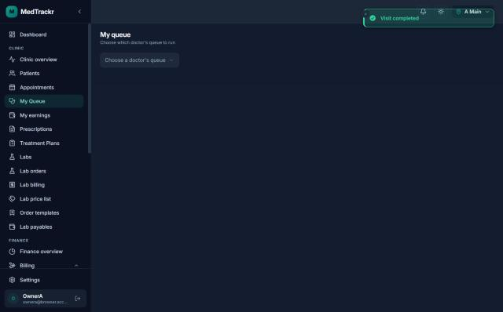

*Figure 30.1 — The "My queue" page for a user who may run any doctor's queue but has no doctor profile at this location.*

The screenshot was taken on 2026-10-23 in the dark theme and shows the former working name "MedTrackr" in the top-left corner. The left sidebar lists Dashboard, a "Clinic" group (Clinic overview, Patients, Appointments, My Queue highlighted, My earnings, Prescriptions, Treatment Plans, Labs, Lab orders, Lab billing, Lab price list, Order templates, Lab payables), a "Finance" group (Finance overview, Billing) and Settings, with a signed-in owner account at the bottom. The top bar shows the location switcher set to the main location, a theme toggle and a notifications bell. The page itself shows only the title "My queue", the subtitle "Choose which doctor's queue to run" and a dropdown "Choose a doctor's queue". A green toast "Visit completed" in the top-right corner is left over from finishing a consultation. This picker appears when the user holds `queue.doctor.any` but is not an employee at the location; after a doctor is chosen, the full doctor screen of Figure 30.2 opens for that doctor.

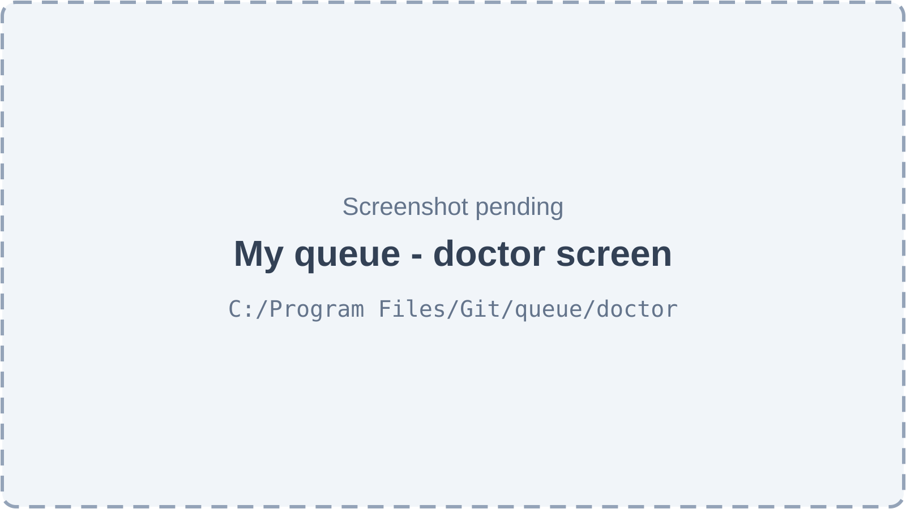

*Figure 30.2 — The doctor screen, "My queue" (screenshot pending).*

The header reads "My queue" with the doctor's name and the service date. On the right are a "Live" or "Reconnecting" indicator, a badge "Smart queue" or "First come, first served", the session status badge ("Doctor not started", "Open", "Paused", "Closed"), and the session buttons: **Start my queue**, **Pause** or **Resume**, and **Close day** (disabled while a patient is with the doctor). The left column has a "Current patient" card showing the token in large type, the patient's name and phone, the status, the call time, the reason for visit and badges. For a called patient it offers **Patient is here — start**, **Call again**, **Didn't come** and **Undo call**. For a patient in consultation it offers **Open consultation**, **Complete**, **Send for test**, **Transfer** and **Stop consultation**. Under the card is a large **Call next** button that shows the token and reason it would pick (for example "A-007 · Appointment due"), and a "completed today" count. The right column is the "Waiting" list, in the order Call next would pick them, each with badges and a **Select** button; the suggested patient is highlighted with "Suggested · reason". A small card lists patients "At a test — reception returns them" and "Skipped — reception can rejoin them".

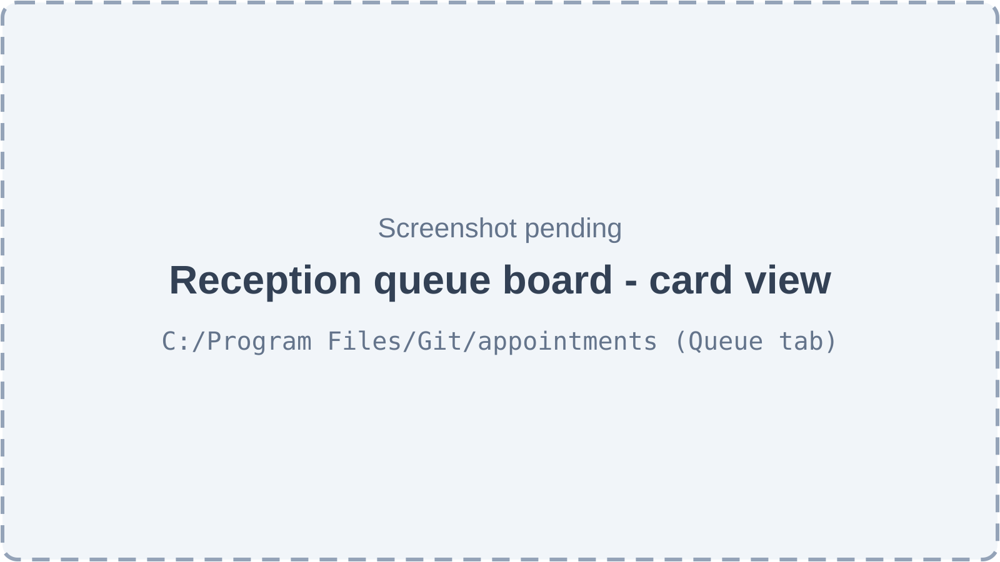

*Figure 30.3 — The reception queue board, card view (screenshot pending).*

The board sits under the Appointments page header. Its filter bar has a search box ("Search token, name or phone…"), a doctor filter, a **Clear filters** button with a count when filters are active, a "Live"/"Reconnecting" indicator, a badge with the location's default queue order, a card/list switch, a refresh button, a button that opens the waiting-room TV display in a new tab, and **Walk-in**. In card view each doctor has a lane: the doctor's name, the token pattern ("Tokens A-xxx"), the number waiting and the queue order; the session status badge (with the pause reason); and, for users who may reprioritise, a settings menu "Today only" with "Switch to smart queue" or "Switch to first come, first served". The lane body shows "With doctor" (token, name, status, a **Force complete** button for admins when the consultation is running), the numbered waiting list in call order with badges (Emergency, Appointment 10:00 or Walk-in, Back from test, Transferred, minutes waited), an "At a test" group with **Back from test**, a "Skipped — didn't come when called" group with **Rejoin**, and a collapsible "Done today (n)". Each patient has an action menu: **Print ticket**, **Transfer to another doctor**, **Urgent priority**, **Remove from queue**. A called patient also has **Didn't come**. At the bottom is "Add walk-in for Dr. …". Loading, error ("Could not load the queue" with retry), empty ("No doctors at this location yet") and "No patients match your filters" states are handled.

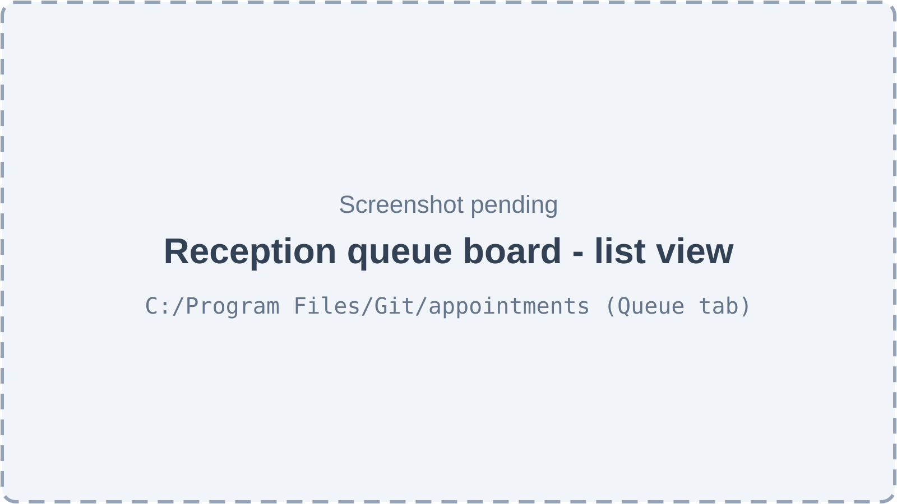

*Figure 30.4 — The reception queue board, list view (screenshot pending).*

The list view shows every patient of every lane in one table with the columns Token, Patient, Doctor, Status, Arrived, an optional Billing column (for users with `billing.desk.use`, showing the patient's outstanding balance and a bill action once the visit is completed) and the same per-patient actions as the card view.

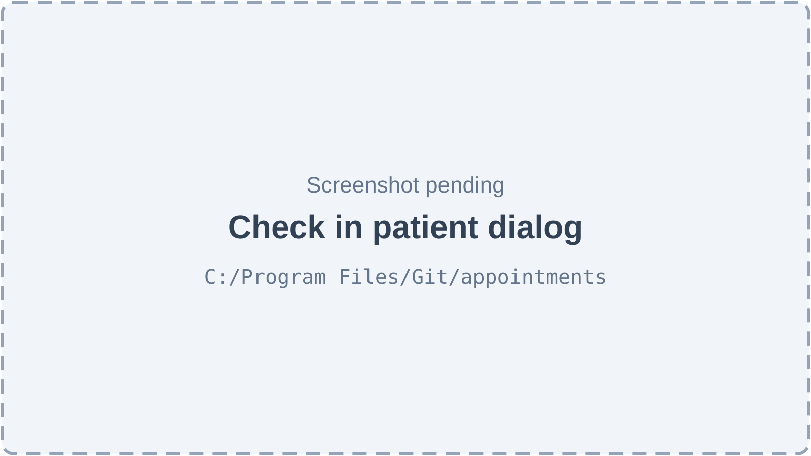

*Figure 30.5 — The "Check in patient" dialog (screenshot pending).*

The dialog shows the patient, the doctor and the booked time. If the booking is marked emergency, a note says that the emergency flag does not move the patient ahead on its own and that urgent priority can be given in this dialog. A checkbox **Give urgent priority?** reveals a required reason box. The buttons are **Cancel** and **Check in & get token**. If the server answers that the patient is too late, the title changes to "Too late for the appointment", an amber box explains that the booking becomes a no-show and the patient joins the same doctor's queue as a walk-in with a new token, and the button becomes **Convert to walk-in**.

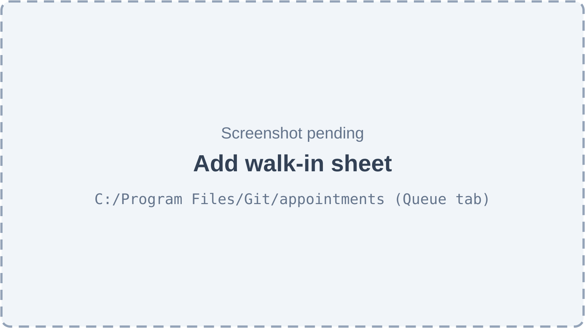

*Figure 30.6 — The "Add walk-in" side sheet (screenshot pending).*

The sheet slides in from the side with the title "Add walk-in" and the line "The patient gets the next token in the chosen doctor's queue." Two tabs choose **Existing patient** (search by name or phone, pick from results) or **New patient** (Patient name and Phone). Then come **Doctor** (required), **Reason for visit**, an **Urgent priority?** checkbox and, when ticked, a required **Urgent reason**. The button **Add to queue** is disabled until the form is valid. If the patient already has a token in this doctor's queue, an alert says so and nothing is added. If the patient is in another doctor's queue today, an alert lists those tokens and asks whether to add the patient to this doctor's queue as well, with an "add anyway" action.

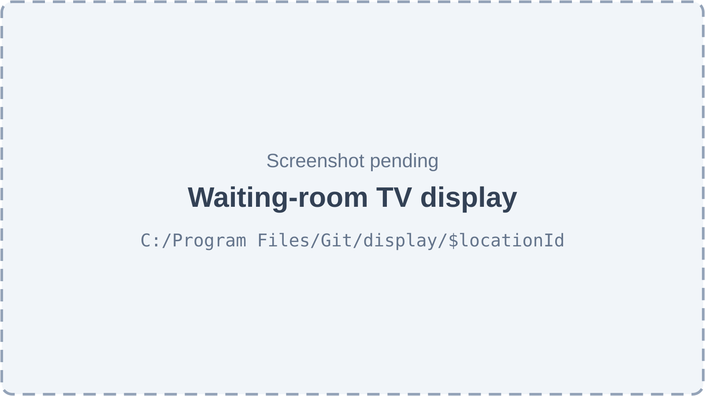

*Figure 30.7 — The public waiting-room TV display (screenshot pending).*

A full-screen dark page with no menus. The header shows the location name, "Please wait for your token" and a large clock (with "Reconnecting…" when the live connection is down). Each doctor with a queue today that is not closed gets a panel: "Dr." and the doctor's name, a badge "On a break" (paused) or "Starting soon" (not started), "Now serving" with the token in very large type (pulsing green with "Please go to the doctor" while the patient is being called), "Next" with up to five tokens, and "n waiting". If no doctor has an open queue it shows "No doctors are seeing patients right now." No patient names appear anywhere.

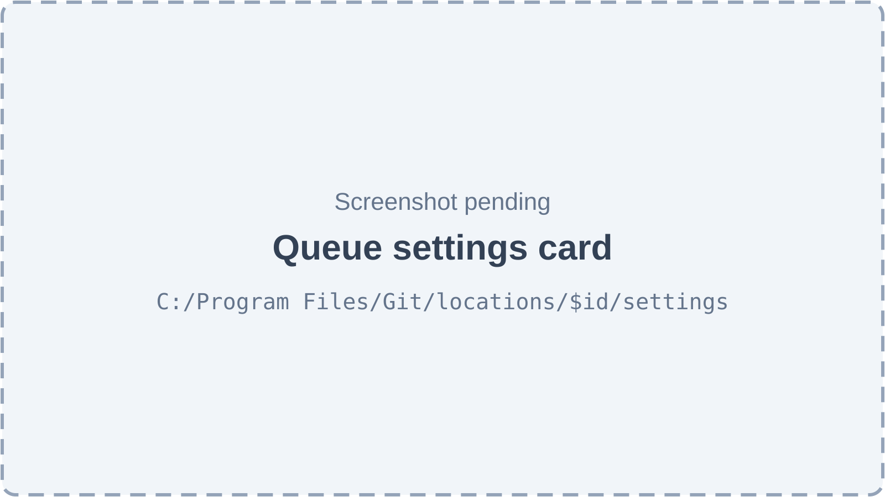

*Figure 30.8 — The "Queue settings" card on the location settings page (screenshot pending).*

The card says whether the location currently uses its own settings, the organization default or the built-in defaults. It holds the **Smart queue** switch, minute fields for the early window, late grace, maximum late and walk-in starvation limit, "Skipped patient rejoins" (end of line, original position, or manual), "Auto-skip after a call (seconds)" (empty means off), the "reason required for manual select" switch, "Service day starts at" (HH:MM), and "Save as" (**This location only** or **Organization default (all locations)**). A **Use organization default** button removes the location override. The card can be edited only while the location is the active one; otherwise it says "Switch to this location (top bar) to edit its queue settings."

## 30.3 Features

Every change to the queue in this section goes through one service, `QueueOrchestrator`, and follows the same pattern, so it is described once here and referred to as "the standard queue transaction". In one database transaction: set a 3-second lock timeout and the tenant context; claim the request's `Idempotency-Key` (a replay returns the saved response); lock the doctor's `queue_sessions` row (`SELECT … FOR UPDATE`); check the transition map; compare the client's `If-Match` version when sent; update the rows (each update bumps the entry's `version`); write one `queue_events` audit row and three `outbox` rows (rooms `session:<id>`, `location:<id>:board`, `location:<id>:display`) plus a `pg_notify`; store the response under the key; commit. "Now" is the database clock of that transaction. Partial unique indexes on `queue_entries` (one active entry per appointment, one active entry per patient per session, at most one patient with the doctor per session) are the last line of defence.

### 30.3.1 Open a doctor's queue for the day

**Status:** [Implemented] — `POST /queue/sessions` has no web-app caller.

**What it does.** Makes sure a doctor has a queue session for today. A session is created automatically by the first check-in or walk-in, or when the doctor opens "My queue". A new session is in the state "Doctor not started" (`waiting_for_doctor`): reception can already add patients.

**How the user does it.**
1. A doctor opens **My Queue** in the sidebar; the session is created if missing.
2. A user who runs any doctor's queue without being a doctor at the location picks a doctor in "Choose a doctor's queue" (Figure 30.1).

**Behind the scenes — in simple terms.** One session per doctor, per location, per clinic day. The clinic day follows the location's timezone and the "service day starts at" setting, so a night clinic can keep 01:30 on the previous day.

**Behind the scenes — technically.** `GET /queue/my-session[?doctorId=]` (`DoctorQueueController.mySession`) and `POST /queue/sessions` (`QueueController.ensureSession`, `@AnyMember`) call `QueueOrchestrator.ensureTodaySession`, then return a snapshot (`QueueQueryService.snapshot`). `TokenEngine.ensureSession` inserts into `queue_sessions` with `ON CONFLICT ON CONSTRAINT uq_queue_session_doctor_day DO NOTHING`, so concurrent requests are safe. It copies the token prefix and the current `smart_queue_enabled` value into the session. The service date is `QueuePoliciesService.serviceDate` (location-local date of the time minus the cutoff). This path uses no idempotency key. Note that `GET /queue/my-session` writes a row, so it also works in read-only mode, where other writes are refused.

**Rules and validations.**
- The doctor must be active and actively assigned to the location.
- Reception (`queue.checkin`) may open any doctor's session; a doctor only their own unless they hold `queue.doctor.any`.

**Who can do it.** `GET /queue/my-session`: `queue.doctor.own` (with `queue.doctor.any` to name another doctor). `POST /queue/sessions`: any member, then `queue.checkin` or the right to run that session. Feature `appointments.core`. Default: Doctor (own), Admin (any); Receptionist and Assistant through check-in.

**Data read and written.** Reads `employee_org_location_assignments`, `employees`, `queue_policies`, `locations`. Writes `queue_sessions`.

**Effects on other modules.** None.

**Error cases.** 403 `FORBIDDEN` "You can only open your own queue (needs queue.doctor.any)"; 404 `NOT_FOUND` "Doctor profile for this user at this location not found" (the doctor screen then shows "You are not set up as a doctor at this location"); 404 "Doctor at this location not found".

**Technical references:** `backend/src/queue/controllers/doctor-queue.controller.ts` · `QueueOrchestrator.ensureTodaySession`, `TokenEngine.ensureSession` · `web-app/src/features/queue/pages/DoctorQueuePage.tsx`

### 30.3.2 Start, pause and resume the queue

**Status:** [Implemented]

**What it does.** The doctor starts their queue when ready, can pause it with a reason (break, prayer) and resume it. While a queue is not open, nobody can be called, but reception can keep checking patients in.

**How the user does it.**
1. On **My Queue**, click **Start my queue**.
2. Click **Pause**, type a reason in "Pause your queue" and confirm **Pause**.
3. Click **Resume** to continue.

**Behind the scenes — in simple terms.** The session moves between "Doctor not started", "Open" and "Paused". The pause reason is shown on the reception board, and the TV shows "On a break".

**Behind the scenes — technically.** `PATCH /queue/sessions/:id/start`, `/pause` (body `{ reason }`), `/resume` → `QueueOrchestrator.startSession` / `pauseSession` / `resumeSession` → `sessionChange`: lock the session, check the actor may run it, `assertSessionTransition`, update status (start sets `started_at` the first time; pause stores `pause_reason`; resume clears it), emit `SESSION_STARTED` / `SESSION_PAUSED` / `SESSION_RESUMED`. Standard queue transaction.

**Rules and validations.**
- Start only from `waiting_for_doctor`; pause only from `open`; resume only from `paused`.
- A pause reason is required (1–500 characters).

**Who can do it.** `queue.doctor.own` in one's own session, or `queue.doctor.any` for any session; feature `appointments.core`. Default: Doctor (own), Admin (any).

**Data read and written.** Writes `queue_sessions`, `queue_events`, `outbox`, `idempotency_keys`.

**Effects on other modules.** The TV display and reception board update live.

**Error cases.** 422 `INVALID_TRANSITION` "Cannot move a open session to open"; 403 `FORBIDDEN` "Only this queue's doctor can do that"; 400 on a missing pause reason.

**Technical references:** `backend/src/queue/queue-transitions.ts` · `QueueOrchestrator.sessionChange` · `web-app/src/features/queue/pages/DoctorQueuePage.tsx`

### 30.3.3 Close the day

**Status:** [Implemented]

**What it does.** Ends the doctor's queue for the day. Every patient still waiting, skipped or at a test must get a decision first: cancel, or (for waiting patients) transfer to another doctor.

**How the user does it.**
1. Finish or undo the current patient (the **Close day** button is disabled while someone is with the doctor).
2. Click **Close day**. The "Close today's queue" dialog lists each remaining patient with a choice: **Cancel** (the default) or "Transfer → Dr. …".
3. Confirm. A toast says "Queue closed for today".

**Behind the scenes — in simple terms.** Each remaining patient is removed or moved, then the session is closed and accepts no more patients that day. A background job also closes past days' empty sessions on its own (30.3.25).

**Behind the scenes — technically.** `PATCH /queue/sessions/:id/close` with `{ decisions: [{ entryId, action: 'cancel' | 'transfer', toDoctorId? }] }` → `QueueOrchestrator.closeSession`: lock, check the actor, `assertSessionTransition(→ closed)`, `assertDoctorFree`, load remaining entries (waiting, skipped, on hold), refuse if any has no decision, then cancel (reason "Session closed") or transfer each one (target session ensured for the same service date), set `status = closed`, `closed_at`, emit `SESSION_CLOSED`. Standard queue transaction; everything succeeds or nothing does.

**Rules and validations.**
- Nobody may be called or in consultation.
- Every remaining entry needs a decision (up to 500 decisions).
- Only waiting entries can be transferred; skipped or at-test patients must be cancelled or brought back first.
- Cancelling a booked patient also closes the appointment as cancelled (`patient_left`).

**Who can do it.** `queue.doctor.own` in one's own session, or `queue.doctor.any`; feature `appointments.core`. Default: Doctor (own), Admin.

**Data read and written.** Writes `queue_sessions`, `queue_entries`, `appointments`, `queue_events`, `outbox`, `idempotency_keys`.

**Effects on other modules.** Cancelled booked patients become cancelled appointments; transferred patients appear in another doctor's lane with new tokens.

**Error cases.** 409 `DOCTOR_BUSY` "The doctor already has a patient. Finish or undo that call first."; 422 `INVALID_TRANSITION` "Decide (cancel or transfer) for every remaining patient before closing" (with the undecided ids); 422 "Entry … is skipped; only waiting patients can be transferred".

**Technical references:** `backend/src/queue/dto/queue.dto.ts` · `QueueOrchestrator.closeSession` · `web-app/src/features/queue/components/CloseSessionDialog.tsx`

### 30.3.4 Switch between smart queue and first come, first served for today

**Status:** [Implemented]

**What it does.** Changes the calling order of one doctor's session for today only, without touching the clinic's settings.

**How the user does it.**
1. On the reception board, open the settings icon of a doctor's lane ("Queue options for Dr. …").
2. Choose "Switch to smart queue" or "Switch to first come, first served".

**Behind the scenes — in simple terms.** Each session copies the clinic's queue order when it is created. This switch changes only that copy.

**Behind the scenes — technically.** `PATCH /queue/sessions/:id/mode` with `{ smartQueueEnabled }` → `QueueOrchestrator.setMode`: lock, update `smart_queue_enabled`, emit `MODE_CHANGED`. No change if already in that mode.

**Rules and validations.**
- Not offered for closed sessions in the web app.

**Who can do it.** `queue.entry.reprioritize`; feature `appointments.core`. Default: Admin only.

**Data read and written.** Writes `queue_sessions`, `queue_events`, `outbox`, `idempotency_keys`.

**Effects on other modules.** None beyond the call order.

**Error cases.** 403 `NO_PERMISSION` / `FORBIDDEN` "You cannot change the queue order".

**Technical references:** `backend/src/queue/controllers/doctor-queue.controller.ts` · `QueueOrchestrator.setMode` · `web-app/src/features/queue/components/QueueLaneCard.tsx`

### 30.3.5 Doctor-wise tokens

**Status:** [Implemented]

**What it does.** Gives each arriving patient a short number that belongs to one doctor's queue for one day, such as "A-007". Tokens are never reused and have no gaps.

**How the user does it.** Automatic at check-in, walk-in, convert-to-walk-in and transfer. The token appears in the toast, on the ticket, on the board, on the doctor screen and on the TV.

**Behind the scenes — in simple terms.** Each session keeps its own counter. The next token is the counter plus one. Because the counter lives in the same row that every change locks, two desks can never get the same number, and a failed check-in gives its number back.

**Behind the scenes — technically.** `TokenEngine.nextToken` runs `UPDATE queue_sessions SET last_token_number = last_token_number + 1 … WHERE id = $1 AND status <> 'closed' RETURNING last_token_number` inside the caller's transaction (no database sequence, so a rollback leaves no gap). `TokenEngine.format` gives prefix + "-" + the number padded to three digits (four digits after 999). The prefix is the doctor's `employee_org_location_assignments.token_prefix` at that location, otherwise the first letter of the doctor's name without a leading "Dr.", upper-cased, letters and digits only, at most 6 characters, else "T". It is copied into the session at creation. `queue_entries` has a unique constraint on (session, token number).

**Rules and validations.**
- A closed session issues no tokens.
- Two doctors whose names start with the same letter get the same prefix unless a prefix is set on their assignment.

**Who can do it.** Follows the arrival action (`queue.checkin`).

**Data read and written.** Reads `employee_org_location_assignments`, `employees`. Writes `queue_sessions.last_token_number`.

**Effects on other modules.** The token is shown on the appointment (list and detail) and in the patient's visit history.

**Error cases.** 422 `SESSION_NOT_OPEN` "This queue is closed for the day".

**Technical references:** `backend/src/queue/services/token-engine.service.ts` · `TokenEngine` · `web-app/src/features/queue/utils/printTicket.ts`

### 30.3.6 Check in a booked patient

**Status:** [Implemented]

**What it does.** Turns a booking into a queue entry with a token when the patient arrives. The Appointments chapter (Chapter 29, feature "Check a patient in") describes the screen steps; this feature covers the queue side.

**How the user does it.**
1. Click **Check in** on a booking (list row menu or detail dialog).
2. In "Check in patient" (Figure 30.5), optionally tick **Give urgent priority?** with a reason, and click **Check in & get token**.
3. If the patient is too late, click **Convert to walk-in** instead.

**Behind the scenes — in simple terms.** The patient joins the booked doctor's queue for today. A booked patient is not automatically first: the selection rules (30.3.8) decide when their scheduled time makes them "due".

**Behind the scenes — technically.** `PATCH /appointments/:id/check-in` → `QueueOrchestrator.checkInAppointment`, standard queue transaction. It locks the appointment row; returns 409 `ALREADY_CHECKED_IN` (with the existing entry) if an active entry exists; refuses a `no_show` booking with `LATE_LIMIT_EXCEEDED`; checks the appointment transition; checks the booking's service date is today (`NOT_TODAY`); checks `isBeyondMaxLate(start, now, max_late_min)`; opens and locks the session (`waiting_for_doctor`, `open` or `paused` accept arrivals); `issueToken` inserts the entry (`queue_type = appointment`, `waiting`, `checked_in_at = sort_anchor_at = now`, reason for visit copied from the booking) and emits `CHECKED_IN` (plus `PRIORITY_SET` if urgent); sets the appointment `checked_in`. `POST /appointments/:id/convert-to-walk-in` → `QueueOrchestrator.convertToWalkIn` is the late variant (Chapter 29).

**Rules and validations.**
- Booking must be scheduled or confirmed, for today's service date, and not more than `max_late_min` late (default 45).
- The session must not be closed.
- Urgent reason up to 500 characters; urgent priority sets `priority_class = authorized_urgent` and `urgent_since`.

**Who can do it.** `queue.checkin` (implies `queue.board.view`); feature `appointments.core`. Default: Admin, Receptionist, Assistant.

**Data read and written.** Writes `appointments`, `queue_sessions`, `queue_entries`, `queue_events`, `outbox`, `idempotency_keys`.

**Effects on other modules.** The appointment becomes `checked_in` and locked for editing.

**Error cases.** 409 `ALREADY_CHECKED_IN`; 422 `LATE_LIMIT_EXCEEDED` "More than 45 minutes late — convert to a walk-in or reschedule"; 422 `NOT_TODAY`; 422 `SESSION_NOT_OPEN`; 503 `LOCK_TIMEOUT` "The queue is busy, please retry" (the web app retries automatically).

**Technical references:** `backend/src/queue/engines/check-in-rules.ts` · `QueueOrchestrator.checkInAppointment`, `issueToken` · `web-app/src/features/queue/components/CheckInDialog.tsx`

### 30.3.7 Register a walk-in

**Status:** [Implemented]

**What it does.** Adds a patient without a booking to a chosen doctor's queue, creating the patient record on the spot if needed.

**How the user does it.**
1. On the reception board click **Walk-in** (or "Add walk-in for Dr. …" in a lane).
2. In "Add walk-in" (Figure 30.6), choose **Existing patient** and search, or **New patient** and enter name and phone.
3. Choose the **Doctor**, optionally a **Reason for visit** and **Urgent priority?** with a reason.
4. Click **Add to queue**. A toast shows "Token A-008 — patient name" with **Print ticket**.

**Behind the scenes — in simple terms.** If the patient already waits for the same doctor, nothing is added and their token is shown. If they wait for another doctor today, the desk is warned and must confirm. A new patient gets the next patient number.

**Behind the scenes — technically.** `POST /queue/walk-ins` → `QueueOrchestrator.registerWalkIn`, standard queue transaction. `assertDoctorAtLocation`; `resolvePatient` either loads the patient (same organization) or creates one: it takes a transaction-level advisory lock per organization, computes the next number as `P-` plus five digits, saves the patient with the active location as primary location, and writes a patient audit record. It ensures and locks today's session, refuses a duplicate active entry in that session (`ALREADY_CHECKED_IN`), and unless `force` is true refuses when the patient has active entries in other sessions at the location today (`ACTIVE_WITH_OTHER_DOCTOR`, listing tokens and doctors). Then `issueToken` with `queue_type = walk_in`.

**Rules and validations.**
- Doctor required. Either `patientId`, or name (up to 150 characters) and phone (up to 20; the form accepts digits, spaces, `+`, `-` and parentheses, 7–20 characters).
- Reason for visit and urgent reason up to 500 characters; an urgent walk-in needs a reason.

**Who can do it.** `queue.checkin`; feature `appointments.core`. Default: Admin, Receptionist, Assistant.

**Data read and written.** Reads `patients`, `employee_org_location_assignments`. Writes `patients` (new patient), patient audit log, `queue_sessions`, `queue_entries`, `queue_events`, `outbox`, `idempotency_keys`.

**Effects on other modules.** A new patient appears in Patients (Chapter 28). Walk-ins appear in the appointments list, the KPI strip and the reports.

**Error cases.** 409 `ALREADY_CHECKED_IN` (sheet: "Already in this doctor's queue with token … Nothing was added."); 409 `ACTIVE_WITH_OTHER_DOCTOR` "This patient is already in another doctor's queue today"; 404 "Patient not found"; 404 "Doctor at this location not found"; 422 `SESSION_NOT_OPEN`.

**Technical references:** `backend/src/queue/controllers/queue.controller.ts` · `QueueOrchestrator.registerWalkIn`, `resolvePatient` · `web-app/src/features/queue/components/WalkInSheet.tsx`

### 30.3.8 Call the next patient (smart and first-come rules)

**Status:** [Implemented]

**What it does.** With one button, the doctor calls whoever should be seen next. The patient's token starts flashing on the TV.

**How the user does it.**
1. On **My Queue**, with the queue open and nobody with the doctor, click **Call next**. The button already shows which token and why, for example "(A-007 · Appointment due)".

**Behind the scenes — in simple terms.** A small rule engine looks at everyone waiting and picks one. It has two modes.

In **first come, first served** mode: an urgent patient goes first (earliest urgent first); otherwise the patient with the earliest place in line goes first. The place in line is the arrival time, or the rejoin time after a "rejoin at end".

In **smart** mode the order is:
1. **Emergency** — an urgent patient, earliest first.
2. **Waited too long** (starvation guard) — if an appointment patient is about to overtake, and the patient who has waited longest in the ordinary line has waited at least the starvation limit (45 minutes by default), that patient goes first. The guard never fires twice in a row, so the due appointment goes right after.
3. **Appointment due** — a booked patient whose time has come: it is no earlier than 15 minutes (early window) before the booked time, and the patient arrived no later than 10 minutes (late grace) after it. Earliest booked time first.
4. **Back from test** — a patient returning from a test, earliest return first.
5. **Next in line** — everyone else (walk-ins, appointment patients who came very early, and those who arrived after the grace period) by place in line.

Ties are broken by the lower token number. "Due" depends on the clock, so priority is recalculated at every call; it is never stored.

The specification's 14 scenarios, each tested in both modes, show the effect. A 10:00 appointment who arrived at 9:58 is called at 10:01 before a walk-in waiting since 9:40 (smart), but after him in first-come mode. An appointment patient who arrived at 9:20 for 10:00 is not yet due at 9:35, so he queues by arrival. A walk-in who has waited 50 minutes is called before a due appointment; on the very next call the appointment goes. An appointment patient who arrives 25 minutes late has lost the priority and queues behind a walk-in who arrived at 10:15. A patient back from a test goes ahead of walk-ins in smart mode only. An urgent patient goes first in both modes. Two patients with the same time are ordered by token. With nobody waiting, nothing is called. Scenario 7 tests the separate check-in rule: a 10:00 patient arriving at 10:50 is beyond the 45-minute maximum and cannot check in.

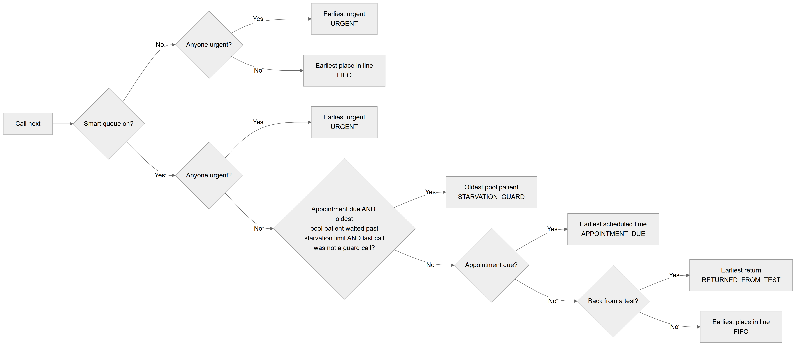

*Figure 30.9 — The selection engine's decision path.*

The flowchart starts at "Call next" and asks "Smart queue on?". On "No", it asks "Anyone urgent?": yes leads to "Earliest urgent, URGENT"; no leads to "Earliest place in line, FIFO". On "Yes", it asks "Anyone urgent?": yes leads to "Earliest urgent, URGENT". Otherwise it asks whether an appointment is due and the oldest pool patient has waited past the starvation limit and the last call was not a guard call: yes leads to "Oldest pool patient, STARVATION_GUARD". Otherwise "Appointment due?": yes leads to "Earliest scheduled time, APPOINTMENT_DUE". Otherwise "Back from a test?": yes leads to "Earliest return, RETURNED_FROM_TEST"; no leads to "Earliest place in line, FIFO". The capitalised words are the reason codes stored with each call and shown to the doctor as Emergency, Waited too long, Appointment due, Back from test and Next in line.

**Behind the scenes — technically.** `POST /queue/sessions/:id/call-next` → `QueueOrchestrator.callNext`, standard queue transaction: lock, check the actor, `assertOpen`, `assertDoctorFree`, load waiting entries, call the pure function `selectNext` (`engines/selection-engine.ts`) with the transaction's `now`, the session's mode, the policy's `early_window_min`, `late_grace_min`, `walkin_starvation_min` and the session's `last_call_reason`. It stores the new `last_call_reason`, moves the entry to `called` with `called_at`, and emits `CALLED` with the reason code. With nobody eligible it returns `entry: null` and reason `NO_ELIGIBLE_PATIENT` ("No patient is waiting"). The snapshot the screens load contains `waitingOrder` (the engine applied repeatedly) and `suggestion`.

**Rules and validations.**
- The session must be `open`; nobody may already be called or in consultation (also guaranteed by the index `one_patient_with_doctor`).
- Only `waiting` entries are candidates; skipped and at-test patients are not.

**Who can do it.** `queue.doctor.own` in one's own session, or `queue.doctor.any`; feature `appointments.core`. Default: Doctor (own), Admin.

**Data read and written.** Reads `queue_entries`, `appointments` (booked time), `queue_policies`. Writes `queue_sessions`, `queue_entries`, `queue_events`, `outbox`, `idempotency_keys`.

**Effects on other modules.** The TV shows the called token; the board moves the patient to "With doctor".

**Error cases.** 422 `SESSION_NOT_OPEN` "The doctor has paused this queue" / "The doctor has not started this queue yet"; 409 `DOCTOR_BUSY`; 403 `FORBIDDEN`.

**Technical references:** `backend/src/queue/engines/selection-engine.ts` (+ `selection-engine.spec.ts`) · `selectNext`, `QueueOrchestrator.callNext` · `web-app/src/features/queue/pages/DoctorQueuePage.tsx`

### 30.3.9 Select a specific patient

**Status:** [Implemented]

**What it does.** Lets the doctor call a patient out of the engine's order. The engine's own suggestion is recorded next to the choice.

**How the user does it.**
1. In the "Waiting" list, click **Select** next to a patient.
2. If the patient is not the suggestion (or a reason is required by settings), the dialog "Call A-009 now?" explains whom the queue would have called and accepts a reason; confirm **Call this patient**.

**Behind the scenes — in simple terms.** The chosen patient is called, and the queue history notes who the engine would have picked.

**Behind the scenes — technically.** `PATCH /queue/entries/:id/select` with `{ reason? }` and `If-Match` → `QueueOrchestrator.selectPatient`: lock via the entry, `assertOpen`, `assertDoctorFree`, enforce `manual_select_reason_required`, compute the engine's suggestion, set `last_call_reason = MANUAL_SELECT`, transition `waiting → called`, emit `CALLED` with `MANUAL_SELECT`, the reason text and `suggested_entry_id`.

**Rules and validations.**
- As Call next, plus a reason when the location requires one.
- The entry must still be at the version the screen showed.

**Who can do it.** `queue.doctor.own` (own session) or `queue.doctor.any`; feature `appointments.core`. Default: Doctor (own), Admin.

**Data read and written.** As Call next.

**Effects on other modules.** None beyond the queue.

**Error cases.** 400 `REASON_REQUIRED` "A reason is required to select a patient out of order"; 409 `VERSION_CONFLICT` "This was changed by someone else. The latest state is shown."; 409 `DOCTOR_BUSY`; 422 `INVALID_TRANSITION`.

**Technical references:** `backend/src/queue/services/queue-orchestrator.service.ts` · `QueueOrchestrator.selectPatient` · `web-app/src/features/queue/pages/DoctorQueuePage.tsx`

### 30.3.10 Call again (recall)

**Status:** [Implemented]

**What it does.** Announces a called patient once more without changing anything.

**How the user does it.**
1. With a called patient, click **Call again**.

**Behind the scenes — in simple terms.** Only a history entry and a live nudge are written, so screens refresh.

**Behind the scenes — technically.** `PATCH /queue/entries/:id/recall` → `QueueOrchestrator.recall`: the entry must be `called`; emits `RECALLED` (from and to `called`). No If-Match.

**Rules and validations.** Only for a `called` entry.

**Who can do it.** `queue.doctor.own` (own session) or `queue.doctor.any`; feature `appointments.core`. Default: Doctor (own), Admin.

**Data read and written.** Writes `queue_sessions.event_seq`, `queue_events`, `outbox`, `idempotency_keys`.

**Effects on other modules.** None. The TV has no sound or extra animation for a recall; it refreshes.

**Error cases.** 422 `INVALID_TRANSITION` "Only a called patient can be recalled".

**Technical references:** `backend/src/queue/controllers/doctor-queue.controller.ts` · `QueueOrchestrator.recall` · `web-app/src/features/queue/pages/DoctorQueuePage.tsx`

### 30.3.11 Undo a call

**Status:** [Implemented]

**What it does.** Reverses a wrong call: the patient goes back to waiting in the same place.

**How the user does it.**
1. With a called patient, click **Undo call**.

**Behind the scenes — in simple terms.** The patient's place in line is unchanged, so they are not penalised.

**Behind the scenes — technically.** `PATCH /queue/entries/:id/undo-call` with `If-Match` → `QueueOrchestrator.undoCall`: transition `called → waiting`, clear `called_at`, emit `CALL_UNDONE`. `sort_anchor_at` is untouched.

**Rules and validations.** Only from `called`.

**Who can do it.** `queue.doctor.own` (own session) or `queue.doctor.any`; feature `appointments.core`. Default: Doctor (own), Admin.

**Data read and written.** Writes `queue_entries`, `queue_events`, `outbox`, `idempotency_keys`.

**Effects on other modules.** None.

**Error cases.** 422 `INVALID_TRANSITION`; 409 `VERSION_CONFLICT`.

**Technical references:** `backend/src/queue/queue-transitions.ts` · `QueueOrchestrator.undoCall` · `web-app/src/features/queue/pages/DoctorQueuePage.tsx`

### 30.3.12 Skip a patient who did not come

**Status:** [Implemented]

**What it does.** Marks a called patient who did not come to the room as skipped. They leave the waiting list until reception rejoins them. The skip can also happen automatically after a set number of seconds (30.3.25).

**How the user does it.**
1. The doctor clicks **Didn't come** on the current patient, or reception clicks **Didn't come** in the lane.

**Behind the scenes — in simple terms.** The patient moves to the "Skipped" group, and the doctor is free to call the next one.

**Behind the scenes — technically.** `PATCH /queue/entries/:id/skip` with `If-Match` (`@AnyMember`) → `QueueOrchestrator.skip`: `assertHandleEntry` (entry managers anywhere, doctors in their own session), transition `called → skipped`, set `skipped_at`, emit `SKIPPED` (reason code `CALL_TIMEOUT` when the job did it).

**Rules and validations.** Only from `called`.

**Who can do it.** `queue.entry.manage`, or the session's doctor (`queue.doctor.own` / `queue.doctor.any`); feature `appointments.core`. Default: Receptionist, Admin, Doctor (own session).

**Data read and written.** Writes `queue_entries`, `queue_events`, `outbox`, `idempotency_keys`.

**Effects on other modules.** None.

**Error cases.** 403 `FORBIDDEN` "Only reception or this queue's doctor can do that"; 422 `INVALID_TRANSITION`; 409 `VERSION_CONFLICT`.

**Technical references:** `backend/src/queue/queue-actor.ts` · `QueueOrchestrator.skip`, `canHandleEntry` · `web-app/src/features/queue/components/QueueEntryActions.tsx`

### 30.3.13 Rejoin a skipped patient

**Status:** [Implemented]

**What it does.** Puts a skipped patient back into the waiting list, at a place set by the clinic's "Skipped patient rejoins" setting.

**How the user does it.**
1. In the lane's "Skipped" group, click **Rejoin**.
2. If the setting is "manual" and others are waiting, first pick "Place after…" a token, then click **Rejoin**.

**Behind the scenes — in simple terms.** "End" puts the patient at the back of the line (default). "Original position" keeps their original arrival place. "Manual" places them right after a chosen patient.

**Behind the scenes — technically.** `PATCH /queue/entries/:id/rejoin` with `{ placeAfterEntryId? }` and `If-Match` → `QueueOrchestrator.rejoin`: `assertManageEntries`; compute the new `sort_anchor_at` (now for `end`; unchanged for `original_position`; the chosen entry's anchor plus one millisecond for `manual`); transition to `waiting`, clear `called_at`, emit `REJOINED` with the policy as reason code. The transition map also allows this from `called` and `on_hold`, but the web app offers it only for skipped patients.

**Rules and validations.**
- Manual policy needs `placeAfterEntryId` when anyone else is waiting; the target must be a waiting entry of the same session.

**Who can do it.** `queue.entry.manage`; feature `appointments.core`. Default: Receptionist, Admin.

**Data read and written.** Reads `queue_policies`. Writes `queue_entries`, `queue_events`, `outbox`, `idempotency_keys`.

**Effects on other modules.** None.

**Error cases.** 422 `INVALID_TRANSITION` "Choose where to place the patient (placeAfterEntryId)"; 404 "Waiting entry to place after not found"; 403 `FORBIDDEN` "You cannot manage queue entries".

**Technical references:** `backend/src/queue/enums/queue.enums.ts` (`RejoinPolicy`) · `QueueOrchestrator.rejoin` · `web-app/src/features/queue/components/QueueEntryActions.tsx`

### 30.3.14 Send for a test and return from the test

**Status:** [Implemented]

**What it does.** During a consultation the doctor can send the patient for a test (an X-ray, a blood test). The patient keeps their token. When they come back, reception returns them to the waiting list, where in smart mode they go ahead of walk-ins.

**How the user does it.**
1. Doctor: with the patient in consultation, click **Send for test**, enter the test (for example "X-ray") and confirm **Send for test**.
2. Reception: in the lane's "At a test" group, click **Back from test**.

**Behind the scenes — in simple terms.** The doctor becomes free for the next patient while this one is away. On return the patient waits again, with a "Back from test" badge.

**Behind the scenes — technically.** `PATCH /queue/entries/:id/send-for-test` with `{ reason? }` → `QueueOrchestrator.sendForTest`: transition `in_consultation → on_hold`, set `hold_started_at`, emit `SENT_FOR_TEST`. `PATCH /queue/entries/:id/return-from-test` → `QueueOrchestrator.returnFromTest`: transition `on_hold → waiting`, set `returned_from_hold_at`, emit `RETURNED_FROM_TEST`. The selection engine uses `returned_from_hold_at` for the "Back from test" rule. The encounter stays open throughout.

**Rules and validations.**
- Send only from `in_consultation`; return only from `on_hold`.
- The return action has no per-session check beyond `queue.checkin`.

**Who can do it.** Send: `queue.doctor.own` (own session) or `queue.doctor.any`. Return: `queue.checkin`. Feature `appointments.core`. Default: send — Doctor (own), Admin; return — Receptionist, Assistant, Admin.

**Data read and written.** Writes `queue_entries`, `queue_events`, `outbox`, `idempotency_keys`.

**Effects on other modules.** None.

**Error cases.** 422 `INVALID_TRANSITION`; 409 `VERSION_CONFLICT`.

**Technical references:** `backend/src/queue/controllers/queue.controller.ts` · `QueueOrchestrator.sendForTest`, `returnFromTest` · `web-app/src/features/queue/components/QueueEntryActions.tsx`

### 30.3.15 Transfer a patient to another doctor

**Status:** [Implemented]

**What it does.** Moves a waiting patient, or a patient in consultation, to another doctor's queue at the same location. The patient gets a new token there but keeps their original place in line by arrival time.

**How the user does it.**
1. Reception: in a waiting patient's menu choose **Transfer to another doctor**. Doctor: with the patient in consultation click **Transfer**.
2. Pick the doctor, add an optional reason, confirm. A toast shows "Transferred — new token B-004".

**Behind the scenes — in simple terms.** The old entry is closed as "transferred" and a new entry is created in the other doctor's queue for the same day, carrying the booking link, the urgent flag and the arrival time.

**Behind the scenes — technically.** `PATCH /queue/entries/:id/transfer` with `{ toDoctorId, reason? }` and `If-Match` (`@AnyMember`) → `QueueOrchestrator.transfer` → `transferEntry`: `assertHandleEntry`; refuse the same doctor; check the target doctor is at the location; ensure the target session for the same service date; lock both sessions in id order (avoids deadlocks); refuse a closed target; transition the old entry to `transferred` (`TRANSFERRED_OUT` with the target session); allocate a token in the target; insert a new entry with `transferred_from_id`, the same `appointment_id`, `converted_from_appt_id`, priority, urgent fields, reason, `checked_in_at` and `sort_anchor_at`; emit `CHECKED_IN` with reason code `TRANSFERRED_IN` in the target session.

**Rules and validations.**
- From `waiting` or `in_consultation` only (transition map). The web app offers it to reception for waiting patients and to the doctor for the patient in consultation.
- An encounter already started stays with the old entry; the new doctor's consultation starts a new encounter.

**Who can do it.** `queue.entry.manage`, or the doctor of the entry's session; feature `appointments.core`. Default: Receptionist, Admin, Doctor (own session).

**Data read and written.** Writes `queue_sessions` (both), `queue_entries` (old and new), `queue_events`, `outbox`, `idempotency_keys`.

**Effects on other modules.** A booked appointment stays `checked_in` and follows the new entry.

**Error cases.** 422 `INVALID_TRANSITION` "The patient is already in this doctor's queue"; 404 "Doctor at this location not found"; 422 `SESSION_NOT_OPEN`; 409 `VERSION_CONFLICT`.

**Technical references:** `backend/src/queue/services/queue-orchestrator.service.ts` · `QueueOrchestrator.transfer`, `transferEntry` · `web-app/src/features/queue/components/TransferDialog.tsx`

### 30.3.16 Give urgent priority

**Status:** [Implemented]

**What it does.** Moves a patient ahead of everyone else waiting for the same doctor, for a stated reason (for example "Severe bleeding"). It works in both queue modes.

**How the user does it.**
1. In a patient's menu choose **Urgent priority**, enter the reason and click **Give urgent priority**.
2. Or tick **Give urgent priority?** / **Urgent priority?** at check-in or walk-in.

**Behind the scenes — in simple terms.** The patient gets an "Emergency" badge and is called first. Several urgent patients are called in the order they were made urgent.

**Behind the scenes — technically.** `PATCH /queue/entries/:id/priority` with `{ reason }` and `If-Match` → `QueueOrchestrator.setPriority`: `assertReprioritize`; entry must be `waiting`, `skipped` or `on_hold`; set `priority_class = authorized_urgent`, keep an existing `urgent_since` or set it to now, set `urgent_reason`, bump the version, emit `PRIORITY_SET`. A database check requires `urgent_since` and `urgent_reason` whenever the class is urgent. There is no endpoint to remove urgent priority.

**Rules and validations.**
- Reason required, up to 500 characters.
- At check-in and walk-in the urgent option needs only `queue.checkin`; on an existing entry it needs `queue.entry.reprioritize`.

**Who can do it.** `queue.entry.reprioritize`; feature `appointments.core`. Default: Admin only.

**Data read and written.** Writes `queue_entries`, `queue_events`, `outbox`, `idempotency_keys`.

**Effects on other modules.** None.

**Error cases.** 422 `INVALID_TRANSITION` "Priority can only be given to a patient who is still waiting"; 403 "You cannot change the queue order"; 409 `VERSION_CONFLICT`.

**Technical references:** `backend/src/queue/entities/queue-entry.entity.ts` · `QueueOrchestrator.setPriority` · `web-app/src/features/queue/components/QueueBoard.tsx`

### 30.3.17 Start the consultation

**Status:** [Implemented]

**What it does.** Confirms the called patient is in the room, starts the consultation and creates the **encounter** (the clinical record of this visit). The web app then opens the consultation workspace.

**How the user does it.**
1. With a called patient, click **Patient is here — start**. The consultation workspace opens.
2. Later, **Open consultation** returns to the workspace.

**Behind the scenes — in simple terms.** The clinical record begins only when the doctor actually starts, never at booking or check-in.

**Behind the scenes — technically.** `PATCH /queue/entries/:id/start-consultation` with `If-Match` → `QueueOrchestrator.startConsultation`: transition `called → in_consultation`, set `consultation_started_at`, emit `CONSULTATION_STARTED`, then `EncountersService.ensureForQueueEntry` in the same transaction creates a `patient_encounters` row (unique per queue entry; copies `appointment_id`, patient, organization, location and reason) or returns the existing one. The response includes `encounterId`; the web app navigates to `/consultation/$encounterId`.

**Rules and validations.** Only from `called`.

**Who can do it.** `queue.doctor.own` (own session) or `queue.doctor.any`; feature `appointments.core`. Default: Doctor (own), Admin.

**Data read and written.** Writes `queue_entries`, `patient_encounters`, `queue_events`, `outbox`, `idempotency_keys`.

**Effects on other modules.** Opens the consultation workspace (Chapter 31). `consultation_started_at` feeds the "Avg wait" figure.

**Error cases.** 422 `INVALID_TRANSITION`; 409 `VERSION_CONFLICT`; 403 `FORBIDDEN`.

**Technical references:** `backend/src/encounters/encounters.service.ts` · `QueueOrchestrator.startConsultation`, `EncountersService.ensureForQueueEntry` · `web-app/src/features/queue/pages/DoctorQueuePage.tsx`

### 30.3.18 Complete the visit (and bill it automatically)

**Status:** [Implemented]

**What it does.** Ends the consultation. A booked appointment becomes completed, and the visit's charges (consultation fee and recorded treatments) are created for billing at the same moment.

**How the user does it.**
1. On the doctor screen click **Complete**, or press complete in the consultation workspace (the toast says "Visit completed" and the doctor returns to **My Queue**).

**Behind the scenes — in simple terms.** The patient leaves the queue as completed. The billing module receives a consultation charge and one charge per treatment recorded in the encounter, priced from the price list, with the doctor's commission noted. Nothing about money is sent back to the doctor's screen.

**Behind the scenes — technically.** `PATCH /queue/entries/:id/complete` with `If-Match` → `QueueOrchestrator.complete`: transition `in_consultation → completed`, set `finished_at`, emit `COMPLETED`; if booked, update the appointment to `completed` with `completed_at`; then `ChargeSourcesService.syncForEncounter` inside the same transaction. That service does nothing if the `billing.invoices` feature is off or if no encounter exists. Otherwise it adds a consultation charge if none is active, adds a treatment charge for each treatment of the encounter not yet billed, snapshots the doctor's commission in force on the clinic date, voids unbilled charges whose treatment was removed, and writes billing audit rows. Inserts use `ON CONFLICT DO NOTHING`, so a repeat never duplicates charges. The Billing chapter (Chapter 34) and the Commissions chapter (Chapter 35) cover the details.

**Rules and validations.** Only from `in_consultation`; the actor must run this session.

**Who can do it.** `queue.doctor.own` (own session) or `queue.doctor.any`; feature `appointments.core` (charges also need `billing.invoices`). Default: Doctor (own), Admin.

**Data read and written.** Writes `queue_entries`, `appointments`, `charges`, `billing_audit_logs`, `queue_events`, `outbox`, `idempotency_keys`; reads `patient_encounters`, `treatments`, prices and compensation plans.

**Effects on other modules.** Charges appear on the billing desk and as outstanding balance; commission entries follow; the visit counts as completed in reports.

**Error cases.** 422 `INVALID_TRANSITION`; 409 `VERSION_CONFLICT`; 403 `FORBIDDEN`.

**Technical references:** `backend/src/billing/charges/charge-sources.service.ts` · `QueueOrchestrator.complete`, `ChargeSourcesService.syncForEncounter` · `web-app/src/features/consultation/pages/ConsultationPage.tsx`

### 30.3.19 Stop a consultation (abort)

**Status:** [Implemented]

**What it does.** Ends a consultation without completing it, for example when the patient has to leave. A booked appointment is closed as cancelled.

**How the user does it.**
1. Click **Stop consultation**, optionally enter a reason, confirm **Stop consultation**.

**Behind the scenes — in simple terms.** The visit ends as "Stopped". No charges are created by this action.

**Behind the scenes — technically.** `PATCH /queue/entries/:id/abort` with `{ reason? }` and `If-Match` → `QueueOrchestrator.abort`: transition `in_consultation → aborted`, set `finished_at`, emit `ABORTED`; if booked, `closeAppointment` sets the appointment (only if still `checked_in`) to `cancelled` with code `other` and the reason or "Consultation aborted".

**Rules and validations.** Only from `in_consultation`.

**Who can do it.** `queue.doctor.own` (own session) or `queue.doctor.any`; feature `appointments.core`. Default: Doctor (own), Admin.

**Data read and written.** Writes `queue_entries`, `appointments`, `queue_events`, `outbox`, `idempotency_keys`.

**Effects on other modules.** The encounter remains but is not billed by this action.

**Error cases.** 422 `INVALID_TRANSITION`; 409 `VERSION_CONFLICT`.

**Technical references:** `backend/src/queue/services/queue-orchestrator.service.ts` · `QueueOrchestrator.abort`, `closeAppointment` · `web-app/src/features/queue/pages/DoctorQueuePage.tsx`

### 30.3.20 Remove a patient from the queue (cancel)

**Status:** [Implemented]

**What it does.** Removes a patient who left before being seen. Their token is never given to anyone else. A booked appointment is closed as cancelled with the reason "patient left".

**How the user does it.**
1. In the patient's menu choose **Remove from queue**.
2. In "Remove A-007 from the queue?" optionally enter a reason (for example "Left without being seen") and click **Remove from queue**.

**Behind the scenes — in simple terms.** The entry ends as cancelled and moves to "Done today".

**Behind the scenes — technically.** `PATCH /queue/entries/:id/cancel` with `{ reason? }` and `If-Match` → `QueueOrchestrator.cancel` → `cancelEntry`: `assertManageEntries`, transition to `cancelled`, set `finished_at`, emit `CANCELLED`; if booked, `closeAppointment` with code `patient_left`.

**Rules and validations.** From `waiting`, `skipped` or `on_hold`.

**Who can do it.** `queue.entry.manage`; feature `appointments.core`. Default: Receptionist, Admin.

**Data read and written.** Writes `queue_entries`, `appointments`, `queue_events`, `outbox`, `idempotency_keys`.

**Effects on other modules.** The appointment becomes cancelled ("Left" in the appointment's queue label).

**Error cases.** 422 `INVALID_TRANSITION`; 403 `FORBIDDEN` "You cannot manage queue entries"; 409 `VERSION_CONFLICT`.

**Technical references:** `backend/src/queue/controllers/queue.controller.ts` · `QueueOrchestrator.cancel`, `cancelEntry` · `web-app/src/features/queue/components/QueueBoard.tsx`

### 30.3.21 Force-complete a visit for the doctor

**Status:** [Implemented]

**What it does.** Lets an admin complete a consultation the doctor forgot to close. It has exactly the same effects as Complete, including automatic charges, and is recorded separately in the history.

**How the user does it.**
1. On the reception board, in the lane's "With doctor" box, click **Force complete**.
2. Confirm "Complete A-007 for the doctor?" with **Mark completed**.

**Behind the scenes — in simple terms.** Same as Complete, done by someone else.

**Behind the scenes — technically.** `PATCH /queue/entries/:id/force-complete` → `QueueOrchestrator.complete(…, force = true)`: requires `anyDoctor`, emits `FORCE_COMPLETED`, otherwise identical to 30.3.18.

**Rules and validations.** Only from `in_consultation`.

**Who can do it.** `queue.doctor.any`; feature `appointments.core`. Default: Admin only.

**Data read and written.** As Complete.

**Effects on other modules.** As Complete.

**Error cases.** 403 "Only staff who run any doctor's queue can do that"; 422 `INVALID_TRANSITION`.

**Technical references:** `backend/src/queue/controllers/queue.controller.ts` · `QueueOrchestrator.complete` · `web-app/src/features/queue/components/QueueBoard.tsx`

### 30.3.22 Print a token ticket

**Status:** [Implemented]

**What it does.** Prints a small ticket for the patient: clinic name, location, the token in large type, the doctor, the date, the patient's name, "Appointment 10:00" or "Walk-in", and roughly how many people are ahead.

**How the user does it.**
1. Click **Print ticket** in the success toast after check-in or walk-in, in a patient's menu on the board, or in the appointment detail dialog.
2. The browser's print dialog opens in a small pop-up window.

**Behind the scenes — in simple terms.** "People ahead" is how many waiting patients the engine would call first right now; it can change.

**Behind the scenes — technically.** `GET /queue/entries/:id/ticket` (`@AnyMember`, then `queue.board.view` or `queue.doctor.own`) → `QueueQueryService.ticket`, limited to the active location. `printQueueTicket` opens the pop-up synchronously (to pass pop-up blockers), escapes all text, and calls `window.print()`.

**Rules and validations.** Pop-ups must be allowed ("Allow pop-ups to print the ticket").

**Who can do it.** `queue.board.view` or `queue.doctor.own`; feature `appointments.core`. Default: Admin, Receptionist, Assistant, Doctor.

**Data read and written.** Reads `queue_entries`, `queue_sessions`, `patients`, `appointments`, `organizations`, `locations`.

**Effects on other modules.** None.

**Error cases.** 404 "Queue entry not found"; toast "Could not load the ticket".

**Technical references:** `backend/src/queue/services/queue-query.service.ts` · `QueueQueryService.ticket` · `web-app/src/features/queue/utils/printTicket.ts`

### 30.3.23 Reception board, doctor screen and TV display (reads)

**Status:** [Implemented]

**What it does.** Provides the three live views: all lanes for reception, one session for the doctor, and the anonymous TV state.

**How the user does it.** Open the **Queue** tab of Appointments, **My Queue**, or the TV button on the board (which opens `/display/<location id>` in a new tab, to be shown full-screen on a waiting-room screen).

**Behind the scenes — in simple terms.** Each screen loads a full picture once and refreshes it whenever the server says something changed. The TV page needs no login and shows only tokens, doctor names, statuses and counts.

**Behind the scenes — technically.**
- `GET /queue/sessions?date=` (`queue.board.view`) → `QueueQueryService.lanes`: one lane per active staff member assigned to the location, with that doctor's snapshot for the service date (null before the first arrival), plus the effective policy.
- `GET /queue/sessions/:id` (`@AnyMember`; board viewers or the session's doctor) → `snapshot`: session view, all entries, `waitingOrder` and `suggestion` (null while someone is with the doctor).
- `GET /queue/displays/:locationId/state` (`@Public`, listed in the public routes) → `displayState`: for an active location, its name, service date and, per session of the day, the doctor's name, session status, the token being served and its status, the next five tokens in engine order, and the waiting count. No patient data. Anyone who knows a location's id can read it.
- `GET /queue/me` (`@AnyMember`) returns legacy role names and the employee id; the web app does not call it and uses `/me/access` instead.

**Rules and validations.**
- The web app hides buttons the user may not use (`useQueuePermissions`); the API enforces the same rules.
- The TV page hides closed sessions.

**Who can do it.** Board: `queue.board.view` (Admin, Receptionist, Assistant). Doctor screen: `queue.doctor.own` (Doctor, Admin through `queue.doctor.any`). TV: anyone, no login. Feature `appointments.core`.

**Data read and written.** Reads `queue_sessions`, `queue_entries`, `patients`, `appointments`, `employees`, `employee_org_location_assignments`, `queue_policies`, `locations`.

**Effects on other modules.** The list view shows billing status from Billing for users with `billing.desk.use`.

**Error cases.** 403 `NO_PERMISSION` "You can't see this doctor's queue"; 404 "Location not found" (TV shows "Display not available for this location").

**Technical references:** `backend/src/queue/controllers/display.controller.ts` · `QueueQueryService.lanes`, `snapshot`, `displayState` · `web-app/src/features/queue/pages/DisplayPage.tsx`

### 30.3.24 Live updates on every screen

**Status:** [Implemented]

**What it does.** Every change appears on the board, the doctor screen and the TV within about a second, without reloading. If the live connection drops, screens refresh every 10 seconds and show "Reconnecting".

**How the user does it.** Nothing to do. The green "Live" or amber "Reconnecting" label shows the state.

**Behind the scenes — in simple terms.** Each change writes small notes to an "outbox" table in the same transaction. A background process reads the outbox and broadcasts the notes to the screens that listen. A screen that receives a note newer than what it shows reloads its picture. Notes carry ids, statuses and tokens, never patient names.

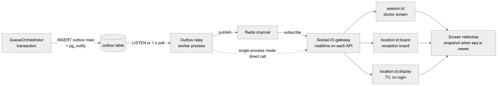

*Figure 30.10 — The realtime path from a queue change to the screens.*

The flowchart runs left to right. "QueueOrchestrator transaction" writes "INSERT outbox rows + pg_notify" into the "outbox table". The "Outbox relay worker process" picks rows up by "LISTEN or 1 s poll" and "publish"es them to a "Redis channel". The "Socket.IO gateway /realtime on each API" instance "subscribe"s to that channel. A dotted arrow from the relay straight to the gateway is labelled "single-process mode: direct call". The gateway sends to three rooms: "session:id, doctor screen", "location:id:board, reception board" and "location:id:display, TV, no login". All three lead to "Screen refetches snapshot when seq is newer".

**Behind the scenes — technically.** `QueueTx.emit` bumps `queue_sessions.event_seq`, inserts the `queue_events` row and three `outbox` rows, and calls `pg_notify('queue_outbox')`, all in one statement inside the transaction, so screens never see a change that rolled back. `OutboxRelayService` (worker role) drains unpublished rows in batches of 100 with `FOR UPDATE SKIP LOCKED`, publishes them, and stamps `published_at` only after publishing succeeded (at-least-once delivery). In `api` + `worker` deployments it publishes to Redis and `RedisRealtimeSubscriber` on every API instance relays to its sockets; the gateway refuses sockets while Redis or the worker heartbeat is missing, so clients fall back to polling. In the single-process `all` role it calls the gateway directly. `QueueGateway` (namespace `/realtime`) accepts a JWT in the handshake; `subscribe` to `session:` and `location:…:board` rooms requires access to that organization and location; `location:…:display` needs no login. Clients (`useQueueSocket`, `useQueueData`) compare `seq` with the snapshot's `eventSeq`, coalesce refetches (120 ms) and poll every 10 s while disconnected. The worker process must run as exactly one instance.

**Rules and validations.** Payloads never contain patient names.

**Who can do it.** Any signed-in member with access to the location (board and session rooms); anyone (display room).

**Data read and written.** Writes `outbox`, `queue_events`, `queue_sessions.event_seq`; the relay updates `outbox.published_at`.

**Effects on other modules.** The same gateway also carries `access.changed` to the room `org:<id>` (Chapter 57).

**Error cases.** Subscribe answers "Sign in required for this room", "No access to this room" or "Unknown room"; the screen then stays on polling.

**Technical references:** `backend/src/queue/realtime/outbox-relay.service.ts` · `OutboxRelayService`, `QueueGateway`, `QueueTx.emit` · `web-app/src/features/queue/hooks/useQueueSocket.ts`

### 30.3.25 Safe retries and stale screens (Idempotency-Key and If-Match)

**Status:** [Implemented]

**What it does.** Protects against double clicks, lost network replies and two people acting on the same patient at once. A retried check-in returns the same token, never a second one; an action on a patient someone else has already moved is refused and the screen refreshes.

**How the user does it.** Nothing to do. On a conflict the screen shows a warning toast that someone else changed this patient, and reloads the latest state.

**Behind the scenes — in simple terms.** Each button press carries a unique key; the server remembers the answer for that key for 24 hours. Each patient row carries a version number; the screen sends the version it saw, and the server refuses if it changed.

**Behind the scenes — technically.** Every queue mutation (except opening a session) requires an `Idempotency-Key` header (1–200 characters). The `@Idempotency` decorator hashes method, path and body. `claimIdempotencyKey` inserts `(organization_id, key, request_hash)` with `ON CONFLICT DO NOTHING`; a later request with the same key gets the saved response, a different body gets 422 `IDEMPOTENCY_KEY_REUSED`, and one still running gets 409 `REQUEST_IN_FLIGHT`. Entry actions accept `If-Match: <version>`; a mismatch gives 409 `VERSION_CONFLICT` with the current state. The web app (`queue.api.ts`) creates one key per user action and retries the same key up to 5 times on 503 `LOCK_TIMEOUT` or a lost connection. Database errors are mapped: lock timeout → `LOCK_TIMEOUT`; `one_patient_with_doctor` → `DOCTOR_BUSY`; `one_active_entry_per_appt` / `one_active_entry_per_patient` → `ALREADY_CHECKED_IN`.

**Rules and validations.** Keys are per organization and kept 24 hours.

**Who can do it.** Applies to everyone.

**Data read and written.** `idempotency_keys`; `version` columns on `queue_entries` and `queue_sessions`.

**Effects on other modules.** None.

**Error cases.** 400 `IDEMPOTENCY_KEY_REQUIRED`; 422 `IDEMPOTENCY_KEY_REUSED`; 409 `REQUEST_IN_FLIGHT`; 409 `VERSION_CONFLICT`; 503 `LOCK_TIMEOUT`.

**Technical references:** `backend/src/queue/decorators/queue-request.decorators.ts` · `Idempotency`, `IfMatch`, `QueueOrchestrator.mutate` · `web-app/src/features/queue/services/queue.api.ts`

### 30.3.26 Background jobs

**Status:** [Implemented]

**What it does.** Four jobs keep the queue tidy without anyone pressing a button: marking no-shows, auto-skipping patients who do not answer a call, closing yesterday's empty queues, and nightly clean-up.

**How the user does it.** Nothing to do; they run in the worker process.

**Behind the scenes — in simple terms.**
- **No-show marker**, every 60 seconds: bookings still scheduled or confirmed whose start plus "maximum late" minutes has passed become no-shows.
- **Call timeout**, every 15 seconds: if the location has "Auto-skip after a call" set, a patient called longer ago than that is skipped.
- **Day-end close**, every 5 minutes: sessions from a past service day are closed if nobody is left in them. Sessions that still have patients are only logged as an alert and are never cancelled automatically.
- **Clean-up**, every day at 03:15 server time: idempotency keys older than 24 hours and published outbox rows older than 7 days are deleted.

**Behind the scenes — technically.** `QueueJobsService` (`@Interval('queue-no-show-marker', 60_000)`, `@Interval('queue-call-timeout', 15_000)`, `@Interval('queue-session-day-end', 300_000)`, `@Cron('15 3 * * *', { name: 'queue-cleanup' })`, no timezone option, so server time). Each run is skipped if the previous run of the same job in this process is still busy. The call-timeout job selects entries called more than 30 seconds ago, reads each location's `call_timeout_sec`, and calls `QueueOrchestrator.timeoutCall`, which runs `skip` as the system actor with the expected version, ignoring the case where the state already moved on. The day-end job compares each open session's date with the location's current service date and calls `closeIfEmpty` (event `SESSION_CLOSED`, reason `DAY_END`). The no-show marker writes with plain SQL (no queue event, no realtime message). Jobs that go through the orchestrator re-check state under the session lock, so a double run is harmless.

**Rules and validations.** `call_timeout_sec` is null (off) by default and at least 30 when set.

**Who can do it.** The system (actor label `system`).

**Data read and written.** `appointments`, `queue_entries`, `queue_sessions`, `queue_policies`, `queue_events`, `outbox`, `idempotency_keys`.

**Effects on other modules.** No-shows change appointment status and figures (Chapter 29).

**Error cases.** Failures are logged ("Queue job … failed") and retried at the next tick.

**Technical references:** `backend/src/queue/jobs/queue-jobs.service.ts` · `QueueJobsService` · none (no screen)

### 30.3.27 Queue settings (organization default and location override)

**Status:** [Implemented]

**What it does.** Lets an admin set how queues behave: smart or first-come order, the early window, late grace, maximum lateness, the walk-in starvation limit, how skipped patients rejoin, auto-skip after a call, whether a manual select needs a reason, and when the service day starts. Settings can be saved for the whole organization or for one location.

**How the user does it.**
1. Open the location's settings page (from the locations admin) and find the **Queue settings** card (Figure 30.8). Make that location the active one first.
2. Change the values, choose **Save as** "This location only" or "Organization default (all locations)", and save. The message says "Queue settings saved — they apply from tomorrow's queues".
3. To go back to the organization default, click **Use organization default**.

**Behind the scenes — in simple terms.** The location's own settings win; otherwise the organization default applies; otherwise the built-in defaults: first come, first served; early window 15 min; late grace 10 min; maximum late 45 min; starvation 45 min; rejoin at the end; auto-skip off; no reason required for select; day starts at 00:00.

**Behind the scenes — technically.** `GET /queue/policies` (`@AnyMember`) → `QueuePoliciesService.getForLocation` (organization default, location override, effective values with `source`). `PATCH /queue/policies` with `UpdateQueuePolicyDto` (`scope`, optional `version` for optimistic locking) → `upsert`; a new location override starts from the currently effective values. `DELETE /queue/policies/location` → `removeOverride`. `getEffective` is cached for 60 seconds per location in each API process; saving clears the cache in that process only. Only `smart_queue_enabled` is copied into a session at creation; every other value is read live at each action, so those changes take effect within about a minute, not only from the next day as the message says.

**Rules and validations.**
- Early window 0–240; late grace 0–240; maximum late 0–480 and at least the late grace; starvation 1–480; auto-skip empty or 30–3600 seconds; service day start "HH:MM". The same limits are database checks.
- One organization default and at most one override per location (partial unique indexes).

**Who can do it.** Read: any member. Save and remove: `admin.settings.manage`; the page itself needs `admin.locations.manage`. Default: Admin.

**Data read and written.** Reads and writes `queue_policies`; reads `locations.timezone`.

**Effects on other modules.** `max_late_min` drives the appointment no-show marker and check-in (Chapter 29).

**Error cases.** 409 `VERSION_CONFLICT` (someone saved in between); 422 `INVALID_TRANSITION` "max_late_min must be at least late_grace_min"; 400 on out-of-range values.

**Technical references:** `backend/src/queue/services/queue-policies.service.ts` · `QueuePoliciesService`, `POLICY_DEFAULTS` · `web-app/src/features/queue/components/QueueSettingsSection.tsx`

### 30.3.28 Patient visit history

**Status:** [Implemented]

**What it does.** Lists a patient's queue visits, booked and walk-in, newest first, with token, doctor, date and outcome, on the patient record.

**How the user does it.** Open a patient and look at the appointments and visits tab.

**Behind the scenes — in simple terms.** Every queue entry of the patient in the organization, up to 200.

**Behind the scenes — technically.** `GET /queue/patients/:patientId/visits` (`patients.view`) → `QueueQueryService.patientVisits`. It is organization-wide and does not apply the scope of `patients.view` to the visits.

**Rules and validations.** At most 200 rows.

**Who can do it.** `patients.view`; feature `patients.core`. Default: Admin, Receptionist, Assistant, Doctor.

**Data read and written.** Reads `queue_entries`, `queue_sessions`, `employees`, `appointments`.

**Effects on other modules.** Shown in Patients (Chapter 28).

**Error cases.** 403 `NO_PERMISSION`.

**Technical references:** `backend/src/queue/services/queue-query.service.ts` · `QueueQueryService.patientVisits` · `web-app/src/features/patients/components/tabs/AppointmentsTab.tsx`

### 30.3.29 Next-patient preview

**Status:** [Partial] — backend only; no screen calls it.

**What it does.** Returns whom Call next would pick right now and the full waiting order, without reserving anyone.

**How the user does it.** Not from a screen. The doctor screen shows the same suggestion from its snapshot instead.

**Behind the scenes — in simple terms.** A read-only question to the selection engine.

**Behind the scenes — technically.** `GET /queue/sessions/:id/next-preview` (`@AnyMember`; board viewers or the session's doctor) → snapshot's `suggestion`, `waitingOrder` and `eventSeq`.

**Rules and validations.** The suggestion is empty while someone is with the doctor.

**Who can do it.** `queue.board.view`, or the right to run that session; feature `appointments.core`.

**Data read and written.** Reads the session's entries and policy.

**Effects on other modules.** None.

**Error cases.** 403 `NO_PERMISSION`; 404 "Queue session not found".

**Technical references:** `backend/src/queue/controllers/queue.controller.ts` · `QueueController.nextPreview` · no web-app caller

### 30.3.30 Queue history (events log)

**Status:** [Partial] — backend only; no screen shows it.

**What it does.** Returns the complete, append-only history of one session: every check-in, call (with the engine's reason and, for manual selects, its suggestion), skip, transfer, priority change, mode change, pause and close, with actor and time.

**How the user does it.** Not from a screen.

**Behind the scenes — in simple terms.** Every queue change writes one history row in the same transaction; rows are never edited.

**Behind the scenes — technically.** `GET /queue/sessions/:id/events?afterSeq=` (`admin.audit.view`) → `QueueQueryService.events`, ordered by `seq`. Rows hold `event_type`, `from_status`, `to_status`, `reason_code`, `reason_text`, `suggested_entry_id`, `actor_id`, `actor_role` (owner, super_admin, the role template keys, or `system`), `metadata` and `occurred_at`.

**Rules and validations.** Limited to the active location.

**Who can do it.** `admin.audit.view`; feature core. Default: Admin.

**Data read and written.** Reads `queue_events`.

**Effects on other modules.** None.

**Error cases.** 404 "Queue session not found".

**Technical references:** `backend/src/queue/entities/queue-event.entity.ts` · `QueueQueryService.events` · no web-app caller

### 30.3.31 Manage the TV display

**Status:** [Not implemented]

**What it does.** Nothing. The permission `queue.display.manage` ("Manage TV display") exists in the catalog and in the Receptionist template, but no endpoint or screen checks it. The TV display has no settings.

**How the user does it.** Not available.

**Behind the scenes — in simple terms.** Any screen can show `/display/<location id>` without setup.

**Behind the scenes — technically.** `queue.display.manage` appears only in `permissions.ts`, `templates.ts` and the catalog test.

**Rules and validations.** None.

**Who can do it.** Not applicable.

**Data read and written.** None.

**Effects on other modules.** None.

**Error cases.** None.

**Technical references:** `backend/src/access/catalog/permissions.ts` · `queue.display.manage` · none

## 30.4 Entities and data model

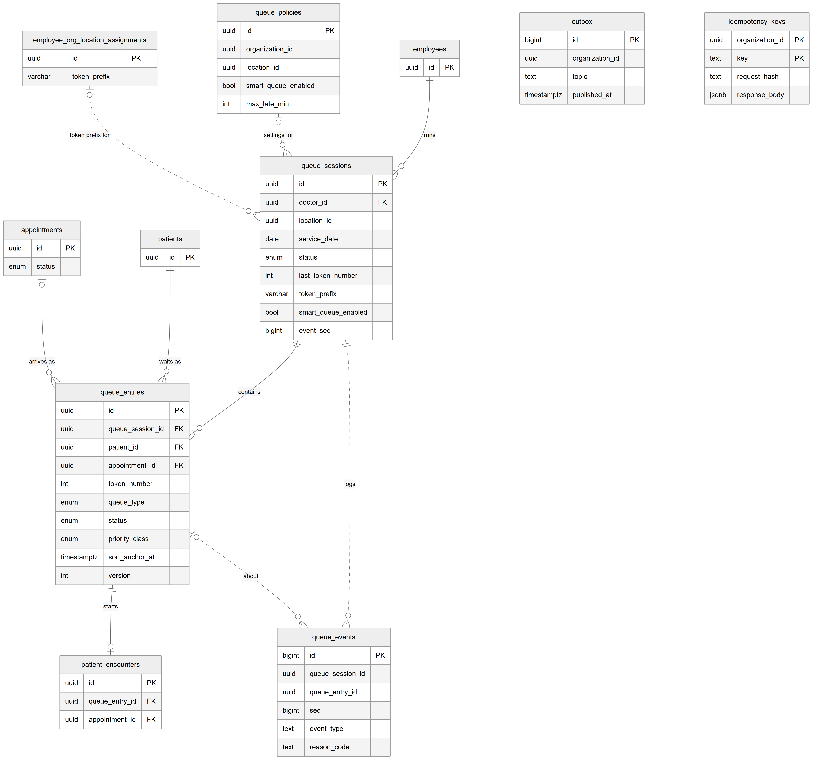

*Figure 30.11 — The queue tables and their links. Dotted lines are logical links without a foreign key.*

The diagram centres on `queue_sessions` (`id`, `doctor_id`, `location_id`, `service_date`, `status`, `last_token_number`, `token_prefix`, `smart_queue_enabled`, `event_seq`). Solid lines: `employees` "runs" sessions; a session "contains" `queue_entries` (`id`, `queue_session_id`, `patient_id`, `appointment_id`, `token_number`, `queue_type`, `status`, `priority_class`, `sort_anchor_at`, `version`); `patients` "waits as" entries; `appointments` "arrives as" entries; an entry "starts" at most one `patient_encounters` row. Dotted lines: a session "logs" `queue_events`, and an entry is what an event is "about"; `queue_policies` are "settings for" sessions; `employee_org_location_assignments` supply the "token prefix for" sessions. Two tables stand alone, with no links: `outbox` (`id`, `organization_id`, `topic`, `published_at`) and `idempotency_keys` (`organization_id` and `key` as the composite key, `request_hash`, `response_body`).

The relationships in words:

- Each queue session belongs to exactly one doctor (an employee). A doctor with sessions cannot be deleted (ON DELETE RESTRICT). There is one session per organization, location, doctor and service date (unique `uq_queue_session_doctor_day`). The session's `organization_id` and `location_id` have no foreign key.
- Each queue entry belongs to exactly one session; a session with entries cannot be deleted (RESTRICT). Token numbers are unique per session.
- Each entry belongs to one patient; deleting the patient deletes the entries (CASCADE).
- A booked entry points to its appointment, and a check constraint says `queue_type = 'appointment'` exactly when `appointment_id` is set. Deleting the appointment deletes the entry (CASCADE). At most one active entry per appointment and per patient per session, and at most one entry with the doctor per session (partial unique indexes).
- `converted_from_appt_id` (walk-in made from a late booking) and `transferred_from_id` (the entry a transfer replaced) are logical links without foreign keys.
- Each entry has at most one encounter (`patient_encounters.queue_entry_id` is unique); deleting the entry deletes the encounter (CASCADE).
- `queue_events` rows refer to a session and optionally an entry by id only, with `seq` unique per session. They are append-only.
- `queue_policies`: one row with `location_id` NULL per organization (the default) and at most one row per location (the override). No foreign keys.
- `outbox` rows are realtime messages addressed to a room (`topic`); `idempotency_keys` store the saved response per organization and key. Neither has foreign keys.

These tables come from the entities (TypeORM synchronize in development, a reviewed schema sync in production); none of the three migration files concerns the queue. The queue transaction sets `app.organization_id` and `app.location_id` for row-level security, but no row-level security policies exist, so tenant isolation is enforced in application code.

## 30.5 Status lifecycles

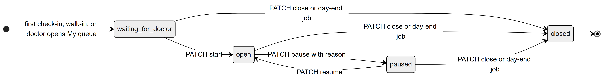

*Figure 30.12 — The queue session lifecycle from `SESSION_TRANSITIONS`.*

The diagram has four states. A session is created in `waiting_for_doctor` by the first check-in or walk-in, or when the doctor opens My queue. "PATCH start" leads to `open`. From `open`, "PATCH pause with reason" leads to `paused`, and "PATCH resume" leads back to `open`. From each of `waiting_for_doctor`, `open` and `paused`, "PATCH close or day-end job" leads to `closed`, the final state.

- **waiting_for_doctor** ("Doctor not started"): patients can arrive and get tokens; nobody can be called. The TV shows "Starting soon".
- **open**: the doctor can call, select and consult.
- **paused**: arrivals continue; calls are blocked; the TV shows "On a break" and the board shows the reason.
- **closed**: no arrivals, no tokens, no calls. Closing by hand needs a decision for each remaining patient; the day-end job closes only empty sessions of past days.

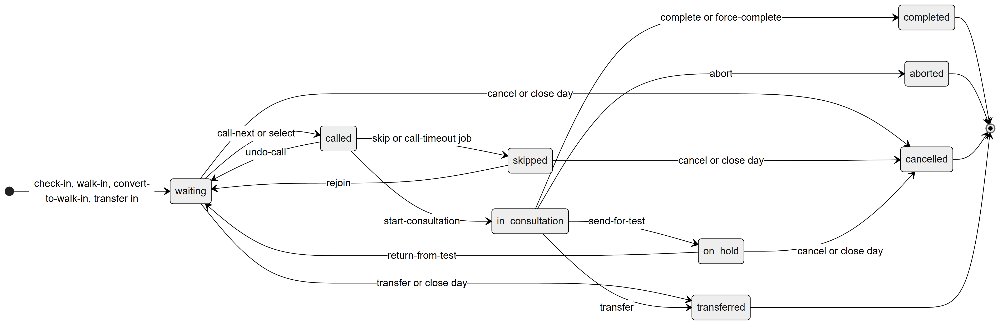

*Figure 30.13 — The queue entry lifecycle from `ENTRY_TRANSITIONS`.*

The diagram has nine states. Entries start in `waiting` through check-in, walk-in, convert-to-walk-in or "transfer in". From `waiting`: "call-next or select" to `called`; "cancel or close day" to `cancelled`; "transfer or close day" to `transferred`. From `called`: "undo-call" back to `waiting`; "skip or call-timeout job" to `skipped`; "start-consultation" to `in_consultation`. From `skipped`: "rejoin" back to `waiting`; "cancel or close day" to `cancelled`. From `in_consultation`: "send-for-test" to `on_hold`; "complete or force-complete" to `completed`; "abort" to `aborted`; "transfer" to `transferred`. From `on_hold`: "return-from-test" back to `waiting`; "cancel or close day" to `cancelled`. `completed`, `aborted`, `cancelled` and `transferred` are final.

- **waiting** ("Waiting"): in line; the only state the engine picks from.
- **called** ("Called"): the doctor called the token; it flashes on the TV. At most one entry per session is called or in consultation.
- **skipped** ("Skipped"): did not come when called; waits for reception to rejoin or remove.
- **in_consultation** ("In room"): with the doctor; the encounter exists.
- **on_hold** ("At test"): sent for a test; keeps the token; the doctor is free.
- **completed**: visit finished; the appointment is completed and charges are created.
- **aborted** ("Stopped"): consultation stopped; the appointment is cancelled with code `other`.
- **cancelled**: patient left or the day was closed; the appointment is cancelled with code `patient_left`.
- **transferred**: replaced by a new entry in another doctor's queue.

Any other change is refused with 422 `INVALID_TRANSITION`. The map also allows rejoin from `called` and `on_hold`, which the web app does not offer.

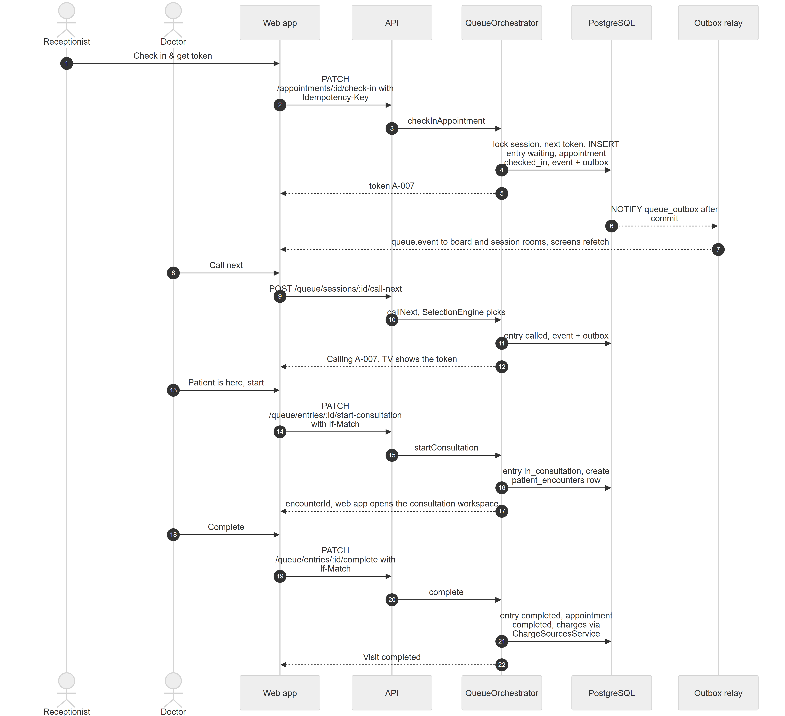

*Figure 30.14 — Check-in, call, consultation and completion of one booked patient.*

The sequence has seven participants: Receptionist, Doctor, Web app, API, QueueOrchestrator, PostgreSQL and Outbox relay, and 22 numbered steps. Steps 1–5: the receptionist clicks "Check in & get token"; the web app sends `PATCH /appointments/:id/check-in` with an Idempotency-Key; the API calls `checkInAppointment`; the orchestrator locks the session, takes the next token, inserts the entry as waiting, sets the appointment to checked_in and writes the event and outbox rows; the web app receives token A-007. Steps 6–7: after commit PostgreSQL notifies the relay, which sends `queue.event` to the board and session rooms, and the screens refetch. Steps 8–12: the doctor clicks "Call next"; the web app sends `POST /queue/sessions/:id/call-next`; the orchestrator lets the SelectionEngine pick, sets the entry to called and writes the event and outbox; the screen shows "Calling A-007" and the TV shows the token. Steps 13–17: the doctor clicks "Patient is here, start"; the web app sends `PATCH /queue/entries/:id/start-consultation` with If-Match; the orchestrator sets the entry to in_consultation and creates the `patient_encounters` row; the encounter id comes back and the web app opens the consultation workspace. Steps 18–22: the doctor clicks "Complete"; the web app sends `PATCH /queue/entries/:id/complete` with If-Match; the orchestrator sets the entry and the appointment to completed and creates the charges through ChargeSourcesService; the screen shows "Visit completed".

## 30.6 Connections to other modules

- **Appointments (Chapter 29).** Check-in and convert-to-walk-in start here; the queue sets the appointment to completed or cancelled; the no-show marker and `max_late_min` live here.
- **Patients (Chapter 28).** Walk-ins can create patients; the patient record shows visits; a doctor's `own` patient scope includes patients with a queue visit with that doctor.
- **Consultation (Chapter 31).** Start consultation creates the encounter and opens the workspace; the workspace's complete button calls the queue's complete.
- **Billing and Commissions (Chapters 34 and 35).** Completion creates charges and commission snapshots through `ChargeSourcesService`; the board's list view shows outstanding balances.
- **Employees (Chapter 37).** Doctors and token prefixes come from assignments.
- **Access control (Chapter 57).** All permissions are queue permissions of feature `appointments.core`; the realtime gateway also carries `access.changed`.
- **Realtime and jobs (Chapter 63).** The outbox relay, Redis bus and jobs run in the single worker process.
- **Subscriptions (Chapter 45).** In read-only mode queue writes are refused with 402 `SUBSCRIPTION_EXPIRED`; opening "My queue" still works because it is a GET.

## 30.7 Limitations and known gaps

- Next-patient preview and the queue history log have no screen.
- `queue.display.manage` is never checked; the TV display has no management.
- The TV state is public for any active location id and shows doctor names and tokens.
- Lanes, doctor pickers and transfer targets list every active staff member at the location, not only doctors.
- Urgent priority cannot be removed once set.
- The settings message says changes apply from tomorrow, but only the smart/FIFO choice is fixed per session; other values apply within about a minute (per-process 60-second cache).
- No row-level security policies exist, despite the tenant settings the transaction prepares.
- The no-show marker writes no queue event or realtime message.
- `GET /queue/me` and `POST /queue/sessions` have no web-app caller.
- Sound announcements, SMS or WhatsApp calls, and waiting-time estimates are not implemented.

## 30.8 Owner's FAQ

**Can two receptionists give out the same token?** No. Tokens come from a counter in the locked session row; a failed check-in rolls the counter back, so there are no gaps and no duplicates.

**What if the network drops right after "Check in & get token"?** The web app retries with the same Idempotency-Key and receives the same token. No second entry is created.

**Does a booked patient always go before walk-ins?** Only in smart mode and only when "due" (from 15 minutes before to 10 minutes after the booked time). A walk-in who has waited 45 minutes is called first once. In first-come mode, arrival order decides.

**Can a receptionist call patients?** Not with the default role. Calling and consulting need `queue.doctor.own` (own queue) or `queue.doctor.any` (Admin).

**What happens to patients still waiting when the doctor leaves?** The doctor must cancel or transfer each one to close the day. If nobody closes the day, the session stays open and the day-end job only logs an alert.

**Can I see who skipped or reordered a patient?** Yes in the database: every change is in `queue_events` with actor and reason. There is an API for it (`admin.audit.view`) but no screen yet.

**Does the TV show patient names?** No. Only tokens, doctor names, session status and counts.

**Where are queue settings stored?** In `queue_policies`: one organization default row and optional per-location override rows.

**What does "Complete" do to billing?** It creates the consultation and treatment charges in the same transaction, if the billing feature is enabled and an encounter exists.
