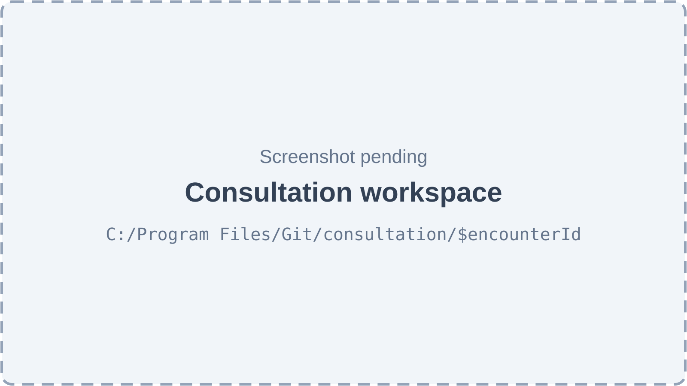
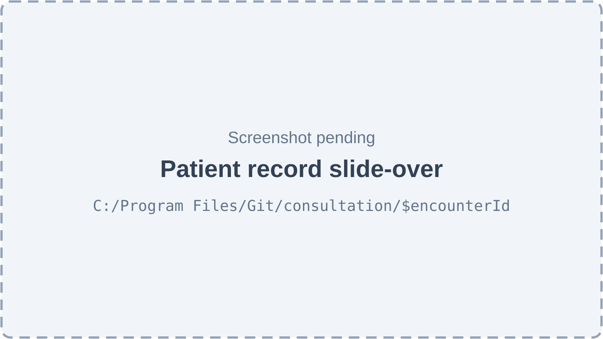
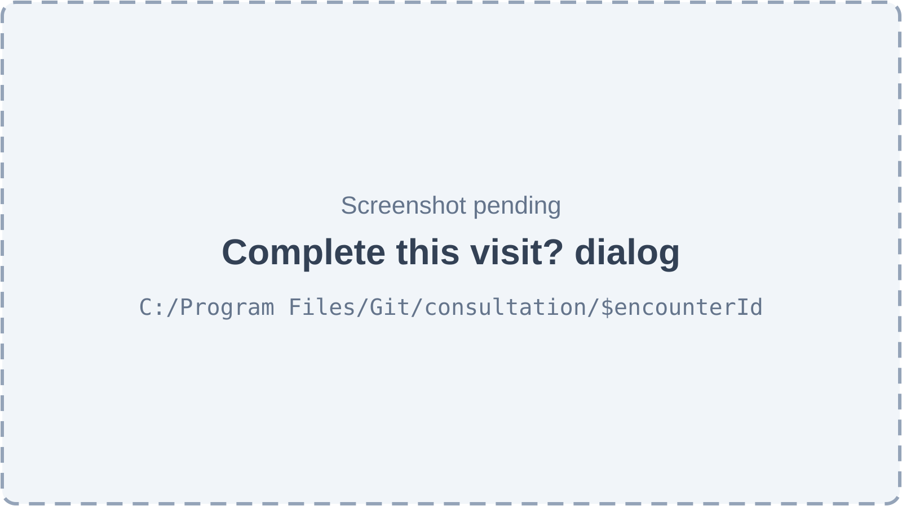
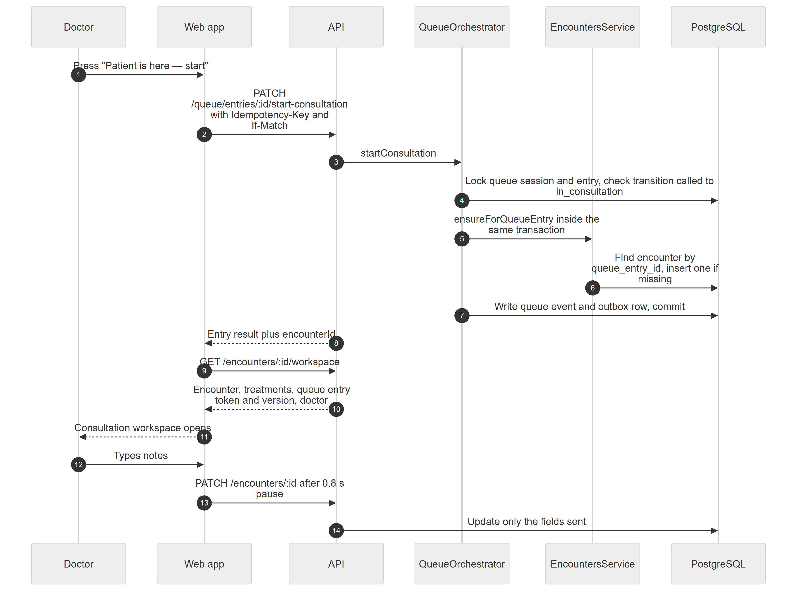
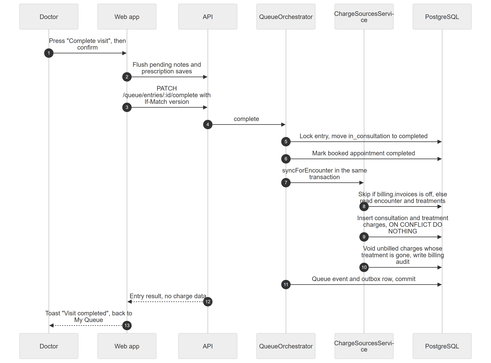
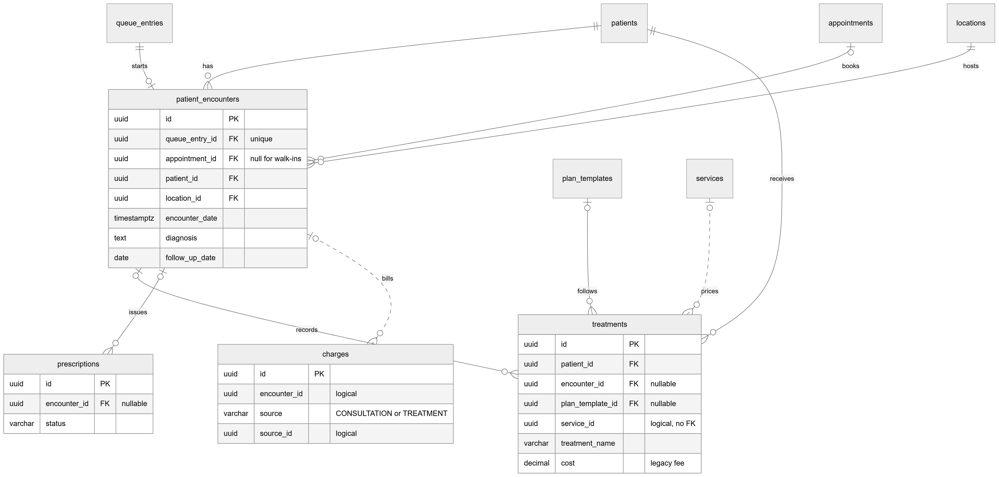
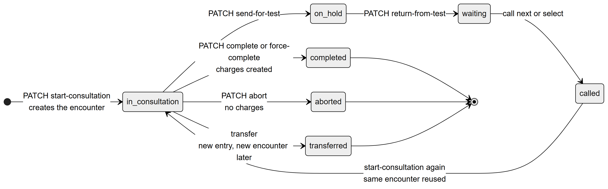

# Chapter 31 — Consultation

This chapter describes the consultation module of the Platform: the single screen a doctor works on while a patient is in the chair. It is written for the product owner and explains what the screen does, how the clinical record of one visit (the **encounter**) is created and saved, and how finishing the visit hands work over to billing. The consultation sits between the queue (which brings the patient to the doctor) and billing (which charges for the visit), so it touches both.

## 31.1 What this module is for

When a doctor starts seeing a patient from their queue, the Platform opens the **consultation workspace**. On one screen the doctor sees who the patient is and anything dangerous to know (allergies, blood thinners, pregnancy), writes the visit notes (complaint, examination, diagnosis, advice, next visit), records the **treatments** performed today, writes and signs the **prescription**, and finally presses "Complete visit". Everything saves itself while the doctor types.

Behind the screen, every consultation is stored as one **encounter**: the clinical record of one consultation. The Platform creates the encounter automatically when the doctor starts the consultation from the queue. There is no separate "new encounter" button.

**Who uses it.** Doctors, by default. The Doctor system role holds the permission `consultation.conduct` at scope `own`, so a doctor can only open consultations that came from their own queue. The Admin system role does not get this permission by default (Admins clone the Doctor role if they also see patients). The owner of the organization holds every permission.

**Where it appears.** The consultation workspace has **no sidebar entry**. The doctor reaches it from the "My Queue" sidebar item (`/queue/doctor`): the button "Patient is here — start" starts the consultation and opens the workspace, and the button "Open consultation" re-opens it later. The workspace route is `/consultation/$encounterId`.

## 31.2 Screens

The module has one page with two overlays. There are no usable screenshots of these screens yet, so each figure is a placeholder and the paragraph after it describes the screen from the web-app code.

*Figure 31.1 — Consultation workspace (screenshot pending).*

The consultation workspace is a full-screen page without the normal sidebar. A sticky header runs across the top. On its left is a "Back to my queue" button, the patient's initials avatar, the patient's full name and a sub-line with age, gender, patient number and the doctor's name. Next to it is the queue **token** (for example "A-007") and a timer showing how many minutes the consultation has been running; once the queue entry is no longer in consultation, the timer is replaced by "Visit ended". A row of shortcut buttons opens the patient record: "History", "Teeth" (only with permission `patients.chart.edit`), "Vitals" and "Files" (only with `patients.documents.manage`). On the right is the green "Complete visit" button. Under the header, a strip of coloured alert chips appears when the patient has allergies or other risks. The body has three columns on a wide screen. The left column, "Patient at a glance", shows the latest vitals, up to four previous visits and up to three previous signed prescriptions, each with a "Use these medicines again" icon button. The middle column, "Visit notes", has text boxes for Complaint, Examination, Diagnosis and "Advice to patient", each with one-tap phrase chips, and a "Next visit" row with chips (3 days, 1 week, 2 weeks, 1 month, 3 months, 6 months) and a date picker. The right column holds two panels: "Treatment done today" and "Prescription". On a phone or tablet the columns stack, and the patient summary folds behind a "Patient summary & history" button.

*Figure 31.2 — Patient record slide-over (screenshot pending).*

The patient record slide-over opens from the right on top of the workspace when the doctor presses one of the header shortcuts or a "See all", "Record" or "Update" link in the patient summary. Its title is the patient's name followed by "patient record", with the line "Look anything up or add to it. Closing this returns to the consultation." It has tabs: "History" (past visits and treatments, with amounts hidden), "Teeth chart" (needs `patients.chart.edit`), "Vitals & dental", "Prescriptions" (needs `prescriptions.create`), "X-rays & files" (needs `patients.documents.manage`) and "Consents". The tabs reuse the same components as the patient detail page, so anything the doctor adds here is saved to the patient record. Closing the slide-over returns the doctor to exactly where they were.

*Figure 31.3 — "Complete this visit?" dialog (screenshot pending).*

The "Complete this visit?" dialog opens when the doctor presses "Complete visit". Its description says "The patient leaves your queue and reception is told you are done." It lists four reminder lines, each with a green tick or an amber warning icon: whether visit notes are written (or "No complaint or diagnosis written"), how many treatments were recorded (or "No treatment recorded"), the prescription state ("Prescription signed", "Prescription is still a draft — not signed", or "No prescription written") and the next visit date (or "No next visit set"). These are reminders only: the doctor can always finish. The buttons are "Keep working" and "Complete visit".

## 31.3 Features

### 31.3.1 Start a consultation (the encounter is created)

**Status:** [Implemented]

**What it does.** When the doctor accepts the called patient, the queue entry moves to "in consultation" and the Platform creates the encounter for that visit. The doctor lands straight in the consultation workspace.

**How the user does it.**
1. On "My Queue", call the next patient (Chapter 30 covers calling).
2. When the patient walks in, press "Patient is here — start".
3. The consultation workspace opens for that patient.

**Behind the scenes — in simple terms.** Starting the consultation and creating the clinical record happen together, in one database transaction. Either both happen or neither does. If the patient was sent for a test and comes back, starting again re-uses the same encounter instead of making a second one.

*Figure 31.4 — Sequence from "Patient is here — start" to the first auto-saved note.*

Figure 31.4 is a sequence diagram with six participants: Doctor, Web app, API, QueueOrchestrator, EncountersService and PostgreSQL. In step 1 the doctor presses "Patient is here — start". In step 2 the web app sends `PATCH /queue/entries/:id/start-consultation` with an Idempotency-Key header and an If-Match header carrying the entry's version. In step 3 the API calls `startConsultation` on the QueueOrchestrator. In step 4 the orchestrator locks the queue session and entry in PostgreSQL and checks that the move from `called` to `in_consultation` is allowed. In step 5 it calls `ensureForQueueEntry` on the EncountersService inside the same transaction, and in step 6 that service looks for an encounter with this queue entry id and inserts one only if none exists. In step 7 the orchestrator writes the queue event and outbox row and commits. In step 8 the API returns the entry result plus the new `encounterId`. In steps 9 and 10 the web app loads `GET /encounters/:id/workspace` and receives the encounter with its treatments, the queue entry's token and version, and the doctor. In step 11 the workspace opens. In steps 12 to 14 the doctor types notes, the web app sends `PATCH /encounters/:id` after a short pause, and the API updates only the fields that were sent.

**Behind the scenes — technically.** `PATCH /queue/entries/:id/start-consultation` (doctor queue controller) calls `QueueOrchestrator.startConsultation`. Inside the orchestrator's `mutate` transaction it locks the entry, checks the caller runs this doctor's session (`assertSessionDoctor`), applies the transition `called → in_consultation` with `consultation_started_at`, and records the queue event `CONSULTATION_STARTED`. It then calls `EncountersService.ensureForQueueEntry(tx, entry, locationId, userId)`. That method returns the existing encounter for `queue_entry_id` if there is one; otherwise it inserts a row with the entry's appointment id (null for a **walk-in**), patient, organization, location, `encounter_date = now`, `reason` copied from the entry's reason for visit, and `created_by` / `updated_by` set to the user. The response adds `encounterId`, and the doctor queue page navigates to `/consultation/$encounterId`.

**Rules and validations.**
- Only the doctor of that queue session can start it, or staff holding `queue.doctor.any`.
- The entry must be in status `called`; anything else answers 422 `INVALID_TRANSITION`.
- The request needs an Idempotency-Key header; If-Match must match the entry version when sent.
- At most one encounter per queue entry (unique `queue_entry_id`).

**Who can do it.** Permission `queue.doctor.own` (feature `appointments.core`), held by the Doctor template. The Admin template holds `queue.doctor.any`, which implies it. Opening the workspace afterwards also needs `consultation.conduct` (feature `patients.core`), which only the Doctor template holds by default.

**Data read and written.** `queue_entries`, `queue_sessions`, `queue_events`, outbox, `patient_encounters`.

**Effects on other modules.** The queue board and TV display update through the realtime outbox (Chapter 30). The encounter becomes visible in the patient's visit history (Chapter 28).

**Error cases.**
- "Only this queue's doctor can do that" (403 `FORBIDDEN`) → another doctor's entry without `queue.doctor.any`.
- 422 `INVALID_TRANSITION` → the entry is not in `called`.
- 409 `VERSION_CONFLICT`, "This was changed by someone else. The latest state is shown." → reception changed the entry meanwhile.

**Technical references:** `backend/src/queue/services/queue-orchestrator.service.ts` · `QueueOrchestrator.startConsultation`, `EncountersService.ensureForQueueEntry` · `web-app/src/features/queue/pages/DoctorQueuePage.tsx`

### 31.3.2 Re-open a consultation that is already running

**Status:** [Implemented]

**What it does.** If the doctor reloads the page, closes the tab, or goes back to their queue, they can return to the same consultation without starting anything again.

**How the user does it.**
1. On "My Queue", the current patient shows the button "Open consultation".
2. Press it. The workspace opens with everything saved so far.

**Behind the scenes — in simple terms.** The Platform looks up the encounter that belongs to the queue entry and opens it. If the consultation was never started, it says so.

**Behind the scenes — technically.** `GET /encounters/by-queue-entry/:queueEntryId` → `EncountersService.getWorkspaceByQueueEntry` finds the encounter by `queue_entry_id` within the active organization and location, checks the conduct scope (`assertConductScope`), and returns the same workspace object as `GET /encounters/:id/workspace` (`getWorkspace`): the encounter with its appointment, patient and treatments (newest first), the queue entry (id, display token built from the session's token prefix and a three-digit number, status, version, session id) and the doctor (id, full name). The web hook `useOpenConsultation` then navigates to `/consultation/$encounterId`.

**Rules and validations.**
- The encounter must belong to the active organization and location.
- With scope `own`, the caller must be the doctor of the queue session the encounter came from. With scope `location` or `org`, any encounter at this location is reachable.
- Outside that reach the encounter reads as "not found", so its existence is not revealed.

**Who can do it.** `consultation.conduct` (feature `patients.core`, scopes own / location / org). Doctor template: `own`. Not in the Admin, Receptionist, Assistant or Accountant templates. The route itself is gated by `staticData.can = 'consultation.conduct'`.

**Data read and written.** Reads `patient_encounters`, `queue_entries`, `queue_sessions`, `employees`, `treatments`, `appointments`, `patients`.

**Effects on other modules.** None; read only.

**Error cases.**
- "This patient has not been started yet" (404) → no encounter exists for that queue entry.
- "Encounter not found" (404) → wrong organization or location, or outside the caller's scope.
- The workspace page shows "Couldn’t open this consultation" with a retry button when loading fails.

**Technical references:** `backend/src/encounters/encounters.service.ts` · `EncountersService.getWorkspace`, `assertConductScope` · `web-app/src/features/consultation/hooks/useConsultation.ts`

### 31.3.3 See the patient at a glance

**Status:** [Implemented]

**What it does.** The left column, "Patient at a glance", gives the doctor the latest vitals, the last few visits and the last few signed prescriptions, and lets them reuse an old prescription with one tap.

**How the user does it.**
1. Read "Latest vitals" (BP, Pulse, Temp °C, SpO₂ %, Weight kg, Height cm, with the date recorded). Press "Record" or "Update" to open the Vitals tab of the record slide-over.
2. Read "Earlier visits": up to four previous encounters, each showing the diagnosis (or complaint, or reason) and date, with the treatments under it. "See all" opens the History tab.
3. Under "Earlier prescriptions", press the repeat icon ("Use these medicines again") next to an old prescription to copy its medicines into today's prescription.

**Behind the scenes — in simple terms.** The screen pulls the patient's history, vitals and recent prescriptions. Amounts are never shown here.

**Behind the scenes — technically.** The page calls `GET /patients/:id` (patient), `GET /patients/:id/vitals` (the newest record is picked on the client), `GET /patients/:id/history` (encounters with treatments; the current encounter is filtered out) and `GET /prescriptions/patient/:patientId?page=1&limit=5` (draft and empty prescriptions, and those of this encounter, are filtered out; three are shown). The history endpoint runs through `HideTreatmentPricesInterceptor`, so treatment costs are removed for callers without `patients.price.view`.

**Rules and validations.**
- Only finalized or amended prescriptions with at least one medicine appear under "Earlier prescriptions".
- Reusing medicines skips any medicine already on today's prescription (matched by name, case-insensitive).

**Who can do it.** `patients.clinical.view` for history and vitals; reading prescriptions also needs the feature `patients.prescriptions`. The Doctor template holds both.

**Data read and written.** Reads `patients`, `patient_vitals`, `patient_encounters`, `treatments`, `prescriptions`, `prescription_medicines`.

**Effects on other modules.** Reusing medicines feeds the Prescription panel (Chapter 32).

**Error cases.** Each section shows an empty message instead of an error ("No vitals recorded yet.", "First visit — nothing earlier on record.", "No earlier prescriptions.").

**Technical references:** `web-app/src/features/consultation/components/PatientSnapshot.tsx` · `PatientSnapshot` · `backend/src/patients/patients.controller.ts`

### 31.3.4 Allergy and medical alerts

**Status:** [Partial] — the alert strip works, but it is built from free-text fields. There is no structured allergy list and no automatic check of a prescribed medicine against allergies.

**What it does.** Before treating, the doctor sees coloured chips under the header for anything that can hurt the patient today.

**How the user does it.** Nothing to do; the chips appear automatically. Red chips are dangers, amber chips are context.

**Behind the scenes — in simple terms.** The screen reads the patient's allergy and medical-history text and the latest vitals record, and turns them into labels.

**Behind the scenes — technically.** The web function `patientAlerts(patient, vitals)` builds the list on the client:
- red "Allergy: <text>" when `patients.allergies` is not blank;
- red "Blood thinners" and "Pregnant" from the latest vitals flags `isOnBloodThinners` and `isPregnant`;
- amber "Diabetic", "Hypertensive", "On antibiotics" from the vitals flags;
- amber "Medical history: <text>" from `patients.medical_history`;
- amber "Minor" (with "Guardian: …" when a guardian name exists).
No backend endpoint is involved beyond loading the patient and vitals.

**Rules and validations.** Alerts follow the most recent vitals record only; older flags are ignored.

**Who can do it.** Anyone who can open the workspace (`consultation.conduct`).

**Data read and written.** Reads `patients` and `patient_vitals`.

**Effects on other modules.** None.

**Error cases.** None; with no data there is no alert strip.

**Technical references:** `web-app/src/features/consultation/utils/patientInfo.ts` · `patientAlerts` · `web-app/src/features/consultation/components/ConsultationHeader.tsx`

### 31.3.5 Write the visit notes (auto-saved)

**Status:** [Implemented]

**What it does.** The doctor records the chief complaint, examination findings, diagnosis, advice to the patient and the next-visit date. There is no Save button: the notes save themselves.

**How the user does it.**
1. Type into Complaint, Examination, Diagnosis and "Advice to patient", or tap the phrase chips under them (for example "Toothache", "Dental caries", "Warm salt-water rinse"). The first five chips show, the rest behind "+N more". Tapping a chip appends the phrase once.
2. Under "Next visit", tap a chip such as "1 week" or pick a date (dates before today are blocked). Tap the active chip again to clear it.
3. Watch the save badge in the panel header; it shows saving, saved, or an error.

**Behind the scenes — in simple terms.** About a second after the doctor stops typing, the screen sends the notes to the server. If a save fails, it tries again on the next change. Before the visit is completed, anything still unsaved is sent first. The Complaint box starts with the reason for visit from check-in when no complaint has been written yet.

**Behind the scenes — technically.** The `useAutosave` hook waits 800 ms after the last change, then calls `PATCH /encounters/:id` with the five note fields. `EncountersService.updateNotes` loads the encounter for the active organization and location and touches only fields present in the body: an empty string or `null` clears a field, a missing field is left alone. It sets `updated_by` to the user and saves. When the doctor leaves the screen with an unsaved change, the hook sends it once more. The one-tap phrases are fixed lists in the web app (`quickPicks.ts`); clinics cannot edit them.

**Rules and validations.**
- Each text field is at most 4,000 characters.
- `followUpDate` must be a valid date string, or empty / null to clear.
- Scope check `assertConductScope` runs before every save.
- The server does not refuse edits after the visit is completed.

**Who can do it.** `consultation.conduct` (scoped). Doctor template: `own`.

**Data read and written.** Writes `patient_encounters` (`chief_complaint`, `examination`, `diagnosis`, `advice`, `follow_up_date`, `updated_by`).

**Effects on other modules.** The prescription written in the same workspace copies the complaint, diagnosis, advice and follow-up date into its own fields so they print on the prescription (Chapter 32). The follow-up date does not create an appointment.

**Error cases.**
- 400 validation message → a field longer than 4,000 characters or an invalid date.
- "Encounter not found" (404) → outside the caller's scope.
- The save badge shows an error state; the next edit retries.

**Technical references:** `backend/src/encounters/encounters.controller.ts` · `EncountersService.updateNotes`, `UpdateEncounterNotesDto` · `web-app/src/features/consultation/components/VisitNotes.tsx`

### 31.3.6 Record the treatments done today

**Status:** [Implemented]

**What it does.** The doctor records each procedure performed in this visit. Each one becomes a **treatment** in the patient's history and, when the visit is completed, a **charge** for billing. The doctor never sees or types a price.

**How the user does it.**
1. In "Treatment done today", tap a procedure chip. The chips come from the clinic's service catalog (eight shown; a "Search procedures" box appears when there are more than ten). If the clinic has no catalog yet, the chips are a fixed list of common procedures and the doctor types the name.
2. Tap "Other…" to type a procedure that is not in the catalog.
3. Optionally type the tooth in "Tooth #".
4. Press "Add". The treatment appears in the list with a green tick.

**Behind the scenes — in simple terms.** A picked catalog procedure is stored with a link to the catalog service, so billing can price it later. A typed name is stored without a price, and reception prices the charge at the billing desk. The tooth number is saved as a note "Tooth: …".

**Behind the scenes — technically.**
- `GET /treatments/catalog` → `TreatmentsService.listProcedureCatalog` returns id, name and code of active services of kind `PROCEDURE` in the organization, ordered by sort order and name. No prices are returned.
- `POST /encounters/:encounterId/treatments` → `EncountersService.assertPatientInScope`, then `TreatmentsService.createForEncounter`. It takes the patient from the encounter (so the patient can never mismatch) and calls `create`, which:
  - checks the patient exists in the organization and, if given, the plan template;
  - checks `serviceId` points to an active `PROCEDURE` service, else 422;
  - uses the typed name, or the service name when none is typed;
  - stores `cost = null` when a service is linked (billing prices it), else the optional legacy cost;
  - stores `date = now` unless given.
- The web app refreshes the workspace, the patient's treatments and the patient's history.

**Rules and validations.**
- Either a service or a treatment name is required ("Pick a service or enter a treatment name").
- Name at most 200 characters.
- A linked service must be an active procedure (`TREATMENT_SERVICE_INVALID`).
- The encounter must be at the active location.
- There is no remove or edit button for a treatment in the workspace, and no API endpoint to delete one.

**Who can do it.** `patients.clinical.edit` (feature `patients.core`), plus the patient must be inside the caller's `patients.view` scope. Doctor and Admin templates hold `patients.clinical.edit`; `consultation.conduct` also implies it.

**Data read and written.** Reads `services`, `patient_encounters`, `patients`, `plan_templates`; writes `treatments`.

**Effects on other modules.** Billing turns each treatment into a charge when the visit is completed (31.3.10). Commissions are snapshotted on those charges (Chapter 35). The treatment shows in the patient's history (Chapter 28).

**Error cases.**
- "Pick a service or enter a treatment name" (400) → nothing chosen.
- "Pick an active procedure from the service catalog" (422 `TREATMENT_SERVICE_INVALID`) → service inactive or not a procedure.
- "Service not found" / "Encounter not found" / "Treatment plan not found" (404).

**Technical references:** `backend/src/treatments/treatments.service.ts` · `TreatmentsService.createForEncounter`, `listProcedureCatalog` · `web-app/src/features/consultation/components/TreatmentsToday.tsx`

### 31.3.7 Look up or add to the patient record without leaving

**Status:** [Implemented]

**What it does.** The doctor can open the full patient record in a slide-over (Figure 31.2), use it, and close it to return to the consultation.

**How the user does it.**
1. Press "History", "Teeth", "Vitals" or "Files" in the header, or a link in the patient summary.
2. Switch tabs inside the slide-over as needed and add data.
3. Close the slide-over.

**Behind the scenes — in simple terms.** The slide-over shows the same tabs as the patient detail page. History is shown without amounts.

**Behind the scenes — technically.** `RecordDrawer` renders the patients feature components `VisitsTab` and `TreatmentsTab` (with `hideAmounts`), `TeethChartTab`, `VitalsAndDentalTab`, `ClinicalTab`, `FilesTab` and `ConsentsTab`. Their endpoints are described in the Patients chapter (Chapter 28).

**Rules and validations.** Tabs are hidden without their permission: Teeth chart needs `patients.chart.edit`, Prescriptions needs `prescriptions.create`, X-rays & files needs `patients.documents.manage`.

**Who can do it.** As for each tab; the Doctor template holds all of them.

**Data read and written.** As for each patient tab.

**Effects on other modules.** New vitals immediately refresh the alert strip and the vitals shown in the summary.

**Error cases.** As for each patient tab.

**Technical references:** `web-app/src/features/consultation/components/RecordDrawer.tsx` · `RecordDrawer` · `web-app/src/features/patients/components/tabs/`

### 31.3.8 Write the prescription inside the consultation

**Status:** [Implemented]

**What it does.** The "Prescription" panel lets the doctor write, sign and print the prescription for this visit without leaving the workspace. The Prescriptions chapter (Chapter 32) covers prescriptions in full; this section only describes how the panel fits the consultation.

**How the user does it.**
1. Search a medicine ("Search medicine…"), tap a suggestion chip, press "Add “name”" for a medicine not in the directory, press "Repeat last", or choose from "Use a preset".
2. Open each medicine line to set Dose, How often, For how long, With food and an optional note.
3. Press "Sign & print". If the doctor has no saved signature, a "Sign the prescription" dialog asks them to sign once; it is saved for next time.
4. The PDF opens in an in-app preview with a Print button. Afterwards the panel offers "Print" and "Amend".

**Behind the scenes — in simple terms.** The prescription is created as a draft the moment the first complete medicine line exists, and saves itself after that. The complaint, diagnosis, advice, follow-up date and today's vitals from the visit notes are copied onto the prescription automatically, so nothing is typed twice. A preset's English instructions are offered to the "Advice" note when it is still empty.

**Behind the scenes — technically.** The panel uses `GET /prescriptions/encounter/:encounterId` to find this visit's prescription, then `POST /prescriptions` (with `patientId`, `encounterId` and the queue session's doctor as `doctorId`) for the first save and `PATCH /prescriptions/:id` with the full medicine list for later saves (autosave after 1 second). "Sign & print" flushes the autosave, then calls `POST /prescriptions/:id/finalize` with the signature image and `GET /prescriptions/:id/pdf`. Vitals are copied only when the latest vitals record was taken on the encounter's date.

**Rules and validations.**
- Only medicine lines with name, dose, frequency and duration are saved.
- "Sign & print" refuses with "Choose how often and for how long for every medicine" or "Add at least one medicine".
- The panel is shown whether or not the user holds `prescriptions.create` or the feature `patients.prescriptions` is on; the server refuses the writes in that case.

**Who can do it.** `prescriptions.create` (feature `patients.prescriptions`). Doctor template only, by default.

**Data read and written.** `prescriptions`, `prescription_medicines`, `prescription_history`, `doctor_signatures`.

**Effects on other modules.** The signed prescription appears in the patient's record and the Prescriptions list (Chapter 32).

**Error cases.** "Could not sign the prescription — try again", "Signed, but the PDF could not be opened — tap Print", "Could not save the prescription — try again".

**Technical references:** `web-app/src/features/consultation/components/PrescriptionPanel.tsx` · `PrescriptionPanel` · `backend/src/prescriptions/controllers/prescription.controller.ts`

### 31.3.9 Order lab work from the consultation

**Status:** [Not implemented] — the workspace has no lab-order entry point, and a **lab order** has no link to an encounter.

**What it does.** Nothing in the workspace today. A doctor who wants to send a case to a dental lab must leave the consultation and use the Labs module (Chapter 40), which is reached from the sidebar.

**How the user does it.** Not available in the workspace.

**Behind the scenes — in simple terms.** The consultation feature code contains no lab component, the record slide-over has no lab tab, and the lab-order tables carry no encounter reference.

**Behind the scenes — technically.** No `lab` reference exists in `web-app/src/features/consultation/`, and `backend/src/lab-orders/` has no `encounter` field.

**Rules and validations.** Not applicable.

**Who can do it.** Not applicable (the Doctor template holds `lab.orders.create` for the Labs module).

**Data read and written.** None.

**Effects on other modules.** None.

**Error cases.** None.

**Technical references:** `web-app/src/features/consultation/` · `RecordDrawer` · `backend/src/lab-orders/`

### 31.3.10 Complete the visit

**Status:** [Implemented]

**What it does.** Finishing the visit removes the patient from the doctor's queue, closes the booked appointment, tells reception, and creates the charges for billing.

**How the user does it.**
1. Press "Complete visit" in the header.
2. Read the reminders in the "Complete this visit?" dialog (Figure 31.3).
3. Press "Complete visit" again, or "Keep working" to go back.
4. A "Visit completed" message appears and the doctor returns to "My Queue".

The doctor can also press "Complete" directly on the "My Queue" page without opening the workspace. A user holding `queue.doctor.any` can force-complete a visit the doctor forgot to close (Chapter 30).

**Behind the scenes — in simple terms.** First the screen makes sure the latest notes and prescription are saved; if that fails, it stops and says so. Then, in one transaction, the queue entry becomes completed, the appointment (if any) becomes completed, and billing creates the charges. The doctor's screen receives no prices or charge data.

*Figure 31.5 — Sequence from "Complete visit" to the automatic charges.*

Figure 31.5 is a sequence diagram with six participants: Doctor, Web app, API, QueueOrchestrator, ChargeSourcesService and PostgreSQL. In step 1 the doctor presses "Complete visit" and confirms. In step 2 the web app flushes any pending notes and prescription saves to the API. In step 3 it sends `PATCH /queue/entries/:id/complete` with the entry version in If-Match. In step 4 the API calls `complete` on the QueueOrchestrator. In step 5 the orchestrator locks the entry and moves it from `in_consultation` to `completed`. In step 6 it marks the booked appointment as completed. In step 7 it calls `syncForEncounter` on the ChargeSourcesService in the same transaction. In step 8 that service stops if the feature `billing.invoices` is off, otherwise it reads the encounter and its treatments. In step 9 it inserts the consultation and treatment charges with "ON CONFLICT DO NOTHING". In step 10 it voids unbilled charges whose treatment has disappeared and writes billing audit rows. In step 11 the orchestrator writes the queue event and outbox row and commits. In step 12 the API returns the entry result without any charge data, and in step 13 the web app shows "Visit completed" and returns the doctor to My Queue.

**Behind the scenes — technically.** `PATCH /queue/entries/:id/complete` → `QueueOrchestrator.complete`: lock, `assertSessionDoctor` (or `assertAnyDoctor` for force-complete), transition to `completed` with `finished_at`, queue event `COMPLETED` (or `FORCE_COMPLETED`), update the appointment to `COMPLETED` with `completed_at`, then `ChargeSourcesService.syncForEncounter`, all inside one transaction. The automatic charges are described in 31.3.11.

**Rules and validations.**
- The entry must be `in_consultation`; otherwise 422 `INVALID_TRANSITION`.
- Only the session's doctor, or `queue.doctor.any` for force-complete.
- The web "Complete visit" button is disabled while saving, once the visit has ended, or when the encounter has no queue entry.
- Nothing is mandatory: a visit can be completed with no notes, no treatment and no prescription.

**Who can do it.** `queue.doctor.own` (complete), `queue.doctor.any` (force-complete). Doctor template: complete; Admin template: force-complete.

**Data read and written.** `queue_entries`, `queue_events`, outbox, `appointments`, and the billing tables in 31.3.11.

**Effects on other modules.** Queue board, TV display and reception see the change in real time (Chapter 30). Billing receives the charges (Chapter 34). Commission entries follow the charges (Chapter 35).

**Error cases.**
- "Your latest changes could not be saved. Check the connection and try again." → the pre-completion save failed; nothing is completed.
- 409 `VERSION_CONFLICT` → someone changed the entry; the dialog closes and the workspace reloads.
- 403 "Only this queue's doctor can do that".

**Technical references:** `backend/src/queue/services/queue-orchestrator.service.ts` · `QueueOrchestrator.complete` · `web-app/src/features/consultation/components/CompleteDialog.tsx`

### 31.3.11 Automatic charges when the visit is completed

**Status:** [Implemented] — runs only when the organization has the feature `billing.invoices` enabled.

**What it does.** Every completed consultation produces one consultation **charge** plus one charge per treatment, ready for reception to collect. Nobody has to re-enter what the doctor did.

**How the user does it.** Nothing; it happens on completion. Reception sees the charges at the billing desk (Chapter 34).

**Behind the scenes — in simple terms.** The consultation fee comes from the clinic's "default consultation service" in billing settings. Each treatment linked to a catalog procedure is priced from the catalog, using the doctor-specific price when one exists. A treatment typed by name uses its old-style fee if it has one; otherwise the charge is created at zero and marked "needs pricing" for reception. A pricing problem never blocks the doctor: the charge is only marked "needs pricing". If the same visit is completed twice, no duplicate charges appear.

**Behind the scenes — technically.** `ChargeSourcesService.syncForEncounter(manager, { tenant, queueEntryId, doctorId, completedAt, actorUserId })`:
- Returns at once when `billing.invoices` is not enabled for the organization, or when no encounter exists for the queue entry.
- Loads the encounter's treatments and the existing active charges with source `CONSULTATION` or `TREATMENT` for this encounter.
- Builds drafts with `ChargeDraftFactory`: one `CONSULTATION` draft (source id = encounter id) if none exists, and one `TREATMENT` draft (source id = treatment id) for each treatment not yet billed.
- Prices them through `ChargePricingService.resolve`. A `BillingException` is caught, so the draft gets `unit_price = 0` and `needs_pricing = true`.
- Sets the charge date to the completion moment converted to a date in the **location's** timezone.
- Takes a commission snapshot for the doctor's compensation plan on that date (`CommissionService.snapshot`).
- Inserts with `.orIgnore()` against the partial unique index `uq_charges_source` (organization, source, source id, active only).
- Writes `CREATED` rows to the billing audit log.

**Rules and validations.**
- One active charge per source (enforced by `uq_charges_source`).
- The function returns nothing, so no charge data reaches the doctor's response.
- Runs inside the queue completion transaction: if it fails, the completion is rolled back.

**Who can do it.** Runs as a system billing actor on behalf of the doctor who completed the visit; no billing permission is needed by the doctor.

**Data read and written.** Reads `patient_encounters`, `treatments`, `location_billing_settings`, `services`, `service_prices` and the compensation tables (`compensation_plans`, `commission_rules`); writes `charges` and `billing_audit_logs`.

**Effects on other modules.** Billing desk and ready-to-bill list (Chapter 34); commission entries (Chapter 35); finance reports (Chapter 36).

**Error cases.** None shown to the doctor; pricing failures are logged as warnings and the charge is flagged "needs pricing".

**Technical references:** `backend/src/billing/charges/charge-sources.service.ts` · `ChargeSourcesService.syncForEncounter`, `ChargeDraftFactory` · (no screen; called by `QueueOrchestrator.complete`)

### 31.3.12 Void the charge of a treatment the doctor removed

**Status:** [Partial] — the logic exists in billing, but no current flow reaches it: there is no endpoint or button that removes a treatment from an encounter, and the charge sync runs only once, at completion.

**What it does.** If a treatment that was already charged disappears from the encounter, its unbilled charge is voided with the reason "Treatment removed by doctor". If the charge is already on an invoice, the money is kept and the charge is only flagged for review.

**How the user does it.** No user action leads here today.

**Behind the scenes — in simple terms.** When billing compares the encounter's treatments with the charges it already created, a charge without a matching treatment is either voided (not invoiced yet) or flagged (already invoiced).

**Behind the scenes — technically.** `ChargeSourcesService.handleRemoved` finds active `TREATMENT` charges whose `source_id` is no longer among the encounter's treatments. Charges without `invoice_id` are voided (`voidCharge`, reason "Treatment removed by doctor") and audited as `VOIDED`. Invoiced charges get `source_removed_at` set to the completion time.

**Rules and validations.** Invoiced charges are never voided by this path.

**Who can do it.** System, inside the completion transaction.

**Data read and written.** `charges`, `billing_audit_logs`.

**Effects on other modules.** Billing review of flagged charges (Chapter 34).

**Error cases.** None.

**Technical references:** `backend/src/billing/charges/charge-sources.service.ts` · `ChargeSourcesService.handleRemoved` · (no screen)

### 31.3.13 Keep prices away from doctors

**Status:** [Implemented]

**What it does.** Doctors never see treatment prices in the consultation, the procedure picker or the patient history.

**How the user does it.** Nothing; it is automatic.

**Behind the scenes — in simple terms.** Any response from the consultation or treatment endpoints has the `cost` field removed unless the caller may see prices.

**Behind the scenes — technically.** `HideTreatmentPricesInterceptor` is applied to the encounters and treatments controllers (and the patient history endpoint). It deletes `cost` from every object that has a `treatmentName`, anywhere in the response, unless the caller holds `patients.price.view`. With no access context it strips (fail-closed). The `Treatment.cost` column also carries `@VisibleIf('patients.price.view')`. The procedure catalog returns only id, name and code.

**Rules and validations.** Prices are visible only with `patients.price.view`.

**Who can do it.** `patients.price.view` is held by the Receptionist, Accountant and Admin templates, not by Doctor.

**Data read and written.** None (response filtering only).

**Effects on other modules.** None.

**Error cases.** None.

**Technical references:** `backend/src/common/interceptors/hide-treatment-prices.interceptor.ts` · `HideTreatmentPricesInterceptor` · `web-app/src/features/consultation/utils/treatmentInput.ts`

### 31.3.14 Encounter and treatment records outside the consultation

**Status:** [Implemented]

**What it does.** The same backend serves the patient record: reading one encounter in full, listing treatments of a patient or an encounter, and recording a treatment without a consultation.

**How the user does it.** From the patient detail page (Chapter 28), for example the visits and treatments tabs.

**Behind the scenes — in simple terms.** These endpoints follow the patient's visibility rules: a patient outside the caller's reach looks like it does not exist.

**Behind the scenes — technically.**
- `GET /encounters/:id` → `assertPatientInScope`, then `findOne`: the encounter with appointment, queue entry, patient and treatments (newest first), limited to the active location.
- `GET /treatments?patientId=` or `?encounterId=` → treatments with their plan template, newest first. One of the two parameters is required.
- `POST /treatments` → the standalone create path of `TreatmentsService.create`. Here the caller may pass `encounterId`, `planTemplateId`, `serviceId` and a legacy `cost` (0 or more, two decimals).

**Rules and validations.**
- A treatment linked to an encounter must belong to the encounter's patient ("Treatment patient does not match the encounter patient").
- "Provide either patientId or encounterId" when listing without either.
- Patient scope enforced on every path.

**Who can do it.** `patients.clinical.view` (reads), `patients.clinical.edit` (create). Reads: Doctor, Assistant, Admin. Create: Doctor, Admin.

**Data read and written.** `patient_encounters`, `treatments`.

**Effects on other modules.** A standalone treatment with no encounter is not picked up by the automatic charges of 31.3.11.

**Error cases.** 404 "Patient not found" / "Encounter not found"; 400 for mismatched patient or missing parameter.

**Technical references:** `backend/src/treatments/treatments.controller.ts` · `TreatmentsService.create`, `EncountersService.findOne` · `web-app/src/features/patients/services/patients.api.ts`

### 31.3.15 SOAP notes and note templates

**Status:** [Not implemented]

**What it does.** There is no separate clinical-note entity (for example structured SOAP notes with versions) and no clinic-defined note templates. The encounter's own fields (complaint, examination, diagnosis, advice, follow-up date) are the only visit notes, and the one-tap phrases are fixed in the web-app code.

**How the user does it.** Not available.

**Behind the scenes — in simple terms.** Not built.

**Behind the scenes — technically.** No entity, controller or route for clinical notes or note templates exists in `backend/src/encounters/` or `web-app/src/features/consultation/`.

**Rules and validations.** Not applicable.

**Who can do it.** Not applicable.

**Data read and written.** None.

**Effects on other modules.** None.

**Error cases.** None.

**Technical references:** `backend/src/encounters/entities/patient-encounter.entity.ts` · `PatientEncounter` · `web-app/src/features/consultation/constants/quickPicks.ts`

## 31.4 Entities and data model

*Figure 31.6 — Entity-relationship diagram of encounters, treatments and their neighbours.*

Figure 31.6 shows the table `patient_encounters` in the centre with its key columns: `id` (primary key), `queue_entry_id` (foreign key, unique), `appointment_id` (foreign key, null for walk-ins), `patient_id`, `location_id`, `encounter_date`, `diagnosis` and `follow_up_date`. In the top row are `queue_entries` ("starts"), `patients` ("has"), `appointments` ("books") and `locations` ("hosts"). Under it, `treatments` ("records") shows `patient_id`, the nullable `encounter_id` and `plan_template_id`, a logical `service_id` without a foreign key, `treatment_name` and the legacy `cost`. `treatments` also links to `patients` ("receives"), to `plan_templates` ("follows") and, with a dotted line, to `services` ("prices"). `prescriptions` hangs off the encounter ("issues") through a nullable `encounter_id`. `charges` is connected to the encounter by a dotted line ("bills") through the logical columns `encounter_id`, `source` (CONSULTATION or TREATMENT) and `source_id`.

The relationships in words:
- **Queue entry → encounter.** Each encounter belongs to exactly one queue entry, and a queue entry has at most one encounter (unique `queue_entry_id`). Deleting the queue entry deletes the encounter (ON DELETE CASCADE).
- **Appointment → encounter.** An encounter has an appointment only for booked visits; walk-ins have none. Deleting the appointment keeps the encounter and sets `appointment_id` to null (ON DELETE SET NULL).
- **Patient, organization, location → encounter.** Each encounter belongs to one patient, one organization and one location. Deleting any of them deletes the encounter (ON DELETE CASCADE). The patient id is stored on the encounter for fast lookup even though the queue entry also has it.
- **Encounter → treatments.** An encounter can have many treatments. A treatment always belongs to a patient (ON DELETE CASCADE from patients) and may belong to an encounter; deleting the encounter keeps the treatment and clears `encounter_id` (ON DELETE SET NULL).
- **Plan template → treatments.** A treatment may follow a clinic **plan template**; deleting the template clears the link (SET NULL).
- **Service → treatment.** `treatments.service_id` points to a row in `services` (the billing catalog) but has no database foreign key; it is a logical link checked by the service code.
- **Encounter → prescriptions.** A prescription may record the encounter it was written in; deleting the encounter clears the link (SET NULL).
- **Encounter → charges.** `charges.encounter_id` and `charges.source_id` are logical links (no foreign keys). For the consultation charge, `source_id` is the encounter id; for a treatment charge, it is the treatment id.

Indexes exist on `appointment_id`, `organization_id`, `location_id`, `patient_id` and `encounter_date` of `patient_encounters`, and on organization, location, patient and encounter of `treatments`. The encounter is a different thing from `patient_visits`, which is a per-location visit-count aggregate (Chapter 18 explains both).

## 31.5 Status lifecycles

The encounter itself has **no status column**. Whether a consultation is running, paused or finished is read from the status of its queue entry. Figure 31.7 therefore shows the queue-entry states that matter to an encounter, using the code's state names.

*Figure 31.7 — Life of an encounter, read from the status of its queue entry.*

Figure 31.7 is a left-to-right state diagram. From the start point, the transition "PATCH start-consultation, creates the encounter" leads to `in_consultation`. From `in_consultation` four transitions leave:
- "PATCH send-for-test" goes to `on_hold`. From there "PATCH return-from-test" goes to `waiting`, "call next or select" goes to `called`, and "start-consultation again, same encounter reused" returns to `in_consultation`.
- "PATCH complete or force-complete, charges created" goes to `completed`.
- "PATCH abort, no charges" goes to `aborted`.
- "transfer, new entry, new encounter later" goes to `transferred`.

`completed`, `aborted` and `transferred` each lead to the end point.

Walking through each state:
- **in_consultation.** The encounter exists and the doctor is working. Notes, treatments and the prescription are saved continuously.
- **on_hold.** The doctor pressed "Send for test" (for example an X-ray). The encounter and everything written so far stay. When reception marks the patient back, the entry returns to `waiting`; the doctor calls the patient again and starts again, and `ensureForQueueEntry` returns the same encounter.
- **completed.** The visit is finished. The appointment is marked completed and the automatic charges are created (31.3.11). The workspace shows "Visit ended" and disables "Complete visit".
- **aborted.** The doctor pressed "Stop consultation" on "My Queue". The appointment is closed as cancelled. The encounter row and its notes and treatments remain, but no charges are created because the charge sync runs only on completion.
- **transferred.** The patient was moved to another doctor. The encounter stays with the original queue entry. The new queue entry in the other doctor's queue gets its own encounter when that doctor starts.

The server does not lock an encounter after completion: `PATCH /encounters/:id` and `POST /encounters/:id/treatments` still accept changes. A treatment added after completion is not charged automatically.

## 31.6 Connections to other modules

- **Queue (Chapter 30).** Starting, sending for test, completing, aborting and transferring are queue actions run by `QueueOrchestrator`. The encounter is created inside the start transaction and billing runs inside the complete transaction.
- **Appointments (Chapter 29).** A booked visit's appointment is linked to the encounter and is marked completed (or cancelled on abort).
- **Patients (Chapter 28).** The workspace reads the patient, vitals and history, and the record slide-over reuses the patient tabs. Patient visibility (`patients.view` scope) governs treatment and encounter reads.
- **Prescriptions (Chapter 32).** The Prescription panel writes a prescription linked to the encounter and copies the visit notes onto it.
- **Treatment plans (Chapter 33).** A treatment can reference a plan template; planned work is separate from treatments performed.
- **Billing (Chapter 34).** Completion creates consultation and treatment charges, priced from the service catalog.
- **Commissions (Chapter 35).** Each automatic charge carries a commission snapshot for the doctor.
- **Access control (Chapter 57).** `consultation.conduct`, `patients.clinical.*`, `patients.price.view`, `queue.doctor.*`.

## 31.7 Limitations and known gaps

- No lab-order entry point in the workspace, and lab orders do not reference an encounter.
- No structured clinical notes, SOAP note entity or note templates; the one-tap phrases are fixed in code and dental-oriented.
- Allergies are free text; there is no allergy list and no check of prescribed medicines against allergies.
- Treatments cannot be edited or removed from the workspace, and no API deletes them. The "Treatment removed by doctor" voiding therefore has no current trigger.
- The encounter is not locked after completion; later edits are saved but later treatments are not charged.
- The follow-up date is only a note; it does not book an appointment or remind anyone.
- The Prescription panel is shown even when the user lacks `prescriptions.create` or the prescriptions feature is off; the server then refuses the save.
- Automatic charges depend on the feature `billing.invoices` being enabled for the organization; with it off, completion creates no charges and nothing is created later.

## 31.8 Owner's FAQ

**When exactly is the encounter created?** When the doctor presses "Patient is here — start", in the same transaction that moves the queue entry to `in_consultation`. Check-in does not create it, so waiting patients can still be cancelled cleanly.

**Can a receptionist open the consultation screen?** Not with the default templates. The route and the workspace endpoints need `consultation.conduct`, which only the Doctor template holds. A custom role can be given it at scope `location` or `org`.

**Can one doctor open another doctor's consultation?** Not with scope `own`, which the Doctor template uses: the encounter must come from the doctor's own queue session, otherwise it reads as "not found".

**What happens if the doctor's connection drops while typing?** The notes save about a second after typing stops. A failed save shows an error badge and is retried on the next change. Before completion the screen saves everything first and refuses to complete if that fails.

**What if the doctor completes a visit without writing anything?** It is allowed. The dialog only warns. A consultation charge is still created (if billing is enabled), priced from the default consultation service or marked "needs pricing".

**Do doctors ever see prices?** No. The treatment cost is stripped from responses for anyone without `patients.price.view`, and the procedure picker returns names only.

**Where are the visit notes stored?** In `patient_encounters`, columns `chief_complaint`, `examination`, `diagnosis`, `advice` and `follow_up_date`, one row per consultation.

**What happens to the record if the visit is stopped half-way?** The encounter and anything written stay in the patient's history, the appointment is cancelled, and no charges are created.

**If the patient goes for an X-ray and comes back, is a second record created?** No. Starting the consultation again re-uses the same encounter for that queue entry.
