# Chapter 32 — Prescriptions

This chapter describes the prescriptions module of the Platform: how doctors write, sign, amend and print prescriptions, and how the clinic maintains the library behind them (medicines, ready-made medicine sets and print layouts). It is written for the product owner. Prescriptions are part of the clinical record of a patient and are usually written inside the consultation workspace, so this module sits next to Patients (Chapter 28) and Consultation (Chapter 31).

## 32.1 What this module is for

A **prescription** is the signed list of medicines a doctor gives a patient, with dose, frequency, duration and instructions in English and Urdu, printed on the clinic's letterhead. In the Platform a prescription starts as a draft, becomes final when the doctor signs it, and can be amended later; every change is logged.

The module has three parts:
- **Prescriptions themselves**: list, builder, detail page, signing, PDF printing.
- **The prescription library**, shared by the whole organization:
  - the **medicine directory** (the drug catalogue doctors search);
  - **prescription presets** (ready-made sets of medicines for common situations);
  - **print layouts** (letterhead, footer and paper size).
- **Doctor signatures**: each doctor's saved signature image.

**Who uses it.**
- Doctors write and sign prescriptions (`prescriptions.create`, held only by the Doctor system role by default).
- Staff with `patients.clinical.view` (Doctor, Assistant and Admin by default) can read and print them.
- The Admin role maintains the library (`prescriptions.library.manage`).
- The owner holds every permission.

The whole module sits behind the **feature** `patients.prescriptions`, which is enabled by default for new organizations.

**Where it appears.** The sidebar item "Prescriptions" (`/prescriptions`) sits in the "Clinic" section and is shown to users holding `prescriptions.create`. The library pages have no sidebar entries of their own: they are reached through the "Library" button on the Prescriptions page and through links in the builder, and they share one tabbed header, "Prescription Library". Inside the consultation workspace, the "Prescription" panel is the doctor's main way to write prescriptions.

## 32.2 Screens

There are no usable screenshots of these screens yet, so each figure is a placeholder followed by a description taken from the web-app code.

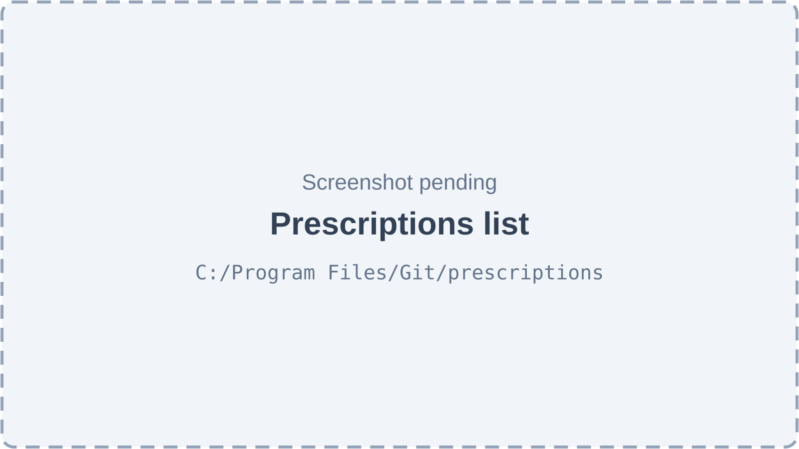

*Figure 32.1 — Prescriptions list (screenshot pending).*

The Prescriptions page (`/prescriptions`) has the title "Prescriptions" and the subtitle "Create, review, and manage patient prescriptions." In the top-right are a card/table view toggle, a "Library" button that opens the prescription library, and "New Prescription" (only with `prescriptions.create`). A strip of four counters shows Total, This month, Drafts and Finalized. Under the counters, a filter row has status tabs "All", "Drafts", "Finalized" and "Amended", each with a count, a "Clear filter" button when a status is chosen, and the number of prescriptions found. The table view lists Patient, Doctor, Medicines, Status (a coloured badge: Draft, Finalized or Amended), Created, and an "Open prescription" icon button; clicking a row also opens it. The card view shows the same prescriptions as cards. Both views have pagination with a page-size selector (10, 20, 50, 100). Empty, error and "No prescriptions match this status." states are shown when relevant.

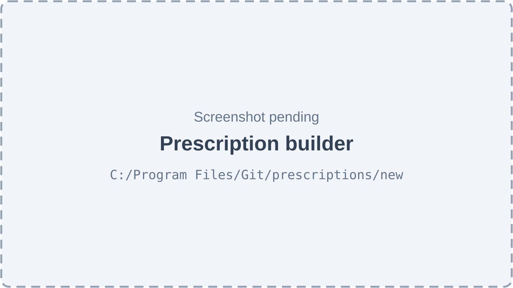

*Figure 32.2 — Prescription builder (screenshot pending).*

The builder (`/prescriptions/new`, title "New Prescription", with a back button to the list) has an editor on the left and a live preview of the printed page on the right. The toolbar of the editor has a "Presets" menu ("Apply prescription preset", with a link "Manage prescription presets"), a layout selector listing the organization's print layouts (or a "Set up layout" link when there are none), and, for a saved prescription, "History", a "Finalized" badge and "Print". The editor then has cards for:
- **Patient**: search box "Search patient by name or phone…", with "Change" once a patient is chosen.
- **Prescribing Doctor**: "Select a doctor…".
- **Chief Complaint** and **Diagnosis**.
- **Vitals (optional)**: BP, Pulse, Temp, SpO₂, Weight, Height.
- **Medicines**: numbered rows, each with a medicine search box, Dose, Frequency (free text or a pick list), a meal-relation selector, Duration, and English and Urdu instruction boxes, plus a delete icon. "Add medicine" adds a row.
- **Further Plan / Comment**.
- **Instructions (English)** and a right-to-left Urdu instructions box set in the Nastaliq font.

At the bottom are "Save Draft" and "Finalize & Sign" ("Amend & Sign" for a finalized prescription).

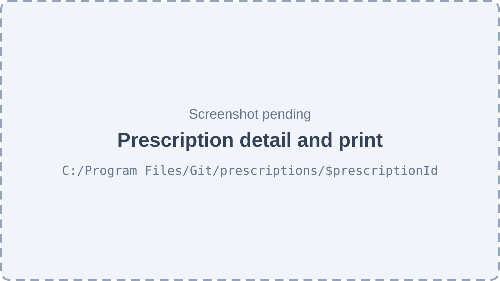

*Figure 32.3 — Prescription detail and print (screenshot pending).*

The detail page (`/prescriptions/$prescriptionId`) has the title "Prescription" and a back button "Back to prescriptions". It shows the same builder, loaded with the saved prescription, so the doctor can keep editing a draft or amend a finalized one. "Print" in the toolbar fetches the PDF and opens it in a new browser tab. The live preview on the right shows the prescription number and date.

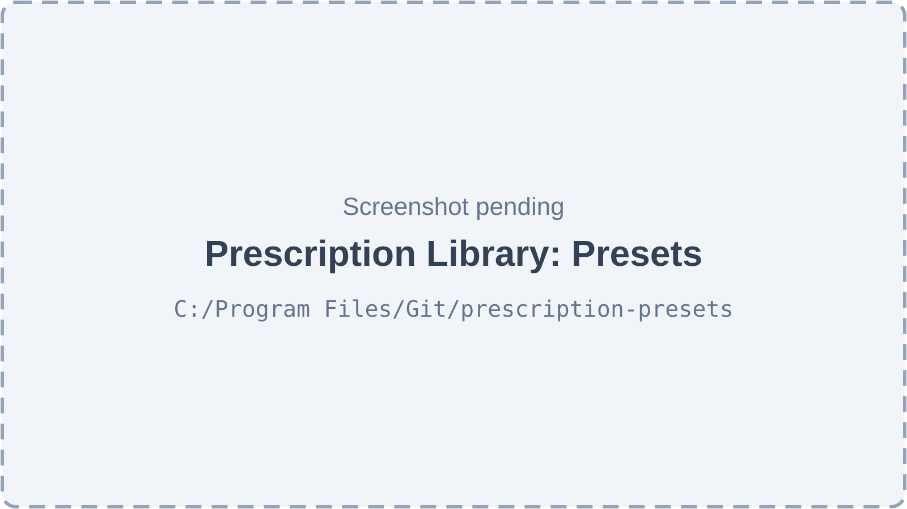

*Figure 32.4 — Prescription Library: Presets (screenshot pending).*

All three library pages share the title "Prescription Library", a back button to the prescriptions list and a tab bar with "Presets" (hint "Ready-made medicine sets"), "Medicines" ("Drug catalogue") and "Print layouts" ("Letterhead and paper"). The Presets tab (`/prescription-presets`) has the subtitle "Ready-made medicine sets. One tap adds a whole set to a prescription." It offers a search box "Search presets or medicines…", a category filter ("All categories" and about forty categories such as Toothache, Post extraction, Root canal, Pregnancy safe), a card/table toggle, and "New preset" for library managers. The table shows Preset, Category, Medicines and row actions "Edit preset" and "Deactivate preset" (library managers only). The empty state suggests saving a set such as "Toothache after extraction". The "New prescription preset" side sheet has sections "Preset" (Name, Category, Description), "Medicines" (each with Dose, How often, With food, For how long) and "Instructions for the patient" (English, Urdu, Further plan).

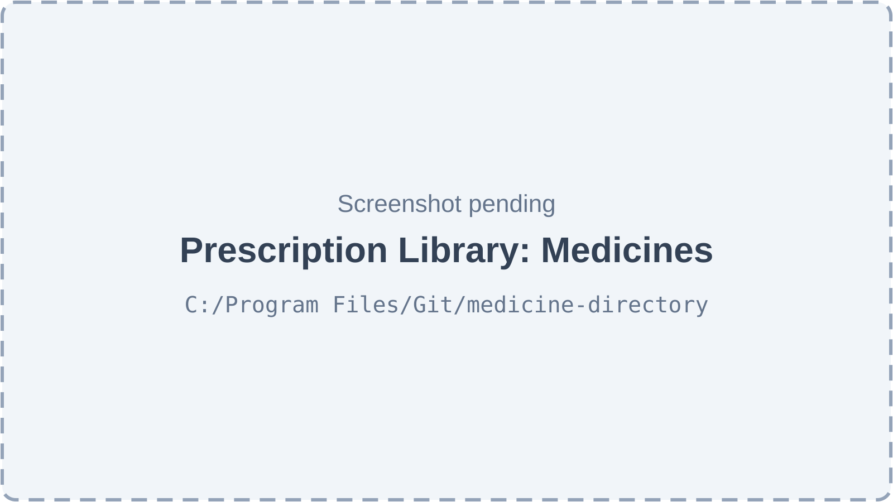

*Figure 32.5 — Prescription Library: Medicines (screenshot pending).*

The Medicines tab (`/medicine-directory`) has the subtitle "The drug catalogue doctors search while writing a prescription." It has a search box "Search by brand or generic name…" (300 ms debounce), a type filter ("All types", Tablet, Capsule, Syrup and so on), a card/table toggle and "Add medicine" for library managers. The table shows Medicine (with the generic name under it), Type, Strength, "Usual prescription" (the default dose, frequency, duration and meal relation), and Edit / Deactivate icon buttons. When the directory is empty, the empty state offers "Add common medicines" and "Add medicine". The "Add medicine" side sheet has "Medicine" (Name, Generic name, Urdu name, Type, Strength) and "Defaults on a prescription" (Dose, With food, How often, For how long). Deactivation asks "Deactivate this medicine?" and explains that existing prescriptions are not changed.

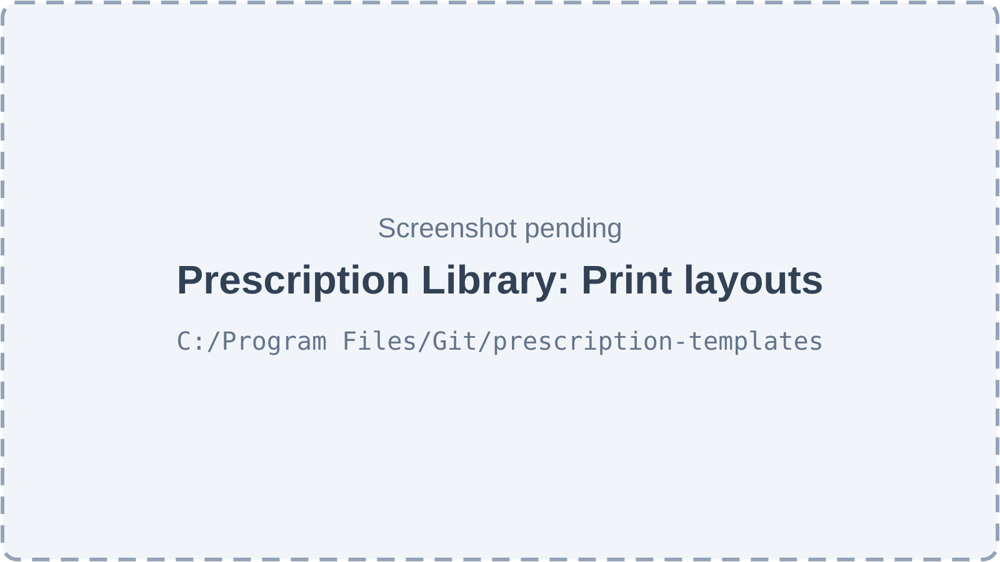

*Figure 32.6 — Prescription Library: Print layouts (screenshot pending).*

The Print layouts tab (`/prescription-templates`) has the subtitle "Letterhead, footer and paper size for printed prescriptions." It lists layouts with Layout, Paper and Default columns and row actions, and offers "New layout" for library managers. The empty state reads "No print layouts yet". The layout side sheet shows a live preview of the printed page beside these sections:
- **Layout**: Name, Paper size (A4, A5, Letter), Accent colour, "Use as the default layout".
- **Letterhead (top of the page)**: Clinic name, Clinic name in Urdu, Qualification, Registration no., Doctor phone.
- **Footer (bottom of the page)**: Address, Timings, Clinic phone, Small print.
- **Show on the prescription**: switches for Vitals, Medicine names in Urdu, Patient gender, Date.

## 32.3 Features

### 32.3.1 Browse and filter prescriptions

**Status:** [Implemented]

**What it does.** Shows every prescription at the active location, with counters and a status filter.

**How the user does it.**
1. Open "Prescriptions" in the sidebar.
2. Pick a status tab ("All", "Drafts", "Finalized", "Amended"); "Clear filter" resets it.
3. Switch between table and cards; change the page size or page.
4. Click a row or the "Open prescription" icon.

**Behind the scenes — in simple terms.** The list only contains prescriptions of patients the user is allowed to see, at the location the user is working in.

**Behind the scenes — technically.**
- `GET /prescriptions` → `PrescriptionService.findAll`: filters by organization and active location, applies the caller's `patients.view` scope to `patient_id` (`patientScope`), and accepts optional filters `patientId`, `doctorId`, `status`, `dateFrom`, `dateTo`, `page`, `limit`. It returns rows with patient, doctor and medicines, newest first.
- `GET /prescriptions/stats` → `getStats` returns `total`, `thisMonth`, `finalized` and `draft` under the same scope.
- The "Amended" count is computed in the browser as total minus drafts minus finalized.

**Rules and validations.**
- `status` must be DRAFT, FINALIZED or AMENDED.
- `page` and `limit` are at least 1.
- "This month" starts on the first day of the month in the server's clock, not the location's timezone.

**Who can do it.** `patients.clinical.view` plus feature `patients.prescriptions` (controller-level `@RequireFeature`). Route: any of `prescriptions.create` or `patients.clinical.view`. Doctor, Assistant and Admin templates can open it; only the Doctor sees the sidebar item.

**Data read and written.** Reads `prescriptions`, `prescription_medicines`, `patients`, `employees`.

**Effects on other modules.** None.

**Error cases.** Error state with retry when the list fails; "No prescriptions match this status." for an empty filter.

**Technical references:** `backend/src/prescriptions/services/prescription.service.ts` · `PrescriptionService.findAll`, `getStats` · `web-app/src/features/prescriptions/pages/PrescriptionsPage.tsx`

### 32.3.2 Write a prescription and save it as a draft

**Status:** [Implemented]

**What it does.** Creates a new prescription for a patient, with medicines, vitals and instructions, stored as a draft until it is signed.

**How the user does it.**
1. Press "New Prescription" on the list, or "New Prescription" on the patient's prescriptions tab (which pre-selects the patient).
2. Choose the patient and the prescribing doctor.
3. Fill Chief Complaint, Diagnosis and optional vitals.
4. Add medicines. Typing two or more letters searches the medicine directory; picking a result fills its defaults. Set dose, frequency, meal relation, duration and instructions.
5. Optionally fill Further Plan and the English and Urdu instructions.
6. Press "Save Draft". The page moves to the saved prescription.

In the consultation workspace the same thing happens automatically: the draft is created as soon as the first complete medicine line exists and then saves itself every second (Chapter 31 describes the panel).

**Behind the scenes — in simple terms.** The Platform gives the prescription a number such as "RX-2026-00042", links it to the patient (and the visit or appointment when known), chooses the print layout, and logs a "created" entry in its history.

**Behind the scenes — technically.** `POST /prescriptions` → `PrescriptionService.create(ctx, dto, dto.doctorId)`:
1. If `treatmentPlanTemplateId` (a preset) is given, the preset's medicines, further plan and instructions fill any fields the caller left empty.
2. The print layout is the one given in the request; otherwise the location's default; otherwise the organization-wide default; otherwise none.
3. The number is generated per organization as `RX-{current year}-{5 digits}`: it reads the organization's most recently created prescription and adds one to its last number part.
4. The prescription is saved with status `DRAFT`, version 1 and its medicines (cascade). Missing meal relation becomes `NONE`, missing sort order becomes the row position.
5. A history row `CREATED` is written.

Later saves use `PATCH /prescriptions/:id`, covered in 32.3.4.

**Rules and validations.**
- `patientId` is required (UUID).
- Each medicine needs a name (at most 200 characters), dosage (50), frequency (100) and duration (50). Urdu name is at most 200 characters, type at most 30. Meal relation must be BEFORE_MEAL, AFTER_MEAL, WITH_MEAL, EMPTY_STOMACH or NONE.
- The builder refuses to save without a patient ("Please select a patient first") or without a named medicine ("Add at least one medicine").
- The prescription number column is unique across the whole Platform.

**Who can do it.** `prescriptions.create` (feature `patients.prescriptions`). Doctor template only by default; the Admin template deliberately leaves it out.

**Data read and written.** Reads `treatment_plan_templates`, `prescription_templates`; writes `prescriptions`, `prescription_medicines`, `prescription_history`.

**Effects on other modules.** The prescription appears on the patient record (Chapter 28) and, when linked to an encounter, in the consultation workspace and the patient's "Earlier prescriptions".

**Error cases.**
- 400 with the field message → a medicine line with an empty dose, frequency or duration (the builder sends any row with a name).
- "Treatment plan template not found" (404) → the preset id does not belong to the organization.

**Technical references:** `backend/src/prescriptions/services/prescription.service.ts` · `PrescriptionService.create`, `CreatePrescriptionDto` · `web-app/src/features/prescriptions/components/PrescriptionBuilder.tsx`

### 32.3.3 Fill a prescription from a preset

**Status:** [Implemented]

**What it does.** A **prescription preset** (for example "Root canal aftercare") adds a whole set of medicines and instructions in one tap.

**How the user does it.**
- In the builder, open "Presets" and choose one. The medicine list is replaced by the preset's medicines, and empty Further Plan and instruction boxes are filled from the preset.
- In the consultation workspace, open "Use a preset" in the Prescription panel. The preset's medicines are added (duplicates by name are skipped), and its English instructions go into the visit's "Advice" note if that is empty.

**Behind the scenes — in simple terms.** Presets live in the prescription library and belong to the whole organization. Choosing one only copies its contents; later changes to the preset do not change prescriptions already written.

**Behind the scenes — technically.** The web app loads `GET /treatment-plan-templates` (active presets, optional `category` filter, ordered by name, medicines eager-loaded) and copies the medicines into the editor. The builder also sends the preset id as `treatmentPlanTemplateId`, which is stored on the prescription.

**Rules and validations.** Only active presets are listed.

**Who can do it.** Reading presets is open to any member of the organization (`@AnyMember`) when the feature is on. Writing the prescription needs `prescriptions.create`.

**Data read and written.** Reads `treatment_plan_templates`, `treatment_plan_template_medicines`.

**Effects on other modules.** None beyond the prescription.

**Error cases.** None specific; an empty preset list hides the menu in the workspace and shows a "Manage prescription presets" link in the builder.

**Technical references:** `backend/src/prescriptions/controllers/treatment-plan-template.controller.ts` · `TreatmentPlanTemplateService.findAll` · `web-app/src/features/prescriptions/components/PrescriptionBuilder.tsx`

### 32.3.4 Sign (finalize) a prescription

**Status:** [Implemented]

**What it does.** Signing makes the prescription final: it is stamped with the doctor's signature and time, and a PDF is produced.

**How the user does it.**
- In the builder: press "Finalize & Sign". The prescription is saved first. The dialog "Sign & finalize prescription" shows the saved signature (if any) with "Tap Confirm to use this — or draw a new one below to override it", and a "Draw new signature" pad. Press "Confirm & Sign".
- In the consultation workspace: press "Sign & print". If no signature is saved, the "Sign the prescription" dialog asks once ("Sign with your finger or mouse. It is saved, so you only do this once."). The PDF opens in an in-app preview with "Print".

**Behind the scenes — in simple terms.** A newly drawn signature is saved for next time. The prescription is checked (it must have medicines), marked final, and a PDF is generated and stored in the clinic's file storage if storage is available. If PDF storage fails, signing still succeeds and the PDF is built when someone prints.

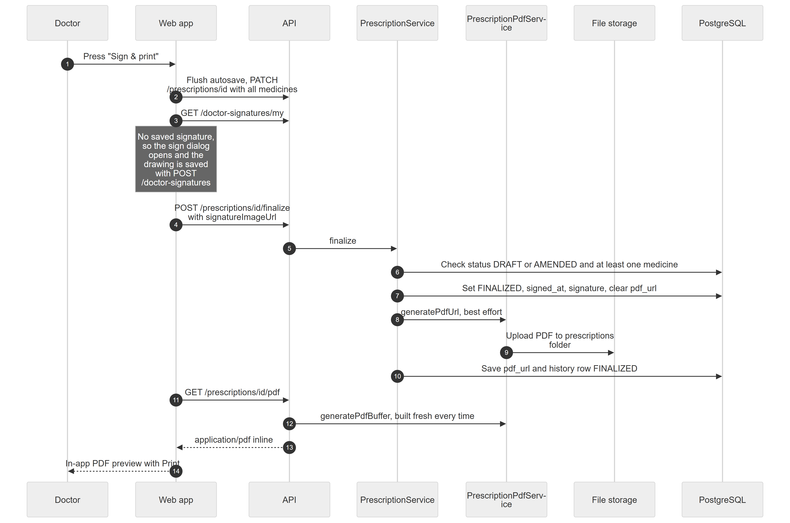

*Figure 32.7 — Sequence of "Sign & print" in the consultation workspace.*

Figure 32.7 is a sequence diagram with seven participants: Doctor, Web app, API, PrescriptionService, PrescriptionPdfService, File storage and PostgreSQL. In step 1 the doctor presses "Sign & print". In step 2 the web app flushes the autosave with `PATCH /prescriptions/id` carrying all medicines. In step 3 it asks `GET /doctor-signatures/my`. A note explains that when no signature is saved, the sign dialog opens and the drawing is saved with `POST /doctor-signatures`. In step 4 the web app sends `POST /prescriptions/id/finalize` with the signature image. In step 5 the API calls `finalize` on the PrescriptionService. In step 6 the service checks that the status is DRAFT or AMENDED and that there is at least one medicine. In step 7 it sets FINALIZED, the signing time and the signature, and clears the stored PDF address. In step 8 it asks the PrescriptionPdfService to generate the PDF address, best effort. In step 9 that service uploads the PDF to the "prescriptions" folder in file storage. In step 10 the PrescriptionService saves the PDF address and a FINALIZED history row. In steps 11 to 13 the web app calls `GET /prescriptions/id/pdf`, the API builds the PDF fresh with `generatePdfBuffer` and returns it inline as `application/pdf`. In step 14 the doctor sees the in-app preview with Print.

**Behind the scenes — technically.** `POST /prescriptions/:id/finalize` → `PrescriptionService.finalize`:
- Refuses unless the status is `DRAFT` or `AMENDED` and at least one medicine exists.
- Takes the signature image from the request, otherwise the saved signature found by the caller's user id (`DoctorSignatureService.getByEmployee`).
- Sets `status = FINALIZED`, `signed_at = now`, `signature_image_url`, `pdf_url = null`, and saves.
- Calls `PrescriptionPdfService.generatePdfUrl`, which builds the PDF and uploads it through the `StorageProvider` (folder "prescriptions"); any error is swallowed and the URL stays empty.
- Logs history `FINALIZED` with optional `changeNotes`.

**Rules and validations.**
- Only DRAFT or AMENDED can be finalized.
- At least one medicine is required.
- The workspace also refuses when a medicine line is incomplete ("Choose how often and for how long for every medicine").
- The builder refuses without a signature ("Please draw your signature or use a saved one").

**Who can do it.** `prescriptions.create`. Doctor template only by default.

**Data read and written.** `prescriptions`, `prescription_history`, `doctor_signatures`; the PDF file in external storage.

**Effects on other modules.** The signed status shows in the consultation's "Complete this visit?" dialog ("Prescription signed") and in the patient's "Earlier prescriptions".

**Error cases.**
- "Only DRAFT or AMENDED prescriptions can be finalized" (400).
- "Cannot finalize a prescription with no medicines" (400).
- Workspace toasts "Could not sign the prescription — try again" and "Signed, but the PDF could not be opened — tap Print".

**Technical references:** `backend/src/prescriptions/services/prescription.service.ts` · `PrescriptionService.finalize` · `web-app/src/features/consultation/components/PrescriptionPanel.tsx`

### 32.3.5 Amend a signed prescription

**Status:** [Implemented]

**What it does.** A signed prescription can still be corrected. Editing it turns it into an **amended** prescription with a higher version number; signing again makes it final once more. The state before each change is kept in the history.

**How the user does it.**
- Builder: open the prescription, edit, then press "Amend & Sign" (or "Save Draft" to save the amendment unsigned).
- Workspace: press "Amend", edit the medicines, then "Sign amendment & print".

**Behind the scenes — in simple terms.** Every save takes a full copy of the prescription before the change and stores it in the history, so any older version can be rebuilt. The cached PDF is thrown away so the next print shows the new content.

**Behind the scenes — technically.** `PATCH /prescriptions/:id` → `PrescriptionService.update`:
1. Takes a JSON snapshot of the prescription and its medicines (`PrescriptionHistoryService.snapshot`).
2. In a transaction:
   - if `medicines` is sent, deletes all medicine rows and inserts the new list (replace-all);
   - merges the other fields;
   - when the prescription was `FINALIZED`, sets `status = AMENDED`, increments `version` and clears `pdf_url`.
3. Logs a history row `AMENDED` with the snapshot and optional `changeNotes`.

A draft edit is also logged as `AMENDED`, with the same version.

**Rules and validations.**
- Any status can be patched: DRAFT stays DRAFT, FINALIZED becomes AMENDED, AMENDED stays AMENDED.
- Medicine lines follow the rules in 32.3.2.
- The patient, encounter, appointment and doctor cannot be changed through this endpoint.

**Who can do it.** `prescriptions.create`, and the patient must be inside the caller's `patients.view` scope (otherwise "Prescription not found").

**Data read and written.** `prescriptions`, `prescription_medicines`, `prescription_history`.

**Effects on other modules.** An amended (unsigned) prescription shows as "Prescription is still a draft — not signed" in the consultation completion dialog.

**Error cases.** "Prescription not found" (404) → wrong organization or patient out of scope.

**Technical references:** `backend/src/prescriptions/services/prescription.service.ts` · `PrescriptionService.update`, `PrescriptionHistoryService.snapshot` · `web-app/src/features/prescriptions/components/PrescriptionBuilder.tsx`

### 32.3.6 Add, edit or remove one medicine line

**Status:** [Partial] — backend only. No screen calls these endpoints; both the builder and the workspace send the whole medicine list with `PATCH /prescriptions/:id`.

**What it does.** Changes a single medicine on a draft or amended prescription without resending the rest.

**How the user does it.** Not available in the web app.

**Behind the scenes — in simple terms.** The change is allowed only while the prescription is not signed, and each change is noted in the history.

**Behind the scenes — technically.**
- `POST /prescriptions/:id/medicines` adds a line at the end of the sort order.
- `PATCH /prescriptions/:id/medicines/:medicineId` updates a line.
- `DELETE /prescriptions/:id/medicines/:medicineId` removes a line.

Each runs `assertEditable` (status DRAFT or AMENDED) and logs history `AMENDED` with a note such as "Added medicine: …". The version does not change.

**Rules and validations.** Finalized prescriptions refuse with "Finalized prescriptions cannot be edited — amend instead". Medicine field rules as in 32.3.2.

**Who can do it.** `prescriptions.create` with patient scope.

**Data read and written.** `prescription_medicines`, `prescription_history`.

**Effects on other modules.** None.

**Error cases.** "Medicine line not found" (404); the edit-refusal message (400).

**Technical references:** `backend/src/prescriptions/controllers/prescription.controller.ts` · `PrescriptionService.addMedicine`, `updateMedicine`, `removeMedicine` · `web-app/src/features/prescriptions/hooks/usePrescriptionMedicines.ts` (unused hooks)

### 32.3.7 Duplicate a prescription

**Status:** [Partial] — backend only; no screen calls it. It also stores the caller's user id in the doctor column, which normally holds an employee id; whether that save succeeds was not verified.

**What it does.** Creates a new draft prescription for the same patient with the same layout, notes, vitals and medicines.

**How the user does it.** Not available in the web app. The consultation's "Repeat last" and "Use these medicines again" copy medicines in the browser instead.

**Behind the scenes — in simple terms.** It is a copy that starts again as a draft with a new number, without the appointment link.

**Behind the scenes — technically.** `POST /prescriptions/:id/duplicate` → `PrescriptionService.duplicate` reads the source and calls `create` with its fields and medicines. The encounter and appointment are not copied. `doctorId` is `req.user.uuid`.

**Rules and validations.** As for create.

**Who can do it.** `prescriptions.create` with patient scope.

**Data read and written.** `prescriptions`, `prescription_medicines`, `prescription_history`.

**Effects on other modules.** None.

**Error cases.** "Prescription not found" (404).

**Technical references:** `backend/src/prescriptions/services/prescription.service.ts` · `PrescriptionService.duplicate` · (no screen)

### 32.3.8 Change history of a prescription

**Status:** [Partial] — history rows are written on every create, edit, line change and signing, but no screen shows them, and the read endpoint looks broken.

**What it does.** Keeps an audit trail of a prescription: who changed it, when, the type of change, the version and a full copy of the prescription before an edit.

**How the user does it.** The builder has a "History" button, but it only reloads the same page with a `tab=history` parameter that nothing reads, so no history view appears.

**Behind the scenes — in simple terms.** Each change adds one row; rows are never edited.

**Behind the scenes — technically.**
- Writing: `PrescriptionHistoryService.log` stores `prescription_id`, `version`, `changed_by`, `change_type` (CREATED, AMENDED or FINALIZED are used; PRINTED and SHARED exist in the enum but are never written), `previous_data` (JSON snapshot) and `change_notes`.
- `changed_by` holds the employee id given at creation, but the user id for later changes.
- Reading: `GET /prescriptions/:id/history` → `listFor` asks the database layer to load a relation named `changedByEmployee`. The history entity does not declare that relation, and TypeORM normally refuses such a query, so the endpoint is expected to fail at run time (found by reading the code, not tested).

**Rules and validations.** Rows are append-only by code convention; the database does not enforce it.

**Who can do it.** Written by the system; reading needs `patients.clinical.view` with patient scope.

**Data read and written.** `prescription_history`.

**Effects on other modules.** None.

**Error cases.** See the read problem described in the technical paragraph.

**Technical references:** `backend/src/prescriptions/services/prescription-history.service.ts` · `PrescriptionHistoryService.log`, `listFor` · `web-app/src/features/prescriptions/hooks/usePrescriptionHistory.ts` (unused)

### 32.3.9 Print a prescription as PDF, with Urdu

**Status:** [Implemented]

**What it does.** Produces a one-page PDF of the prescription on the clinic's layout. Urdu text (medicine names, notes, instructions, clinic name, disclaimer) is printed in proper Nastaliq script, right to left, with numbers and English words kept the right way round.

**How the user does it.**
- Workspace: "Sign & print" or "Print" opens an in-app PDF preview with a "Print" button.
- Builder or detail page: "Print" opens the PDF in a new browser tab.

**Behind the scenes — in simple terms.** The PDF is built fresh each time it is requested, from the saved prescription and its print layout. Any staff member who can read the prescription can print it, including drafts.

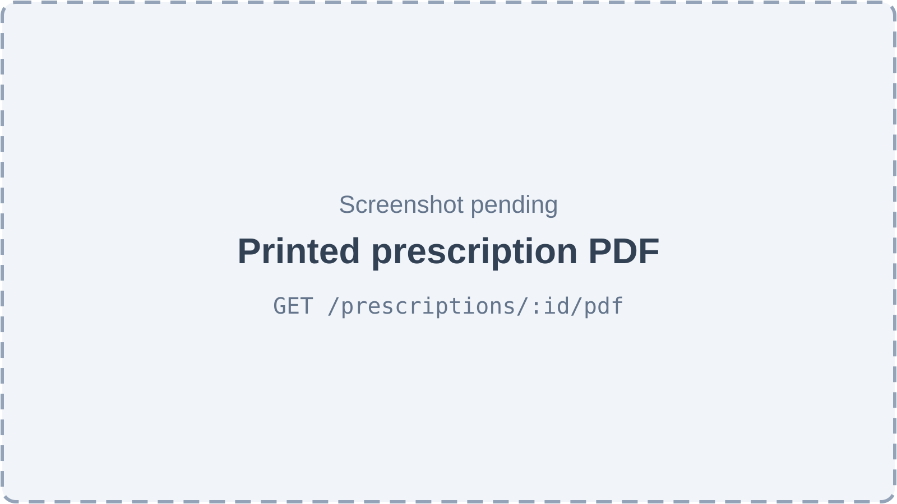

*Figure 32.8 — Printed prescription PDF (screenshot pending).*

Figure 32.8 stands for the generated PDF. From the PDF code, the page is laid out from top to bottom as follows:
- **Header.** "Dr. <doctor name>" on the left in the layout's accent colour, with the qualification under it. The clinic name is on the right (the layout's clinic name, else the location name, else "Clinic"), the Urdu clinic name under it, then the doctor phone. A coloured line closes the header.
- **Patient bar.** A grey bar with Name, Age, Gender, Reg#, Date and the RX number.
- **Vitals row.** BP, Pulse, Temp, SpO2, Wt and the other vitals present, unless the layout hides vitals.
- **Clinical text.** Labelled blocks "Chief Complaint" and "Diagnosis".
- **Medicines.** A bold "Rx", then numbered medicines. Each shows the name in bold; under it dose, frequency, "× duration" and the meal relation in brackets; then a bullet with the special instruction. When a medicine has an Urdu name or Urdu note, they are printed in a right-hand column taking five-twelfths of the width.
- **Instructions.** Labelled blocks "Instructions", the Urdu instructions block (right-aligned, headed in Urdu) and "Further Plan".
- **Signature.** In the bottom right: the signature image, a line and the doctor's name.
- **Footer.** Address, timings, phone and website, with the English small print on the left and the Urdu small print on the right.
- **Watermark.** An optional watermark text drawn diagonally across the page.

**Behind the scenes — technically.**
- `GET /prescriptions/:id/pdf` → `PrescriptionPdfService.generatePdfBuffer` loads the prescription with patient, doctor and layout, falling back to the location or organization default layout.
- It draws one page with pdf-lib, sized from the layout (A4 595×842 pt, A5, Letter, or custom millimetres). Margins and colours come from the layout's `styling`, with defaults of 15 mm top and bottom, 12 mm left and right, and a teal accent.
- Latin text uses the standard Helvetica fonts.
- Arabic-script runs go through `PdfTextWriter`:
  - text is split into direction runs by a small bidirectional algorithm (`bidi.ts`);
  - each Urdu run is shaped with fontkit in Noto Nastaliq Urdu (from the `@fontsource/noto-nastaliq-urdu` package), giving joined letter forms and right-to-left order;
  - each glyph is drawn as a vector outline, about 15% larger than the Latin text.
- Urdu printed this way cannot be selected or searched in the PDF; the code accepts that trade-off.
- The signature image is fetched (a `data:` URL is decoded, an http(s) URL is downloaded) and embedded as PNG or JPEG; if embedding fails, the page is printed without it.
- The response is streamed inline with `Content-Type: application/pdf`.

**Rules and validations.**
- The PDF can be generated for any status, including DRAFT.
- The date printed is the creation date, formatted day/month/year by the server.

**Who can do it.** `patients.clinical.view` with patient scope and the feature `patients.prescriptions`. Doctor, Assistant and Admin templates.

**Data read and written.** Reads `prescriptions`, `prescription_medicines`, `patients`, `employees`, `prescription_templates`.

**Effects on other modules.** None.

**Error cases.**
- "Prescription not found" (404).
- Web toasts "Failed to load PDF" (builder) or "Could not open the prescription PDF" (workspace).

**Technical references:** `backend/src/prescriptions/services/prescription-pdf.service.ts` · `PrescriptionPdfService.generatePdfBuffer`, `PdfTextWriter` (`backend/src/prescriptions/pdf/pdf-text.ts`, `bidi.ts`) · `web-app/src/features/consultation/components/PdfPreviewDialog.tsx`

### 32.3.10 Print layouts (prescription templates)

**Status:** [Implemented]

**What it does.** A print layout defines how printed prescriptions look: paper size, accent colour, letterhead, footer and which items to show. One layout can be the default. In code a print layout is a "prescription template"; the screens call it a print layout.

**How the user does it.**
1. Open "Prescriptions" → "Library" → "Print layouts".
2. Press "New layout", or the edit icon on a row.
3. Fill the sheet (Figure 32.6) and watch the live preview. Switch on "Use as the default layout" if wanted.
4. Save. To retire a layout, use "Deactivate" and confirm "Deactivate this layout?".
5. In the builder, pick a layout in the toolbar selector for one prescription.

**Behind the scenes — in simple terms.** Layouts can belong to one location or to the whole organization. When a prescription is created without a chosen layout, it takes the location's default, else the organization's default. Layouts made from the web screen are always organization-wide.

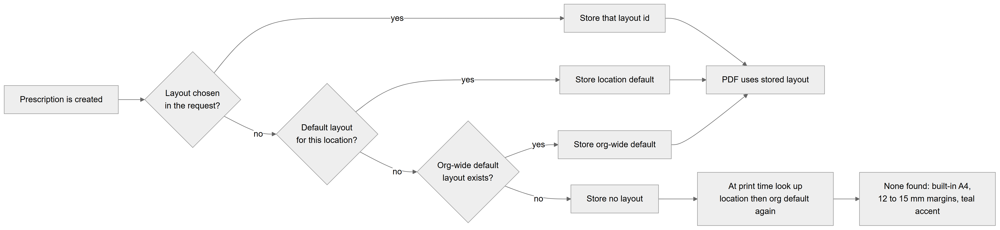

*Figure 32.9 — How the print layout of a prescription is chosen.*

Figure 32.9 is a left-to-right flowchart. It starts at "Prescription is created" and asks "Layout chosen in the request?". If yes, the next box is "Store that layout id". If no, it asks "Default layout for this location?"; yes leads to "Store location default". No leads to "Org-wide default layout exists?"; yes leads to "Store org-wide default" and no leads to "Store no layout". The three "store" boxes lead to "PDF uses stored layout". "Store no layout" leads to "At print time look up location then org default again", and from there to "None found: built-in A4, 12 to 15 mm margins, teal accent".

**Behind the scenes — technically.**
- `POST /prescription-templates`: when `isDefault` is set, it first clears the default flag of the other layouts with the same location (or the other organization-wide layouts). It then merges the given `header`, `footer` and `styling` objects over built-in defaults (Helvetica, Noto Nastaliq Urdu, show vitals, show Urdu medicine names, margins and so on).
- `PATCH /prescription-templates/:id` merges the JSON objects field by field and moves the default flag the same way.
- `DELETE /prescription-templates/:id` sets `is_active = false` and `is_default = false`.
- `GET /prescription-templates?locationId=` lists active layouts for that location plus organization-wide ones, default first.
- `GET /prescription-templates/default?locationId=` resolves location default, then organization default.
- `GET /prescription-templates/:id` reads one layout.

**Rules and validations.**
- At most one default per location and one organization-wide default, kept by the service rather than a database constraint.
- A deactivated layout already stored on a prescription is still used for that prescription's PDF.
- The PDF ignores `orientation` (always portrait), the logo flag and the registration number, even though the web preview shows the registration number.

**Who can do it.** Reading: any member (`@AnyMember`). Writing: `prescriptions.library.manage` (feature `patients.prescriptions`), held by the Admin template. Route: any of `prescriptions.create` or `prescriptions.library.manage`.

**Data read and written.** `prescription_templates`.

**Effects on other modules.** Every printed prescription.

**Error cases.** "Prescription template not found" (404).

**Technical references:** `backend/src/prescriptions/services/prescription-template.service.ts` · `PrescriptionTemplateService.getDefaultForLocation` · `web-app/src/features/prescriptions/pages/PrintLayoutsPage.tsx`, `components/library/LayoutSheet.tsx`

### 32.3.11 Doctor signatures

**Status:** [Implemented] — saving and reading one's own signature work from the screens. Deleting a signature and reading another doctor's signature exist only in the backend.

**What it does.** Each doctor keeps one saved signature image, which is placed on every prescription they sign unless they draw a new one at signing time.

**How the user does it.** The first time a doctor signs, they draw in the signature pad; the drawing is saved automatically. Drawing a new one later replaces it.

**Behind the scenes — in simple terms.** The signature is stored once per login account. It can be an image link or the drawing itself embedded as data.

**Behind the scenes — technically.**
- `POST /doctor-signatures` → `DoctorSignatureService.save` upserts the row keyed by the caller's **user id** (stored in the column `employee_id`; the entity comment says this becomes a real employee link later). It sets `signature_image_url`, optional `signature_data` and `is_active = true`.
- `GET /doctor-signatures/my` returns the caller's active signature.
- `DELETE /doctor-signatures` removes it (no screen calls this).
- `GET /doctor-signatures/doctor/:employeeId` returns a given owner's active signature (no screen calls this).

**Rules and validations.**
- One signature per owner (unique index on `employee_id`).
- `signatureImageUrl` is required and must not be empty.

**Who can do it.** Save, read own and delete: `prescriptions.create`. Read by id: any member (`@AnyMember`). Feature `patients.prescriptions`.

**Data read and written.** `doctor_signatures`.

**Effects on other modules.** Finalize falls back to the saved signature when the request has none.

**Error cases.** "Signature not found" (404) on delete.

**Technical references:** `backend/src/prescriptions/services/doctor-signature.service.ts` · `DoctorSignatureService.save` · `web-app/src/features/prescriptions/hooks/useDoctorSignature.ts`

### 32.3.12 Medicine directory

**Status:** [Implemented]

**What it does.** The organization's drug catalogue. Doctors search it while writing; picking a medicine fills its usual dose, frequency, duration, meal relation and Urdu name. A new clinic can load a starter list with one button.

**How the user does it.**
1. Open "Prescriptions" → "Library" → "Medicines".
2. With an empty directory, press "Add common medicines" to load the starter list, or "Add medicine".
3. Fill the "Add medicine" sheet: name, generic name, Urdu name, type, strength, and the defaults.
4. Use the edit icon to change a medicine, or "Deactivate" (with confirmation) to hide it from search.
5. Doctors search by typing at least two letters in a medicine box in the builder or the workspace.

**Behind the scenes — in simple terms.** Medicines are never deleted, only deactivated, so old prescriptions keep their link. Each prescription stores its own copy of the medicine name and details, so renaming a directory entry does not change prescriptions already written. The starter list adds ten common medicines (for example paracetamol, ibuprofen and amoxicillin brands) only when the directory is completely empty.

**Behind the scenes — technically.**
- `GET /medicine-directory` lists active medicines by name.
- `GET /medicine-directory/search?query=&type=&limit=` does a case-insensitive match on name, generic name or Urdu name among active rows. Limit defaults to 10, maximum 50.
- `POST /medicine-directory` creates; `PATCH /medicine-directory/:id` updates; `DELETE /medicine-directory/:id` sets `is_active = false`.
- `POST /medicine-directory/seed-common` → `seedCommonMedicines` returns `{ seeded, skipped }`. It is skipped when any row (active or not) exists for the organization.
- The Medicines page filters the full list in the browser with a 300 ms debounced search and a type filter.

**Rules and validations.**
- Name is required (at most 200 characters).
- Type must be one of the 15 medicine types (Tablet, Capsule, Syrup, Injection, Cream, Drops, Inhaler, Sachet, Suppository, Ointment, Gel, Patch, Spray, Powder, Other).
- Default meal relation from the meal-relation list.
- Names are not unique; duplicates are possible.

**Who can do it.** Reading and search: any member (`@AnyMember`). Create, edit, deactivate and seed: `prescriptions.library.manage` (Admin template). Feature `patients.prescriptions`.

**Data read and written.** `medicine_directory`.

**Effects on other modules.** Prescriptions and presets keep a nullable link to the directory row (`medicine_directory_id`).

**Error cases.** "Medicine not found" (404). The seed answers "Directory already populated" when skipped.

**Technical references:** `backend/src/prescriptions/services/medicine-directory.service.ts` · `MedicineDirectoryService.search`, `seedCommonMedicines` · `web-app/src/features/prescriptions/pages/MedicinesPage.tsx`

### 32.3.13 Prescription presets

**Status:** [Implemented]

**What it does.** A **prescription preset** is a named, reusable set of medicines with instructions, filed under a category such as "Post extraction" or "Pregnancy safe". In the backend it is called a "treatment plan template" (`/treatment-plan-templates`, table `treatment_plan_templates`). Despite the name, it has nothing to do with clinical treatment plans or the **plan templates** at `/plan-templates`, which describe planned dental work (Chapter 33).

**How the user does it.**
1. Open "Prescriptions" → "Library" (the Presets tab opens first).
2. Press "New preset". In the sheet, enter Name, Category and Description, add medicines with Dose, How often, With food and For how long, and fill the instructions (English, Urdu, Further plan).
3. Save. Edit or deactivate from the row icons.
4. Use presets from the builder ("Presets") or the workspace ("Use a preset"), as described in 32.3.3.

**Behind the scenes — in simple terms.** A preset belongs to the whole organization. Deactivating hides it from the lists but keeps it.

**Behind the scenes — technically.**
- `POST /treatment-plan-templates` creates the preset with its medicines in one save (cascade). `specialty_tags` defaults to `["general"]`.
- `PATCH /treatment-plan-templates/:id` replaces all medicines in a transaction when a medicine list is sent; otherwise it updates fields only.
- `DELETE /treatment-plan-templates/:id` sets `is_active = false`.
- `GET /treatment-plan-templates?category=` lists active presets; `GET /treatment-plan-templates/:id` reads one.

**Rules and validations.**
- Name required (at most 200 characters).
- At least one medicine ("Template must include at least one medicine").
- Category must be one of the `PresetCategory` values (about forty, from GENERAL to OTHER).
- Medicine line rules as for prescriptions.

**Who can do it.** Reading: any member. Writing: `prescriptions.library.manage` (Admin template). Feature `patients.prescriptions`.

**Data read and written.** `treatment_plan_templates`, `treatment_plan_template_medicines`.

**Effects on other modules.** Prescriptions created from a preset store its id in `treatment_plan_template_id`.

**Error cases.** "Treatment plan template not found" (404); validation message for an empty medicine list (400).

**Technical references:** `backend/src/prescriptions/services/treatment-plan-template.service.ts` · `TreatmentPlanTemplateService`, `PresetCategory` · `web-app/src/features/prescriptions/pages/PresetsPage.tsx`, `components/library/PresetSheet.tsx`

### 32.3.14 Prescriptions of one patient, one visit or one appointment

**Status:** [Partial] — the patient and visit lookups are used by screens; the appointment lookup is backend only.

**What it does.** Returns the prescriptions written for a patient, for a consultation (encounter) or for a booked appointment.

**How the user does it.**
- The patient record's prescriptions tab and the consultation's "Earlier prescriptions" use the patient lookup.
- The consultation's Prescription panel uses the visit lookup to find today's prescription.
- No screen uses the appointment lookup.

**Behind the scenes — in simple terms.** All three follow the patient visibility rules.

**Behind the scenes — technically.**
- `GET /prescriptions/patient/:patientId?page=&limit=` is guarded by `@PatientInScope`. It is paged (default 20), with doctor and medicines, newest first.
- `GET /prescriptions/encounter/:encounterId` and `GET /prescriptions/appointment/:appointmentId` drop rows whose patient is outside the caller's scope (`visibleOnly`).
- `GET /prescriptions/:id` reads one prescription with patient, appointment, doctor and both template links, after `ensureVisible`.

**Rules and validations.** Organization filter on all; location filter is not applied to these lookups (unlike the main list).

**Who can do it.** `patients.clinical.view` plus the feature.

**Data read and written.** Reads `prescriptions`, `prescription_medicines`.

**Effects on other modules.** Feeds the consultation workspace (Chapter 31) and the patient record (Chapter 28).

**Error cases.** "Prescription not found" (404) for a single read out of scope.

**Technical references:** `backend/src/prescriptions/controllers/prescription.controller.ts` · `PrescriptionService.listByPatient`, `listByEncounter`, `listByAppointment` · `web-app/src/features/prescriptions/hooks/usePrescriptions.ts`

### 32.3.15 Legacy quick prescriptions (`patient_prescriptions`)

**Status:** [Implemented] — kept for older data; still readable and writable from the patient record.

**What it does.** Before the current module, prescriptions were stored as a simple record on the patient, with the medicines in one JSON list. That older table, `patient_prescriptions`, still exists next to the new `prescriptions` table. The patient's prescriptions tab shows it in a collapsed section "Legacy quick-Rx history" ("Older prescriptions saved in the simple form. Kept for reference."), with a button to add one in the old simple form.

**How the user does it.**
1. Open a patient, then the prescriptions tab.
2. Expand "Legacy quick-Rx history" to see old entries (with "Printed (n)" counters).
3. Users with `prescriptions.create` can add one through the old dialog.

**Behind the scenes — in simple terms.** The two tables are separate: legacy entries do not appear in the Prescriptions list, the consultation or the PDF printing of the new module, and the new prescriptions do not appear in the legacy list. The old entries print through the browser, not through the PDF service.

**Behind the scenes — technically.**
- `GET /patients/:id/prescriptions` and `POST /patients/:id/prescriptions` are in the patients controller (Chapter 28), with patient scope.
- Legacy numbers are `RX-{5 digits}` counted per organization, unique per organization.
- Legacy writes are audited through the patients audit trail.
- Columns include `prescribed_by`, `appointment_id`, `prescription_date`, `medications` (JSON), `special_instructions`, `follow_up_date`, `is_printed`, `printed_at` and `print_count`.

**Rules and validations.** Read: `patients.clinical.view` and feature `patients.prescriptions`. Create: `prescriptions.create`.

**Who can do it.** As in the rules; Doctor writes, Doctor, Assistant and Admin read.

**Data read and written.** `patient_prescriptions`.

**Effects on other modules.** None on the new module.

**Error cases.** As for patient sub-records (Chapter 28).

**Technical references:** `backend/src/patients/patients.controller.ts` · `PatientPrescription` · `web-app/src/features/patients/components/tabs/ClinicalTab.tsx`

## 32.4 Entities and data model

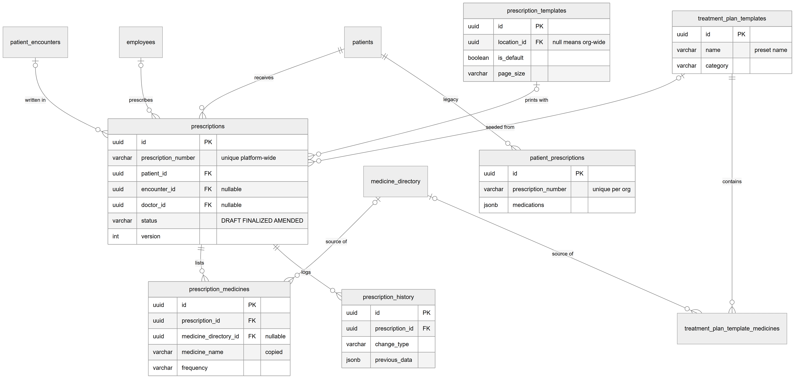

*Figure 32.10 — Entity-relationship diagram of prescriptions and the prescription library.*

Figure 32.10 shows `prescriptions` with its key columns:
- `id` (primary key) and `prescription_number` (marked "unique platform-wide");
- `patient_id`, plus the nullable foreign keys `encounter_id` and `doctor_id`;
- `status` (DRAFT, FINALIZED, AMENDED) and `version`.

Around it:
- **Top of the figure.** `patient_encounters` ("written in"), `employees` ("prescribes"), `patients` ("receives"), `prescription_templates` ("prints with": `location_id` where null means organization-wide, `is_default`, `page_size`) and `treatment_plan_templates` ("seeded from": `name` as preset name and `category`).
- **Bottom of the figure.** `prescription_medicines` ("lists": `prescription_id`, nullable `medicine_directory_id`, `medicine_name` marked "copied", `frequency`) and `prescription_history` ("logs": `prescription_id`, `change_type`, `previous_data`).
- **Library tables.** `medicine_directory` is a "source of" both `prescription_medicines` and `treatment_plan_template_medicines`, and `treatment_plan_templates` "contains" `treatment_plan_template_medicines`.
- **Legacy.** `patients` also links to the separate `patient_prescriptions` table ("legacy", with `prescription_number` unique per organization and `medications` as JSON).

The relationships in words:
- **Patient → prescriptions.** Each prescription belongs to exactly one patient, organization and location; deleting any of them deletes the prescription (ON DELETE CASCADE).
- **Encounter, appointment, doctor → prescription.** Optional links. Deleting the encounter, appointment or employee keeps the prescription and clears the link (ON DELETE SET NULL). The appointment link is not drawn in the figure.
- **Print layout and preset → prescription.** Optional links to `prescription_templates` and `treatment_plan_templates`; deleting either clears the link (SET NULL). In practice layouts and presets are only deactivated, never deleted.
- **Prescription → medicines.** A prescription has many medicine lines; deleting the prescription deletes its lines (CASCADE). Lines copy the medicine's name and details, and keep an optional link to `medicine_directory` that is cleared if the directory row is deleted (SET NULL).
- **Prescription → history.** Many history rows per prescription; deleted with it (CASCADE). `changed_by` is a plain id with no foreign key.
- **Preset → preset medicines.** `treatment_plan_template_medicines.template_id` is required; deleting the preset deletes its medicines (CASCADE); the optional directory link is SET NULL.
- **Doctor signatures** (not drawn). `doctor_signatures` has one row per owner (unique `employee_id`, which currently holds a user id, without a foreign key) and a foreign key to the organization (CASCADE).
- **Legacy table.** `patient_prescriptions` belongs to a patient, location and organization (CASCADE). Its `prescribed_by` and `appointment_id` are plain ids without foreign keys. It has no link to the new tables.

Indexes: `prescriptions` on (organization, location), patient, appointment, encounter, doctor and a unique index on `prescription_number`; `medicine_directory` on (organization, is_active) and (organization, name); `prescription_templates` on (organization, is_active) and (location, is_default); `treatment_plan_templates` on (organization, is_active) and (organization, category); `prescription_history` on (prescription, created_at). Chapter 19 covers these tables in the full data model.

## 32.5 Status lifecycles

A prescription has one status column with three values: `DRAFT`, `FINALIZED` and `AMENDED`.

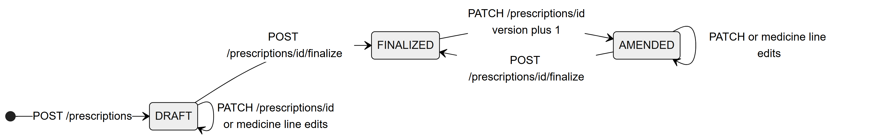

*Figure 32.11 — Prescription status lifecycle.*

Figure 32.11 is a left-to-right state diagram:
- From the start point, "POST /prescriptions" leads to DRAFT.
- DRAFT has a loop "PATCH /prescriptions/id or medicine line edits".
- "POST /prescriptions/id/finalize" leads from DRAFT to FINALIZED.
- "PATCH /prescriptions/id, version plus 1" leads from FINALIZED to AMENDED.
- AMENDED has a loop "PATCH or medicine line edits".
- "POST /prescriptions/id/finalize" leads from AMENDED back to FINALIZED.

There is no end state: a prescription can always be amended again.

Walking through each state:
- **DRAFT.** Created by the builder or the consultation panel, version 1. It can be edited freely, printed (the PDF works for drafts) and finalized once it has at least one medicine.
- **FINALIZED.** Signed: `signed_at` and the signature are set and a PDF may be stored. Single-line medicine edits are refused, but a full `PATCH` is accepted and turns it into AMENDED.
- **AMENDED.** A signed prescription that has been edited and not yet signed again. Its version is one higher, the stored PDF address is cleared, and the state before the edit is saved in the history. Signing again returns it to FINALIZED with the same version.

The enum of history change types also contains PRINTED and SHARED, but nothing writes them; printing does not change the status or the history. There is no cancelled or deleted status, and no endpoint deletes a prescription.

## 32.6 Connections to other modules

- **Consultation (Chapter 31).** The workspace's Prescription panel writes the prescription linked to the encounter, copies complaint, diagnosis, advice, follow-up and same-day vitals onto it, and signs and prints it. The completion dialog reports whether it is signed.
- **Patients (Chapter 28).** The patient's prescriptions tab lists new prescriptions, links to the builder with the patient pre-selected, and shows the legacy quick prescriptions. Patient visibility (`patients.view` scope) limits every read and write.
- **Treatment plans (Chapter 33).** Unrelated despite the backend name "treatment plan templates" for presets; real plan templates live at `/plan-templates`.
- **Employees (Chapter 37).** The prescribing doctor is an employee; the builder's doctor list comes from the employees module.
- **Features and access (Chapters 10 and 57).** Feature `patients.prescriptions`; permissions `prescriptions.create`, `prescriptions.library.manage`, `patients.clinical.view`.
- **File storage.** Finalized PDFs are uploaded through the Platform's shared storage provider (the same one used for patient files) when it is configured.

## 32.7 Limitations and known gaps

- **Numbering can collide.**
  - Numbers are counted per organization (`RX-{year}-{5 digits}`), but the database requires the number to be unique across the whole Platform. Two organizations will produce the same first number, and the second insert would be refused by the database (found by reading the code, not tested).
  - The counter reads the latest prescription, so two simultaneous creates in one organization can also clash.
  - The counter does not restart with a new year.
- **History is incomplete.** History is written but cannot be viewed: the "History" button does nothing visible, and the read endpoint requests a relation the entity does not have.
- **Backend-only endpoints.** Duplicate, single-line medicine edits, signature delete, signature read by doctor and the by-appointment lookup have no screen.
- **PDF limits.**
  - The PDF is a single page; no page-break logic exists, so a very long prescription can run off the page.
  - Orientation, logo and registration number from the layout are not printed.
  - Urdu text in the PDF is drawn as shapes and cannot be selected or searched.
  - The PDF date is the creation date formatted by the server, and drafts can be printed.
- **Clock.** "This month" on the list uses the server's clock rather than the location's timezone.
- **Layouts from the screen.** The web screen creates organization-wide layouts only; per-location layouts exist in the API (`locationId`) but have no field in the sheet.
- **Signatures.** Signatures are stored per login account, not per employee, so one person working in two organizations has a single signature row.
- **Two prescription tables.** The legacy `patient_prescriptions` table still accepts new entries, which keeps two separate prescription histories per patient.
- **Ordering.** Medicine order is kept, but there is no way to reorder lines except removing and re-adding them.

## 32.8 Owner's FAQ

**Can an Admin write prescriptions?** Not with the default templates. The Admin role is given every permission except a few doctor-only ones, and `prescriptions.create` is one of them. Admins can read, print and manage the library. An owner, or a custom role with `prescriptions.create`, can write.

**Can a receptionist print a prescription?** Not by default. Printing needs `patients.clinical.view`, which the Receptionist template does not hold. The Assistant template does, so an assistant can open the list by URL and print, even without a sidebar entry.

**What happens if the clinic switches off the Prescriptions feature?** The sidebar entry disappears (the permissions tied to the feature are dropped), every prescription endpoint answers with a feature error, and the legacy list read is blocked too. Existing data stays in the database.

**Is a signed prescription locked?** It cannot be edited line by line, but it can be amended. Amending raises the version, marks it AMENDED, and saves the previous version in `prescription_history`. It must be signed again to become final.

**If we rename a medicine in the directory, do old prescriptions change?** No. Each prescription line stores its own copy of the medicine name and details.

**Where is the signature stored?** In `doctor_signatures`, one row per login account. The image is either a link to file storage or the drawing embedded as a data URL. A copy of the image reference is also stored on each prescription at signing time.

**Where are PDFs kept?** The PDF is built on demand every time someone prints. At signing, the Platform also tries to upload a copy to the clinic's file storage and keeps its address in `pdf_url`; the web app does not use that stored copy.

**How does Urdu print correctly?** The server shapes Urdu with the Noto Nastaliq Urdu font and draws each letter as a vector shape in the right order, because the PDF library cannot join Urdu letters by itself. Numbers and English words inside Urdu text keep left-to-right order.

**What is the difference between a preset and a plan template?** A preset (backend name "treatment plan template") is a ready-made list of medicines for a prescription. A plan template (`/plan-templates`) describes planned dental work and its costs. Chapter 33 covers plan templates.

**Are old prescriptions from the first version lost?** No. They stay in `patient_prescriptions` and appear under "Legacy quick-Rx history" on the patient's prescriptions tab.
