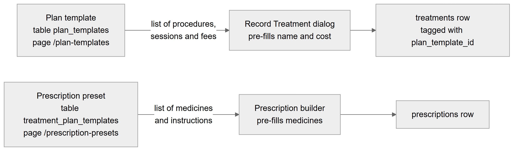
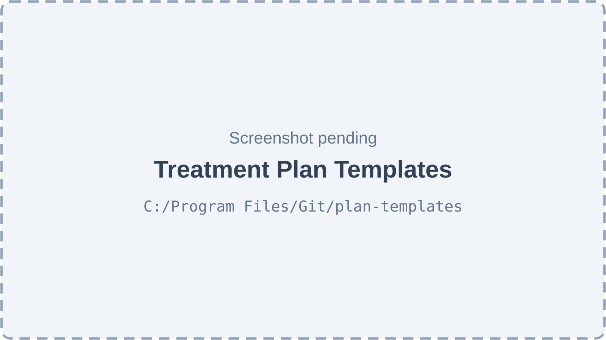
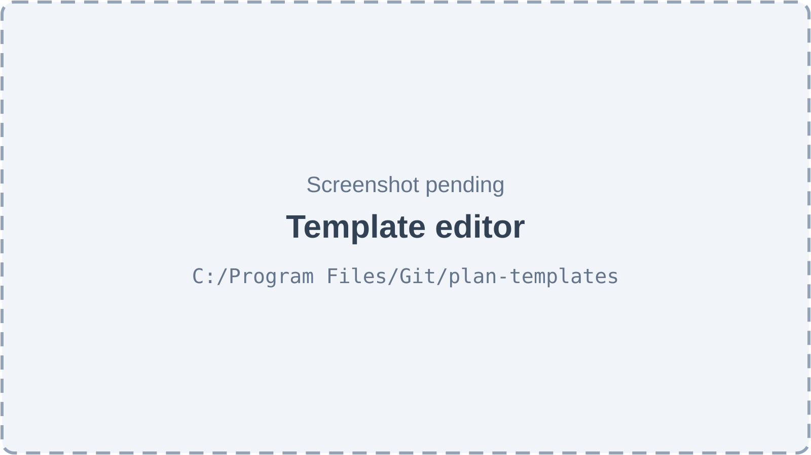
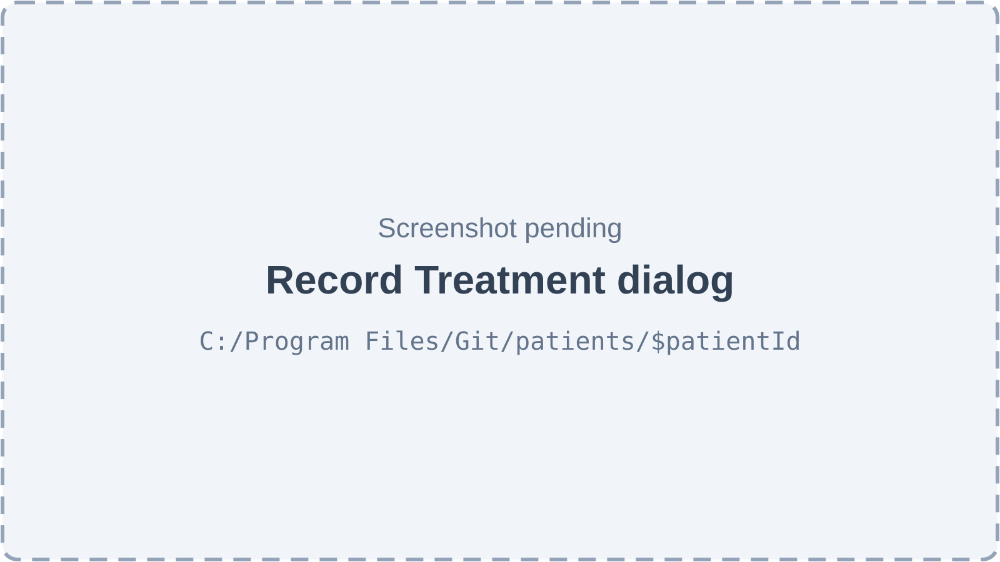
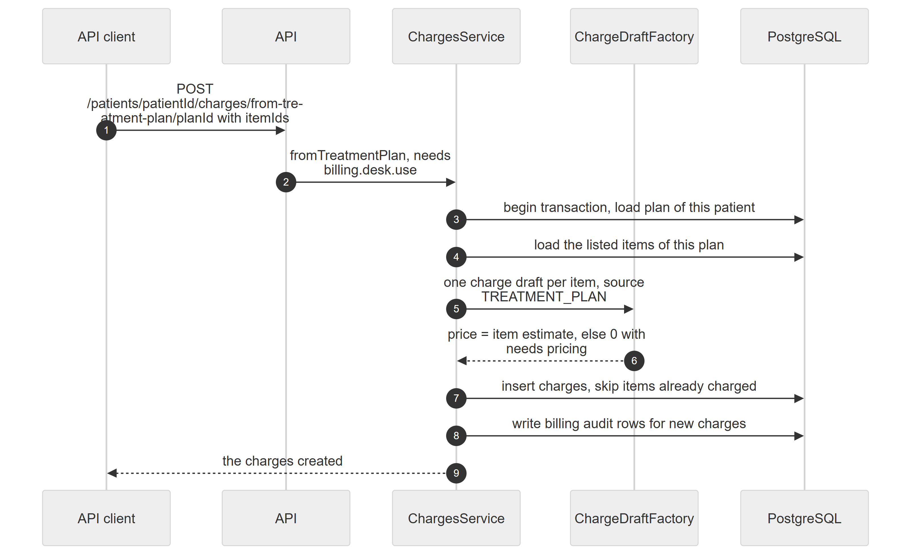
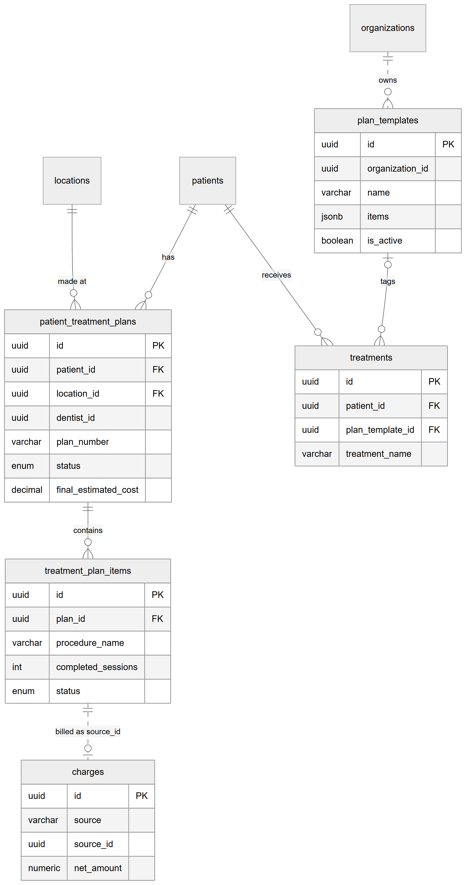
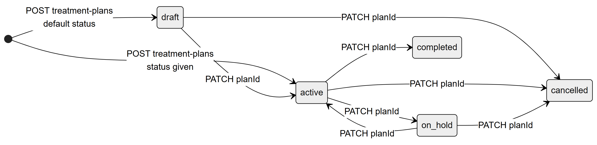
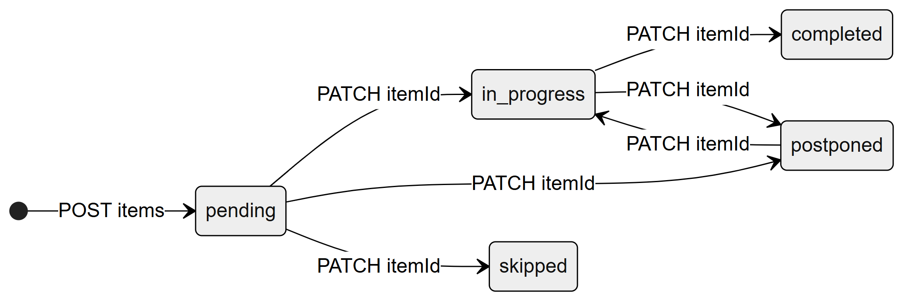

# Chapter 33 — Treatment Plans

A **treatment plan** is the planned work for one patient, such as a root canal spread over several sessions, with its steps, estimated cost and progress. A **plan template** is a clinic's ready-made list of steps (Root Canal, Implant, Braces …) that staff reuse. This chapter is for the product owner who needs to know what the Platform already does with plans, what exists only in the backend, and how plans connect to treatments and billing.

## 33.1 What this module is for

The module has two halves that are built to very different depths:

- **Plan templates** are complete end to end. The clinic keeps its own list of templates on the **Treatment Plans** page (`/plan-templates`). Each template has a name, a category (endodontics, orthodontics …), a description and an ordered list of procedures with sessions and an optional usual fee. A new clinic receives twelve ready-made templates the first time anyone opens the list. Staff use a template when they record a treatment: picking it fills the treatment name and cost, and the treatment is tagged with the template.
- **Patient treatment plans** (one plan per course of treatment, with items) are stored and audited by the backend, and Billing can read a plan's money position or turn its items into charges. No web screen shows, creates or edits a patient plan today, and nothing creates a patient plan from a template.

**Who uses it** (system roles, by default): the Admin manages templates (`plans.templates.manage` is in the Admin template only) and can record treatments from templates. The Doctor holds `plans.manage`, so a doctor could create and update patient plans through the API, but has no screen for it. Any member of the organization can read the template list when the feature is on.

**Sidebar:** the entry **Treatment Plans** (route `/plan-templates`, sidebar key `nav.plan_templates`) sits in the "Clinic" section of the default sidebar and is shown only to holders of `plans.templates.manage`. The page itself is titled "Treatment Plan Templates". There is no sidebar entry or route for patient plans.

**Feature key:** everything in this chapter belongs to the feature `patients.treatment_plans` ("Treatment Plans — multi-step treatment plans with cost estimates"), which is enabled by default in the feature catalog. When the organization turns it off, the template page, the template list, the plan endpoints and the permissions `plans.manage` and `plans.templates.manage` all stop working.

**Plan templates versus prescription presets.** The prescriptions module has a table called `treatment_plan_templates`. Despite the name, those rows are not plan templates: each one is a set of **medicines** and instructions for a prescription (for example "Root Canal Aftercare"), shown in the web app as **Prescription Presets** at `/prescription-presets` and used by the prescription builder. Figure 33.1 shows the two side by side.

*Figure 33.1 — The two kinds of "template" and where each one is used.*

The top row starts at "Plan template" (table `plan_templates`, page `/plan-templates`). An arrow labelled "list of procedures, sessions and fees" leads to the "Record Treatment dialog", which pre-fills the treatment name and cost, and an arrow from there leads to a "treatments row tagged with plan_template_id". The bottom row starts at "Prescription preset" (table `treatment_plan_templates`, page `/prescription-presets`). An arrow labelled "list of medicines and instructions" leads to the "Prescription builder", which pre-fills the medicines, and then to a "prescriptions row". The two rows never touch: a plan template has no medicines and a prescription preset has no procedures. The Prescriptions chapter (Chapter 32) covers presets.

## 33.2 Screens

*Figure 33.2 — Treatment Plan Templates page (screenshot pending).*

The page has the title "Treatment Plan Templates" and the subtitle "Ready-made plans like Root Canal or Implant. Doctors pick one when starting a plan for a patient." A filled **New template** button sits top right. The filter row has a search box ("Search templates or procedures…", debounced by 300 ms) that matches template names and procedure names, a category select ("All categories" plus every category), an active-filter count badge and **Clear all filters**. Templates appear as cards in a grid. Each card shows the template name and category, the description, the numbered list of procedures, a line such as "6 procedures · 8 visits · PKR 45,000" (the fee total adds up the procedures that have a fee and is left out when none has one), an Active/Hidden switch with an explanation, and two icon buttons with tooltips: "Edit template" and "Delete template". Hidden templates are shown dimmed. When the clinic has no template the page shows "No treatment plan templates" with a **New template** button; when filters hide everything it shows a separate no-results state. There is no table view on this page.

*Figure 33.3 — Template editor dialog (screenshot pending).*

**New template** and "Edit template" open a dialog titled "New treatment plan template" or "Edit template", with the note "The procedures are copied into a patient's plan when a doctor uses this template." The form has a Name field (placeholder "e.g. Root Canal Treatment (RCT)"), a Category select, a Description field ("What this plan covers") and a "Procedures, in order" list. Each procedure row has a Procedure name, a Sessions number ("Sessions (visits)"), a "Fee (Rs.)" number and three icon buttons: "Move up", "Move down" and "Remove procedure". **Add procedure** appends a row. The footer has **Cancel** and **Create template** or **Save changes**; the save button is disabled while the form is invalid or saving.

*Figure 33.4 — Record Treatment dialog on the patient's Treatments tab (screenshot pending).*

The **Add Treatment** button on a patient's Treatments tab (and "Add treatment" inside a visit's details) opens "Record Treatment" (or "Add Treatment to Visit"). Its first row holds two selects: "Treatment plan" (No plan, or any active plan template) and "Procedure" ("Whole plan" or one procedure of the chosen template; disabled until a template is chosen). The following fields are Treatment Name (required), "Cost (Rs.)", Date (required), an optional "Link to Visit" select listing the patient's visits, Notes, **Cancel** and **Save Treatment**.

No screen exists for patient treatment plans, so no figure is shown for them.

## 33.3 Features

### 33.3.1 Browse and filter plan templates

**Status:** [Implemented]

**What it does.** Lists all of the clinic's plan templates, active and hidden, with search and a category filter.

**How the user does it.**
1. Open **Treatment Plans** in the sidebar.
2. Type in "Search templates or procedures…" or pick a category; press **Clear all filters** to reset.

**Behind the scenes — in simple terms.** The list is loaded once and filtered in the browser. Fees are removed from the answer for anyone who may not see prices.

**Behind the scenes — technically.** `GET /plan-templates?includeInactive=true` → `PlanTemplatesService.findAll`, ordered by category then name. Because item fees live inside a JSON column, the controller deletes `estimatedCost` from each item itself when the caller lacks `patients.price.view`.

**Rules and validations.**
- Without `includeInactive=true` only active templates are returned (the Record Treatment dialog uses this).
- If the organization has no template rows at all, the twelve defaults are inserted first (Root Canal, Scaling & Polishing, Dental Implant and nine more).

**Who can do it.** The endpoint is open to any member (`@AnyMember`) with the feature `patients.treatment_plans` active. The page requires `plans.templates.manage` (route `staticData.can`). Default page holder: Admin.

**Data read and written.** Reads `plan_templates` (writes it on first read for a new clinic).

**Effects on other modules.** The same list feeds the Record Treatment dialog.

**Error cases.** Error state with retry → request failed; feature-off error when the organization switched the feature off.

**Technical references:** `backend/src/plan-templates/plan-templates.controller.ts` · `PlanTemplatesController.findAll`, `PlanTemplatesService.findAll` · `web-app/src/features/plan-templates/pages/PlanTemplatesPage.tsx`

### 33.3.2 Create a plan template

**Status:** [Implemented]

**What it does.** Adds a new reusable plan with ordered procedures.

**How the user does it.**
1. Press **New template**.
2. Enter Name, Category and Description; add procedures with **Add procedure**, set sessions and fees, reorder with "Move up" / "Move down".
3. Press **Create template**. A "Template created" toast confirms.

**Behind the scenes — in simple terms.** The template and its procedures are stored as one row; the procedures are kept in order inside it.

**Behind the scenes — technically.** `POST /plan-templates` → `PlanTemplatesService.create`. Names and notes are trimmed; empty notes become null; category defaults to `GENERAL`; `createdBy` is the user id. The web form drops rows with an empty procedure name before sending. No audit row is written.

**Rules and validations.**
- Name required, at most 200 characters; description at most 1,000.
- At most 50 procedures. Each needs a name (at most 200), sessions as a whole number of at least 1, an optional fee of 0 or more, and optional notes (at most 500).
- Category must be one of: general, preventive, restorative, endodontics, periodontics, oral surgery, prosthodontics, implantology, orthodontics, pediatric, cosmetic, geriatric, oral medicine, TMJ and orofacial pain, full mouth rehabilitation, emergency, other.
- Names do not have to be unique.

**Who can do it.** `plans.templates.manage`, feature `patients.treatment_plans`. Default holder: Admin.

**Data read and written.** Writes `plan_templates`.

**Effects on other modules.** The new template appears in the Record Treatment dialog when active.

**Error cases.** "Failed to create template" toast with the server message (for example a validation error).

**Technical references:** `backend/src/plan-templates/plan-templates.service.ts` · `create`, `CreatePlanTemplateDto`, `PlanTemplateItemDto` · `web-app/src/features/plan-templates/components/PlanTemplateForm.tsx`

### 33.3.3 Edit a plan template

**Status:** [Implemented]

**What it does.** Changes a template's name, category, description or procedures.

**How the user does it.**
1. Press the "Edit template" pencil on the card.
2. Change fields and press **Save changes**.

**Behind the scenes — in simple terms.** Only the fields sent are changed; sending procedures replaces the whole list. Treatments already recorded from the template keep their own name and cost.

**Behind the scenes — technically.** `PATCH /plan-templates/:id` → `PlanTemplatesService.update`. No audit row.

**Rules and validations.** Same limits as creation; the template must belong to the organization.

**Who can do it.** `plans.templates.manage`, feature `patients.treatment_plans`. Default holder: Admin.

**Data read and written.** `plan_templates`.

**Effects on other modules.** None on existing treatments.

**Error cases.** "Treatment plan template not found" (404); "Failed to update template" toast.

**Technical references:** `backend/src/plan-templates/plan-templates.service.ts` · `update`, `UpdatePlanTemplateDto` · `web-app/src/features/plan-templates/hooks/usePlanTemplates.ts`

### 33.3.4 Hide or show a plan template

**Status:** [Implemented]

**What it does.** Switches a template off so doctors no longer see it in the picker, without deleting it.

**How the user does it.**
1. Flip the switch on the template card. The card then reads "Hidden" (or "Active").

**Behind the scenes — in simple terms.** A hidden template stays on the management page but disappears from the Record Treatment dialog.

**Behind the scenes — technically.** `PATCH /plan-templates/:id` with `{ isActive }`.

**Rules and validations.** None beyond editing rules.

**Who can do it.** `plans.templates.manage`. Default holder: Admin.

**Data read and written.** `plan_templates.is_active`.

**Effects on other modules.** Hidden templates are not offered when recording a treatment.

**Error cases.** "Failed to update template" toast.

**Technical references:** `backend/src/plan-templates/entities/plan-template.entity.ts` · `isActive` · `web-app/src/features/plan-templates/pages/PlanTemplatesPage.tsx` (`TemplateCard`)

### 33.3.5 Delete a plan template

**Status:** [Implemented]

**What it does.** Removes a template for good.

**How the user does it.**
1. Press the "Delete template" bin on the card.
2. Read "Delete this template?" ("… will be deleted for good. Plans already made from it are not affected. To just hide it from doctors, switch it off instead.") and press **Delete**.

**Behind the scenes — in simple terms.** The template row is deleted. Treatments that were tagged with it lose the tag but keep their name and cost.

**Behind the scenes — technically.** `DELETE /plan-templates/:id` → `PlanTemplatesService.remove` (hard delete). `treatments.plan_template_id` has `ON DELETE SET NULL`, so tagged treatments show "—" in the Plan column afterwards.

**Rules and validations.**
- Always behind a confirmation dialog.
- If the clinic deletes every template, the next time anyone reads the list the twelve defaults are inserted again.

**Who can do it.** `plans.templates.manage`. Default holder: Admin.

**Data read and written.** `plan_templates`; `treatments.plan_template_id` (cleared by the database).

**Effects on other modules.** Tagged treatments lose their plan tag.

**Error cases.** "Treatment plan template not found" (404); "Failed to delete template" toast.

**Technical references:** `backend/src/plan-templates/plan-templates.service.ts` · `remove` · `web-app/src/features/plan-templates/pages/PlanTemplatesPage.tsx`

### 33.3.6 Starter templates for a new clinic

**Status:** [Implemented] (backend-only by design)

**What it does.** Gives every clinic a starting set so the picker is never empty.

**How the user does it.** Nothing to do; the templates appear the first time the list is opened.

**Behind the scenes — in simple terms.** Twelve common dental plans are added without fees, because fees belong to each clinic. The clinic sets fees once on the templates page.

**Behind the scenes — technically.** `PlanTemplatesService.findAll` counts the organization's templates (active or not); when the count is zero it inserts `DEFAULT_PLAN_TEMPLATES` with `estimatedCost: null` and `createdBy: null`. The defaults are: Root Canal Treatment (RCT), Scaling & Polishing, Gum Treatment (Periodontal), Composite Filling, Simple Extraction, Wisdom Tooth Surgical Extraction, Crown / Bridge, Dental Implant, Complete / Partial Denture, Braces (Orthodontics), Teeth Whitening and Pulpotomy (Child). For example, Root Canal Treatment has six procedures: diagnosis and X-ray, access opening, cleaning and shaping (two sessions), obturation, post-endodontic restoration, and crown (two sessions).

**Rules and validations.** Seeding happens only when the organization has zero template rows.

**Who can do it.** Triggered by any read of the list.

**Data read and written.** `plan_templates`.

**Effects on other modules.** None.

**Error cases.** None specific.

**Technical references:** `backend/src/plan-templates/default-plan-templates.ts` · `DEFAULT_PLAN_TEMPLATES`, `seedDefaults` · none in web-app

### 33.3.7 Use a template when recording a treatment

**Status:** [Implemented]

**What it does.** Lets staff record a treatment by picking a template (the whole plan or one of its procedures), which fills the name and cost and tags the treatment with the template.

**How the user does it.**
1. On a patient's **Treatments** tab press **Add Treatment** (or, in a visit's details, **Add treatment**).
2. Pick a "Treatment plan"; optionally pick a "Procedure".
3. Adjust Treatment Name, Cost and Date and press **Save Treatment**. The Treatments table shows the template name as a badge in its Plan column.

**Behind the scenes — in simple terms.** Choosing the whole plan fills the template name and the sum of the fees that are set (empty when no procedure has a fee). Choosing one procedure fills that procedure's name and fee. The template link is a label; it does not create or update a patient plan.

**Behind the scenes — technically.** `POST /treatments` with `planTemplateId` → `TreatmentsService.create` checks that the template belongs to the organization, then stores `treatments.plan_template_id`. The template list comes from `GET /plan-templates` (active only).

**Rules and validations.**
- Treatment name and date required; cost cannot be negative.
- The button is shown only to users with both `patients.clinical.edit` and `patients.price.view`.

**Who can do it.** `patients.clinical.edit` (treatments endpoint) plus `patients.price.view` (button visibility). Default holder with both: Admin. The Doctor template lacks `patients.price.view`, so doctors do not see this button.

**Data read and written.** Reads `plan_templates`; writes `treatments`.

**Effects on other modules.** Treatments can produce charges (the Consultation and Billing chapters, Chapters 31 and 34).

**Error cases.** "Treatment plan not found" (404) → the template was deleted meanwhile.

**Technical references:** `backend/src/treatments/treatments.service.ts` · `TreatmentsService.create`, `planTemplateId` · `web-app/src/features/patients/components/tabs/TreatmentFormDialog.tsx`

### 33.3.8 Create a patient treatment plan

**Status:** [Partial] — backend only; web API functions and hooks exist but no component uses them.

**What it does.** Opens a plan for a patient with a name, the responsible dentist, estimated cost, discount, dates and notes.

**How the user does it.** No screen. An API client calls the endpoint.

**Behind the scenes — in simple terms.** The plan gets the next plan number for the clinic (`TP-00001`, `TP-00002` …), starts as a draft unless another status is given, and its final estimate is the estimate minus the discount. A "created" entry goes into the patient's audit history.

**Behind the scenes — technically.** `POST /patients/:id/treatment-plans` → `PatientsService.createTreatmentPlan`. `generatePlanNumber` counts the organization's plans (including soft-deleted ones) plus one. `finalEstimatedCost = estimatedCost − discountAmount` when an estimate is given. `locationId` is the active location; `createdBy` the user id. Save and audit row (`patient_treatment_plan`, `create`) in one transaction via `saveAudited`. The patient must be inside the caller's `patients.view` scope (`PatientScopeGuard`).

**Rules and validations.**
- `dentistId` (a UUID) and `planName` (at most 200) are required. The dentist id is not checked against employees.
- Optional `estimatedCost`, `discountAmount` (numbers), `status`, `startDate`, `expectedEndDate`, `notes`, `description`.
- The create request cannot carry items; items are added one by one with the items endpoint.

**Who can do it.** `plans.manage`, feature `patients.treatment_plans`. Default holders: Admin, Doctor.

**Data read and written.** `patient_treatment_plans`, `audit_logs`.

**Effects on other modules.** None until items are billed.

**Error cases.** "Patient not found" (404); validation errors (400); a duplicate plan number (possible after a patient with plans is deleted) fails with a server error.

**Technical references:** `backend/src/patients/patients.service.ts` · `createTreatmentPlan`, `CreateTreatmentPlanDto` · `web-app/src/features/patients/hooks/usePatientSubEntities.ts` (`useCreateTreatmentPlan`, unused)

### 33.3.9 Update a plan: status, acceptance and costs

**Status:** [Partial] — backend only.

**What it does.** Changes a plan's name, description, costs, status, dates, notes, and records that the patient accepted it.

**How the user does it.** No screen.

**Behind the scenes — in simple terms.** When the patient's acceptance is set for the first time, the time of acceptance is stamped. The final estimate is recalculated from the current estimate and discount.

**Behind the scenes — technically.** `PATCH /patients/:id/treatment-plans/:planId` → `updateTreatmentPlan`: loads the plan of this patient and organization; if `patientAccepted` turns true, sets `patientAcceptedAt` to now; recalculates `finalEstimatedCost`; saves with an audited diff.

**Rules and validations.**
- Any status may be set from any status; there is no transition map (the intended paths are drawn in Figure 33.7).
- `actualEndDate` is set only when sent; completing the plan does not set it.
- Turning `patientAccepted` back to false keeps the old acceptance time.

**Who can do it.** `plans.manage`. Default holders: Admin, Doctor.

**Data read and written.** `patient_treatment_plans`, `audit_logs`.

**Effects on other modules.** None.

**Error cases.** "Treatment plan not found" (404).

**Technical references:** `backend/src/patients/patients.service.ts` · `updateTreatmentPlan`, `UpdateTreatmentPlanDto` · `web-app/src/features/patients/services/patients.api.ts`

### 33.3.10 Add items to a plan

**Status:** [Partial] — backend only.

**What it does.** Adds one procedure step to a plan: name, optional code, tooth number and surface, estimated sessions, estimated cost, order, assigned doctor and notes.

**How the user does it.** No screen.

**Behind the scenes — in simple terms.** Each item starts as pending with zero completed sessions.

**Behind the scenes — technically.** `POST /patients/:id/treatment-plans/:planId/items` → `createPlanItem` (checks the plan belongs to the patient and organization) → `saveAudited` (`treatment_plan_item`, `create`). `GET …/items` lists items by `sequence_order`.

**Rules and validations.**
- Procedure name required (at most 200); code at most 20; tooth number at most 10; surface at most 50.
- Estimated sessions and sequence order are whole numbers of at least 1 (defaults 1).
- Item costs are not summed into the plan's estimate automatically.

**Who can do it.** `plans.manage` to write; `patients.clinical.view` plus the feature to read. Default writers: Admin, Doctor.

**Data read and written.** `treatment_plan_items`, `audit_logs`.

**Effects on other modules.** Billing can turn items into charges (backend only).

**Error cases.** "Treatment plan not found" (404).

**Technical references:** `backend/src/patients/patients.service.ts` · `createPlanItem`, `CreatePlanItemDto` · `web-app/src/features/patients/hooks/usePatientSubEntities.ts` (`useCreateTreatmentPlanItem`, unused)

### 33.3.11 Track progress of plan items

**Status:** [Partial] — backend only; nothing updates progress automatically.

**What it does.** Updates an item's status, completed sessions and any other field.

**How the user does it.** No screen.

**Behind the scenes — in simple terms.** Progress is entered by hand. Recording a treatment or completing a consultation does not move a plan item forward.

**Behind the scenes — technically.** `PATCH /patients/:id/treatment-plans/:planId/items/:itemId` → `updatePlanItem`. After applying the change, completed sessions are capped at the estimated sessions. Audited diff.

**Rules and validations.**
- Completed sessions: whole number of 0 or more, never more than the estimate after saving.
- Any status may be set from any status.
- Marking every item completed does not complete the plan.

**Who can do it.** `plans.manage`. Default holders: Admin, Doctor.

**Data read and written.** `treatment_plan_items`, `audit_logs`.

**Effects on other modules.** None.

**Error cases.** "Treatment plan not found", "Plan item not found" (404).

**Technical references:** `backend/src/patients/patients.service.ts` · `updatePlanItem`, `UpdatePlanItemDto` · none used in web-app

### 33.3.12 Start a patient plan from a template

**Status:** [Not implemented] — mentioned in code comments and UI text only.

**What it does.** The template page says "The procedures are copied into a patient's plan when a doctor uses this template", and the entity comment says the same. No endpoint, service method or screen does this: there is no "create plan from template" route, the create-plan request cannot carry items, and no screen creates a patient plan.

**How the user does it.** Not available.

**Behind the scenes — in simple terms.** Templates are used only to fill the Record Treatment form.

**Behind the scenes — technically.** None.

**Rules and validations.** None.

**Who can do it.** Nobody.

**Data read and written.** None.

**Effects on other modules.** None.

**Error cases.** None.

**Technical references:** `backend/src/plan-templates/entities/plan-template.entity.ts` (comment) · `PlanTemplate` · `web-app/src/features/plan-templates/pages/PlanTemplatesPage.tsx` (dialog description)

### 33.3.13 Turn plan items into charges

**Status:** [Partial] — backend only; no web code calls the endpoint.

**What it does.** Creates one unbilled **charge** per chosen plan item, ready for the billing desk.

**How the user does it.** No screen. An API client calls the endpoint.

**Behind the scenes — in simple terms.** For each chosen item the Platform creates a charge for the item's procedure, priced at the item's estimate. If the item has no estimate, the charge is created at zero and flagged as needing a price. An item that already has an active charge is skipped silently, so the same step cannot be billed twice. Figure 33.5 shows the flow.

*Figure 33.5 — Sequence of turning plan items into charges.*

The diagram has five participants: API client, API, ChargesService, ChargeDraftFactory and PostgreSQL. (1) The client posts `POST /patients/patientId/charges/from-treatment-plan/planId` with a list of item ids. (2) The API, after checking `billing.desk.use`, calls `fromTreatmentPlan`. (3) The service opens a transaction and loads the plan, which must belong to this patient and organization. (4) It loads the listed items of that plan. (5) It asks the factory for one charge draft per item with source `TREATMENT_PLAN`. (6) The factory prices each draft at the item's estimate, or at zero with "needs pricing" set. (7) The service inserts the charges, skipping items that already have an active charge. (8) It writes billing audit rows for the charges actually created. (9) It returns the created charges.

**Behind the scenes — technically.** `POST /patients/:patientId/charges/from-treatment-plan/:planId` → `ChargesService.fromTreatmentPlan` (one transaction). `ChargeDraftFactory.fromPlanItem` sets `source = TREATMENT_PLAN`, `sourceId = item id`, description = procedure name (at most 200 characters), quantity 1, `unitPrice` = item estimate when above zero else 0, `needsPricing` = true when there is no estimate, and the doctor = the item's `assignedTo`, else the plan's `dentistId`. The charge date is today in the location's timezone. Duplicates are prevented by the partial unique index `uq_charges_source` (organization, source, source id, for active charges) with `INSERT … ON CONFLICT DO NOTHING`. Each new charge gets a billing audit row (`CREATED`).

**Rules and validations.**
- 1 to 100 item ids, each a UUID; every id must belong to the plan, otherwise nothing is created.
- Plan and item statuses are not checked: cancelled plans and skipped items can be charged.
- The catalog price list is not consulted (the factory receives no catalog price).

**Who can do it.** `billing.desk.use` (feature `billing.invoices`). Default holders: Admin, Receptionist, Accountant. The endpoint does not require `plans.manage`.

**Data read and written.** Reads `patient_treatment_plans`, `treatment_plan_items`; writes `charges` and the billing audit log.

**Effects on other modules.** The charges appear in the patient's open charges and on the billing desk (the Billing chapter, Chapter 34, covers what follows).

**Error cases.** "Treatment plan not found" or "Plan item not found" (404); validation errors for the item list (400).

**Technical references:** `backend/src/billing/charges/charges.service.ts` · `fromTreatmentPlan`, `ChargeDraftFactory.fromPlanItem`, `ChargesFromPlanDto` · none in web-app

### 33.3.14 See a plan's billing summary

**Status:** [Partial] — the endpoint, a web API function and a hook (`usePlanBillingSummary`) exist, but no component renders it.

**What it does.** Answers, for one plan: the estimate, how much has been billed on issued invoices, how much is charged but not yet invoiced, how much is not yet charged, how much has been paid, and the balance owed.

**How the user does it.** No screen.

**Behind the scenes — in simple terms.** Only charges created from the plan's items count; treatments recorded separately are not linked to plan items and do not count.

**Behind the scenes — technically.** `GET /treatment-plans/:planId/billing-summary` → `BillingReportsService.planSummary`. It sums active `TREATMENT_PLAN` charges whose source is one of the plan's items, at the active location only: billed (net amount on `ISSUED` invoices), tax on those, unbilled (no invoice yet) and paid (allocated amount). Estimate = the plan's final estimate, else its estimate, else the sum of item estimates. `notYetCharged = max(0, estimate − billed − unbilled)`; `balance = billed + tax − paid` (billed is before tax, what is owed includes tax). Arithmetic is done in paisa and returned in currency units.

**Rules and validations.**
- The plan must belong to the organization; the patient's scope is not checked on this route.
- Charges made at another location of the same organization are left out.

**Who can do it.** `billing.invoice.view` (feature `billing.invoices`). Default holders: Admin (org), Receptionist and Accountant (location).

**Data read and written.** Reads `patient_treatment_plans`, `treatment_plan_items`, `charges`, `invoices`.

**Effects on other modules.** None.

**Error cases.** "Treatment plan not found" (404).

**Technical references:** `backend/src/billing/reports/billing-reports.service.ts` · `planSummary`, `PlanBillingSummary` · `web-app/src/features/billing/hooks/use-billing-queries.ts` (`usePlanBillingSummary`, unused)

## 33.4 Entities and data model

*Figure 33.6 — Entity-relationship diagram of treatment plans, plan items, plan templates and their links to treatments and charges.*

The diagram shows seven tables. Each `patient_treatment_plans` row belongs to exactly one patient and one location; deleting the patient or the location deletes the plan (ON DELETE CASCADE). The plan also carries `organization_id` (cascading), `dentist_id` (a plain UUID with no foreign key), `plan_number` (unique per organization), `status` and the three cost columns `estimated_cost`, `discount_amount` and `final_estimated_cost` (decimal, currency units, hidden from users without `patients.price.view` by `@VisibleIf`). Each plan contains any number of `treatment_plan_items`; deleting a plan deletes its items. Items have no `organization_id` of their own; they reach the organization through their plan. Items carry `procedure_name`, `estimated_sessions`, `completed_sessions`, `estimated_cost` (decimal, also price-hidden), `status`, `sequence_order` and `assigned_to` (a plain UUID). The dotted line from an item to `charges` is a logical link without a foreign key: a charge created from an item stores the item id in `source_id` with `source = 'TREATMENT_PLAN'`, and at most one active charge can exist per item. `plan_templates` belongs to an organization through `organization_id`, drawn dotted because there is no foreign key. Templates keep their procedures inside the JSON column `items` (each with `procedureName`, `estimatedSessions`, `estimatedCost`, `notes`), so template procedures are not rows. Each `treatments` row belongs to one patient (cascading) and may point to one plan template through `plan_template_id`; deleting the template clears that pointer (ON DELETE SET NULL). There is no link between a treatment and a plan item, and none between a patient plan and the template it might have come from.

Plans and templates are separate from the prescriptions module's `treatment_plan_templates` and `treatment_plan_template_medicines` tables, which hold prescription presets.

## 33.5 Status lifecycles

*Figure 33.7 — Intended lifecycle of a patient treatment plan.*

A plan is created by `POST /patients/:id/treatment-plans` in **draft** by default, or directly in **active** (or any other status) when the request gives one. `PATCH /patients/:id/treatment-plans/:planId` moves it: draft to active when work starts; active to **on_hold** and on_hold back to active; active to **completed**; and draft, active or on_hold to **cancelled**. The diagram shows the intended paths only. The code accepts any status from any status, never changes the status by itself, and does not stamp `actual_end_date` on completion. No screen shows the status today.

*Figure 33.8 — Intended lifecycle of a treatment plan item.*

An item is created by `POST …/items` in **pending**. `PATCH …/items/:itemId` moves it: pending to **in_progress**, in_progress to **completed**, pending or in_progress to **postponed**, postponed back to in_progress, and pending to **skipped**. As with plans, any status can be set from any status, and nothing changes item status automatically: recording a treatment, completing a consultation or billing the item leaves it as it is. Completed sessions are stored separately and capped at the estimated sessions.

Plan templates have no status lifecycle; they only have the `is_active` switch (Active or Hidden).

## 33.6 Connections to other modules

- **Patients (Chapter 28):** patient plans and items are stored and audited by the Patients module; plan writes appear in the patient's change history (values hidden from readers without `patients.clinical.view`). Deleting a patient deletes their plans.
- **Treatments and consultation (Chapter 31):** the Record Treatment dialog, on the patient page and inside a visit, uses active plan templates and tags treatments with them.
- **Billing (Chapter 34):** charges from plan items and the plan billing summary (both backend only); the billing desk then prices, invoices and collects those charges.
- **Prescriptions (Chapter 32):** prescription presets are a different kind of template, stored in `treatment_plan_templates`.
- **Features and access (Chapters 10 and 11):** feature `patients.treatment_plans`; permissions `plans.manage`, `plans.templates.manage`, `patients.clinical.view` and `patients.price.view`.

## 33.7 Limitations and known gaps

- **No screen for patient treatment plans.** Plans and items can only be created, read and updated through the API; the web hooks exist but are unused.
- **Templates cannot start a patient plan**, although the template page text says the procedures are copied into a patient's plan.
- **Plan billing exists only in the backend.** Neither "charges from plan" nor the billing summary is called by any screen.
- **No automatic progress.** Treatments are not linked to plan items, so completed sessions, item status, plan status and the actual end date are all manual.
- **Free status changes.** There is no transition map for plan or item status.
- **Plan numbers come from a row count** and can repeat after a patient with plans is deleted, which makes the next save fail.
- **No delete endpoints** for plans or items; a mistaken plan can only be cancelled.
- **The plan estimate is entered by hand**; item costs are not summed into it (the billing summary falls back to the item sum only when the plan has no estimate).
- **Template changes are not audited**, unlike patient plans.
- **Deleting every template brings the twelve defaults back** on the next read.
- **Doctors cannot use templates from the patient page by default**, because the Add Treatment button also needs `patients.price.view`, which the Doctor template lacks.

## 33.8 Owner's FAQ

**Is "Treatment Plans" in the sidebar the place where a doctor builds a patient's plan?**
No. That page (`/plan-templates`) manages the clinic's reusable templates. There is no screen for a patient's own plan today; patient plans exist only in the backend.

**What is the difference between a plan template and a prescription preset?**
A plan template is a list of procedures with sessions and fees, used when recording treatments. A prescription preset is a list of medicines with instructions, used in the prescription builder. The preset table is confusingly named `treatment_plan_templates` in the database.

**If I change a template's fee, do old treatments change?**
No. The Record Treatment dialog copies the name and cost into the treatment when it is saved; later template edits do not touch existing treatments.

**What happens to treatments if I delete a template?**
They keep their name, cost and date; only the template badge in their Plan column disappears.

**Who can edit templates?**
Holders of `plans.templates.manage`, which only the Admin system role has by default. Every member of the clinic can read the template list when the feature is on, but fees are removed for users without `patients.price.view`.

**Can a plan item be billed twice?**
Not while its first charge is active: the database allows only one active charge per plan item, and a repeated request skips that item silently. If the first charge is voided, the item can be charged again.

**Does completing a consultation update the patient's plan?**
No. Plans, items and treatments are not linked, so progress must be entered by hand through the API.

**What happens if I switch off the Treatment Plans feature?**
The Treatment Plans page and sidebar entry disappear, the template list endpoint and all patient plan endpoints refuse requests, and the permissions `plans.manage` and `plans.templates.manage` are dropped for every role until the feature is switched back on. Treatments already tagged with a template keep the tag.
