# Chapter 34 — Billing

This chapter describes the Billing module of the Platform: how a clinic turns finished visits and extra work into charges, collects money, issues invoices and receipts, gives refunds and closes the cash counter at the end of a shift. It is written for the product owner, who needs to know exactly what the module does today, which rules protect the money and where the module stops. Billing is the largest module of the Platform (84 endpoints under `backend/src/billing`, six of which belong to doctor commissions, covered in Chapter 35).

## 34.1 What this module is for

Billing on the Platform is **charge-based**. A **charge** is one billable line for one patient: a consultation fee, a treatment, or an extra item that reception adds. Charges pile up "unbilled" until the patient pays or reception issues an invoice. An **invoice** groups unbilled charges under one number and fixes the sales tax. A **payment** is money received into a **payment account** (Cash, a bank account, a card machine); it is split over charges as **allocations**. Money that is received but not needed for any charge stays with the patient as **advance**. A **refund** always pays out of advance. At the end of a shift, a **cash close** compares the money the system expects in each account with what was counted.

Who uses it:

- **Receptionist**: the main user at the desk. Sees the billing desk, adds charges, applies preset discounts, collects payments and prints receipts and invoices. Cannot edit or cancel invoices, refund or close the counter.
- **Accountant**: everything a receptionist can do, plus invoice edits and cancellations, refunds, cash close, billing activity, expenses and financial reports. Cannot apply discounts or override prices with the default role.
- **Admin** and the **owner**: every billing permission, including custom discounts, price overrides and billing settings.
- **Doctor** and **Assistant**: no billing permissions. A doctor's completed visit creates charges in the background, but the doctor never sees an amount.

Where it appears in the sidebar (`web-app/src/features/access/nav/nav.registry.ts`): the **Finance** section has a **Billing** group with **Billing desk** (`/billing`, needs `billing.desk.use`), **Invoices** (`/invoices`, `billing.invoice.view`), **Payments** (`/payments`, the sidebar checks `billing.payment.collect`) and **Expenses** (`/expenses`, `expenses.view`). The **Reports** group of the same section holds **Billing activity** (`/billing/activity`, `billing.activity.view`), **Doctor revenue** and **Doctor earnings**. Billing settings have no sidebar entry; they open from the Settings page as **Billing** (`/settings/billing`). The patient record has a **Billing** tab.

The module sits behind the feature **`billing.invoices`** ("Invoices"). Its seed sets `enabledByDefault: false`, so a clinic has no billing until the feature is entitled and enabled (Chapter 10). Discounts need the extra feature `billing.discounts`, expenses need `billing.expenses`, the financial summary needs `billing.financial_summary` and credit packages need `billing.credit_packages`.

## 34.2 Screens

All screens in this chapter are shown as placeholders; an older billing screenshot exists but is excluded because it shows realistic personal data.

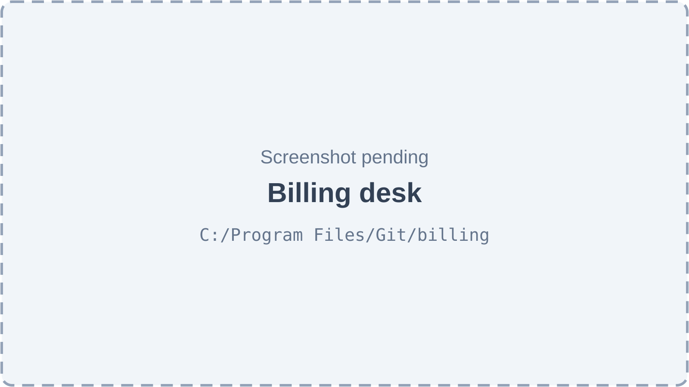

*Figure 34.1 — Billing desk (screenshot pending).*

The Billing desk (`/billing`) has the title "Billing desk" and the subtitle "Bill finished visits and follow up on dues". A date picker in the header ("Today" by default, clearable) chooses the clinic day. If the location has no document code, an amber notice says "This location has no document code, so invoices and receipts cannot be numbered yet.", with a link "Set it in billing settings" for users who manage settings. The first section, **Ready to bill** ("Patients with charges not invoiced yet"), lists patients with columns Patient (name, then patient number or phone), Charges (a count and a "Needs price" badge when one charge has no price), Amount (the unbilled total) and a **Bill** button. Clicking **Bill** opens the Collect payment sheet for that patient; there is no patient search on the desk. The list pages in the browser, 10 rows at a time; when empty it says "Nobody is waiting to be billed. Completed consultations appear here." The second section, **Outstanding** ("Overdue and unpaid invoices"), lists issued invoices whose payment status is Overdue or Unpaid (partly paid invoices are not shown), with Patient, Invoice (a link), Due (with a red "Overdue" badge), Balance and a **Collect** button. When empty it says "No dues — every issued invoice is paid."

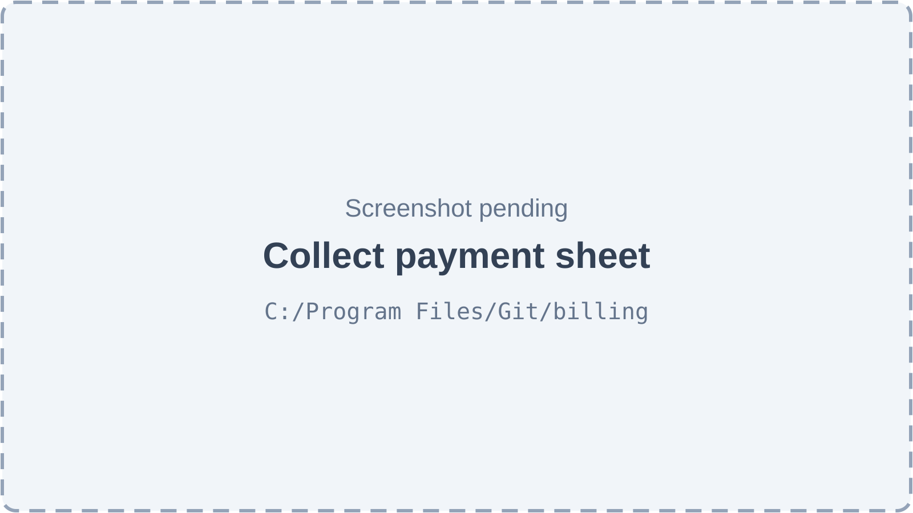

*Figure 34.2 — The Collect payment sheet (screenshot pending).*

The Collect payment sheet slides in from the right with the title "Collect payment — " and the patient's name. From top to bottom it shows: four summary figures ("Not invoiced", "Outstanding", "Overdue", "Advance"); the patient's open charges with a "Select all charges" box, a **Discount** button and an **Add charge** button, grouped as "Not invoiced yet" and then one group per invoice ("Invoice " plus its number); each line has a checkbox, the description, quantity, date, doctor, any discount, the balance and a three-dot menu. After the charges come the payment fields: **Amount received (Rs)** (filled automatically with what clears the selection until the user types), **Allocation** with the choices **Oldest first** and **Manual** (Manual adds a "Pay now for …" amount on each selected line), **Received in** (one chip per active payment account, the default account pre-selected), **Reference number** (only for accounts that require one), a **Use advance** switch when the patient holds advance, and **Notes**. A live summary shows "Selected balance", "Advance used", "Paying now" and "Going to advance", a line such as "An invoice will be issued for 2 charge(s) (incl. Tax (17%) …)", any blocker ("Set a price for: …") and, only for users who can see all earnings, an internal "Doctor share" line. The main button reads **Receive Rs …**, or **Apply advance Rs …** when the amount is zero and advance covers the selection. After success the sheet shows "Received …" with the receipt number, "Invoice … issued", "Still outstanding", "Advance held", a **Print receipt** button with a format choice and a **Print invoice** button.

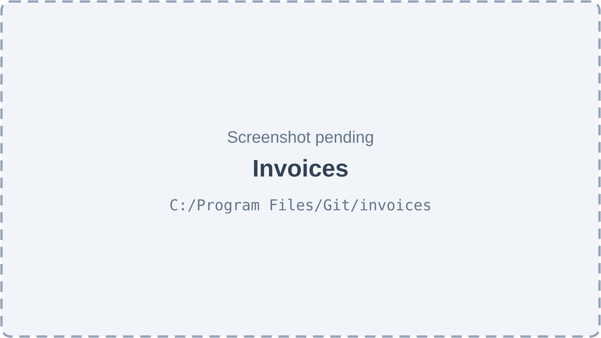

*Figure 34.3 — Invoices list (screenshot pending).*

The Invoices page (`/invoices`) has the subtitle "Search issued invoices — status follows payments and due dates.", a **List / Cards** view switch and a **Billing desk** button. A strip of six figures shows Invoices (count), Invoiced, Collected, Outstanding, Overdue and Refunded. Status tabs with counts read All, Unpaid, Partial, Overdue, Paid, Refunded and Cancelled. A search box ("Invoice no., patient or phone...") is followed by date presets (Today, This month, Past 30 days, All), a custom range and a **Reset** button. The table columns are Date (with "Due …" under it), Invoice (with "Rev n" after an edit), Patient, Total, Paid, Balance, Status and a menu with **View details**, **Collect payment** (issued invoices with a balance) and **Print**. Cancelled rows are dimmed. The card view shows the same data per invoice. Paging is on the server with 10, 25, 50 or 100 rows. Without filters and data it says "No invoices yet — they are issued when reception collects a payment." with an **Open billing desk** button; with filters and no match it says "No invoices match these filters."

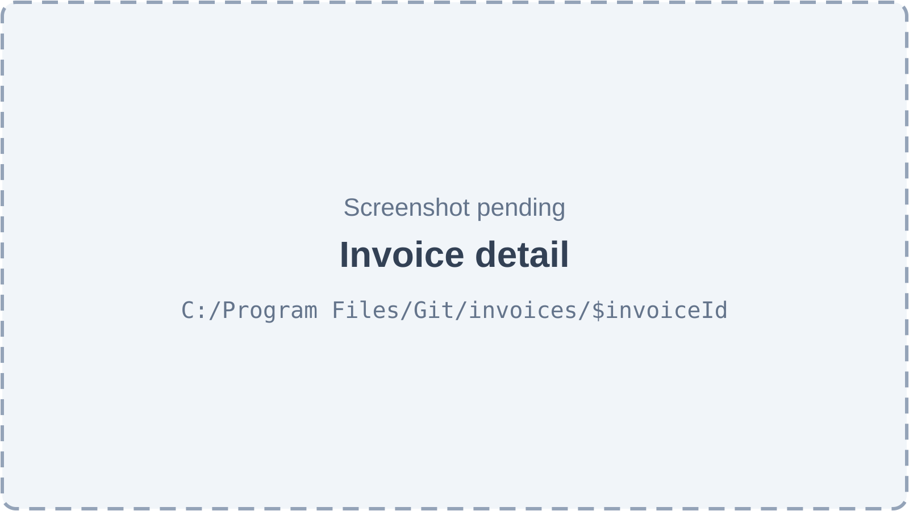

*Figure 34.4 — Invoice detail (screenshot pending).*

The invoice detail page (`/invoices/$invoiceId`) has the title "Invoice" plus the number and a back button "Back to invoices". Its action buttons are **Print** (A4 or Thermal 80 mm), **Edit**, **Refund**, **Cancel** (red) and **Collect payment**, each shown only when the invoice state and the user's permissions allow it. A cancelled invoice shows a red banner "Cancelled … — " and the reason. The header card shows the patient, a status badge (Paid, Partially paid, Unpaid, Overdue, Cancelled or Refunded, plus "Refunded …" for a partial refund), "Rev n", the issue date, due date and issuer. A totals box lists Subtotal, Discount, Tax (only when the rate is above zero), Total, Paid and Balance due. The page then has the sections **Charges** (Charge, Qty, Price, Discount, Net, Paid; void charges struck through), **Payments on this invoice**, **Refunds** ("Refunded … · still refundable …") and, after edits, **Revision history** with a **Print rev n** button per older revision.

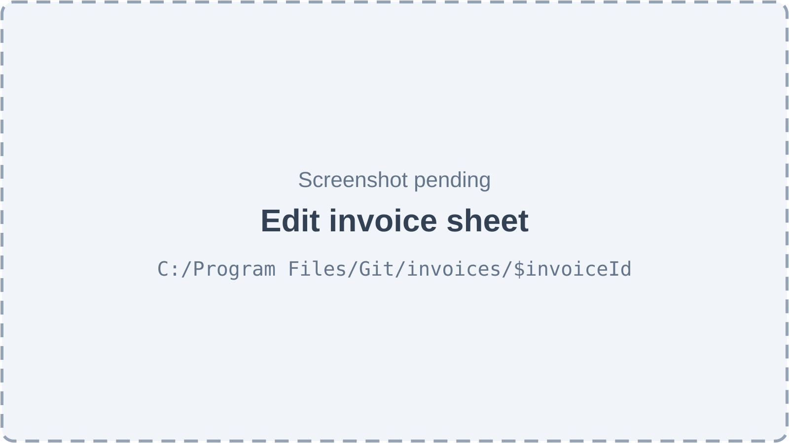

*Figure 34.5 — The Edit invoice sheet (screenshot pending).*

The Edit sheet is titled "Edit" plus the invoice number, with the line "Revision r → r+1. The invoice number never changes." Each active charge has a Quantity field, a Unit price field (editable only with the price-override permission or for non-catalog charges), a Discount choice (keep, "Remove discount" or another discount type) and a **Void** box. A section "Add unbilled charges" lists the patient's unbilled charges with checkboxes. A **Reason** field is required (at least 5 characters). A live preview shows the tax, "New total", "Change", "New balance" and, when money is freed, "… will move to the patient's advance." If someone else changed the invoice meanwhile, a banner says "This invoice was changed by someone else." with **Reload**. The buttons are **Cancel**, **Save & refund** (only when money moves to advance; it opens the refund sheet) and **Save changes**.

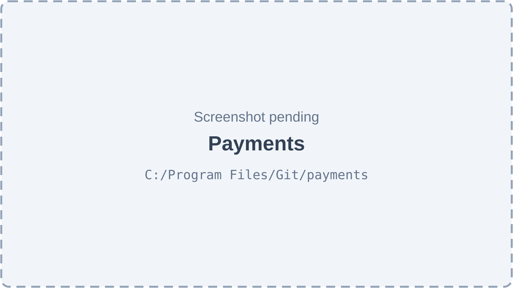

*Figure 34.6 — Payments page (screenshot pending).*

The Payments page (`/payments`) has the subtitle "The day's collection per payment account, refunds subtracted." and a **Close counter** button for users who may close the counter. Four figures show Receipts, Collected, Refunded and Net in hand for the chosen day. A toolbar has a day picker, previous and next arrows, **Today** and **Yesterday** buttons and an account filter. The section **By payment account** lists each account with its payments, refunds and net. The section **Receipts** lists the day's payments (Time with receipt number, Patient, Account with reference, Received by, Amount with "−… refunded"); clicking a row prints the receipt, and the row menu offers **Print receipt** and **Open patient**. The last section, **Counter closes**, is the cash-close history. There is no card view on this page.

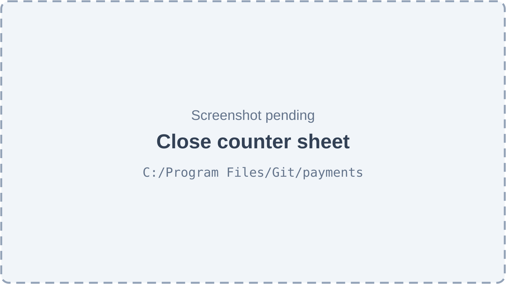

*Figure 34.7 — The Close counter sheet (screenshot pending).*

The Close counter sheet says "Since" and the end of the previous close (or "Since the first payment at this location"). It shows one card per payment account with "Expected" and the counts and totals of payments and refunds. Accounts marked "Count physically at cash close" have a required **Counted (Rs)** field with a live green or red difference. A **Note** is required when any difference exists ("Explain the difference"). The button reads **Close counter (Rs … expected)**. After success it says "Counter closed. Print the slip to hand over the cash." with **Print slip** and **Done**.

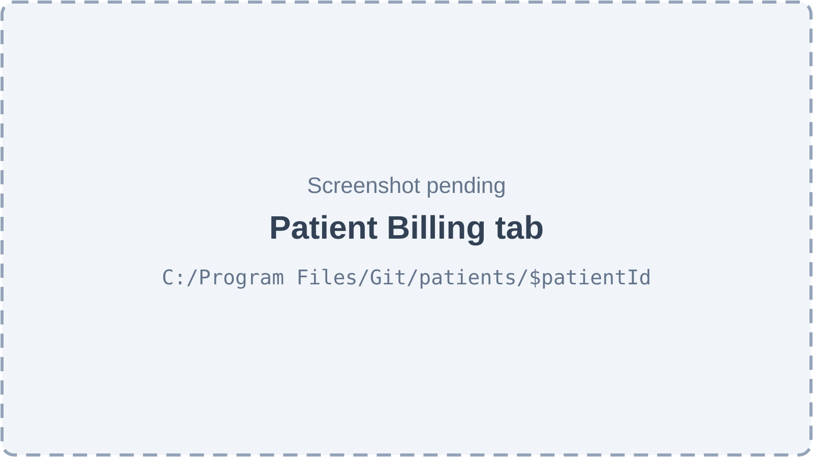

*Figure 34.8 — The Billing tab on the patient record (screenshot pending).*

The patient record's **Billing** tab shows the four figures Not invoiced, Outstanding, Overdue and Advance, a **Refund advance** button when advance exists, and four sub-tabs. **Open charges** lists unbilled and unpaid charges (Charge, Date, Invoice or "Not invoiced", Net with tax, Paid, Balance, row menu) with **Add charge**, **Issue invoice (n)** for selected unbilled charges and **Collect payment**. **Invoices** and **Payments** list the patient's documents with print buttons. **Statement** shows a date range, a **Print statement** button and a running ledger (Date, Description, Debit, Credit, Balance) between "Opening balance" and "Closing balance", with the note "Positive balance = patient owes; negative = clinic holds advance."

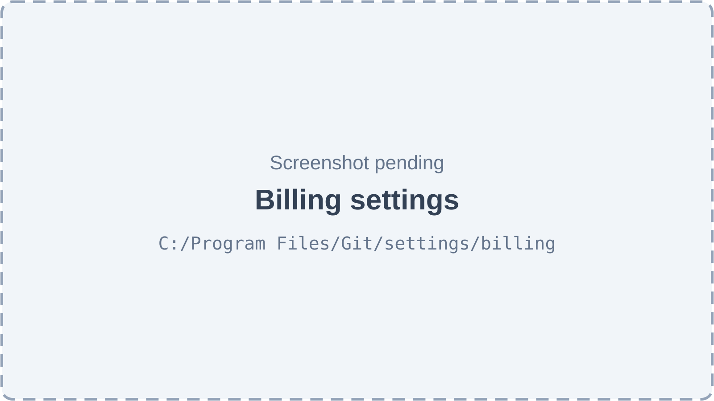

*Figure 34.9 — Billing settings (screenshot pending).*

Billing settings (`/settings/billing`) have the subtitle "Services, prices, discounts, payment accounts and printing", a back button "Back to settings" and four tabs. **Services and prices** holds the "Service catalog" table (Service, Kind, Default price, an Active switch, Edit) with **Add service**, and "Price overrides for this location" with an inline row (Service, doctor or "All doctors", Price, **Add override**) and a remove button per override. **Discount types** (only with the discounts feature) lists presets (Name, Value, Applies to, Reception range or "Fixed", Active, Edit) with **Add discount type**. **Payments and printing** holds the location's document code, due days, print formats, consultation fee service, default account, variance alert, footer note and three switches. **Payment accounts** lists accounts (Account with a "Default" badge, Kind, Bank, Rules, Active, Edit) with **Add account**.

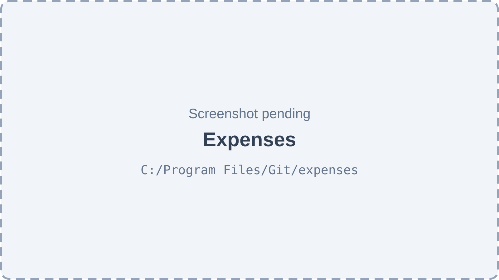

*Figure 34.10 — Expenses page (screenshot pending).*

The Expenses page (`/expenses`) has the subtitle "Track and categorise clinic spending" and an **Add Expense** button. A "This Month Total" card shows the current month's total and the three largest categories. Category buttons (All, Rent, Utilities, Supplies, Salary, Equipment, Marketing, Maintenance, Other) filter a table of Date, Category, Description, Method and Amount, with a delete icon per row. The page uses an older style: it shows the latest 30 rows with no paging, no search, no date filter, no card view and no edit action.

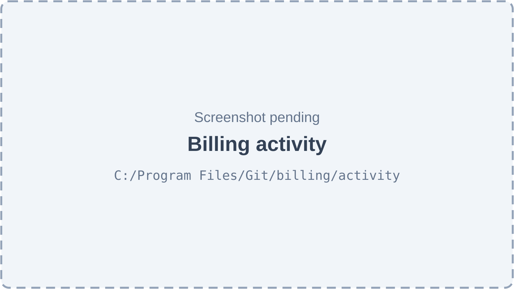

*Figure 34.11 — Billing activity (screenshot pending).*

Billing activity (`/billing/activity`) has the subtitle "Every billing change with who, when and why." Date presets (Today by default, This month, Past 30 days, custom range) choose the period. A table "Per user per day" shows Date, User, Edits, Cancels, Refunds (count and amount) and Discounts (count and amount). The "Activity feed" lists Time, User, Action (for example Created, Voided, Discount, Price changed, Issued, Edited, Cancelled, Advance applied, Unapplied, Refunded, Counter closed), Document, Amount and Reason, 20 rows per page.

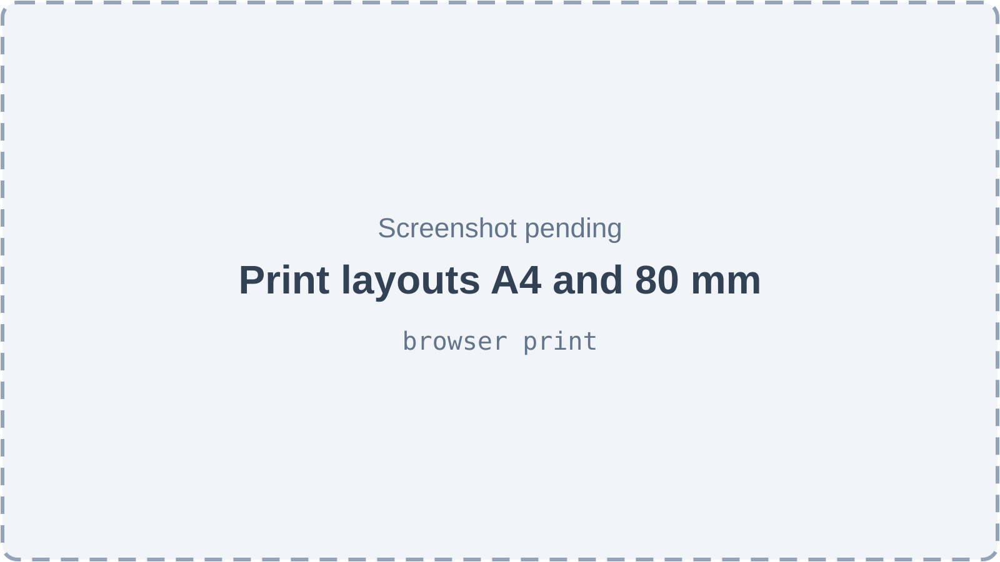

*Figure 34.12 — Printed documents in A4 and 80 mm thermal layout (screenshot pending).*

Printing happens in the browser's print dialog. Every printed document has a header with the location logo (if enabled), clinic and location name, address and phone, and a footer with the footer note and "Computer-generated document" with the time. The invoice ("INVOICE") lists the lines, totals, the total in words, refunds and "Issued by", and carries a large "CANCELLED" or "REFUNDED" watermark when applicable. The receipt ("PAYMENT RECEIPT") shows the amount received, the amount in words, the account, reference, the charges it was applied to, the part kept as advance and what is still outstanding. The refund voucher, the patient statement and the cash-close slip have signature lines where a person hands over money. The A4 layout uses 12 mm margins; the thermal layout prints a 72 mm wide column on 80 mm paper.

## 34.3 Features

### 34.3.1 Keep a service catalog

**Status:** [Implemented]

**What it does.** Keeps the organization's list of billable services (consultations, procedures and other items) with a default price each. The catalog is shared by all locations of the organization.

**How the user does it.**
1. Open Settings → **Billing** → **Services and prices**.
2. Click **Add service**, fill **Name**, optional **Code**, **Kind** (Consultation, Procedure or Other) and **Default price (Rs)**, then **Save**.
3. Click the Edit icon to change a service, or flip the **Active** switch to stop offering it.

**Behind the scenes — in simple terms.** A price change never touches charges that already exist: each charge keeps a copy of its price. A service that is switched off can no longer be priced for new charges.

**Behind the scenes — technically.** `GET /billing/services` (optional `activeOnly`, `kind`), `POST /billing/services`, `PATCH /billing/services/:serviceId` → `CatalogServicesService` (class name of the entity: `CatalogService`, table `services`). Each write runs in a transaction and writes a `billing_audit_logs` row (entity `SERVICE`, action `CREATED`/`UPDATED`, organization level with no location). A unique violation becomes 409 `BILLING_DUPLICATE`.

**Rules and validations.**
- Name 2–120 characters, unique per organization; code up to 30 characters, stored in upper case, unique per organization when given.
- Default price 0 or more, at most 2 decimals.
- Services are never deleted; they are deactivated.

**Who can do it.** Read: `billing.desk.use`. Write: `admin.settings.manage`. Feature `billing.invoices`. Default: Admin (write and read); Receptionist and Accountant (read).

**Data read and written.** `services`, `billing_audit_logs`.

**Effects on other modules.** The consultation workspace's treatments can point to a service, which decides the automatic charge's price (Chapter 31).

**Error cases.** 409 `BILLING_DUPLICATE` "A service with this name or code already exists"; 404 "Service not found".

**Technical references:** `backend/src/billing/catalog/catalog.service.ts` · `CatalogServicesService`, `CatalogService` · `web-app/src/features/billing/components/settings/ServicesTab.tsx`

### 34.3.2 Set location and doctor price overrides

**Status:** [Implemented] — editing an existing override's price exists in the API but not on screen (remove and add again instead).

**What it does.** Lets a location charge a different price than the catalog default, either for all doctors or for one doctor. The **resolved price** of a service is the first that exists of: the doctor's price at this location, the location price, the default price.

**How the user does it.**
1. In **Services and prices**, under "Price overrides for this location", choose a Service, a doctor or "All doctors", and type a **Price (Rs)**.
2. Click **Add override**. Remove one with its remove button and confirm "Remove price override?".

**Behind the scenes — in simple terms.** When a charge is created, the Platform looks up the most specific price and copies it onto the charge.

**Behind the scenes — technically.** `GET/POST /billing/service-prices`, `PATCH /billing/service-prices/:id` (not used by the web app), `DELETE /billing/service-prices/:id`, `GET /billing/services/:serviceId/resolved-price?doctorId` (not used by the web app). `ChargePricingService.resolve` reads `service_prices` for (service, location, doctor) and (service, location, no doctor) and falls back to `services.default_price`; it returns the price level (`DOCTOR`, `LOCATION`, `DEFAULT`). An inactive service throws 422 `BILLING_SERVICE_INACTIVE`. Writes are audited (`SERVICE_PRICE`, `CREATED`/`PRICE_CHANGED`/`DELETED`); deleting is a hard delete.

**Rules and validations.**
- One location-wide override per service and location; one per service, location and doctor (partial unique indexes).
- The doctor must be staff of the active location.
- Price 0 or more, 2 decimals.

**Who can do it.** `admin.settings.manage`, feature `billing.invoices`. Default: Admin.

**Data read and written.** `service_prices`, `services`, `billing_audit_logs`.

**Effects on other modules.** Automatic charges after a consultation use the doctor's price.

**Error cases.** 409 `BILLING_DUPLICATE` "An override for this service and doctor already exists"; 422 `BILLING_SERVICE_INACTIVE` "… is no longer offered".

**Technical references:** `backend/src/billing/catalog/charge-pricing.service.ts` · `ChargePricingService.resolve`, `ServicePrice` · `web-app/src/features/billing/components/settings/ServicesTab.tsx`

### 34.3.3 Get automatic charges from a completed consultation

**Status:** [Implemented]

**What it does.** When a doctor completes a visit, the Platform creates a consultation charge and one charge per treatment recorded in the encounter, without anyone at the desk typing them. The patient then appears in **Ready to bill**.

**How the user does it.**
1. The doctor completes the visit in the queue or the consultation workspace (Chapter 30, Chapter 31).
2. Reception opens the Billing desk; the patient is listed under **Ready to bill**.

**Behind the scenes — in simple terms.** Figure 34.13 shows the decision. The consultation fee comes from the location's "Consultation fee service". If no price can be found, the charge is created at zero with the flag **Needs price**, so the doctor is never blocked by a missing catalog entry. If the doctor removes a treatment and completes again, its unbilled charge is voided with the reason "Treatment removed by doctor"; if that charge is already on an invoice, the money is kept and the charge is marked for review.

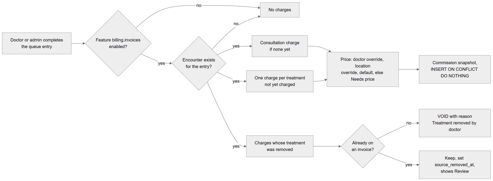

*Figure 34.13 — How completing a visit creates and voids charges.*

The flowchart starts at "Doctor or admin completes the queue entry". A first diamond asks whether the feature `billing.invoices` is enabled; "no" leads to "No charges". A second diamond asks whether an encounter exists for the entry; "no" again leads to "No charges". On "yes" three branches start. The first creates a "Consultation charge if none yet", the second "One charge per treatment not yet charged"; both go to the pricing box "Price: doctor override, location override, default, else Needs price" and then to "Commission snapshot, INSERT ON CONFLICT DO NOTHING". The third branch takes "Charges whose treatment was removed" to a diamond "Already on an invoice?": "no" leads to "VOID with reason Treatment removed by doctor", "yes" leads to "Keep, set source_removed_at, shows Review".

**Behind the scenes — technically.** `QueueOrchestrator.complete` (normal and force completion) calls `ChargeSourcesService.syncForEncounter` inside the queue's completion transaction, after the queue session lock. It reads the encounter by `queue_entry_id`, the encounter's `treatments` and its existing ACTIVE `CONSULTATION`/`TREATMENT` charges. `ChargeDraftFactory` builds drafts: `fromConsultation` (source id = encounter id, description from the service or "Consultation") and `fromTreatment` (source id = treatment id; price from the treatment's service, else the treatment's legacy cost, else zero with `needs_pricing`). The charge date is the completion instant converted to the location's date. `CommissionService.snapshot` adds the commission plan and rate in force on that date (Chapter 35). Rows are inserted with `ON CONFLICT DO NOTHING` on the partial unique index `uq_charges_source` (organization, source, source id, ACTIVE only), so repeating the completion never doubles a charge. Created and voided charges are audited with the system role.

**Rules and validations.**
- Runs only if the feature is enabled for the organization and the visit has an encounter.
- A catalog error (inactive service, missing service) never fails the completion; it yields a Needs price charge.
- Removed treatments: unbilled charge → `VOID`; billed charge → `source_removed_at` set, money untouched.

**Who can do it.** No user permission; it runs as part of `queue.doctor.own` / `queue.doctor.any` completion. Feature `billing.invoices`.

**Data read and written.** Reads `patient_encounters`, `treatments`, `charges`, `location_billing_settings`, `services`, `service_prices`, compensation tables. Writes `charges`, `billing_audit_logs`.

**Effects on other modules.** The doctor's response contains no charge data. Charges carry the encounter and appointment ids, which reports use.

**Error cases.** None shown to the doctor; pricing problems appear as "Needs price" at the desk.

**Technical references:** `backend/src/billing/charges/charge-sources.service.ts` · `ChargeSourcesService.syncForEncounter`, `ChargeDraftFactory` · `web-app/src/features/billing/pages/BillingDeskPage.tsx`

### 34.3.4 Add a manual charge

**Status:** [Implemented]

**What it does.** Adds a charge by hand: a catalog service priced automatically, or an "Other" item with free text and a price.

**How the user does it.**
1. In the Collect payment sheet or the patient's **Open charges**, click **Add charge**.
2. Choose **Catalog service** and pick a **Service**, or choose **Other** and type **Description** and **Price (Rs)**.
3. Set **Quantity** (1–999) and click **Add charge**. A toast says "Charge added".

**Behind the scenes — in simple terms.** A catalog service gets its resolved price for this location. A receptionist cannot type a different price for a catalog service.

**Behind the scenes — technically.** `POST /patients/:patientId/charges` → `ChargesService.addManual` in one transaction: checks the patient and optional doctor, resolves the price, builds the draft with `ChargeDraftFactory.manual` (source `MANUAL`, charge date = location's today unless given), applies `assertCanSetPrice` when a different price is sent for a catalog service, saves and audits `CHARGE`/`CREATED`. `GET /patients/:patientId/charges?state=unbilled|open|all` lists charges.

**Rules and validations.**
- "Other" needs a description of 2–200 characters and a price.
- Quantity 1–999; price 0 or more with 2 decimals.
- Manual charges carry no commission snapshot.

**Who can do it.** `billing.desk.use`, feature `billing.invoices`. Default: Admin, Receptionist, Accountant. A different catalog price needs `billing.price.override` (Admin).

**Data read and written.** `charges`, `services`, `service_prices`, `billing_audit_logs`.

**Effects on other modules.** None beyond billing.

**Error cases.** 422 `BILLING_CHARGE_INVALID` "Enter a price for this charge"; 403 `BILLING_PRICE_CHANGE_NOT_ALLOWED`; 422 `BILLING_SERVICE_INACTIVE`.

**Technical references:** `backend/src/billing/charges/charges.service.ts` · `ChargesService.addManual` · `web-app/src/features/billing/components/charges/AddChargeSheet.tsx`

### 34.3.5 Create charges from a treatment plan

**Status:** [Partial] — backend only; no screen calls the endpoint.

**What it does.** Turns selected items of a patient's treatment plan into unbilled charges, priced at each item's estimated cost.

**How the user does it.** Not available in the web app.

**Behind the scenes — in simple terms.** One charge per plan item; the same item can never be charged twice while its charge is active.

**Behind the scenes — technically.** `POST /patients/:patientId/charges/from-treatment-plan/:planId` with `itemIds` (1–100) → `ChargesService.fromTreatmentPlan`. Builds drafts with source `TREATMENT_PLAN` (doctor = item's assignee or the plan's dentist; price = estimated cost, else zero with Needs price) and inserts with `ON CONFLICT DO NOTHING` on `uq_charges_source`. `GET /treatment-plans/:planId/billing-summary` reports these charges per plan; its web hook exists but no component uses it.

**Rules and validations.** Items must belong to the plan, the plan to the patient and organization.

**Who can do it.** `billing.desk.use`, feature `billing.invoices`.

**Data read and written.** Reads `patient_treatment_plans`, `treatment_plan_items`; writes `charges`, `billing_audit_logs`.

**Effects on other modules.** Treatment plans (Chapter 33) are unchanged by it.

**Error cases.** 404 "Treatment plan not found", "Plan item not found".

**Technical references:** `backend/src/billing/charges/charges.controller.ts` · `ChargesService.fromTreatmentPlan` · none in the web app

### 34.3.6 Edit an unbilled charge (and the price policy)

**Status:** [Implemented]

**What it does.** Changes the quantity or price of a charge that is not yet on an invoice. The **price policy** says: without `billing.price.override`, only "Other" charges and charges that still need a price can be priced; for a catalog charge, give a discount instead.

**How the user does it.**
1. In the charge's three-dot menu, choose **Edit quantity / price**.
2. Change **Quantity** or **Unit price (Rs)** and click **Save**. If the price field is disabled, the hint says "Catalog price — give a discount instead."

**Behind the scenes — in simple terms.** Gross, discount and net are recalculated. A percentage discount follows the new amount; a fixed one stays, capped at the gross.

**Behind the scenes — technically.** `PATCH /charges/:chargeId` → `ChargesService.update` via `mutateUnbilled`: one transaction, locks the charge (and its invoice if any) with `BillingLocks.chargesWithInvoices`, asserts it is ACTIVE and unbilled, applies changes, runs `recalcCharge` (integer paisa math), saves, audits `UPDATED` with before and after snapshots (commission fields stripped). Setting a price clears `needs_pricing`. Changing the doctor re-takes the commission snapshot.

**Rules and validations.**
- Only ACTIVE, unbilled charges; billed charges change only through an invoice edit.
- Only "Other" charges can be renamed.
- Quantity 1–999.

**Who can do it.** `billing.desk.use` (+ `billing.price.override` for catalog prices), feature `billing.invoices`. Default: Admin, Receptionist, Accountant; price override Admin only.

**Data read and written.** `charges`, `billing_audit_logs`.

**Effects on other modules.** None.

**Error cases.** 409 `BILLING_CHARGE_ALREADY_BILLED` "This charge is on an invoice — edit the invoice instead"; 409 `BILLING_CHARGE_NOT_OPEN` "This charge is void"; 403 `BILLING_PRICE_CHANGE_NOT_ALLOWED` "You are not allowed to change a catalog price — give a discount instead".

**Technical references:** `backend/src/billing/charges/price-policy.ts` · `assertCanSetPrice`, `ChargesService.update` · `web-app/src/features/billing/components/charges/EditChargeSheet.tsx`

### 34.3.7 Void an unbilled charge

**Status:** [Implemented]

**What it does.** Cancels a charge that should not be billed, keeping it for the record.

**How the user does it.**
1. In the charge's menu, choose **Void**.
2. In "Void this charge?", type a **Reason** and click **Void charge**. A toast says "Charge voided".

**Behind the scenes — in simple terms.** The charge becomes VOID, with who, when and why. It no longer counts anywhere.

**Behind the scenes — technically.** `POST /charges/:chargeId/void` with `reason` → `ChargesService.void` through `mutateUnbilled`; sets `status = VOID`, `voided_at`, `voided_by`, `void_reason`; audits `VOIDED` with the reason.

**Rules and validations.** Reason 5–300 characters (screen and server). Only ACTIVE, unbilled charges. A void cannot be undone.

**Who can do it.** `billing.desk.use`, feature `billing.invoices`. Default: Admin, Receptionist, Accountant.

**Data read and written.** `charges`, `billing_audit_logs`.

**Effects on other modules.** A voided treatment charge does not change the clinical record.

**Error cases.** 400 validation for a short reason; 409 `BILLING_CHARGE_ALREADY_BILLED`; 409 `BILLING_CHARGE_NOT_OPEN`.

**Technical references:** `backend/src/billing/charges/charge-math.ts` · `voidCharge`, `ChargesService.void` · `web-app/src/features/billing/components/charges/ChargeRowActions.tsx`

### 34.3.8 Manage discount types

**Status:** [Implemented] — the optional Code field exists in the API but not on screen.

**What it does.** Lets the clinic define preset discounts ("Staff family 20%", "Senior citizen 10%", a fixed amount off) that reception may apply. A **discount type** has a kind (percentage or fixed), a value, an optional maximum amount per use, what it applies to (everything, some service kinds, some services), an optional range within which reception may change the value, an optional "note required" rule and optional validity dates.

**How the user does it.**
1. Open Settings → **Billing** → **Discount types**, click **Add discount type**.
2. Fill **Name**, **Kind**, **Value**, optionally **Max amount per use (Rs)**, **Applies to**, the switch **Reception may change the value** (then **Min value** and **Max value**), the switch **Note required when applied**, **Valid from** and **Valid to**.
3. Save. Use the **Active** switch to retire a type.

**Behind the scenes — in simple terms.** Charges keep a copy of the discount they got; changing a type later never changes them.

**Behind the scenes — technically.** `GET /billing/discount-types?usableToday` (list, `billing.discount.apply`), `POST` and `PATCH /billing/discount-types/:id` → `DiscountTypesService`, transactional and audited (`DISCOUNT_TYPE`). `assertShape` checks the merged row so a PATCH cannot break the rules. "Usable today" means active and the location's today within the validity dates.

**Rules and validations.**
- Name 2–80 characters, unique per organization; value at least 0.01; a percentage at most 100.
- "Service kinds" needs at least one kind; "Specific services" at least one service.
- Reception range must satisfy min ≤ value ≤ max; valid from ≤ valid to.
- Types are never deleted.

**Who can do it.** Write: `admin.settings.manage`; read: `billing.discount.apply`. Features `billing.invoices` and `billing.discounts`. Default: Admin.

**Data read and written.** `discount_types`, `billing_audit_logs`.

**Effects on other modules.** None.

**Error cases.** 422 `BILLING_DISCOUNT_INVALID` (for example "Percentage must be between 0 and 100", "Reception range must satisfy min ≤ value ≤ max"); 409 `BILLING_DUPLICATE`.

**Technical references:** `backend/src/billing/discounts/discount-types.service.ts` · `DiscountTypesService.assertShape` · `web-app/src/features/billing/components/settings/DiscountTypesTab.tsx`

### 34.3.9 Give a discount on one charge, many charges, or a custom discount

**Status:** [Implemented]

**What it does.** Applies one discount to an unbilled charge (each charge carries at most one; a new one replaces the old), applies one type to several charges at once, removes a discount, or gives a **custom discount** (any percentage or amount, not from a preset).

**How the user does it.**
1. One charge: menu → **Discount**. Several: tick unbilled charges and click **Discount** in the Collect payment sheet ("Discount n charges").
2. Choose a **Discount** type. If the type allows it, change the value within "Value (min–max)".
3. Or switch on **Custom discount** (admins) and choose **Kind** and **Value**.
4. Add a **Note** if required and click **Apply discount**. Remove with **Remove discount**.

**Behind the scenes — in simple terms.** The amount is computed, capped by the type's maximum and by the charge's gross. For many charges, a percentage applies to each charge and the maximum is shared; a fixed amount is one total spread over the charges in proportion to their size. Charges the type does not apply to are skipped and named in a warning ("Not applied to: …").

**Behind the scenes — technically.** `POST /charges/:chargeId/discount`, `DELETE /charges/:chargeId/discount`, `POST /charges/discount/bulk` (1–100 charge ids). `DiscountApplier.resolve` loads the type and calls `resolveDiscount`, which enforces the permission rules: a preset needs `billing.discount.apply`; a value different from the type's own goes through `AccessContext.decide('billing.discount.apply', { value, min, max })`, allowed inside the reception range, otherwise only with the escalation permission `billing.discount.custom`. `discountForCharge` / `discountsForCharges` compute paisa amounts (`splitProportionally` gives leftover paisa to the largest share). The bulk call locks all charges in id order in one transaction and writes one `DISCOUNT_APPLIED` audit row per charge with the amount and note.

**Rules and validations.**
- Only ACTIVE, unbilled charges.
- The type must be active and valid on the location's today, and must apply to the charge (single charge: error; bulk: skipped).
- Value inside the type's range for reception; percentage 0–100 for anyone.
- Custom discount: needs `billing.discount.custom` and a note of at least 3 characters; it is named "Custom".
- Types marked "note required" need a note of at least 3 characters.

**Who can do it.** `billing.discount.apply` (presets), `billing.discount.custom` (custom or out-of-range values; implies apply). Feature `billing.discounts`. Default: Admin (both), Receptionist (apply). The Accountant template holds neither.

**Data read and written.** `charges`, `discount_types`, `billing_audit_logs`.

**Effects on other modules.** Discounts lower the commission base (Chapter 35) and appear in Doctor revenue.

**Error cases.** 403 `BILLING_CUSTOM_DISCOUNT_ADMIN_ONLY`; 403 `BILLING_DISCOUNT_VALUE_NOT_ALLOWED` "Value must be between … and …"; 422 `BILLING_DISCOUNT_NOTE_REQUIRED`; 422 `BILLING_DISCOUNT_INVALID` "… does not apply to …", "… is not available today".

**Technical references:** `backend/src/billing/discounts/discount-policy.ts` · `resolveDiscount`, `DiscountApplier`, `discountsForCharges` · `web-app/src/features/billing/components/charges/DiscountSheet.tsx`

### 34.3.10 Work the ready-to-bill list and the billing desk

**Status:** [Implemented]

**What it does.** Gives reception one screen with everyone to bill today and everyone who owes money.

**How the user does it.**
1. Open **Billing desk**. Optionally pick another day.
2. Click **Bill** on a ready-to-bill patient, or **Collect** on an outstanding invoice.

**Behind the scenes — in simple terms.** A patient is "ready to bill" on a day when they have at least one unbilled charge dated that day; their total includes older unbilled charges too.

**Behind the scenes — technically.** `GET /billing/ready-to-bill?date` → `ChargesService.readyToBill`: one SQL query over ACTIVE, unbilled charges with `charge_date ≤ day`, grouped by patient, `HAVING BOOL_OR(charge_date = day)`, newest first; the default day is the location's today from `BillingClock`. The Outstanding section calls `GET /invoices?paymentStatus=OVERDUE` and `?paymentStatus=UNPAID` (50 each).

**Rules and validations.** Active location only.

**Who can do it.** `billing.desk.use`, feature `billing.invoices`. Default: Admin, Receptionist, Accountant.

**Data read and written.** Reads `charges`, `patients`, `invoices`.

**Effects on other modules.** None.

**Error cases.** 403 `NO_PERMISSION`.

**Technical references:** `backend/src/billing/charges/charges.service.ts` · `ChargesService.readyToBill` · `web-app/src/features/billing/pages/BillingDeskPage.tsx`

### 34.3.11 Collect a payment (with preview and allocation)

**Status:** [Implemented]

**What it does.** Records money received from a patient, issues an invoice for any unbilled charges in the selection, splits the money over the selected charges, keeps any rest as advance and gives a receipt number.

**How the user does it.**
1. Open the Collect payment sheet (Billing desk, patient Billing tab, queue **Bill** button, invoice detail or invoice list menu).
2. Tick the charges to pay, check **Amount received (Rs)**, pick **Oldest first** or **Manual**, choose the account under **Received in**, add a **Reference number** if asked.
3. Read the live summary, then click **Receive Rs …**.
4. Print the receipt and the invoice from the result screen.

**Behind the scenes — in simple terms.** Figure 34.14 shows the full exchange. The preview runs the same calculation without saving, so the screen never does money math itself. On save, everything happens in one database transaction: either all of it (invoice, receipt, allocations, totals, ledger, audit) is stored, or nothing is. Sending the same click twice returns the first result instead of charging twice.

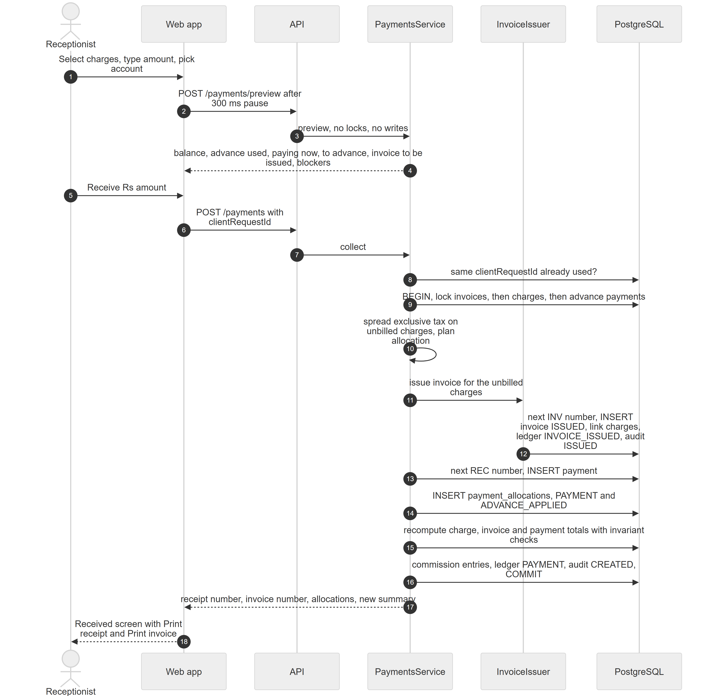

*Figure 34.14 — Collect payment: preview, then one transaction that issues the invoice, records the payment and allocates it.*

The diagram has six participants: the Receptionist, the Web app, the API, the PaymentsService, the InvoiceIssuer and PostgreSQL. In steps 1 to 4 the receptionist selects charges, types an amount and picks an account; after a 300 ms pause the web app calls `POST /payments/preview`; the service computes without locks or writes and returns the balance, advance used, paying now, the part going to advance, the invoice that will be issued and any blockers. In steps 5 to 7 the receptionist clicks "Receive Rs amount", the web app sends `POST /payments` with a `clientRequestId`, and the API calls collect. Step 8 checks whether that request id was already used. Step 9 opens the transaction and locks invoices, then charges, then the patient's advance payments. Step 10 spreads the exclusive tax on the unbilled charges and plans the allocation. Steps 11 and 12 hand the unbilled charges to the InvoiceIssuer, which takes the next INV number, inserts the invoice as ISSUED, links the charges, posts an INVOICE_ISSUED ledger row and an ISSUED audit row. Step 13 takes the next REC number and inserts the payment. Step 14 inserts the allocation rows with reasons PAYMENT and ADVANCE_APPLIED. Step 15 recomputes charge, invoice and payment totals with invariant checks. Step 16 records commission entries, posts the PAYMENT ledger row, writes the CREATED audit row and commits. Steps 17 and 18 return the receipt number, invoice number, allocations and the new summary, and the screen shows the result with Print receipt and Print invoice.

**Behind the scenes — technically.** `POST /payments/preview` → `PaymentsService.preview`; `POST /payments` → `PaymentsService.collect` → `runCollect`. Locks follow `BillingLocks` order invoices → charges → payments (each by id) so two operations cannot deadlock. `assertCollectable` requires every selected charge to belong to the patient, be ACTIVE, have a balance (or await a price) and not sit on a cancelled invoice. `planAllocation` (see 34.3.12) draws first from old advance (oldest payment first), then from the new money. `InvoiceIssuer.issue` runs only when unbilled charges are selected. `AllocationWriterService.insert` appends rows and asserts each allocated charge is on an invoice. `BillingTotalsService` recomputes cached columns from source rows with SQL `SUM` (never increments) and throws `BILLING_INVARIANT_VIOLATION` (rolling everything back) if a charge is over-allocated, a payment over-used or an invoice balance negative. `CommissionService.recordForCharges` records commission on collection. Money crosses the API as rupees with two decimals, is stored as `numeric(12,2)`, and every calculation runs in integer paisa. Idempotency: the unique `client_request_id` per organization; a losing parallel retry returns the winner's result.

**Rules and validations.**
- New money: amount at least 0.01, an active account of this location, a reference when the account requires one, notes up to 300 characters.
- A charge with Needs price blocks the invoice ("Set a price for: …").
- Manual mode: every selected charge needs an amount, no amount above its balance, total not above the funds.
- Up to 200 selections.

**Who can do it.** `billing.payment.collect` (preview and collect), feature `billing.invoices`. Default: Admin, Receptionist, Accountant. The doctor-share line in the preview needs `earnings.all.view` and the commissions feature.

**Data read and written.** Writes `payments`, `payment_allocations`, `invoices`, `charges`, `document_sequences`, `ledger_entries`, `billing_audit_logs`, `commission_entries`.

**Effects on other modules.** Commission entries (Chapter 35); daily collection, dashboards and reports (Chapter 36).

**Error cases.** 422 `BILLING_LOCATION_CODE_MISSING`; 422 `BILLING_REFERENCE_REQUIRED`; 422 `BILLING_PAYMENT_ACCOUNT_INVALID`; 422 `BILLING_CHARGE_NEEDS_PRICING`; 409 `BILLING_CHARGE_NOT_OPEN` "… has nothing left to pay"; 409 `BILLING_INVOICE_CANCELLED`; 422 `BILLING_ALLOCATION_EXCEEDS_BALANCE` / `_EXCEEDS_FUNDS`; 500 `BILLING_INVARIANT_VIOLATION`.

**Technical references:** `backend/src/billing/payments/payments.service.ts` · `PaymentsService.collect`, `BillingLocks`, `BillingTotalsService` · `web-app/src/features/billing/components/collect-payment/CollectPaymentSheet.tsx`

### 34.3.12 Choose an allocation strategy

**Status:** [Implemented]

**What it does.** Decides how much of the available money each selected charge receives. **Oldest first** (code `AUTO`, FIFO) pays the oldest charge first; **Manual** pays exactly what the user typed per charge.

**How the user does it.** In the Collect payment sheet, choose **Oldest first** or **Manual** under **Allocation**.

**Behind the scenes — in simple terms.** Oldest first walks the charges from the oldest charge date (then creation time) and gives each the smaller of its balance and the money left. Whatever is not used becomes advance.

**Behind the scenes — technically.** `planAllocation` (pure function) uses `ALLOCATION_STRATEGIES`: `FifoAllocationStrategy` and `ManualAllocationStrategy`. Each strategy returns a target per charge; the planner then draws each target from the funding sources in order (old advance payments, oldest received first, then `NEW`). It returns the planned lines, the advance used and the unused part of the new payment.

**Rules and validations.** Manual amounts may not exceed a charge's balance or the total funds.

**Who can do it.** As for collecting a payment.

**Data read and written.** None by itself; the plan is written by collect.

**Effects on other modules.** None.

**Error cases.** 422 `BILLING_ALLOCATION_EXCEEDS_BALANCE` "An amount is larger than the charge balance"; 422 `BILLING_ALLOCATION_EXCEEDS_FUNDS` "The amounts add up to more than the money available".

**Technical references:** `backend/src/billing/payments/allocation/allocation-planner.ts` · `planAllocation`, `FifoAllocationStrategy`, `ManualAllocationStrategy` · `web-app/src/features/billing/components/collect-payment/CollectPaymentFields.tsx`

### 34.3.13 Hold advance and apply it later

**Status:** [Implemented]

**What it does.** Money received beyond what the selected charges need stays as the patient's **advance**. Advance is used on later charges, automatically when "Use advance" is on, or alone with **Apply advance** when no new money is received.

**How the user does it.**
1. In the Collect payment sheet, leave **Use advance (… available)** on (the default).
2. To use only advance, set the amount to 0; the button becomes **Apply advance Rs …**.

**Behind the scenes — in simple terms.** Advance is not a separate balance: it is the unused part of the patient's previous payments. Applying it issues an invoice for unbilled charges but no new receipt.

**Behind the scenes — technically.** Advance of a payment = `amount − allocated_amount − refunded_amount`. `POST /patients/:patientId/advance/apply` → `PaymentsService.applyAdvance` runs `runCollect` with amount 0; it writes `ADVANCE_APPLIED` allocations, audits `ALLOCATED`, and posts no PAYMENT ledger row.

**Rules and validations.** Fails when there is no advance to apply.

**Who can do it.** `billing.payment.collect`, feature `billing.invoices`. Default: Admin, Receptionist, Accountant.

**Data read and written.** `payments`, `payment_allocations`, `charges`, `invoices`, `billing_audit_logs`.

**Effects on other modules.** Commission is recorded when advance is applied.

**Error cases.** 422 `BILLING_NOTHING_TO_APPLY` "There is no advance to apply to these charges".

**Technical references:** `backend/src/billing/payments/payments.service.ts` · `PaymentsService.applyAdvance` · `web-app/src/features/billing/components/collect-payment/CollectSummary.tsx`

### 34.3.14 Unapply a payment

**Status:** [Partial] — backend only; the web app defines the call but no screen uses it.

**What it does.** Takes back all or part of a payment's allocations; the money returns to the patient's advance. It is needed before an invoice with payments can be cancelled.

**How the user does it.** Not available in the web app.

**Behind the scenes — in simple terms.** Negative allocation rows are added; nothing is deleted. The receipt stays.

**Behind the scenes — technically.** `POST /payments/:paymentId/unapply` with `reason` (5–300) and optional `lines` → `PaymentsService.unapply`: locks charges with invoices, then the payment; `AllocationWriterService.releaseFromPayment` inserts negative `UNAPPLY` rows (never more than the current net); totals are recomputed; commission is reversed with a negative entry; audit `UNAPPLIED`. No ledger entry is posted, because the patient's net position does not change.

**Rules and validations.** Each line at most the payment's current net on that charge.

**Who can do it.** `billing.invoice.edit`, feature `billing.invoices`. Default: Admin, Accountant.

**Data read and written.** `payment_allocations`, `charges`, `invoices`, `payments`, `commission_entries`, `billing_audit_logs`.

**Effects on other modules.** Commission reversal (Chapter 35).

**Error cases.** 422 `BILLING_UNAPPLY_EXCEEDS_ALLOCATION` "Cannot release more than was applied"; 404 "Payment not found".

**Technical references:** `backend/src/billing/payments/allocation-writer.service.ts` · `PaymentsService.unapply` · none in the web app

### 34.3.15 Manage payment accounts and payment methods

**Status:** [Implemented]

**What it does.** Defines where the location receives money. Each **payment account** has a kind (the payment method: Cash, Bank transfer, Card, Online wallet, Cheque), optional bank details, and two rules: "Reference number required" and "Count physically at cash close". Every location gets a default account named **Cash** automatically.

**How the user does it.**
1. Open Settings → **Billing** → **Payment accounts**, click **Add account**.
2. Fill **Name**, **Kind** (fixed after creation), optional **Bank name**, **Account title**, **Account number**, and the two switches. For example, "Example Bank current account" with kind Bank transfer.
3. Use the **Active** switch to retire an account. Choose the default account in **Payments and printing**.

**Behind the scenes — in simple terms.** Payments and refunds copy the account's name and method, so old receipts keep the name they were taken with.

**Behind the scenes — technically.** `GET/POST /billing/payment-accounts`, `PATCH /billing/payment-accounts/:id` → `PaymentAccountsService`. Listing first calls `BillingSettingsService.getOrCreate`, which inserts the settings row and the `Cash` account (`ON CONFLICT DO NOTHING`) and makes it the default. New Cash accounts default to "no reference, counted"; other kinds to "reference, not counted". `resolveForUse` checks active, same location and reference.

**Rules and validations.**
- Name 2–60 characters, unique per location.
- The default account cannot be deactivated; the last active account cannot be deactivated.
- Deactivated accounts cannot receive payments or pay refunds.

**Who can do it.** Read: `billing.desk.use`; write: `admin.settings.manage`. Feature `billing.invoices`. Default: Admin (write); Receptionist and Accountant (read).

**Data read and written.** `payment_accounts`, `location_billing_settings`, `billing_audit_logs`.

**Effects on other modules.** Cash close groups by account.

**Error cases.** 409 `BILLING_PAYMENT_ACCOUNT_IS_DEFAULT` "Choose another default account before deactivating this one"; 422 `BILLING_PAYMENT_ACCOUNT_INVALID` "A location needs at least one active account"; 409 `BILLING_DUPLICATE`.

**Technical references:** `backend/src/billing/payment-accounts/payment-accounts.service.ts` · `PaymentAccountsService.assertCanDeactivate` · `web-app/src/features/billing/components/settings/PaymentAccountsTab.tsx`

### 34.3.16 Number invoices, receipts and refunds

**Status:** [Implemented]

**What it does.** Gives every invoice, receipt and refund a gapless number of the form `CODE-INV-YYYY-NNNNN` (receipts `REC`, refunds `RFD`), for example `KHI01-INV-2026-00001`. The counter is per location, per document type and per year (the year of the location's date).

**How the user does it.** Nothing to do once the **Document code** is set in billing settings.

**Behind the scenes — in simple terms.** If the transaction that took a number fails, the number goes back, so there are no gaps.

**Behind the scenes — technically.** `DocumentSequenceService.next` runs an `INSERT … ON CONFLICT … DO UPDATE SET last_value = last_value + 1 RETURNING` on `document_sequences` (primary key organization, location, type, year). The upsert row-locks the counter until the transaction ends, so parallel collections queue up. The code comes from `location_billing_settings.document_code`; when the settings row is first created the Platform tries to derive it from the location's code. Numbers are unique per organization (`uq_invoices_org_number`, `uq_payments_org_receipt`, `uq_refunds_org_number`). Applying advance issues no receipt number.

**Rules and validations.** Without a document code nothing can be numbered.

**Who can do it.** Runs inside collect, issue and refund.

**Data read and written.** `document_sequences`, `location_billing_settings`.

**Effects on other modules.** None.

**Error cases.** 422 `BILLING_LOCATION_CODE_MISSING` "Set a document code for this location in billing settings first".

**Technical references:** `backend/src/billing/numbering/document-sequence.service.ts` · `DocumentSequenceService.next` · `web-app/src/features/billing/components/settings/BillingSettingsForm.tsx`

### 34.3.17 Issue an invoice (at payment or on its own)

**Status:** [Implemented]

**What it does.** Creates an invoice for unbilled charges. This happens automatically when payment is collected or advance applied, and by hand with **Issue invoice (n)** when a patient leaves without paying.

**How the user does it.**
1. Usually nothing: collecting payment issues the invoice.
2. For a patient who pays later: patient **Billing** tab → **Open charges**, tick unbilled charges, click **Issue invoice (n)**. A toast says "Invoice … issued".

**Behind the scenes — in simple terms.** The invoice takes a number, fixes the tax rate of the location at that moment, gets a due date (issue date plus the location's due days, 7 by default) and posts a debit on the patient's statement.

**Behind the scenes — technically.** `POST /invoices` (`patientId`, 1–100 `chargeIds`, optional notes) → `InvoicesService.create` → `InvoiceIssuer.issue` inside a transaction: asserts charges are ACTIVE, unbilled, of one patient, priced; reads the tax rate with `locationTaxRate`; `applyInvoiceTax`; next INV number; inserts the invoice (`status ISSUED`, `revision 1`, `issue_date`, `due_date = today + due_days`, `tax_rate`); links charges and writes their tax shares; recomputes totals; ledger `INVOICE_ISSUED`; audit `ISSUED` with a snapshot.

**Rules and validations.** At least one charge; Needs price charges cannot be invoiced.

**Who can do it.** `billing.desk.use` for the manual issue; feature `billing.invoices`. Default: Admin, Receptionist, Accountant.

**Data read and written.** `invoices`, `charges`, `document_sequences`, `location_settings` (tax rate), `ledger_entries`, `billing_audit_logs`.

**Effects on other modules.** The invoice counts in Outstanding until paid.

**Error cases.** 422 `BILLING_CHARGE_NEEDS_PRICING` "… needs a price first"; 409 `BILLING_CHARGE_NOT_OPEN` "… cannot be invoiced".

**Technical references:** `backend/src/billing/invoices/invoice-issuer.service.ts` · `InvoiceIssuer.issue` · `web-app/src/features/billing/components/patient-billing/OpenChargesPanel.tsx`

### 34.3.18 Apply exclusive sales tax

**Status:** [Implemented]

**What it does.** Adds the location's sales tax on top of the invoice. Tax is **exclusive**: prices are before tax.

**How the user does it.** Set the rate in the location settings ("Tax Rate (%)" on the location's settings page, or "Sales tax on invoices (%)" in the setup wizard). Billing settings do not contain the rate.

**Behind the scenes — in simple terms.** Tax = rate × (sum of the active charges' nets), rounded once. Because payments go to charges, the tax is shared out over the charges. The rate is frozen on the invoice; later edits use the frozen rate, not the current one.

**Behind the scenes — technically.** `locationTaxRate` reads `location_settings.tax_rate` (no row → 0), normalised to basis points. `splitInvoiceTax` gives each charge the tax on its own net and puts the rounding difference on the largest charge; `basisPointsOf` uses BigInt half-up rounding. A charge's payable = net + tax. Tax is not revenue: commission and revenue reports use the pre-tax part (`preTaxMinor`).

**Rules and validations.** Rate 0–100 with 2 decimals. A cancelled invoice keeps its frozen totals; its charges return to unbilled with tax 0.

**Who can do it.** Setting the rate: `admin.locations.manage` (location settings).

**Data read and written.** `location_settings`, `invoices.tax_rate`, `invoices.tax_amount`, `charges.tax_amount`.

**Effects on other modules.** The finance reports subtract tax collected from revenue (Chapter 36).

**Error cases.** None specific.

**Technical references:** `backend/src/billing/tax/invoice-tax.ts` · `applyInvoiceTax`, `locationTaxRate` · `web-app/src/features/locations/LocationSettingsFeature.tsx`

### 34.3.19 Browse invoices and see their payment status

**Status:** [Implemented]

**What it does.** Lists and shows invoices with a status that follows payments and due dates. The stored status is only `ISSUED` or `CANCELLED`; the **payment status** (Unpaid, Partially paid, Paid, Overdue) and the **refund status** are computed each time.

**How the user does it.**
1. Open **Invoices**; use the status tabs, search, dates, list or cards.
2. Click a row to open the detail page.

**Behind the scenes — in simple terms.** An invoice is Paid when nothing is left to pay, Overdue when money is still owed after the due date, Partially paid when some was paid, otherwise Unpaid.

**Behind the scenes — technically.** `GET /invoices` (paging up to 100, `paymentStatus`, `patientId`, `from`, `to`, `search`), `GET /invoices/stats`, `GET /invoices/:invoiceId`, `GET /invoices/:invoiceId/revisions/:revision` (not used by the web app). `invoicePaymentStatus` and the SQL twin `paymentStatusSql` use the location's today. Row scope of `billing.invoice.view`: `location` / `org` show the active location's invoices; `own` shows invoices that carry one of the signed-in doctor's charges.

**Rules and validations.** Always the active location.

**Who can do it.** `billing.invoice.view` (scoped), feature `billing.invoices`. Default: Admin (`org`), Receptionist and Accountant (`location`).

**Data read and written.** Reads `invoices`, `charges`, `patients`, `payment_allocations`, `refunds`.

**Effects on other modules.** None.

**Error cases.** 404 "Invoice not found".

**Technical references:** `backend/src/billing/invoices/invoice-status.ts` · `invoicePaymentStatus`, `InvoiceQueries` · `web-app/src/features/billing/pages/InvoicesPage.tsx`

### 34.3.20 Edit an issued invoice (revisions)

**Status:** [Implemented]

**What it does.** Changes an issued invoice: quantities, prices, discounts, void lines, add unbilled charges, add a new manual line. Each save raises the revision number; the invoice number never changes. Money that is no longer needed moves to the patient's advance.

**How the user does it.**
1. On the invoice detail page click **Edit**.
2. Change lines, tick **Void** or add unbilled charges, type a **Reason**.
3. Read the preview, then click **Save changes** (or **Save & refund** to pay back freed money). A toast says "Saved — revision n".

**Behind the scenes — in simple terms.** The preview really performs the edit in a transaction that is then thrown away, so the preview is exactly what saving will do. If two people edit at once, the second gets "changed by someone else".

**Behind the scenes — technically.** `POST /invoices/:invoiceId/edit/preview` and `POST /invoices/:invoiceId/edit` (`expectedRevision`, 1–50 `operations`, `reason` 5–300) → `InvoicesService.runEdit`: lock the invoice, compare `revision` (optimistic check), lock its charges plus added ones, apply typed commands through `InvoiceEditHandlers` (`updateQuantity`, `setUnitPrice`, `setDiscount`, `removeDiscount`, `voidCharge`, `addCharges`, `addManualCharge`), re-spread tax at the snapshot rate, release any allocation above a charge's new payable (newest allocation first, reason `INVOICE_EDIT_RELEASE`), bump `revision`, recompute totals, adjust commission, post ledger `INVOICE_ADJUSTED` with the difference, audit `EDITED` with full before and after snapshots. Older revisions are printed from these audit snapshots.

**Rules and validations.**
- Only ISSUED invoices.
- `setUnitPrice` follows the price policy; `voidCharge` needs `billing.invoice.void`; discount operations follow the discount rules.
- Added charges must be unbilled, of the same patient and priced.

**Who can do it.** `billing.invoice.edit` (+ `billing.invoice.void` to void lines, + `billing.price.override` for catalog prices), feature `billing.invoices`. Default: Admin, Accountant.

**Data read and written.** `invoices`, `charges`, `payment_allocations`, `payments`, `ledger_entries`, `commission_entries`, `billing_audit_logs`.

**Effects on other modules.** Commission adjusts to the new amounts.

**Error cases.** 409 `BILLING_INVOICE_REVISION_CONFLICT` "This invoice was changed by someone else. Reload and try again."; 409 `BILLING_INVOICE_CANCELLED` "This invoice is cancelled and read-only"; 404 "Charge is not on this invoice".

**Technical references:** `backend/src/billing/invoices/invoices.service.ts` · `InvoicesService.runEdit`, `InvoiceEditHandlers` · `web-app/src/features/billing/components/invoices/EditInvoiceSheet.tsx`

### 34.3.21 Cancel an invoice

**Status:** [Implemented] — an invoice with payments must first be unapplied, which only the API can do.

**What it does.** Cancels an unpaid invoice. Its charges go back to "not invoiced"; the number stays used.

**How the user does it.**
1. On the invoice detail page click **Cancel** (shown only when nothing is paid).
2. In "Cancel … ?" type a **Reason** and click **Cancel invoice**.

**Behind the scenes — in simple terms.** The invoice keeps its frozen totals for the record and is printed with a CANCELLED watermark. A credit is posted on the patient's statement.

**Behind the scenes — technically.** `POST /invoices/:invoiceId/cancel` with `reason` → `InvoicesService.cancel`: lock the invoice and its charges, refuse if any allocation or `paid_amount` exists, set `CANCELLED` with `cancelled_at/by` and `cancel_reason`, set active charges' `invoice_id` to null and tax to 0, ledger `INVOICE_CANCELLED` (minus the total), audit `CANCELLED`.

**Rules and validations.** ISSUED and nothing paid. Final: a cancelled invoice cannot be reopened.

**Who can do it.** `billing.invoice.void` (high risk), feature `billing.invoices`. Default: Admin, Accountant.

**Data read and written.** `invoices`, `charges`, `ledger_entries`, `billing_audit_logs`.

**Effects on other modules.** The charges reappear in Ready to bill.

**Error cases.** 409 `BILLING_INVOICE_HAS_PAYMENTS` "Unapply its payments before cancelling this invoice".

**Technical references:** `backend/src/billing/invoices/invoices.service.ts` · `InvoicesService.cancel` · `web-app/src/features/billing/pages/InvoiceDetailPage.tsx`

### 34.3.22 Refund money (from advance or from an invoice)

**Status:** [Implemented]

**What it does.** Pays money back to a patient. A refund always comes out of advance. An **advance refund** returns unused money; an **invoice refund** returns money released from an invoice, optionally together with the edit that released it, in one step.

**How the user does it.**
1. Advance: patient **Billing** tab → **Refund advance**. Invoice: invoice detail → **Refund**, or **Save & refund** in the Edit sheet.
2. Fill **Amount (Rs)**, **Paid out from**, **Reference number** if asked, and a **Reason**.
3. Click **Refund…**, confirm "Return … via … to …?". A toast says "Refund … recorded"; print the voucher for the patient to sign.

**Behind the scenes — in simple terms.** The Platform decides which previous payments the refund comes from (its **refund sources**): for an invoice refund, first the payments released from that invoice (latest first), then any other advance, newest first.

**Behind the scenes — technically.** `POST /refunds` (`patientId`) → `RefundsService.createAdvanceRefund`; `POST /invoices/:invoiceId/refund` with optional `edit` and `refund` → `createInvoiceRefund`, which runs `InvoicesService.runEdit` and the refund in the same transaction. `runRefund`: account check, invoice refundable check (`released_amount − refunded_amount`), lock the patient's advance payments, check available advance, pick sources, take the next RFD number, insert `refunds` and `refund_sources`, recompute payment and invoice totals, ledger `REFUND` (a debit, because the clinic now holds less of the patient's money), audit `REFUNDED` on the refund and, for invoice refunds, on the invoice. Idempotent by `clientRequestId`. `GET /refunds` and `GET /refunds/:refundId` exist but the web app does not call them.

**Rules and validations.**
- Amount at least 0.01, at most the advance; for an invoice refund, at most the invoice's refundable amount.
- Reason 5–300 characters; reference when the account requires one.
- Refunds cannot be undone.

**Who can do it.** `billing.refund.issue` (high risk), feature `billing.invoices`. Default: Admin, Accountant.

**Data read and written.** `refunds`, `refund_sources`, `payments`, `invoices`, `document_sequences`, `ledger_entries`, `billing_audit_logs`.

**Effects on other modules.** Payments page and cash close subtract refunds per account.

**Error cases.** 422 `BILLING_REFUND_EXCEEDS_ADVANCE` "The patient's advance is only Rs …"; 422 `BILLING_REFUND_EXCEEDS_INVOICE_REFUNDABLE` "Only Rs … can be refunded from this invoice"; 422 `BILLING_REFERENCE_REQUIRED`.

**Technical references:** `backend/src/billing/refunds/refunds.service.ts` · `RefundsService.runRefund`, `sourceOrder` · `web-app/src/features/billing/components/refunds/RefundSheet.tsx`

### 34.3.23 See a patient's billing: summary, open charges, statement

**Status:** [Implemented]

**What it does.** Shows one patient's money position: not invoiced, outstanding, overdue and advance; the open charges; and a statement (a running ledger of invoices, adjustments, cancellations, payments and refunds).

**How the user does it.** Open the patient → **Billing** tab; switch sub-tabs; on **Statement** choose a range and **Print statement**.

**Behind the scenes — in simple terms.** The statement comes from an append-only patient ledger: an invoice adds a debit, a payment a credit. Its balance equals outstanding minus advance.

**Behind the scenes — technically.** `GET /patients/:patientId/billing/summary`, `/open-charges`, `/statement?from&to` → `PatientBillingService`. The summary query sums unbilled nets, issued balances, overdue balances (due date before the location's today), payment advance and the ledger. The statement reads `ledger_entries` with an opening balance before `from`. `LedgerService.post` only inserts rows (debit for positive, credit for negative, zero skipped).

**Rules and validations.** Active location only.

**Who can do it.** `billing.invoice.view`, feature `billing.invoices`. Default: Admin, Receptionist, Accountant.

**Data read and written.** Reads `charges`, `invoices`, `payments`, `ledger_entries`.

**Effects on other modules.** The Billing tab appears on the patient record (Chapter 28).

**Error cases.** 404 when the patient is not in the organization.

**Technical references:** `backend/src/billing/patient-billing/patient-billing.queries.ts` · `PatientBillingQueries.summary`, `LedgerService.post` · `web-app/src/features/billing/components/patient-billing/PatientBillingTab.tsx`

### 34.3.24 Show dues at check-in

**Status:** [Implemented]

**What it does.** Shows a red "Rs … due" badge (with a dot when overdue) or a green "Advance Rs …" badge on queue rows and on the patient header, so reception can ask for old dues.

**How the user does it.** Keep **Show dues at check-in** on in billing settings (default on). The queue gains a **Billing** column with the badge and a **Bill** button on completed entries.

**Behind the scenes — in simple terms.** The screen asks the server for the dues of the patients it shows.

**Behind the scenes — technically.** `GET /billing/outstanding?patientIds=` (at most 100 ids) → `PatientBillingService.outstanding`. The setting `show_outstanding_at_check_in` is checked only by the web app; the endpoint itself answers regardless.

**Rules and validations.** Queue column needs `billing.desk.use`; patient header badge needs `billing.invoice.view`.

**Who can do it.** `billing.invoice.view`, feature `billing.invoices`. Default: Admin, Receptionist, Accountant. Doctors never see it.

**Data read and written.** Reads `charges`, `invoices`, `payments`, `ledger_entries`, `location_billing_settings`.

**Effects on other modules.** Queue board (Chapter 30), patient header (Chapter 28).

**Error cases.** 400 for more than 100 ids.

**Technical references:** `backend/src/billing/patient-billing/billing-reports.controller.ts` · `PatientBillingService.outstanding` · `web-app/src/features/billing/components/queue/QueueBillingCell.tsx`

### 34.3.25 See the day's collection

**Status:** [Implemented]

**What it does.** Shows, for one clinic day, receipts and refunds per payment account and the net in hand, plus the list of receipts.

**How the user does it.** Open **Payments**, choose a day and optionally an account.

**Behind the scenes — in simple terms.** Payments by their payment date, refunds by their refund date, both in the location's calendar.

**Behind the scenes — technically.** `GET /payments/daily-collection?date` (`billing.desk.use`) and `GET /payments?from&to&paymentAccountId&patientId&method` (`billing.invoice.view`, paged). `GET /payments/:paymentId` exists but is unused.

**Rules and validations.** The day picker does not allow future days.

**Who can do it.** Daily collection: `billing.desk.use`; list: `billing.invoice.view`. Default: Admin, Receptionist, Accountant. The sidebar item checks `billing.payment.collect`, the route checks `billing.invoice.view`.

**Data read and written.** Reads `payments`, `refunds`, `payment_accounts`.

**Effects on other modules.** None.

**Error cases.** 403 `NO_PERMISSION`.

**Technical references:** `backend/src/billing/payments/payments.queries.ts` · `PaymentQueries.dailyCollection` · `web-app/src/features/billing/pages/PaymentsPage.tsx`

### 34.3.26 Close the counter (cash close)

**Status:** [Implemented]

**What it does.** Ends a cash period at the location: for each payment account it computes the expected money (payments minus refunds since the last close), takes the counted amount for physically counted accounts, records the difference (variance) and keeps an immutable record with a printable slip. Closing never blocks taking payments.

**How the user does it.**
1. On **Payments** click **Close counter**.
2. Enter **Counted (Rs)** for each counted account; add a **Note** if there is a difference.
3. Click **Close counter (Rs … expected)**, then **Print slip**. Past closes appear under **Counter closes**, with a red "Flagged" badge when the difference is above the alert amount.

**Behind the scenes — in simple terms.** Each close starts where the previous one ended, so no payment is counted twice and none is missed.

**Behind the scenes — technically.** `GET /billing/cash-close/preview`, `POST /billing/cash-close` (`periodEnd`, `lines`, `note`), `GET /billing/cash-close?from&to` (latest 200), `GET /billing/cash-close/:id` (unused by the web app) → `CashCloseService`. Create takes a PostgreSQL advisory transaction lock per location, rejects a `periodEnd` in the future or not after the last close, sums payments by `received_at` and refunds by `refunded_at` in (start, end] per account (`calculateCashClose`, paisa math), requires counts and a note, inserts `cash_closes` and `cash_close_lines` (account name copied) and audits `CLOSED` with the variance. The flag compares the absolute variance with `cash_variance_alert_amount`.

**Rules and validations.** Counted amount required for accounts with "Count physically at cash close"; note required when any variance exists; closes cannot be edited or deleted.

**Who can do it.** `billing.cash_close`, feature `billing.invoices`. Default: Admin, Accountant.

**Data read and written.** Reads `payments`, `refunds`, `payment_accounts`, `location_billing_settings`; writes `cash_closes`, `cash_close_lines`, `billing_audit_logs`.

**Effects on other modules.** None.

**Error cases.** 422 `BILLING_CASH_CLOSE_COUNT_REQUIRED` "Enter the counted amount for …"; 422 `BILLING_CASH_CLOSE_NOTE_REQUIRED` "Explain the difference in a note"; 422 `BILLING_CASH_CLOSE_PERIOD_INVALID` "This counter was already closed — open a fresh preview".

**Technical references:** `backend/src/billing/cash-close/cash-close.service.ts` · `CashCloseService.create`, `calculateCashClose` · `web-app/src/features/billing/components/cash-close/CashCloseSheet.tsx`

### 34.3.27 Print invoices, receipts, refund vouchers, statements and cash-close slips

**Status:** [Implemented] — Urdu is supported for typed text only; printed labels and amount in words are English.

**What it does.** Prints the five billing documents in A4 or 80 mm thermal format from the browser.

**How the user does it.** Click **Print** (invoice and receipt offer **A4** or **Thermal 80 mm**), **Print receipt**, **Print voucher**, **Print statement** or **Print slip**; the browser's print dialog opens. The file name defaults to the document number.

**Behind the scenes — in simple terms.** The server sends a frozen set of numbers; the browser only lays them out. A cancelled invoice prints as it was when cancelled, with a CANCELLED watermark; an older revision prints from its saved snapshot.

**Behind the scenes — technically.** `GET /print/invoices/:invoiceId?revision`, `/print/payments/:paymentId`, `/print/refunds/:refundId`, `/print/patients/:patientId/statement?from&to`, `/print/cash-close/:id` → `PrintDataService`. Payloads include the location header, logo (if `show_logo`), the default format from settings, amount in words (English thousand/million wording, `amount-in-words.ts`) and, when `show_previous_balance` is on, the patient's other dues. The web app renders React templates into a print root with an `@page` rule (A4 with 12 mm margins, or 80 mm width), calls `window.print()` and cleans up afterwards. Typed text (names, notes, reasons, footer) is marked `dir="auto"` and the font stack includes an Arabic-script font, so Urdu text prints right to left. Refund vouchers and statements always print A4.

**Rules and validations.** No server PDF.

**Who can do it.** `billing.invoice.view` (cash-close slip: `billing.cash_close`), feature `billing.invoices`.

**Data read and written.** Reads the billing tables and `location_billing_settings`, `billing_audit_logs` (revision snapshots).

**Effects on other modules.** None.

**Error cases.** 404 for unknown documents.

**Technical references:** `backend/src/billing/print/print-data.service.ts` · `PrintDataService` · `web-app/src/features/billing/components/print/templates.tsx`

### 34.3.28 Configure billing settings

**Status:** [Implemented]

**What it does.** Sets, per location: the **Document code** (2–6 capital letters or digits), **Invoice due after (days)** (0–365, default 7), invoice and receipt print formats (A4 default), the **Consultation fee service** used for automatic charges, the **Default payment account**, the cash-variance alert amount, the printed footer note, and the switches **Print logo**, **Print previous balance** and **Show dues at check-in** (all on by default).

**How the user does it.** Settings → **Billing** → **Payments and printing**, change fields, click **Save settings** ("Billing settings saved").

**Behind the scenes — in simple terms.** The document code locks once any invoice, receipt or refund has been numbered at the location.

**Behind the scenes — technically.** `GET /billing/settings` (`billing.desk.use`), `PATCH /billing/settings` (`admin.settings.manage`) → `BillingSettingsService`; one row per location in `location_billing_settings`, created lazily by `getOrCreate`. The lock checks for any `document_sequences` row of the location. Updates are audited (`SETTINGS`).

**Rules and validations.** Consultation fee service must be of kind Consultation; default account must be active; footer up to 300 characters.

**Who can do it.** `admin.settings.manage`, feature `billing.invoices`. Default: Admin. The page also requires the feature.

**Data read and written.** `location_billing_settings`, `payment_accounts`, `services`, `document_sequences`, `billing_audit_logs`.

**Effects on other modules.** Automatic charges, numbering, due dates, printing and queue badges.

**Error cases.** 409 `BILLING_LOCATION_CODE_LOCKED` "The document code cannot change after the first invoice, receipt or refund"; 422 `BILLING_SERVICE_KIND_INVALID` "Choose a consultation service"; 422 `BILLING_PAYMENT_ACCOUNT_INVALID` "The default account must be active".

**Technical references:** `backend/src/billing/settings/billing-settings.service.ts` · `BillingSettingsService` · `web-app/src/features/billing/components/settings/BillingSettingsForm.tsx`

### 34.3.29 Record expenses

**Status:** [Implemented] — editing exists in the API only; delete has no confirmation dialog.

**What it does.** Records clinic spending (rent, utilities, supplies and so on) per location, with a monthly summary by category. An expense can be linked to a lab order (for example a courier cost).

**How the user does it.**
1. Open **Expenses**, click **Add Expense**.
2. In "Record Expense" fill **Category**, **Amount**, **Description**, **Date**, **Payment Method**, optional **Reference** and **Notes**; click **Save Expense**.
3. Filter by category; delete with the trash icon.

**Behind the scenes — in simple terms.** Expenses are separate from patient billing; they feed the profit figures of the finance reports.

**Behind the scenes — technically.** `POST /expenses`, `GET /expenses` (category, `dateFrom`, `dateTo`, paging), `GET /expenses/summary?month&year`, `PATCH /expenses/:id` (no screen), `DELETE /expenses/:id` → `ExpensesService` (repository calls, no billing audit). Amounts are `decimal(10,2)`. Delete is a hard delete. Update and delete look up the row by organization, not location.

**Rules and validations.** Description up to 300 characters; amount 0 or more; payment methods Cash, Card, Bank transfer, Online, Insurance, Cheque, Credit package (a separate list from payment accounts).

**Who can do it.** `expenses.view` (read), `expenses.manage` (write; implies view). Feature `billing.expenses`. Default: Admin, Accountant.

**Data read and written.** `expenses`, `lab_orders` (lookup).

**Effects on other modules.** Finance overview and profit and loss (Chapter 36); lab case costs (Chapter 42).

**Error cases.** 404 "Expense not found", "Lab order not found"; the screen shows "Failed to record expense".

**Technical references:** `backend/src/billing/expenses.service.ts` · `ExpensesService` · `web-app/src/features/billing/pages/ExpensesPage.tsx`

### 34.3.30 Sell credit packages and track patient credits

**Status:** [Partial] — backend only; no screen uses it (web hooks exist but no component calls them).

**What it does.** Lets a clinic define prepaid packages (name, credits, price, validity days), record a package sold to a patient and draw credit from it. A nightly job marks expired credits.

**How the user does it.** Not available in the web app.

**Behind the scenes — in simple terms.** A sold credit starts ACTIVE, becomes EXHAUSTED when used up, or EXPIRED after its expiry date. Selling a package records no payment, no receipt and no charge, and using credit does not pay a charge.

**Behind the scenes — technically.** `POST/GET/PATCH/DELETE /credit-packages` (DELETE deactivates) → `CreditPackagesService`; `POST/GET /patients/:patientId/credits` and `POST /patients/:patientId/credits/:creditId/use` → `PatientCreditsService`. `checkExpiredCredits` runs `@Cron('0 1 * * *')`, every day at 01:00 server time, and compares `expiry_date` with the server's date (not the location's). No transactions, no locks, no billing audit.

**Rules and validations.** Use amount above 0 and at most the remaining amount; credit must be ACTIVE and not past expiry.

**Who can do it.** Packages: `admin.settings.manage` (write), `billing.desk.use` (read); credits: `billing.payment.collect` (sell, use), `billing.desk.use` (read). Feature `billing.credit_packages`.

**Data read and written.** `credit_packages`, `patient_credits`.

**Effects on other modules.** None.

**Error cases.** 400 "This credit package is not active", "This credit package has expired", "Amount exceeds the remaining balance (…)"; 404 "Credit package not found".

**Technical references:** `backend/src/billing/patient-credits.service.ts` · `PatientCreditsService.checkExpiredCredits` · `web-app/src/features/billing/hooks/useCreditPackages.ts` (unused)

### 34.3.31 Review billing activity (the billing audit log)

**Status:** [Implemented] — the API's filters by user, document type and action are not offered on screen.

**What it does.** Shows every billing change with who, when and why, and per-user daily totals of edits, cancellations, refunds and discounts.

**How the user does it.** Open **Billing activity**, choose the period.

**Behind the scenes — in simple terms.** Every billing write adds an audit row in the same transaction; if the audit row fails, the change fails too.

**Behind the scenes — technically.** `BillingAuditService.log/logMany` insert into `billing_audit_logs` (entity type, entity id, action, before and after as JSON, amount, reason, actor and role). Organization-level entities (services, discount types) have no location. `GET /billing/activity?from&to&actorId&entityType&action&page&limit` → `BillingActivityService.list`: the feed for the location (plus organization-level rows) and day totals by the location's timezone. Commission fields are removed from charge snapshots.

**Rules and validations.** Default period is the location's today.

**Who can do it.** `billing.activity.view`, feature `billing.invoices`. Default: Admin, Accountant.

**Data read and written.** Reads `billing_audit_logs`.

**Effects on other modules.** The general audit log (Chapter 60) is separate.

**Error cases.** 403 `NO_PERMISSION`.

**Technical references:** `backend/src/billing/audit/billing-audit.service.ts` · `BillingAuditService`, `BillingActivityService` · `web-app/src/features/billing/pages/BillingReportsPages.tsx`

### 34.3.32 Run the nightly money-invariant check

**Status:** [Implemented] — backend job by design; it only logs.

**What it does.** Every night, re-checks the money rules for every patient with charges or payments and writes any violation to the server log. It repairs nothing.

**How the user does it.** Nothing; operations staff read the logs.

**Behind the scenes — in simple terms.** It checks that cached totals match the detailed rows and that no money is counted twice.

**Behind the scenes — technically.** `BillingInvariantJob.run`, `@Cron('30 2 * * *')`, every day at 02:30 server time, in the process that runs scheduled jobs. For each (organization, location, patient) it calls `BillingInvariantChecker.checkPatient` with raw SQL (deliberately not sharing code with `BillingTotalsService`). The invariants:
- **I1** a charge's allocated amount equals the sum of its allocations and lies between 0 and net + tax (0 for VOID);
- **I2** a payment's cached allocated and refunded amounts match the rows, and together do not exceed the payment;
- **I3** an issued invoice's subtotal, discount, tax (rate × net), total, paid and balance match its active charges;
- **I4** every allocation points to a charge on an ISSUED invoice and to that same invoice, and no net allocation is negative;
- **I5** the patient's ledger balance equals outstanding minus advance;
- **I6** invoice, receipt and refund numbers of the location are unique, consecutive from 1 per year, and the counter equals the highest;
- **I7** each refund equals the sum of its refund sources;
- **I8** allocations, refunds and ledger rows agree with their charge, payment and invoice on organization, location and patient;
- **I9** an invoice's refunded amount is between 0 and its released amount and matches the rows;
- **I10** each charge's commission entries add up to its commission target (Chapter 35).

**Rules and validations.** Read-only; one failing patient does not stop the run.

**Who can do it.** System job.

**Data read and written.** Reads all billing tables; writes logs only.

**Effects on other modules.** None.

**Error cases.** Log lines "[I3] org … loc … patient …: …".

**Technical references:** `backend/src/billing/invariants/billing-invariant-checker.ts` · `BillingInvariantJob`, `BillingInvariantChecker` · none

### 34.3.33 Doctor revenue and financial summary

**Status:** [Implemented] — the daily financial summary has a hook but no screen; `/financial-summary` redirects to the dashboard.

**What it does.** **Doctor revenue** lists per doctor what was billed (by invoice date), discounts and what was collected (by payment date, releases subtracted). The **financial summary** endpoints give daily and monthly collection, refunds, tax-free revenue, expenses and a trend; the dashboard uses the monthly and trend ones. Chapter 36 covers dashboards and reports.

**How the user does it.** Open **Doctor revenue** in the Reports group; choose a period.

**Behind the scenes — in simple terms.** Revenue excludes sales tax.

**Behind the scenes — technically.** `GET /billing/reports/doctor-revenue?from&to` → `BillingReportsService.doctorRevenue`; `GET /financial-summary/daily|monthly|trend` → `FinancialSummaryService` (class-level `@RequireFeature('billing.financial_summary')`).

**Rules and validations.** Active location.

**Who can do it.** `reports.financial.view`, features `reports.financial` and, for the summary, `billing.financial_summary`. Default: Admin, Accountant (`location`).

**Data read and written.** Reads `charges`, `invoices`, `payment_allocations`, `payments`, `refunds`, `expenses`.

**Effects on other modules.** Dashboard (Chapter 36).

**Error cases.** 403 `NO_PERMISSION` or feature disabled.

**Technical references:** `backend/src/billing/reports/billing-reports.service.ts` · `BillingReportsService.doctorRevenue`, `FinancialSummaryService` · `web-app/src/features/billing/pages/BillingReportsPages.tsx`

### 34.3.34 Snapshot the doctor's commission on a charge

**Status:** [Implemented] — cross-reference only; Chapter 35 covers compensation.

**What it does.** When a charge is created from a visit (or its doctor is changed while unbilled), it stores the performing assignment, the compensation plan and the commission rate (basis points) or fixed amount in force on the charge date. Commission is earned when money is allocated. These fields never appear on invoices, prints or audit snapshots.

**How the user does it.** Nothing at the desk.

**Behind the scenes — in simple terms.** Later changes to a doctor's plan do not change old charges.

**Behind the scenes — technically.** `CommissionService.snapshot` in `syncForEncounter` and `ChargesService.update`; columns `performing_assignment_id`, `commission_plan_id`, `commission_rate_bps` (0–10 000, checked), `commission_fixed_minor` (bigint paisa).

**Rules and validations.** Manual charges have no snapshot.

**Who can do it.** System. Feature `billing.commissions`.

**Data read and written.** `charges`, compensation tables.

**Effects on other modules.** Commissions (Chapter 35).

**Error cases.** None.

**Technical references:** `backend/src/billing/commissions/commission.service.ts` · `CommissionService.snapshot` · none

## 34.4 Entities and data model

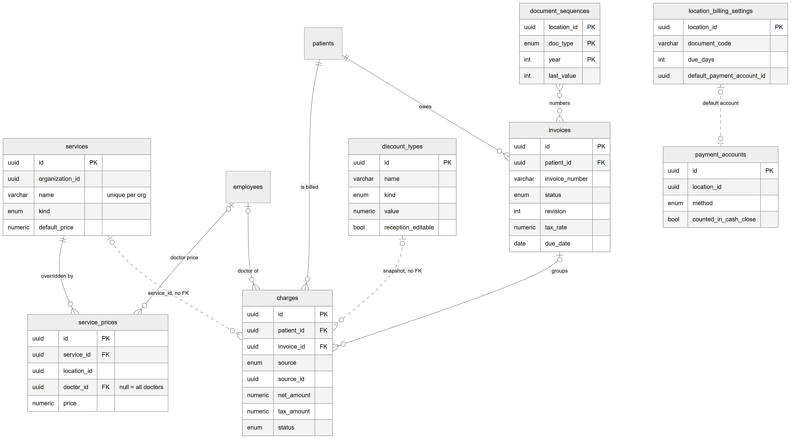

*Figure 34.15 — The pricing, charge and invoice tables.*

The diagram shows ten tables. `services` (id, organization_id, name unique per org, kind, default_price) is "overridden by" `service_prices` (id, service_id, location_id, doctor_id where empty means all doctors, price); `employees` links to `service_prices` as "doctor price". `charges` (id, patient_id, invoice_id, source, source_id, net_amount, tax_amount, status) is linked from `patients` ("is billed"), `employees` ("doctor of") and `invoices` ("groups"). Dotted lines with "no FK" connect `services` to `charges` (service_id) and `discount_types` (id, name, kind, value, reception_editable) to `charges` (snapshot). `patients` "owes" `invoices` (id, patient_id, invoice_number, status, revision, tax_rate, due_date). `document_sequences` (location_id, doc_type, year as primary key, last_value) is linked to `invoices` with a dotted "numbers" line. `location_billing_settings` (location_id, document_code, due_days, default_payment_account_id) has a dotted "default account" line to `payment_accounts` (id, location_id, method, counted_in_cash_close).

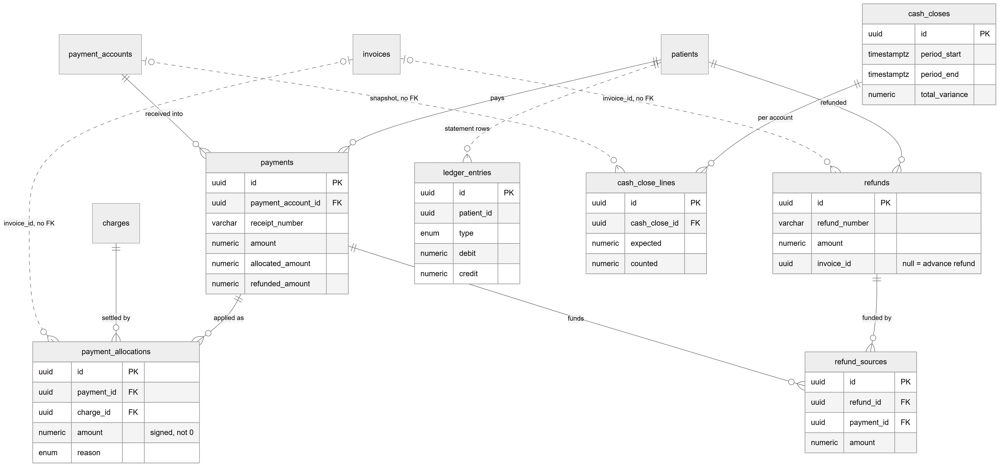

*Figure 34.16 — The money-movement tables.*

This diagram shows `payments` (id, payment_account_id, receipt_number, amount, allocated_amount, refunded_amount) linked from `patients` ("pays") and `payment_accounts` ("received into"). `payment_allocations` (id, payment_id, charge_id, amount signed and never zero, reason) hangs from `payments` ("applied as") and `charges` ("settled by"), with a dotted "invoice_id, no FK" line to `invoices`. `refunds` (id, refund_number, amount, invoice_id, empty for an advance refund) comes from `patients` and has a dotted line to `invoices`; `refund_sources` (id, refund_id, payment_id, amount) links each refund to the payments it drew from. `ledger_entries` (id, patient_id, type, debit, credit) is linked to `patients` by a dotted line. `cash_closes` (id, period_start, period_end, total_variance) owns `cash_close_lines` (id, cash_close_id, expected, counted), which reference `payment_accounts` by a dotted, no-FK line.

The relationships in words:

- Each service belongs to one organization; a service with price overrides cannot be deleted (`service_prices.service_id` ON DELETE RESTRICT). Overrides belong to one location and optionally one doctor (employee, RESTRICT).
- Each charge belongs to exactly one patient (RESTRICT), optionally one doctor (RESTRICT) and at most one invoice (RESTRICT). `invoice_id` empty means unbilled. `service_id`, `discount_type_id`, `source_id`, `encounter_id` and `appointment_id` are logical links without foreign keys; the charge keeps copies of description, price, kind and discount. One ACTIVE charge per (organization, source, source id) (`uq_charges_source`).
- Each invoice belongs to one patient (RESTRICT); its number is unique per organization.
- Each payment belongs to one patient and one payment account (RESTRICT); receipt number and `client_request_id` are unique per organization. The account name and method are copied onto the payment.
- Each allocation belongs to one payment and one charge (RESTRICT) and copies the charge's invoice id. Allocations are append-only: corrections are negative rows (`amount <> 0` check).
- Each refund belongs to one patient; `invoice_id` (no FK) is set only for invoice refunds. Each refund source belongs to one refund and one payment.
- `ledger_entries` is the append-only patient statement (types INVOICE_ISSUED, INVOICE_ADJUSTED, INVOICE_CANCELLED, PAYMENT, REFUND); it has no foreign keys.
- Each cash close belongs to one location and has one line per payment account, copying the account name.
- `document_sequences` has one row per organization, location, document type and year.
- `location_billing_settings` has one row per location (the location id is the key). `billing_audit_logs` stores every change; `expenses`, `credit_packages` and `patient_credits` are separate tables.

Money storage: billing amounts are `numeric(12,2)` rupee columns, read through a transformer that rounds via paisa; all arithmetic is integer paisa; commission amounts are `bigint` paisa. Expenses, credit packages and patient credits use `decimal(10,2)`. The general ledger journals in `billing/ledger/journal` are used by the lab finance modules, not by patient billing.

## 34.5 Status lifecycles

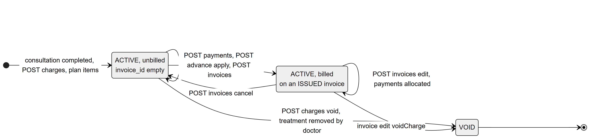

*Figure 34.17 — A charge: stored status ACTIVE or VOID, and whether it is on an invoice.*

The diagram has three boxes. A charge enters "ACTIVE, unbilled, invoice_id empty" when a consultation is completed, through `POST` charges, or from plan items. A self-loop on it says "PATCH charge, discount, needs price set". An arrow labelled "POST payments, POST advance apply, POST invoices" leads to "ACTIVE, billed on an ISSUED invoice", which has its own loop "POST invoices edit, payments allocated". An arrow "POST invoices cancel" goes back to unbilled. "POST charges void, treatment removed by doctor" leads from unbilled to "VOID", and "invoice edit voidCharge" leads from billed to "VOID", which ends.

The stored `status` has only two values, `ACTIVE` and `VOID`. VOID is final. Whether a charge is billed is not a status but the presence of `invoice_id`. Unbilled charges are changed directly; billed charges only through an invoice edit. A charge is "paid" when its allocated amount reaches net + tax; this too is computed.

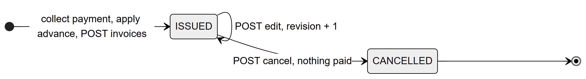

*Figure 34.18 — The stored invoice status.*

An invoice is born `ISSUED` by collecting a payment, applying advance or `POST /invoices`. "POST edit" keeps it ISSUED and raises the revision by one. "POST cancel, nothing paid" makes it `CANCELLED`, which is final. There is no draft state.

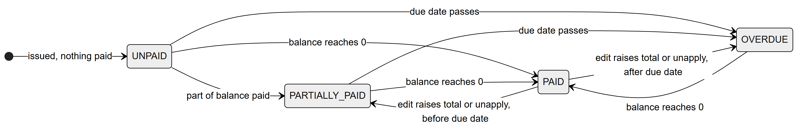

*Figure 34.19 — The computed payment status of an issued invoice.*

The diagram starts at UNPAID ("issued, nothing paid"). UNPAID goes to PARTIALLY_PAID when part of the balance is paid, to PAID when the balance reaches 0, and to OVERDUE when the due date passes. PARTIALLY_PAID goes to PAID or OVERDUE the same way. OVERDUE goes to PAID when the balance reaches 0. PAID goes back to PARTIALLY_PAID when an edit raises the total or an unapply happens before the due date, and to OVERDUE when that happens after the due date. The status is never stored; it is computed on each read from `balance_due`, `paid_amount`, `due_date` and the location's today. A cancelled invoice has no payment status. The due date never changes after issue.

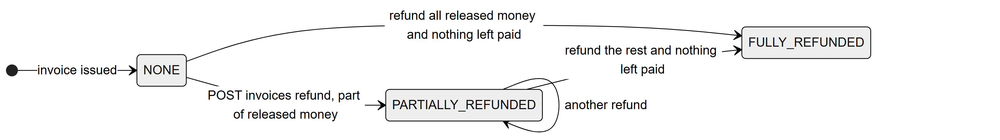

*Figure 34.20 — The computed refund status of an invoice.*

An invoice starts at NONE. "POST invoices refund, part of released money" moves it to PARTIALLY_REFUNDED, which loops on "another refund". It reaches FULLY_REFUNDED when all money released from the invoice has been refunded and nothing is left paid on it. Refunds themselves have no status column; a refund row is final once written.

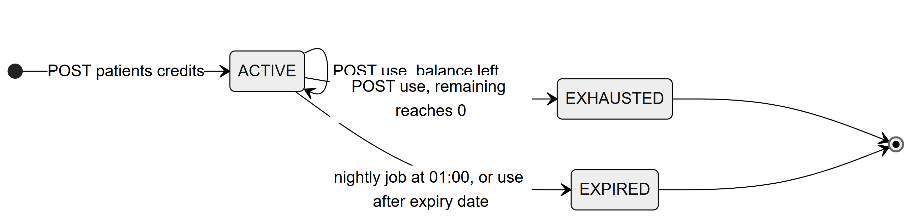

*Figure 34.21 — The lifecycle of a sold patient credit.*

A credit starts ACTIVE through `POST` patient credits. "POST use, balance left" keeps it ACTIVE; "POST use, remaining reaches 0" makes it EXHAUSTED; "nightly job at 01:00, or use after expiry date" makes it EXPIRED. Both end states are final.

Other objects have no lifecycle: payments, allocations, refunds, ledger entries and cash closes are written once and never change state (allocations are corrected by adding negative rows).

## 34.6 Connections to other modules

- **Queue and consultation (Chapters 30, 31).** Completing a visit creates charges in the same transaction. The queue board shows dues badges and a **Bill** button.
- **Patients (Chapter 28).** The Billing tab and the dues badge in the patient header. Patients with charges cannot be deleted (RESTRICT).
- **Treatment plans (Chapter 33).** Plan-to-charges and the plan billing summary exist in the API only.
- **Commissions (Chapter 35).** Charges snapshot the rate; collection, unapply and invoice edits write commission entries.
- **Dashboard and reports (Chapter 36).** Finance overview, profit and loss, doctor revenue and the dashboard read billing tables and expenses.
- **Locations (Chapter 9).** The location's timezone sets every clinic date; the location's tax rate is snapshotted on invoices.
- **Features and roles (Chapters 10, 11).** Five billing features; permissions listed per feature in 34.3.
- **Lab finance (Chapters 40, 42).** Expenses can point to lab orders; the general ledger journals are shared code.
- **Subscriptions (Chapter 45).** In read-only mode every billing write is refused.

## 34.7 Limitations and known gaps

- `billing.invoices` is off by default in the feature seed; a new clinic has no billing until it is enabled.
- No screen for: unapply, refund list, payment detail, resolved price, editing a price override, charges from a treatment plan, plan billing summary, credit packages and patient credits, editing an expense, daily financial summary.
- Because unapply has no screen, an invoice that has received any payment cannot be cancelled from the web app; it can only be edited (voiding lines moves the money to advance).
- The Payments sidebar item checks `billing.payment.collect` but the page checks `billing.invoice.view`.
- The billing desk's Outstanding section omits partly paid invoices.
- Expenses: no confirmation before delete, hard delete, no paging beyond 30 rows, no billing audit, update and delete not limited to the active location.
- Credit expiry uses the server's date, not the location's; selling or using credit is not linked to payments or charges.
- The "Show dues at check-in" switch is enforced only in the web app.
- Printed labels and amounts in words are English only; there is no server PDF.
- The invariant job only logs; nobody is alerted.
- The Accountant template has no discount permission; the Receptionist template cannot edit invoices or refund.

## 34.8 Owner's FAQ

**Can a receptionist change the price of a consultation?** No, not for a catalog service. The receptionist can apply a preset discount, within the range the type allows. Only a role with `billing.price.override` (Admin by default) can change a catalog price. "Other" charges and charges marked Needs price can be priced by anyone at the desk.

**What happens if a doctor completes a visit and the consultation fee service is not set?** The consultation charge is still created, at zero, with a "Needs price" badge. Reception must set a price before an invoice can be issued.

**What if a patient pays more than they owe?** The extra stays as advance. It is used on the next bill when "Use advance" is on, or can be refunded with **Refund advance**.

**Can an invoice be deleted?** No. It can be edited (each edit is a new revision with a reason) or cancelled while nothing is paid. Its number is never reused.

**Why does an invoice say Overdue?** It still has a balance and its due date (issue date plus the location's due days, 7 by default) is before the location's today. The status is computed, not stored.

**Where is the tax rate set, and does changing it change old invoices?** In the location's settings. Each invoice freezes the rate it was issued with; later edits keep using that frozen rate.

**What protects against double charging when the network retries?** Collect payment and refunds carry a client request id; a repeat with the same id returns the first result. Automatic charges use a unique index per source, so completing a visit twice never doubles them.

**Can two receptionists take the next invoice number at the same time?** Yes, safely. The counter row is locked until each transaction ends, so numbers stay unique and gapless.

**Where is the history of who changed what?** In `billing_audit_logs`, shown on the **Billing activity** page, with before and after snapshots and the reason.

**Does cash close stop the desk from taking payments?** No. A close only records a period; payments after it fall into the next close.
