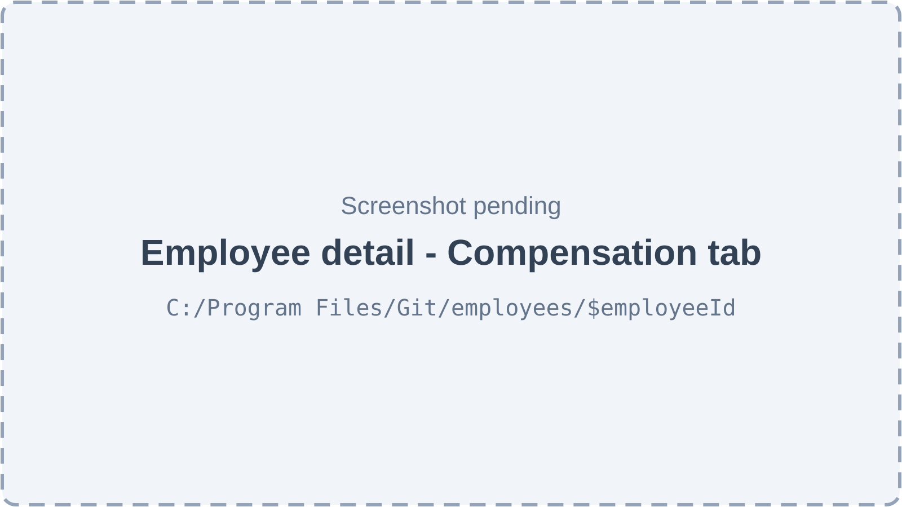
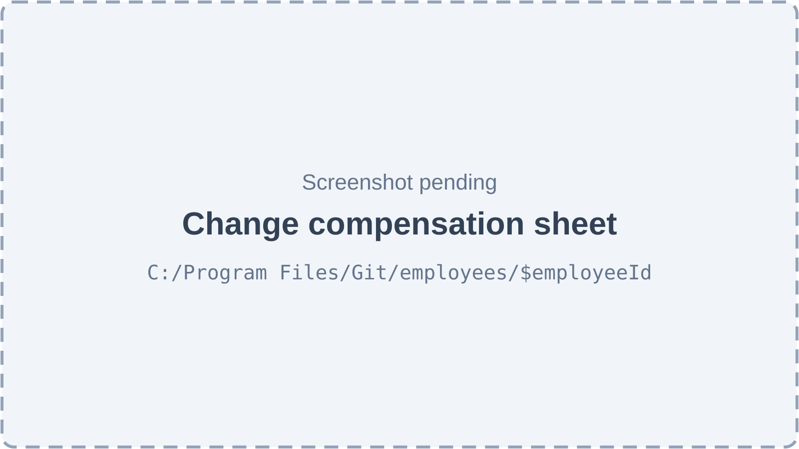
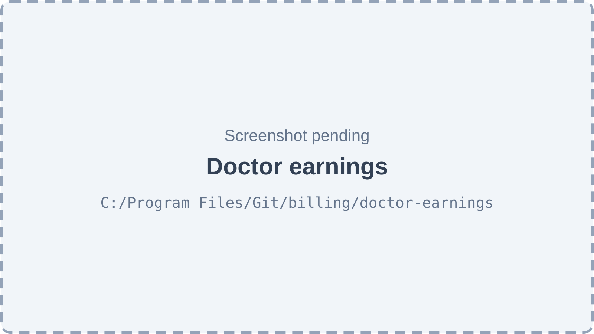
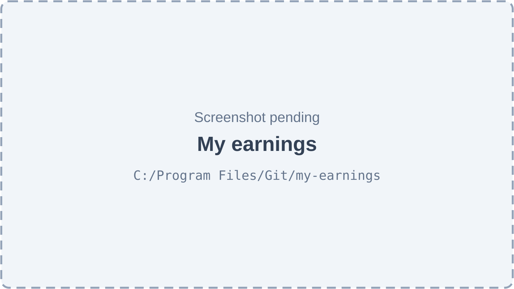
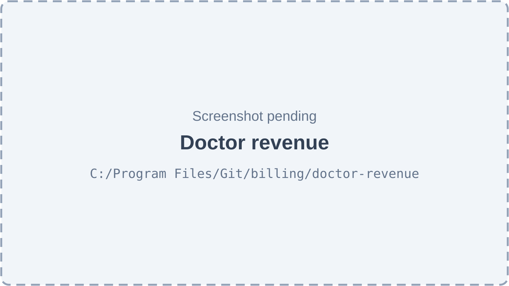
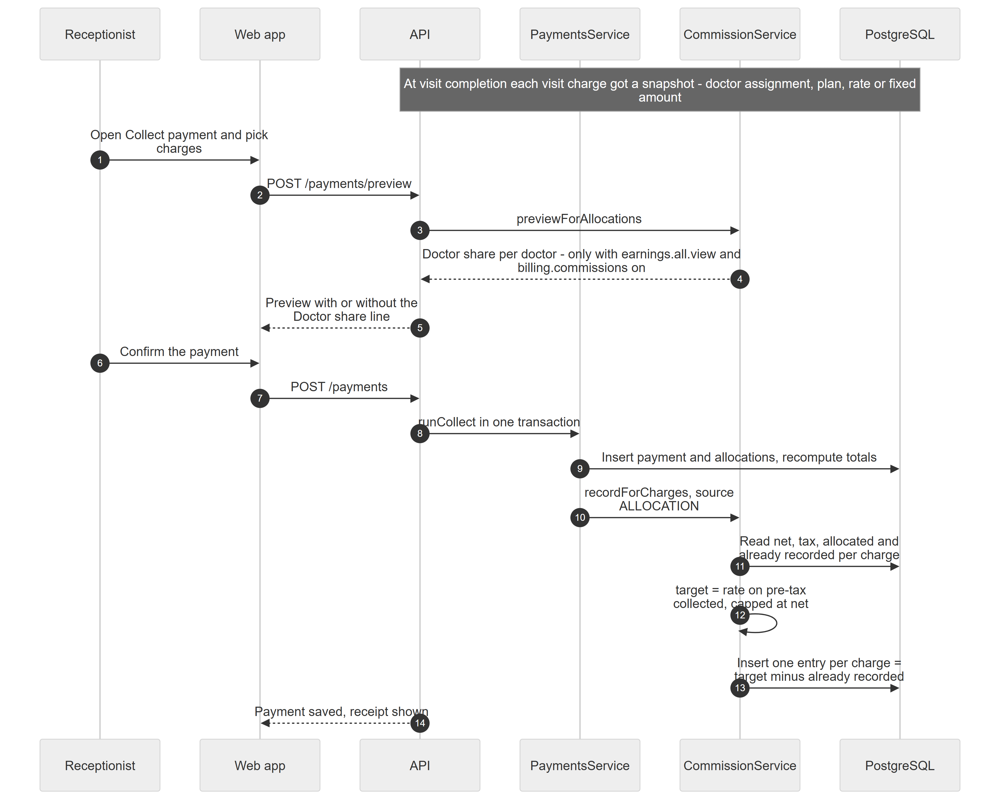
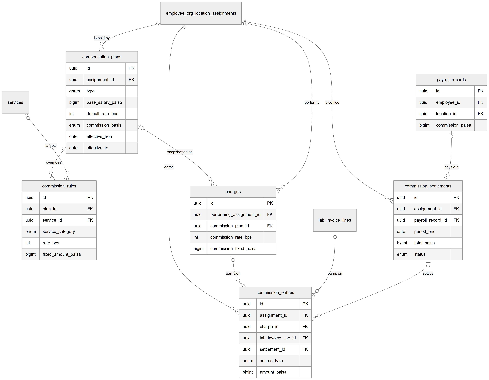
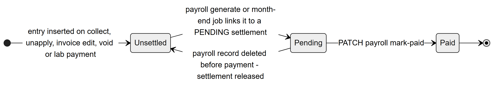
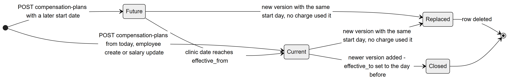

# Chapter 35 — Commissions

This chapter describes the Commissions module of the Platform: how a clinic decides how each staff member is paid (a monthly salary, a share of what patients pay for that person's work, or both), how the Platform works out that share automatically from billing, and how the share is paid out through payroll. It is written for the product owner, who needs to know exactly which rules the code enforces, where the money figures are stored and what is still missing. Commissions sit between Billing (Chapter 34), which produces the patient money, and Payroll (Chapter 38), which pays the staff.

## 35.1 What this module is for

A **compensation plan** says how one **assignment** (one employee at one location) is paid. It has one of three types: `SALARY` (shown as "Salaried"), `COMMISSION` ("Commission") or `SALARY_PLUS_COMMISSION` ("Both"). A plan with commission has a default rate and may have **commission rules**: overrides for one catalog service or one service category. Plans are versioned by date, so a change never alters what was already earned.

Commission is earned **on collection**, not on billing. When patient money is applied to a doctor's charge, the Platform writes a **commission entry** in an append-only ledger. At month end, payroll gathers the unsettled entries into a **settlement** and adds them to the payroll record. Commission is an internal clinic cost: it never appears on invoices, receipts or prints.

Who uses it:

- **Admin** and the **owner**: set and change compensation plans and overrides, see every doctor's earnings and the "Doctor share" line when collecting payment.
- **Accountant**: sees every doctor's earnings and the doctor share line, but cannot change plans.
- **Doctor**: sees only their own earnings on "My earnings".
- **Receptionist** and **Assistant**: no access by default. A receptionist collecting payment does not see the doctor share line.

Where it appears in the sidebar (labels from `nav.registry.ts`):

- **My earnings** (`nav.my_earnings`, route `/my-earnings`, needs `earnings.own.view`) in the Clinic section.
- **Doctor earnings** (`nav.reports.doctor_earnings`, route `/billing/doctor-earnings`, needs `earnings.all.view`) in Finance → Reports.
- **Doctor revenue** (`nav.reports.doctor_revenue`, route `/billing/doctor-revenue`, needs `reports.financial.view`) in Finance → Reports. This report is about billed and collected money per doctor, not commission, but it sits next to the earnings report and owners read them together.
- The compensation screens have no sidebar entry: they are the **Compensation** tab inside the employee detail page (`/employees/$employeeId`).

The module is controlled by the feature **`billing.commissions`** ("Doctor Commissions", off by default). All three commission permissions belong to it, so with the feature off nobody holds them. A second feature key, **`hr.commissions`** ("Commissions", off by default), exists in the feature catalog, but no permission, route or code checks it: it gates nothing. Salaries keep working with the feature off, because a salary is stored as a salary-only compensation plan.

## 35.2 Screens

*Figure 35.1 — Employee detail, Compensation tab (screenshot pending).*

The tab is shown on the employee detail page to users who hold `compensation.manage`. It has two cards. The first card, "Current compensation", shows the plan in force today at the location: Type (Salaried, Commission or Both), Monthly salary, Default commission as a percentage, "Commission on" ("Amount after discount" or "Amount before discount") and "Since" (the start date). Under these it lists "Service-wise overrides" as small badges such as "All procedures: 35%" or "Root canal: Rs 500 per charge", or the line "None — every service earns the default rate.". The card header has an **Edit overrides** button (only when the current plan earns commission) and a **Change plan** button (labelled **Set up compensation** when no plan is in force). With no plan in force, the card shows an empty state "No compensation in force". The second card, "Version history", is a table of every version, newest first, with columns Period (for example "1 Oct 2026 – now", with a "Current" badge), Type, Salary, Commission (for example "40% (net)") and Overrides (a count or "None").

*Figure 35.2 — The "Change compensation" slide-over sheet (screenshot pending).*

The sheet opens from the right with the title "Change compensation" and the explanation "Saves a new version from the chosen date. Charges already created keep the rate they were made with." It contains: "How is this person paid?" as a three-way switch (Salaried, Commission, Both; the two commission options are disabled with the hint "Commission needs a role that can consult patients." when the person's role cannot consult); "Monthly salary (Rs)" (hidden for Commission); "Default commission (%)" and "Commission on" ("After discount" / "Before discount"), both hidden for Salaried; "Service-wise overrides", an editor of rows where each row picks a service or one of "All consultations", "All procedures", "All other services", a percent-or-fixed switch and a value, with the hint "A service rule beats a category rule, which beats the default."; and "Effective from", a date picker that defaults to today at the location and cannot go before the current version's start. The footer shows "Unsaved changes" when the form is dirty, **Cancel** and **Save version** (disabled while invalid or saving). A second, smaller sheet, "Commission overrides", edits only the overrides of the current version and has a **Save overrides** button.

*Figure 35.3 — Doctor earnings report (screenshot pending).*

The page title is "Doctor earnings" with the subtitle "Commission is earned when patient money is applied to the doctor's charges. Internal — never shown to patients." A strip of five tiles shows Doctors, Collected, Commission earned, Settled and Pending for the chosen period. A toolbar offers the date presets Today, This month, Last month, Past 30 days and a custom range, shows the range as "from → to" and a small live dot while refreshing. The table has one row per doctor with the columns Doctor ("Dr." and the name), Plan (a badge), Collected, Earned, Settled and Pending. Negative amounts are shown in red. With no data the table says "No commission-earning doctors in this period."; a failed load shows an error state with a retry button.

*Figure 35.4 — A doctor's own earnings page (screenshot pending).*

"My earnings" has the subtitle "Your commission from patient payments on your work." It uses the same four money tiles (without the doctor count) and the same date presets. Its first table has one row per location where the doctor works, with the columns Location, Plan, Collected, Earned, Settled and Pending (empty message "You have no commission plan yet."). Under the heading "Commission lines" a second, paged table lists every ledger line in the period: Date, Patient (with the charge description and invoice number under the name), Why ("Payment", "Unapplied", "Invoice edited", "Charge voided" or "Adjustment"), Rate (a percentage or "Fixed"), Amount and Status ("Settled" or "Pending").

*Figure 35.5 — Doctor revenue report (screenshot pending).*

The page title is "Doctor revenue" with the subtitle "Billed by invoice date; collected by payment date (releases subtract)." Five tiles show Doctors, Billed, Discounts, Collected and Collected %. The same date toolbar is used. The table has the columns Doctor (or "No doctor" in italics for charges without a doctor), Billed, Discounts, Collected and Collected % (a coloured pill: green from 90%, amber from 50%, red below).

A sixth place shows commission without a screen of its own: in the billing desk's **Collect payment** panel, users who hold `earnings.all.view` see a "Doctor share" line with the commission this payment would record, split per doctor when more than one doctor is involved. The Billing chapter (Chapter 34) describes that panel.

## 35.3 Features

### 35.3.1 Set up or change a compensation plan

**Status:** [Implemented]

**What it does.** Creates a new version of how one assignment is paid, starting on a chosen clinic date. The version in force until then is closed on the day before.

**How the user does it.**
1. Open **Employees**, click an employee, and choose the **Compensation** tab.
2. Click **Change plan** (or **Set up compensation**).
3. Pick Salaried, Commission or Both; fill in the salary and/or default commission, the basis and any overrides.
4. Choose **Effective from** and click **Save version**.

**Behind the scenes — in simple terms.** Plans are kept as a dated history per assignment. A new version starts on its date and the old one ends the day before, so charges made under the old version keep the old rate. If the new version starts on the same day as the latest one, it replaces it, but only if no charge has used that version yet. Commission is allowed only for staff whose role can consult patients.

**Behind the scenes — technically.** `POST /assignments/:assignmentId/compensation-plans` → `CompensationPlansService.create` → `CompensationPlanVersions.add`, in one transaction. The service loads the assignment for the active organization and location (with its role), runs `validateFields` (type/field combination, rate 0–10000 basis points, salary whole paisa, date `YYYY-MM-DD`), checks `canConsult` (the role's permissions, expanded through implies, contain `consultation.conduct`) for commission types, and `validateRules`. It then locks the assignment row (`SELECT … FOR UPDATE`), reads the latest version and either refuses, deletes it (same start day, unused), or sets its `effective_to` to the day before. The new row is inserted with `created_by`; the PostgreSQL error 23P01 from the exclusion constraint `excl_compensation_plans_overlap` (GiST over `assignment_id` and `daterange(effective_from, effective_to, '[]')`) is mapped to `COMPENSATION_PLAN_OVERLAP`. The default start date is the location's clinic date (`BillingClock`). The response is the full overview (`GET` shape).

**Rules and validations.**
- Salaried: salary required, no rate, no overrides. Commission: rate required, no salary. Both: salary and rate required. The database repeats this rule as a check constraint.
- Rates are integer basis points (4000 = 40.00%), 0 to 10000. The web form accepts percentages with at most two decimals and converts them with integer maths.
- Money is integer paisa; the form accepts rupees with at most two decimals.
- The basis defaults to `NET` (after discount).
- A new version must start on or after the latest version's start. Same day replaces only an unused version.
- At most 200 overrides per version.
- The web app opens the Compensation tab only when the employee record carries an assignment at the active location.

**Who can do it.** `compensation.manage` (marked high-risk in the role editor; it implies `earnings.all.view`), feature `billing.commissions`. Default: Admin only.

**Data read and written.** Reads `employee_org_location_assignments`, `employment_roles`, `services`, `charges` (to test whether a version was used). Writes `compensation_plans`, `commission_rules`.

**Effects on other modules.** Charges created after the start date take their snapshot from the new version (35.3.4). Payroll reads the salary from the version in force at month end (Chapter 38). The employee list and detail show the salary from the current version.

**Error cases.**
- 422 `COMPENSATION_PLAN_INVALID` → wrong field combination, for example "A commission plan needs a default rate and no salary".
- 422 `COMMISSION_ROLE_CANNOT_CONSULT` → "Commission is only for staff whose role can consult patients".
- 422 `COMMISSION_RULE_INVALID` → a rule with no target or two targets, both or neither amount, a duplicate target, or "Unknown service in rules".
- 409 `COMPENSATION_PLAN_OVERLAP` → "A new version must start after the current one (2026-10-01)".
- 409 `COMPENSATION_PLAN_IN_USE` → "The current version already priced charges; start the new one on a later date".
- 404 `BILLING_NOT_FOUND` "Assignment not found" → the assignment is not at the active location.
- 403 `NO_PERMISSION`; 402 `SUBSCRIPTION_EXPIRED` in read-only mode.

**Technical references:** `backend/src/billing/commissions/compensation-plan-versions.ts` · `CompensationPlanVersions.add`, `CompensationPlansService.create` · `web-app/src/features/billing/components/compensation/CompensationSheet.tsx`

### 35.3.2 See the current plan and its version history

**Status:** [Implemented]

**What it does.** Shows the plan in force today, all earlier and future versions, and whether the person's role allows commission.

**How the user does it.**
1. Open the employee and choose the **Compensation** tab.

**Behind the scenes — in simple terms.** The server returns every version of the assignment, marks the one whose dates include today at the location as current, and adds service names to the overrides.

**Behind the scenes — technically.** `GET /assignments/:assignmentId/compensation-plans` → `CompensationPlansService.list`. Returns `today` (the location's clinic date), `canConsult`, `current` and `versions` (newest first, with rules and service names).

**Rules and validations.**
- `isCurrent` = `effective_from ≤ today` and (`effective_to` is empty or `≥ today`).

**Who can do it.** `compensation.manage`, feature `billing.commissions`. Default: Admin.

**Data read and written.** Reads `employee_org_location_assignments`, `employment_roles`, `compensation_plans`, `commission_rules`, `services`.

**Effects on other modules.** None.

**Error cases.** 404 "Assignment not found"; 403 `NO_PERMISSION`. The tab shows "Could not load compensation." with a retry button.

**Technical references:** `backend/src/billing/commissions/compensation-plans.controller.ts` · `CompensationPlansService.list` · `web-app/src/features/billing/components/compensation/CompensationTab.tsx`

### 35.3.3 Edit service-wise overrides (commission rules)

**Status:** [Implemented]

**What it does.** Replaces the overrides of one version without starting a new version. Each override names one catalog service or one service category (`CONSULTATION`, `PROCEDURE`, `OTHER`) and gives either a percentage or a fixed amount per charge.

**How the user does it.**
1. On the Compensation tab click **Edit overrides**.
2. Add, change or remove rows in "Commission overrides".
3. Click **Save overrides**.

**Behind the scenes — in simple terms.** The overrides decide the rate for each service: a rule for the exact service wins, then a rule for its category, then the plan's default rate. New overrides apply only to charges created from now on; charges already made keep their stored rate.

**Behind the scenes — technically.** `PUT /compensation-plans/:planId/rules` → `CompensationPlansService.replaceRules`: in one transaction it locks the plan row (`FOR UPDATE`, scoped to the organization), checks the assignment belongs to the active location, refuses salary-only plans and versions that ended before today, validates the rules, deletes all rules of the plan and inserts the new list.

**Rules and validations.**
- Exactly one target per rule (service or category) and exactly one amount (rate or fixed); database check constraints enforce both.
- One rule per service and one per category within a plan (partial unique indexes).
- Fixed amounts are paisa ≥ 0; rates 0–10000 basis points.
- A fixed amount is earned in full only when the charge is fully paid; partial payment earns the same fraction.
- Services must belong to the organization.

**Who can do it.** `compensation.manage`, feature `billing.commissions`. Default: Admin.

**Data read and written.** Reads `compensation_plans`, `services`. Writes `commission_rules` (delete + insert).

**Effects on other modules.** Only later charges' snapshots.

**Error cases.** 404 "Compensation plan not found"; 422 `COMPENSATION_PLAN_INVALID` "A salaried plan cannot have commission rules"; 409 `COMPENSATION_PLAN_CLOSED` "This version has ended; add a new version instead"; 422 `COMMISSION_RULE_INVALID`.

**Technical references:** `backend/src/billing/commissions/compensation-plans.service.ts` · `CompensationPlansService.replaceRules`, `resolveCommissionRate` · `web-app/src/features/billing/components/compensation/CommissionRulesEditor.tsx`

### 35.3.4 Snapshot the rate on each visit charge

**Status:** [Implemented] (backend only by design; no screen)

**What it does.** When a visit produces charges, each consultation or treatment charge records which doctor assignment performed it, which plan was in force on the visit's clinic date and the resolved rate or fixed amount. Later plan changes do not touch these stored values.

**How the user does it.** Nothing to do. The snapshot is taken automatically when the visit's charges are created at the end of the consultation, and again when an unbilled charge is moved to a different doctor.

**Behind the scenes — in simple terms.** The Platform writes the doctor's deal onto the charge at the moment the charge is born, like a price tag. Manual charges and charges without a doctor carry no deal and never earn.

**Behind the scenes — technically.** `CommissionService.snapshot` runs inside the charge-creation transaction of `ChargeSourcesService` (visit charges) and inside `ChargesService` when the doctor of an unbilled charge changes. It returns empty snapshots when there is no doctor or when `billing.commissions` is not enabled for the organization. Otherwise it finds the doctor's assignment at the active location, loads the version in force on the charge's clinic date (`CompensationPlanVersions.activeOn`) and resolves per charge with `resolveCommissionRate` (service → category → default; a `SALARY` plan resolves to nothing). Only charges whose source is `CONSULTATION` or `TREATMENT` get a snapshot. It sets four columns on `charges`: `performing_assignment_id`, `commission_plan_id`, `commission_rate_bps`, `commission_fixed_paisa`.

**Rules and validations.**
- Charges with a salary-only plan keep `performing_assignment_id` and `commission_plan_id` but no rate, so they never earn.
- If the doctor has no assignment at the location, or no version covers the date, the charge has no plan and never earns.
- Turning the feature off stops new snapshots; charges that already carry one keep recording commission when paid.

**Who can do it.** Whoever creates the charges (the consultation and billing flows); no commission permission is needed.

**Data read and written.** Reads `employee_org_location_assignments`, `compensation_plans`, `commission_rules`, `org_feature_flags` (through the feature service). Writes the four snapshot columns of `charges`.

**Effects on other modules.** Billing (Chapter 34) carries the columns but never shows them on invoices; audit snapshots strip them.

**Error cases.** None of its own.

**Technical references:** `backend/src/billing/commissions/commission.service.ts` · `CommissionService.snapshot` · no web-app use

### 35.3.5 Earn commission when patient money is applied

**Status:** [Implemented] (backend only by design)

**What it does.** Every time money on a doctor's charge changes, the Platform brings the charge's total commission up (or down) to the correct amount by inserting one signed entry in `commission_entries`.

**How the user does it.** Nothing to do. It happens when staff collect a payment, apply a patient's advance, unapply a payment, or edit or void an invoice.

Figure 35.6 shows the main path, a payment collection.

*Figure 35.6 — How collecting a payment writes commission entries.*

The diagram has six participants: Receptionist, Web app, API, PaymentsService, CommissionService and PostgreSQL. A note at the top says that, at visit completion, each visit charge received a snapshot with the doctor's assignment, plan and rate or fixed amount. In steps 1 to 5 the receptionist opens Collect payment and picks charges; the web app calls `POST /payments/preview`; the API asks CommissionService for `previewForAllocations`, which returns a doctor share per doctor only when the user holds `earnings.all.view` and `billing.commissions` is on; the web app shows the preview with or without the Doctor share line. In steps 6 to 9 the receptionist confirms, the web app calls `POST /payments`, the API runs `runCollect` in one transaction and PaymentsService inserts the payment and allocations and recomputes totals. In steps 10 to 13 PaymentsService calls `recordForCharges` with source `ALLOCATION`; CommissionService reads net, tax, allocated and already-recorded amounts for each charge, computes the target as the rate on the pre-tax collected amount capped at net, and inserts one entry per charge equal to the target minus what is already recorded. Step 14 returns the saved payment and receipt to the web app.

**Behind the scenes — in simple terms.** For each charge the Platform asks: "Given everything collected so far, how much commission should this charge have earned in total?" It then writes only the difference. That makes the ledger self-correcting: a second instalment adds a little more, an unapplied payment or a discount added later produces a negative entry, a voided charge brings the total back to zero, and running the same operation twice writes nothing the second time. Tax is never doctor revenue, so only the pre-tax part of what was paid counts.

**Behind the scenes — technically.** `CommissionService.recordForCharges(manager, chargeIds, source)` runs in the caller's money transaction under the caller's charge locks. It loads, per charge with a snapshot, `gross`, `net`, `tax` (all as paisa from `numeric(12,2)` columns), the plan's basis, the sum of `payment_allocations` and the sum of existing entries. The target comes from the pure function `commissionTarget` in `commission-math.ts`, using BigInt and half-away-from-zero rounding:

- collected = allocated (no tax) or round(allocated × net ÷ (net + tax)), capped at net; a `VOID` charge has net 0.
- Rate, `NET` basis: round(collected × rate ÷ 10000).
- Rate, `GROSS` basis: round(collected × gross × rate ÷ (net × 10000)), so the clinic absorbs the discount.
- Fixed amount: round(fixed × collected ÷ net).

The callers and source types are: `PaymentsService` collect and apply-advance (`ALLOCATION`, source id = the new payment, else an operation id), `PaymentsService.unapply` (`UNAPPLY`), and `InvoicesService.runEdit` (`CHARGE_ADJUST`, turned into `VOID` for a voided charge). Each entry stores `base_paisa` (collected so far), `rate_bps` and the signed `amount_paisa`. Invoice cancel needs no call because it is refused while the invoice has payments.

**Rules and validations.**
- One entry per (source type, source id, charge) (unique index `uq_commission_entries_source`).
- Commission is never added to charge or invoice totals.
- Entries already settled are never changed: a reversal after settlement simply lands, as a negative entry, in the next settlement.
- Overpayment beyond net goes to the patient's advance and never counts as collected.
- The `labCostPaisa` input of `commissionTarget` is not used for ordinary charges; only lab invoice lines use it (35.3.6).

**Who can do it.** Whoever performs the money operation (`billing.payment.collect`, `billing.invoice.edit`, and so on); the ledger itself needs no permission.

**Data read and written.** Reads `charges`, `compensation_plans`, `payment_allocations`, `commission_entries`. Writes `commission_entries` (insert only).

**Effects on other modules.** Feeds the earnings reports, the "Doctor commissions" report and the commission columns of other reports (Chapter 36), the finance overview, and payroll settlement (Chapter 38).

**Error cases.** None user-visible; an error rolls back the whole money operation.

**Technical references:** `backend/src/billing/commissions/commission-math.ts` · `CommissionService.recordForCharges`, `commissionTarget` · no web-app use

### 35.3.6 Earn commission on lab work (lab-line commissions)

**Status:** [Implemented] (backend only by design)

**What it does.** When lab work is billed to a patient on a **patient lab invoice**, the doctor named on each lab invoice line earns commission on what the patient pays for it, minus what the lab charged the clinic.

**How the user does it.** Nothing to do. It happens when a patient lab invoice is issued, paid, has advance applied, has a payment reversed, or receives a credit note.

**Behind the scenes — in simple terms.** For lab work, the doctor's share is calculated on the clinic's margin, not on the full price: if the patient pays for a crown and the lab charged the clinic part of that, only the remainder earns commission. The same "write only the difference" rule applies, so instalments and reversals correct themselves.

**Behind the scenes — technically.** `LabFinanceListeners` subscribe to lab-billing events inside the money transaction. On `invoiceIssued`, `LabCommissionService.snapshot` sets the same four snapshot columns on each non-void `lab_invoice_lines` row that has a doctor (plan in force on the issue date; a line without a mapped service counts as a `PROCEDURE`). On payment collected and advance applied (`ALLOCATION`), payment reversed (`UNAPPLY`) and credit note issued (`CHARGE_ADJUST`), `recordForInvoices` computes per line with `labLineCommissionTarget`: the invoice's net is its total minus credit notes (0 if void); each line's share of net and of collected money is proportional to its pre-tax amount; then `commissionTarget` runs with `labCostPaisa`. The lab cost is the item's cost from approved vendor bill lines (else its frozen snapshot) for a lab item line, the charge amount for an order-level charge passed on to the patient, and 0 for manual lines. With a lab cost, the rate applies to max(net − lab cost, 0) (or gross − lab cost on the `GROSS` basis); a fixed amount is not reduced. Entries go into the same `commission_entries` table with `lab_invoice_line_id` instead of `charge_id`, and the lab receivables ledger posts a journal "Doctor commission on lab work" (Commission Expense / Commission Payable).

**Rules and validations.**
- Each entry targets exactly one of a charge or a lab invoice line (check constraint `chk_commission_entries_target`).
- One entry per (source type, source id, lab line) (partial unique index).
- Nothing is snapshotted while `billing.commissions` is off; such lines never earn.

**Who can do it.** Whoever runs the lab billing operation (`lab.billing.manage` and related permissions, Chapter 42).

**Data read and written.** Reads `lab_invoice_lines`, `lab_invoices`, `lab_payment_allocations`, `order_charge_requests`, vendor bill and lab order item costs, `compensation_plans`. Writes `lab_invoice_lines` (snapshot), `commission_entries`, lab ledger journal rows.

**Effects on other modules.** Lab commission appears on My earnings, in settlements and payroll exactly like charge commission. The "Collected" column of the earnings reports counts only ordinary charges, not lab invoices.

**Error cases.** None user-visible.

**Technical references:** `backend/src/lab-finance/lab-commission.service.ts` · `LabCommissionService.recordForInvoices`, `labLineCommissionTarget` · no web-app use

### 35.3.7 Preview the doctor share while collecting payment

**Status:** [Implemented]

**What it does.** Shows, before a payment is saved, how much commission it would record, per doctor.

**How the user does it.**
1. On the billing desk, open **Collect payment** for a patient and choose what to pay.
2. Read the "Doctor share" line in the summary (only for users who may see earnings).

**Behind the scenes — in simple terms.** The server runs the same calculation as the real recording, on a "what if" basis, without saving anything.

**Behind the scenes — technically.** `POST /payments/preview` fills `doctorShare` only when the caller's access context can `earnings.all.view` and `billing.commissions` is enabled; otherwise `doctorShare` is `null`. `CommissionService.previewForAllocations` adds the planned allocation amounts to each charge, uses the tax share of charges that will be invoiced by this payment, and groups the differences per assignment with the doctor's name.

**Rules and validations.** Read-only; the frontend never computes commission itself.

**Who can do it.** `earnings.all.view`, feature `billing.commissions`. Default: Admin, Accountant. A Receptionist collects payment without seeing it.

**Data read and written.** Reads `charges`, `compensation_plans`, `payment_allocations`, `commission_entries`, `employees`.

**Effects on other modules.** None.

**Error cases.** None of its own.

**Technical references:** `backend/src/billing/payments/payments.service.ts` · `CommissionService.previewForAllocations` · `web-app/src/features/billing/components/collect-payment/CollectSummary.tsx`

### 35.3.8 See every doctor's earnings

**Status:** [Implemented]

**What it does.** Lists, per doctor at a location, the money collected on their charges, the commission earned, the part already settled and the part pending, for a date range.

**How the user does it.**
1. Open **Finance → Reports → Doctor earnings**.
2. Pick a date preset or a custom range.

**Behind the scenes — in simple terms.** For each assignment that has a commission plan or any commission entry, the server adds up collections and ledger entries written in the period, and splits the earned total into settled and pending.

**Behind the scenes — technically.** `GET /reports/doctor-earnings?from&to&locationId` → `CommissionReportsService.doctorEarnings`. The range is clinic dates at the location, converted to UTC instants; the default is the first of the current month to today. *Collected* = sum of `payment_allocations` created in the range on charges whose `performing_assignment_id` is the assignment; *earned* = sum of entries created in the range; *settled* = the part with a `settlement_id`; *pending* = earned − settled. The plan type shown is the version in force today. Another location of the organization can be requested with `locationId`, but only if the caller also holds `earnings.all.view` there (resolved like any request at that location). `GET /commissions?assignmentId&locationId&from&to` returns the raw ledger lines of a location (at most 1000, newest first); no screen calls it.

**Rules and validations.**
- Only assignments with a non-salary plan or with entries are listed.
- The web page does not offer the location switch.

**Who can do it.** `earnings.all.view`, feature `billing.commissions`. Default: Admin, Accountant.

**Data read and written.** Reads `employee_org_location_assignments`, `employees`, `locations`, `compensation_plans`, `payment_allocations`, `charges`, `commission_entries`.

**Effects on other modules.** None.

**Error cases.** 404 "Location not found" (another organization's location); 403 `NO_PERMISSION` "You cannot see earnings at that location".

**Technical references:** `backend/src/billing/commissions/commission-reports.service.ts` · `CommissionReportsService.doctorEarnings`, `entries` · `web-app/src/features/billing/pages/CommissionPages.tsx`

### 35.3.9 See my own earnings

**Status:** [Implemented]

**What it does.** Shows a doctor their own collected, earned, settled and pending amounts per location in the organization, and every ledger line behind them.

**How the user does it.**
1. Open **My earnings** in the sidebar.
2. Pick a date preset or a custom range.

**Behind the scenes — in simple terms.** The server filters by the signed-in user's own assignments. A doctor can never see another doctor's figures through this page.

**Behind the scenes — technically.** `GET /me/earnings?from&to&locationId` → `CommissionReportsService.myEarnings`: the same earnings query filtered on `a.user_id = signed-in user` across the organization, plus up to 1000 ledger lines (`entryRows`), which join both charges and lab invoice lines to show description, patient and invoice number. The date range uses the active location's timezone.

**Rules and validations.** Only the caller's assignments; optional filter by location.

**Who can do it.** `earnings.own.view`, feature `billing.commissions`. Default: Doctor; Admin and Accountant also hold it through `earnings.all.view`.

**Data read and written.** Reads the same tables as 35.3.8 plus `patients`, `invoices`, `lab_invoice_lines`, `lab_invoices`.

**Effects on other modules.** None.

**Error cases.** 403 `NO_PERMISSION`.

**Technical references:** `backend/src/billing/commissions/commissions.controller.ts` · `CommissionReportsService.myEarnings` · `web-app/src/features/billing/pages/CommissionPages.tsx`

### 35.3.10 See doctor revenue (billed and collected per doctor)

**Status:** [Implemented]

**What it does.** Shows, per doctor, the net amount billed on issued invoices, the discounts given and the pre-tax money collected in a period.

**How the user does it.**
1. Open **Finance → Reports → Doctor revenue** and pick a period.

**Behind the scenes — in simple terms.** Billed counts invoices by their issue date; collected counts payments by payment date, and money released back to advance subtracts.

**Behind the scenes — technically.** `GET /billing/reports/doctor-revenue?from&to` → `BillingReportsService.doctorRevenue`: one SQL with a `billed` part (active charges on `ISSUED` invoices, `issue_date` in range, grouped by `charges.doctor_id`) and a `collected` part (pre-tax share of `payment_allocations` created in the range), joined to `employees`. It does not read commission tables.

**Rules and validations.** Active location only; amounts in rupees (numeric columns).

**Who can do it.** `reports.financial.view`, feature `reports.financial` (off by default). Default: Accountant (scope `location`), Admin.

**Data read and written.** Reads `charges`, `invoices`, `payment_allocations`, `employees`.

**Effects on other modules.** None.

**Error cases.** 403 `NO_PERMISSION`.

**Technical references:** `backend/src/billing/reports/billing-reports.service.ts` · `BillingReportsService.doctorRevenue` · `web-app/src/features/billing/pages/BillingReportsPages.tsx`

### 35.3.11 Settle commission through payroll

**Status:** [Implemented]

**What it does.** At payroll generation, collects all unsettled commission entries of an assignment up to the end of the month into one settlement linked to that month's payroll record. Paying the payroll record pays the settlement; deleting an unpaid payroll record releases the entries.

**How the user does it.**
1. Generate payroll (on **Payroll**, or automatically on the 1st of the month).
2. Mark the payroll record as paid with **Mark as Paid**.

**Behind the scenes — in simple terms.** Payroll locks the doctor's unsettled ledger lines so they cannot be paid twice, adds their total to the payroll record and ties them to a settlement. If the doctor's unsettled lines add up to a negative number (only reversals), nothing is settled; the negative amount waits and reduces the next month's commission.

**Behind the scenes — technically.** `CommissionSettlements.lockUnsettled` selects entries of the assignment with `settlement_id IS NULL` and `created_at` before the end of the month's last clinic day (location timezone), `FOR UPDATE`. If at least one entry exists and the total is ≥ 0, `CommissionSettlements.create` inserts a `PENDING` row in `commission_settlements` (period start and end, total, payroll record id) and sets `settlement_id` on the entries. `PayrollService.markPaid` calls `CommissionSettlements.markPaid` in the same transaction (status `PAID`, `paid_at`, `paid_by`). `PayrollService.remove` calls `CommissionSettlements.release`: for a `PENDING` settlement it clears `settlement_id` on its entries and deletes the settlement; for a `PAID` one deletion of the payroll record is refused. The month-end flow is drawn in Chapter 38 (Figure 38.6).

**Rules and validations.**
- An entry can be in only one settlement (row locks plus `settlement_id IS NULL` on update).
- Settlement amounts are signed paisa; entries keep their amounts.
- Only active assignments at the location are processed by payroll.

**Who can do it.** `payroll.manage`, feature `hr.payroll`. Default: Admin.

**Data read and written.** Writes `commission_settlements`, `commission_entries.settlement_id`, `payroll_records`.

**Effects on other modules.** Settled and Pending columns of the earnings pages; payroll record commission amount, payslip and CSV.

**Error cases.** 400 "This payroll paid out commission and cannot be deleted".

**Technical references:** `backend/src/billing/commissions/commission-settlements.ts` · `CommissionSettlements.lockUnsettled`, `create`, `markPaid`, `release` · `web-app/src/features/employees/pages/PayrollPage.tsx`

### 35.3.12 Protect the ledger (append-only trigger and invariant I10)

**Status:** [Implemented] (backend only by design)

**What it does.** Makes sure commission history cannot be rewritten and that the ledger always matches the money.

**How the user does it.** Nothing to do. Violations appear only in the server logs.

**Behind the scenes — in simple terms.** The database itself refuses to delete commission lines or change their amounts. Every night a separate check recomputes, for every charge with a snapshot, what the commission should be and compares it with the sum in the ledger.

**Behind the scenes — technically.** The migration `DoctorCompensation1792403456699` creates the function `commission_entries_append_only()` and the trigger `trg_commission_entries_append_only` (BEFORE UPDATE OR DELETE): deletes raise "commission_entries is append-only: delete refused"; any change to the listed columns raises "only settlement_id may change"; `settlement_id` may move from a value back to NULL only while that settlement is `PENDING`. Invariant **I10** in `BillingInvariantChecker` recomputes the target in SQL numeric (deliberately not reusing `commission-math.ts`) and reports each charge whose recorded sum differs. `BillingInvariantJob` runs all invariants (I1–I10) every day at 02:30 server time, where scheduled jobs run, and only logs; nothing is repaired automatically. The same check is part of the per-patient invariant run.

**Rules and validations.**
- I10 covers charges only, not lab invoice lines.

**Who can do it.** Not applicable.

**Data read and written.** Reads `charges`, `compensation_plans`, `payment_allocations`, `commission_entries`.

**Effects on other modules.** None.

**Error cases.** A refused update raises a database error inside the operation, which rolls back.

**Technical references:** `backend/src/migrations/1792403456699-doctor-compensation.ts` · `BillingInvariantChecker.checkCommissions`, `BillingInvariantJob.run` · no web-app use

### 35.3.13 Choose a commission plan when adding an employee

**Status:** [Implemented]

**What it does.** Lets the first compensation version of a new employee be a commission or salary-plus-commission plan, instead of the default salaried plan.

**How the user does it.**
1. On **Employees**, click **Add Employee**.
2. In the "Compensation" section (shown only to users with `compensation.manage`), pick Salaried, Commission or Both and enter the rate and basis.
3. Save the employee.

**Behind the scenes — in simple terms.** Every new assignment gets a first plan version starting on the joining date. Without the compensation step it is a salaried plan with the entered salary (or zero).

**Behind the scenes — technically.** `POST /employees` with an optional `compensation` object; `EmployeesService.initialPlan` validates it before anything is saved, refuses commission types with 403 `COMMISSIONS_DISABLED` when `billing.commissions` is off and checks the role can consult. The plan is added in the same transaction as the assignment. The Employees chapter (Chapter 37) covers the rest of the create flow.

**Rules and validations.** As in 35.3.1; Both requires a salary.

**Who can do it.** `employees.manage` plus `compensation.manage` for the commission options. Default: Admin.

**Data read and written.** Writes `compensation_plans`, `commission_rules`.

**Effects on other modules.** As in 35.3.1.

**Error cases.** 403 `COMMISSIONS_DISABLED` "Doctor commissions are not enabled"; 422 `COMMISSION_ROLE_CANNOT_CONSULT`.

**Technical references:** `backend/src/employees/employees.service.ts` · `EmployeesService.initialPlan` · `web-app/src/features/employees/components/EmployeeForm.tsx`

### 35.3.14 Manual commission adjustments

**Status:** [Not implemented]

**What it does.** Nothing today. The source type `MANUAL` ("Reserved for an admin correction") exists in the enum and the web app has a label "Adjustment" for it, but no endpoint or service writes a `MANUAL` entry.

**How the user does it.** Not available.

**Behind the scenes — in simple terms.** Corrections happen only through the money operations themselves.

**Behind the scenes — technically.** `CommissionSourceType.MANUAL` is never used as a write source.

**Rules and validations.** None.

**Who can do it.** Not applicable.

**Data read and written.** None.

**Effects on other modules.** None.

**Error cases.** None.

**Technical references:** `backend/src/billing/commissions/commission.enums.ts` · `CommissionSourceType.MANUAL` · `web-app/src/features/billing/pages/CommissionPages.tsx`

## 35.4 Entities and data model

*Figure 35.7 — Compensation plans, rules, the commission ledger and settlements.*

The diagram has `employee_org_location_assignments` at the top. From it, solid lines go to `compensation_plans` ("is paid by"), `charges` ("performs", optional), `commission_entries` ("earns") and `commission_settlements` ("is settled"). `compensation_plans` shows `id`, `assignment_id`, `type`, `base_salary_paisa`, `default_rate_bps`, `commission_basis`, `effective_from` and `effective_to`; it links to `commission_rules` ("overrides") and, optionally, to `charges` ("snapshotted on"). `services` links optionally to `commission_rules` ("targets"). `commission_rules` shows `plan_id`, `service_id`, `service_category`, `rate_bps` and `fixed_amount_paisa`. `charges` shows its four snapshot columns. At the bottom, `commission_entries` shows `assignment_id`, `charge_id`, `lab_invoice_line_id`, `settlement_id`, `source_type` and `amount_paisa`, and receives optional links from `charges` and `lab_invoice_lines` (both "earns on") and from `commission_settlements` ("settles"). On the right, `payroll_records` (with `commission_paisa`) is linked one-to-one, optionally, with `commission_settlements` ("pays out"), which shows `assignment_id`, `payroll_record_id`, `period_end`, `total_paisa` and `status`.

The relationships in words:

- Each compensation plan belongs to exactly one assignment. Deleting the assignment deletes its plans (ON DELETE CASCADE). Versions of one assignment never overlap (GiST exclusion constraint, which needs the `btree_gist` extension the migration creates).
- Each commission rule belongs to one plan (CASCADE) and targets either one service (CASCADE when the service is deleted) or one category.
- A charge points to the performing assignment and the plan it was snapshotted with. These are plain columns on `charges`; the snapshot does not change when the plan changes.
- Each commission entry belongs to one assignment and earns on exactly one charge or one lab invoice line. The assignment, charge, lab line and settlement links are ON DELETE RESTRICT, so none of them can be deleted while entries point to them.
- Each settlement belongs to one assignment (RESTRICT) and to at most one payroll record (one-to-one, RESTRICT); a payroll record has at most one settlement.
- Money columns are integer paisa (`bigint`): `base_salary_paisa`, `fixed_amount_paisa`, `amount_paisa`, `base_paisa`, `total_paisa`. Rates are integer basis points. `charges` amounts themselves are numeric rupee columns, converted exactly to paisa in SQL.
- Indexes: plans by assignment and start; entries by assignment and time, by charge, by lab line, and a partial index on unsettled entries per assignment; settlements by assignment and period end.

The migration also backfilled one `SALARY` plan per existing assignment from the deprecated `gross_salary` column, effective from the joining date.

## 35.5 Status lifecycles

### 35.5.1 Commission entry and settlement

*Figure 35.8 — The life of a commission entry, from earning to payout.*

The diagram has three states. An entry starts as **Unsettled** when it is inserted on a collection, unapply, invoice edit, void or lab payment. It moves to **Pending** when payroll generation or the month-end job links it to a `PENDING` settlement. From Pending, two arrows leave: back to Unsettled when the payroll record is deleted before payment and the settlement is released, and forward to **Paid** through `PATCH /payroll/:id/mark-paid`. Paid leads to the end marker.

Walking through each state:

- **Unsettled** — `settlement_id` is NULL. The entry counts as "Pending" on the earnings pages. A net-negative group of unsettled entries stays here and offsets the next month.
- **Pending** — the entry points to a settlement whose status is `PENDING`; the earnings pages count it as "Settled" already, although the money is not yet paid.
- **Paid** — the settlement is `PAID`; the entry can never be released again (the trigger refuses).

The entry's amount never changes in any state. The two stored settlement statuses are `PENDING` and `PAID`.

### 35.5.2 Compensation plan versions

*Figure 35.9 — How a compensation plan version is created, becomes current, and ends.*

The diagram shows four states. A version enters as **Future** when it is created with a later start date, or as **Current** when it starts today (from the Compensation tab, from employee creation, or from a salary update). Future becomes Current when the clinic date reaches `effective_from`. Current becomes **Closed** when a newer version is added and its `effective_to` is set to the day before. Future or Current becomes **Replaced** when a new version with the same start day is saved and no charge has used it; the replaced row is deleted. Closed and Replaced lead to the end marker.

These states are not stored: the code derives "current" from the dates and the clinic date (`isCurrent`). Overrides of a Closed version cannot be edited (`COMPENSATION_PLAN_CLOSED`).

## 35.6 Connections to other modules

- **Employees (Chapter 37).** Plans hang from assignments. Creating an employee creates the first version; "Update Salary" on the employee page adds a new version from today and carries over the commission settings. The role decides whether commission is allowed (`consultation.conduct`).
- **Consultation (Chapter 31) and Billing (Chapter 34).** Visit charges take the snapshot when created; collect, apply advance, unapply and invoice edit write ledger entries in the same transaction. The billing desk shows the doctor share to authorised users.
- **Lab finance (Chapter 42).** Patient lab invoice lines earn commission on the margin over lab cost and post a commission journal.
- **Payroll (Chapter 38).** Settles entries monthly, pays settlements, releases them on delete.
- **Dashboard and reports (Chapter 36).** The "Doctor commissions" report (staff category) and commission columns in revenue and cost reports and the finance overview read `commission_entries`.
- **Features and roles (Chapters 10 and 11).** `billing.commissions` must be entitled and enabled; the three permissions are dropped when it is off.

## 35.7 Limitations and known gaps

- `hr.commissions` is a feature key that gates nothing; only `billing.commissions` matters.
- No `MANUAL` adjustment path exists, although the enum and UI label do.
- `GET /commissions` (raw ledger of a location) has no screen; an admin can see per-doctor totals on "Doctor earnings" but not the individual ledger lines of other doctors.
- The earnings reports' "Collected" column counts ordinary charges only; lab invoice collections are not included, while lab commission is.
- Invariant I10 checks ordinary charges only; lab-line commission has no nightly check.
- The append-only trigger was written before lab lines existed; its list of frozen columns does not include `lab_invoice_line_id`.
- Settlement covers only active assignments: commission of a deactivated doctor stays unsettled until the assignment is reactivated.
- Turning `billing.commissions` off stops new snapshots, but charges that already have one keep earning.
- The Compensation tab trigger is shown whenever the user holds `compensation.manage`, but its content appears only if the employee record has an assignment at the active location.
- Plan and rule changes are not written to the general audit log; versions keep `created_by` only.

## 35.8 Owner's FAQ

**If I raise a doctor's rate today, does last month's commission change?** No. Each charge keeps the rate stored when it was created. Only charges created after the new version starts use the new rate.

**When exactly does a doctor earn?** When patient money is applied to the doctor's charge, not when the invoice is issued. Half paid means half the commission.

**What happens if a payment is reversed after the commission was paid out in payroll?** The reversal writes a negative entry. It is settled with next month's payroll and reduces that month's commission. If the doctor has only negative entries, nothing is settled and the balance waits.

**Does tax count towards commission?** No. Only the pre-tax part of what the patient paid counts.

**Can a receptionist see how much the doctor gets from a payment?** Not with the default role. The doctor share appears only to users with `earnings.all.view` (Admin, Accountant by default).

**Can a doctor see another doctor's earnings?** No. "My earnings" is filtered on the signed-in user's own assignments on the server.

**Can an assistant or hygienist be on commission?** Only if their role holds `consultation.conduct`. Otherwise the commission options are disabled and the server refuses with `COMMISSION_ROLE_CANNOT_CONSULT`.

**Where is commission stored?** In `commission_entries`, one signed row per change, in paisa. The database refuses deletes and amount changes.

**What is the difference between "after discount" and "before discount"?** After discount (`NET`) means the doctor shares the discount. Before discount (`GROSS`) means the clinic absorbs it and the doctor earns as if no discount had been given.
