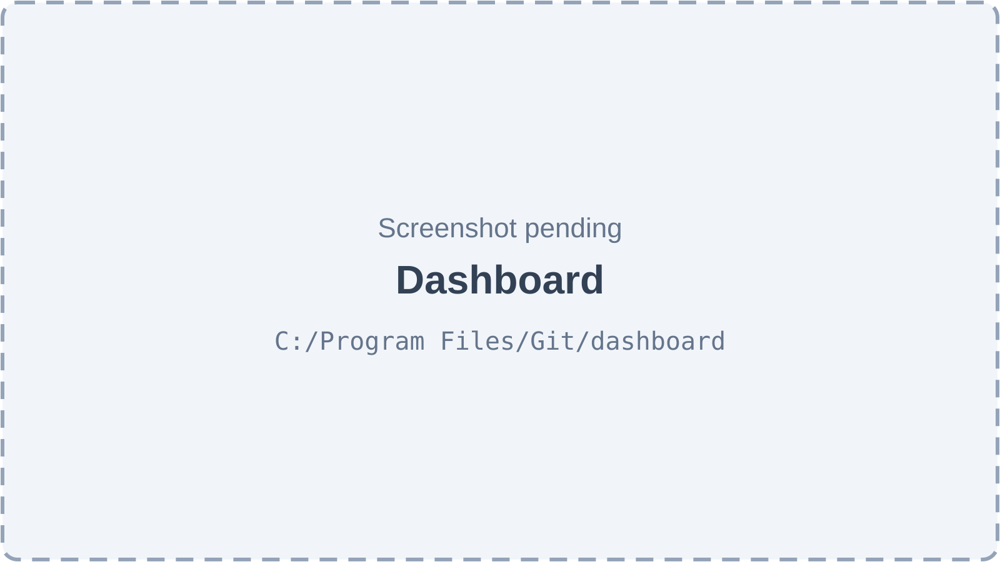
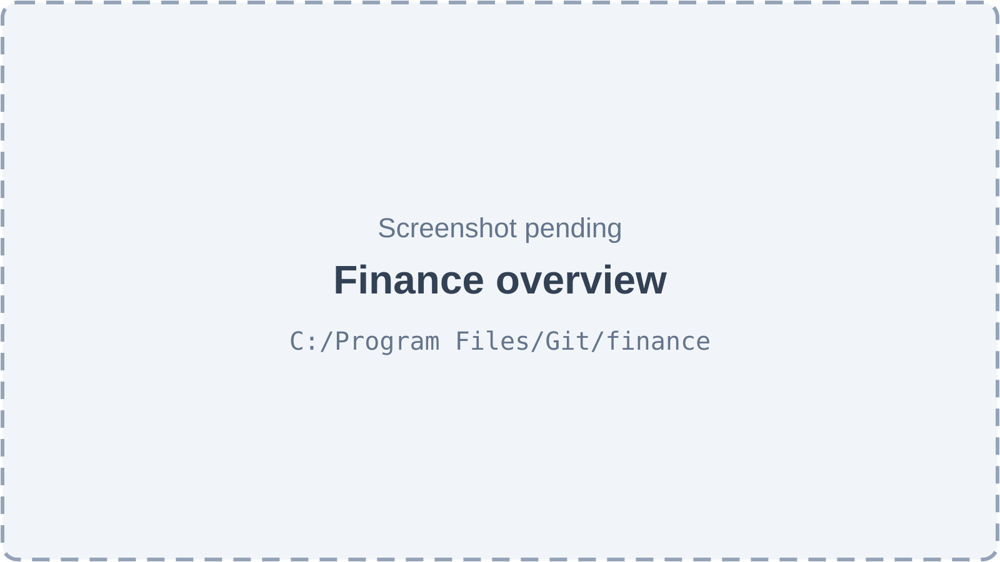
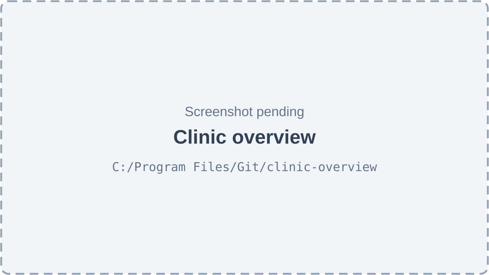
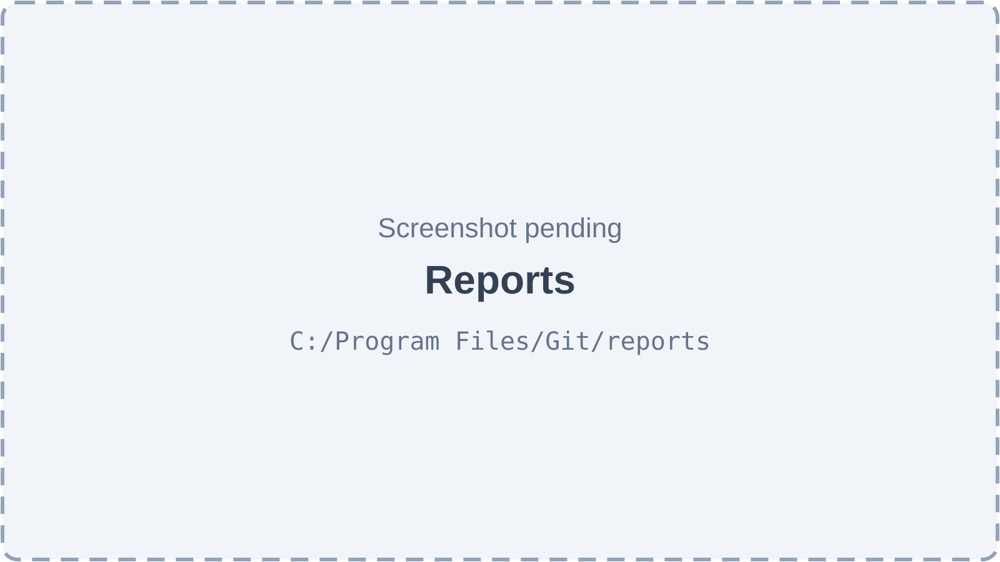
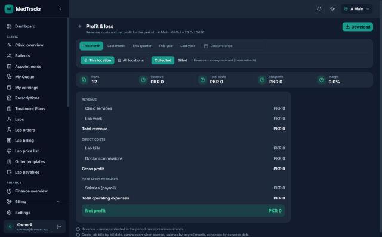
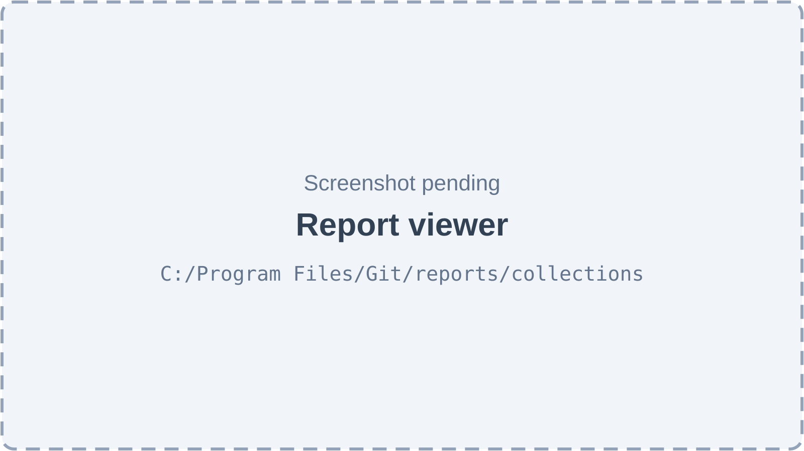
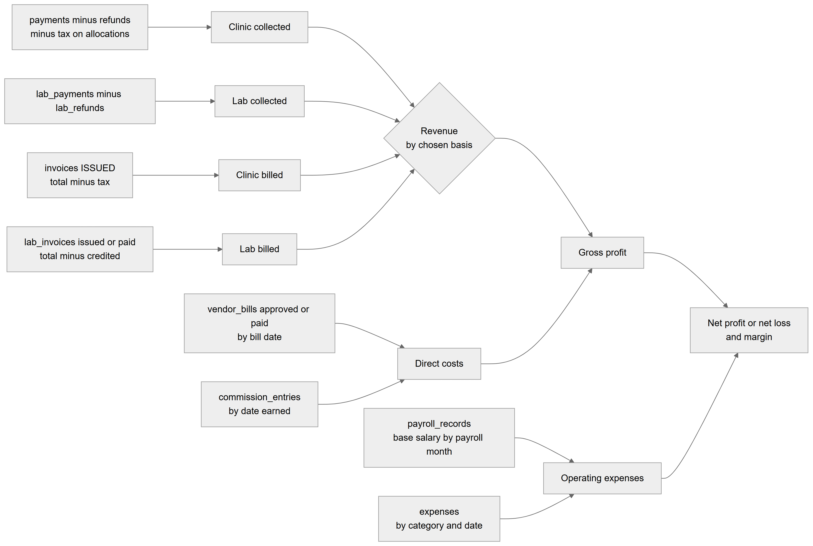
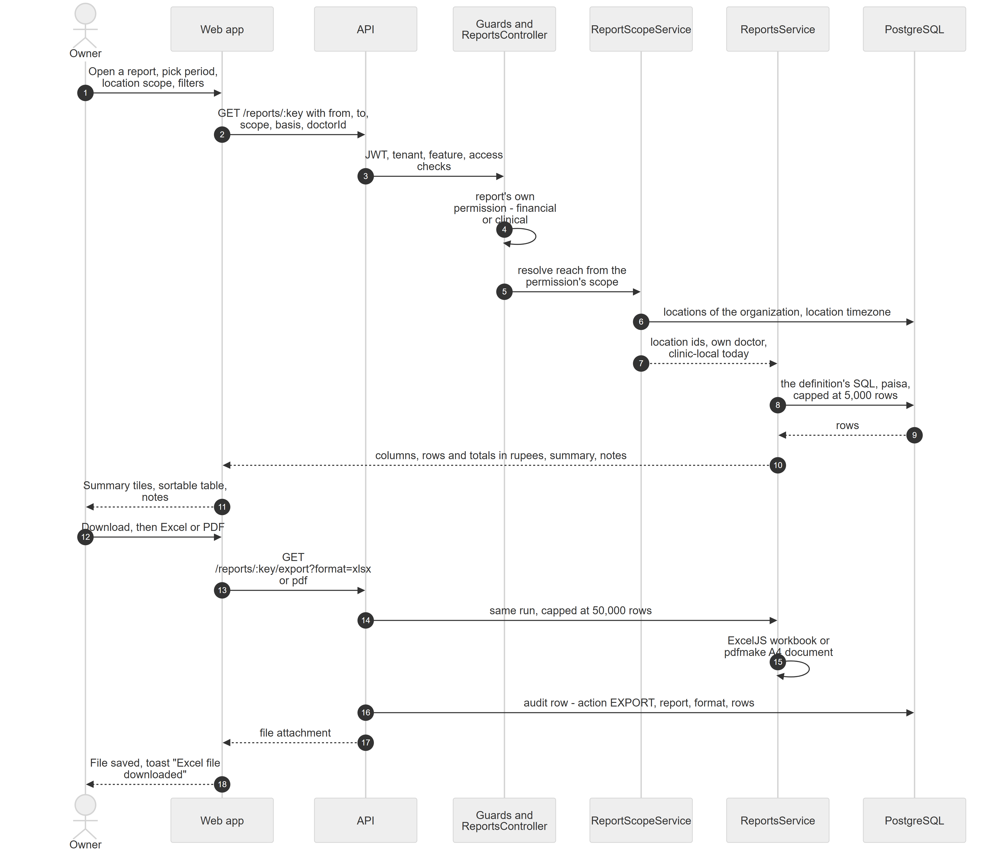
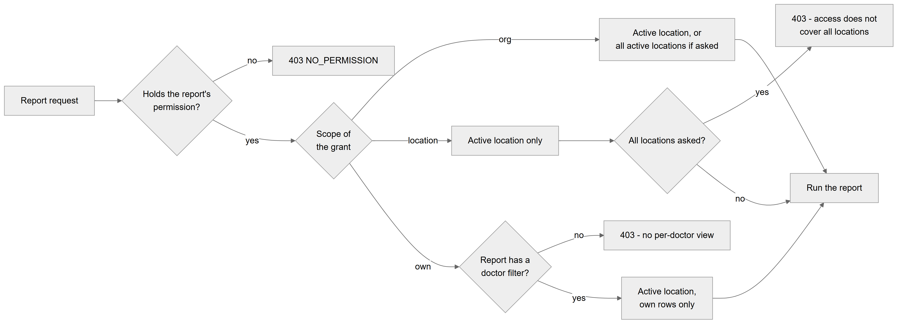

# Chapter 36 — Dashboard and Reports

This chapter describes how the Platform shows a clinic its numbers: the home dashboard, the finance overview (profit and loss), the clinic overview (patients, appointments and waiting), and a library of 37 reports that can be read on screen or downloaded as Excel or PDF. It is written for the product owner, who needs to know where every figure comes from, who may see it and where the numbers can disagree. The module only reads data; it owns no tables and changes nothing except one audit row per download.

## 36.1 What this module is for

The module answers two questions for the people who run a clinic: "How is the clinic doing?" and "Where is the money?". It has five screens:

- **Dashboard** (`/dashboard`): the home page after sign-in. Sidebar item **Dashboard** (key `nav.dashboard`). It has no page permission; each tile appears only when the user holds the permission behind it.
- **Clinic overview** (`/clinic-overview`): patients, appointments, waiting and doctors for a period. Sidebar item **Clinic overview** (key `nav.clinic_overview`, section Clinic, needs `reports.clinical.view`).
- **Finance overview** (`/finance`): the owner's profit and loss dashboard. Sidebar item **Finance overview** (key `nav.finance`, section Finance, needs `finance.overview.view`).
- **All reports** (`/reports`): the report library. Sidebar item **All reports** (key `nav.reports`, in the Finance → Reports group, needs `reports.financial.view` or `reports.clinical.view`).
- **Report viewer** (`/reports/<report key>`): one report on screen, opened from the library or from a link on an overview card. No sidebar entry of its own.

The old address `/financial-summary` has no screen any more: it redirects to `/dashboard`. The same Reports sidebar group also holds **Doctor revenue**, **Doctor earnings** and **Billing activity**; those screens belong to the Billing and Commissions chapters (Chapters 34 and 35).

Who uses it:

- The **owner** and the **Admin** role: everything, for one location or for all locations together.
- **Accountant**: financial reports, the finance overview and downloads, for the active location only.
- **Doctor**: clinical reports with scope `own`, so only the eight reports that can be narrowed to one doctor, showing only their own rows.
- **Receptionist** and **Assistant**: no report permission; they see only the dashboard tiles their other permissions allow.

Three features gate the module, all off by default for a new organization: `reports.financial` ("Financial Reports"), `reports.clinical` ("Clinical Reports") and `reports.exports` ("Data Exports"). The dashboard's money tiles also need the older feature `billing.financial_summary` ("Financial Dashboard", off by default).

## 36.2 Screens

*Figure 36.1 — Dashboard (screenshot pending).*

The dashboard was redesigned on 2026-10-23; this describes the current code. The header shows today's date, a greeting such as "Good morning, Dr. Example One", and the organization and location name. On the right are a month picker (the last 12 months), a **Refresh** icon button, **Collect payment** (for users with `billing.desk.use`) and **New appointment** (for users with `appointments.book`). Below come up to four KPI tiles: **Active patients** (needs `patients.view`), **Visits today** with a progress bar of "done" and "in clinic" (needs `appointments.view`), **Revenue · Oct** with a daily sparkline and the change against last month (needs `reports.financial.view` and the `billing.financial_summary` feature) and **Outstanding** with an overdue count (needs `billing.invoice.view`). Each tile links to its module. The next row holds the **Revenue overview** card (month figures Revenue, Expenses, Net profit, Avg. invoice and a six-month revenue-versus-expenses bar chart) and the **Visits** donut (Completed, Upcoming, In clinic, No-show, Cancelled, plus Completion rate and Avg. wait). The last row holds **Today's schedule** (up to 8 visits with a **View all** link) and **Top procedures** (the month's six best-earning procedures). A user who lacks a permission simply does not see that tile or card.

*Figure 36.2 — Finance overview (screenshot pending).*

The finance overview has the title "Finance overview" and a subtitle naming the location scope, the period and the period it is compared with. The top-right buttons are **Download P&L** (Excel or PDF, for users with `reports.export`) and **All reports**. The filter bar offers period presets (**This month**, **Last month**, **This quarter**, **This year**, **Last year**), a **Custom range** picker, a **This location / All locations** switch (only for org-wide access in an organization with more than one location) and a **Collected / Billed** switch with a short hint. Four KPI tiles show revenue, **Total costs**, **Net profit** (or Net loss) with margin, and **Patients owe**. Cards follow: **Last 12 months** (revenue, costs and profit chart, link "Cash book"), **Needs attention** (overdue patient balances, overdue lab bills, lab bills to pay, patient advances held, plus data warnings), **Profit & loss** (the statement, link "Full statement"), **Where the money goes** (cost breakdown), **Billing** (Invoices, Average invoice, Patients billed, Discounts given), **Revenue by doctor**, **Top services** and **Cash and receivables** (money in by payment account and unpaid balances by age). Each card link opens the matching report.

*Figure 36.3 — Clinic overview (screenshot pending).*

The clinic overview has the same filter bar without the revenue basis, and an **All reports** button. Its KPI tiles are **Patients seen** (with visits and returning patients), **New patients** (with the walk-in share), **Show-up rate** (with appointments booked) and **Average wait** (with average consultation length). Cards follow: **Visits per day / week / month** (first visits and returning patients), **Needs attention** (missed follow-ups in the last 30 days, no-shows to call back, follow-ups due this week, patients who stopped coming, late lab orders), **Appointment outcomes**, **Busiest times** (check-ins by weekday and hour), **Doctors** (visits and waiting per doctor), **Patient mix** (tabs Source, Gender, Age) and **What we treat** (tabs Diagnoses, Treatments). Card links open the related report. This screen has no download button.

*Figure 36.4 — The report library (screenshot pending).*

The library has the title "Reports" and the subtitle "Every report in one place — view on screen or download as Excel / PDF.", with buttons to the clinic and finance overviews. The shared filter bar sets the period and location scope used by the quick downloads. Extra filters are a search box ("Search reports"), category chips (All plus each category that has at least one visible report) and **Clear filters** with a count. A card / table view switch is on the right. In card view the reports are grouped under category headings; each card shows an icon, the title, a one-line description, an **Open** button and two icon buttons, **Download Excel** and **Download PDF**. Table view lists Report, Category, What it shows and the same actions. Only reports the user may open are listed.

*Figure 36.5 — The Profit & loss report in the report viewer.*

This screenshot was captured on 2026-10-23 in dark theme and shows the former working name "MedTrackr" in the top-left corner; the product is called the Platform. On the left is the owner's full sidebar: Dashboard, then the Clinic section (Clinic overview, Patients, Appointments, My Queue, My earnings, Prescriptions, Treatment Plans, Labs, Lab orders, Lab billing, Lab price list, Order templates, Lab payables), then the Finance section (Finance overview, Billing) and Settings. The page has a back arrow, the title "Profit & loss" and the line "Revenue, costs and net profit for the period. · A Main · 01 Oct – 23 Oct 2026". A **Download** button sits top right. The filter bar shows the presets with **This month** selected, **Custom range**, the switch **This location / All locations** and the switch **Collected / Billed** with the hint "Revenue = money received (minus refunds)". A strip of five tiles shows Rows 12, Revenue PKR 0, Total costs PKR 0, Net profit PKR 0 and Margin 0.0%. The statement lists REVENUE (Clinic services, Lab work, Total revenue), DIRECT COSTS (Lab bills, Doctor commissions, Gross profit), OPERATING EXPENSES (Salaries (payroll), Total operating expenses) and a highlighted Net profit line, all PKR 0 because the test clinic had no money movement. Two notes at the bottom explain the revenue basis and when each cost counts.

*Figure 36.6 — A list report, such as "Payments received", in the report viewer (screenshot pending).*

Every other report uses the same viewer. The header has a back button ("Back to reports"), the report title, its description, the location scope and the period, and a **Download** menu with **Excel (.xlsx)** and **PDF**. The filter bar adds a doctor picker ("All doctors") for reports that can be narrowed to one doctor, and an expense category picker for the expense register. Snapshot reports show "Balances as of today" instead of the period. Below come summary tiles (Rows plus the report's own summary or its column totals), an amber warning when more than 5,000 rows exist ("Showing the first 5,000 rows. Download Excel for up to 50,000, or pick a shorter period."), the sortable, paged table, and the report's notes. Empty results say "No records in this period."; empty results with a doctor or category filter say "No results for your filters".

## 36.3 Features

### 36.3.1 See the home dashboard

**Status:** [Partial] — the rendered dashboard uses real data; the money tiles need a second, older feature, and a mock data module with unused widgets is still in the code.

**What it does.** Gives each signed-in user a one-page view of today and the selected month, limited to what their role may see.

**How the user does it.**
1. Sign in, or click **Dashboard** in the sidebar.
2. Optionally pick another month in the month picker, or click **Refresh**.
3. Click a tile to jump to Patients, Appointments, Finance overview or Invoices.

**Behind the scenes — in simple terms.** The page asks several existing services for their numbers: the patient list for a count, the appointment statistics for today and for the month, the invoice statistics for what is owed, and the financial summary for the month's revenue, expenses and top procedures. It only asks for what the user may see, so a receptionist never gets an empty "PKR 0" money tile.

**Behind the scenes — technically.** Calls: `GET /patients?page=1&limit=1&isActive=true` (count), `GET /appointments/stats` twice (today and month), `GET /appointments` (today, 8 rows), `GET /invoices/stats`, `GET /financial-summary/monthly?month&year` and `GET /financial-summary/trend?months=6`. The financial-summary endpoints run `FinancialSummaryService`: monthly revenue is payments in the month minus refunds minus the tax part of allocations to taxed charges; expenses are the `expenses` table only; net profit is revenue minus those expenses; average invoice, paid-invoice count, revenue by day, expenses by category, payment-account split and the top 5 procedures (by `charges.net_amount` on issued invoices) come with it. The trend loops month by month for revenue and expenses. Each widget query uses `retry: false`, so one refused call blanks one widget only. `features/dashboard/services/dashboard.api.ts` is a mock module (fixed numbers such as "1630" patients and a simulated delay). Its four hooks (`useDashboardStats`, `useDashboardChart`, `useSpendingBreakdown`, `useDashboardAppointments`) are exported from the dashboard barrel, but nothing imports that barrel, and the widgets built for it (`AnalyticsChartCard`, `AppointmentsTable`, `SpendingBreakdownCard`, the dashboard `StatCard`, `KpiCard`) and several older cards (`AppointmentStatusCard`, `ExpenseCategoryChart`, `RecentAppointmentsCard`, `TopProceduresCard`, `DashboardSkeletons`) are not rendered anywhere. No mock number reaches a user.

**Rules and validations.**
- The money tile, Revenue overview and Top procedures need `reports.financial.view` and the feature `billing.financial_summary`.
- Dashboard "Net profit" is collected revenue minus recorded expenses only. It does not subtract salaries, lab bills or commissions, so it differs from the P&L (36.3.3).
- Today's and the month's ranges are built from the browser's date and sent as UTC midnight to UTC midnight; the financial summary uses calendar months of the payment date. Figures near midnight can differ from the location's clinic day.
- Only the active location is counted.

**Who can do it.** Any signed-in member. Tiles: `patients.view`, `appointments.view`, `billing.invoice.view`, `reports.financial.view` (+ feature `billing.financial_summary`). Admin sees everything; Receptionist sees patients, visits and outstanding; Assistant sees patients and visits; Doctor sees visits (own); Accountant sees revenue and outstanding.

**Data read and written.** Reads `patients`, `appointments`, `queue_entries`, `queue_sessions`, `invoices`, `payments`, `refunds`, `payment_allocations`, `charges`, `expenses`. Writes nothing.

**Effects on other modules.** None.

**Error cases.** A refused or failed call leaves that one widget empty or at zero; the rest of the page still loads. 403 `NO_PERMISSION` or a feature refusal on `/financial-summary/*` when the feature is off.

**Technical references:** `backend/src/billing/financial-summary.service.ts` · `FinancialSummaryService.getMonthlySummary`, `getRevenueComparison`, `DashboardPage` · `web-app/src/features/dashboard/pages/DashboardPage.tsx`

### 36.3.2 Read the finance overview

**Status:** [Implemented]

**What it does.** Shows the owner the period's revenue, costs, net profit and margin, compared with the period before, with a 12-month trend, a cost breakdown, revenue per doctor and service, cash by account, money owed both ways and warnings about incomplete data.

**How the user does it.**
1. Click **Finance overview** in the sidebar.
2. Pick a period preset or a custom range; choose **Collected** or **Billed**; optionally choose **All locations**.
3. Read the cards; click a card link (for example "Full statement" or "Who owes") to open the matching report.
4. Click **Download P&L** for an Excel or PDF statement.

**Behind the scenes — in simple terms.** The server builds the profit and loss for the chosen period and for the comparison period, the monthly figures for the last 12 months, and several side lists, all in one request. It also checks for three common data problems: a month whose payroll was not generated, salaries entered both as payroll and as "Salary" expenses, and lab bills still in draft.

**Behind the scenes — technically.** `GET /reports/finance/overview` → `FinanceOverviewService.overview`. It runs nine queries in parallel: P&L of the period and of `previousRange` (a period starting on the 1st compares with the same days of the previous month; a whole month with the whole previous month; any other range with the same number of days just before it), `FinanceDataService.monthlyComponents` for 12 trailing months, `balances` (open patient balances on issued invoices and live lab invoices, aged Not due / 1–30 / 31–60 / 61–90 / 90+ days against the due date; payable and overdue lab bills; patient advances = payments minus allocated minus refunded), `topDoctors` (billed: `charges.net_amount` on issued invoices; collected: pre-tax part of allocations), `topServices` (top 6 by net billed), `collectionsByAccount` (clinic payments minus refunds per `payment_account_name`, plus lab payments per method), `counts` and `warnings`. Lists keep the top 5 and fold the rest into "Others". Money is summed in paisa and returned in rupees. The scope comes from `ReportScopeService` with the rule "gate on `finance.overview.view`, reach from `reports.financial.view`".

**Rules and validations.**
- Dates are clinic-local `YYYY-MM-DD`; default period is the first of this month to today; "from" must not be after "to"; at most 3 years.
- "All locations" needs `reports.financial.view` with scope `org`.
- Change percentages are null when the earlier value is 0.

**Who can do it.** `finance.overview.view` (unscoped), feature `reports.financial`; all-locations reach needs `reports.financial.view` at `org`. Default: Admin (all locations), Accountant (active location). Not Doctor, Receptionist or Assistant.

**Data read and written.** Reads `payments`, `refunds`, `payment_allocations`, `charges`, `invoices`, `services`, `lab_payments`, `lab_refunds`, `lab_invoices`, `vendor_bills`, `commission_entries`, `payroll_records`, `expenses`, `employees`, `locations`, `organizations`. Writes nothing.

**Effects on other modules.** None.

**Error cases.** 403 `NO_PERMISSION`; 403 "Your access does not cover all locations together."; 400 "Dates must be YYYY-MM-DD.", "\"From\" must be on or before \"to\".", "A report can cover at most 3 years."; the screen shows "Couldn't load the finance overview" with a retry button.

**Technical references:** `backend/src/reports/finance/finance-overview.service.ts` · `FinanceOverviewService.overview`, `ReportScopeService.resolve` · `web-app/src/features/reports/pages/FinanceDashboardPage.tsx`

### 36.3.3 Read the profit and loss statement

**Status:** [Implemented]

**What it does.** Produces a classic profit and loss statement: revenue (clinic services, lab work), direct costs (lab bills, doctor commissions), gross profit, operating expenses (salaries from payroll and each expense category) and net profit or net loss, each with its share of revenue.

**How the user does it.**
1. Open **All reports** and click **Open** on "Profit & loss", or click "Full statement" on the finance overview.
2. Pick the period, location scope and **Collected** or **Billed**.
3. Optionally click **Download** → **Excel (.xlsx)** or **PDF**.

*Figure 36.7 — Where each line of the profit and loss comes from.*

The diagram reads from left to right. Four source boxes feed four revenue figures: "payments minus refunds minus tax on allocations" gives Clinic collected; "lab_payments minus lab_refunds" gives Lab collected; "invoices ISSUED total minus tax" gives Clinic billed; "lab_invoices issued or paid total minus credited" gives Lab billed. All four flow into a diamond "Revenue by chosen basis": the Collected basis uses the two collected figures, the Billed basis the two billed figures. Below, "vendor_bills approved or paid by bill date" and "commission_entries by date earned" flow into Direct costs. Revenue and Direct costs together give Gross profit. "payroll_records base salary by payroll month" and "expenses by category and date" flow into Operating expenses. Gross profit and Operating expenses together give the final box "Net profit or net loss and margin".

**Behind the scenes — in simple terms.** Revenue can be counted two ways. **Collected** counts money that actually came in during the period (clinic receipts and lab receipts, minus refunds, with sales tax taken out because tax is not the clinic's income). **Billed** counts work invoiced in the period (issued clinic invoices without tax, plus lab invoices minus credits), whether paid or not. Costs are always counted in the period they belong to, whatever basis is chosen: what labs billed the clinic by the bill date, doctor commission when it was earned, salaries by payroll month, and expenses by their expense date. Gross profit is revenue minus lab bills and commissions; net profit also subtracts salaries and expenses.

**Behind the scenes — technically.** `FinanceDataService.monthlyComponents` runs one SQL `UNION ALL` that returns, per month, `clinicCollected` (`payments.amount` by `payment_date`, minus `refunds.amount` by `refund_date`, minus `amount − preTaxAllocationSql` for `payment_allocations` on charges with `tax_amount > 0`, by allocation date in the location's timezone), `labCollected` (`lab_payments.amount_paisa` by `received_on` minus `lab_refunds` by `refunded_at`), `clinicBilled` (`invoices.total_amount − tax_amount`, status `ISSUED`, by `issue_date`), `labBilled` (`lab_invoices.total_paisa − credited_paisa`, status issued, partially paid or paid, by `issued_on`), `labCost` (`vendor_bills.total_paisa`, status approved, partially paid or paid, by `bill_date`), `commission` (`commission_entries.amount_paisa` by `created_at`), `salaries` (`payroll_records.base_salary_paisa`, or `salary_amount` for older rows without a breakdown, by payroll year and month) and `expense` per category (`expenses.amount` by `expense_date`). Clinic billing tables store numeric rupees and are multiplied by 100; lab, commission and payroll tables store integer paisa. `buildProfitLoss` then computes revenue, direct costs, gross profit, operating total, net profit and margin (one decimal, null when revenue is 0). The report definition `profit-loss` turns this into section, line, subtotal and total rows, with summary tiles Revenue, Total costs, Net profit/Net loss and Margin, and two notes.

**Rules and validations.**
- Payroll counts base salary only; the commission part of payroll is already counted when earned, so it is not counted twice.
- Draft lab bills and cancelled clinic invoices are not counted.
- Expense category "Salary" is shown as "Salaries (expenses)"; if the clinic also runs payroll, the finance overview warns that salaries may be counted twice.
- Zero-value expense categories are hidden; expense lines are sorted largest first.

**Who can do it.** `reports.financial.view` (scope `location` or `org`), feature `reports.financial`. Download also needs `reports.export` (feature `reports.exports`). Default: Admin, Accountant.

**Data read and written.** As 36.3.2. Writes an audit row only on download (36.3.7).

**Effects on other modules.** None.

**Error cases.** As 36.3.2; 403 `NO_PERMISSION` without `reports.financial.view`.

**Technical references:** `backend/src/reports/finance/profit-loss.ts` · `buildProfitLoss`, `FinanceDataService.monthlyComponents`, `financeReports` · `web-app/src/features/reports/components/PnlStatement.tsx`

### 36.3.4 Read the clinic overview

**Status:** [Partial] — works for org- and location-scoped users; a Doctor with the default role sees the sidebar item but the page is refused (deduced from code, not observed).

**What it does.** Shows how the clinic is running: patients seen, new patients, appointments and show-up rate, waiting and consultation times, trends, busiest hours, doctors, patient mix, top diagnoses and treatments, and "Needs attention" lists.

**How the user does it.**
1. Click **Clinic overview** in the sidebar.
2. Pick a period and, if allowed, **All locations**.
3. Read the cards; use the tabs on Patient mix and What we treat; click a card link to open the detailed report.

**Behind the scenes — in simple terms.** The server counts encounters (consultations), new patient registrations, appointments and queue entries for the period and the comparison period. The trend is grouped by day for up to 14 days, by week up to 120 days and by month beyond. "Needs attention" ignores the period and looks at today: follow-ups missed in the last 30 days with no later visit, follow-ups due in the next 7 days, patients not seen for 180 days or more, no-shows of the last 30 days with no later booking or visit, and open lab orders past their expected date.

**Behind the scenes — technically.** `GET /reports/clinic/overview` → `ClinicOverviewService.overview`, eleven queries in parallel. Patients seen and visits come from `patient_encounters`; new patients from `patients.created_at` (deleted patients excluded); appointments, no-show and show-up rate from `appointments` (show-up = due minus no-show over due, where due = completed, checked in or no-show); average wait = check-in to call (or to consultation start), average consultation = start to finish of completed entries, walk-in share from `queue_entries` (transferred entries excluded); heatmap by ISO weekday and hour of check-in in the location's timezone; demographics by gender and age band (Under 18, 18–29, 30–44, 45–59, 60+, Not recorded); top 6 diagnoses (free text, grouped ignoring case and spaces) and treatments. Scope rule: `reports.clinical.view` without a doctor filter, so a grant with scope `own` is refused.

**Rules and validations.**
- Same date rules as 36.3.2.
- The Doctor template holds `reports.clinical.view` with scope `own`. The sidebar item checks only that the permission exists, so it is shown, but `ReportScopeService` answers 403 for `own` scope here.

**Who can do it.** `reports.clinical.view` at `location` or `org`, feature `reports.clinical`. Default: Admin. Accountant, Receptionist and Assistant: no. Doctor: refused (see rules).

**Data read and written.** Reads `patient_encounters`, `patients`, `appointments`, `queue_entries`, `queue_sessions`, `treatments`, `lab_orders`, `employees`. Writes nothing.

**Effects on other modules.** None.

**Error cases.** 403 "Your access covers only your own data; this report has no per-doctor view."; the date errors of 36.3.2; the screen shows "Couldn't load the clinic overview" with a retry button.

**Technical references:** `backend/src/reports/clinic/clinic-overview.service.ts` · `ClinicOverviewService.overview` · `web-app/src/features/reports/pages/ClinicOverviewPage.tsx`

### 36.3.5 Browse the report library

**Status:** [Implemented]

**What it does.** Lists every report the user may open, grouped by category, with search, category filters and quick downloads.

**How the user does it.**
1. Click **All reports** in the sidebar (Finance → Reports).
2. Search, or click a category chip; switch between card and table view.
3. Click **Open**, or use **Download Excel** / **Download PDF** for the current period.

**Behind the scenes — in simple terms.** The server holds a fixed list of 37 report definitions and returns only those the user's permissions allow. A doctor with own-only access gets only the reports that can be narrowed to one doctor.

**Behind the scenes — technically.** `GET /reports` (`@AnyMember`) → `ReportsService.catalog(access)`: keeps a definition when `access.scope(permissionOf(def))` is set, and, for scope `own`, only when the definition has `filters.doctor`. Each entry carries key, title, description, category, filter spec and permission. `permissionOf` maps feature `reports.clinical` to `reports.clinical.view` and everything else to `reports.financial.view`. The catalog is cached for 10 minutes in the web app. Categories are shown in the order Profit & cash, Revenue & collections, Expenses, Staff & payroll, Patients, Appointments, Waiting & queue, Clinical, Lab.

**Rules and validations.**
- Search is debounced by 300 ms and matches title and description.
- Quick downloads use "All locations" only when the user's grant for that report reaches the whole organization.

**Who can do it.** Page: `reports.financial.view` or `reports.clinical.view`. Default: Admin (37 reports), Accountant (15 financial reports), Doctor (8 doctor-filterable clinical reports).

**Data read and written.** Nothing from the database for the list.

**Effects on other modules.** None.

**Error cases.** "Couldn't load reports" with a retry button; "No reports available" when the list is empty; "No reports match your filters."

**Technical references:** `backend/src/reports/reports.service.ts` · `ReportsService.catalog`, `permissionOf` · `web-app/src/features/reports/pages/ReportsHubPage.tsx`

### 36.3.6 Run a report on screen

**Status:** [Implemented]

**What it does.** Runs one report for a period, a location scope and optional filters, and shows summary tiles, a sortable table and notes.

**How the user does it.**
1. Open a report from the library or an overview card.
2. Set the period (snapshot reports have none), the location scope, and the doctor or expense category filter if the report has one.
3. Read the tiles, table and notes; click ← to go back.

*Figure 36.8 — A report request, then an Excel or PDF download.*

The diagram has seven participants: the Owner, the Web app, the API, "Guards and ReportsController", ReportScopeService, ReportsService and PostgreSQL. In steps 1 to 11, the owner opens a report and picks period, scope and filters; the web app calls `GET /reports/:key` with from, to, scope, basis and doctorId; the global guards check the JWT, tenant, feature and access; the controller checks the report's own permission (financial or clinical); the scope service reads the organization's locations and the location's timezone and hands the engine the location ids, the doctor (for own-only users) and the clinic-local today; the engine runs the definition's SQL in paisa with a cap of 5,000 rows; rows come back and the engine returns columns, rows and totals in rupees, the summary and notes; the screen shows tiles, a sortable table and notes. In steps 12 to 18, the owner clicks Download and picks Excel or PDF; the web app calls `GET /reports/:key/export?format=xlsx` or `pdf`; the engine repeats the same run capped at 50,000 rows, builds an ExcelJS workbook or a pdfmake A4 document; the API writes an audit row with action EXPORT, report, format and row count; the file comes back as an attachment and the screen shows the toast "Excel file downloaded".

**Behind the scenes — in simple terms.** Every report is a definition: a title, a category, the filters it supports, its columns and one database query. The same rows feed the screen, the Excel file and the PDF, so they always match. Money is calculated in paisa (whole numbers, so no rounding drift) and shown in rupees with two decimals. Dates are clinic days in the active location's timezone.

**Behind the scenes — technically.** `GET /reports/:key` (`@AnyMember`; the handler checks `permissionOf(def)`) → `ReportScopeService.resolve` → `ReportsService.view`. Snapshot ("as of") reports run with from = to = today. The engine fetches the cap plus one row to detect truncation, adds the note "Totals cover only the rows shown." when truncated, computes a totals row from columns marked `total` (in paisa), converts money to rupees and adds meta: organization name, scope label, period, basis and a clinic-local "generated" time. `doctorId` from an own-only user is forced to their employee id whatever the request says. The viewer refuses to run until the catalog has loaded, so it knows the report's filter spec.

**Rules and validations.**
- Unknown key → 404 "Report not found"; the screen says "Report not found — This report doesn't exist or isn't available to you."
- On screen at most 5,000 rows; dates and range as 36.3.2.
- The P&L is drawn as a statement; all other reports as a table (25 rows per page by default).

**Who can do it.** The report's permission: `reports.financial.view` or `reports.clinical.view` (scope `own` / `location` / `org`); feature `reports.financial` or `reports.clinical`. Default as in 36.3.5.

**Data read and written.** Per report (table in 36.3.8). Writes nothing.

**Effects on other modules.** None.

**Error cases.** 403 `NO_PERMISSION` "Missing permission: reports.clinical.view" (or financial); 403 for own-only users on a report without a doctor filter; 404; 400 date errors; screen "Couldn't load this report" with retry.

**Technical references:** `backend/src/reports/reports.controller.ts` · `ReportsService.view`, `ReportDefinition` · `web-app/src/features/reports/pages/ReportViewerPage.tsx`

*Figure 36.9 — How the permission's scope decides which locations and rows a report covers.*

The flowchart starts at "Report request" and asks "Holds the report's permission?"; "no" ends at "403 NO_PERMISSION". On "yes" it branches on "Scope of the grant". With "org", the report runs for the active location, or for all active locations if asked. With "location", it covers the active location only; if all locations were asked for, it ends at "403 - access does not cover all locations"; otherwise it runs. With "own", it asks "Report has a doctor filter?"; "no" ends at "403 - no per-doctor view", "yes" runs the report for the active location with the user's own rows only. All successful paths end at "Run the report".

### 36.3.7 Download a report as Excel or PDF

**Status:** [Implemented]

**What it does.** Saves the report with the current filters as an Excel workbook or an A4 PDF, and records who downloaded what.

**How the user does it.**
1. In the viewer click **Download** → **Excel (.xlsx)** or **PDF**; on the finance overview click **Download P&L**; or use the icon buttons in the library.
2. The button shows "Preparing…"; the file is saved, named like `profit-loss_2026-10-01_to_2026-10-23.xlsx`, and a toast confirms.

**Behind the scenes — in simple terms.** The server runs the report again with a larger limit, turns it into a file and writes an audit entry before sending it, because clinic data is leaving the system.

**Behind the scenes — technically.** `GET /reports/:key/export?format=xlsx|pdf` (`@Can('reports.export')` plus the report's own permission). Up to 50,000 rows. Excel (ExcelJS): one sheet with title, organization and scope line, period line, summary block, a frozen and filterable header, typed numbers and dates with formats (money `#,##0.00` with red negatives, percent, dd-mmm-yyyy), a bold totals row and the notes. PDF (pdfmake): A4, landscape for wide registers, title block, summary strip, zebra table with a repeating header, bold totals, "Page x of y" footer; Urdu text is set in the bundled Noto Naskh Arabic font; the PDF engine may read only its bundled fonts and no URLs. `AuditService.record` writes `entityType: 'report'`, action `EXPORT`, with report key, format, period, scope label and row count. Headers: `Content-Disposition: attachment`, `Cache-Control: no-store`.

**Rules and validations.**
- PDF is refused above 5,000 rows.
- The download control is hidden for users without `reports.export`.

**Who can do it.** `reports.export` (high-risk, feature `reports.exports`) plus the report's permission. Default: Admin, Accountant. Not Doctor.

**Data read and written.** Reads as the report. Writes one audit-log row (Chapter 60).

**Effects on other modules.** The export appears in the audit trail.

**Error cases.** 400 "This report has 6,200 rows — too many for a PDF (max 5000). Download Excel or pick a shorter period."; 403 `NO_PERMISSION`; the web app shows the server message as an error toast, or "Could not download the report.".

**Technical references:** `backend/src/reports/exporters/xlsx.exporter.ts` · `ReportsService.export`, `exportXlsx`, `exportPdf` · `web-app/src/features/reports/components/ExportMenu.tsx`

### 36.3.8 The 37 reports

**Status:** [Implemented]

**What it does.** Provides 37 ready-made reports in 9 categories. 35 are written out individually; 2 ("Top diagnoses", "Top complaints") are built by one shared helper over free-text encounter fields.

| Key | Title | Category | Feature | Purpose |
|---|---|---|---|---|
| `profit-loss` | Profit & loss | finance | reports.financial | Revenue, costs and net profit for the period (Collected / Billed basis). |
| `cash-book` | Daily cash book | finance | reports.financial | Per day: clinic and lab receipts, refunds, expenses, paid to labs, salaries paid, net cash. |
| `collections` | Payments received | revenue | reports.financial | Every receipt, clinic and lab, with patient and account. |
| `collections-by-account` | Collections by account | revenue | reports.financial | Cash, bank and wallet totals: what should be in each account. |
| `invoices` | Invoice register | revenue | reports.financial | Issued invoices (clinic and lab) with paid and balance. |
| `outstanding` | Outstanding balances | revenue | reports.financial | Who owes money, aged by due date (as of today). |
| `doctor-revenue` | Doctor performance | revenue | reports.financial | Billed, collected and commission per doctor. |
| `service-revenue` | Revenue by service | revenue | reports.financial | Which treatments earn the most, with discounts given. |
| `discounts` | Discounts given | revenue | reports.financial | Every discount on issued invoices and who gave it. |
| `refunds` | Refunds | revenue | reports.financial | Money returned to patients, with the reason. |
| `expenses` | Expense register | expenses | reports.financial | Every expense with category, method and who recorded it (category filter). |
| `expense-summary` | Expenses by category | expenses | reports.financial | Where operating money goes, with each category's share. |
| `payroll` | Payroll register | staff | reports.financial | Salary and commission paid out per employee per month. |
| `commissions` | Doctor commissions | staff | reports.financial | Commission earned on collections, settled and pending (doctor filter). |
| `lab-bills` | Lab bills | lab | reports.financial | What labs billed the clinic, what is paid and what is still owed. |
| `new-patients` | New patients | patients | reports.clinical | Everyone registered in the period, with source, age and city. |
| `patient-sources` | Where patients come from | patients | reports.clinical | New patients by source, and how many came and paid. |
| `patient-demographics` | Patient demographics | patients | reports.clinical | Patients seen by visit type, gender, age group and city. |
| `lapsed-patients` | Patients who stopped coming | patients | reports.clinical | Not seen for 6+ months, a call list, most valuable first (as of today). |
| `top-patients` | Top patients | patients | reports.clinical | Patients with the most billing and visits in the period. |
| `appointments-daily` | Appointments by day | appointments | reports.clinical | Booked, completed, cancelled and no-show appointments per day (doctor filter). |
| `appointments-by-doctor` | Appointments by doctor | appointments | reports.clinical | Each doctor's bookings, completions and no-show rate. |
| `no-shows` | No-shows & cancellations | appointments | reports.clinical | Who missed or cancelled, why, and how often (doctor filter). |
| `visit-mix` | Walk-ins vs appointments | appointments | reports.clinical | Arrivals with and without an appointment, per day (doctor filter). |
| `busy-hours` | Rush hours | appointments | reports.clinical | Arrivals by hour and weekday (doctor filter). |
| `queue-by-doctor` | Waiting time by doctor | operations | reports.clinical | How long patients wait for each doctor and how long consultations take. |
| `queue-daily` | Waiting time by day | operations | reports.clinical | Arrivals, patients seen and waiting time per clinic day (doctor filter). |
| `left-unseen` | Left without being seen | operations | reports.clinical | Patients who checked in but were skipped, cancelled or left (doctor filter). |
| `doctor-activity` | Doctor activity | clinical | reports.clinical | Patients seen, treatments, prescriptions, plans and lab orders per doctor. |
| `treatment-plans` | Treatment plan conversion | clinical | reports.clinical | Plans proposed per doctor, how many were accepted and finished. |
| `diagnoses` | Top diagnoses | clinical | reports.clinical | The most common diagnoses doctors recorded. |
| `complaints` | Top complaints | clinical | reports.clinical | The chief complaints recorded at visits. |
| `treatments-done` | Treatments done | clinical | reports.clinical | How often each treatment was performed and for how many patients. |
| `medicines` | Most prescribed medicines | clinical | reports.clinical | Medicines on finalized prescriptions (doctor filter). |
| `follow-ups` | Follow-ups | clinical | reports.clinical | Follow-ups due in the period: who came back and whom to call (doctor filter). |
| `lab-turnaround` | Lab turnaround | lab | reports.clinical | How fast each lab returns work, on-time rate, late orders and remakes. |
| `lab-delays` | Late lab orders | lab | reports.clinical | Open orders past the lab's promised date (as of today). |

The table lists all 37 reports by their code key, the title users see, the category that groups them in the library, the feature (and therefore the permission) that gates them, and a one-line purpose taken from the report's own description. Fifteen reports are financial (`reports.financial` → permission `reports.financial.view`) and twenty-two are clinical or operational (`reports.clinical` → `reports.clinical.view`). The category and the feature are independent: "Lab bills" is a lab report gated as financial, while "Lab turnaround" and "Late lab orders" are lab reports gated as clinical. Three reports are snapshots "as of today" with no period: Outstanding balances, Patients who stopped coming and Late lab orders. Nine reports offer a doctor filter (the eight clinical ones marked plus Doctor commissions); only those can be run by an own-only user. The third feature, `reports.exports`, gates downloads of any report, not a report of its own.

**How the user does it.** Open the report from the library (36.3.5) and run it (36.3.6).

**Behind the scenes — in simple terms.** Each report is one read-only query over the tables of the module it describes: billing, lab billing, lab payables, payroll, commissions, expenses, patients, appointments, the queue, encounters, treatments, prescriptions and plans.

**Behind the scenes — technically.** Definitions live in `definitions/finance.reports.ts` (2), `revenue.reports.ts` (8), `cost.reports.ts` (5), `patient.reports.ts` (5), `visit.reports.ts` (8) and `clinical.reports.ts` (9, two of them via `textFrequency`). `ReportsService` registers them in that order and indexes them by key. Free-text reports note that the same thing spelled differently shows as separate lines. Wide registers are marked landscape for PDF.

**Rules and validations.** "Lapsed" means not seen for 180 days. Free-text grouping ignores case and repeated spaces.

**Who can do it.** As 36.3.6.

**Data read and written.** Read-only, per report. Writes nothing.

**Effects on other modules.** None.

**Error cases.** As 36.3.6.

**Technical references:** `backend/src/reports/definitions/` · `financeReports`, `revenueReports`, `costReports`, `patientReports`, `visitReports`, `clinicalReports`, `textFrequency` · `web-app/src/features/reports/lib/report-categories.ts`

### 36.3.9 Daily financial summary

**Status:** [Partial] — backend only; no screen calls it since `/financial-summary` was folded into the dashboard.

**What it does.** Returns one day's collections (net of refunds) per payment account, invoices issued that day, the outstanding amount and the overdue invoice count.

**How the user does it.** Not available in the web app. The address `/financial-summary` redirects to `/dashboard`. The day's takings per account are shown on the Payments page instead (Chapter 34).

**Behind the scenes — in simple terms.** A small summary query for one date at the active location.

**Behind the scenes — technically.** `GET /financial-summary/daily?date` → `FinancialSummaryService.getDailySummary`. With no date the server uses today's UTC date, not the location's. A web hook (`useDailySummary`) exists but no component uses it. The Payments page uses a different endpoint, `GET /payments/daily-collection` (permission `billing.desk.use`, clinic-local today), which belongs to Billing.

**Rules and validations.** Active location only.

**Who can do it.** `reports.financial.view`, feature `billing.financial_summary`. Default: Admin, Accountant.

**Data read and written.** Reads `payments`, `refunds`, `invoices`.

**Effects on other modules.** None.

**Error cases.** 403 when the feature is off or the permission is missing.

**Technical references:** `backend/src/billing/financial-summary.controller.ts` · `FinancialSummaryController.daily` · `web-app/src/routes/financial-summary.tsx`

## 36.4 Entities and data model

The Reports module owns no tables and has no entities. It reads, with raw SQL, the tables of other modules and writes only one row per download into the general audit log. Its "model" is in code:

- **Report definition** (`ReportDefinition`): key, title, description, category, optional feature (default `reports.financial`), filter spec (`dates`: range or asOf; `doctor`; `expenseCategory`; `basis`), columns (type text, money, number, decimal, date or percent; a `total` flag; a PDF width weight), a landscape flag and a `run` function.
- **Report scope** (`ReportScope`): organization, the list of location ids, a label such as "Main location" or "All locations (3)", whether it is the whole organization, an optional doctor (for own-only users), the active location's timezone and the clinic-local today.
- **Report view** (`ReportView`): what the API returns: columns, rows, totals, summary, notes, truncated flag and meta.

The relationships to stored data, in words:

- Financial reports and the P&L read billing (`payments`, `refunds`, `payment_allocations`, `charges`, `invoices`, `expenses`, `services`), lab billing (`lab_invoices`, `lab_payments`, `lab_refunds`), lab payables (`vendor_bills`, `vendor_payments`), commissions (`commission_entries`) and payroll (`payroll_records`). There are no foreign keys from reports to these tables; the link is the SQL.
- Clinical reports and the clinic overview read `patients`, `appointments`, `queue_sessions`, `queue_entries`, `patient_encounters`, `treatments`, prescriptions, treatment plans and `lab_orders`.
- Every query filters by `organization_id` and the scope's location ids.
- Money: clinic billing columns are numeric rupees, lab, payroll and commission columns are integer paisa; the engine converts everything to paisa, sums, and returns rupees. "PKR" is the default currency, not a limit.

## 36.5 Status lifecycles

The module has no lifecycle of its own: reports and dashboards are computed on request and stored nowhere. The statuses it filters on belong to other modules and are described there: invoice status `ISSUED` versus `CANCELLED` (Chapter 34), lab bill status draft, approved, partially paid, paid (Chapter 42), appointment and queue statuses (Chapters 29 and 30) and lab order status (Chapter 40).

## 36.6 Connections to other modules

- **Billing (Chapter 34).** Source of clinic revenue, receipts, refunds, discounts, expenses and outstanding balances. Dashboard money tiles use the billing financial-summary endpoints.
- **Commissions (Chapter 35).** Commission entries are a direct cost in the P&L and feed "Doctor commissions" and "Doctor performance". The "Doctor revenue" and "Doctor earnings" screens in the same sidebar group belong there.
- **Payroll (Chapter 38).** Base salary by payroll month is an operating cost; salaries paid appear in the cash book on the paid date.
- **Lab chapters (Chapters 40–42).** Lab invoices and lab receipts are revenue; vendor bills are a direct cost; lab orders feed turnaround and late-order reports.
- **Appointments, Queue, Consultation, Patients (Chapters 28–31).** Source of every clinical and operational figure.
- **Access control (Chapter 57).** Four permissions and three features decide what each user sees and how far it reaches.
- **Audit logging (Chapter 60).** Each download writes an EXPORT audit row.

## 36.7 Limitations and known gaps

- The dashboard's "Net profit" subtracts only recorded expenses, not payroll, lab bills or commissions, so it does not match the P&L.
- Dashboard money tiles need the separate feature `billing.financial_summary`; an organization with `reports.financial` on but that feature off sees no money on the dashboard.
- The dashboard and the report period presets use the browser's date; the financial summary uses the server's UTC date when no date is given. The reports themselves use the location's timezone.
- A Doctor with the default role sees "Clinic overview" in the sidebar but gets an error on the page (own scope is refused there).
- The daily financial summary endpoint has no screen.
- `features/dashboard/services/dashboard.api.ts` is a mock module, and about ten dashboard components are unused code.
- On-screen reports stop at 5,000 rows, Excel at 50,000, PDF refuses more than 5,000 rows; ranges are limited to 3 years.
- The clinic overview has no download; report filters are kept in memory only and reset on reload.
- "Doctor performance" and "Revenue by service" accept a doctor id in the API but offer no doctor filter on screen.
- Free-text reports (diagnoses, complaints) split spelling variants into separate lines.

## 36.8 Owner's FAQ

**Why does the dashboard show a different profit from the Finance overview?** The dashboard subtracts only expenses from collected revenue. The P&L also subtracts lab bills, doctor commissions and payroll salaries.

**What is the difference between Collected and Billed?** Collected counts money received in the period (net of refunds and without sales tax). Billed counts invoices issued in the period, paid or not. Costs are counted the same way under both.

**Are salaries counted twice if I also enter them as expenses?** They can be. The finance overview warns when a period has both payroll records and "Salary" expenses.

**Can an Accountant see all branches together?** Not with the default role: their financial permission has scope `location`. Give the role `org` scope in the role editor.

**Can a doctor see other doctors' figures?** No. With scope `own` a doctor sees only the reports that can be narrowed to one doctor, and only their own rows.

**Who downloaded our data?** Every Excel or PDF download writes an audit entry with the user, report, format, period, scope and row count.

**Why is a report cut off?** More than 5,000 rows were found. Download Excel (up to 50,000 rows) or choose a shorter period.

**Where are reports stored?** Nowhere. Each one is calculated from live data when opened or downloaded.
