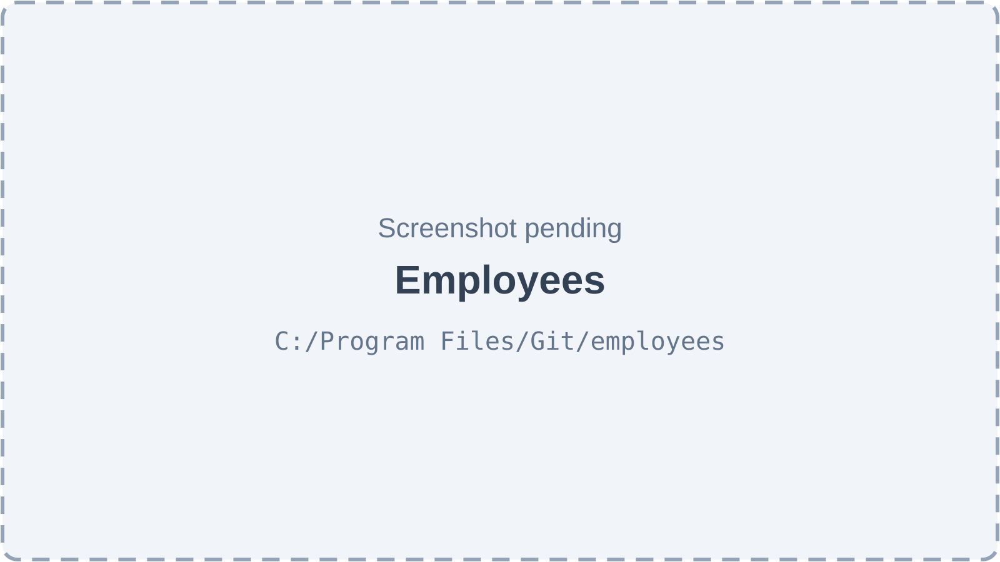
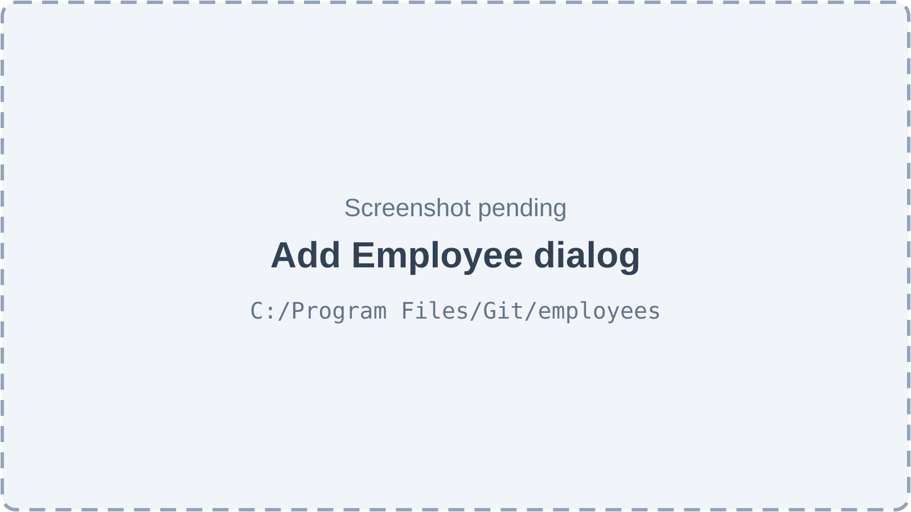
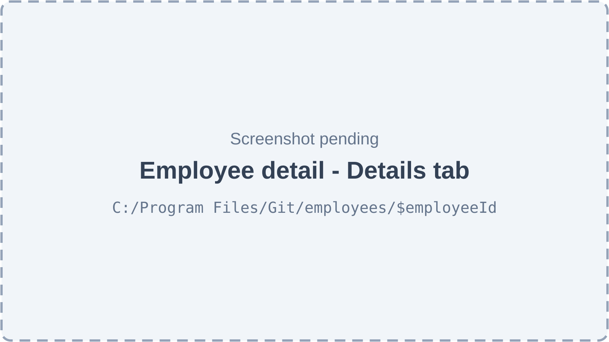
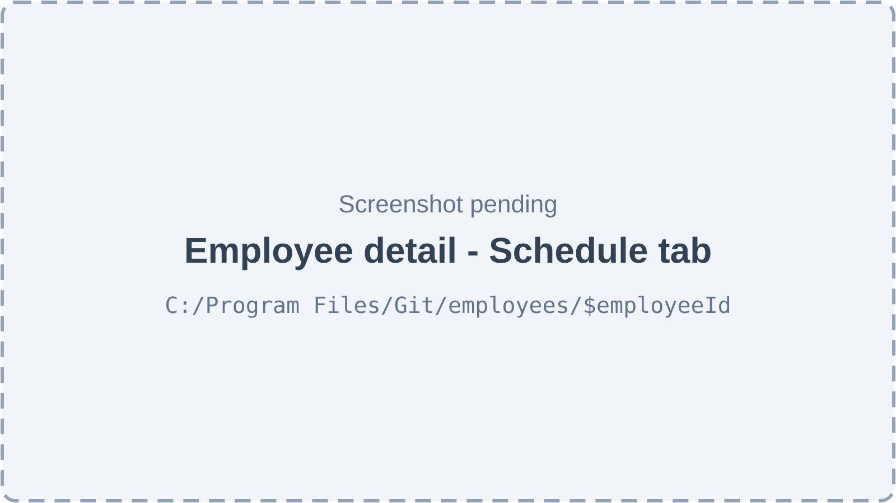
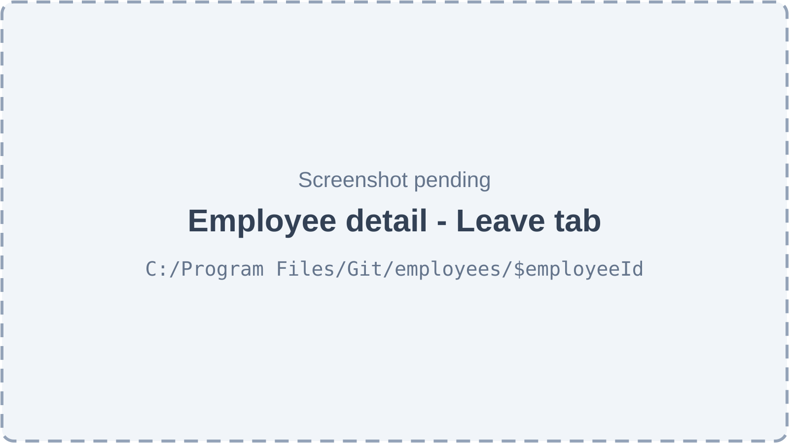
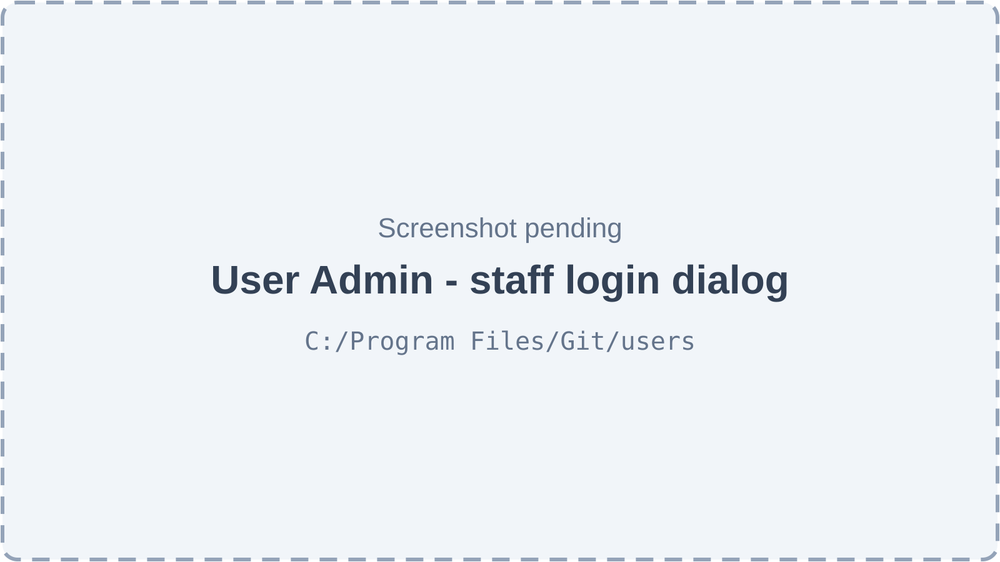
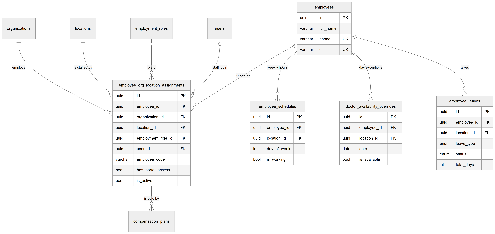
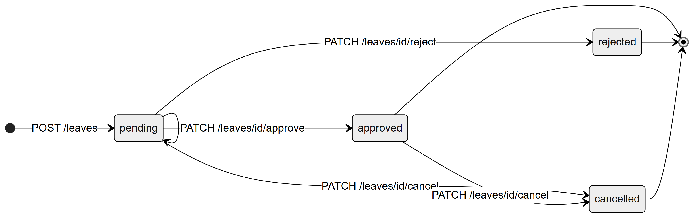
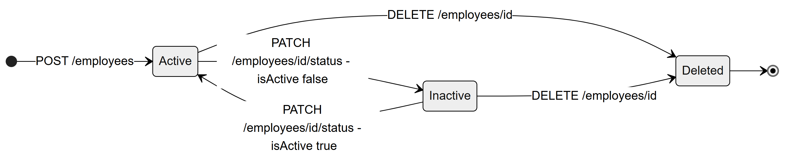

# Chapter 37 — Employees

This chapter describes the Employees module of the Platform: the staff directory of a clinic, where each person's details, workplace, role, login, salary, weekly hours, day exceptions and leave are kept. It is written for the product owner, who needs to know what the module really does today and where it stops. Other modules lean on it: appointments and the queue need doctors with an assignment and a schedule, access control reads the role on the assignment, and payroll and commissions pay the assignment (Chapters 38 and 35).

## 37.1 What this module is for

The module separates the **person** from the **job**. An **employee** is the person record, kept once for the whole Platform: name, phone, CNIC, gender, date of birth and photo. Phone and CNIC are unique across the whole Platform, not just within one clinic. An **assignment** links the employee to one organization and one location, with a **role** (employment role), a designation, an employment type, an employee code, a joining date, an active flag and portal access. The **staff login** (a user account) is attached to the assignment.

From the assignment hang the weekly schedule, date-specific availability overrides, leave requests, the compensation plan (Chapter 35) and payroll records (Chapter 38).

Who uses it:

- **Admin** and the **owner**: everything — add, edit, deactivate and delete employees, set salary, schedules and overrides, approve leave, give logins.
- **Doctor**, **Receptionist**, **Assistant**, **Accountant**: no access by default. None of these system roles holds `employees.view`.

Where it appears: the sidebar item **Employees** (key `nav.employees`, route `/employees`, needs `employees.view`) in the **Team** section, next to **Payroll**. Staff logins are also managed from **User Admin** (`nav.users`, route `/users`, needs `admin.users.manage`) in the Admin section.

The core employee permissions (`employees.view`, `employees.manage`) belong to the always-on `core` feature. Leave belongs to the feature **`hr.leave`** ("Leave Management", off by default), through the permission `leave.approve`. Attendance is mentioned only in that feature's description and is not built.

## 37.2 Screens

*Figure 37.1 — The Employees page (screenshot pending).*

The page title is "Employees" with the subtitle "N employees total". Top right are a card/table view toggle and an **Add Employee** button. A filter bar holds a search box (name, phone or employee code), a role filter ("All Roles", filled from the clinic's roles), an employment-type filter ("All Types": full time, part time, visiting, contract), a status filter ("All Status": active or inactive) and a reset action. The table view has the columns Employee (avatar, name, designation), Code, Phone, Type, Salary, Status (Active / Inactive badge) and an actions column with icon buttons with tooltips: "View employee", "Edit employee", an Activate/Deactivate switch and "Delete employee permanently". Rows are paged on the server (page sizes 10, 20, 50, 100). The card view shows the same people as a grid of cards with the same actions. With no rows the page shows "No employees found" and a hint to add the first employee; a failed load shows "Failed to load employees. Please try again." Without an active location the page asks "Select a location first".

*Figure 37.2 — The Add Employee dialog (screenshot pending).*

**Add Employee** opens a wide dialog, "Add Employee — Fill in the details to add a new employee to this location." The form has: Full Name \*, Phone \*, CNIC, Designation \*, Role \* (the clinic's roles), Employment Type \*, Joining Date \* (date picker), Gender, Date of Birth (date picker) and Gross Salary (optional). Users who can manage compensation also see a "Compensation" section ("Salaried by default…") with Salaried / Commission / Both, a commission percentage and "Commission on". A "Portal Access" switch ("Allow this employee to log in to the system") reveals login email and password fields (password at least 6 characters). Errors appear under each field and as a red banner; the buttons are Cancel and a submit button. The same form also exists as a full page at `/employees/create`, which no button links to.

*Figure 37.3 — Employee detail page, Details tab (screenshot pending).*

The detail page title is the employee's name with the designation as subtitle, a ← back button ("Back to employees"), an Active/Inactive badge and an **Edit** button for users with `employees.manage`. Tabs: **Details**, **Compensation** (with `compensation.manage`, Chapter 35), **Schedule**, **Leave** (with `leave.approve`) and **Payroll** (with `payroll.manage`, Chapter 38). The Details tab has a "Personal Information" card (Phone, CNIC, Date of Birth, Gender, Employment Type, Joining Date, Location, Employee Code, Portal Access as "Has Login Access" or "No Portal Access") and a "Current Salary" card with the monthly amount, "Effective since" and an **Update** (or **Set Salary**) button, or "No salary configured yet." **Edit** opens a slide-over sheet with the same form as Add Employee, without the compensation section.

*Figure 37.4 — Weekly schedule and availability overrides (screenshot pending).*

The Schedule tab has two cards. "Weekly Schedule" lists the seven days, each with a switch (working or off) and, for working days, start and end times; the card header has a "Slot:" selector (15, 30, 45 or 60 minutes) and a **Save** button. Switching a day on fills 09:00–17:00. "Availability Overrides" has an **Add Override** button and a table with Date, Status ("Available" or "Unavailable"), Hours, Reason and edit and delete icon buttons; empty, it says "No overrides set — Add an override for a day off or special working hours". The override dialog has Date, "Available this day", "Working Hours" (one or more time slots) and "Reason (optional)" ("e.g. Conference, public holiday...").

*Figure 37.5 — Leave requests and the leave summary (screenshot pending).*

Four small cards show "Approved Days (2026)", "Pending Requests", "Annual" and "Sick". Under them a "Leave Requests" card has a **New Request** button and a table with Type, From, To, Days, Status (badge), Reason and a three-dot menu: **Approve**, **Reject** and **Edit** for pending requests and **Cancel Request** for pending or approved ones. The request dialog has Leave Type, Leave dates (a range picker) and Reason (optional).

*Figure 37.6 — Giving an existing employee a login from User Admin (screenshot pending).*

On **User Admin**, the user dialog's role list offers "Staff (existing employee)" with the explanation "Gives an employee a login. What they can do comes from their role in the Employee directory." An "Employee" list shows employees of the organization without a login, as "name · location, location"; if none remain it says "Every employee already has a login. Add new staff from the Employee directory first." The rest of the dialog asks for name, email, optional phone and password.

## 37.3 Features

### 37.3.1 Browse and filter the employee list

**Status:** [Implemented]

**What it does.** Lists the employees assigned to the active location, with search, filters, paging and card or table view.

**How the user does it.**
1. Open **Employees** in the sidebar.
2. Type in the search box or pick a role, type or status filter; switch between card and table view.

**Behind the scenes — in simple terms.** The list is really a list of assignments at this location. Each row shows the person's details plus the job details at this location and the salary from the current compensation plan.

**Behind the scenes — technically.** `GET /employees?search&role&employmentType&isActive&page&limit` → `EmployeesService.findAll`: query on `employee_org_location_assignments` for the active organization and location, joined to `employees`, `employment_roles` and `locations`; search uses `ILIKE` on name, phone and employee code; the role filter compares the role's slug. Ordered by assignment creation, newest first. The salary and `compensationType` come from `CompensationPlanVersions.activeForMany` on the location's clinic date, falling back to the deprecated `gross_salary` column.

**Rules and validations.** Default page size 20 on the server (the web app starts at 10); `isActive` accepts `true`/`false`.

**Who can do it.** `employees.view`, feature `core`. Default: Admin.

**Data read and written.** Reads `employee_org_location_assignments`, `employees`, `employment_roles`, `locations`, `compensation_plans`.

**Effects on other modules.** None.

**Error cases.** 403 `NO_PERMISSION`.

**Technical references:** `backend/src/employees/employees.service.ts` · `EmployeesService.findAll` · `web-app/src/features/employees/pages/EmployeesPage.tsx`

### 37.3.2 Add an employee

**Status:** [Implemented]

**What it does.** Creates the person record, an assignment at the active location with a role and an employee code, a first compensation plan version and, optionally, a staff login.

**How the user does it.**
1. On **Employees**, click **Add Employee**.
2. Fill in the required fields (Full Name, Phone, Designation, Role, Employment Type, Joining Date) and any optional ones.
3. Optionally turn on **Portal Access** and enter the login email and password.
4. Submit. A toast "Employee created successfully" appears.

**Behind the scenes — in simple terms.** The server first checks that no employee anywhere on the Platform already has this phone number. It validates the pay terms, saves the person, generates the next employee code for the clinic, creates the login if asked, and saves the assignment together with the first pay version.

**Behind the scenes — technically.** `POST /employees` → `EmployeesService.create`:
1. Refuse when an `employees` row already has the phone (409).
2. Load the role (organization-scoped) and build the first plan with `initialPlan`: the optional `compensation` object, else a `SALARY` plan with the entered salary in paisa (0 when empty), effective from the joining date (or the location's clinic date).
3. Insert `employees`.
4. Generate `employee_code` as `EMP-` plus (number of assignments in the organization + 1), zero-padded to three digits.
5. If portal access is on and no `userId` was given, create a `users` row (email unique, password hashed with bcrypt, local provider).
6. In one transaction, insert the assignment (`is_primary` true by default, `gross_salary` left empty) and add the compensation version.

The access-version subscriber bumps the organization's access version when an assignment is saved, so sessions refresh their permissions.

**Rules and validations.**
- Phone is unique across the Platform (checked first, and a unique database index). CNIC is optional and also unique across the Platform (database index only).
- Full name 2–255 characters; designation required; role must be a UUID (the form requires it; the API allows it to be empty).
- Portal access needs an email and a password of at least 6 characters; the email must not belong to an existing user.
- Commission plans need `billing.commissions` and a role that can consult (Chapter 35).
- The person is saved before the login and the assignment, outside the final transaction.

**Who can do it.** `employees.manage`, feature `core`. Default: Admin. The compensation section is shown only with `compensation.manage`.

**Data read and written.** Reads `employees`, `employment_roles`, `users`. Writes `employees`, `users` (optional), `employee_org_location_assignments`, `compensation_plans`, `commission_rules`, `organizations.access_version`.

**Effects on other modules.** An active assignment makes the person appear in the appointments doctor list and queue lanes (Chapters 29 and 30); a login with portal access lets them sign in with the role's permissions.

**Error cases.**
- 409 "An employee with this phone number already exists".
- 409 "A user with email … already exists".
- 400 "portalEmail and portalPassword are required when hasPortalAccess is true".
- 400 "Salary must be a positive amount with at most 2 decimals".
- 403 `COMMISSIONS_DISABLED`; 422 `COMPENSATION_PLAN_INVALID`, `COMMISSION_ROLE_CANNOT_CONSULT`.
- A duplicate CNIC reaches the database unique index and is returned as a generic 500 "Something went wrong".
- 402 `SUBSCRIPTION_EXPIRED` in read-only mode.

**Technical references:** `backend/src/employees/employees.service.ts` · `EmployeesService.create`, `initialPlan` · `web-app/src/features/employees/components/CreateEmployeeModal.tsx`

### 37.3.3 View an employee

**Status:** [Implemented]

**What it does.** Shows one employee's details at the active location, with the tabs the viewer's permissions allow.

**How the user does it.**
1. Click "View employee" (eye icon) on a row or card.

**Behind the scenes — in simple terms.** The server finds the person's assignment at this location; a person who works only at another location is "not found" here.

**Behind the scenes — technically.** `GET /employees/:id` → `EmployeesService.findOne`: the assignment for (employee, active organization, active location) with employee, role, location and user; the current plan gives `grossSalary`, `compensationType` and `currentSalary.effectiveFrom`.

**Rules and validations.** Scoped to the active location.

**Who can do it.** `employees.view`, feature `core`. Default: Admin.

**Data read and written.** Reads `employee_org_location_assignments`, `employees`, `employment_roles`, `locations`, `users`, `compensation_plans`.

**Effects on other modules.** None.

**Error cases.** 404 "Employee not found at this location" (the page shows "Employee Not Found" with **Back to List**).

**Technical references:** `backend/src/employees/employees.controller.ts` · `EmployeesService.findOne` · `web-app/src/routes/employees/$employeeId.index.tsx`

### 37.3.4 Edit an employee

**Status:** [Implemented]

**What it does.** Changes the person's details and the assignment's details at this location, and can turn portal access on (creating a login) or off.

**How the user does it.**
1. Click **Edit** on the detail page, or "Edit employee" on the list.
2. Change fields in the "Edit Employee" sheet and save. A toast "Employee updated successfully" appears.

**Behind the scenes — in simple terms.** Personal fields go to the person record, which every clinic the person works for sees. Job fields go to this location's assignment only.

**Behind the scenes — technically.** `PUT /employees/:id` → `EmployeesService.update`: sets name, phone, CNIC, gender, date of birth and photo on `employees`; designation, role, employment type, joining date and primary flag on the assignment. Turning portal access on without a linked user creates a login (same rules as create); turning it off only clears the flag. A `grossSalary` value adds a new salary version from today (37.3.8).

**Rules and validations.**
- Same field rules as create; all fields optional.
- The phone uniqueness check of create is not repeated; a duplicate phone or CNIC is caught only by the database index (generic 500).
- Changing the role changes the person's permissions at this location; the access version is bumped.

**Who can do it.** `employees.manage`, feature `core`. Default: Admin.

**Data read and written.** Writes `employees`, `employee_org_location_assignments`, `users` (optional), `compensation_plans` (optional).

**Effects on other modules.** Role and portal changes take effect on the person's next access refresh (Chapter 57).

**Error cases.** 404 "Employee not found at this location"; 400 "portalEmail and portalPassword are required when enabling portal access"; 409 duplicate login email.

**Technical references:** `backend/src/employees/employees.service.ts` · `EmployeesService.update` · `web-app/src/features/employees/components/EditEmployeeSheet.tsx`

### 37.3.5 Activate or deactivate an employee

**Status:** [Implemented]

**What it does.** Switches the employee's assignment at this location on or off without deleting anything.

**How the user does it.**
1. On the list, use the switch with the tooltip "Deactivate employee" / "Activate employee".

**Behind the scenes — in simple terms.** An inactive assignment keeps all history. The person cannot sign in to this location, does not appear as a doctor for booking, gets no payroll, and their schedule and leave cannot be edited until reactivated.

**Behind the scenes — technically.** `PATCH /employees/:id/status` with `{ isActive }` → `EmployeesService.setActive` sets `employee_org_location_assignments.is_active`. The `employees.is_active` column is not changed by any endpoint. Login (`AuthorizationService`) and access resolution require an active assignment with portal access.

**Rules and validations.** Affects only the active location's assignment.

**Who can do it.** `employees.manage`, feature `core`. Default: Admin.

**Data read and written.** Writes `employee_org_location_assignments`, `organizations.access_version`.

**Effects on other modules.** Appointments doctor list, queue lanes, payroll generation, staff-login candidates and sign-in all ignore inactive assignments.

**Error cases.** 404 "Employee not found at this location".

**Technical references:** `backend/src/employees/employees.service.ts` · `EmployeesService.setActive` · `web-app/src/features/employees/components/EmployeeTable.tsx`

### 37.3.6 Delete an employee permanently

**Status:** [Implemented]

**What it does.** Deletes the person record and, by database cascade, their assignments, schedules, leave, overrides, payroll records and compensation plans.

**How the user does it.**
1. Click "Delete employee permanently" (bin icon).
2. Confirm in the dialog "Delete employee permanently?" with **Delete permanently**.

**Behind the scenes — in simple terms.** Deletion is refused when the person also works at another location, or when other records still need them. The dialog advises deactivating instead.

**Behind the scenes — technically.** `DELETE /employees/:id` → `EmployeesService.remove`: confirms the assignment at this location, refuses if the employee has an assignment at any other location, then deletes the `employees` row and bumps the access version. A PostgreSQL foreign-key error (23503) is turned into 409 with an inventory message. Appointments refuse deletion of a doctor who still has appointments (ON DELETE RESTRICT, Chapter 29), and commission entries and settlements refuse deletion of their assignment (RESTRICT, Chapter 35); both surface as the same 409.

**Rules and validations.** Only when this is the person's only assignment.

**Who can do it.** `employees.manage`, feature `core`. Default: Admin.

**Data read and written.** Deletes `employees` and cascaded rows.

**Effects on other modules.** Payroll history and plans of the person are gone.

**Error cases.** 409 "This employee is also assigned to other locations and cannot be deleted. Deactivate them here instead."; 409 "This employee has linked inventory records and cannot be deleted. Deactivate them instead." (shown for any blocking reference).

**Technical references:** `backend/src/employees/employees.service.ts` · `EmployeesService.remove` · `web-app/src/features/employees/pages/EmployeesPage.tsx`

### 37.3.7 Give an employee a staff login (portal access)

**Status:** [Implemented]

**What it does.** Lets an employee sign in. There are two ways: the Portal Access switch on the employee form, and the "Staff (existing employee)" option on **User Admin**.

**How the user does it.**
1. Either turn on **Portal Access** on Add or Edit Employee and enter email and password,
2. or open **User Admin**, add a user, choose "Staff (existing employee)", pick the employee and enter name, email and password.

**Behind the scenes — in simple terms.** A login alone grants nothing. What the person may do comes from the role on each assignment. The User Admin path links one login to all the person's active assignments in the organization at once.

**Behind the scenes — technically.** Employee form: `createPortalUser` inside `EmployeesService.create`/`update`, linking only the active location's assignment. User Admin: `GET /user/staff-candidates` lists employees with an active assignment and no linked login in the organization; `POST /user` with `type: 'employee'` and `employeeId` → `UserService.createStaffLogin`: after the subscription user-limit check (`assertCanAddUser`), in one transaction it locks the active assignments, refuses if any is already linked, creates the user and sets `user_id` and `has_portal_access = true` on every active assignment. The endpoint `PATCH /employees/:id/portal-access` (`togglePortalAccess`) flips the flag only; no screen calls it. Sign-in and location access require `has_portal_access = true` and an active assignment.

**Rules and validations.**
- User Admin: password at least 8 characters, valid email, email unique. Employee form: password at least 6 characters.
- The employee-form path does not check the subscription's user limit; the User Admin path does.

**Who can do it.** Employee form: `employees.manage`. User Admin: `admin.users.manage` (or super admin). Default: Admin.

**Data read and written.** Writes `users`, `employee_org_location_assignments`.

**Effects on other modules.** Authentication and access control (Chapters 56 and 57).

**Error cases.** 409 "This employee already has a login"; 404 "Employee not found in this organization"; 400 "User with email already exists"; 400 "employeeId is required for staff users"; the user-limit error from Subscriptions (Chapter 45).

**Technical references:** `backend/src/user/user.service.ts` · `UserService.createStaffLogin`, `staffCandidates`, `EmployeesService.togglePortalAccess` · `web-app/src/features/users/components/UserFormDialog.tsx`

### 37.3.8 Set or update the salary

**Status:** [Implemented]

**What it does.** Changes the monthly salary of the assignment from today.

**How the user does it.**
1. On the Details tab, click **Update** (or **Set Salary**) on the "Current Salary" card.
2. Enter the amount and save. A toast "Salary updated" appears.

**Behind the scenes — in simple terms.** Salary lives in the compensation plan. A change adds a new plan version from today; a commission rate and overrides in force are carried over, and a commission-only plan becomes "Both".

**Behind the scenes — technically.** `PATCH /employees/:id/salary` with `{ grossSalary }` → `EmployeesService.updateSalary` → `addSalaryVersion`: converts rupees to paisa, reads the version in force on the location's clinic date, does nothing if the salary is unchanged, otherwise calls `CompensationPlanVersions.add` with `effectiveFrom` = today. The deprecated `gross_salary` column is no longer written.

**Rules and validations.** Salary at least 1, at most 2 decimals. A second change on the same day replaces the first only if no charge used it (else 409 `COMPENSATION_PLAN_IN_USE`, Chapter 35).

**Who can do it.** `employees.manage`, feature `core`. Default: Admin. Works with `billing.commissions` off.

**Data read and written.** Reads and writes `compensation_plans`, `commission_rules`.

**Effects on other modules.** Payroll uses the version in force on the month's last day (Chapter 38).

**Error cases.** 400 "Salary must be a positive amount with at most 2 decimals"; 409 `COMPENSATION_PLAN_IN_USE`; toast "Failed to update salary".

**Technical references:** `backend/src/employees/employees.service.ts` · `EmployeesService.addSalaryVersion` · `web-app/src/features/employees/components/UpdateSalaryModal.tsx`

### 37.3.9 Set the weekly schedule

**Status:** [Implemented]

**What it does.** Stores, per weekday, whether the person works at this location and from when to when, plus a slot length.

**How the user does it.**
1. Open the **Schedule** tab.
2. Switch days on or off, set times, pick "Slot:", and click **Save**.

**Behind the scenes — in simple terms.** The week is saved as seven rows for this location. Booking reads these hours to decide whether a doctor works at a given time (Chapter 29).

**Behind the scenes — technically.** `GET /employees/:employeeId/schedule` returns seven days (missing days filled as not working, slot 30). `POST /employees/:employeeId/schedule` → `ScheduleService.setSchedule` validates and upserts each day; `PATCH /employees/:employeeId/schedule/:dayOfWeek` updates one day (no screen calls it). Days are 0–6; times are "HH:MM" strings with no timezone (clinic local time).

**Rules and validations.**
- Exactly seven unique days 0–6; slot 15, 30, 45 or 60 minutes.
- A working day needs start and end; end after start.
- The person must have an active assignment at the location.
- One row per employee, location and weekday (unique index).
- A helper that checks overlap with the same person's hours at other locations exists but is never called; overlapping weekly hours at two locations are accepted.

**Who can do it.** Read: `employees.view`; save: `employees.manage`; feature `core`. Default: Admin. The Save button is visible without `employees.manage`, but the server refuses.

**Data read and written.** Reads `employee_org_location_assignments`. Writes `employee_schedules`.

**Effects on other modules.** Appointment validation, slot suggestions and the calendar's working-hours shading (Chapter 29).

**Error cases.** 400 "Employee is not assigned to this location"; 400 "Schedule must contain exactly 7 unique days (0-6)"; 400 "Day 1: End time must be after start time".

**Technical references:** `backend/src/employees/schedule.service.ts` · `ScheduleService.setSchedule` · `web-app/src/features/employees/components/ScheduleTab.tsx`

### 37.3.10 Record availability overrides

**Status:** [Partial] — recorded and edited, but booking, slot suggestions and the calendar ignore them.

**What it does.** Records a one-day exception to the weekly schedule: unavailable that day, or available with special hours.

**How the user does it.**
1. On the **Schedule** tab, click **Add Override**.
2. Pick the date, set "Available this day" and, if available, the working hours; add a reason.
3. Save. Edit or delete with the icons in the table.

**Behind the scenes — in simple terms.** The exception is stored for this person, location and date. Nothing else in the Platform reads it today.

**Behind the scenes — technically.** `POST`, `GET ?from&to`, `PATCH /:id`, `DELETE /:id` on `/employees/:employeeId/availability-overrides` → `AvailabilityOverrideService`. Hours are stored as JSON slots (`override_hours`); when unavailable they are cleared.

**Rules and validations.**
- One override per employee, location and date (checked, and a unique index).
- Each slot "HH:MM", end after start, slots must not overlap.
- Active assignment at the location required for create and list.
- Delete has no confirmation dialog and the icon buttons have no tooltips.

**Who can do it.** Read: `employees.view`; write: `employees.manage`; feature `core`. Default: Admin.

**Data read and written.** Writes `doctor_availability_overrides`.

**Effects on other modules.** None today. Booking a doctor on an "Unavailable" date is still possible (Chapter 29, 29.3.13).

**Error cases.** 409 "An override for this employee on this date already exists"; 400 "Override hour slots must not overlap"; 404 "Availability override not found".

**Technical references:** `backend/src/employees/availability-override.service.ts` · `AvailabilityOverrideService` · `web-app/src/features/employees/components/AvailabilityOverrideTab.tsx`

### 37.3.11 Manage leave requests

**Status:** [Partial] — the full request and approval cycle works for managers, but employees cannot request their own leave, and approved leave does not block bookings.

**What it does.** Records leave for an employee, then approves, rejects, edits or cancels it.

**How the user does it.**
1. Open the **Leave** tab (visible with `leave.approve`) and click **New Request**.
2. Pick Leave Type, the date range and an optional reason; submit.
3. Use the three-dot menu: **Approve**, **Reject**, **Edit** (pending only) or **Cancel Request** (pending or approved).

**Behind the scenes — in simple terms.** A request starts pending. It counts the calendar days from start to end. Two pending or approved requests of the same person may not overlap.

**Behind the scenes — technically.** All routes are on `LeaveController` (`/leaves`), which requires `leave.approve` for every endpoint: `POST /leaves`, `GET /leaves?employeeId&status&leaveType`, `GET /leaves/:id`, `PATCH /leaves/:id`, `PATCH /leaves/:id/approve`, `PATCH /leaves/:id/reject` (both take an optional `reviewNote`), `PATCH /leaves/:id/cancel`. `LeaveService.review` sets `status`, `review_note`, `approved_by` (also for rejections) and `reviewed_at`. Types: annual, sick, unpaid, maternity, paternity, other.

**Rules and validations.**
- End date on or after start date; `total_days` = calendar days inclusive (weekends and holidays count).
- No overlap with the person's other pending or approved leave (any location).
- Only pending requests can be edited, approved or rejected; pending or approved can be cancelled.
- The person must have an active assignment at the location to file.
- The web app sends no review note.

**Who can do it.** `leave.approve`, feature `hr.leave` (off by default). Default: Admin (when the feature is on).

**Data read and written.** Writes `employee_leaves`.

**Effects on other modules.** None. Appointments and the queue do not read leave, and payroll does not deduct unpaid leave.

**Error cases.** 400 "Employee already has a pending or approved leave overlapping these dates"; 400 "Only pending leave requests can be reviewed"; 400 "Only pending or approved leave requests can be cancelled"; 400 "End date must be on or after start date"; 404 "Leave request not found".

**Technical references:** `backend/src/employees/leave.service.ts` · `LeaveService.create`, `review`, `cancel` · `web-app/src/features/employees/components/LeaveTable.tsx`

### 37.3.12 See the leave summary ("balance")

**Status:** [Partial] — a usage tally, not a balance: there are no leave entitlements to subtract from.

**What it does.** Shows the approved leave days this calendar year, the number of pending requests and approved days per type.

**How the user does it.**
1. Open the **Leave** tab; the four cards appear at the top.

**Behind the scenes — in simple terms.** The server adds up the person's approved leave that touches the current year and counts pending requests.

**Behind the scenes — technically.** `GET /leaves/balance/:employeeId` → `LeaveService.getBalance`. The year is the server's calendar year; a leave that crosses New Year counts all its days in both years.

**Rules and validations.** Counts leave in the whole organization, not only this location.

**Who can do it.** `leave.approve`, feature `hr.leave`. Default: Admin.

**Data read and written.** Reads `employee_leaves`.

**Effects on other modules.** None.

**Error cases.** 400 "Employee is not assigned to this location".

**Technical references:** `backend/src/employees/leave.service.ts` · `LeaveService.getBalance` · `web-app/src/features/employees/components/LeaveTable.tsx`

### 37.3.13 List employment roles

**Status:** [Implemented]

**What it does.** Supplies the role list for the employee form and the role filter.

**How the user does it.** Open the Role field or filter; the clinic's roles appear.

**Behind the scenes — in simple terms.** The roles are the clinic's system and custom roles. Creating and editing roles happens in the role editor (Chapter 11).

**Behind the scenes — technically.** `GET /employment-roles` and `GET /employment-roles/:id` need `employees.view`. The same controller also has `POST`, `PUT` and `DELETE` guarded by `admin.roles.manage`; the role editor uses `/admin/roles`.

**Rules and validations.** Organization-scoped.

**Who can do it.** `employees.view`. Default: Admin.

**Data read and written.** Reads `employment_roles`.

**Effects on other modules.** None.

**Error cases.** 403 `NO_PERMISSION`.

**Technical references:** `backend/src/employees/employment-roles.controller.ts` · `EmploymentRolesService` · `web-app/src/features/employees/components/EmployeeForm.tsx`

### 37.3.14 Assign an existing employee to another location

**Status:** [Not implemented]

**What it does.** Nothing today. The data model allows one person to have assignments at several locations and organizations, and a `CreateAssignmentDto` exists, but no endpoint uses it. Adding the same person at a second location through **Add Employee** fails, because the phone number is already taken.

**How the user does it.** Not available.

**Behind the scenes — in simple terms.** Every assignment is created together with a new person record.

**Behind the scenes — technically.** `EmployeesService.create` is the only code that inserts assignments; `create-assignment.dto.ts` and `update-assignment.dto.ts` are unused; `getAssignmentsByEmployee` is not exposed.

**Rules and validations.** None.

**Who can do it.** Not applicable.

**Data read and written.** None.

**Effects on other modules.** Multi-location doctors (Chapters 29, 35, 38) can exist only in data created another way.

**Error cases.** 409 "An employee with this phone number already exists" when trying via Add Employee.

**Technical references:** `backend/src/employees/dto/create-assignment.dto.ts` · `CreateAssignmentDto` · none

### 37.3.15 Attendance

**Status:** [Not implemented]

**What it does.** Nothing. Attendance appears only in the description of the `hr.leave` feature ("Track employee leave and attendance."). There is no table, endpoint or screen.

**How the user does it.** Not available.

**Behind the scenes — in simple terms.** Not built.

**Behind the scenes — technically.** No attendance entity or controller exists.

**Rules and validations.** None.

**Who can do it.** Not applicable.

**Data read and written.** None.

**Effects on other modules.** None.

**Error cases.** None.

**Technical references:** `backend/src/feature-flags/feature-catalog.seed.ts` · `hr.leave` · none

## 37.4 Entities and data model

*Figure 37.7 — The person, the assignment and the tables that hang from them.*

The diagram has `employees` at the top right with `id`, `full_name`, and `phone` and `cnic` marked UK (unique). A "works as" line goes from `employees` to `employee_org_location_assignments`, which shows `id`, `employee_id`, `organization_id`, `location_id`, `employment_role_id`, `user_id`, `employee_code`, `has_portal_access` and `is_active`. Over the assignment, four boxes link to it: `organizations` ("employs"), `locations` ("is staffed by"), and, as optional links, `employment_roles` ("role of") and `users` ("staff login"). Under the assignment, `compensation_plans` hangs off it ("is paid by"). From `employees` three more lines go to `employee_schedules` ("weekly hours": `employee_id`, `location_id`, `day_of_week`, `is_working`), `doctor_availability_overrides` ("day exceptions": `date`, `is_available`) and `employee_leaves` ("takes": `leave_type`, `status`, `total_days`).

The relationships in words:

- Each employee can have several assignments; each assignment belongs to exactly one employee, organization and location. Deleting any of these deletes the assignment (CASCADE). One person has at most one assignment per location (unique `employee_id`, `location_id`); the employee code is unique within an organization.
- An assignment may have one role; deleting the role leaves the assignment without one (SET NULL), which means no permissions. An assignment may have one login; deleting the user clears the link (SET NULL).
- Schedules, overrides and leave belong to one employee and name one organization and location; deleting the employee or the location deletes them (CASCADE). Schedules are unique per employee, location and weekday; overrides per employee, location and date.
- Compensation plans belong to the assignment (CASCADE); payroll records belong to the employee and location (Chapter 38).
- `employees.is_active` exists but nothing writes it; the active flag that matters is on the assignment. `gross_salary` on the assignment is deprecated; salary lives in `compensation_plans`.

The Data model chapter (Chapter 16) lists every column.

## 37.5 Status lifecycles

### 37.5.1 Leave request

*Figure 37.8 — The states of a leave request.*

The diagram has four states. A request enters at **pending** through `POST /leaves`. A loop on pending shows `PATCH /leaves/:id` (edit). From pending, `PATCH …/approve` leads to **approved**, `PATCH …/reject` to **rejected** and `PATCH …/cancel` to **cancelled**. From approved, `PATCH …/cancel` leads to cancelled. Approved, rejected and cancelled all lead to the end marker.

- **pending** — filed, can be edited, approved, rejected or cancelled; blocks overlapping requests.
- **approved** — counts in the summary and blocks overlapping requests; can still be cancelled.
- **rejected** — final; does not block.
- **cancelled** — final; does not block.

Any other change is refused with 400.

### 37.5.2 Employee (assignment) status

*Figure 37.9 — Active, inactive and deleted.*

The diagram shows an employee entering **Active** through `POST /employees`. `PATCH /employees/:id/status` with `isActive false` moves Active to **Inactive**; with `isActive true` it moves back. From either state, `DELETE /employees/:id` leads to **Deleted** and the end marker.

The status is the assignment's `is_active` flag at one location; the same person can be active at one location and inactive at another. Deleted is not a stored state: the rows are gone.

## 37.6 Connections to other modules

- **Appointments and queue (Chapters 29 and 30).** Doctors are active assignments at the location; weekly schedules drive booking. Overrides and leave are not read.
- **Access control (Chapters 11 and 57).** The role and portal flag on the assignment decide what a staff login may do; changes bump the access version.
- **Authentication (Chapter 56).** Sign-in lists organizations and locations from active assignments with portal access.
- **Commissions (Chapter 35).** Compensation plans per assignment; salary updates create plan versions.
- **Payroll (Chapter 38).** Generated for active assignments; reads the plan.
- **Subscriptions (Chapter 45).** The User Admin path counts logins against the plan's limit; writes are refused in read-only mode.

## 37.7 Limitations and known gaps

- No way to add an existing person at a second location or organization; the phone check blocks it.
- Employee creation is not one transaction: if the login email is already taken, the person record is already saved, and a retry fails on the phone number.
- A duplicate CNIC (and a duplicate phone on edit) returns a generic 500 instead of a clear message.
- The employee code is "number of assignments + 1"; after deletions it can repeat an existing code and the save fails.
- Availability overrides and approved leave do not affect booking.
- Leave can only be filed by managers (`leave.approve`); there is no self-service, no entitlement and no attendance.
- Payslips and CSV show the designation as empty, because it is read from the person record instead of the assignment (Chapter 38).
- Overlapping weekly hours of one person at two locations are not checked.
- Employee changes are not written to the general audit log.

## 37.8 Owner's FAQ

**Can the same doctor work at two of our branches?** The data model supports it (one assignment per location), but there is no screen or endpoint to add the second assignment today.

**Why does "Add Employee" say the phone number already exists when the person is new to my clinic?** Phone numbers are unique across the whole Platform. The person may already be registered by another clinic.

**What is the difference between deactivating and deleting?** Deactivating keeps everything and blocks login, booking and payroll at this location. Deleting removes the person and their schedules, leave, overrides, plans and payroll records, and is refused if they work elsewhere or are still referenced.

**Can a receptionist see staff salaries?** Not with the default role; only the Admin holds `employees.view`.

**If I mark a doctor on leave, will reception be stopped from booking them?** No. Leave and availability overrides are recorded but not checked by booking.

**How does a staff member get a login?** Turn on Portal Access when adding or editing them, or use User Admin → "Staff (existing employee)". Their permissions come from their role.

**Where is a salary stored?** In `compensation_plans`, as a dated version per assignment, in paisa.
