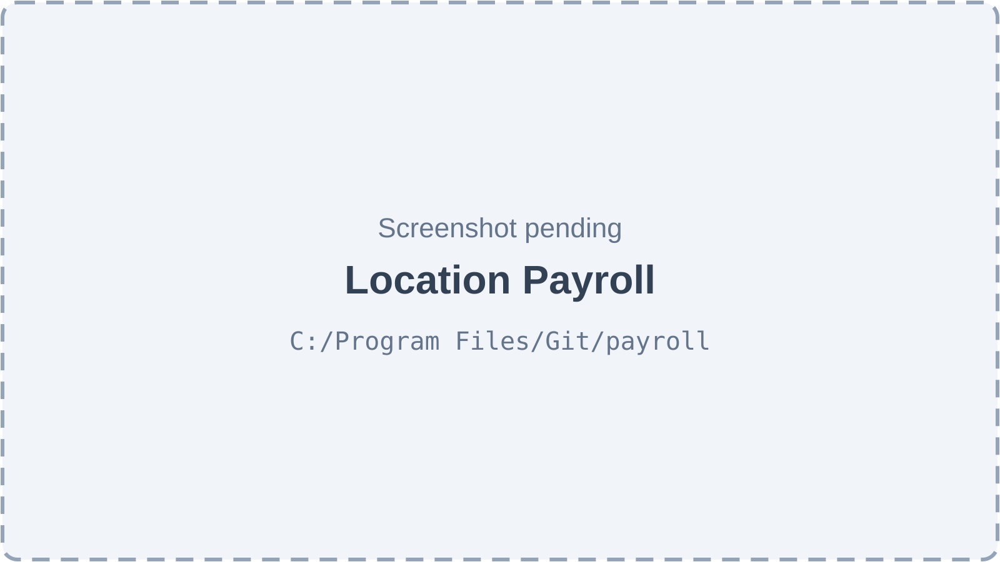
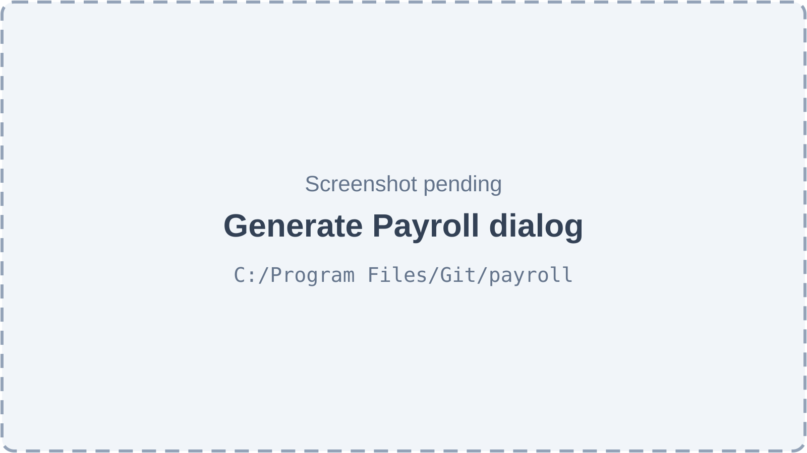
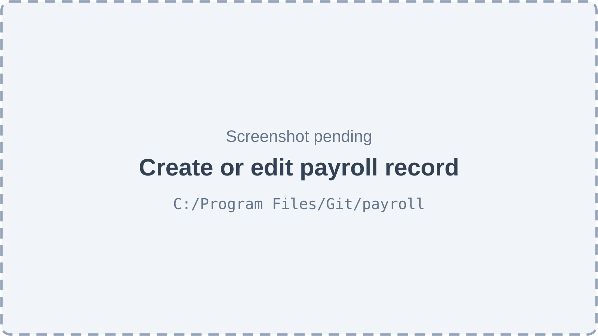
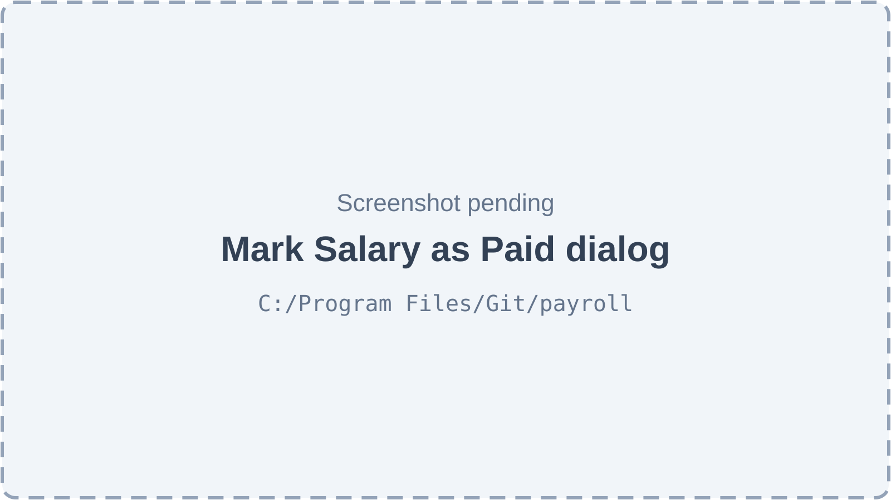
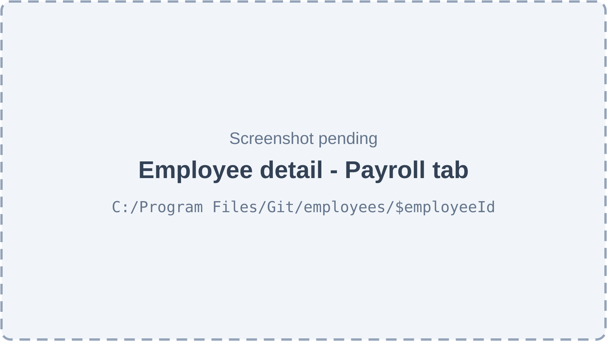
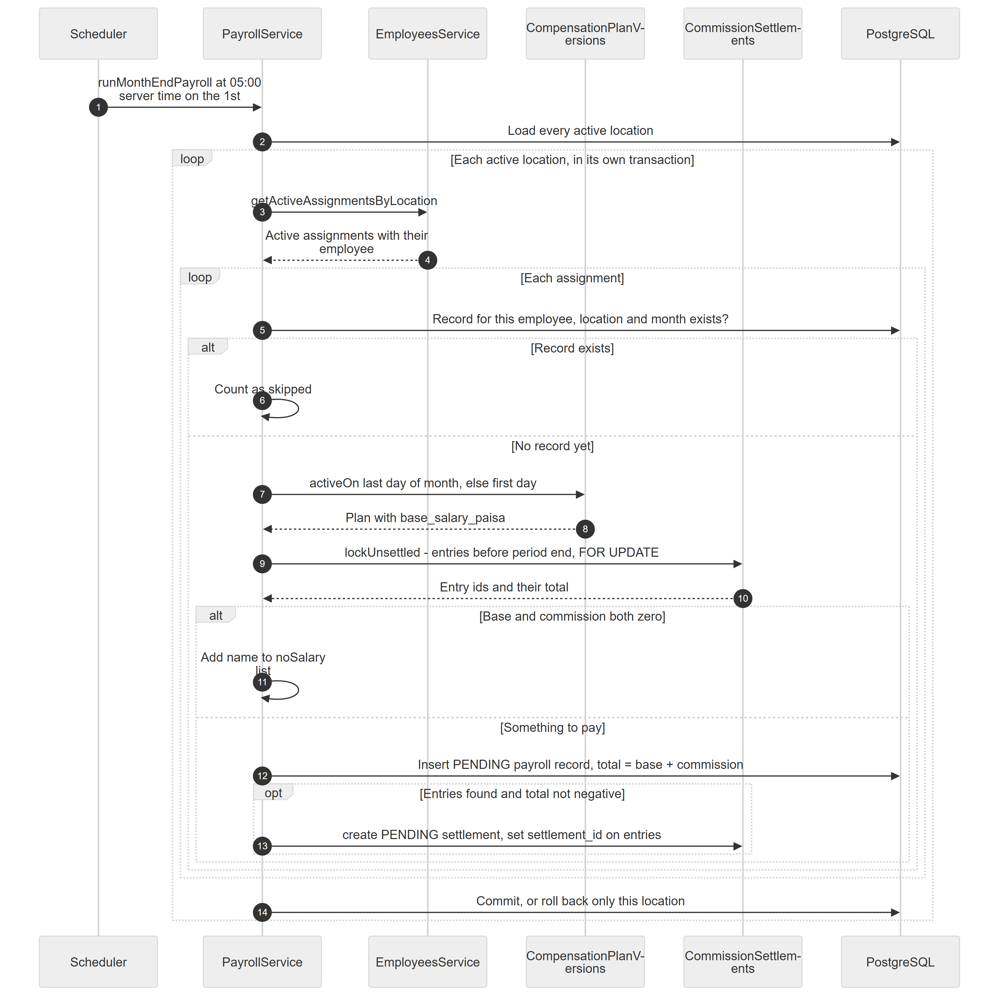
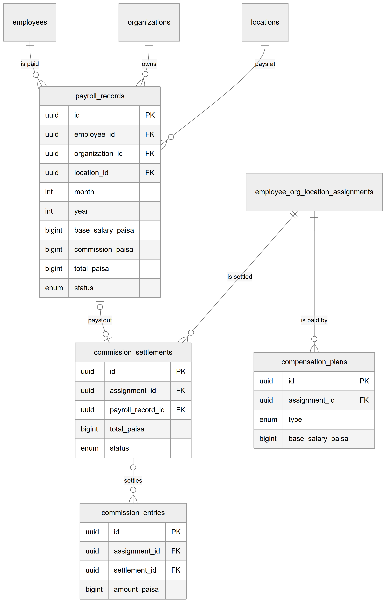
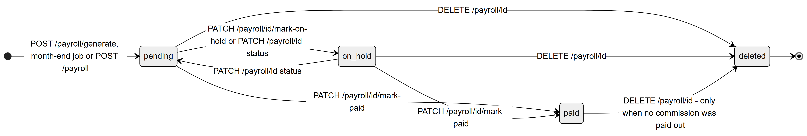

# Chapter 38 — Payroll

This chapter describes the Payroll module of the Platform: how a clinic turns each staff member's pay terms into one monthly payroll record, tracks it until it is paid, and exports it as a payslip or a spreadsheet. It is written for the product owner, who needs to know exactly how base salary and doctor commission are combined and which gaps remain. Payroll reads pay terms from the Employees module (Chapter 37) and commission from the Commissions module (Chapter 35).

## 38.1 What this module is for

A **payroll record** is one month's pay for one employee at one location. It stores a base salary, a commission amount and their total, all in integer paisa, plus a status (pending, paid, on hold), the payment method and reference once paid, and notes. There is at most one record per employee, location and month.

Records come from three sources: the automatic month-end job, the **Generate Payroll** action (all employees of the active location for a chosen month), and **Create Payroll** (one record typed in by hand).

Who uses it: the **Admin** and the **owner**. No other system role (Doctor, Receptionist, Assistant, Accountant) holds the permission by default. The permission `payroll.manage` is marked high-risk in the role editor.

Where it appears: the sidebar item **Payroll** (key `nav.payroll`, route `/payroll`, needs `payroll.manage`) in the **Team** section. The employee detail page also has a **Payroll** tab for the same permission. The whole module sits behind the feature **`hr.payroll`** ("Payroll", enabled by default).

## 38.2 Screens

*Figure 38.1 — The Location Payroll page (screenshot pending).*

The page title is "Location Payroll" with the subtitle "Manage monthly payroll for this location". In the header are a month selector, a year selector (current year minus two to plus two), a **Create Payroll** button and a **Generate Payroll** button. Under the header, four cards summarise the chosen month: Total Payroll (amount and "N employees"), Paid Amount ("N paid records"), Pending Amount ("N pending records") and On Hold ("Records on hold"). A heading "Records for October 2026" introduces a paged table with the columns Employee, Period, Amount (with a small "commission …" line when the record includes commission), Status (Pending, Paid or On Hold badge), Paid On, Method and an actions column. Actions are **Mark as Paid** (hidden once paid), an edit icon button ("Edit payroll") and a delete icon button ("Delete payroll"). An empty month shows "No payroll records found."

*Figure 38.2 — The Generate Payroll dialog (screenshot pending).*

The dialog says "Generate payroll records for all active employees at this location" and offers a Month and a Year selector and a note that existing records for the same month are skipped. After it runs, a toast lists how many records were created, how many already existed and the names of employees with no salary set.

*Figure 38.3 — The dialog for one payroll record (screenshot pending).*

The dialog has Employee (a searchable list when creating, read-only when editing), Month, Year, Amount, Status (Pending, Paid, On Hold) and Notes ("Reason for this payroll (e.g. mid-month joiner, bonus adjustment)…"). Choosing an employee pre-fills the amount with their current salary.

*Figure 38.4 — The Mark Salary as Paid dialog (screenshot pending).*

The dialog "Mark Salary as Paid" asks for Payment Method (cash, bank transfer or cheque), Reference Number ("Transaction ID or reference") and Notes (optional). On success a toast confirms the payment.

*Figure 38.5 — The Payroll tab of an employee (screenshot pending).*

The tab shows "Payroll History" with a **Generate This Month** button (when this month has no record and the person has a salary or a commission plan), the same table without the Employee column, or an empty state "No payroll records yet — Generate payroll to track monthly salaries" with a **Generate Payroll** button. Its Generate button opens the same dialog as the main page, which generates for the whole location, not only this person.

## 38.3 Features

### 38.3.1 Generate payroll for a month

**Status:** [Implemented]

**What it does.** Creates one pending payroll record for every active employee of the active location who has something to be paid for the chosen month, and settles that employee's unsettled commission into it.

**How the user does it.**
1. Open **Payroll** and choose the month and year.
2. Click **Generate Payroll**, check the month and year, and confirm.
3. Read the toast: records created, records skipped, employees with no salary.

**Behind the scenes — in simple terms.** For each active employee the Platform skips anyone who already has a record that month. Otherwise it takes the base salary from the pay plan in force at the end of the month, adds all the doctor's commission earned but not yet paid out, and saves one record. An employee with neither salary nor commission is listed as "no salary".

**Behind the scenes — technically.** `POST /payroll/generate` with `{ month, year }` → `PayrollService.generate` → `generateForLocation`. The month may not be in the future in the location's clinic calendar (400 "Cannot generate payroll for future months"). All work for the location runs in one transaction on a query runner; any error rolls back the whole location. Per active assignment (`EmployeesService.getActiveAssignmentsByLocation`) the steps are the same as in the month-end job drawn in Figure 38.6 and described in 38.3.2.

**Rules and validations.**
- Month 1–12, year at least 2020 (body); not in the future.
- Unique per employee, location and month (database constraint and a prior read).
- Base salary = `base_salary_paisa` of the compensation plan in force on the last day of the month, else on the first day; if the assignment has no plan at all, the deprecated `gross_salary` is used.
- Commission = sum of the assignment's unsettled `commission_entries` created before the end of the month's last clinic day (location timezone), locked `FOR UPDATE`. A net-negative sum is not settled and is carried to a later month; the record then has commission 0.
- Total = base + commission; `salary_amount` (rupees) mirrors the total.
- Nothing to pay (both zero) → no record; the name goes into `noSalary`.
- Records are created `pending`, with `created_by` = the user.

**Who can do it.** `payroll.manage`, feature `hr.payroll`. Default: Admin.

**Data read and written.** Reads `employee_org_location_assignments`, `employees`, `compensation_plans`, `commission_entries`. Writes `payroll_records`, `commission_settlements`, `commission_entries.settlement_id`.

**Effects on other modules.** Commission becomes "settled" on the earnings pages (Chapter 35).

**Error cases.** 400 "Cannot generate payroll for future months"; 400 validation messages for month or year; 403 `NO_PERMISSION`; 402 `SUBSCRIPTION_EXPIRED` in read-only mode.

**Technical references:** `backend/src/payroll/payroll.service.ts` · `PayrollService.generate`, `generateForLocation` · `web-app/src/features/employees/components/GeneratePayrollModal.tsx`

### 38.3.2 Month-end automatic generation

**Status:** [Implemented]

**What it does.** On the first day of every month the Platform generates payroll for the month that just ended, for every active location of every organization.

**How the user does it.** Nothing to do. Open Payroll afterwards and select the previous month. Records made this way have no `created_by`.

Figure 38.6 shows the job, including the commission settlement.

*Figure 38.6 — The month-end job, with commission settlement, per location and per assignment.*

The diagram has six participants: Scheduler, PayrollService, EmployeesService, CompensationPlanVersions, CommissionSettlements and PostgreSQL. In step 1 the scheduler calls `runMonthEndPayroll` at 05:00 server time on the 1st. In step 2 the service loads every active location. A first box, "loop: each active location, in its own transaction", contains the rest. Step 3 asks EmployeesService for the active assignments of the location and step 4 returns them with their employees. A second box, "loop: each assignment", opens with step 5, a check whether a record for this employee, location and month exists. An "alt" box has two branches. If a record exists (step 6) it is counted as skipped. Otherwise step 7 asks CompensationPlanVersions for the plan in force on the last day of the month, else the first day, and step 8 returns the plan with `base_salary_paisa`. Step 9 calls `lockUnsettled` on CommissionSettlements for entries before the period end with a row lock and step 10 returns the entry ids and their total. A nested "alt" box then decides: if base and commission are both zero (step 11) the name is added to the no-salary list; otherwise step 12 inserts a PENDING payroll record whose total is base plus commission, and an optional step 13, taken only when entries were found and their total is not negative, creates a PENDING settlement and sets `settlement_id` on the entries. Step 14, after the loops, commits the location, or rolls back only that location.

**Behind the scenes — in simple terms.** It is the same work as manual generation, run for every clinic in one go. If one clinic fails, the others still run. Running it twice, or after a manual generation, is safe because existing records are skipped.

**Behind the scenes — technically.** `PayrollService.runMonthEndPayroll`, decorated `@Cron('0 5 1 * *', { name: 'month-end-payroll' })` with no timezone option, so it fires at 05:00 server time on the 1st. The code comment above it says "00:05", which is wrong; the expression means 05:00 (the same conflict is noted in the scheduled-jobs appendix). The month is computed from the server's own `new Date()` (previous month, December of the previous year in January), not from each location's timezone. It loads `locations` with `is_active = true` (without checking that the organization is active or that `hr.payroll` is enabled), calls `generateForLocation(…, userId = null)` for each in a try/catch, and logs totals generated and skipped. It runs where scheduled jobs run (the worker or all-in-one process).

**Rules and validations.** Same as 38.3.1, except there is no future-month check and no user.

**Who can do it.** The scheduler; no permission.

**Data read and written.** As in 38.3.1.

**Effects on other modules.** As in 38.3.1.

**Error cases.** A location error is logged ("Month-end payroll failed for location …") and skipped; there is no in-app notification.

**Technical references:** `backend/src/payroll/payroll.service.ts` · `PayrollService.runMonthEndPayroll` · no web-app use

### 38.3.3 Create a payroll record by hand

**Status:** [Implemented]

**What it does.** Adds one record for a chosen employee and month, for example for a mid-month joiner or a bonus.

**How the user does it.**
1. Click **Create Payroll**.
2. Pick the employee, month, year, amount, status and notes; submit.

**Behind the scenes — in simple terms.** The amount you type is stored as the base salary with zero commission. This record does not settle any commission.

**Behind the scenes — technically.** `POST /payroll` → `PayrollService.createManual`: refuses a duplicate (400 "A payroll record already exists for this employee and period"), then inserts with `base_salary_paisa = total_paisa` = rupee amount converted to paisa (at most 2 decimals), `commission_paisa = 0`, status from the request (default pending) and the notes.

**Rules and validations.**
- Month 1–12, year at least 2020, amount at least 0.
- The server does not check that the employee has an assignment at this location, nor that the month is not in the future.
- Choosing status "Paid" here records no payment method, no paid date and no settlement change.

**Who can do it.** `payroll.manage`, feature `hr.payroll`. Default: Admin.

**Data read and written.** Reads `payroll_records`. Writes `payroll_records`.

**Effects on other modules.** None.

**Error cases.** 400 "A payroll record already exists for this employee and period"; 400 "Amount must have at most 2 decimals".

**Technical references:** `backend/src/payroll/payroll.service.ts` · `PayrollService.createManual` · `web-app/src/features/employees/components/CreateEditPayrollModal.tsx`

### 38.3.4 View payroll for a month or for one employee

**Status:** [Implemented]

**What it does.** Lists the month's records of the location with a summary, or all records of one employee.

**How the user does it.**
1. Open **Payroll** and pick a month and year, or open an employee's **Payroll** tab.

**Behind the scenes — in simple terms.** The four summary cards add up the month's records by status.

**Behind the scenes — technically.** `GET /payroll/location?month&year` → `PayrollService.findByLocation` returns the records (with the employee) and a summary: total employees, total amount, paid, pending and on-hold counts, paid and pending amounts and the paisa split into base and commission. A month outside 1–12 or a year outside 2000–2100, or a non-number, returns 400 "month must be 1–12" / "year must be a four-digit year". `GET /payroll/employee/:id` → `findByEmployee` returns the person's records in the organization, newest first.

**Rules and validations.**
- The summary uses the rupee amounts; records created before the paisa breakdown fall back to those.
- The location list is scoped to the active location; the per-employee list covers every location of the organization.

**Who can do it.** `payroll.manage`, feature `hr.payroll`. Default: Admin.

**Data read and written.** Reads `payroll_records`, `employees`.

**Effects on other modules.** None.

**Error cases.** 400 "month must be 1–12"; 400 "year must be a four-digit year".

**Technical references:** `backend/src/payroll/payroll.controller.ts` · `payrollPeriod`, `PayrollService.findByLocation` · `web-app/src/features/employees/pages/PayrollPage.tsx`

### 38.3.5 Mark a record as paid

**Status:** [Implemented]

**What it does.** Records that the salary was paid, how, and with what reference, and marks the linked commission settlement as paid.

**How the user does it.**
1. In the table, click **Mark as Paid**.
2. Choose Payment Method, enter a Reference Number and optional Notes, and confirm.

**Behind the scenes — in simple terms.** The record becomes paid with the time, the method and who paid it. In the same step the commission that was bundled into it is marked paid, so it can never be released again.

**Behind the scenes — technically.** `PATCH /payroll/:id/mark-paid` → `PayrollService.markPaid`, one transaction: loads the record in the organization, refuses a paid one (400 "Payroll already marked as paid"), sets status `paid`, `paid_at` = now, `payment_method` (cash, bank_transfer or cheque), `payment_reference`, `paid_by` and `notes` (the notes field is replaced, also by empty), then `CommissionSettlements.markPaid` sets the settlement to `PAID`.

**Rules and validations.**
- Payment method is required and must be one of the three values; reference and notes are optional text.
- An on-hold record can be paid.
- No money moves: the Platform records the payout, it does not make it, and it posts nothing to the general ledger or expenses.

**Who can do it.** `payroll.manage`, feature `hr.payroll`. Default: Admin.

**Data read and written.** Writes `payroll_records`, `commission_settlements`.

**Effects on other modules.** Settled commission appears as settled on the earnings pages (Chapter 35). The payroll cost report counts records by month (Chapter 36).

**Error cases.** 400 "Payroll already marked as paid"; 404 "Payroll record not found"; toast "Failed to mark as paid".

**Technical references:** `backend/src/payroll/payroll.service.ts` · `PayrollService.markPaid` · `web-app/src/features/employees/components/MarkPaidModal.tsx`

### 38.3.6 Put a record on hold

**Status:** [Partial] — the endpoint and the edit dialog's status field work, but no button calls `mark-on-hold`.

**What it does.** Marks a record as on hold, for example while a dispute is resolved.

**How the user does it.**
1. Click the edit icon on a record, set Status to **On Hold** and save.

**Behind the scenes — in simple terms.** On hold changes only the label and the summary counts. The commission stays tied to the record.

**Behind the scenes — technically.** `PATCH /payroll/:id/mark-on-hold` → `PayrollService.markOnHold` refuses a paid record (400 "Cannot put a paid payroll record on hold"). A client function for it exists in `payroll.api.ts`, but no hook or screen uses it. The edit dialog uses `PATCH /payroll/:id` (38.3.7).

**Rules and validations.** Not allowed on paid records.

**Who can do it.** `payroll.manage`, feature `hr.payroll`. Default: Admin.

**Data read and written.** Writes `payroll_records`.

**Effects on other modules.** None.

**Error cases.** 400 "Cannot put a paid payroll record on hold"; 404.

**Technical references:** `backend/src/payroll/payroll.service.ts` · `PayrollService.markOnHold` · `web-app/src/features/employees/services/payroll.api.ts`

### 38.3.7 Edit a payroll record

**Status:** [Implemented]

**What it does.** Changes the amount, month, year, status or notes of a record.

**How the user does it.**
1. Click the edit icon ("Edit payroll"), change fields and save.

**Behind the scenes — in simple terms.** The amount you edit is the total. Commission already inside the record stays as it is, and the difference is treated as base salary.

**Behind the scenes — technically.** `PATCH /payroll/:id` → `PayrollService.update`: for a new amount, total = paisa(amount); the amount may not be below `commission_paisa`; `base_salary_paisa = total − commission`. Month and year changes rebuild the period label. The save maps a unique-key clash (23505) to 400.

**Rules and validations.**
- Amount at least 0, at most 2 decimals; month 1–12; year at least 2020.
- Editing is allowed in any status, including paid.
- Setting the status to "paid" here does not set the paid date, method or reference and does not mark the settlement paid (see 38.7).

**Who can do it.** `payroll.manage`, feature `hr.payroll`. Default: Admin.

**Data read and written.** Writes `payroll_records`.

**Effects on other modules.** None.

**Error cases.** 400 "The amount cannot be below the commission already in this payroll"; 400 "A payroll record already exists for this employee and period"; 404 "Payroll record not found".

**Technical references:** `backend/src/payroll/payroll.service.ts` · `PayrollService.update` · `web-app/src/features/employees/components/CreateEditPayrollModal.tsx`

### 38.3.8 Delete a payroll record

**Status:** [Implemented]

**What it does.** Deletes a record and returns its commission to the unsettled pool, unless commission was already paid out.

**How the user does it.**
1. Click the delete icon ("Delete payroll") and accept the browser confirmation "Delete the payroll record for … ? This cannot be undone."

**Behind the scenes — in simple terms.** Deleting an unpaid record frees its commission so the next generation picks it up again. A record that paid out commission cannot be deleted.

**Behind the scenes — technically.** `DELETE /payroll/:id` → `PayrollService.remove`, one transaction: `CommissionSettlements.release` locks the settlement; `PENDING` → clears `settlement_id` on its entries and deletes the settlement; `PAID` → 400; none → nothing. Then the record is removed. The confirmation uses the browser's `window.confirm`, not the project's confirmation dialog.

**Rules and validations.** A paid record with no commission settlement (zero commission) can be deleted.

**Who can do it.** `payroll.manage`, feature `hr.payroll`. Default: Admin.

**Data read and written.** Deletes `payroll_records`, `commission_settlements`; updates `commission_entries`.

**Effects on other modules.** The commission appears as pending again on the earnings pages.

**Error cases.** 400 "This payroll paid out commission and cannot be deleted"; 404 "Payroll record not found".

**Technical references:** `backend/src/payroll/payroll.service.ts` · `PayrollService.remove` · `web-app/src/features/employees/components/PayrollTable.tsx`

### 38.3.9 Export a month as CSV

**Status:** [Partial] — the endpoint works; no button in the web app calls it.

**What it does.** Returns a CSV file for one month at the active location.

**How the user does it.** Not available in the web app. The API can be called directly.

**Behind the scenes — in simple terms.** One row per record with base salary, commission, gross, deductions, net, status, method and paid date.

**Behind the scenes — technically.** `GET /payroll/export?month&year` → `PayrollExportService.generatePayrollSummaryCsv` with the same month and year validation (400). Columns: Employee Name, Designation, Base Salary, Commission, Gross Pay, Deductions, Net Pay, Status, Payment Method, Paid Date. Deductions are always 0.00 and net equals gross. Designation reads a field the employee record does not have, so the column is empty. Response type `text/csv`, file name `payroll-<year>-<month>.csv`.

**Rules and validations.** Active location only. Amounts come from paisa.

**Who can do it.** `payroll.manage`, feature `hr.payroll`. Default: Admin.

**Data read and written.** Reads `payroll_records`, `employees`.

**Effects on other modules.** None.

**Error cases.** 400 "month must be 1–12" / "year must be a four-digit year".

**Technical references:** `backend/src/payroll/payroll-export.service.ts` · `PayrollExportService.generatePayrollSummaryCsv` · none

### 38.3.10 Payslip PDF

**Status:** [Partial] — the endpoint works; no button in the web app calls it.

**What it does.** Returns a one-page A4 PDF payslip for one record.

**How the user does it.** Not available in the web app.

**Behind the scenes — in simple terms.** The slip shows the period, the employee, base salary, commission, gross pay, deductions (always zero), net pay, status, payment method and paid date.

**Behind the scenes — technically.** `GET /payroll/:id/payslip-pdf` → `PayrollExportService.generatePayslipPdf`, built with `pdf-lib` and Helvetica (Latin text only). Returned inline as `application/pdf`, file name `payslip-<period>.pdf`. Records from before the paisa breakdown show their whole amount as base salary. The designation line is skipped because the employee record has none.

**Rules and validations.** The record must belong to the organization.

**Who can do it.** `payroll.manage`, feature `hr.payroll`. Default: Admin.

**Data read and written.** Reads `payroll_records`, `employees`.

**Effects on other modules.** None.

**Error cases.** 404 "Payroll record not found".

**Technical references:** `backend/src/payroll/payroll-export.service.ts` · `PayrollExportService.generatePayslipPdf` · none

### 38.3.11 Deductions, tax and bank files

**Status:** [Not implemented]

**What it does.** Nothing. There are no deductions, advances, loans, taxes, overtime or bank payment files; the "Deductions" column is a fixed zero, and unpaid leave does not reduce pay.

**How the user does it.** Not available.

**Behind the scenes — in simple terms.** Pay is base salary plus commission, nothing else.

**Behind the scenes — technically.** `PayrollRecord` has no deduction columns; the export functions print `0.00`.

**Rules and validations.** None.

**Who can do it.** Not applicable.

**Data read and written.** None.

**Effects on other modules.** None.

**Error cases.** None.

**Technical references:** `backend/src/payroll/payroll-export.service.ts` · `PayrollExportService` · none

## 38.4 Entities and data model

*Figure 38.7 — The payroll record and the tables that feed it.*

The diagram has `payroll_records` at the top, showing `id`, `employee_id`, `organization_id`, `location_id`, `month`, `year`, `base_salary_paisa`, `commission_paisa`, `total_paisa` and `status`. Three lines come into it from `employees` ("is paid"), `organizations` ("owns") and `locations` ("pays at"). A one-to-one optional line labelled "pays out" connects it to `commission_settlements` (`assignment_id`, `payroll_record_id`, `total_paisa`, `status`). `commission_settlements` has an optional one-to-many line "settles" to `commission_entries` (`assignment_id`, `settlement_id`, `amount_paisa`), and a line "is settled" from `employee_org_location_assignments` (shown only as a relationship). The same assignment has a line "is paid by" to `compensation_plans` (`type`, `base_salary_paisa`).

The relationships in words:

- Each payroll record belongs to one employee, one organization and one location. Deleting any of them deletes the record (ON DELETE CASCADE).
- A record is unique per employee, location, month and year.
- A record has at most one commission settlement; the settlement's link to the record is ON DELETE RESTRICT, so a record that has one cannot be removed by a plain database delete. The service releases and deletes the settlement first.
- A settlement groups entries of one assignment; entries only point to it and are never changed otherwise.
- The base salary is copied from the compensation plan at generation time. Later plan changes do not change existing records.
- Columns: `period_label` (for example "October 2026"), `salary_amount` (rupee decimal mirror of the total), the three paisa columns, `status`, `paid_at`, `payment_method`, `payment_reference`, `paid_by`, `notes`, `created_by` (empty for the job).

## 38.5 Status lifecycles

*Figure 38.8 — The states of a payroll record.*

The diagram has three stored states and a "deleted" end state. A record enters **pending** through `POST /payroll/generate`, the month-end job or `POST /payroll`. From pending, `PATCH …/mark-paid` leads to **paid**, and `PATCH …/mark-on-hold` or a `PATCH /payroll/:id` with a status change leads to **on_hold**. From on_hold, `PATCH …/mark-paid` leads to paid, and a status edit leads back to pending. Pending and on_hold lead to deleted through `DELETE /payroll/:id`; paid leads to deleted only when no commission was paid out. Deleted leads to the end marker.

- **pending** — generated and waiting for payment; its commission settlement, if any, is `PENDING`.
- **on_hold** — set aside; nothing else changes.
- **paid** — payment method, reference, date and payer recorded; the settlement is `PAID`. Editing is still possible.

## 38.6 Connections to other modules

- **Employees (Chapter 37).** Payroll runs over active assignments and reads their plans; the employee page has a Payroll tab.
- **Commissions (Chapter 35).** Settlement lock, mark paid and release.
- **Dashboard and reports (Chapter 36).** The payroll and staff-cost reports and the finance overview read `payroll_records` by month.
- **Subscriptions (Chapter 45).** Read-only mode refuses generation, edits and payments with 402.
- **Scheduled jobs (Chapter 63).** The month-end job is one of the timed jobs.

## 38.7 Limitations and known gaps

- The month-end job's code comment says 00:05; the schedule is 05:00 server time, and the month is taken from server time, not from each location's timezone.
- The job does not check that the organization is active or that `hr.payroll` is on.
- Marking a record paid through the edit dialog's Status field does not pay the commission settlement; a later delete would then release the commission back to the pool.
- Manual creation does not check the assignment or the month, and a hand-made record carries no commission.
- Payslip PDF and CSV export have no button.
- On-hold has no button; the delete confirmation is a browser dialog.
- Designation is empty on exports.
- No deductions, tax, overtime or unpaid-leave handling; no general-ledger posting for salary payment.
- Payroll changes are not written to the general audit log.

## 38.8 Owner's FAQ

**When does payroll run by itself?** At 05:00 server time on the 1st of each month, for the month that just ended, at every active location.

**What if I generate manually first?** Safe: existing records are skipped, so the job and manual runs never double up.

**A doctor is paid only commission. Will they get a record?** Yes, if they have unsettled commission of zero or more. A commission-only doctor with no earnings gets none and appears in the "no salary" list.

**What happens to commission reversed after payroll was paid?** It becomes a negative entry that is settled with the next payroll, reducing it.

**Can I delete a paid record?** Only if it paid out no commission.

**Can I change the amount after generating?** Yes, with the edit icon; it may not go below the commission in the record.

**Can I get a payslip?** The endpoint exists, but the web app has no button yet.

**Is the unique rule per person or per branch?** Per person per branch per month: a doctor at two branches gets two records.
