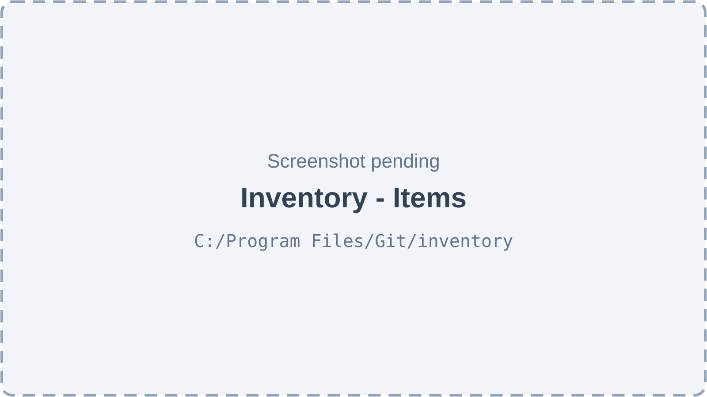
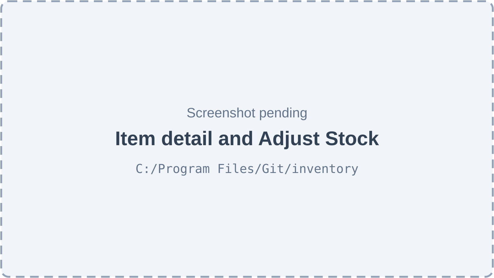
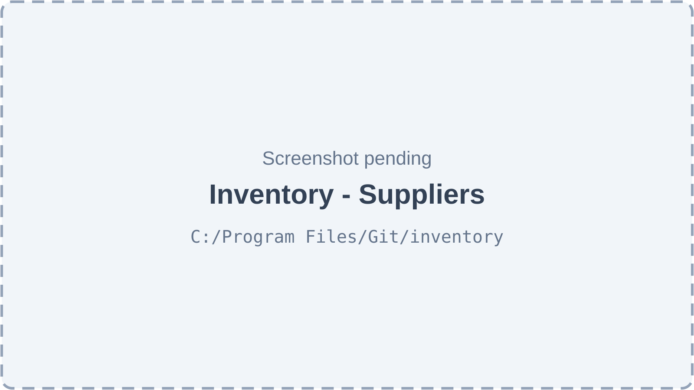
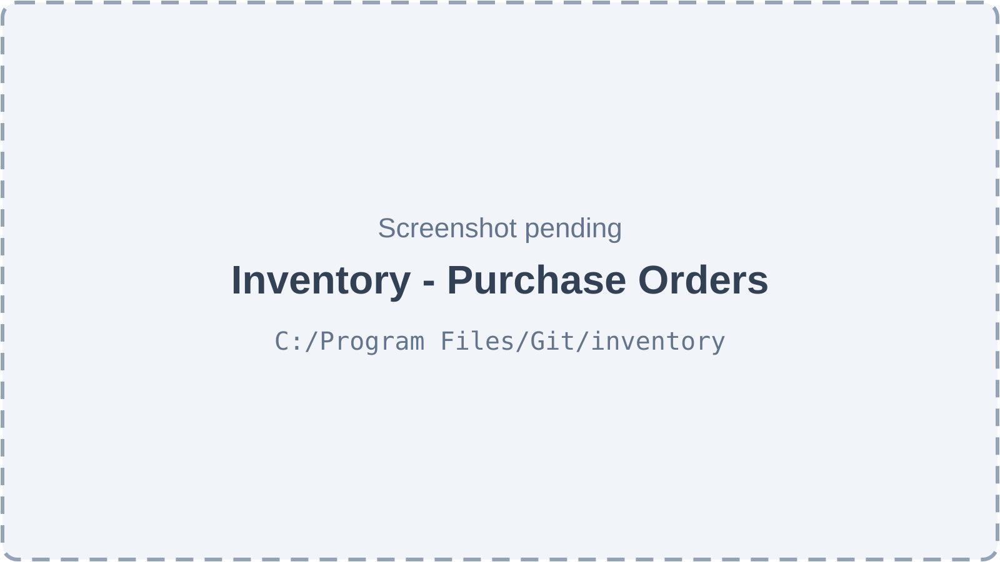
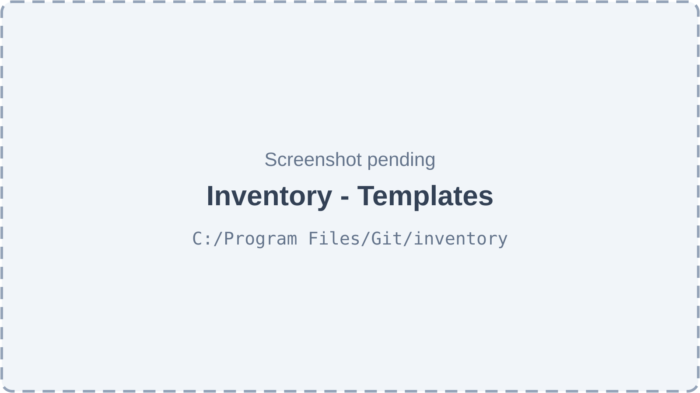
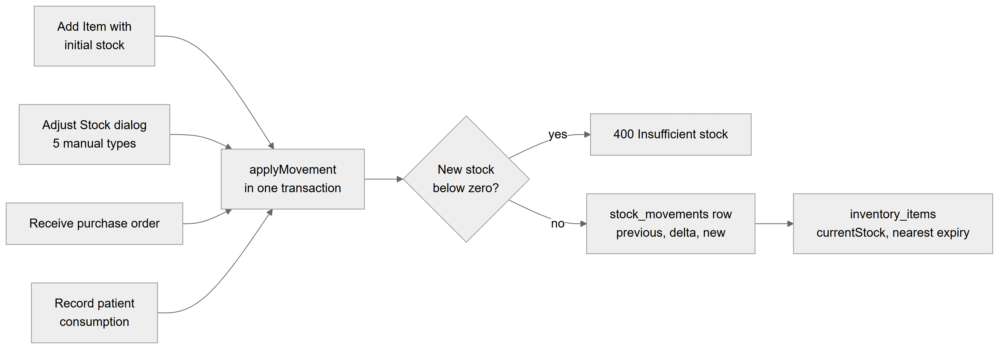
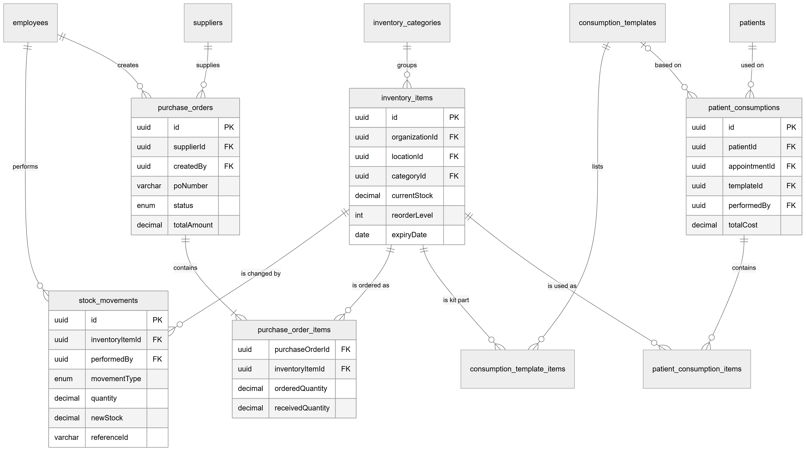
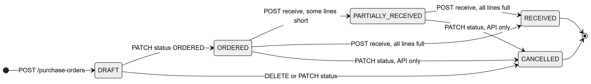

# Chapter 39 — Inventory

This chapter describes the Inventory module of the Platform: how a clinic keeps a list of its supplies, tracks how much of each it holds, buys more from suppliers through purchase orders, and defines kits of materials used per procedure. It is written for the product owner, who needs to know exactly what works today and where the module stops. Inventory is a per-location module; it has a complete set of screens, but no sidebar entry, and several of its write paths carry an unverified risk that is explained in full.

## 39.1 What this module is for

The module keeps a stock list for each location. Every change of quantity is recorded as a **stock movement**, so the clinic can always see who changed what, when and why. Staff can:

- add items (gloves, composite, anaesthetic cartridges…) with a unit, cost, reorder level and expiry date;
- correct stock by hand, write off wastage, record transfers and returns;
- keep a list of suppliers and raise purchase orders, then receive the goods into stock;
- define **consumption templates** (kits of items used for a procedure).

Who uses it: the **Admin** role (all actions) and the **Assistant** role (view only). Doctor, Receptionist and Accountant have no inventory permission by default.

Where it appears: **no sidebar entry**. The page `/inventory` exists and is protected by `inventory.view`, but `web-app/src/features/access/nav/nav.registry.ts` has no item for it, and no other screen links to it. Users reach it only by typing the address. The component that would record materials used on a patient (`ConsumptionRecorder`) is exported but not placed on any screen, so the consultation and patient screens offer no link either.

Two features exist: `inventory.core` ("Inventory", off by default) gates every permission of the module; `inventory.alerts` ("Inventory Alerts", off by default) only switches on the daily alert job.

## 39.2 Screens

The page title is "Inventory Management" with the subtitle "Track supplies, suppliers, purchase orders and consumption". Without an active location it shows "Select a location first". Above four tabs (**Items**, **Suppliers**, **Purchase Orders**, **Templates**) sits a strip of five tiles: Total Items, Total Value (stock × cost price), Low Stock, Expiring (within 30 days) and Out of Stock.

*Figure 39.1 — Inventory, Items tab (screenshot pending).*

The Items tab has a search box ("Search name or SKU…"), a category filter ("All categories"), two toggle buttons **Low Stock** and **Expiring**, and an **Add Item** button for users with `inventory.stock.adjust`. The table shows Name, SKU, Category, Stock (for example "12 / 10 pieces", coloured red when at or below the reorder level, amber up to twice that level, green above, or "Out of stock"), Unit Price and Expiry (a red "Expired" badge or a warning when within 30 days). A three-dot menu per row offers **Edit item**, **Adjust stock**, **View movements** and **Deactivate** (the last asks a browser confirmation "Deactivate "…"?"). Pages of 20 with **Previous** / **Next**. The **Add Item** / edit form is a dialog with Name, SKU, Category, Initial Stock (new items only), Unit, Cost Price, Reorder Level, Expiry Date, a **Billable to patient** switch with Selling Price, and Description.

*Figure 39.2 — Item detail sheet and the Adjust Stock dialog (screenshot pending).*

Clicking a row opens a side sheet with the item name, SKU, Category, Unit, Cost Price, Selling Price, Expiry, Current Stock against the reorder level, an **Adjust Stock** button and a "Stock Movements" table (Date, Type, Qty, After, Notes) of the ten most recent movements. The Adjust Stock dialog, titled "Adjust Stock — <item>", offers Reason (Manual Adjustment, Wastage, Return to Supplier, Transfer In, Transfer Out), Quantity, Direction (Increase or Decrease, for manual adjustments), Batch Number and Expiry Date (for incoming stock), Notes (required for manual adjustment and wastage), and a preview "Current: 12 → New: 9".

*Figure 39.3 — Inventory, Suppliers tab (screenshot pending).*

The Suppliers tab lists Name, Contact Person, Phone, Email and City, with **Add Supplier** for users with `inventory.po.manage` and a row menu to edit or deactivate. The supplier dialog has Name (required), Contact Person, Phone, Email, City, Address, Website and Notes ("Payment terms, delivery schedule…").

*Figure 39.4 — Inventory, Purchase Orders tab with its dialogs (screenshot pending).*

The Purchase Orders tab has status buttons All, Draft, Ordered, Partial and Received (no Cancelled filter) and **Create PO**. The table shows PO #, Supplier, Order Date, Expected, Items, Total and Status. The "Create Purchase Order" dialog takes a supplier, Expected Delivery, items with Qty and Unit Price, Tax Rate (%) and Notes, and shows Subtotal, Tax and Total. Clicking a PO opens a sheet with its status badge, the lines (Item, Ordered, Received, Unit Price, Total) and buttons by status: **Mark as Ordered** and **Cancel** for a draft, **Receive Items** (or **Receive More Items**) for an ordered or partly received PO. The "Receive Items — PO-…" dialog asks per line for "Receiving now", Batch # and Expiry.

*Figure 39.5 — Inventory, Templates tab (screenshot pending).*

The Templates tab lists Template, Procedure, Appointment Type and Items, with **Add Template**, edit and deactivate actions for users with `inventory.stock.adjust`. The template dialog has a name ("Root Canal Kit"), a procedure ("Root Canal"), "Appointment Type (for auto-matching)" and "Add Items to Kit" with quantity and notes per item.

## 39.3 Features

### 39.3.1 Browse stock and see stock health

**Status:** [Partial] — works; reachable only by typing `/inventory` (no sidebar entry).

**What it does.** Lists the active items at the active location with search, category, low-stock and expiring filters, and shows five stock-health tiles.

**How the user does it.**
1. Type the address `/inventory`.
2. Search, pick a category, or toggle **Low Stock** / **Expiring**.

**Behind the scenes — in simple terms.** Low stock means more than zero but at or below the reorder level. Expiring means the item's nearest expiry date is within 30 days (already expired items count too). Total value is quantity times the last cost price.

**Behind the scenes — technically.** `GET /inventory/items` (`InventoryService.findAll`, paged, default 20, `ILIKE` on name and SKU) and `GET /inventory/items/stats` (`getStats`). Separate endpoints `GET /inventory/items/low-stock`, `/expiring?daysAhead=30` and `/out-of-stock` exist; the web app has hooks for two of them but no component calls them. `GET /inventory/categories` fills the category filter.

**Rules and validations.**
- Active location and active items only.
- The 30-day window uses the server's date, not the location's; the per-item `expiryAlertDays` setting is stored but not used.
- The search box is not debounced; each keystroke queries.

**Who can do it.** `inventory.view`, feature `inventory.core`. Default: Admin, Assistant.

**Data read and written.** Reads `inventory_items`, `inventory_categories`.

**Effects on other modules.** None.

**Error cases.** 403 `NO_PERMISSION`; the page shows "No items found" for an empty result (no separate filtered-empty message).

**Technical references:** `backend/src/inventory/controllers/inventory.controller.ts` · `InventoryService.findAll`, `getStats` · `web-app/src/features/inventory/components/ItemsTab.tsx`

### 39.3.2 Add, edit and deactivate an item

**Status:** [Partial] — adding without stock, editing and deactivating work; adding with an initial stock goes through the stock-movement path whose foreign-key risk is described in 39.3.4 ([Unverified]).

**What it does.** Creates a stock item at the active location, edits its details, or hides it (soft delete).

**How the user does it.**
1. Click **Add Item**, fill the dialog and save; or choose **Edit item** in the row menu.
2. To remove, choose **Deactivate** and confirm.

**Behind the scenes — in simple terms.** A new item starts at zero. If an initial stock is entered, an "initial stock" movement is recorded right after. Editing can never change the quantity; only movements can.

**Behind the scenes — technically.** `POST /inventory/items` → `InventoryService.create` (SKU uniqueness check per organization, save with `currentStock = 0`, then `adjustStock` with `INITIAL_STOCK` when `initialStock > 0`; these are two separate steps, not one transaction). `PATCH /inventory/items/:id` → `update` (drops `currentStock` from the payload). `DELETE /inventory/items/:id` → `deactivate` (sets `isActive = false`).

**Rules and validations.**
- Name, unit, cost price and initial stock (0 or more) are required by the API; reorder level defaults to 10, reorder quantity to 50, expiry alert days to 30.
- SKU must be unique within the organization (checked in code, not by a database constraint).
- Units: pieces, boxes, pairs, rolls, bottles, packets, cartridges, tubes, ml, gm, kg, liters.
- "Billable to patient" and the selling price are stored, but no billing screen uses them.

**Who can do it.** `inventory.stock.adjust` (implies `inventory.view`), feature `inventory.core`. Default: Admin.

**Data read and written.** Writes `inventory_items` (and `stock_movements` for initial stock).

**Effects on other modules.** None.

**Error cases.** 409 "An item with SKU "GLV-M-001" already exists"; 404 "Inventory item not found"; in the dialog "Name is required".

**Technical references:** `backend/src/inventory/services/inventory.service.ts` · `InventoryService.create`, `update`, `deactivate` · `web-app/src/features/inventory/components/ItemFormDialog.tsx`

### 39.3.3 Manage categories

**Status:** [Partial] — the API supports create, rename and deactivate; the web app only lists categories, so there is no way to create one from a screen.

**What it does.** Groups items (for example "Consumables", "Anaesthetics") for filtering.

**How the user does it.** Only pick an existing category in the item form or the filter. No screen creates categories, and the default-category seeding function is never called, so a new organization has none.

**Behind the scenes — in simple terms.** Categories are shared by all locations of an organization.

**Behind the scenes — technically.** `POST /inventory/categories`, `GET`, `PATCH /inventory/categories/:id`, `DELETE` (deactivate) → `InventoryCategoryService`. `seedDefaults` exists but has no caller. The web hooks `useCreateCategory`, `useUpdateCategory`, `useDeleteCategory` are not used by any component.

**Rules and validations.** Organization-wide; deactivated categories are hidden. Deleting a category row in the database sets items' category to null.

**Who can do it.** View: `inventory.view`; change: `inventory.stock.adjust`. Feature `inventory.core`.

**Data read and written.** `inventory_categories`.

**Effects on other modules.** None.

**Error cases.** 404 "Category not found".

**Technical references:** `backend/src/inventory/services/inventory-category.service.ts` · `InventoryCategoryService` · `web-app/src/features/inventory/hooks/useCategories.ts`

### 39.3.4 Adjust stock and keep the movement history

**Status:** [Unverified] — the logic is complete and the screen calls it, but the code stores the signed-in user's id in `stock_movements.performedBy`, a column with a foreign key to `employees`. User ids and employee ids are different records on the Platform, so the insert is expected to fail with a database error. Not run or tested.

**What it does.** Changes an item's quantity for a stated reason and records the change as a stock movement with the stock before and after.

**How the user does it.**
1. Choose **Adjust stock** in the row menu, or **Adjust Stock** in the item sheet.
2. Pick the Reason, enter the Quantity (and Direction for a manual adjustment), optional Batch Number and Expiry Date, and Notes when required.
3. Check the "Current → New" preview and save.
4. Open the item (or **View movements**) to see the last ten movements.

*Figure 39.6 — All four ways stock changes go through one method.*

On the left are four sources: "Add Item with initial stock", "Adjust Stock dialog 5 manual types", "Receive purchase order" and "Record patient consumption". All four arrows meet at "applyMovement in one transaction". From there a diamond asks "New stock below zero?". "Yes" leads to "400 Insufficient stock". "No" leads to "stock_movements row previous, delta, new" and then to "inventory_items currentStock, nearest expiry", meaning the movement is saved first and the item's quantity and nearest expiry date are then updated.

**Behind the scenes — in simple terms.** Incoming types (transfer in, purchase, initial stock) add; outgoing types (wastage, transfer out, return to supplier, consumption) subtract; a manual adjustment can go either way. Stock may never go below zero. When a batch arrives with an expiry date earlier than the item's current one, the item's expiry date moves to that earlier date. The movement list is the audit trail of stock; there is no other log.

**Behind the scenes — technically.** `POST /inventory/items/:id/adjust-stock` → `InventoryService.adjustStock` → `applyMovement` inside `dataSource.transaction`. It loads the item (organization and location), computes the signed delta, refuses a negative result, inserts the `stock_movements` row (`movementType`, signed `quantity`, `previousStock`, `newStock`, `referenceType`, `referenceId`, batch, expiry, notes, `performedBy`) and saves the item. The item row is read without a row lock, so two adjustments at the same instant could both read the same starting stock. The controller passes `req.user.uuid` (the user id) as `performedBy`. Movement history: the item detail returns the last 10 movements; `GET /inventory/items/:id/movements` (paged) exists but no screen calls it.

**Rules and validations.**
- The dialog allows only MANUAL_ADJUSTMENT, WASTAGE, RETURN_TO_SUPPLIER, TRANSFER_IN, TRANSFER_OUT.
- Notes are required for manual adjustment and wastage.
- Quantity must be greater than zero in the dialog; resulting stock must not be negative.
- Transfers are recorded at one location only; nothing is added at the other location.

**Who can do it.** `inventory.stock.adjust`, feature `inventory.core`. Default: Admin.

**Data read and written.** Writes `stock_movements`, `inventory_items`.

**Effects on other modules.** None (stock is not linked to billing or the consultation).

**Error cases.** 400 "Notes are required for wastage and manual adjustments"; 400 "Insufficient stock for "Gloves". Available: 3 pieces"; 400 on a disallowed movement type; in the dialog "Enter a quantity greater than zero", "Adjustment would take stock below zero".

**Technical references:** `backend/src/inventory/entities/stock-movement.entity.ts` · `InventoryService.adjustStock`, `applyMovement`, `StockMovementType` · `web-app/src/features/inventory/components/AdjustStockDialog.tsx`

### 39.3.5 Manage suppliers

**Status:** [Partial] — works; reachable only through the unlisted `/inventory` page.

**What it does.** Keeps the organization's supplier list for purchase orders.

**How the user does it.**
1. On the **Suppliers** tab click **Add Supplier**, fill the dialog and save.
2. Use the row menu to edit or deactivate (with a browser confirmation).

**Behind the scenes — in simple terms.** Suppliers are shared by all locations of the organization; deactivation hides them.

**Behind the scenes — technically.** `POST /suppliers`, `GET /suppliers`, `GET /suppliers/:id`, `PATCH /suppliers/:id`, `DELETE /suppliers/:id` (sets `isActive = false`) → `SupplierService`.

**Rules and validations.** Name required; other fields free text with no format checks.

**Who can do it.** View: `inventory.view`; change: `inventory.po.manage`. Feature `inventory.core`. Default: Admin manages; Assistant views.

**Data read and written.** `suppliers`.

**Effects on other modules.** None.

**Error cases.** 404 "Supplier not found"; "Name is required" in the dialog.

**Technical references:** `backend/src/inventory/controllers/supplier.controller.ts` · `SupplierService` · `web-app/src/features/inventory/components/SuppliersTab.tsx`

### 39.3.6 Raise and track a purchase order

**Status:** [Unverified] — screens and logic exist; creation stores the user id in `purchase_orders.createdBy`, which has a foreign key to `employees` (same risk as 39.3.4). Also, PO numbers are unique across the whole database but numbered per organization, so the second organization's first order in a year would collide (deduced from code).

**What it does.** Records an order to a supplier with lines, quantities, prices and tax, and moves it through Draft → Ordered.

**How the user does it.**
1. On **Purchase Orders** click **Create PO**, choose a supplier, add items with Qty and Unit Price, optional Expected Delivery, Tax Rate and Notes, and save. The PO starts as Draft.
2. Open it and click **Mark as Ordered**, or **Cancel** while still a draft.

**Behind the scenes — in simple terms.** The server numbers the order (for example "PO-2026-00001"), computes each line total, the subtotal, the tax and the total.

**Behind the scenes — technically.** `POST /purchase-orders` → `PurchaseOrderService.create`: `generatePoNumber` takes the organization's latest PO and adds one (`PO-<year>-<5 digits>`), lines get `totalPrice = qty × price` rounded to 2 decimals, `taxAmount = subtotal × rate / 100`. `GET /purchase-orders` (status and supplier filters, paged), `GET /purchase-orders/:id`. `PATCH /purchase-orders/:id/status` checks `VALID_PO_TRANSITIONS`. `DELETE /purchase-orders/:id` cancels a draft. `poNumber` has a unique index over the whole table.

**Rules and validations.**
- At least one line in the dialog; ordered quantity ≥ 1; unit price ≥ 0.
- The sequence continues across years (the counter is not reset), and two orders created at the same moment could get the same number.
- Line items are not checked to belong to the organization.

**Who can do it.** View: `inventory.view`; create and change: `inventory.po.manage` (implies `inventory.view`). Feature `inventory.core`. Default: Admin.

**Data read and written.** Writes `purchase_orders`, `purchase_order_items`.

**Effects on other modules.** None; purchase orders are not linked to expenses or lab payables, and do not appear in the P&L.

**Error cases.** 400 "Cannot transition purchase order from RECEIVED to ORDERED"; 400 "Only draft purchase orders can be cancelled"; 404 "Purchase order not found"; dialog "Select a supplier", "Add at least one item".

**Technical references:** `backend/src/inventory/services/purchase-order.service.ts` · `PurchaseOrderService.create`, `updateStatus`, `VALID_PO_TRANSITIONS` · `web-app/src/features/inventory/components/PurchaseOrdersTab.tsx`

### 39.3.7 Receive goods into stock

**Status:** [Unverified] — goes through the stock-movement path of 39.3.4 with the same foreign-key risk.

**What it does.** Records quantities that arrived against an ordered PO, adds them to stock with batch and expiry, updates the item's cost price, and sets the PO to Partially Received or Received.

**How the user does it.**
1. Open an Ordered or Partial PO and click **Receive Items** (or **Receive More Items**).
2. Enter "Receiving now", Batch # and Expiry per line, and save.

**Behind the scenes — in simple terms.** Each line can be received in several deliveries, but never more than ordered. Each received line adds a "purchase in" movement. When every line is complete the order becomes Received.

**Behind the scenes — technically.** `POST /purchase-orders/:id/receive` → `PurchaseOrderService.receiveItems` in one transaction: per line with quantity > 0, check `received + new ≤ ordered`, update the PO line, call `applyMovement` with `PURCHASE_IN` and reference `purchase_order`/PO id, and set `inventory_items.unitPrice` to the line price. Then it recomputes the status from all lines.

**Rules and validations.**
- Only from ORDERED or PARTIALLY_RECEIVED.
- No over-receiving; a zero line is skipped.

**Who can do it.** `inventory.po.manage`, feature `inventory.core`. Default: Admin.

**Data read and written.** Writes `purchase_order_items`, `purchase_orders`, `stock_movements`, `inventory_items`.

**Effects on other modules.** None.

**Error cases.** 400 "Cannot receive items for a purchase order in DRAFT status"; 400 "Cannot receive more than ordered for "…". Ordered: 10, already received: 8"; 404 "Purchase order item … not found"; dialog "Enter at least one quantity to receive".

**Technical references:** `backend/src/inventory/services/purchase-order.service.ts` · `PurchaseOrderService.receiveItems` · `web-app/src/features/inventory/components/PurchaseOrdersTab.tsx`

### 39.3.8 Define consumption templates (procedure kits)

**Status:** [Partial] — templates can be created, edited and deactivated, but nothing on any screen uses them, because the consumption recorder is not placed anywhere.

**What it does.** Defines a named kit of items and quantities for a procedure, optionally tied to an appointment type for automatic matching.

**How the user does it.**
1. On **Templates** click **Add Template**, enter name and procedure, optionally an appointment type, add items with quantities and notes, and save.
2. Edit or deactivate from the row actions.

**Behind the scenes — in simple terms.** A template is a list, not stock; saving it changes no quantities.

**Behind the scenes — technically.** `POST /consumption-templates`, `GET`, `GET /consumption-templates/:id`, `PATCH` (replaces all items in one transaction), `DELETE` (deactivate), `GET /consumption-templates/by-type?appointmentType=` (first active template for that type) → `ConsumptionTemplateService`. Items load the inventory item eagerly.

**Rules and validations.** Name and procedure required; at least one item in the dialog; item quantity ≥ 0.01. Templates are organization-wide, but items belong to one location, so a template made at one location lists that location's items.

**Who can do it.** View: `inventory.view`; change: `inventory.stock.adjust`. Feature `inventory.core`. Default: Admin.

**Data read and written.** `consumption_templates`, `consumption_template_items`.

**Effects on other modules.** None.

**Error cases.** 404 "Consumption template not found"; dialog "Name and procedure are required", "Add at least one item".

**Technical references:** `backend/src/inventory/services/consumption-template.service.ts` · `ConsumptionTemplateService` · `web-app/src/features/inventory/components/TemplatesTab.tsx`

### 39.3.9 Record materials used on a patient

**Status:** [Not implemented] in the web app — the API and a ready component exist, but no screen shows the component. The API path also carries the foreign-key risk of 39.3.4.

**What it does.** Would record which items were used for a patient (optionally for an appointment or treatment plan), price them at cost, and deduct them from stock.

**How the user does it.** Not available. `ConsumptionRecorder` (template picker, "Items Used", "Add Item", Notes) is exported from the inventory feature but imported by no page, including the consultation workspace and the patient record.

**Behind the scenes — in simple terms.** One record per use, with lines priced at the item's current cost; stock goes down in the same transaction, so either everything is saved or nothing is.

**Behind the scenes — technically.** `POST /patient-consumptions` → `PatientConsumptionService.recordConsumption`: per line, load the item at the location, snapshot `unitPrice`, compute totals, save `patient_consumptions` with items, then `applyMovement` with `CONSUMPTION` and reference `appointment`, `treatment_plan` or `manual`. Read endpoints: `GET /patient-consumptions/appointment/:appointmentId`, `GET /patient-consumptions/patient/:patientId` (checks the patient is in the user's scope), `GET /patient-consumptions/report?dateFrom&dateTo` (top 10 items, total cost, per performer, template versus manual). None of them is called by a screen.

**Rules and validations.** Quantity ≥ 0.01 per line; stock must not go negative; the treatment-plan id is stored without a foreign key.

**Who can do it.** Record: `inventory.stock.adjust`; read: `inventory.view`. Feature `inventory.core`.

**Data read and written.** `patient_consumptions`, `patient_consumption_items`, `stock_movements`, `inventory_items`.

**Effects on other modules.** None today (not billed, not shown on the encounter).

**Error cases.** 404 "Inventory item … not found"; 400 "Insufficient stock…".

**Technical references:** `backend/src/inventory/services/patient-consumption.service.ts` · `PatientConsumptionService.recordConsumption` · `web-app/src/features/inventory/components/ConsumptionRecorder.tsx`

### 39.3.10 Daily low-stock and expiry alerts

**Status:** [Partial] — the job runs and counts, but only writes a warning to the server log; no user is notified.

**What it does.** Once a day finds items that are low or expiring at each location where both inventory features are on.

**How the user does it.** Switch on `inventory.alerts` (and `inventory.core`) in **Features**. Nothing appears for users; the counts go to the server log only.

**Behind the scenes — in simple terms.** Every morning the server checks each location's stock. A notification for users is planned in a code comment but not built.

**Behind the scenes — technically.** `InventoryAlertService.checkAlerts`, `@Cron('0 8 * * *')`, every day at 08:00 server time (not the location's timezone), in the process that runs scheduled jobs (worker or all-in-one). For each organization–location pair with active items it checks both features, calls `getLowStockItems` and `getExpiringItems` (30 days) and logs "[Inventory Alerts] org=… location=… lowStock=… expiringSoon=…". A TODO notes that in-app notifications should go to members holding `inventory.view`.

**Rules and validations.** Fixed 30-day window; out-of-stock items are not counted as low.

**Who can do it.** The job, no user. Feature `inventory.alerts` (no permission belongs to it).

**Data read and written.** Reads `inventory_items`. Writes nothing.

**Effects on other modules.** None; the notifications module (Chapter 44) receives nothing.

**Error cases.** None visible to users.

**Technical references:** `backend/src/inventory/services/inventory-alerts.service.ts` · `InventoryAlertService.checkAlerts` · none

## 39.4 Entities and data model

*Figure 39.7 — The inventory tables and their links.*

The diagram centres on `inventory_items` (`id`, `organizationId`, `locationId`, `categoryId`, `currentStock`, `reorderLevel`, `expiryDate`). Above it, `inventory_categories` "groups" items. Left, `stock_movements` (`inventoryItemId`, `performedBy`, `movementType`, `quantity`, `newStock`, `referenceId`) records how items "are changed"; `employees` "performs" movements and "creates" `purchase_orders` (`supplierId`, `createdBy`, `poNumber`, `status`, `totalAmount`), which `suppliers` "supplies". `purchase_orders` "contains" `purchase_order_items` (`purchaseOrderId`, `inventoryItemId`, `orderedQuantity`, `receivedQuantity`), each pointing to an item. Right, `consumption_templates` "lists" `consumption_template_items` (each a kit part pointing to an item); `patients` are "used on" `patient_consumptions` (`patientId`, `appointmentId`, `templateId`, `performedBy`, `totalCost`), which may be "based on" a template and "contains" `patient_consumption_items`, each pointing to an item.

The relationships in words (columns are camelCase in this module, unlike most of the Platform):

- Each item belongs to one organization and one location; deleting either deletes its items (CASCADE). An item may have a category; deleting the category sets it to NULL.
- Each stock movement belongs to one item (deleting the item deletes its movements, CASCADE) and names one employee in `performedBy` (FK to `employees`, NO ACTION). `referenceType` + `referenceId` point to the cause (purchase order, appointment, treatment plan, manual) without a foreign key; `referenceId` is text.
- Suppliers and categories belong to the organization (CASCADE), not to a location.
- Each purchase order belongs to one organization and location (CASCADE), one supplier and one creating employee (both NO ACTION). Its lines are deleted with it (CASCADE); each line points to one item.
- Each template belongs to the organization (CASCADE); its items are deleted with it (CASCADE) and point to items.
- Each patient consumption belongs to an organization, location and patient (CASCADE), optionally to an appointment (SET NULL) and a template (SET NULL); `treatmentPlanId` has no foreign key. Its lines are deleted with it (CASCADE).
- Quantities and prices are `decimal(10,2)` numeric columns in rupees, not paisa.
- A legacy entity `inventory` (snake_case columns `item_name`, `quantity`, `unit_price`) exists in the code but is registered by no module, so the running API never creates or uses it.

## 39.5 Status lifecycles

*Figure 39.8 — The purchase order status map from `VALID_PO_TRANSITIONS`.*

A purchase order enters at `DRAFT` through `POST /purchase-orders`. From `DRAFT`, "PATCH status ORDERED" leads to `ORDERED` (setting the order date), and "DELETE or PATCH status" leads to `CANCELLED`. From `ORDERED`, "POST receive, some lines short" leads to `PARTIALLY_RECEIVED`, "POST receive, all lines full" leads to `RECEIVED`, and "PATCH status, API only" leads to `CANCELLED`. From `PARTIALLY_RECEIVED`, "POST receive, all lines full" leads to `RECEIVED` and "PATCH status, API only" to `CANCELLED`. `RECEIVED` and `CANCELLED` are final. The screen offers cancel only for drafts; cancelling an ordered PO is possible only through the API, and cancelling a partly received PO does not reverse stock already received. A manual status change to `RECEIVED` is also allowed by the map without receiving any goods.

Stock movements have no lifecycle; they are written once and never changed. Their eight types are: `INITIAL_STOCK`, `PURCHASE_IN`, `TRANSFER_IN` (add), `CONSUMPTION`, `WASTAGE`, `TRANSFER_OUT`, `RETURN_TO_SUPPLIER` (subtract) and `MANUAL_ADJUSTMENT` (either way).

## 39.6 Connections to other modules

- **Access control (Chapter 57).** Three permissions (`inventory.view`, `inventory.stock.adjust`, `inventory.po.manage`) belong to the feature `inventory.core`.
- **Patients and Appointments (Chapters 28–29).** Patient consumptions point to patients and appointments; no screen uses this yet.
- **Consultation (Chapter 31).** Not connected: the consultation workspace does not record materials.
- **Billing and Reports (Chapters 34, 36).** Not connected: billable items, purchase orders and consumption costs appear in no invoice, expense or report.
- **Notifications (Chapter 44).** Not connected: the alert job only logs.

## 39.7 Limitations and known gaps

- No sidebar entry; `/inventory` is reachable only by address.
- Stock movements, purchase orders and patient consumptions store the user id in columns that reference employees; this is expected to fail at the database (not tested).
- PO numbers are globally unique but generated per organization, so they can collide between organizations; the counter does not reset each year and is not safe against simultaneous creation.
- No category management screen and no default categories.
- Consumption recording, consumption reports and the full movement history have no screen.
- Alerts are log-only and use the server's time and date.
- Stock changes do not lock the item row.
- Transfers do not move stock to the other location.
- Inventory costs do not reach the P&L, expenses or patient invoices.
- The tabs use plain tables without card view, and confirmations use the browser's dialog.

## 39.8 Owner's FAQ

**How do staff open Inventory?** Only by typing `/inventory`; there is no sidebar item. Adding one means adding an entry to the navigation registry.

**Can stock go negative?** No. Any movement that would take stock below zero is refused with "Insufficient stock".

**Can I see who changed a quantity?** Yes, in principle: every change is a stock movement with the before and after quantity, type, notes and the person. The item sheet shows the last ten.

**Does receiving a purchase order create an expense or a lab bill?** No. Purchase orders are not linked to billing or the P&L.

**Will the system warn me about low stock?** Not on screen. The daily 08:00 job writes counts to the server log only. The Low Stock tile and filter on the page show the current state.

**Are suppliers per branch?** No. Suppliers, categories and templates are shared by the whole organization; items, stock and purchase orders are per location.

**Can an Assistant change stock?** Not with the default role: the Assistant can only view.

**Where is stock stored?** In `inventory_items.currentStock`, kept equal to the `newStock` of the latest movement in `stock_movements`.
