# Chapter 40 — Dental Lab

This chapter describes the clinic side of dental-lab work on the Platform: how a clinic keeps a list of the dental labs it works with, how it orders crowns, bridges and dentures from them, follows the work through try-ins and shipments, and approves or sends back what comes home. It is written for the product owner, who needs to know exactly what the module does today and where it stops. "Lab" here always means a dental laboratory that makes prosthetics, never a diagnostic test lab. The lab's own screens (the lab portal and the no-login magic link page) are in Chapter 41, and the money side (patient lab invoices, vendor bills, payments, statements) is in Chapter 42.

## 40.1 What this module is for

A dental clinic rarely makes crowns, bridges and dentures itself. It sends a **lab order** to a **lab**, the lab makes the work in stages, ships it back, and the clinic fits it on the patient. This module covers that whole case from the clinic's chair:

- **Lab list.** The clinic chooses which labs it works with. Each connection is a **lab link** that carries payment terms and how much of the patient's identity the lab may see.
- **Lab price list.** For every service a linked lab offers, the clinic sees what the lab charges it and what it charges the patient, and maps each lab service to one of its own billable treatments.
- **Order templates.** A doctor saves "my usual zirconia crown" once and starts later orders from it.
- **Lab orders.** One order is one case for one patient with one or more **lab order items** (a crown, a bridge). The order is a draft until submitted. At submit, prices and form answers are frozen. After submit, changes are revisions, never overwrites.
- **Lab access.** The lab can answer through the lab portal, through a **magic link** (a no-login web page the clinic sends by message) or, when the lab does not answer at all, a lab coordinator at the clinic can record the lab's answer on its behalf.
- **Production.** Work moves through the lab's stages. Try-in rounds go to the clinic and back. The clinic receives parcels, approves or rejects them, delivers the finished item and, if needed, asks for a remake.

Who uses it, by canonical role:

- **Doctor.** Creates and submits orders, answers the lab's questions, decides try-ins, approves or rejects work, delivers it. Sees orders they ordered or created (scope `own`).
- **Receptionist** and **Assistant.** Can view the lab orders of their location and receive shipments at the front desk. They cannot create or change orders.
- **Admin** and the **owner.** Everything, including the lab list, the lab price list, shared templates and acting for a lab.
- **Accountant.** No lab-order access; the Accountant holds the lab billing and payables permissions that Chapter 42 covers.
- **Super admin.** Maintains the platform lab directory, the lab members and each lab's services and prices.

Where it appears in the sidebar (labels from `nav.registry.ts`, all inside the **Clinic** section by default): **Labs** (`/labs`, needs `lab.links.manage`), **Lab orders** (`/lab-orders`, needs `lab.orders.view`), **Lab price list** (`/lab-catalog`, needs `lab.catalog.manage`) and **Order templates** (`/lab-order-templates`, needs `lab.orders.create`). **Lab billing** and **Lab payables** also sit there and belong to Chapter 42. A **Lab portal** entry appears only for users who are lab members. For the super admin there is **Lab Directory** (`/lab-directory`) in the **Admin** section.

The clinic side sits behind the feature **`dental.lab_orders`** (display name "Lab Management"). It is not enabled by default: the super admin entitles it to an organization and the owner switches it on. The platform routes (directory, catalog) ignore it, and so do the lab portal routes, because a lab is not a tenant.

### How the lab order runs on the workflow engine

A lab order, each lab order item and each try-in stage round have a status. These statuses are **not fixed in code**. Each one is a state of a **workflow template** (a versioned definition of states and transitions that the super admin edits in Config Studio; Chapter 43 covers the engine). When a draft order is created it pins the newest published order workflow of its specialty, and every item it contains pins an item workflow. Later edits to a template never change cases already in flight. Every status change goes through one engine call, which locks the row, finds the (state, action) pair in the pinned version, checks the actor's side (clinic, lab or system) and role, checks a required reason or input, writes the new state, writes the status history and then runs the transition's effects.

The default dental templates are seeded as published version 1 (`DENTAL_ORDER`, `DENTAL_ITEM`, `DENTAL_STAGE`). The state diagrams in section 40.5 show those seeded definitions. An organization that has published its own version would see different states, and nothing in this chapter would describe them. The labels in the web app are a lookup table for the seeded codes; an unknown code is shown with its underscores replaced by spaces.

One rule is in code, not in data: **the order's status follows its items.** After every item change the engine recomputes the order status in the same transaction, using fixed rules (first match wins): all items cancelled gives cancelled; a manual hold gives on hold; ignoring items that left the work (cancelled, rejected, remake required), all items approved or delivered gives completed; all received or later gives under review; some received gives partially received; all ready or dispatched gives ready; some ready gives partially ready; any in production, at clinic try-in or in QC gives in progress; all accepted gives accepted; otherwise submitted. The statuses draft, clarification needed, rejected by lab, cancelled and completed are never overwritten by this derivation, except that a remake reopens a completed order.

## 40.2 Screens

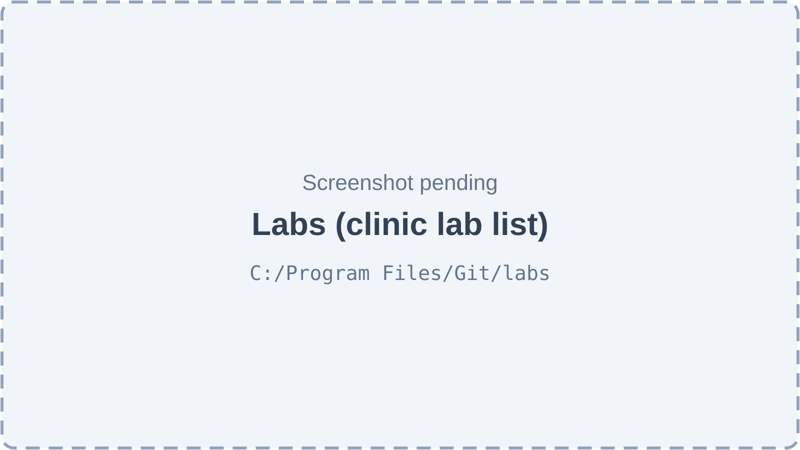

*Figure 40.1 — Labs, the clinic's lab list (screenshot pending).*

The **Labs** page (`/labs`) has the title "Labs", the subtitle "The dental labs your clinic sends work to." and an **Add lab** button. A filter row holds a search box ("Search by lab, city or phone…") and a status filter ("All statuses", Awaiting confirmation, Active, Suspended). A view toggle switches between a table and a grid of cards. The table has the columns Lab, Contact, Status, Payment terms, "Patient details shared" and an actions column. The row menu offers **Edit terms**, **Activate** (for a link awaiting confirmation), **Reactivate** (for a suspended link), **History** and **Suspend**. With no links the page shows "No labs yet" and a short explanation; with filters that match nothing it shows "No labs match your filters." and a clear-filters action. **Add lab** opens a side sheet that lists the platform directory with a search box ("Search labs by name or city…"), then asks for the payment terms in days, the patient-details setting and notes.

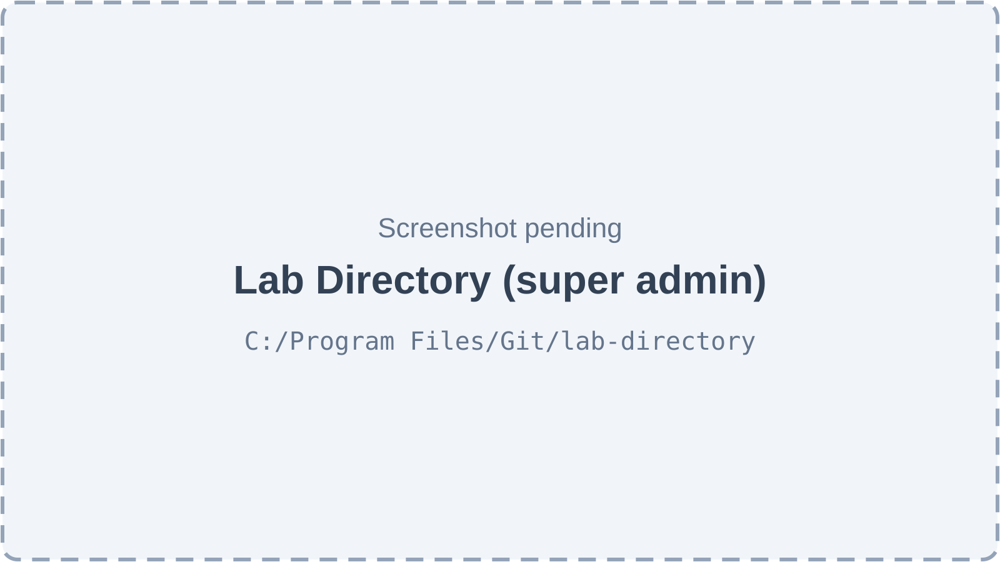

*Figure 40.2 — The platform Lab Directory (screenshot pending).*

The **Lab Directory** page (`/lab-directory`, super admin only; other users are sent to the dashboard) is titled "Lab Directory" with the subtitle "Dental labs on the platform. Clinics add labs from this list." Its table has the columns Lab, Type (External or In-house), Contact, Clinics, Staff and Status, plus an edit button on each row. Filters are a search box (name, city, phone or email), a status filter and a type filter. The **Add lab** sheet asks for the name, the type (an In-house lab also asks for the owner clinic), and the contact details and address.

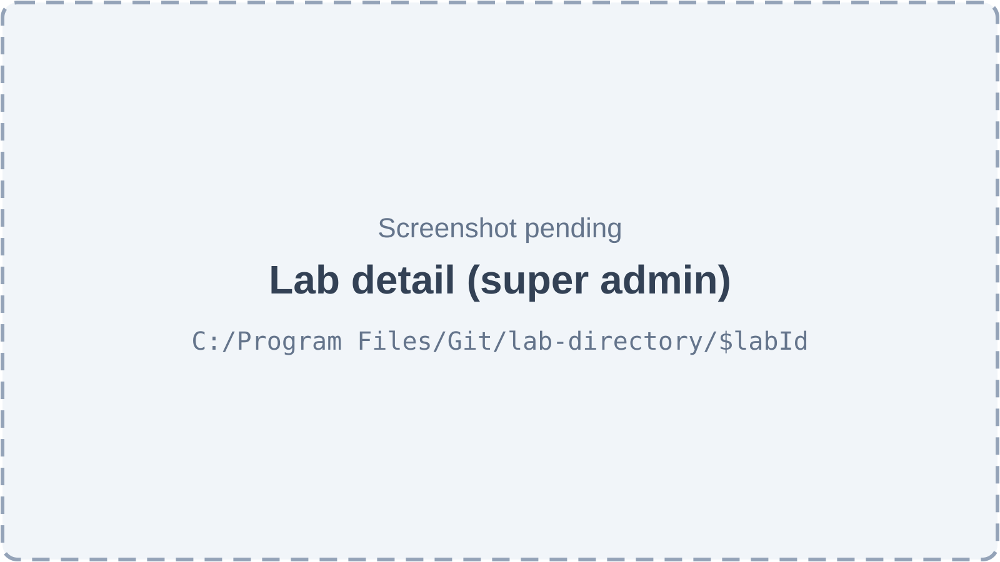

*Figure 40.3 — One lab in the directory (screenshot pending).*

The lab detail page (`/lab-directory/$labId`, super admin only) shows the lab's phone, WhatsApp, email, city, address and, for an in-house lab, the clinic it belongs to. Under that are four tabs: **Services & prices** (the lab's catalog with price windows and options), **Staff** (the lab members, with a role selector and an active switch on each row and an **Add lab member** sheet), **Clinics** (every clinic linked to the lab, with link status, payment terms, patient-details setting and active-since date) and **Activity** (the audit timeline). A switch suspends or reactivates the whole lab after a confirmation.

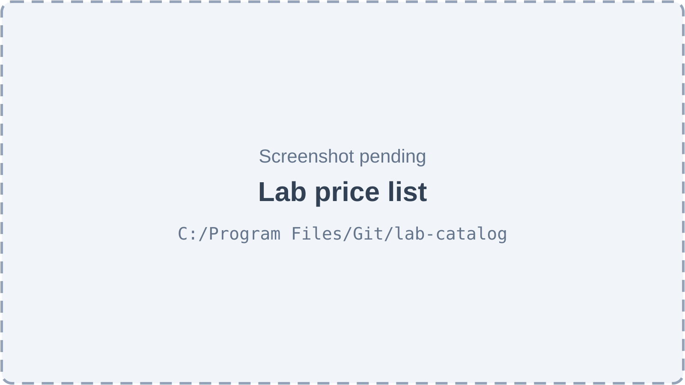

*Figure 40.4 — The clinic's Lab price list (screenshot pending).*

The **Lab price list** page (`/lab-catalog`) has the title "Lab price list" and the subtitle "Lab costs, patient prices and which lab makes each treatment." It has two tabs. **Lab services** lists every service of every linked lab with the columns Service, Lab, Charged (per tooth, unit, arch or case), Lab cost, Patient price, Margin and an action to bill the service as one of the clinic's treatments; filters are search, lab, category and "Mapped or not". **Treatment mapping** lists the existing mappings with the columns "Your treatment", "Lab service" and Default, a star button to make a lab the default for a treatment and an unlink button that removes a mapping after a confirmation.

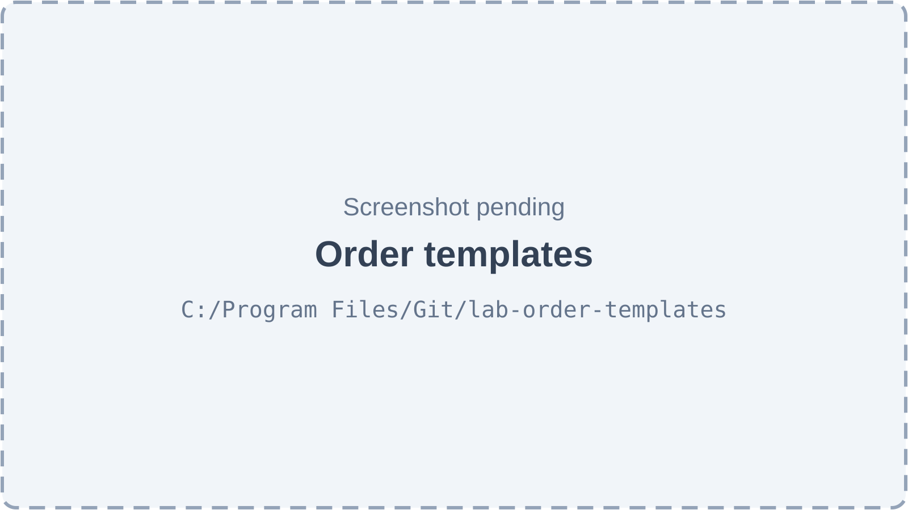

*Figure 40.5 — Order templates (screenshot pending).*

The **Order templates** page (`/lab-order-templates`) has the title "Order templates" and the subtitle "Your usual lab orders, ready to send in seconds." Its table has the columns Template, Lab, Owner, Used and an edit button; filters are search, owner (mine or shared), lab and "Include archived". The **New order template** sheet asks for a name, a "Share with the whole clinic" switch (shown only to users who may share), one or more services with their options, quantity, rush flag and any form answers, and "Notes for the lab". All services of a template must belong to one lab.

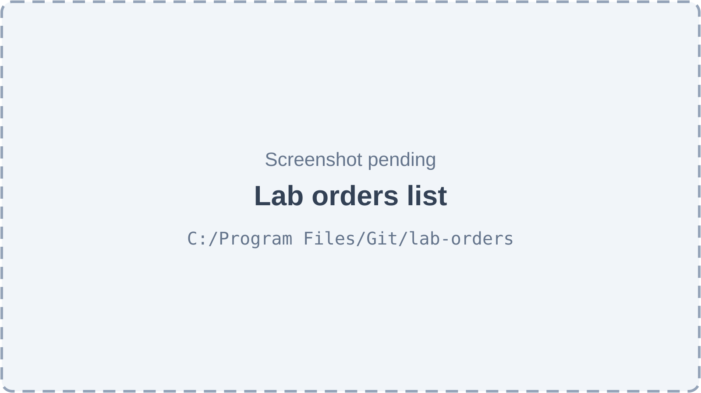

*Figure 40.6 — The Lab orders list (screenshot pending).*

The **Lab orders** page (`/lab-orders`) has the title "Lab orders" and the subtitle "Crowns, bridges, dentures — from draft to delivery." A **New lab order** button appears for users with `lab.orders.create`. Filters are a debounced search ("Search order no. or patient…"), status, lab, doctor and a From and To date. The table has the columns Order, Patient, Lab, Doctor, Status, "Due back", "Lab cost", Created and an actions column; a card view is the alternative. The lab cost is hidden for drafts. With no orders the page shows "No lab orders yet" and explains that prices are fixed at submit.

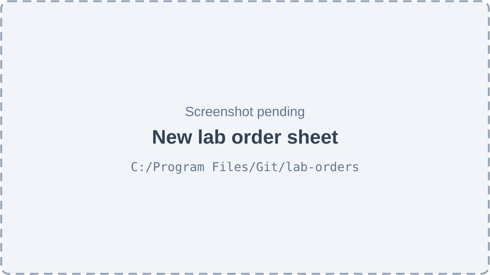

*Figure 40.7 — The New lab order sheet, step 1 of 3 (screenshot pending).*

The **New lab order** sheet is a three-step form: "Patient & lab", "Items" and "Prices & send". Step 1 has a patient search ("Search by name, number or phone…"), the lab, the ordering doctor (default: the signed-in user if they are a doctor), the priority, "Needed back by" and "Instructions for the lab". Once a patient is chosen, a "Quick start" box offers **From a template** and **Repeat last order**. Step 2 lists the items; each has the service, its options, quantity, a Rush switch and the form fields of that service (shade, material, teeth and so on). Step 3 shows the price quote per line (lab cost and patient price) and a total. Buttons are **Cancel** or **Back**, **Next**, **Save draft** and **Submit to lab**.

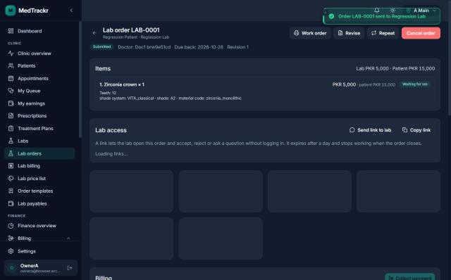

*Figure 40.8 — Lab order LAB-0001 in status Submitted, with one zirconia crown item and the Lab access panel.*

This screenshot was captured on 2026-10-23 in dark theme and shows the former working name "MedTrackr" in the sidebar corner. The page header reads "Lab order LAB-0001" with the line "Regression Patient · Regression Lab" under it and a back arrow to the lab orders list. A green toast at the top right confirms that the order was sent to the lab. Buttons on the right are **Work order**, **Revise**, **Repeat** and a red **Cancel order**. A status line shows the badge "Submitted", the doctor, the due-back date and "Revision 1". The **Items** section shows the total "Lab PKR 5,000 · Patient PKR 15,000" and one item, "1. Zirconia crown × 1", with tooth 12, the shade system, shade and material, the lab price PKR 5,000 with the patient price PKR 15,000, and the item badge "Waiting for lab". Under it the **Lab access** panel explains that a link lets the lab open the order and answer without logging in, that it expires after a day and stops working when the order closes, and offers **Send link to lab** and **Copy link**; its list of links was still loading when the picture was taken. The start of the Billing section is visible at the bottom. All names in the picture are test data.

Besides these, the order detail page has sections that the screenshot does not reach: **Production**, **Billing** (Chapter 42), **Messages**, **Extra charges**, **Revisions**, **History** and **Files**.

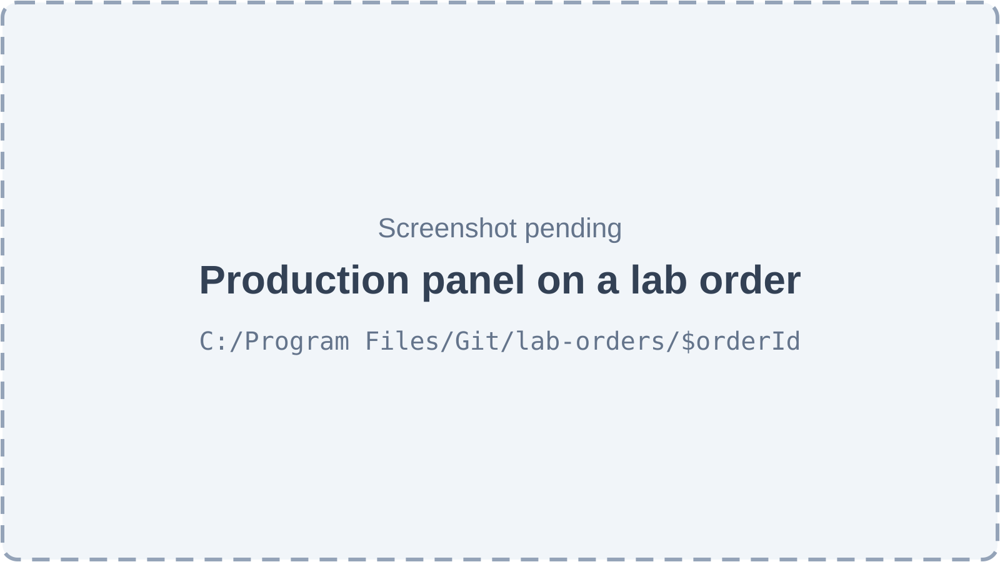

*Figure 40.9 — The Production section of a lab order (screenshot pending).*

The **Production** section lists "Incoming from the lab" shipments with their lines and a button to mark a shipment lost, then one block per item with its status, its try-in rounds as an ordered list ("Stages"), its warranty dates once delivered, and the next action for the clinic. Depending on the state these are **Record try-in**, **Approve** (the stage name is added), **Needs correction**, **Approve work**, **Reject — remake**, **Fitted — mark delivered** and **Request remake** (after delivery). A "Remake requests" block lists each request with its reason, responsible party, status and a decision button.

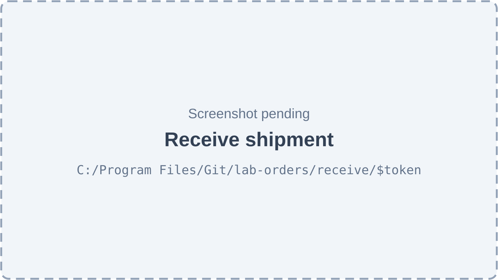

*Figure 40.10 — The Receive shipment page opened from a slip's QR code (screenshot pending).*

The receive page (`/lab-orders/receive/$token`) is titled "Receive SHP-0001" (the shipment number) with the subtitle "From" and the lab's name. Each line of the parcel has a tick box to receive it, a Condition selector (the first choice is OK, then Damaged and Missing), a received quantity, an "Incoming QC" selector with "Not checked" as its first choice, and a notes box ("e.g. box cracked, shade looks off"). The button is **Receive**. If nothing is left to receive the page says "Nothing left to receive" with the shipment status.

## 40.3 Features

### 40.3.1 Keep the platform lab directory

**Status:** [Implemented]

**What it does.** The super admin keeps one list of dental labs for the whole Platform. A lab is either **external** (serves many clinics) or **in-house** (belongs to one clinic and serves only it). A lab can be suspended; suspending blocks new links and new activations, while links that already exist stay as they are.

**How the user does it.**
1. As super admin, open **Lab Directory** in the sidebar.
2. Press **Add lab**. Enter the name, choose External or In-house (for In-house choose the owner clinic) and fill the contact details.
3. To change contact details press the edit button on the row. To suspend, use the status switch on the lab detail page and confirm.

**Behind the scenes — in simple terms.** Labs belong to the Platform, not to a clinic, so there is no clinic filter. When an in-house lab is created, the Platform also creates its link to the owner clinic, already active, in the same step.

**Behind the scenes — technically.** `GET/POST /platform/labs`, `GET/PATCH /platform/labs/:id`, `POST /platform/labs/:id/status`, `GET /platform/labs/:id/links`, `GET /platform/labs/:id/history` in `PlatformLabsController` (`@RequireSuperAdmin`, no tenant context) over `LabsDirectoryService`. Create runs in one transaction: owner check, insert into `labs` (UUID version 7 key), an `audit_logs` row, and for an in-house lab a call to `LabLinksService.createInTx` that inserts the active link plus a `status_history` row. Update and status change lock the lab row (`pessimistic_write`) and compare the sent `version` with the stored one (409 `STALE_VERSION` when they differ).

**Rules and validations.**
- Only in-house labs have an owner organization, and every in-house lab must have one (`LAB_OWNER_INVALID`, `LAB_OWNER_ORG_NOT_FOUND`).
- The lab name is not editable from the lab portal; only contact fields are (Chapter 41).
- Suspending a lab does not close existing links, but a magic link of a suspended lab stops working.

**Who can do it.** Super admin only (`@RequireSuperAdmin`). No feature key applies.

**Data read and written.** Reads and writes `labs`, `lab_clinic_links`, `audit_logs`, `status_history`; reads `organizations`.

**Effects on other modules.** Clinics can add only active external labs and their own in-house labs.

**Error cases.** 404 `LAB_NOT_FOUND`; 422 `LAB_OWNER_INVALID` or `LAB_OWNER_ORG_NOT_FOUND`; 409 `STALE_VERSION`.

**Technical references:** `backend/src/labs/directory/platform-labs.controller.ts` · `LabsDirectoryService` · `web-app/src/features/labs/pages/LabDirectoryPage.tsx`

### 40.3.2 Manage the staff of a lab

**Status:** [Implemented]

**What it does.** The super admin adds people to a lab as **lab members**, with the role lab admin or lab technician, changes a role, and switches a member on or off. These accounts are how lab staff log in to the lab portal (Chapter 41).

**How the user does it.**
1. As super admin open a lab from **Lab Directory** and choose the **Staff** tab.
2. Press **Add lab member**, enter the account email and the role. The account must already exist: create it first under **User Admin**.
3. Change the role in the role selector, or flip the Active switch to deactivate.

**Behind the scenes — in simple terms.** A lab member is a normal user account with one extra row that says "works at this lab". Lab staff have no clinic membership at all, so no clinic screen can ever show their data and no lab screen can show a clinic's.

**Behind the scenes — technically.** `GET/POST /platform/labs/:id/members`, `PATCH /platform/labs/:id/members/:memberId` over `LabMembersService`. Add runs in a transaction: finds the user by lower-cased email (not deleted), runs the "may join" check, inserts into `lab_members`, writes an audit row. Update locks the member row and checks the version. Members are deactivated, never deleted.

**Rules and validations.**
- A super admin account cannot be a lab member (`LAB_MEMBER_NOT_ALLOWED`).
- A user who owns an organization or has an active staff assignment cannot join an external lab. For an in-house lab the only clinic account allowed is one of its owner clinic.
- One membership per lab and user (`LAB_MEMBER_EXISTS`).
- If no account uses the email, the message is "No account uses this email. Create the user first, then add them here."

**Who can do it.** Super admin. Lab admins can also add and change members of their own lab from the portal, but not themselves (Chapter 41).

**Data read and written.** Writes `lab_members`, `audit_logs`; reads `users`, `organization_ownership`, `employee_org_location_assignments`.

**Effects on other modules.** Active members receive in-app notifications about the lab's orders.

**Error cases.** 404 `LAB_MEMBER_USER_NOT_FOUND`; 409 `LAB_MEMBER_EXISTS`, `LAB_MEMBER_NOT_ALLOWED`; 409 `STALE_VERSION`.

**Technical references:** `backend/src/labs/members/lab-members.service.ts` · `LabMembersService` · `web-app/src/features/labs/components/LabMembersPanel.tsx`

### 40.3.3 Manage a lab's services, options and prices

**Status:** [Implemented]

**What it does.** For each lab, the super admin keeps the list of what the lab makes (a **lab service**, for example a zirconia crown), the **options** on it (a material or variant with an extra cost per unit) and its **prices**. A price is a window of dates. A lab's **list price** applies to every clinic; a **negotiated price** applies to one clinic and wins over the list price.

**How the user does it.**
1. As super admin open the lab and choose **Services & prices**.
2. Add a service: category, code, name, how it is charged (per tooth, per unit, per arch or per case), turnaround in days, description, and the form, item workflow and try-in stage template an order line will use.
3. Open the pricing sheet of a service to add prices (list or for one clinic, with "From" and "Until" dates and an optional rush surcharge) and options.
4. A price that has not started yet can be edited or voided. A running price can only be ended.

**Behind the scenes — in simple terms.** Prices are never overwritten. A new open-ended price closes the one running before it the day before. A price that is being used can only get an end date, so history stays true. A mistaken future price is voided, not deleted.

**Behind the scenes — technically.** Routes under `/platform/labs/:labId/services` in `PlatformLabServicesController` (`@RequireSuperAdmin`): list, get, create, patch, history, options (add, patch) and prices (list, add, patch, `POST …/void`, history). Services run in transactions; price writes lock the service row so two edits queue up, then pure functions (`planNewWindow`, `checkWindowEdit`) check dates, and the database exclusion constraint `excl_lab_service_prices_overlap` is the last line of defence. "Today" for a price window is the platform's day in the Asia/Karachi timezone (`CATALOG_TIMEZONE`), not a location's. Every change writes an `audit_logs` row.

**Rules and validations.**
- A new price cannot start in the past (`LAB_PRICE_INVALID`); the end date cannot precede the start date.
- Two non-void windows of the same service and clinic cannot overlap (`LAB_PRICE_OVERLAP`) unless the new one is open-ended and supersedes an open-ended one that began before it.
- A started price cannot change its amounts or start date (`LAB_PRICE_LOCKED`) and can end yesterday at the earliest.
- A negotiated price needs the clinic to be linked to the lab.
- The form, workflow and stage template must be active platform definitions of the service's specialty (`LAB_SERVICE_DEFINITION_INVALID`); the category must be of the same specialty.
- Amounts are `bigint` paisa, at most PKR 1,000,000,000 (`MAX_PAISA`).
- Archived services are hidden from new orders; old orders keep them.

**Who can do it.** Super admin. The lab itself cannot edit its catalog: no lab portal screen or route exists for it (the code comments say the portal "will add" one).

**Data read and written.** Writes `lab_services`, `lab_service_options`, `lab_service_prices`, `audit_logs`; reads `service_categories`, `form_schemas`, `workflow_templates`, `stage_templates`.

**Effects on other modules.** Clinics see these services and prices in the Lab price list and in the order sheet.

**Error cases.** 409 `LAB_PRICE_OVERLAP`, `LAB_PRICE_LOCKED`; 422 `LAB_PRICE_INVALID`, `LAB_SERVICE_DEFINITION_INVALID`, `SERVICE_CATEGORY_MISMATCH`.

**Technical references:** `backend/src/lab-catalog/categories/platform-catalog.controller.ts` · `LabServicesService`, `LabServicePricesService`, `price-resolver.ts` · `web-app/src/features/lab-catalog/components/LabServicesPanel.tsx`

### 40.3.4 Service categories

**Status:** [Partial]

**What it does.** Categories such as Crowns, Bridges, Implant restorations, Dentures, Orthodontic appliances and "Repairs & relines" group lab services, so clinics can compare labs like for like. They are seeded for the dental specialty.

**How the user does it.** The category list appears as a filter and in the service form. There is no screen to create or rename a category.

**Behind the scenes — in simple terms.** The six default categories exist after start-up. Adding more needs an API call.

**Behind the scenes — technically.** `GET/POST /platform/service-categories` and `PATCH …/:id` (super admin) exist; the web app calls only the list. `CatalogSeedService` inserts missing default categories and never changes existing ones.

**Rules and validations.** Category code is unique per specialty (`SERVICE_CATEGORY_EXISTS`).

**Who can do it.** Super admin.

**Data read and written.** `service_categories`, `audit_logs`.

**Effects on other modules.** None beyond grouping.

**Error cases.** 409 `SERVICE_CATEGORY_EXISTS`; 404 `SERVICE_CATEGORY_NOT_FOUND`.

**Technical references:** `backend/src/lab-catalog/categories/service-categories.service.ts` · `ServiceCategoriesService` · `web-app/src/features/lab-catalog/hooks/usePlatformCatalog.ts` (read only)

### 40.3.5 Add a lab to the clinic's lab list

**Status:** [Implemented]

**What it does.** A clinic chooses a lab from the platform directory and adds it to its own list. The new link starts as **invited** ("Awaiting confirmation") until it is activated.

**How the user does it.**
1. Open **Labs** and press **Add lab**.
2. Search the directory and pick a lab. Labs already linked show their link status.
3. Set "Payment terms (days)", "Patient details shared" and optional notes, then press **Add lab**.
4. The message says "Lab added — activate it once the lab confirms". Activate it as in 40.3.7.

**Behind the scenes — in simple terms.** The directory offers only active external labs plus the clinic's own in-house labs; another clinic's in-house lab never appears and answers "not found" even if its id is guessed.

**Behind the scenes — technically.** `GET /lab-links/directory` (up to 25 labs, optional search) and `POST /lab-links` in `LabLinksController` (`lab.links.manage`) over `LabLinksService.create`: one transaction that read-locks the lab, inserts into `lab_clinic_links` with status invited (unique per lab and organization), writes an `audit_logs` row and a `status_history` row (action `invite`).

**Rules and validations.**
- The lab must be active (`LAB_SUSPENDED` otherwise) and visible to the clinic (`LAB_NOT_FOUND`).
- One link per lab and clinic (`LAB_LINK_EXISTS`: "This lab is already in your lab list").
- Payment terms are 0 to 365 days, default 30.

**Who can do it.** `lab.links.manage`, feature `dental.lab_orders`. Default: Admin. Reading the lab list (`GET /lab-links`, `GET /lab-links/:id`) is open to every member of the clinic (needed so doctors can pick a lab), still behind the feature.

**Data read and written.** Writes `lab_clinic_links`, `audit_logs`, `status_history`; reads `labs`.

**Effects on other modules.** Only an active link allows ordering, pricing quotes and price negotiation.

**Error cases.** 404 `LAB_NOT_FOUND`; 409 `LAB_LINK_EXISTS`; 422 `LAB_SUSPENDED`.

**Technical references:** `backend/src/labs/links/lab-links.controller.ts` · `LabLinksService` · `web-app/src/features/labs/components/LabLinkSheet.tsx`

### 40.3.6 Set payment terms and patient data level

**Status:** [Implemented]

**What it does.** On each lab link the clinic sets how many days it takes to pay the lab, and how much of the patient's identity the lab sees: **Full patient name** or **Patient code only**. The change applies to new orders; the sheet says "Orders already sent keep their terms."

**How the user does it.**
1. In **Labs** open the row menu of the lab and choose **Edit terms** (or click the row).
2. Change "Payment terms (days)", "Patient details shared" or "Notes" and press **Save terms**.

**Behind the scenes — in simple terms.** With "Patient code only" the lab sees the clinic's patient number instead of the name on its order list, the order page, the magic link page, the printed work order and notifications. The patient number is still sent in a separate field in lab responses.

**Behind the scenes — technically.** `PATCH /lab-links/:id` → `LabLinksService.update`: lock, version check, copy changed fields, audit diff, save only if something changed. `patient_data_level` is read through the order's `lab_clinic_link_id` by `patientForLab` (order mapper) and by `orderRecipients` (notification variable `patient_ref`).

**Rules and validations.** Payment terms 0 to 365. A stale version gives 409.

**Who can do it.** `lab.links.manage`; Admin by default.

**Data read and written.** `lab_clinic_links`, `audit_logs`.

**Effects on other modules.** Payment terms are used by lab payables (Chapter 42).

**Error cases.** 404 `LAB_LINK_NOT_FOUND`; 409 `STALE_VERSION`.

**Technical references:** `backend/src/labs/links/lab-links.service.ts` · `LabLinksService.update`, `patientForLab` · `web-app/src/features/labs/components/LabLinkSheet.tsx`

### 40.3.7 Activate, suspend and reactivate a lab link

**Status:** [Implemented]

**What it does.** A link moves between three states: invited, active and suspended. Either side can stop working with the other and a reason is kept. A suspension can be lifted only by the side that made it.

**How the user does it.**
1. In **Labs** open the row menu.
2. Choose **Activate** on a link awaiting confirmation, or **Reactivate** on a suspended one.
3. To stop, choose **Suspend**, type a reason ("e.g. Repeated late deliveries") and confirm.
4. Choose **History** to see the timeline of changes.

**Behind the scenes — in simple terms.** Today the clinic can confirm a lab on the lab's behalf, so most links are activated by the clinic. A lab that has a portal account can also accept an invitation itself from its portal (Chapter 41). If the lab suspended the link, the clinic cannot undo it, and the reverse.

**Behind the scenes — technically.** `POST /lab-links/:id/transitions` with `action` and optional `reason`, `version`; `GET /lab-links/:id/history`. `LabLinksService.applyTransition` is the single place a link's status changes, shared with the lab portal. It checks the transition table (`activate`: from invited; `suspend`: from invited or active, reason required; `reactivate`: from suspended), refuses activation when the lab itself is suspended, and on reactivation reads the last suspension actor from `status_history` (`canLiftSuspension`). Writes `lab_clinic_links`, `status_history` (with `via`) and `audit_logs` in one transaction under a row lock.

**Rules and validations.**
- A reason is required to suspend (`LAB_LINK_REASON_REQUIRED`).
- A wrong from-state gives `INVALID_TRANSITION`.
- Only the suspending side (or the platform) reactivates (`LAB_LINK_SUSPENDED_BY_OTHER_SIDE`).
- `activated_at` is set on the first activation only.

**Who can do it.** `lab.links.manage`; Admin by default.

**Data read and written.** `lab_clinic_links`, `status_history`, `audit_logs`.

**Effects on other modules.** Ordering requires an active link (`LAB_NOT_LINKED`). Orders already sent are not touched by a suspension.

**Error cases.** 422 `INVALID_TRANSITION`, `LAB_LINK_REASON_REQUIRED`, `LAB_SUSPENDED`; 403 `LAB_LINK_SUSPENDED_BY_OTHER_SIDE`; 409 `STALE_VERSION`.

**Technical references:** `backend/src/labs/links/lab-link-transitions.ts` · `resolveLinkTransition`, `canLiftSuspension` · `web-app/src/features/labs/components/LabLinkActions.tsx`

### 40.3.8 Read the lab price list

**Status:** [Implemented]

**What it does.** Shows the clinic every active service of every lab on its list, with the price this clinic pays (its negotiated price, else the list price), the patient price of the mapped treatment at the active location and the margin. A clinic never sees another clinic's negotiated price.

**How the user does it.**
1. Open **Lab price list** and stay on **Lab services**.
2. Search, or filter by lab, category and "Mapped or not".
3. Open a service for its options and details.

**Behind the scenes — in simple terms.** The list joins the lab's catalog with the clinic's own billing catalog through the mapping. Services without a mapping show "Not mapped" for the patient price.

**Behind the scenes — technically.** `GET /lab-catalog/categories`, `/lab-catalog/services` and `/lab-catalog/services/:id` (`@AnyMember`, `@RequireFeature('dental.lab_orders')`, so every member of the clinic can read them) in `ClinicCatalogController` over `ClinicCatalogService`, tenant-filtered by the clinic's links.

**Rules and validations.** Only labs with a link on the clinic's list contribute services; unlinked ids answer 404.

**Who can do it.** Every clinic member for the reads, behind `dental.lab_orders`. The page itself opens with `lab.catalog.manage` (Admin by default).

**Data read and written.** Reads `lab_services`, `lab_service_options`, `lab_service_prices`, `service_mappings`, `services`, `lab_clinic_links`.

**Effects on other modules.** Feeds the order sheet's service pickers.

**Error cases.** 404 `LAB_SERVICE_NOT_FOUND`.

**Technical references:** `backend/src/lab-catalog/clinic/clinic-catalog.controller.ts` · `ClinicCatalogService` · `web-app/src/features/lab-catalog/components/ClinicServicesTab.tsx`

### 40.3.9 Get a price quote

**Status:** [Implemented]

**What it does.** For a lab service, chosen options, a rush flag and a date, the quote returns the lab cost per unit (base price + option extras + rush surcharge) and the patient price per unit, and says where each came from.

**How the user does it.** The user does not ask for it directly. Step 3 of the New lab order sheet requests one quote per line and shows "Prices" and a "Total".

**Behind the scenes — in simple terms.** The patient price follows the same precedence billing uses (doctor at location, then location, then the treatment's default), so the order line and the charge later billed for it agree.

**Behind the scenes — technically.** `GET /lab-catalog/price-quote` (`@AnyMember`, feature-gated) → `LabPriceResolver.quote`: loads the service, requires an active link and an active service, validates the options, picks a lab price (`pickLabPrice`: negotiated window active that day, else list window), computes `labUnitCost`, then resolves the patient price through the active service mapping or a given treatment (`pickPatientPrice`). Read only. The same function runs again at submit inside the order transaction.

**Rules and validations.**
- Without a price window on the day: 422 `LAB_PRICE_MISSING` ("The lab has no price for … on …").
- Without a mapped treatment the patient price is null; at submit this blocks the line.
- The quote endpoint defaults to the platform day (Asia/Karachi) when no date is sent; submit prices on the location's day.

**Who can do it.** Every clinic member, feature `dental.lab_orders`.

**Data read and written.** Reads only.

**Effects on other modules.** The numbers become the order's frozen price snapshot at submit.

**Error cases.** 404 `LAB_SERVICE_NOT_FOUND`; 422 `LAB_NOT_LINKED`, `LAB_SERVICE_INACTIVE`, `LAB_PRICE_MISSING`, `LAB_SERVICE_OPTION_NOT_FOUND`.

**Technical references:** `backend/src/lab-catalog/pricing/lab-price-resolver.service.ts` · `LabPriceResolver.quote` · `web-app/src/features/lab-orders/components/LabOrderSheet.tsx`

### 40.3.10 Map a lab service to a clinic treatment

**Status:** [Implemented]

**What it does.** A **mapping** says "when we order this lab service, we bill the patient for this treatment from our own catalog". The treatment's price is what the patient pays; the lab's price is the clinic's cost. One treatment can have several lab services, one of them the **default**.

**How the user does it.**
1. In **Lab price list**, press the bill button on a service row (tooltip "Bill … as one of your treatments"), or open the **Treatment mapping** tab.
2. In "Map to a treatment" choose the "Lab service" and "Your treatment", and tick the default option if wanted.
3. Make another lab the default with the star button; remove a mapping with the unlink button and a confirmation.

**Behind the scenes — in simple terms.** If a mapping was removed before, adding the same pair brings the old row back instead of creating a duplicate. The first mapping of a treatment becomes its default automatically.

**Behind the scenes — technically.** `GET /lab-catalog/treatments`, `GET/POST /lab-catalog/mappings`, `PATCH /lab-catalog/mappings/:id` (`lab.catalog.manage`) over `ServiceMappingsService`. Writes lock the treatment row so "one default per treatment" cannot race; unique indexes enforce one row per organization, treatment and lab service and one active mapping per lab service.

**Rules and validations.**
- The treatment and the lab service must both be active (`CLINIC_TREATMENT_INACTIVE`, `LAB_SERVICE_INACTIVE`).
- An active lab service maps to only one treatment (`LAB_SERVICE_ALREADY_MAPPED`); the same pair twice gives `SERVICE_MAPPING_EXISTS`.

**Who can do it.** `lab.catalog.manage`; Admin by default.

**Data read and written.** `service_mappings`, `audit_logs`; reads `services` (the billing catalog), `lab_services`.

**Effects on other modules.** The mapping chooses the treatment, and so the patient price, that a lab order line carries into lab billing (Chapter 42) and commissions (Chapter 35).

**Error cases.** 409 `SERVICE_MAPPING_EXISTS`, `LAB_SERVICE_ALREADY_MAPPED`; 422 `CLINIC_TREATMENT_INACTIVE`, `LAB_SERVICE_INACTIVE`.

**Technical references:** `backend/src/lab-catalog/mappings/service-mappings.service.ts` · `ServiceMappingsService` · `web-app/src/features/lab-catalog/components/MappingsTab.tsx`

### 40.3.11 Save and reuse order templates

**Status:** [Implemented]

**What it does.** A template stores the lines of a lab order (services, options, quantity, rush, answers that do not depend on the patient) and notes. A template is private to its owner or shared with the whole clinic. Templates can be archived.

**How the user does it.**
1. Open **Order templates** and press the add button.
2. Name the template, add one or more services (all from one lab), set options, quantity and rush, and add notes.
3. Switch on "Share with the whole clinic" if you hold the right to share.
4. Edit later with the edit button, or archive it by switching it off.

**Behind the scenes — in simple terms.** Nobody sees another user's private templates. The use counter rises when an order started from the template is submitted, so the list shows the most used first.

**Behind the scenes — technically.** `GET/POST /lab-catalog/order-templates`, `GET/PATCH …/:id`, `POST …/:id/use` (`lab.orders.create`) over `OrderTemplatesService`. The body is validated and stored in `order_templates.template_json` (at most 20 lines). Create and update run in a transaction with an audit row. `markUsed` is a raw `UPDATE` of `use_count` and `last_used_at` (not an edit, so no version bump and no audit); `OrderSubmitService` calls it inside the submit transaction. The explicit `POST …/:id/use` endpoint exists, but no web screen calls it.

**Rules and validations.**
- Every service must be active, of one lab on the clinic's list, and of one specialty; options must belong to their service; answers must fit the service's form (partial answers allowed).
- Sharing or editing a shared template needs `lab.templates.share` (`ORDER_TEMPLATE_FORBIDDEN`).

**Who can do it.** `lab.orders.create` to use and keep private templates (Doctor, Admin); `lab.templates.share` to share (Admin only by default).

**Data read and written.** `order_templates`, `audit_logs`; reads `lab_services`, `lab_service_options`, `lab_clinic_links`, form definitions.

**Effects on other modules.** A draft started from a template records `order_template_id`.

**Error cases.** 403 `ORDER_TEMPLATE_FORBIDDEN`; 422 `ORDER_TEMPLATE_INVALID`.

**Technical references:** `backend/src/lab-catalog/templates/order-templates.service.ts` · `OrderTemplatesService` · `web-app/src/features/lab-catalog/pages/OrderTemplatesPage.tsx`

### 40.3.12 Create a lab order draft

**Status:** [Implemented]

**What it does.** Starts a case for a patient with a chosen lab and one or more items. A draft is a working copy: no order number, no frozen prices, free to edit or abandon.

**How the user does it.**
1. Press **New lab order** on **Lab orders**.
2. Step 1: choose the patient, lab, ordering doctor, priority and "Needed back by"; add instructions.
3. Step 2: add items. For each choose the service, options, quantity, Rush and fill its form (shade, material, teeth, files).
4. Press **Save draft** (or continue to step 3 and submit). A draft can be reopened from the order page with **Edit draft**.

**Behind the scenes — in simple terms.** The draft already remembers which version of each service's form and workflow it will use, so changes made by the super admin later do not alter it. Saving twice with the same key returns the same draft instead of making a second one.

**Behind the scenes — technically.** `POST /lab-orders` (`lab.orders.create`, optional `Idempotency-Key`) → `OrderDraftsService.create`: one transaction that checks the patient, the active link, the doctor and the optional appointment and treatment, loads the services, requires one specialty, inserts `lab_orders` (UUID version 7 key, status `draft`, pinned order workflow version) and the items with their pinned form and item workflow versions (`pin`), saves a form-response row per item, and writes a `status_history` row (`create`) and an `audit_logs` row. A racing duplicate key is caught on the unique constraint `uq_lab_orders_org_idempotency` and returns the winner. `PATCH /lab-orders/:id` updates a draft under a row lock with a version check; it can rewrite the lines (kept items are re-pinned only if the service changed; removed lines are deleted, which is allowed only for drafts).

**Rules and validations.**
- 1 to 20 items per order (`MAX_ORDER_ITEMS`); all items must be services of the chosen lab and of one specialty (`LAB_ORDER_LAB_MISMATCH`, `LAB_ORDER_INVALID`).
- The lab link must be active (`LAB_NOT_LINKED`: "Activate this lab in your lab list before ordering from it").
- The doctor defaults to the caller when the caller can conduct consultations.
- Drafts are not validated beyond coherence; form answers are checked at submit.
- Only drafts can be edited (`LAB_ORDER_NOT_DRAFT`).

**Who can do it.** `lab.orders.create`, feature `dental.lab_orders`. Default: Doctor, Admin.

**Data read and written.** Writes `lab_orders`, `lab_order_items`, `item_form_responses`, `status_history`, `audit_logs`; reads `patients`, `appointments`, `treatments`, `lab_clinic_links`, `lab_services`, workflow and form versions.

**Effects on other modules.** None until submit.

**Error cases.** 404 `LAB_ORDER_PATIENT_NOT_FOUND`, `LAB_ORDER_DOCTOR_NOT_FOUND`; 409 `LAB_ORDER_NOT_DRAFT`; 422 `LAB_ORDER_INVALID`, `LAB_ORDER_WORKFLOW_MISSING`, `LAB_SERVICE_INACTIVE`.

**Technical references:** `backend/src/lab-orders/services/order-drafts.service.ts` · `OrderDraftsService.create`, `update` · `web-app/src/features/lab-orders/components/LabOrderSheet.tsx`

### 40.3.13 Start from a template or repeat a past order

**Status:** [Implemented]

**What it does.** Two shortcuts fill a new draft. **From a template** copies the template's lines. **Repeat last order** (and the **Repeat** button on an order) copies the lines and answers of a past order of the same patient onto the current form versions.

**How the user does it.**
1. In step 1 of the sheet, after choosing the patient, open "Quick start".
2. Choose "From a template" and start it, or press **Repeat last order**.
3. Or, on a submitted order, press **Repeat**; a new draft opens.

**Behind the scenes — in simple terms.** Files never carry over. Teeth carry over only when the new order is for the same patient. Cancelled items are skipped.

**Behind the scenes — technically.** `POST /lab-orders/from-template` and `POST /lab-orders/:id/repeat` (`lab.orders.create`) → `OrderDraftsService.fromTemplate` / `repeat`, both ending in `create`. "Repeat last order" first lists the patient's latest submitted order, then repeats it; a patient without one gives the message "This patient has no past lab order" in the web app. Repeating returns a draft with the same lab, priority and notes.

**Rules and validations.** A template must be active and have a lab (`LAB_ORDER_INVALID`: "This template can’t be used"). Private templates of other users stay invisible.

**Who can do it.** `lab.orders.create`. Default: Doctor, Admin.

**Data read and written.** As 40.3.12; reads `order_templates`, `item_form_responses`.

**Effects on other modules.** Submitting a draft that came from a template raises its use count.

**Error cases.** 404 `LAB_ORDER_NOT_FOUND`; 422 `LAB_ORDER_INVALID`.

**Technical references:** `backend/src/lab-orders/services/order-drafts.service.ts` · `OrderDraftsService.fromTemplate`, `repeat` · `web-app/src/features/lab-orders/components/LabOrderSheet.tsx`

### 40.3.14 Submit an order to the lab

**Status:** [Implemented]

**What it does.** Sends the case. The order gets its number (for example LAB-0001), the prices of every line are frozen, the form answers are checked, the lab is told, and a magic link is sent to the lab if it has a contact address.

**How the user does it.**
1. In the sheet press **Submit to lab**, or on a draft's page press **Submit to lab**.
2. If lines need attention, the message lists them (for example a per-tooth service without teeth, or a service not mapped to a treatment); fix and submit again.
3. On success the toast says "Order … sent to …".

**Behind the scenes — in simple terms.** Everything happens in one step: if anything fails, nothing happened, not even the order number. Pressing the button twice is safe: the second call returns the first result.

**Behind the scenes — technically.** `POST /lab-orders/:id/submit` with a required `Idempotency-Key` header and the draft's `version` → `OrderSubmitService.submit`, one transaction: claim the idempotency key (`IdempotencyService`, scope `lab_order.submit`, replay returns the stored result with `replayed: true`) → engine `transitionIn` of the order with action `submit` (state, role and version checks) → require an ordering doctor → per line: validate answers against the pinned form version (`validateFormData`), derive the quantity from the teeth for per-tooth services, call `LabPriceResolver.quote` on the location's clinic day and write snapshot columns (`service_name_snap`, `options_snap`, lab and patient unit and line prices in paisa, `priced_on`) → order number from the organization's number sequence (`NumberSequenceService`, prefix `LAB`) → `lab_expected_on` = the requested date or submit day plus the longest default turnaround → per line the initial item state (`pending_acceptance`), form answers, teeth rows and promoted detail columns (`item_teeth`, `dental_item_details`), a `status_history` row → revision 1 in `order_revisions` with a snapshot that carries lab cost but not the patient price → template use count → `audit_logs` row → outbox row `order.submitted` for the lab's members → lifecycle hooks (the magic-link module issues a link when the lab has a WhatsApp number, phone or email). After submit, a guard on `LabOrderItem` saves (`snapshot-freeze.ts`) refuses to change frozen columns except through a revision or an approved charge (`LAB_ORDER_SNAPSHOT_FROZEN`).

**Rules and validations.**
- `Idempotency-Key` is mandatory (`IDEMPOTENCY_KEY_REQUIRED`, 400).
- The status must allow `submit` (draft only) for the caller's role: in the seeded workflow, roles `doctor` or `clinic_admin`, which the code derives from permissions (`consultation.conduct` gives doctor, any `admin.*` gives clinic admin; the owner has every role).
- An ordering doctor is required; at least one line.
- Every line must price on the submit day: a lab price window and a mapped treatment must exist.

**Who can do it.** `lab.orders.create` plus the seeded workflow role (doctor or clinic admin). Default: Doctor, Admin.

**Data read and written.** Writes `lab_orders`, `lab_order_items`, `item_form_responses`, `item_teeth`, `dental_item_details`, `order_revisions`, `order_templates`, `idempotency_keys`, `status_history`, `audit_logs`, `magic_links`, `notification_outbox`; reads price, mapping and form tables, `number_sequences`.

**Effects on other modules.** Lab members are notified in the app. Billing and payables read the frozen prices later.

**Error cases.** 400 `IDEMPOTENCY_KEY_REQUIRED`; 403 `TRANSITION_FORBIDDEN`; 409 `STALE_VERSION`; 422 `INVALID_TRANSITION`, `LAB_ORDER_INVALID` (with a list of line issues), `LAB_PRICE_MISSING`.

**Technical references:** `backend/src/lab-orders/services/order-submit.service.ts` · `OrderSubmitService.submit` · `web-app/src/features/lab-orders/hooks/useLabOrderForm.ts`

### 40.3.15 List and search lab orders

**Status:** [Implemented]

**What it does.** Lists the clinic's lab orders with item count, lab cost, patient price, dates and status, newest first, as a table or cards.

**How the user does it.**
1. Open **Lab orders**.
2. Search by order number, patient name or patient number; filter by status, lab, doctor and dates.
3. Click a row to open the order; "Clear all filters" appears when filters are active.

**Behind the scenes — in simple terms.** What a user sees depends on their permission scope: a doctor sees orders they ordered or created, the front desk sees their location.

**Behind the scenes — technically.** `GET /lab-orders` (`lab.orders.view`) → `LabOrdersService.list` with `scopeOrders`: scope `own` filters on `created_by` or `doctor_id`, `location` on the active location, `org` is unfiltered, no grant gives no rows. Sub-selects sum the lab line cost and the patient line price of items that are not cancelled; both are null for drafts.

**Rules and validations.** Paged on the server. An order outside the caller's scope answers 404, not 403.

**Who can do it.** `lab.orders.view`, scope own, location or org. Default: Doctor (own), Receptionist and Assistant (location), Admin (org).

**Data read and written.** Reads `lab_orders`, `lab_order_items`, `patients`, `labs`, `employees`.

**Effects on other modules.** None.

**Error cases.** 403 `NO_PERMISSION`; 400 on an invalid filter.

**Technical references:** `backend/src/lab-orders/services/lab-orders.service.ts` · `LabOrdersService.list`, `scopeOrders` · `web-app/src/features/lab-orders/pages/LabOrdersPage.tsx`

### 40.3.16 Open an order and print the work order

**Status:** [Implemented]

**What it does.** The order page shows the status, the doctor, the due-back date, the revision number, warnings, every item with its teeth and details and both prices, and the sections listed in 40.2. **Work order** prints a sheet with a QR code and the instructions, without prices, to travel with the case.

**How the user does it.**
1. Open an order from the list. A back arrow returns to the list.
2. Press **Work order** to print it (not available for drafts).

**Behind the scenes — in simple terms.** The QR on the printed sheet points at one address that works for both sides: a lab member who scans it signed in lands on the lab portal order, a clinic user lands on the clinic order, and anyone else gets "not found".

**Behind the scenes — technically.** `GET /lab-orders/:id` and `GET /lab-orders/:id/work-order` (`lab.orders.view`). The detail includes `availableActions` for the caller from the pinned workflow (minus actions with their own endpoint) and warnings such as `LAB_DUE_AFTER_NEXT_APPOINTMENT`. The work order carries `qrValue` = the front-end base address (environment variable `FRONTEND_URL`) plus `/o/:orderId` and a patient reference that follows the link's patient data level. `GET /order-links/:orderId` (`@ContextFree`, signed in) resolves the QR for the web route `/o/$orderId`.

**Rules and validations.** A work order needs an order number (submit first).

**Who can do it.** `lab.orders.view`. Default: Doctor, Receptionist, Assistant, Admin.

**Data read and written.** Reads orders, items, parts, `lab_clinic_links`, `organizations`.

**Effects on other modules.** None.

**Error cases.** 404 `LAB_ORDER_NOT_FOUND`; 422 `LAB_ORDER_INVALID` for a draft work order.

**Technical references:** `backend/src/lab-orders/controllers/lab-orders.controller.ts` · `LabOrdersService.workOrder`, `OrderLinkController.resolve` · `web-app/src/features/lab-orders/pages/LabOrderDetailPage.tsx`

### 40.3.17 Cancel, hold, resume or reopen an order

**Status:** [Implemented]

**What it does.** The buttons next to Work order come from the workflow: **Cancel order** (with a reason, from draft, submitted or accepted), **Put on hold** (from in progress, with a reason), **Resume** and **Reopen as draft** (after the lab rejected the order).

**How the user does it.**
1. Press the action button.
2. Type the reason in the dialog (the reason is kept in the history) and confirm.

**Behind the scenes — in simple terms.** Only actions that the pinned workflow allows from the current state, for the caller's role, are offered. In the seeded workflow, cancelling the order does not itself cancel its items, and an order that is already in progress cannot be cancelled as a whole; work in progress is stopped item by item (see 40.3.26).

**Behind the scenes — technically.** `POST /lab-orders/:id/transitions` (`lab.orders.create`, body `action`, `reason`, `version`) → `LabOrdersService.transition` → engine `transition`. The actions `submit`, `reply` and `request_clarification` have their own endpoints and are refused here. `resume` runs the `recompute_order_status` effect. Closing an order (cancelled, completed, rejected by lab) revokes its magic links in the same transaction through a lifecycle hook.

**Rules and validations.** Reason required for cancel, hold, reject and similar (`TRANSITION_REASON_REQUIRED`). A state/action pair that the workflow lacks gives `INVALID_TRANSITION`.

**Who can do it.** `lab.orders.create` and the seeded roles doctor or clinic admin. Default: Doctor, Admin.

**Data read and written.** `lab_orders`, `status_history`, `audit_logs`, `magic_links`.

**Effects on other modules.** Closed orders stop being open to the lab through links.

**Error cases.** 422 `INVALID_TRANSITION`, `TRANSITION_REASON_REQUIRED`; 403 `TRANSITION_FORBIDDEN`; 409 `STALE_VERSION`.

**Technical references:** `backend/src/engine/runtime/workflow-engine.service.ts` · `WorkflowEngine.transition` · `web-app/src/features/lab-orders/pages/LabOrderDetailPage.tsx`

### 40.3.18 Revise a submitted order

**Status:** [Implemented]

**What it does.** Changes the instructions of an order that was already sent: options, rush, quantity, answers and notes. The lab receives the new revision and must acknowledge it. Prices stay as agreed at submit unless the work itself changed.

**How the user does it.**
1. On an order in submitted, clarification needed, accepted, in progress or on hold press **Revise**.
2. In "Revise …" edit the lines and fill "What changed".
3. Press the send button; the message says "Revision n sent to the lab". The Revisions section shows "Not read by lab yet" until the lab acknowledges it.

**Behind the scenes — in simple terms.** A revision never overwrites: it adds a numbered snapshot. Changed lines are re-checked against their pinned form and re-priced on the original price day, so a price change since submit does not leak in. Approved extra charges stay on top.

**Behind the scenes — technically.** `POST /lab-orders/:id/revisions` (`lab.orders.create`) → `LabOrdersService.revise`: one transaction under a row lock; validates and re-prices each changed line, saves it with `snapshotChange: 'revision'`, rewrites answers, teeth and promoted details, re-applies approved item charges, increments `current_revision_no`, inserts `order_revisions` (snapshot, reason), writes audit. If the order was in clarification needed, open clarification messages are marked resolved and the `reply` transition runs.

**Rules and validations.** Allowed statuses are submitted, clarification needed, accepted, in progress and on hold (`LAB_ORDER_REVISION_NOT_ALLOWED` otherwise); the reason is required; a cancelled line cannot be revised.

**Who can do it.** `lab.orders.create`. Default: Doctor, Admin.

**Data read and written.** `lab_order_items`, `item_form_responses`, `item_teeth`, `dental_item_details`, `order_revisions`, `order_messages`, `audit_logs`.

**Effects on other modules.** The lab's open work now follows the new instructions; the vendor bill draft follows the items' frozen costs.

**Error cases.** 409 `LAB_ORDER_REVISION_NOT_ALLOWED`, `STALE_VERSION`; 422 `LAB_ORDER_INVALID`.

**Technical references:** `backend/src/lab-orders/services/lab-orders.service.ts` · `LabOrdersService.revise` · `web-app/src/features/lab-orders/components/RevisionSheet.tsx`

### 40.3.19 Talk to the lab: messages and clarifications

**Status:** [Implemented]

**What it does.** A message thread on the order (optionally on one item). The lab can ask a clarification question, which moves the order to "Clarification needed"; the clinic answers with a reply, which moves it back to "Submitted".

**How the user does it.**
1. In **Messages** type a note ("Message the lab"), or when the lab asked a question type the answer ("Reply to the lab").
2. Send. The thread shows each message with its side and time.

**Behind the scenes — in simple terms.** The clinic cannot ask for clarification; only the lab does. A reply is accepted only while a question is open.

**Behind the scenes — technically.** `POST /lab-orders/:id/messages` (`lab.orders.create`) → `LabOrdersService.clinicMessage`: locks the order, refuses closed orders, resolves open clarification messages for a reply, inserts `order_messages` (author side clinic), runs the `reply` transition. The lab's counterpart is `labMessage` and the lab actions of Chapter 41.

**Rules and validations.** `LAB_ORDER_MESSAGE_INVALID` for a clinic clarification request or a reply without a question. Closed orders (draft, cancelled, completed, rejected by lab) take no messages.

**Who can do it.** `lab.orders.create`. Default: Doctor, Admin. Reading: `lab.orders.view`.

**Data read and written.** `order_messages`, `status_history`, `audit_logs`.

**Effects on other modules.** The doctor receives `order.clarification_requested` when the lab asks (40.3.30).

**Error cases.** 422 `LAB_ORDER_MESSAGE_INVALID`, `LAB_ORDER_INVALID`.

**Technical references:** `backend/src/lab-orders/services/lab-orders.service.ts` · `LabOrdersService.clinicMessage` · `web-app/src/features/lab-orders/pages/LabOrderDetailPage.tsx`

### 40.3.20 Decide the lab's extra charge requests

**Status:** [Implemented]

**What it does.** After submit, the lab can ask for an extra charge (rush, material, shipping, other) with an amount and a reason. The clinic approves or rejects each request. An approved charge on an item is added to that item's lab cost.

**How the user does it.**
1. If requests exist, the **Extra charges** section lists them with the kind, amount and reason.
2. Press the approve or reject icon button (tooltips "Approve charge", "Reject charge").

**Behind the scenes — in simple terms.** This is, together with a revision, the only way a frozen price can move. An order-level charge (for example shipping) does not touch an item; it stays a separate row and later lands on the vendor bill.

**Behind the scenes — technically.** `POST /lab-orders/:id/charge-requests/:chargeId/decision` (`lab.orders.create`, body decision approve or reject, note, version) → `LabOrdersService.decideCharge`: row lock, version check, only pending requests, sets status, `decided_by`, `decided_at`, and for an approved item charge adds the amount to `lab_line_cost_paisa` with `snapshotChange: 'charge'`. Audit row written. The request itself is created by the lab; see Chapter 41 for why that has no screen yet.

**Rules and validations.** `LAB_ORDER_CHARGE_DECIDED` if already decided; the amount is greater than zero and a reason is required (set when the lab asks).

**Who can do it.** `lab.orders.create`. Default: Doctor, Admin.

**Data read and written.** `order_charge_requests`, `lab_order_items`, `audit_logs`.

**Effects on other modules.** The patient price is not changed; only the lab cost. Lab payables (Chapter 42) read the new cost.

**Error cases.** 404 `LAB_ORDER_CHARGE_NOT_FOUND`; 409 `LAB_ORDER_CHARGE_DECIDED`, `STALE_VERSION`; 403 `LAB_ORDER_FORBIDDEN`.

**Technical references:** `backend/src/lab-orders/services/lab-orders.service.ts` · `LabOrdersService.decideCharge` · `web-app/src/features/lab-orders/pages/LabOrderDetailPage.tsx`

### 40.3.21 Attach and download files

**Status:** [Implemented]

**What it does.** Staff attach files (scans, photos, documents) to an order or to one item and choose who may see them: internal (clinic only), shared with the lab, or shared with the patient. Files are downloaded through short-lived links.

**How the user does it.**
1. In **Files** choose "Who can see it" and upload.
2. Press the download button of a file (tooltip "Download …"). Files can also be added in the form of an item that has a file field.

**Behind the scenes — in simple terms.** The file is stored privately; the database keeps only its name, type, size and a checksum. A download link works for ten minutes. The lab can only ever see files marked as shared with the lab.

**Behind the scenes — technically.** `POST /lab-orders/:id/attachments` (multipart, `lab.orders.create`; default visibility `lab_shared`) and `GET /lab-orders/:id/attachments/:attachmentId/url` (`lab.orders.view`) over `AttachmentsService` and an `ATTACHMENT_STORAGE` binding (the Cloudinary implementation uploads as an authenticated, non-public object and signs the download URL with a 600-second lifetime; the credentials are environment variables of the file-upload service). One row in `attachments` per file with a SHA-256 checksum, and an audit row.

**Rules and validations.** At most 50 MB per file (`ATTACHMENT_INVALID`); a file must be chosen; the item, if given, must belong to the order. Download of an unknown or (for the lab) not lab-shared file answers `ATTACHMENT_NOT_FOUND`. The `patient_shared` visibility is stored, but no patient-facing screen reads it.

**Who can do it.** Upload: `lab.orders.create`; download: `lab.orders.view`.

**Data read and written.** `attachments`, `audit_logs`, private file storage.

**Effects on other modules.** A file field of an order form refers to an attachment id and is checked at submit.

**Error cases.** 422 `ATTACHMENT_INVALID`; 404 `ATTACHMENT_NOT_FOUND`, `LAB_ORDER_ITEM_NOT_FOUND`.

**Technical references:** `backend/src/lab-orders/attachments/attachments.service.ts` · `AttachmentsService`, `CloudinaryAttachmentStorage` · `web-app/src/features/lab-orders/components/OrderItemEditor.tsx`

### 40.3.22 Send, copy and revoke magic links

**Status:** [Implemented]

**What it does.** A **magic link** lets one lab contact open one order and answer it without logging in. The clinic can send it to the lab by message, copy it to paste into a chat app, and revoke it. A link is created automatically at submit when the lab has a WhatsApp number, phone or email.

**How the user does it.**
1. On a submitted order open **Lab access**.
2. Press **Send link to lab** (the message goes to the lab's contact) or **Copy link** ("Link copied — paste it into WhatsApp").
3. The list shows each link's state (Active, Expired, Used up, Revoked), how it was delivered and when it was last used.
4. To stop a link press its revoke button (tooltip "Revoke link") and confirm "Revoke this link?".

**Behind the scenes — in simple terms.** The link's secret part is never stored. The database keeps a one-way hash and a random value from which the server can rebuild the secret only at the moment of sending, so a database leak gives nobody a working link. A link dies by itself after 24 hours (configurable), when it is revoked, when the order closes or when the lab is suspended.

**Behind the scenes — technically.** `GET/POST /lab-orders/:id/magic-links`, `POST …/:linkId/revoke` in `ClinicLabAccessController` (read: `lab.orders.view`; issue and revoke: `lab.orders.create`) over `MagicLinksService`. Issue: random 32-byte nonce; token = HMAC-SHA256 of the nonce with the signing secret (environment variable `MAGIC_LINK_SECRET`, with a fallback to the access-token secret); table stores `token_hash` (SHA-256, unique) and the nonce; expiry = now + hours from the request (1 to 168) or `LAB_MAGIC_LINK_TTL_HOURS` (default 24); `max_uses` null. For delivery `notification` the outbox row `order.magic_link` carries a placeholder; a payload finalizer swaps in the real URL just before sending and drops the message if the link was revoked or expired meanwhile. For `copy` the URL is returned once in the response. Revoke locks the link, stamps `revoked_at`, `revoked_reason` `revoked_by` and writes a `void` audit row. Purposes: `lab_view_order` (read only) and `lab_update_order`; the default is update.

**Rules and validations.**
- The order must be submitted (`LAB_ORDER_INVALID`: "Submit the order before sending the lab a link").
- Sending needs a lab contact; otherwise "copy the link instead".
- `receive_shipment` links exist as a purpose but nothing creates them (clinics receive by the shipment's own QR token).

**Who can do it.** Send, copy, revoke: `lab.orders.create`. List: `lab.orders.view`. Default: Doctor, Admin.

**Data read and written.** `magic_links`, `notification_outbox`, `audit_logs`; reads `labs`, `lab_orders`.

**Effects on other modules.** The lab can accept, reject or ask a question through the link (Chapter 41).

**Error cases.** 422 `LAB_ORDER_INVALID`; 404 `MAGIC_LINK_NOT_FOUND`.

**Technical references:** `backend/src/lab-access/magic-links/magic-links.service.ts` · `MagicLinksService.issue`, `revoke` · `web-app/src/features/lab-orders/components/LabAccessPanel.tsx`

### 40.3.23 Update on behalf of a lab that does not answer

**Status:** [Implemented]

**What it does.** When a lab does not use the portal or the link, a **lab coordinator** at the clinic can record the lab's answer: accept (with the expected date), reject, record a clarification question, or change the expected date. The history marks such changes as "entered by clinic for the lab".

**How the user does it.**
1. On a submitted order, find "Update for the lab" in **Lab access** (visible only to coordinators).
2. Choose the action offered and fill the dialog (for Accept, the "Ready on" date and a note).

**Behind the scenes — in simple terms.** The change is checked as if the lab had made it, but it is stamped as a proxy action with the lab's id, so nobody can mistake it for the lab's own click.

**Behind the scenes — technically.** `GET /lab-orders/:id/proxy/actions`, `POST …/proxy/accept`, `…/reject`, `…/clarification`, `…/expected-date` (`@Can('lab.orders.create','lab.links.manage')`) → `LabOrderActionsService` with a `LabSideCall` whose actor has side clinic, `via = proxy` and `onBehalfOfLabId`. The engine's `authorize` accepts the proxy only if the caller holds both permissions and the lab id matches the order's lab; it then checks the transition as side lab without lab roles. History rows carry `via` and `on_behalf_of_lab_id`. Accept, reject, clarify and date change are described in 40.3.30 and Chapter 41.

**Rules and validations.** As for the lab's own actions: accept needs an expected date not in the past in the location's day and a submitted order; reject needs a reason; a date change needs a reason and an accepted, in-progress, partly ready or on-hold order.

**Who can do it.** `lab.orders.create` and `lab.links.manage` together, which only Admin and the owner hold by default.

**Data read and written.** As the lab's own actions: `lab_orders`, `lab_order_items`, `order_messages`, `status_history`, `audit_logs`, `notification_outbox`.

**Effects on other modules.** Accepting creates the item stages and the vendor bill draft (40.3.24, Chapter 42).

**Error cases.** 403 `TRANSITION_FORBIDDEN` ("You cannot update on behalf of this case’s lab"); 422 `LAB_ACTION_NOT_ALLOWED`, `LAB_EXPECTED_DATE_INVALID`.

**Technical references:** `backend/src/lab-access/controllers/clinic-lab-access.controller.ts` · `ClinicLabAccessController`, `WorkflowEngine.authorize` · `web-app/src/features/lab-orders/components/LabAccessPanel.tsx`

### 40.3.24 Follow production and try-in rounds

**Status:** [Implemented]

**What it does.** Once the lab accepts, the order page shows each item moving through the lab: accepted, in production, at clinic for try-in, quality check, ready, dispatched, received. Items with a **stage template** (for example metal try-in, bisque try-in, final) show each try-in round as a stage.

**How the user does it.** Open the order and read **Production**. For a try-in stage that has arrived, press **Record try-in** after the patient visit (an appointment of the patient can be linked), then **Approve** the stage or press **Needs correction** and type what the lab must fix.

**Behind the scenes — in simple terms.** When the lab accepts, the Platform copies the item's stage template into real stage rows (names are copied, so editing the template later changes nothing). Only one round per item is active at a time. A correction closes the round and opens the same stage again as the next round; rounds are never overwritten.

**Behind the scenes — technically.** `GET /lab-orders/:id/production`, `POST …/stages/:stageId/tryin`, `POST …/stages/:stageId/decision` (`lab.orders.view` to read, `lab.orders.create` to act) in `ClinicProductionController` over `ClinicProductionService`, one transaction each. `ProductionWorkflowService` listens to every item transition: at accepted it runs `initStages` (inserts `order_item_stages` round 1 for each template step, initial state from the pinned stage workflow, expected dates from default lab days, last step `is_final`); at in production it starts the next unstarted round (`ensureActiveStage`); at delivered it starts the warranty; at remake required it opens the remake request. The stage adapter keeps `is_active` true while a stage's state category is active or waiting. `record_tryin` moves received to try-in done; the decision `approve` approves the stage and, for a try-in, moves the item back to production (`resume`) so the next round starts, while for the final stage it approves the item; `correction` needs notes, runs `request_correction`, closes the round, adds `round_no + 1` and resumes the item. Notifications `stage.approved` and `stage.correction` go to the lab.

**Rules and validations.**
- A final stage cannot be "corrected": final work is approved or rejected (`PRODUCTION_NOT_ALLOWED`).
- Correction notes are required (`PRODUCTION_INVALID`: "Say what the lab must correct").
- A try-in appointment must be one of the patient's (`PRODUCTION_INVALID`).
- A stage that needs no patient visit goes straight from received to the decision.

**Who can do it.** Read: `lab.orders.view`. Act: `lab.orders.create` plus the workflow role (seeded: doctor or clinic admin). Default: Doctor, Admin.

**Data read and written.** `order_item_stages`, `lab_order_items`, `lab_orders`, `status_history`, `audit_logs`, `notification_outbox`; reads `stage_template_steps`, `appointments`.

**Effects on other modules.** Try-in appointments are linked by id; no appointment is created or reminded automatically (the event `tryin.appointment_due` is not emitted; see 40.3.30).

**Error cases.** 404 `PRODUCTION_STAGE_NOT_FOUND`; 409 `PRODUCTION_NOT_ALLOWED`, `STALE_VERSION`; 422 `PRODUCTION_INVALID`, `INVALID_TRANSITION`.

**Technical references:** `backend/src/lab-production/services/clinic-production.service.ts` · `ClinicProductionService.recordTryin`, `decideStage` · `web-app/src/features/lab-orders/components/production/ProductionPanel.tsx`

### 40.3.25 Approve, reject or deliver finished work

**Status:** [Implemented]

**What it does.** When the finished item has been received, the doctor either approves it (then marks it delivered once fitted on the patient) or rejects it and asks for a remake.

**How the user does it.**
1. On a received item press **Approve work**, or **Reject — remake** (choose the reason and say what is wrong).
2. After approval press **Fitted — mark delivered**. The toast says "Delivered — warranty started".

**Behind the scenes — in simple terms.** Delivery starts a warranty of 12 months by default (terms "Standard lab warranty"). When all items are approved or delivered, the order becomes completed, and the patient and doctor are told.

**Behind the scenes — technically.** `POST /lab-orders/:id/items/:itemId/approve`, `…/reject`, `…/deliver` (`lab.orders.create`) → `ClinicProductionService.approveWork`, `rejectWork`, `deliver`, each in a transaction, each through the engine. Approve goes through the final stage's approval when stages exist, otherwise approves the item directly. Reject allows only received items, closes the final round with outcome rejected, moves the item to remake required (`reject_work`, reason required) and opens a remake request with the warranty check. Deliver moves approved to delivered and `startWarranty` inserts `item_warranties` (starts on the location's day, ends the day before the anniversary). After each item change the order is re-derived; `order.completed` is queued when the order reaches completed.

**Rules and validations.** Only received work can be rejected (`PRODUCTION_NOT_ALLOWED`); reason required; version checks (409). Roles per the seeded workflow: doctor or clinic admin.

**Who can do it.** `lab.orders.create`. Default: Doctor, Admin.

**Data read and written.** `lab_order_items`, `order_item_stages`, `item_warranties`, `remake_requests`, `lab_orders`, `status_history`, `audit_logs`, `notification_outbox`.

**Effects on other modules.** Delivered work is what lab billing and commissions later settle on (Chapters 42 and 35).

**Error cases.** 409 `PRODUCTION_NOT_ALLOWED`, `STALE_VERSION`; 422 `INVALID_TRANSITION`, `TRANSITION_REASON_REQUIRED`.

**Technical references:** `backend/src/lab-production/services/clinic-production.service.ts` · `approveWork`, `rejectWork`, `deliver` · `web-app/src/features/lab-orders/components/production/ProductionPanel.tsx`

### 40.3.26 Cancel one item

**Status:** [Partial]

**What it does.** Cancels a single item of an order while it is accepted or in production, with a reason.

**How the user does it.** No screen offers it. The order's own **Cancel order** button works at order level only, and only from draft, submitted or accepted.

**Behind the scenes — in simple terms.** The capability exists in the API, so work in progress can be stopped item by item, but the web app has no button for it.

**Behind the scenes — technically.** `POST /lab-orders/:id/items/:itemId/cancel` (`lab.orders.create`) → `ClinicProductionService.cancelItem` → item transition `cancel` (seeded from accepted or in production, reason required). `productionApi` in the web app has no matching function.

**Rules and validations.** Reason required; the workflow decides from which states.

**Who can do it.** `lab.orders.create` plus the seeded role (doctor or clinic admin).

**Data read and written.** `lab_order_items`, `lab_orders` (re-derived), `status_history`, `audit_logs`.

**Effects on other modules.** A cancelled item no longer counts for the order's progress.

**Error cases.** 422 `INVALID_TRANSITION`, `TRANSITION_REASON_REQUIRED`.

**Technical references:** `backend/src/lab-production/controllers/clinic-production.controller.ts` · `ClinicProductionService.cancelItem` · no web-app caller

### 40.3.27 Ask for a remake and decide who pays

**Status:** [Implemented]

**What it does.** A **remake request** asks the lab to make an item again. It opens when received work is rejected, or on request for delivered work (for example a fracture months later). If the item's warranty is active, the request is marked as a warranty claim automatically. The lab may dispute it. The clinic then agrees or closes it and says who is responsible, which decides the prices of the new item.

**How the user does it.**
1. After delivery press **Request remake**, choose the reason (shade, fit, fracture, design, damaged, other) and write what is wrong.
2. In **Remake requests** press the decision button. In "Remake decision" choose "Agree — make it again" or "Close — no remake", pick "Who is responsible" (lab, clinic, patient) and add a note.

**Behind the scenes — in simple terms.** If the lab is at fault, the new item costs nobody anything. If the clinic is at fault, the clinic pays the lab and the patient pays nothing. If the patient is at fault, both pay as originally priced. The new item sits in the same order with a copy of the original's answers and teeth, starts again from "Waiting for lab", and the lab accepts it like any new work. A completed order reopens.

**Behind the scenes — technically.** `POST /lab-orders/:id/items/:itemId/remake-requests` and `POST /lab-orders/:id/remake-requests/:remakeId/decision` (`lab.orders.create`). `requestRemake` accepts delivered items (or remake required items without an agreed remake) and calls `openRemakeRequest`, which is idempotent per item (one open request at a time, enforced by a partial unique index) and queues `remake.requested` to the lab. `decideRemake` runs in one transaction: lock the request, check version and that it is requested or disputed, then either closes it, or computes charges (`remakeCharges`), creates the new item through `createRemakeItem` (copy of snapshot with `remake_of_item_id`, charges as line prices, initial state), sets the request to agreed with the new item id, re-derives the order with `reopen`, queues `remake.agreed` and writes audit. Agreeing needs a responsible party other than undetermined.

**Rules and validations.**
- "Decide who is responsible before agreeing a remake" (`PRODUCTION_INVALID`).
- An item already remade cannot be remade again; received work must be rejected, not "requested" (`PRODUCTION_NOT_ALLOWED`).
- A decided request (agreed or closed) cannot be decided again.

**Who can do it.** `lab.orders.create`. Default: Doctor, Admin. The lab's dispute is in Chapter 41.

**Data read and written.** `remake_requests`, `lab_order_items`, `item_form_responses`, `item_teeth`, `dental_item_details`, `item_warranties`, `lab_orders`, `status_history`, `audit_logs`, `notification_outbox`.

**Effects on other modules.** The new item's costs feed the vendor bill (a remake line, free when the lab is at fault) and the patient lab invoice (Chapter 42).

**Error cases.** 404 `PRODUCTION_REMAKE_NOT_FOUND`; 409 `PRODUCTION_NOT_ALLOWED`; 422 `PRODUCTION_INVALID`.

**Technical references:** `backend/src/lab-production/services/clinic-production.service.ts` · `requestRemake`, `decideRemake`, `remakeCharges` · `web-app/src/features/lab-orders/components/production/RemakeSheets.tsx`

### 40.3.28 Receive a shipment and report a lost one

**Status:** [Implemented]

**What it does.** When the lab ships try-in or finished work, the clinic sees an incoming shipment. The front desk records each line (quantity, condition, quality check) and the work moves to "Received". A parcel that never arrives can be marked lost.

**How the user does it.**
1. Scan the QR code on the slip, or use the incoming list in **Production**. The page "Receive SHP-…" opens.
2. For each line set Condition (OK, Damaged, Missing), the received quantity, the incoming QC choice and notes. Untick lines that have not arrived.
3. Press **Receive**. Or on a parcel that did not come press the lost button (tooltip "Mark this shipment lost") and give a reason.

**Behind the scenes — in simple terms.** Lines left out stay open, so a parcel can be received in parts. "Missing" closes a line without receiving work, and the work stays owed so the lab can ship it again. Marking a parcel lost turns every open line into missing and tells both the lab and the doctor.

**Behind the scenes — technically.** `GET /lab-shipments`, `GET /lab-shipments/by-token/:token`, `GET /lab-shipments/:id`, `POST /lab-shipments/:id/receive`, `POST …/:id/lost` (`lab.orders.view`; there is no separate shipments permission in the catalog, so the front desk can receive). `ShipmentsService.receive` runs in one transaction under a shipment row lock: direction must be to clinic, status open; each line is validated (quantity between 1 and the shipped quantity, or 0 for missing), saved, and the stage (`receive`) and the item (`receive` from dispatched) are moved through the engine with `via = qr` when scanned; the shipment becomes partially received or received; audit row; notification `shipment.received` to the lab. `markLost` sets the lost fields, marks open lines missing, and queues `shipment.lost` to the lab and the doctor of each order. The slip's QR value is the front-end address plus `/lab-orders/receive/` and a random 16-byte hex token, unique platform-wide, stored in `shipments.qr_token`. Shipment numbers (SHP-0001 style) come from the organization's number sequence with prefix `SHP`.

**Rules and validations.**
- A shipment to the lab cannot be received from the clinic side.
- Received quantity 1 to shipped quantity; a missing line has quantity 0; a line already received cannot be changed.
- Workflow roles for `receive` include receptionist, doctor and clinic admin.

**Who can do it.** `lab.orders.view` (Doctor, Receptionist, Assistant, Admin).

**Data read and written.** `shipments`, `shipment_items`, `order_item_stages`, `lab_order_items`, `lab_orders`, `status_history`, `audit_logs`, `notification_outbox`.

**Effects on other modules.** Received work is what the doctor approves next.

**Error cases.** 404 `PRODUCTION_SHIPMENT_NOT_FOUND`; 409 `PRODUCTION_NOT_ALLOWED`; 422 `PRODUCTION_INVALID`.

**Technical references:** `backend/src/lab-production/services/shipments.service.ts` · `ShipmentsService.receive`, `markLost` · `web-app/src/features/lab-orders/pages/ReceiveShipmentPage.tsx`

### 40.3.29 Send impressions and models to the lab

**Status:** [Partial]

**What it does.** Creates a shipment from the clinic to the lab (impressions, models, work going back). It changes no status; the lab confirms receipt in its portal.

**How the user does it.** No clinic screen offers it. The web app's API layer has a `sendToLab` function that no component uses.

**Behind the scenes — in simple terms.** The backend can record that the clinic posted something to the lab, with a courier and tracking number, and print-able QR data; no button exists.

**Behind the scenes — technically.** `POST /lab-shipments` (`lab.orders.create`) → `ShipmentsService.dispatchToLab`: all lines must belong to one lab and to items that are not rejected or cancelled; a shipment row and lines are inserted with direction `to_lab`, number from the `SHP` sequence and a QR token; an audit row is written.

**Rules and validations.** An item cannot be listed twice; one shipment goes to one lab.

**Who can do it.** `lab.orders.create`.

**Data read and written.** `shipments`, `shipment_items`, `audit_logs`, `number_sequences`.

**Effects on other modules.** The lab can receive it in its portal (Chapter 41).

**Error cases.** 409 `PRODUCTION_NOT_ALLOWED`; 422 `PRODUCTION_INVALID`.

**Technical references:** `backend/src/lab-production/controllers/clinic-production.controller.ts` · `ShipmentsService.dispatchToLab` · `web-app/src/features/lab-orders/services/production.api.ts` (`sendToLab`, unused)

### 40.3.30 Notifications about lab work

**Status:** [Partial]

**What it does.** The doctor, the lab's members, the lab contact and the patient are told about key moments. Doctor and lab-member messages are in-app. Messages to a lab contact or a patient have a channel (WhatsApp, SMS or email), but the Platform has no real provider for those channels yet: the only provider registered for them writes the message to the server log.

**How the user does it.** Nothing to do. In-app messages appear in the notification inbox of the doctor or lab member.

**Behind the scenes — in simple terms.** Each message is written to an outbox in the same transaction as the business change, so a message exists exactly when the change committed. A worker sends it later. Which channels and templates apply is set by notification rules (Chapter 44).

**Behind the scenes — technically.** Events are seeded in `notification-events.seed.ts` and queued with `NotificationService.enqueue`. The code that emits each one:

| Event | Emitted by | Audience |
|---|---|---|
| `order.submitted` | `OrderSubmitService.submit` | lab members |
| `order.magic_link` | `MagicLinksService.issue` | lab contact |
| `order.accepted`, `order.rejected`, `order.clarification_requested`, `order.expected_date_changed` | `LabOrderActionsService` | ordering doctor |
| `item.ready` | `LabWorkService.qc` (on QC pass) | doctor and patient |
| `stage.sent_to_clinic` | `ShipmentsService.dispatchToClinic` | doctor |
| `shipment.received` | `ShipmentsService.receive` (shipments to the clinic) | lab members |
| `shipment.lost` | `ShipmentsService.markLost` | lab members and doctor |
| `stage.approved`, `stage.correction` | `ClinicProductionService.decideStage` | lab members |
| `remake.requested` | `ProductionWorkflowService.openRemakeRequest` | lab members |
| `remake.agreed` | `ClinicProductionService.decideRemake` | lab members |
| `order.completed` | `LabPatientNotifier` (on order state completed) | doctor and patient |

The table lists, for each seeded event that code actually emits, the emitting class and who receives it. Four seeded events have no emitter in the code: `order.overdue`, `shipment.dispatched`, `tryin.appointment_due` and `appointment.rescheduled_lab_delay`. No scheduled job checks for overdue orders or due try-ins (the only `@Cron` jobs belong to other modules). A workflow transition could emit an event through a `notify` effect, but the seeded dental workflows list none. The patient is addressed in notifications only as the patient's number or name according to the link's patient data level.

**Rules and validations.** A message with no recipient is skipped. Lab members get a link into the portal; the doctor gets a link to the clinic order.

**Who can do it.** Automatic.

**Data read and written.** `notification_outbox`, then `user_notifications` for in-app delivery.

**Effects on other modules.** Chapter 44 covers rules, quiet hours and delivery.

**Error cases.** None are shown to the user; a failed send is retried by the notification worker.

**Technical references:** `backend/src/lab-production/workflow/production-notifier.ts` · `ProductionNotifier`, `NotificationService.enqueue` · `backend/src/notifications/seeds/notification-events.seed.ts`

## 40.4 Entities and data model

The lab module has about fifty tables. This section covers the ones the clinic side uses; Chapter 25 describes every table and Chapter 42 the money tables. Every foreign key in the lab tables uses ON DELETE RESTRICT: no lab record can be deleted while anything refers to it, so records are voided, reversed, archived or switched off instead. All lab tables use UUID version 7 keys, whose first 48 bits are the creation time.

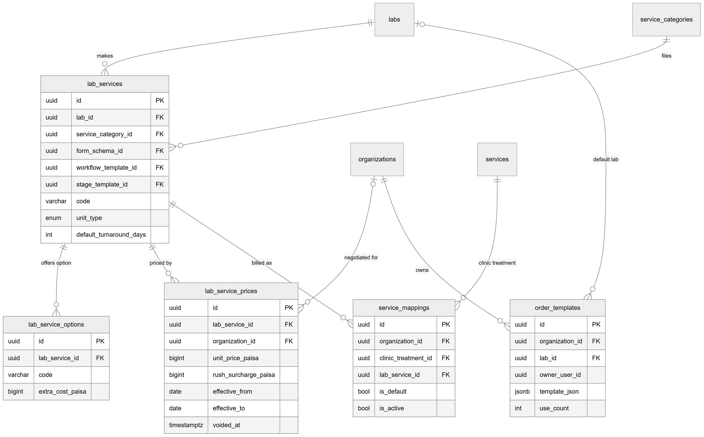

*Figure 40.11 — Lab services, options, prices, mappings and order templates.*

The diagram centres on `lab_services`, with columns `lab_id`, `service_category_id`, `form_schema_id`, `workflow_template_id`, `stage_template_id`, `code`, `unit_type` and `default_turnaround_days`. `labs` points to it ("makes") and `service_categories` points to it ("files"). Three tables hang off it: `lab_service_options` ("offers option", with `extra_cost_paisa`), `lab_service_prices` ("priced by", with `unit_price_paisa`, `rush_surcharge_paisa`, `effective_from`, `effective_to`, `voided_at`) and `service_mappings` ("billed as", with `is_default` and `is_active`) hang off it. `organizations` connects to `lab_service_prices` with an optional line ("negotiated for"), because an empty organization means the list price. `services` (the clinic's billing catalog) connects to `service_mappings` ("clinic treatment"). `order_templates` belongs to an organization ("owns") and optionally to a lab ("default lab"), and holds `owner_user_id` (a logical link to a user, no foreign key), `template_json` and `use_count`.

The relationships in words:
- Each lab service belongs to exactly one lab and one service category; its form, workflow and stage template are optional.
- Each option and each price row belongs to exactly one lab service; a price row belongs to zero or one organization.
- Two non-void windows of one service and one clinic (or both list prices) cannot overlap: the exclusion constraint `excl_lab_service_prices_overlap` guarantees it.
- Each mapping belongs to one organization, one clinic treatment and one lab service. There is at most one active default per treatment, and an active lab service maps to one treatment per organization.
- Each template belongs to one organization; its lab, if set, is one lab.

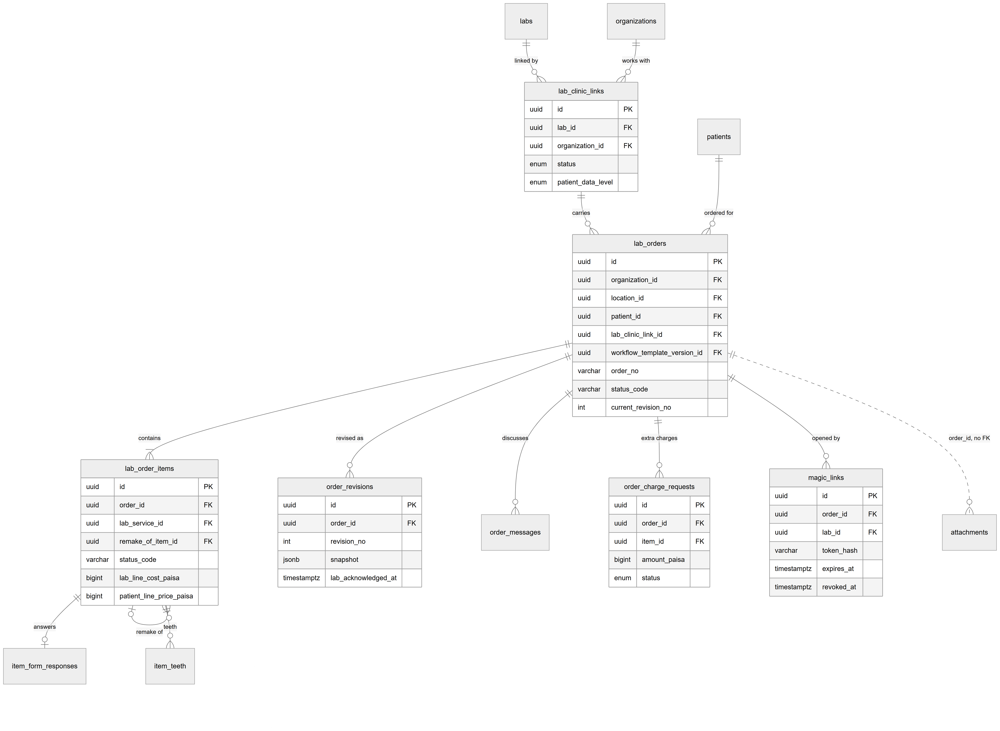

*Figure 40.12 — Lab orders, items, revisions, messages, charge requests and magic links.*

The diagram shows `lab_orders` with `organization_id`, `location_id`, `patient_id`, `lab_clinic_link_id`, `workflow_template_version_id`, `order_no`, `status_code` and `current_revision_no`. It points down to `lab_order_items` ("contains": `order_id`, `lab_service_id`, `remake_of_item_id`, `status_code`, `lab_line_cost_paisa`, `patient_line_price_paisa`), which has a loop to itself ("remake of"), one `item_form_responses` row and many `item_teeth`. `lab_orders` also reaches `order_revisions` ("revised as", with a `snapshot` and `lab_acknowledged_at`), `order_messages` ("discusses"), `order_charge_requests` ("extra charges") and `magic_links` ("opened by", with `token_hash`, `expires_at`, `revoked_at`). `lab_clinic_links` ("carries") links a lab and an organization to the orders, and `patients` ("ordered for") points to the order. A dotted line from `lab_orders` to `attachments` is labelled "order_id, no FK".

The relationships in words:
- Each order belongs to exactly one organization, location, patient, lab and lab link, and pins one workflow version that never changes; the doctor is optional.
- Each order contains at least one item. Deleting is blocked (RESTRICT); only draft items may be removed, by the draft editor.
- An item points to at most one original item it remakes; a request and a new item are linked one to one.
- Each item has at most one form-response row and any number of tooth rows.
- Each revision, message and charge request belongs to one order; messages and charge requests may point at one item.
- `order_no` is unique per organization; `idempotency_key` is unique per organization.
- Attachments point to an order by `order_id` without a foreign key and are polymorphic by `entity_type` (order or item).

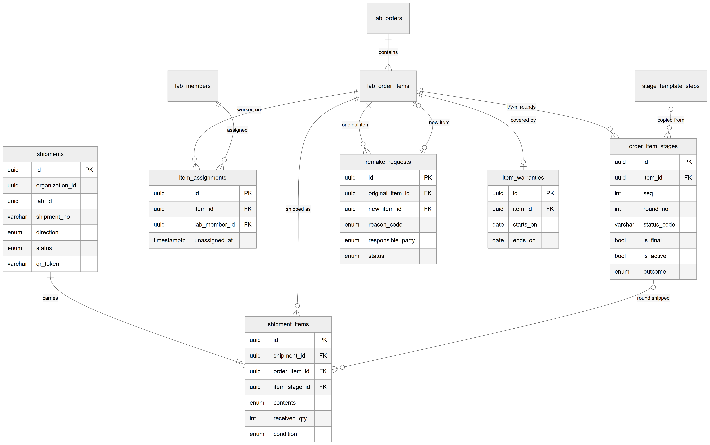

*Figure 40.13 — Stages, technician assignments, shipments, remake requests and warranties.*

The diagram shows `lab_order_items` at the centre. `order_item_stages` hangs off it ("try-in rounds") with `seq`, `round_no`, `status_code`, `is_final`, `is_active` and `outcome`, and is "copied from" `stage_template_steps`. `item_assignments` ("worked on") connects an item to `lab_members` ("assigned") with `unassigned_at`. `shipments` ("carries") has `shipment_items`, each of which points to an item ("shipped as") and optionally a stage ("round shipped"); a shipment has `direction`, `status` and `qr_token`. `remake_requests` connects twice to the item ("original item" many, "new item" one to one) and carries `reason_code`, `responsible_party` and `status`. `item_warranties` is one to one with the item, with `starts_on` and `ends_on`.

The relationships in words:
- At most one stage round per item is active at a time (partial unique index), and rounds are unique by item, sequence and round number.
- At most one open assignment per item (partial unique index); reassigning closes the old row.
- A shipment carries lines for items of one clinic and one lab; an item appears at most once in a shipment; received quantity cannot exceed shipped quantity.
- `new_item_id` is unique, and at most one open (requested or disputed) remake request exists per original item.
- A warranty is one per item.

The schema comes from the entity files; there is no migration file for these tables, because the lab module relies on the development schema sync and a reviewed schema sync in production.

## 40.5 Status lifecycles

The statuses in this section are the **seeded defaults** (version 1 of the `DENTAL_ORDER`, `DENTAL_ITEM` and `DENTAL_STAGE` workflows). Because states and transitions are data, a custom published version can differ; the order derivation rules described in 40.1 are fixed in code.

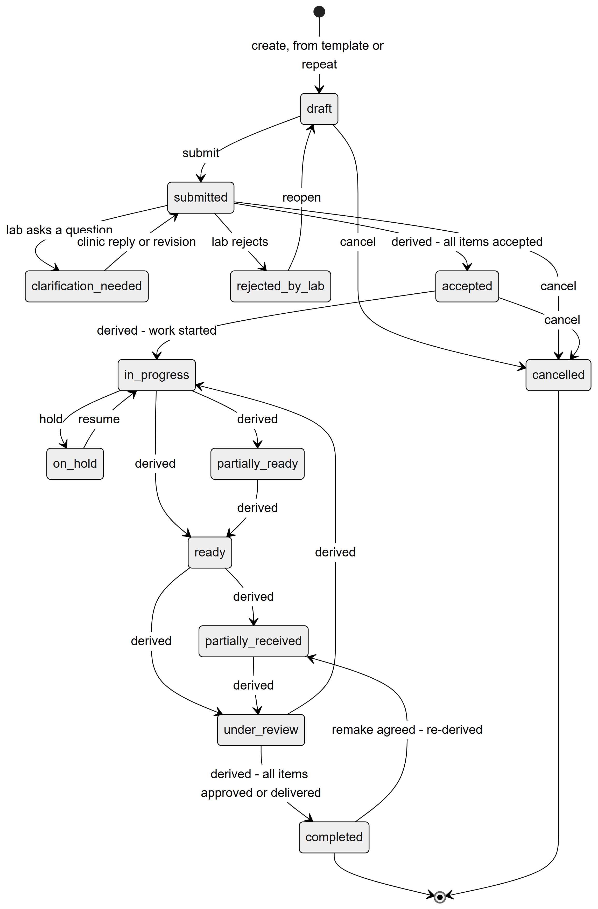

*Figure 40.14 — The seeded lab order workflow.*

The diagram has thirteen states. A new order enters at `draft` (by create, from a template, or by repeat). `draft` leads to `submitted` on "submit" and to `cancelled` on "cancel". From `submitted`: the lab asks a question and the order goes to `clarification_needed`; the clinic's reply or a revision returns it to `submitted`; the lab rejects and the order goes to `rejected_by_lab`, from which "reopen" returns it to `draft`; the clinic cancels and it goes to `cancelled`; and when every item is accepted it is derived to `accepted`. `accepted` can be cancelled, or derived to `in_progress` when work starts. `in_progress` can be put on hold (`on_hold`, with a reason) and resumed, or derived to `partially_ready` or `ready`. `partially_ready` is derived to `ready`. `ready` is derived to `partially_received` or `under_review`; `partially_received` to `under_review`. `under_review` is derived back to `in_progress` (for example after a rejection) or onward to `completed` once all items are approved or delivered. `completed` can return to `partially_received` when a remake adds new work. `completed` and `cancelled` end the diagram.

Walking through the states:
- **draft** — editable working copy, no number. Anyone with the right to order may edit, submit, cancel.
- **submitted** — number and prices frozen, the lab has been told. Changes are revisions.
- **clarification_needed** — the lab asked something. A reply or a revision answers it.
- **rejected_by_lab** — the lab refused the order, with a reason. The clinic may reopen it as a draft. Its items keep the status "Waiting for lab" in the database, which is an oddity recorded in the conflicts file.
- **accepted** — every item accepted with an expected date.
- **in_progress**, **partially_ready**, **ready** — derived from the items' production states.
- **on_hold** — a manual hold by the clinic. Derivation does not override it; **Resume** re-derives.
- **partially_received**, **under_review** — derived from receipt and approval.
- **completed**, **cancelled** — closed; magic links are revoked.

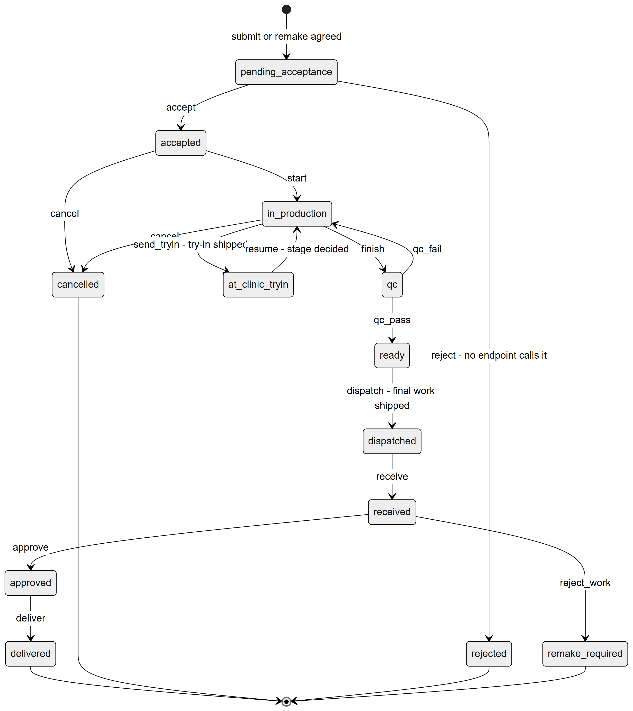

*Figure 40.15 — The seeded item workflow.*

The diagram runs from `pending_acceptance` (entry at submit, or when a remake is agreed) to `accepted` on "accept". An unused branch leads to `rejected` ("reject", no endpoint calls it). `accepted` goes to `in_production` on "start" or to `cancelled`. `in_production` goes to `at_clinic_tryin` ("send_tryin", when a try-in round is shipped), back from there on "resume", to `qc` on "finish", or to `cancelled`. `qc` returns to `in_production` on "qc_fail" or advances to `ready` on "qc_pass". `ready` goes to `dispatched` on "dispatch" (final work shipped). `dispatched` goes to `received` on "receive". `received` goes to `approved` on "approve" or to `remake_required` on "reject_work". `approved` goes to `delivered` on "deliver". `delivered`, `cancelled`, `rejected` and `remake_required` are final. The last state is final for this item only: the remake is a new item.

Walking through the states: **pending_acceptance** (shown as "Waiting for lab") waits for the lab's accept with an expected date; **accepted** has its stages created; **in_production** is bench work; **at_clinic_tryin** means a try-in round is with the clinic; **qc** is the lab's own quality check; **ready** means passed QC; **dispatched** is on the way to the clinic; **received** has been logged by the front desk; **approved** has been accepted by the doctor; **delivered** was fitted and has a warranty; **remake_required** was rejected and has an open remake request. The `send_tryin`, `resume` and `dispatch` transitions are done by the system, driven by shipments and decisions, not by a user button. The `rejected` state has no caller in the code that this review found (the order-level reject changes only the order); this is listed as unverified in the hand-back.

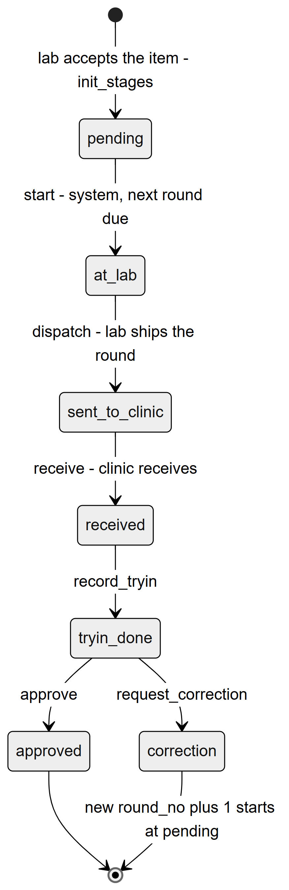

*Figure 40.16 — One try-in round.*

The diagram shows one round: `pending` (created when the lab accepts) goes to `at_lab` when it is started by the system, to `sent_to_clinic` when the lab ships it, to `received` on receipt, to `tryin_done` when the doctor records the try-in, and then either to `approved` (end) or to `correction` (end). A correction closes the round and the same stage starts again as `round_no` plus one, beginning at `pending`.

Walking through the states: **pending** — created, not yet started; **at_lab** — the active round, being worked; **sent_to_clinic** — on its way; **received** — logged at the clinic; **tryin_done** — the patient has tried it; **approved** — the stage is complete and the next stage starts; **correction** — closed with notes, a new round follows. A stage that needs no patient visit goes straight from received to the decision.

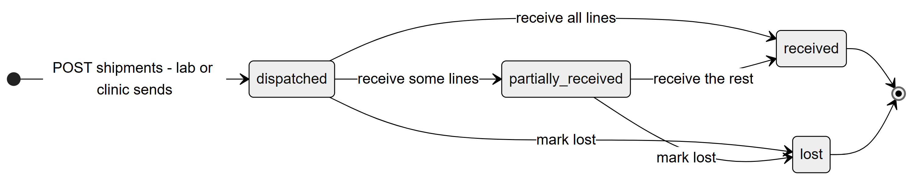

*Figure 40.17 — The shipment status values.*

The diagram shows a shipment entering at `dispatched` when either side posts it. It goes to `received` when every line is recorded, or to `partially_received` when some lines are recorded and others remain; `partially_received` goes to `received` when the rest arrive. From `dispatched` or `partially_received` a shipment can be marked `lost`. `received` and `lost` are final. These four values are fixed in code, not in a workflow.

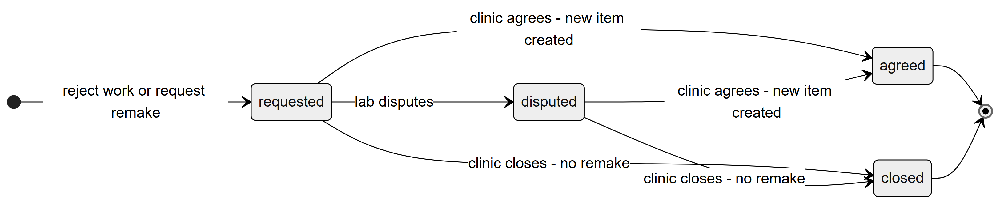

*Figure 40.18 — The remake request status values.*

The diagram shows a request entering at `requested` (a rejection or a remake request). The lab may dispute it (`disputed`). From `requested` or `disputed` the clinic either agrees (`agreed`, a new item is created) or closes it (`closed`, no remake). `agreed` and `closed` are final. These values are fixed in code.

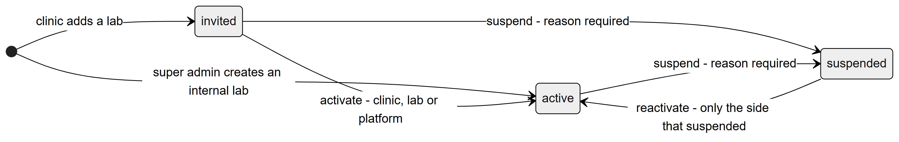

*Figure 40.19 — The lab link status values and who may move them.*

The diagram shows a link entering at `invited` (a clinic adds a lab) or directly at `active` (the super admin creates an in-house lab). `invited` goes to `active` on "activate" or to `suspended` on "suspend" (reason required). `active` goes to `suspended` on "suspend". `suspended` goes back to `active` on "reactivate", only by the side that suspended it. These values and rules are fixed in code (`lab-link-transitions.ts`).

## 40.6 Connections to other modules

- **Workflow engine (Chapter 43).** Order, item and stage statuses and their transitions are workflow template data; forms are form schemas. The super admin edits them in Config Studio.
- **Lab portal (Chapter 41).** The lab's side of every step: accept, reject, ask, produce, ship, dispute, read bills.
- **Lab finance (Chapter 42).** Accepting an order creates the vendor bill draft from the items' frozen lab costs; the patient lab invoice, payments and statements read the same snapshots.
- **Billing and treatments (Chapters 33 and 34).** A lab service is billed through a mapped treatment from the billing catalog; the patient price follows the billing price precedence.
- **Commissions (Chapter 35).** Lab-line commissions read the lab cost and the treatment's doctor.
- **Patients and appointments (Chapters 28 and 29).** An order belongs to a patient; a draft may link an appointment and a treatment; a try-in may link the patient's appointment. A warning appears when the lab's date is after the patient's next appointment.
- **Notifications (Chapter 44).** The events in 40.3.30.
- **Access control and features (Chapters 10 and 11).** Permissions `lab.*` and the feature `dental.lab_orders`.
- **Subscriptions (Chapter 45).** In read-only mode every write is refused with 402 `SUBSCRIPTION_EXPIRED`.

## 40.7 Limitations and known gaps

- The lab cannot manage its own catalog or prices; only the super admin does, through the Lab Directory.
- Service categories can be created only through the API.
- No screen cancels a single item or sends impressions and models to the lab, although the API supports both.
- A whole order that is already in progress cannot be cancelled in the seeded workflow, and cancelling an order does not cancel its items.
- Four seeded notification events are never emitted: `order.overdue`, `shipment.dispatched`, `tryin.appointment_due` and `appointment.rescheduled_lab_delay`. There is no overdue job.
- Patient and lab-contact messages go to a development logger until a real provider exists.
- Attachment visibility "patient shared" is stored but nothing shows it to a patient.
- Lab price windows use the platform's Asia/Karachi day, while order submit prices on the location's day.
- The warranty length is fixed at 12 months by default; no screen or endpoint changes or voids it.
- Magic-link rate limiting is kept in the memory of each API process, so it is per server instance.
- A suspended link stops new orders but does not stop orders already sent.
- A rejected order that is reopened keeps its items in the status "Waiting for lab" while the order is a draft again.

## 40.8 Owner's FAQ

**Can a receptionist create a lab order?** No. The Receptionist and Assistant templates have only `lab.orders.view` at location scope, so they can read orders and receive shipments but not create or change them. Doctors and Admin hold `lab.orders.create`.

**Who can see which orders?** Scope of `lab.orders.view`: a doctor sees the orders they are the doctor of or created; the front desk sees their location's orders; Admin sees all. Orders outside the scope answer "not found".

**What happens to the price if the lab changes its price after I submit?** Nothing. Prices of every line are copied into the item at submit and cannot change except by a revision or an approved extra charge.

**Why did my submit fail with a message about a treatment?** The line's lab service is not mapped to one of your treatments, so the patient price is unknown. Map it in **Lab price list** under **Treatment mapping**, or choose a treatment on the line.

**What if the lab never answers?** A coordinator holding both `lab.orders.create` and `lab.links.manage` (Admin by default) can record the lab's accept, reject, question or date change as a proxy action. It is marked in the history as entered by the clinic for the lab.

**How long does a magic link last, and can I stop it?** 24 hours by default (the environment variable `LAB_MAGIC_LINK_TTL_HOURS` changes it, up to 168 hours). You can revoke it at any time; it also stops when the order is completed, cancelled or rejected, or the lab is suspended.

**What does "Patient code only" do?** The lab sees the patient number instead of the name in its portal, its link page, the printed work order and notifications.

**Where are lab orders stored?** In `lab_orders` with their items in `lab_order_items`; every status change is also written to `status_history` and every edit to `audit_logs`.

**Can I delete a lab order?** No. There is no delete. Drafts can be cancelled; submitted orders are cancelled or completed, and every foreign key blocks deletion.

**Can a lab see what I charge the patient?** No. Lab-facing responses and the revision snapshots carry the lab cost only, never the patient price, the clinic's treatment or internal files.
