# Chapter 41 — Lab Portal

This chapter describes the lab side of dental-lab work on the Platform: the lab portal where lab staff sign in to receive clinic orders, accept and produce them, ship them and see what they are owed, and the no-login magic link page that lets a lab contact answer one order from a phone. It is written for the product owner, who needs to know what a lab can and cannot do today. The clinic side of the same cases (ordering, try-ins, approvals) is in Chapter 40, and the money the lab sees read-only is covered by Chapter 42.

## 41.1 What this module is for

A **lab** is a dental laboratory that makes crowns, bridges and dentures for clinics. It is not a tenant of the Platform and has no organization of its own. Its people are **lab members**: user accounts with the role **lab admin** or **lab technician** on one or more labs. They have no clinic membership, so a clinic can never see their data and they can never see a clinic's.

The lab portal gives them a workspace that is separate from the clinic workspace:

- **Orders.** An inbox of the work that clinics sent, where a lab admin accepts an order with a ready date, rejects it, asks a question or moves the date.
- **Production.** A work queue per item: start work, send to quality check (QC), pass or fail QC, assign a technician, ship try-in rounds and finished work to the clinic, receive parcels the clinic sent, report a lost parcel and dispute a remake request.
- **Clinics.** The clinics that linked this lab, where a lab admin accepts an invitation or suspends and reactivates a clinic.
- **Team** and **Lab profile.** The lab's members and its contact details.
- **Billing.** A read-only view of the bills clinics approved for the lab, the payments, and the statements.
- **Magic link page.** One order, no login, for a lab contact who received a link.

Who uses it, by canonical role:

- **Lab admin.** Everything in the portal: answers orders, assigns work, manages the team, accepts or suspends clinics, edits contact details.
- **Lab technician.** Reads orders, starts work, sends to QC, passes or fails QC, ships and receives parcels. Cannot accept or reject orders, assign technicians, manage the team or change a clinic's link.
- **Lab contact acting through a magic link.** Not a user. Sees one order and can accept, reject or ask a question on it.
- **Clinic staff** act on the same orders from the clinic side (Chapter 40) and, with the right permissions, can record answers for a lab that does not respond.

Where it appears: there is no clinic sidebar for lab-only users. They land in their own layout with the entries **Dashboard**, **Orders**, **Lab profile**, **Team** (lab admins only), **Clinics**, **Production** and **Billing**. A user who is both a lab member and clinic staff also sees a **Lab portal** entry in the clinic sidebar (`nav.lab_portal`, route `/lab-portal`, shown to anyone with at least one lab membership), and the portal offers a **Clinic workspace** link back.

The lab portal does not depend on a feature switch. Access is decided only by an active lab membership of an active lab. The clinic's feature `dental.lab_orders` gates the clinic side (Chapter 40), not the portal.

### Patient data level

Each clinic decides per lab link how much of the patient's identity the lab sees: **Full patient name** or **Patient code only**. In the portal, with "code only" the order list, the order page, the magic link page, the printed work order and notification texts show the clinic's patient number instead of the name. The patient number is always sent in a separate field as well. Prices are never shown: lab-facing responses carry the lab's own cost, never the patient price, the clinic's treatment or internal files, and the clinic list shows a clinic only by name and city, status and payment terms.

## 41.2 Screens

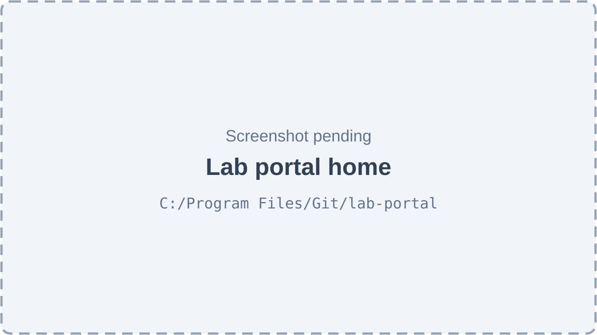

*Figure 41.1 — The lab portal Dashboard (screenshot pending).*

The portal has a left navigation (Dashboard, Orders, Lab profile, Team, Clinics, Production, Billing), a lab switcher at the top (a selector "Switch lab" with the placeholder "Choose a lab", for users who work for several labs), a user block with a **Sign out** icon and, for users who also work for a clinic, a **Clinic workspace** link. The Dashboard is titled "Welcome to" followed by the lab's name, with the subtitle "Your lab's workspace." It shows three cards: "Orders waiting for you" (the number of orders in status Submitted, a link to the order list), "Active clinics" (a link to the clinic list) and "Team members".

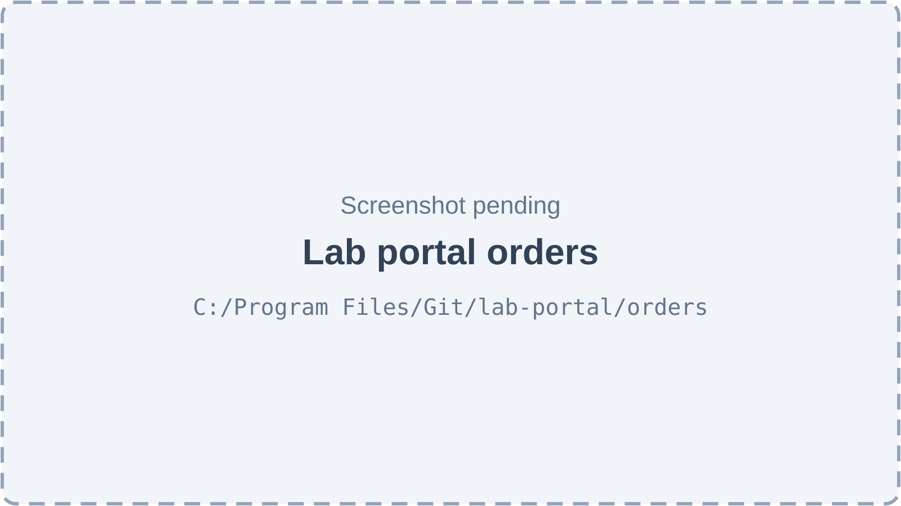

*Figure 41.2 — The lab's order inbox (screenshot pending).*

The **Orders** page is titled "Orders" with the subtitle "Work sent to your lab. Accept new orders with the date they’ll be ready." It has a search box ("Search order no. or clinic…") and a status filter. The table has the columns Order (with an "Urgent" badge), Clinic, Patient (a name or a code, by the link's setting), Doctor, Status, Due, Received. With no orders the page says "No orders yet. When a clinic sends your lab an order, it shows up here — and on WhatsApp if the clinic sends you a link."

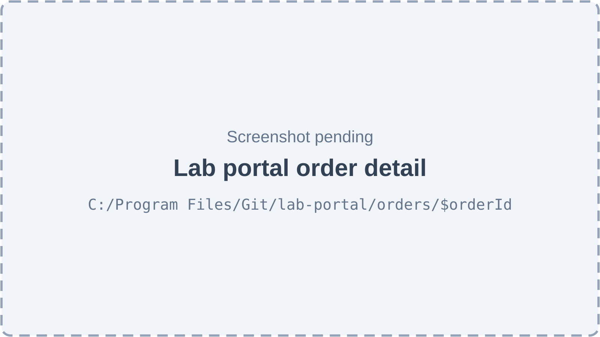

*Figure 41.3 — One order as the lab sees it (screenshot pending).*

The order page is titled "Order" and the order number, with the clinic and the patient reference as subtitle, a back button to the list, the status badge, an "Urgent" badge and the dates "Wanted by" and "Ready on". The buttons at the top right are the actions the lab may take now: **Accept**, **Ask a question**, **Reject**, **Change date**. The body has a **Work** section (each item with its service, quantity, rush, options, teeth, and the form answers such as shade and material), a **Revisions** section (each revision with "Read" and a time, or a button to acknowledge it, or "New"), **Messages** with a box "Write to the clinic…" and **Files** (only files the clinic shared with the lab, with a download button).

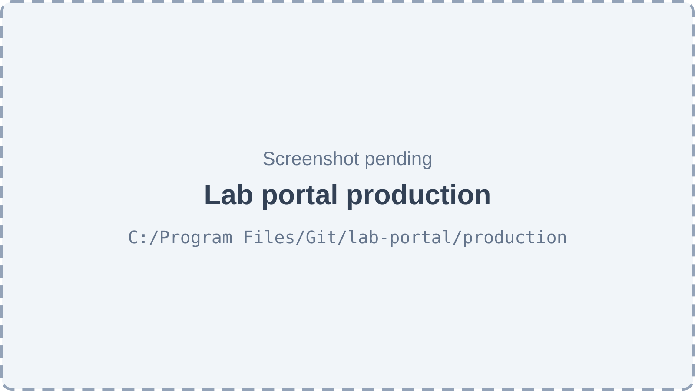

*Figure 41.4 — The Production desk (screenshot pending).*

The **Production** page is titled "Production" with the subtitle "Work in progress, try-in rounds, QC and shipments to clinics." It has three tabs: **Work queue**, **Shipments** and **Remakes**. The work queue table has the columns Order, Work, Stage, Status, Due, Technician and an action column. The action on each row changes with the item's step: **Start work**, **Ship for try-in**, **Send to QC**, **QC pass** with a cross button ("QC fail — back to production"), or **Ship**; a button "Assign technician" appears for lab admins. The Shipments tab lists shipment number, contents, status and dispatch time with buttons to print the slip with its QR code, to mark a shipment lost, and **Receive** for parcels the clinic sent. The Remakes tab lists order, reason, status and a dispute button.

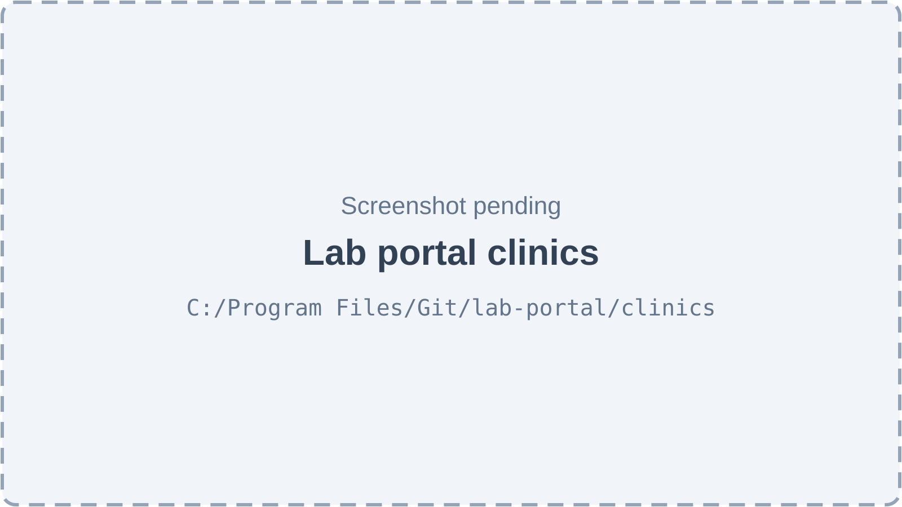

*Figure 41.5 — The clinics that work with the lab (screenshot pending).*

The **Clinics** page is titled "Clinics" with the subtitle "Clinics that send work to your lab. Accept new invitations here." The table has the columns Clinic, City, Status, Payment terms and an actions column; the filters are a search box ("Search by clinic name…") and a status filter. For a lab admin each row shows an accept button (tooltip "Accept" followed by the clinic name), a reactivate button or a suspend action that asks for a reason ("e.g. Outstanding balance"). With no clinics the page says "No clinics yet" and explains that an invitation appears here when a clinic adds the lab to its list.

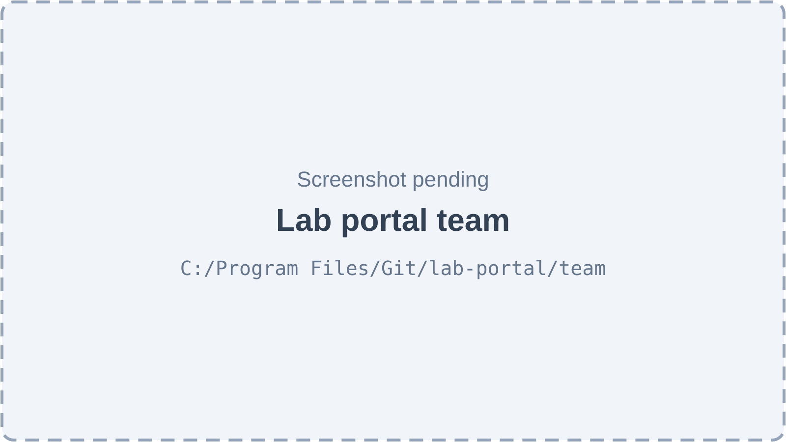

*Figure 41.6 — The lab's team (screenshot pending).*

The **Team** page is titled "Team" with the subtitle "People who work at your lab." For a technician it shows "Lab admins only — Ask your lab admin to add or change team members." For lab admins the table has the columns Member, Status and "Role & access" (a role selector and an active switch per row) and the filters search ("Search by name or email…") and role. The add sheet is "Add team member": "The person needs their own account — clinic staff accounts can’t join an outside lab." It asks for "Account email" and "Role".

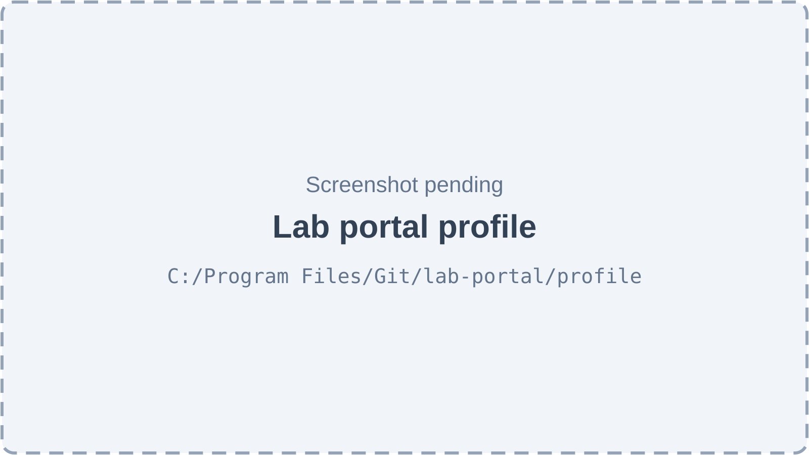

*Figure 41.7 — The lab profile (screenshot pending).*

The **Lab profile** page is titled "Lab profile" with the subtitle "How clinics and couriers reach your lab." It lists phone, WhatsApp, email, city and address. A lab admin can press an edit button that opens "Edit contact details": "Clinics see these details on their lab list. The lab's name is managed by platform support." The form has Phone, WhatsApp, Email, City and "Pickup / delivery address", with an "unsaved changes" hint.

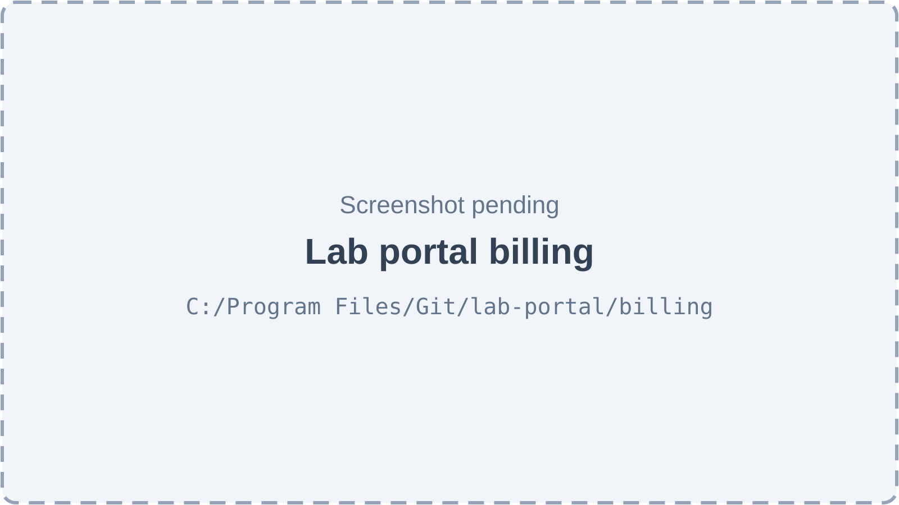

*Figure 41.8 — The lab's read-only Billing page (screenshot pending).*

The **Billing** page is titled "Billing" with the subtitle "Bills clinics approved for your work, and what they paid." It has three tabs. **Bills** has the columns Bill, Clinic, Status, Due, Total and Balance, and opens a bill with its lines and the totals Total, Paid, Balance. **Payments** has Payment, Clinic, "Paid on", Method, Amount and Status. **Statements** has Period, Clinic, "Ref.", Total and Status. Nothing can be edited here; an empty tab says "Nothing here yet".

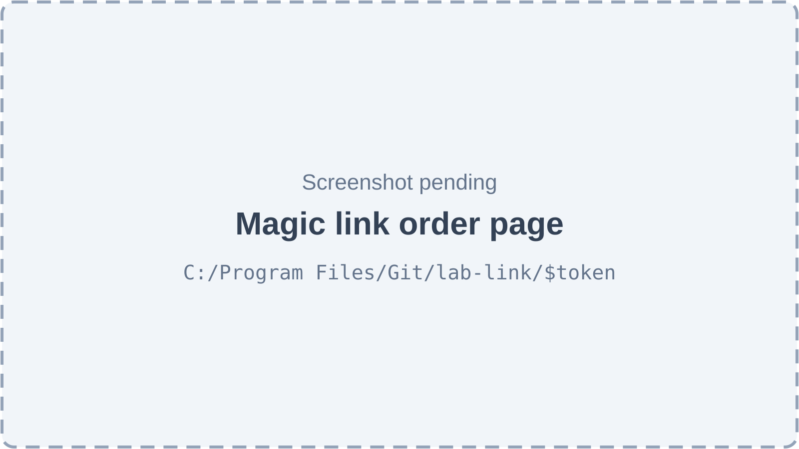

*Figure 41.9 — The no-login order page opened from a magic link (screenshot pending).*

The magic link page (`/lab-link/$token`) is a single page with a small header "Lab order" and, on the right, "For" the lab's name and "link valid until" a date and time. The body shows "Order" with its number, the clinic, the patient reference and the doctor, the status badge, an "Urgent" badge, "Wanted by" and "Ready on" dates, the same action buttons as the portal (but only **Accept**, **Reject** and **Ask a question**) and the same Work, Revisions, Messages and Files sections. A dead link shows "This link is not valid" or "This link no longer works" with "Ask the clinic to send a new link, or sign in to the lab portal."

## 41.3 Features

### How one case flows between the two sides

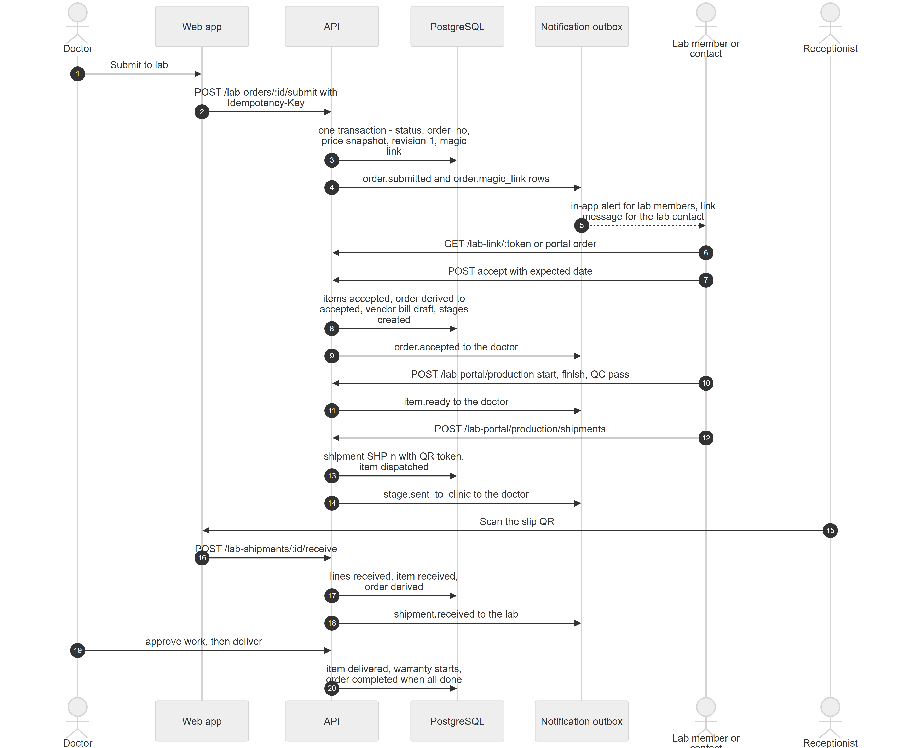

*Figure 41.10 — Submit, magic link, accept, production, shipment and receipt.*

The diagram has seven participants: Doctor, Web app, API, PostgreSQL, Notification outbox, Lab member or contact and Receptionist. The Doctor presses "Submit to lab"; the Web app calls `POST /lab-orders/:id/submit` with an Idempotency-Key. The API does one database transaction (status, order number, price snapshot, revision 1, magic link) and puts `order.submitted` and `order.magic_link` rows in the outbox. The lab members get an in-app alert and the lab contact gets the link message. The Lab opens the link or the portal order and posts "accept" with an expected date; the API marks the items accepted, derives the order to accepted, creates the vendor bill draft and the stages, and queues `order.accepted` to the doctor. The Lab then posts start, finish and QC pass on the portal production routes, which queues `item.ready` to the doctor. The Lab creates a shipment; the API stores a shipment with a QR token, marks the item dispatched and queues `stage.sent_to_clinic`. The Receptionist scans the slip, the Web app calls `POST /lab-shipments/:id/receive`, the API records the lines, marks the item received, re-derives the order and queues `shipment.received` to the lab. Finally the Doctor approves the work and delivers it, which starts the warranty and completes the order once every item is done.

### 41.3.1 Sign in as a lab member

**Status:** [Implemented]

**What it does.** A lab member signs in on the same login page as everybody else. The Platform recognises active lab memberships, and a user with no clinic access goes straight to the lab portal.

**How the user does it.**
1. A super admin creates the lab member's account under **User Admin** and adds it to the lab (Chapter 40, feature "Manage the staff of a lab"), or a lab admin adds an existing account from **Team**.
2. The lab member opens the login page, enters email and password and signs in.
3. A user with only lab memberships lands on `/lab-portal`. A user who also works at a clinic goes through the usual clinic flow and opens the portal from the **Lab portal** sidebar entry.

**Behind the scenes — in simple terms.** The login answer carries the list of labs the user may open. The app stores it, and from then on a lab-only user is kept inside the portal: any other address redirects back to it. Signing in again after a page reload restores the same list.

**Behind the scenes — technically.** `POST /auth/login`, the silent refresh and the other session responses include `labMemberships`, computed by `findLabMemberships` (active `lab_members` rows joined to active labs). In the web app `LoginForm` calls `isLabOnlyUser` (not super admin, no accessible organization, at least one membership) and navigates to `/lab-portal`; `__root.tsx` keeps lab-only users inside `/lab-portal`, sends users without a membership away from it, and lists `/lab-link/` among the paths open to everybody. `GET /lab-portal/me` (any membership, no selected lab) returns the labs for the switcher.

**Rules and validations.**
- A lab member's account cannot be a clinic staff or owner account of another clinic, and a super admin cannot be a lab member.
- A deactivated member or a suspended lab drops out of the list and is refused (`LAB_ACCESS_DENIED`).

**Who can do it.** Any user with an active membership. No permission key or feature key applies.

**Data read and written.** Reads `users`, `lab_members`, `labs`.

**Effects on other modules.** Authentication (Chapter 56) issues the session.

**Error cases.** 403 `LAB_ACCESS_DENIED` ("You are not a member of any lab").

**Technical references:** `backend/src/labs/portal/lab-memberships.ts` · `findLabMemberships` · `web-app/src/features/auth/components/LoginForm.tsx`

### 41.3.2 Work in one lab or switch between labs

**Status:** [Implemented]

**What it does.** Every portal call is tied to one lab. A member of several labs chooses the active lab with the lab switcher; a member of one lab needs no choice.

**How the user does it.** Use the "Switch lab" selector at the top of the portal.

**Behind the scenes — in simple terms.** The portal sends the chosen lab with every request. The server checks that the caller really is an active member of that lab and treats any other lab's id exactly like a lab that does not exist.

**Behind the scenes — technically.** `LabPortalGuard` (applied to every `@LabPortalController` route, which is `@ContextFree` so the clinic tenant guard skips it): rejects requests that carry clinic headers (400 `LAB_PORTAL_CLINIC_CONTEXT`), loads memberships, takes the lab from the `x-lab-id` header (or the only lab; 400 `LAB_SELECTION_REQUIRED` when there are several and none is given), checks `@LabRoles` against the membership's role (403 `FORBIDDEN`) and sets `request.labActor`. The web client adds `x-lab-id` only on `/lab-portal` calls and never sends the clinic headers there. Lab-owned reads start from `LabScopedService.scoped()`, already filtered by `lab_id`, so another lab's ids answer 404.

**Rules and validations.** Super admins hold no membership and are refused like anyone else. A malformed lab id is refused as access denied.

**Who can do it.** Any lab member.

**Data read and written.** Reads `lab_members`, `labs`.

**Effects on other modules.** None.

**Error cases.** 400 `LAB_SELECTION_REQUIRED`, `LAB_PORTAL_CLINIC_CONTEXT`; 403 `LAB_ACCESS_DENIED`, `FORBIDDEN`.

**Technical references:** `backend/src/labs/portal/lab-portal.guard.ts` · `LabPortalGuard`, `LabScopedService` · `web-app/src/features/lab-portal/components/LabSwitcher.tsx`

### 41.3.3 See the lab dashboard

**Status:** [Implemented]

**What it does.** Shows how many orders wait for an answer, how many clinics are active and how many people are on the team.

**How the user does it.** Open **Dashboard**. Click a card to go to the order list or the clinic list.

**Behind the scenes — in simple terms.** "Orders waiting for you" counts orders in the status Submitted.

**Behind the scenes — technically.** `GET /lab-portal/lab` returns the lab profile with `memberCount` and `activeLinkCount`; `GET /lab-portal/orders?status=submitted&limit=1` supplies the waiting count.

**Rules and validations.** Counts are for the active lab only.

**Who can do it.** Any lab member.

**Data read and written.** Reads `labs`, `lab_members`, `lab_clinic_links`, `lab_orders`.

**Effects on other modules.** None.

**Error cases.** Shows an error state with retry.

**Technical references:** `backend/src/labs/portal/lab-portal.controller.ts` · `PortalLabController`, `LabPortalService.profile` · `web-app/src/features/lab-portal/pages/LabPortalDashboardPage.tsx`

### 41.3.4 Read the order inbox

**Status:** [Implemented]

**What it does.** Lists every non-draft order sent to the lab, newest first, with clinic, patient reference, doctor, status, expected date and revision number.

**How the user does it.** Open **Orders**, search by order number or clinic name, filter by status and click a row.

**Behind the scenes — in simple terms.** Drafts never show: the lab sees an order only once the clinic submitted it.

**Behind the scenes — technically.** `GET /lab-portal/orders` → `LabOrdersPortalService.list`, which starts from the lab-scoped query and adds `status_code <> 'draft'`, joins the patient, the link (for the patient data level), the organization and the doctor, and maps the patient through `patientForLab`. Paged on the server.

**Rules and validations.** Search matches order number or clinic name.

**Who can do it.** Any lab member (lab admin and technician).

**Data read and written.** Reads `lab_orders`, `patients`, `lab_clinic_links`, `organizations`, `employees`.

**Effects on other modules.** None.

**Error cases.** 403 `LAB_ACCESS_DENIED`.

**Technical references:** `backend/src/lab-orders/portal/lab-orders-portal.service.ts` · `LabOrdersPortalService.list` · `web-app/src/features/lab-portal/pages/LabPortalOrdersPage.tsx`

### 41.3.5 Open an order

**Status:** [Implemented]

**What it does.** Shows one order the way the lab needs it: items, teeth, form answers, revisions, messages and shared files, plus the actions the lab may take.

**How the user does it.** Click an order in the list. The back button returns to where the user came from.

**Behind the scenes — in simple terms.** The lab sees the lab cost, never the patient price. Internal files of the clinic and files marked only for the patient are hidden.

**Behind the scenes — technically.** `GET /lab-portal/orders/:id` → `toLabOrder` (the lab mapper) over the loaded order bundle; `GET /lab-portal/orders/:id/actions` lists the actions the lab may take now (accept, reject, request clarification, change expected date) computed from the pinned workflow and the member's role.

**Rules and validations.** An order of another lab, or a draft, answers 404 `LAB_ORDER_NOT_FOUND`.

**Who can do it.** Any lab member.

**Data read and written.** Reads the order tables, `attachments`, `order_revisions`, `order_messages`.

**Effects on other modules.** None.

**Error cases.** 404 `LAB_ORDER_NOT_FOUND`.

**Technical references:** `backend/src/lab-orders/mappers/order-response.ts` · `toLabOrder` · `web-app/src/features/lab-portal/pages/LabPortalOrderDetailPage.tsx`

### 41.3.6 Accept an order with an expected date

**Status:** [Implemented]

**What it does.** The lab accepts a submitted order and promises a ready date. The clinic's doctor is told. The case now enters production.

**How the user does it.**
1. Open the order and press **Accept**.
2. Enter "Ready on" and optionally "Note for the clinic", then confirm.

**Behind the scenes — in simple terms.** Every item waiting for the lab is accepted in one step. The Platform creates the try-in stages of each item from its stage template, builds the draft bill the clinic will later approve (from the items' frozen lab costs), and re-derives the order to Accepted.

**Behind the scenes — technically.** `POST /lab-portal/orders/:id/accept` (body `labExpectedOn`, optional `note`, optional `version`) → `LabOrderActionsService.accept`, one transaction: row-lock the order and check the version; the order must be submitted (`LAB_ACTION_NOT_ALLOWED` otherwise); the date must not be past in the location's clinic day (`ClockService`); `UPDATE lab_orders SET lab_expected_on`; for each item in `pending_acceptance`, engine `transitionIn` with action `accept`, required input `lab_expected_on`, actor side lab, `via = portal`; item listeners create `order_item_stages` (`initStages`) and the vendor bill draft (`create_vendor_bill_draft` logic in the payables module), and the order is re-derived; an `audit_logs` row; outbox `order.accepted` to the doctor. Roles come from the pinned workflow (seeded: lab admin only).

**Rules and validations.**
- Date format YYYY-MM-DD, not in the past (`LAB_EXPECTED_DATE_INVALID`).
- Only a lab admin may accept in the seeded workflow; a technician does not see the button.
- "No line is waiting for acceptance" if nothing is pending.

**Who can do it.** Lab admin (seeded workflow role). No permission key.

**Data read and written.** `lab_orders`, `lab_order_items`, `order_item_stages`, `vendor_bills`, `vendor_bill_lines`, `status_history`, `audit_logs`, `notification_outbox`.

**Effects on other modules.** The clinic sees the order as Accepted with the date; a vendor bill draft appears in the clinic's lab payables (Chapter 42).

**Error cases.** 422 `LAB_ACTION_NOT_ALLOWED`, `LAB_EXPECTED_DATE_INVALID`, `TRANSITION_INPUT_REQUIRED`; 403 `TRANSITION_FORBIDDEN`; 409 `STALE_VERSION`.

**Technical references:** `backend/src/lab-access/actions/lab-order-actions.service.ts` · `LabOrderActionsService.accept` · `web-app/src/features/lab-portal/components/LabOrderActions.tsx`

### 41.3.7 Reject an order

**Status:** [Implemented]

**What it does.** The lab refuses the whole order with a reason. The order becomes "Rejected by lab" and the doctor is told; the clinic may reopen it as a draft.

**How the user does it.** Press **Reject**, type the "Reason" and confirm.

**Behind the scenes — in simple terms.** Only the order changes status. Its items stay as they are.

**Behind the scenes — technically.** `POST /lab-portal/orders/:id/reject` → `LabOrderActionsService.reject`: engine transition `reject` on the order (reason required), then outbox `order.rejected`. Closing the order revokes its magic links.

**Rules and validations.** Reason required, at most 1,000 characters; the order must be submitted.

**Who can do it.** Lab admin (seeded workflow role).

**Data read and written.** `lab_orders`, `status_history`, `audit_logs`, `magic_links`, `notification_outbox`.

**Effects on other modules.** The clinic can reopen the order (Chapter 40).

**Error cases.** 422 `INVALID_TRANSITION`, `TRANSITION_REASON_REQUIRED`; 403 `TRANSITION_FORBIDDEN`.

**Technical references:** `backend/src/lab-access/actions/lab-order-actions.service.ts` · `LabOrderActionsService.reject` · `web-app/src/features/lab-portal/components/LabOrderActions.tsx`

### 41.3.8 Ask the clinic a question

**Status:** [Implemented]

**What it does.** The lab asks for clarification. The order moves to "Clarification needed" until the clinic replies or revises it.

**How the user does it.** Press **Ask a question**, type the "Question" (optionally about one item) and send.

**Behind the scenes — in simple terms.** The question is stored as a message in the order's thread and the doctor gets a notice with the first part of the text.

**Behind the scenes — technically.** `POST /lab-portal/orders/:id/clarification` → `LabOrderActionsService.clarify`: the status transition `request_clarification` first (so a wrong state writes no message), then `order_messages` (kind clarification request, author side lab), audit, and outbox `order.clarification_requested` with the question shortened to 300 characters. A message with kind `clarification_request` through `POST /lab-portal/orders/:id/messages` also moves the status.

**Rules and validations.** Body at most 4,000 characters; the order must be submitted; the item, if given, must belong to the order.

**Who can do it.** Lab admin (seeded workflow role).

**Data read and written.** `order_messages`, `lab_orders`, `status_history`, `audit_logs`, `notification_outbox`.

**Effects on other modules.** None.

**Error cases.** 404 `LAB_ORDER_ITEM_NOT_FOUND`; 422 `INVALID_TRANSITION`.

**Technical references:** `backend/src/lab-access/actions/lab-order-actions.service.ts` · `LabOrderActionsService.clarify` · `web-app/src/features/lab-portal/components/LabOrderActions.tsx`

### 41.3.9 Change the expected date

**Status:** [Implemented]

**What it does.** When the work will be late, the lab moves the expected date and says why. The doctor is told the old date, the new date and the reason.

**How the user does it.** Press **Change date**, choose the new date, type the reason and confirm.

**Behind the scenes — in simple terms.** Only orders that are already accepted and not yet finished can change date.

**Behind the scenes — technically.** `POST /lab-portal/orders/:id/expected-date` (`@LabRoles(lab_admin)`) → `LabOrderActionsService.changeExpectedDate`: order lock and version check, allowed statuses accepted, in progress, partially ready, on hold; refuses the same date; refuses a past date; updates `lab_expected_on`; audit; outbox `order.expected_date_changed`.

**Rules and validations.** Reason required (at most 1,000 characters). Date in `YYYY-MM-DD`, not in the past. Not allowed in other statuses (`LAB_ACTION_NOT_ALLOWED`).

**Who can do it.** Lab admin.

**Data read and written.** `lab_orders`, `audit_logs`, `notification_outbox`.

**Effects on other modules.** The clinic may see a warning when the date falls after the patient's next appointment.

**Error cases.** 422 `LAB_ACTION_NOT_ALLOWED`, `LAB_EXPECTED_DATE_INVALID`; 403 `FORBIDDEN`.

**Technical references:** `backend/src/lab-access/controllers/lab-portal-order-actions.controller.ts` · `LabOrderActionsService.changeExpectedDate` · `web-app/src/features/lab-portal/components/LabOrderActions.tsx`

### 41.3.10 Write a note to the clinic

**Status:** [Implemented]

**What it does.** Adds a plain note to the order thread that the clinic can read.

**How the user does it.** In **Messages** type in "Write to the clinic…" and send.

**Behind the scenes — in simple terms.** A note does not change the order's status; a question does.

**Behind the scenes — technically.** `POST /lab-portal/orders/:id/messages` (kind `note`) → `LabOrdersService.labMessage`: lock, closed orders refused, optional item check, insert into `order_messages` (author side lab), audit.

**Rules and validations.** Replies come only from the clinic (`LAB_ORDER_MESSAGE_INVALID`). Closed orders take no messages.

**Who can do it.** Any lab member.

**Data read and written.** `order_messages`, `audit_logs`.

**Effects on other modules.** The doctor sees it in the order's Messages section.

**Error cases.** 422 `LAB_ORDER_MESSAGE_INVALID`, `LAB_ORDER_INVALID`.

**Technical references:** `backend/src/lab-orders/services/lab-orders.service.ts` · `LabOrdersService.labMessage` · `web-app/src/features/lab-portal/pages/LabPortalOrderDetailPage.tsx`

### 41.3.11 Acknowledge a revision

**Status:** [Implemented]

**What it does.** When the clinic revises a sent order, the lab confirms that it read the new version. The clinic sees "Read by lab" or "Not read by lab yet".

**How the user does it.** In **Revisions** press the acknowledge button next to a revision marked "New".

**Behind the scenes — in simple terms.** Pressing it twice changes nothing the second time.

**Behind the scenes — technically.** `POST /lab-portal/orders/:id/revisions/:revisionNo/acknowledge` → `LabOrdersService.acknowledgeRevision`: row-lock the revision, set `lab_acknowledged_at` and `lab_acknowledged_by` once, audit.

**Rules and validations.** Revision must exist (`LAB_ORDER_REVISION_NOT_FOUND`).

**Who can do it.** Any lab member.

**Data read and written.** `order_revisions`, `audit_logs`.

**Effects on other modules.** Shown on the clinic order page.

**Error cases.** 404 `LAB_ORDER_REVISION_NOT_FOUND`.

**Technical references:** `backend/src/lab-orders/services/lab-orders.service.ts` · `LabOrdersService.acknowledgeRevision` · `web-app/src/features/lab-portal/components/LabOrderView.tsx`

### 41.3.12 Ask for an extra charge

**Status:** [Partial]

**What it does.** The lab asks the clinic to approve an extra charge (rush, material, shipping or other) with an amount and a reason. The portal's order page has no form for it.

**How the user does it.** Not available in the web app. The clinic can already decide such requests (Chapter 40), but the lab has no button to create one.

**Behind the scenes — in simple terms.** The API accepts the request; nothing in the portal calls it.

**Behind the scenes — technically.** `POST /lab-portal/orders/:id/charge-requests` (`@LabRoles(lab_admin)`) → `LabOrdersService.requestCharge`: lock, closed orders refused, optional item check, insert into `order_charge_requests` with status pending, audit. No portal component or API function uses it.

**Rules and validations.** Amount greater than zero (paisa), reason required, kind one of rush, material, shipping, other.

**Who can do it.** Lab admin.

**Data read and written.** `order_charge_requests`, `audit_logs`.

**Effects on other modules.** An approved item charge raises the item's lab cost and so the vendor bill.

**Error cases.** 422 `LAB_ORDER_INVALID`; 404 `LAB_ORDER_ITEM_NOT_FOUND`.

**Technical references:** `backend/src/lab-orders/controllers/lab-orders-portal.controller.ts` · `LabOrdersService.requestCharge` · none in `web-app/src/features/lab-portal/`

### 41.3.13 Upload files to an order

**Status:** [Partial]

**What it does.** Lets the lab attach a file (for example a photo of a problem) that the clinic can see. There is no upload control in the portal.

**How the user does it.** Not available in the web app.

**Behind the scenes — in simple terms.** Anything a lab uploads is shared with the clinic automatically.

**Behind the scenes — technically.** `POST /lab-portal/orders/:id/attachments` (multipart) → `AttachmentsService.upload` with visibility `lab_shared`, side lab; at most 50 MB.

**Rules and validations.** `ATTACHMENT_INVALID` for no file or a file over 50 MB.

**Who can do it.** Any lab member.

**Data read and written.** `attachments`, private file storage, `audit_logs`.

**Effects on other modules.** The clinic sees the file in the order's Files section.

**Error cases.** 422 `ATTACHMENT_INVALID`.

**Technical references:** `backend/src/lab-orders/controllers/lab-orders-portal.controller.ts` · `AttachmentsService.upload` · none in the portal web code

### 41.3.14 Download files the clinic shared

**Status:** [Implemented]

**What it does.** Opens a scan, photo or document that the clinic marked "shared with the lab".

**How the user does it.** In **Files**, press the download button (tooltip "Download" and the file name).

**Behind the scenes — in simple terms.** The download link works for ten minutes. A file that is internal to the clinic does not exist for the lab.

**Behind the scenes — technically.** `GET /lab-portal/orders/:id/attachments/:attachmentId/url` and `GET /lab-link/:token/attachments/:attachmentId/url` → `AttachmentsService.signedUrl(order, id, labOnly = true)`, which answers `ATTACHMENT_NOT_FOUND` for anything not `lab_shared`.

**Rules and validations.** Lab-shared files only.

**Who can do it.** Any lab member, or the holder of a valid magic link.

**Data read and written.** Reads `attachments`.

**Effects on other modules.** None.

**Error cases.** 404 `ATTACHMENT_NOT_FOUND`.

**Technical references:** `backend/src/lab-orders/attachments/attachments.service.ts` · `AttachmentsService.signedUrl` · `web-app/src/features/lab-portal/components/LabOrderView.tsx`

### 41.3.15 Run the work queue: start, QC pass, QC fail

**Status:** [Implemented]

**What it does.** The lab moves each accepted item through its bench steps. **Start work** begins production; **Send to QC** finishes the work for inspection; **QC pass** marks it ready and tells the doctor (and the patient, if a patient channel exists); **QC fail** sends it back to production with notes.

**How the user does it.**
1. Open **Production**, tab **Work queue**. Search by order number, clinic or work; filter by status.
2. On a row press the next step: **Start work**, then (for items with try-in stages) **Ship for try-in**, and later **Send to QC**, **QC pass** or the cross button "QC fail — back to production" (then describe what needs fixing in "QC failed").

**Behind the scenes — in simple terms.** If an item has try-in stages, the lab must ship each try-in and the clinic must approve it before the final stage is at the lab; only then can the item go to QC. The portal shows only the step that is allowed.

**Behind the scenes — technically.** `GET /lab-portal/production/items`, `POST …/items/:itemId/start`, `…/finish`, `…/qc` (body `result` pass or fail, notes) in `LabProductionController` over `LabWorkService`, each in a transaction through the engine (actor side lab, `via = portal`, optional `version`). `finish` is refused unless the final stage is at the lab (`PRODUCTION_NOT_ALLOWED`: "Send … for try-in first"). `qc` runs `qc_pass` (then notification `item.ready` to the doctor and the patient) or `qc_fail` (reason). Starting moves the item to in production; the item listener starts the first stage round.

**Rules and validations.** Roles from the pinned item workflow (seeded: lab admin and lab technician). The next-step button follows `nextLabStep` in the web app. Optimistic version checks (409).

**Who can do it.** Lab admin and lab technician.

**Data read and written.** `lab_order_items`, `order_item_stages`, `lab_orders` (re-derived), `status_history`, `audit_logs`, `notification_outbox`.

**Effects on other modules.** The clinic sees the order's progress change; the order status is re-derived on every item change.

**Error cases.** 409 `PRODUCTION_NOT_ALLOWED`, `STALE_VERSION`; 422 `INVALID_TRANSITION`; 404 `PRODUCTION_ITEM_NOT_FOUND`.

**Technical references:** `backend/src/lab-production/services/lab-work.service.ts` · `LabWorkService.start`, `finish`, `qc` · `web-app/src/features/lab-portal/production/LabProductionPage.tsx`

### 41.3.16 Assign a technician

**Status:** [Implemented]

**What it does.** A lab admin assigns an item to a technician of the lab. Reassigning closes the old assignment and opens a new one, so the history is kept. A call to remove the assignment exists in the API, but the portal has no button for it.

**How the user does it.** On a work row press the button "Assign technician" and choose a member.

**Behind the scenes — in simple terms.** The list of choices is the active members of this lab only.

**Behind the scenes — technically.** `GET /lab-portal/production/technicians`, `POST …/items/:itemId/assign` and `…/unassign` (`@LabRoles(lab_admin)`) → `LabWorkService.assign`, `unassign`: item row lock, closed items refused, member must be active in this lab, previous open `item_assignments` row closed (`unassigned_at`), new row inserted, audit. A partial unique index allows one open assignment per item.

**Rules and validations.** "Technician not found in this lab" for a member of another lab; closed items (delivered, cancelled, rejected, remake required) cannot be assigned.

**Who can do it.** Lab admin.

**Data read and written.** `item_assignments`, `lab_members`, `audit_logs`.

**Effects on other modules.** None.

**Error cases.** 404 `PRODUCTION_MEMBER_NOT_FOUND`; 409 `PRODUCTION_NOT_ALLOWED`.

**Technical references:** `backend/src/lab-production/services/lab-work.service.ts` · `LabWorkService.assign` · `web-app/src/features/lab-portal/production/LabProductionPage.tsx`

### 41.3.17 Ship a try-in or finished work to the clinic

**Status:** [Implemented]

**What it does.** Creates a shipment to the clinic for one or several items of one clinic, prints a slip with a QR code, and moves the work to the clinic's side.

**How the user does it.**
1. On a work row press **Ship for try-in** or **Ship**.
2. In the dialog add the courier, the tracking number and notes and confirm. A shipment number (for example SHP-0001) is created.
3. In the **Shipments** tab press the print button (tooltip "Print slip with QR") to print the slip.

**Behind the scenes — in simple terms.** A try-in round is shipped while the item is in production; finished work can only be shipped after it passed QC. The clinic is told "stage sent to clinic" for every line.

**Behind the scenes — technically.** `POST /lab-portal/production/shipments`, `GET …/shipments`, `GET …/shipments/:id` → `ShipmentsService.dispatchToClinic`, one transaction: items must belong to this lab and one clinic and not repeat; per line `planToClinic` decides the stage and item actions (stage at lab, final stage requires item ready; item `send_tryin` or `dispatch`, stage `dispatch`); a shipment row with number from the `SHP` sequence, courier and tracking, a random 16-byte hex QR token (unique platform-wide), and `shipment_items`; audit row; outbox `stage.sent_to_clinic` per line to the doctor. Up to 100 lines, quantity 1 to 64.

**Rules and validations.** "finished work must pass QC before it ships"; "no stage is in progress"; re-shipping work whose first shipment was lost or reported missing needs no status change.

**Who can do it.** Lab admin and lab technician (the status changes are made by the system on the lab's behalf).

**Data read and written.** `shipments`, `shipment_items`, `order_item_stages`, `lab_order_items`, `status_history`, `audit_logs`, `number_sequences`, `notification_outbox`.

**Effects on other modules.** The clinic receives the parcel (Chapter 40).

**Error cases.** 409 `PRODUCTION_NOT_ALLOWED`; 422 `PRODUCTION_INVALID`.

**Technical references:** `backend/src/lab-production/services/shipments.service.ts` · `ShipmentsService.dispatchToClinic` · `web-app/src/features/lab-portal/production/print-shipment-slip.tsx`

### 41.3.18 Receive what the clinic sent

**Status:** [Implemented]

**What it does.** Confirms that an impression, model or returned work sent by the clinic arrived.

**How the user does it.** In **Shipments**, on a shipment from a clinic that is dispatched or partially received, press **Receive**. The toast says "Received from the clinic".

**Behind the scenes — in simple terms.** The portal records every line as received in full and in good condition. A finer per-line receive (damage, partial quantities) exists in the API but not in the portal screen.

**Behind the scenes — technically.** `POST /lab-portal/production/shipments/:id/receive` → `ShipmentsService.receive` with a lab caller (direction must be to the lab). The portal sends each line with its full quantity and condition OK. No item or stage status changes for shipments to the lab.

**Rules and validations.** Only the receiving side can receive; lines already received cannot change.

**Who can do it.** Lab admin and lab technician.

**Data read and written.** `shipments`, `shipment_items`, `audit_logs`.

**Effects on other modules.** The clinic's record shows the shipment as received.

**Error cases.** 409 `PRODUCTION_NOT_ALLOWED`; 404 `PRODUCTION_SHIPMENT_NOT_FOUND`.

**Technical references:** `backend/src/lab-production/services/shipments.service.ts` · `ShipmentsService.receive` · `web-app/src/features/lab-portal/production/LabProductionPage.tsx`

### 41.3.19 Report a shipment lost

**Status:** [Implemented]

**What it does.** Marks an open shipment lost with a reason. Open lines become missing, the work stays owed so the lab can ship it again, and the doctor is told.

**How the user does it.** In **Shipments** press the lost button (tooltip "Mark lost"), type the reason and confirm "Mark … lost".

**Behind the scenes — in simple terms.** Either side may report a loss. A new shipment can then carry the same item.

**Behind the scenes — technically.** `POST /lab-portal/production/shipments/:id/lost` → `ShipmentsService.markLost`: lock, open status only, open lines set to missing with quantity 0, status lost with time and reason, audit, outbox `shipment.lost` for the lab and for the doctor of each order.

**Rules and validations.** Reason required (at most 2,000 characters); only dispatched or partially received shipments.

**Who can do it.** Lab admin and lab technician.

**Data read and written.** `shipments`, `shipment_items`, `audit_logs`, `notification_outbox`.

**Effects on other modules.** None beyond notifications.

**Error cases.** 409 `PRODUCTION_NOT_ALLOWED`; 404 `PRODUCTION_SHIPMENT_NOT_FOUND`.

**Technical references:** `backend/src/lab-production/services/shipments.service.ts` · `ShipmentsService.markLost` · `web-app/src/features/lab-portal/production/LabProductionPage.tsx`

### 41.3.20 Dispute a remake request

**Status:** [Implemented]

**What it does.** When the clinic asks for a remake and the lab disagrees, the lab states why. The clinic then decides who is responsible and who pays (Chapter 40).

**How the user does it.** In **Remakes** press the dispute button, write the reason in "Dispute remake request" ("Tell the clinic why the lab isn’t responsible. They decide who pays.") and confirm.

**Behind the scenes — in simple terms.** A dispute does not block the clinic: it only records the lab's note and changes the request's status to disputed.

**Behind the scenes — technically.** `GET /lab-portal/production/remake-requests`, `POST …/remake-requests/:id/dispute` (`@LabRoles(lab_admin)`) → `LabWorkService.dispute`: lock, version check, only a request in status requested, set disputed and `dispute_note`, audit.

**Rules and validations.** Only requested requests can be disputed (`PRODUCTION_NOT_ALLOWED`).

**Who can do it.** Lab admin.

**Data read and written.** `remake_requests`, `audit_logs`.

**Effects on other modules.** The clinic sees the request as disputed.

**Error cases.** 404 `PRODUCTION_REMAKE_NOT_FOUND`; 409 `PRODUCTION_NOT_ALLOWED`, `STALE_VERSION`.

**Technical references:** `backend/src/lab-production/services/lab-work.service.ts` · `LabWorkService.dispute` · `web-app/src/features/lab-portal/production/LabProductionPage.tsx`

### 41.3.21 Accept, suspend or reactivate a clinic

**Status:** [Implemented]

**What it does.** The **Clinics** page lists the clinics that linked the lab. A lab admin can accept an invitation, suspend a clinic with a reason, or reactivate a clinic the lab itself suspended.

**How the user does it.**
1. Open **Clinics**, filter by status or search by name.
2. Press the accept button for a clinic that is "Awaiting confirmation".
3. To stop working with a clinic, choose suspend, type the reason and confirm. To resume, press reactivate.

**Behind the scenes — in simple terms.** If the clinic suspended the link, the lab cannot undo it, and the reverse. A lab never sees the clinic's other data.

**Behind the scenes — technically.** `GET /lab-portal/clinics`, `POST /lab-portal/clinics/:linkId/transitions` (`@LabRoles(lab_admin)`; actions activate, suspend, reactivate) → `LabPortalService.transitionClinic`: locks the link in the lab's scope and calls the shared `LabLinksService.applyTransition` with `via = portal`. The clinic list query returns only the link's id, status, payment terms and version plus the clinic's name and the city of its main active location.

**Rules and validations.** Same transition table as Chapter 40 (reason required to suspend; only the suspending side reactivates).

**Who can do it.** Read: any lab member. Change: lab admin.

**Data read and written.** `lab_clinic_links`, `status_history`, `audit_logs`; reads `organizations`, `locations`.

**Effects on other modules.** An active link is required for the clinic to order from the lab.

**Error cases.** 404 `LAB_LINK_NOT_FOUND`; 403 `LAB_LINK_SUSPENDED_BY_OTHER_SIDE`; 422 `INVALID_TRANSITION`, `LAB_LINK_REASON_REQUIRED`.

**Technical references:** `backend/src/labs/portal/lab-portal.service.ts` · `LabPortalService.transitionClinic` · `web-app/src/features/lab-portal/pages/LabClinicsPage.tsx`

### 41.3.22 Manage the lab's team

**Status:** [Implemented]

**What it does.** A lab admin adds members by account email, changes a member's role and switches members on or off.

**How the user does it.**
1. Open **Team** (visible to lab admins; technicians see "Lab admins only").
2. Press the add button. In "Add team member" enter "Account email" and "Role" (Lab admin or Technician).
3. Change a role in the selector or flip the active switch.

**Behind the scenes — in simple terms.** A lab admin cannot change their own membership, so the lab cannot lock itself out by demoting or deactivating itself. The account must already exist; clinic staff accounts cannot join an outside lab.

**Behind the scenes — technically.** `GET/POST /lab-portal/members`, `PATCH /lab-portal/members/:memberId` (`@LabRoles(lab_admin)`) → `LabPortalService` over the same `LabMembersService` that the super admin uses. `updateMember` refuses the caller's own row (`LAB_MEMBER_SELF_CHANGE`). Add checks the user and the "may join" rules; update locks the member row and checks the version.

**Rules and validations.** As Chapter 40 (feature "Manage the staff of a lab"): no super admins, no clinic staff or owners for external labs, one membership per lab and user. The last lab admin could still be demoted by another admin; no rule keeps one admin.

**Who can do it.** Lab admin.

**Data read and written.** `lab_members`, `audit_logs`; reads `users`.

**Effects on other modules.** The member list decides who receives the lab's in-app notifications.

**Error cases.** 404 `LAB_MEMBER_USER_NOT_FOUND`, `LAB_MEMBER_NOT_FOUND`; 409 `LAB_MEMBER_EXISTS`, `LAB_MEMBER_NOT_ALLOWED`, `LAB_MEMBER_SELF_CHANGE`.

**Technical references:** `backend/src/labs/portal/lab-portal.controller.ts` · `LabPortalService.addMember`, `updateMember` · `web-app/src/features/lab-portal/pages/LabTeamPage.tsx`

### 41.3.23 View and edit the lab profile

**Status:** [Implemented]

**What it does.** Shows the lab's contact details and lets a lab admin change them. The lab's name and type are managed by the platform.

**How the user does it.** Open **Lab profile**. A lab admin presses the edit button, changes Phone, WhatsApp, Email, City or "Pickup / delivery address" and saves.

**Behind the scenes — in simple terms.** Clinics see these details on their lab list, and the WhatsApp number, phone and email decide whether a magic link can be sent automatically at submit.

**Behind the scenes — technically.** `GET /lab-portal/lab`, `PATCH /lab-portal/lab` (`@LabRoles(lab_admin)`) → `LabPortalService.updateContact` → `LabsDirectoryService.update` with a lab-side audit actor (lock, version check, audit diff).

**Rules and validations.** Only contact fields are accepted; stale versions give 409.

**Who can do it.** Read: any lab member. Edit: lab admin.

**Data read and written.** `labs`, `audit_logs`.

**Effects on other modules.** The contact fields are what clinics and the magic link sender use.

**Error cases.** 409 `STALE_VERSION`.

**Technical references:** `backend/src/labs/portal/lab-portal.service.ts` · `LabPortalService.updateContact` · `web-app/src/features/lab-portal/components/LabContactSheet.tsx`

### 41.3.24 See bills, payments and statements

**Status:** [Implemented]

**What it does.** A read-only view of the money the clinics owe or paid the lab: approved vendor bills, vendor payments, and statements. Draft bills are hidden, because a draft is the clinic's working copy.

**How the user does it.** Open **Billing** and switch between **Bills**, **Payments** and **Statements**; open a bill to see its lines and the totals Total, Paid and Balance.

**Behind the scenes — in simple terms.** The lab sees only its own bills. It cannot approve, pay, dispute or upload anything here; those actions belong to the clinic (Chapter 42).

**Behind the scenes — technically.** `GET /lab-portal/payables/bills`, `…/bills/:id`, `…/payments`, `…/statements`, `…/statements/:id` in `LabPortalPayablesController` over `LabPortalPayablesService`, all scoped to the lab; bills with status draft are excluded in the query.

**Rules and validations.** Read-only; status filters supported.

**Who can do it.** Any lab member.

**Data read and written.** Reads `vendor_bills`, `vendor_bill_lines`, `vendor_payments`, `vendor_payment_allocations`, `lab_statements`, `lab_statement_lines`.

**Effects on other modules.** None.

**Error cases.** 404 for another lab's record.

**Technical references:** `backend/src/lab-payables/controllers/lab-portal-payables.controller.ts` · `LabPortalPayablesService` · `web-app/src/features/lab-portal/payables/LabBillingPage.tsx`

### 41.3.25 Answer an order from a magic link, without logging in

**Status:** [Implemented]

**What it does.** A lab contact who received a link opens one order on any phone or computer and can view it, accept it with a ready date, reject it with a reason or ask a question. It needs no account.

**How the user does it.**
1. Open the link from the message. The page shows the order and the actions the link allows.
2. Press **Accept** (enter "Ready on"), **Reject** (enter a reason) or **Ask a question**. Download a shared file with its button.
3. If the link is dead, the page explains "This link no longer works" and suggests asking the clinic for a new one or signing in to the portal.

**Behind the scenes — in simple terms.** The long, random address is the only key. It opens exactly one order of one lab, shows what the lab may see and lets the lab do three things. It does not offer the date-change action. The server records every action as made through a magic link, with no user, and counts each use. A link stops by itself after 24 hours (default), when the clinic revokes it, when the order closes or when the lab is suspended.

**Behind the scenes — technically.** Public routes (`@Public()` and listed in `PUBLIC_ROUTES`) under `/lab-link`: `GET /lab-link/:token`, `POST …/accept`, `…/reject`, `…/clarification`, `GET …/attachments/:attachmentId/url` in `MagicLinkController`, behind `MagicLinkThrottleGuard` (a fixed one-minute window per client IP, limit from the environment variable `LAB_LINK_RATE_LIMIT`, default 120, kept in process memory; over the limit gives 429 `MAGIC_LINK_RATE_LIMITED`). `MagicLinksService.resolve` checks the token shape (43 base64url characters), finds the row by `token_hash` (SHA-256 of the token; the token itself is an HMAC of a random nonce under the secret from `MAGIC_LINK_SECRET`), rejects revoked, expired or used-up links, a closed order or an inactive lab. The view marks `last_viewed_at` and returns the lab mapper's order and the actions from `LabOrderActionsService.available`, limited to accept, reject and request clarification and only for a `lab_update_order` link. Each action runs in one transaction that locks the link, runs the action as a lab admin without a user (`via = magic_link`, `magic_link_id` stored with the status change) and increments `used_count` and `last_used_at`. Default lifetime is 24 hours, or the value of `LAB_MAGIC_LINK_TTL_HOURS` (1 to 168).

**Rules and validations.**
- Unknown or badly shaped token: 404 `MAGIC_LINK_INVALID`. Expired or used up: 410 `MAGIC_LINK_EXPIRED`. Revoked, order closed or lab inactive: 410 `MAGIC_LINK_REVOKED`.
- A view-only link (`lab_view_order`) cannot act: 403 `MAGIC_LINK_FORBIDDEN`.
- The same business rules as in the portal apply (accept needs a submitted order and a date that is not in the past; reject needs a reason).
- `max_uses` is never set by the code, so links are not limited by count.

**Who can do it.** Anyone holding a valid link. No permission or feature key applies.

**Data read and written.** `magic_links`, `lab_orders`, `lab_order_items`, `order_messages`, `status_history`, `audit_logs`, `notification_outbox`.

**Effects on other modules.** Same effects as the portal: the doctor is notified, stages and the vendor bill draft are created on accept.

**Error cases.** 404 `MAGIC_LINK_INVALID`; 410 `MAGIC_LINK_EXPIRED`, `MAGIC_LINK_REVOKED`; 403 `MAGIC_LINK_FORBIDDEN`; 429 `MAGIC_LINK_RATE_LIMITED`.

**Technical references:** `backend/src/lab-access/magic-links/magic-link.controller.ts` · `MagicLinkController`, `MagicLinksService.resolve` · `web-app/src/features/lab-portal/pages/MagicLinkOrderPage.tsx` · route `web-app/src/routes/lab-link.$token.tsx`

### 41.3.26 Open an order from the printed QR code

**Status:** [Implemented]

**What it does.** The QR code on the printed work order opens the right page for whoever scans it while signed in: a lab member lands on the portal order (and the active lab is switched to the order's lab), clinic staff land on the clinic order (and the organization and location are switched if needed). Anyone else sees "Order not found".

**How the user does it.** Scan the QR code with a phone that is signed in, or type the address.

**Behind the scenes — in simple terms.** The answer for an outsider is exactly the same as for an order that does not exist, so the code leaks nothing.

**Behind the scenes — technically.** Route `/o/$orderId` renders `OrderQrPage`, which calls `GET /order-links/:orderId` (`@ContextFree`, signed-in users). The controller answers `target: lab` (for a lab member of the order's lab when the order is not a draft) or `target: clinic` (owner, or active assignment at the order's organization), else 404 `ORDER_LINK_NOT_FOUND`. The page then calls `setActiveLab` or `POST /auth/switch-location` and navigates.

**Rules and validations.** Needs a signed-in user (the route is not among the open paths, so the app asks for login first).

**Who can do it.** Any signed-in lab member of the order's lab, or clinic staff of the ordering clinic.

**Data read and written.** Reads `lab_orders`, `lab_members`, `organization_ownership`, `employee_org_location_assignments`.

**Effects on other modules.** None.

**Error cases.** 404 `ORDER_LINK_NOT_FOUND`.

**Technical references:** `backend/src/lab-access/controllers/order-link.controller.ts` · `OrderLinkController.resolve` · `web-app/src/features/lab-portal/pages/OrderQrPage.tsx` · route `web-app/src/routes/o.$orderId.tsx`

### 41.3.27 Be told about new work

**Status:** [Partial]

**What it does.** Lab members get in-app notifications for `order.submitted`, `shipment.received`, `shipment.lost`, `stage.approved`, `stage.correction`, `remake.requested` and `remake.agreed`. The lab contact gets the magic link message (`order.magic_link`).

**How the user does it.** Nothing to do. This review found no notification inbox inside the portal layout (a user who is also clinic staff sees the inbox in the clinic header).

**Behind the scenes — in simple terms.** The notification exists in the database for the lab member's user account, with a link into the portal order, but the portal itself does not show a bell or a list. The message to a lab contact has the channels WhatsApp, SMS or email, and the Platform has no real provider for them yet, so those are written to a development log.

**Behind the scenes — technically.** `orderRecipients` finds the lab's active members and the ordering doctor and builds the link `/lab-portal/orders/:id`; messages are queued with `NotificationService.enqueue` in the business transaction. The in-app provider writes `user_notifications`; the provider registered for WhatsApp, SMS and email is `DevLogChannelProvider`. The full list of events and emitters is in Chapter 40 (feature "Notifications about lab work").

**Rules and validations.** A message with no recipient is skipped.

**Who can do it.** Automatic.

**Data read and written.** `notification_outbox`, `user_notifications`.

**Effects on other modules.** Chapter 44.

**Error cases.** None shown.

**Technical references:** `backend/src/lab-orders/workflow/order-recipients.ts` · `orderRecipients` · `web-app/src/features/lab-portal/components/LabPortalLayout.tsx` (no inbox)

## 41.4 Entities and data model

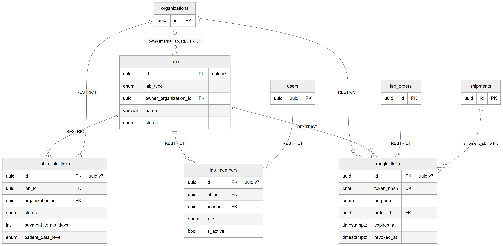

*Figure 41.11 — The tables that identify the lab side: labs, the clinic link, lab members and magic links.*

The diagram shows `labs` with solid lines to `lab_clinic_links`, `lab_members` and `magic_links`, all ON DELETE RESTRICT. `organizations` connects to `labs` ("owns internal lab"), to `lab_clinic_links` and to `magic_links`. `users` connects to `lab_members`, and `lab_orders` connects to `magic_links`. A dotted line from `shipments` to `magic_links` is labelled "shipment_id, no FK". All four main boxes use UUID version 7 keys, and `token_hash` on `magic_links` is unique.

The relationships in words:
- A lab is not a tenant and has no organization column. An in-house lab records its owner organization; an external lab has none.
- Each lab link belongs to exactly one lab and one organization, one link per pair. It carries `status` (invited, active, suspended), `payment_terms_days` and `patient_data_level` (full name or code only).
- Each lab member belongs to exactly one lab and one user, one membership per pair, with `role` lab admin or lab technician and `is_active` as a soft delete.
- Each magic link belongs to one organization, one lab and one lab order and stores `token_hash` (never the token), a random `nonce`, `purpose`, `delivery`, `expires_at`, `max_uses`, `used_count` and the revocation columns.
- Lab-side data is read through columns that copy the lab id (`lab_orders.lab_id`, `order_item_stages.lab_id`, `shipments.lab_id`, `remake_requests.lab_id`, `item_assignments.lab_id`) so the portal can filter every query by the caller's lab.
- The shipment link on magic links is unused: clinics receive by the shipment's QR token, so the `receive_shipment` purpose has no creator.

The order, item, stage, shipment and remake tables are shown in Chapter 40 and the vendor bill tables in Chapter 42. Every one of them uses ON DELETE RESTRICT, and no migration file exists for these tables (development schema sync, reviewed schema sync in production).

## 41.5 Status lifecycles

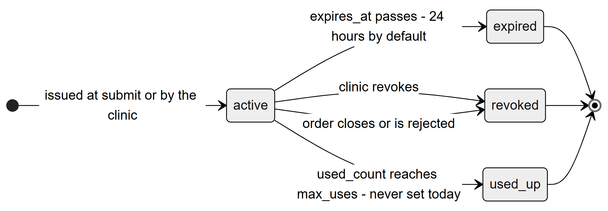

*Figure 41.12 — The states of a magic link, which are computed from its columns and not stored.*

The diagram has four states. A link enters `active` when it is issued, either at order submit or on demand by the clinic. From `active` it goes to `expired` when `expires_at` passes (24 hours by default), to `revoked` when the clinic revokes it, to `revoked` as well when the order is closed or rejected, and to `used_up` when `used_count` reaches `max_uses`. `expired`, `revoked` and `used_up` are final. No code sets `max_uses`, so `used_up` never happens today.

Walking through the states: **active** — opens the order and allows the actions of its purpose; **expired** — the time ran out, the request answers 410 "This link has expired"; **revoked** — withdrawn by the clinic or closed by the order's closing, 410 "This link was withdrawn"; **used up** — reserved for a use limit. The state is computed when the link is read (`linkState`), except revocation, which is stored in `revoked_at` and `revoked_reason`.

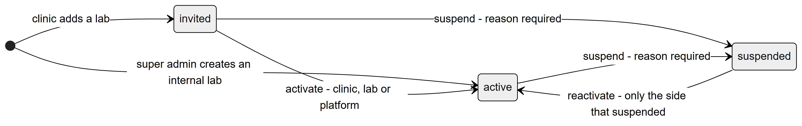

*Figure 41.13 — The lab link status values (the same diagram as in Chapter 40).*

The diagram shows a link entering at `invited` (a clinic adds a lab) or directly at `active` (an in-house lab). `invited` goes to `active` on "activate" or to `suspended` on "suspend" with a reason. `active` goes to `suspended` on "suspend". `suspended` returns to `active` on "reactivate", only by the side that suspended it. In the portal a lab admin uses the accept, suspend and reactivate buttons of the **Clinics** page for the lab's side of these changes.

The lab sees the same item, stage, shipment and remake lifecycles as the clinic, from the other side. The table lists what the lab can do in each seeded item state; the clinic's view of the same states is in Chapter 40.

| Item state (label) | What the lab can do | Who moves it next |
|---|---|---|
| pending_acceptance ("Waiting for lab") | Accept with a date, reject the order, ask a question | Lab admin |
| accepted | Start work | Lab admin or technician |
| in_production | Ship a try-in round, or Send to QC | Lab, then the clinic's approval |
| at_clinic_tryin | Wait; the round is with the clinic | Clinic (try-in decision) |
| qc | QC pass or QC fail | Lab admin or technician |
| ready | Ship finished work | Lab admin or technician |
| dispatched | Wait for receipt | Clinic front desk |
| received, approved, delivered | Nothing; clinic decisions | Clinic doctor |
| remake_required | Dispute the remake request | Lab admin, then the clinic |

The table shows, for each seeded item state, the lab's available action and who moves the item next. The states are workflow data and a custom published workflow may differ.

## 41.6 Connections to other modules

- **Dental lab, clinic side (Chapter 40).** Every portal action changes a clinic order; every clinic action changes what the portal offers.
- **Lab finance (Chapter 42).** Accepting an order creates the vendor bill draft; the lab later sees approved bills, payments and statements read-only.
- **Workflow engine (Chapter 43).** All status changes go through the engine; the lab roles (lab admin, lab technician) are matched against the workflow transitions' allowed roles, and a magic link acts as lab admin.
- **Notifications (Chapter 44).** In-app alerts to lab members and link messages to the lab contact.
- **Authentication (Chapter 56).** Lab members use the normal login and session; the session response carries their lab memberships.
- **Access control (Chapter 57).** Lab roles are separate from clinic permissions. The portal uses `@LabRoles` on routes, never `@Can`.
- **Audit (Chapter 60).** Lab-side writes are audited with the actor side "lab" and the route (`portal`, `magic_link`, `proxy`, `qr`) in the status history.

## 41.7 Limitations and known gaps

- The lab cannot edit its own catalog or prices; platform staff do that.
- No form for extra charges and no upload control in the portal, although the API supports both.
- The portal's receive button always records a full, good-condition receipt; per-line condition and partial quantities are API-only.
- No remove-assignment button, although the API has one.
- No notification inbox inside the portal layout.
- Messages to the lab contact and the patient go to a development logger until a real provider is added.
- A technician cannot accept, reject or ask; those transitions are lab admin only in the seeded workflow.
- A magic link has no use limit and cannot change the expected date.
- The magic link rate limit is per server process.
- The first lab account must be created in User Admin by someone with the right to do so; the portal cannot invite a person who has no account.
- A lab admin can demote or deactivate another admin; nothing keeps at least one admin.
- A lab that serves several clinics sees each clinic's orders in one list; there is no per-clinic filter other than search.

## 41.8 Owner's FAQ

**How does a lab person log in?** With the same login page as everybody else, with an account that a super admin or a lab admin added to the lab. A user with only lab memberships goes straight to the lab portal.

**Can a lab see our patients' names?** Only if the lab link's "Patient details shared" is "Full patient name". With "Patient code only" the lab sees the patient number. The setting is per clinic and lab.

**Can a lab see what we charge patients?** No. Lab responses carry the lab cost only and omit the patient price, the clinic's treatment and internal files.

**Is a magic link safe to forward?** Anyone holding the link can view and answer that one order until it expires, is revoked, or the order closes. The default life is 24 hours, and the clinic can revoke it. The secret part is never stored in the database.

**What if the lab does not answer a submitted order?** A clinic coordinator can record the lab's answer on its behalf (Chapter 40). Otherwise the order stays Submitted.

**Can a technician accept an order?** No. In the seeded workflow only a lab admin accepts, rejects or asks. A technician starts work, sends it to QC, passes or fails QC and ships.

**Can a lab work for several clinics?** Yes. A lab is shared by clinics; each clinic has its own lab link and its own prices. A person can also be a member of several labs and switch with the lab switcher.

**What happens when a lab is suspended on the platform?** Its members lose portal access, its magic links stop working, new links and activations are blocked, and orders already sent are not changed.

**Where is lab activity recorded?** Every status change goes to `status_history` with the actor side and route, and every edit to `audit_logs`.
