# Chapter 42 — Lab Finance

This chapter describes the money side of lab work in the Platform: what a patient owes the clinic for lab work, and what the clinic owes the lab. It is written for the product owner, who needs to know what is built, which rules protect the money and where the gaps are. Lab Finance sits on top of the Lab Management module (Chapter 40), which creates lab orders and freezes their prices, and it feeds the commission feature (Chapter 35) and the double-entry journals.

## 42.1 What this module is for

Lab Finance is three backend modules that work as one flow.

- **Lab billing** (`lab-billing`) handles the **patient lab invoice**: an estimate that becomes an invoice, payments, advances, credit notes, refunds and reminders. It is kept apart from the clinic's own billing (Chapter 34), with its own tables and numbers.
- **Lab payables** (`lab-payables`) handles what the clinic owes each **lab**: the **vendor bill**, payments to the lab, the monthly **lab statement** and three reports.
- **Lab finance glue** (`lab-finance`) has no screen and no endpoint. It listens to lab billing events and, in the same database transaction, records the doctor's lab commission and the double-entry journal lines.

Who uses it:

- **Accountant**: the main user. The default Accountant system role holds both lab permissions and the two billing permissions needed to undo money.
- **Admin** and the **owner**: everything.
- **Receptionist, Assistant, Doctor**: no lab finance permissions by default. A doctor can still see the lab order, but not the Billing panel's actions.
- **Lab admin** (a **lab member**): reads the bills, payments and statements that clinics created for their lab, on the lab portal (Chapter 41).

Sidebar: **Lab billing** (`nav.lab.billing`, `/lab-billing`, needs `lab.billing.manage`) and **Lab payables** (`nav.lab.payables`, `/lab-payables`, needs `lab.payables.manage`), both in the Clinic group. The payables sub-pages (payments, statements, reports) have no sidebar entries of their own; they are reached through tabs inside Lab payables. All lab permissions belong to the feature `dental.lab_orders` ("Lab Management", off by default).

## 42.2 Screens

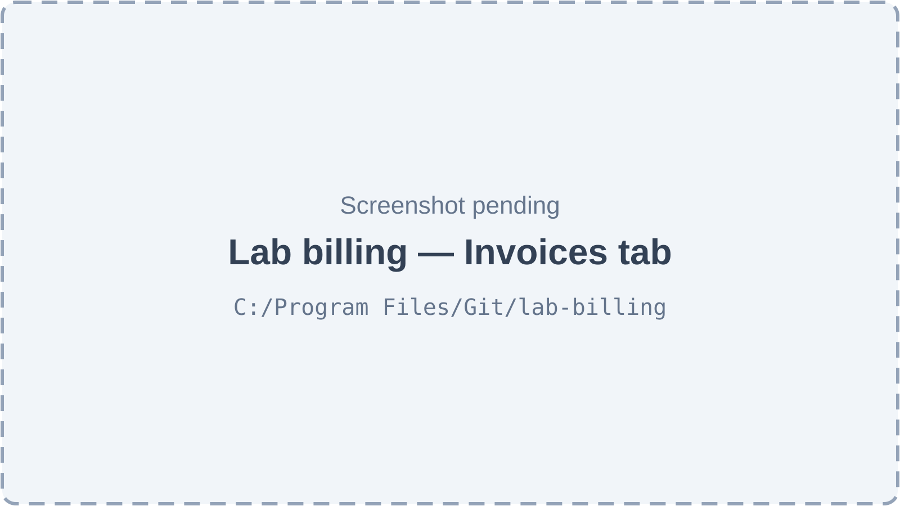

*Figure 42.1 — Lab billing, Invoices tab (screenshot pending).*

The Lab billing page has the title "Lab billing", the subtitle "What patients are billed and pay for lab work", a **Settings** button (only for users who may edit settings) and two tabs, **Invoices** and **Payments**. Without `lab.billing.manage` the page shows "No access to lab billing". The Invoices tab has a search box ("Search invoice, order or patient…"), a status filter, a From and To date range and a table with the columns Invoice, Patient, Status, Issued, Total and Balance. Drafts show "Estimate" and "Not issued". Overdue invoices carry an "Overdue" badge. The empty state says that work is billed from the Billing panel of a submitted lab order.

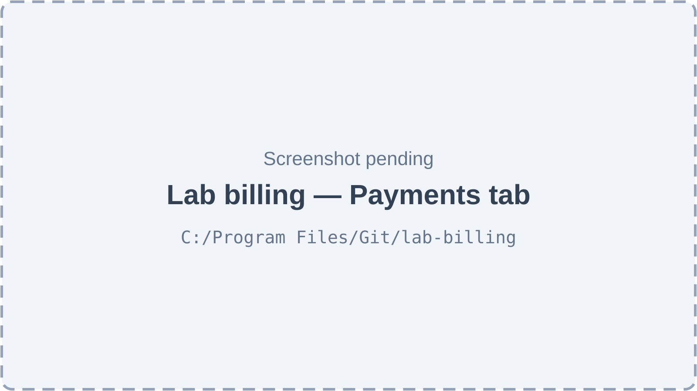

*Figure 42.2 — Lab billing, Payments tab (screenshot pending).*

The Payments tab lists payments collected on lab invoices, including advances. It has a search box (receipt, patient or reference), method and status filters, a date range and the columns Receipt, Patient, Amount and Status (Posted or Reversed). Reversal rows are marked "Reversal". Row actions are icon buttons with tooltips: "Reverse payment" and "Refund advance".

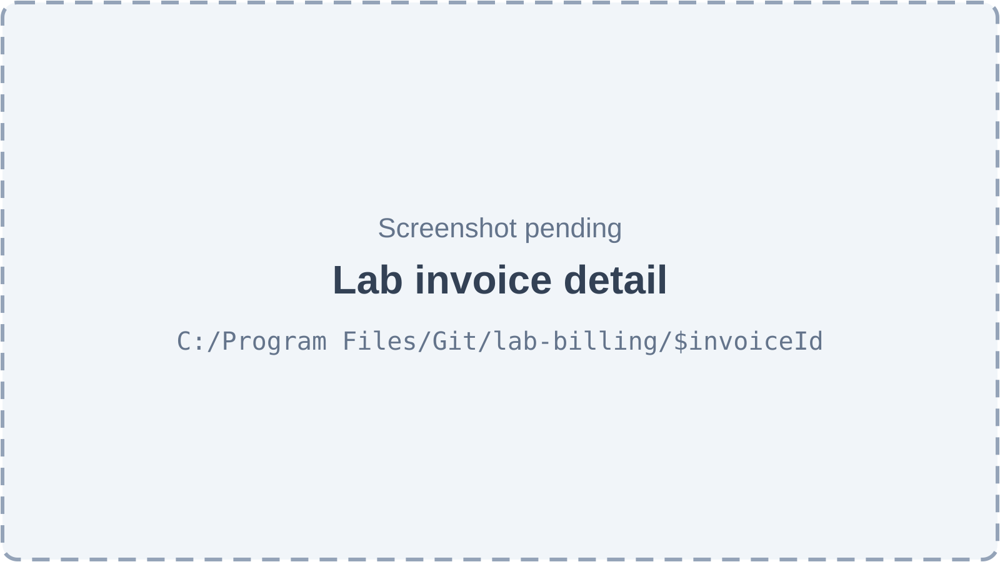

*Figure 42.3 — Lab invoice detail (screenshot pending).*

The invoice page shows a Summary block (Subtotal, Discount, Tax, Total, Credited, Paid, Advance, Owes), a Lines table (Description, Qty, Price, Tax, Total), Payments, Credit notes and a History timeline. The action bar changes with the status. A draft shows **Edit** and **Issue invoice**. An open invoice shows **Use advance (amount)**, **Send reminder**, **Credit note**, **Void** and **Collect payment**. Credit note and Void need extra permissions.

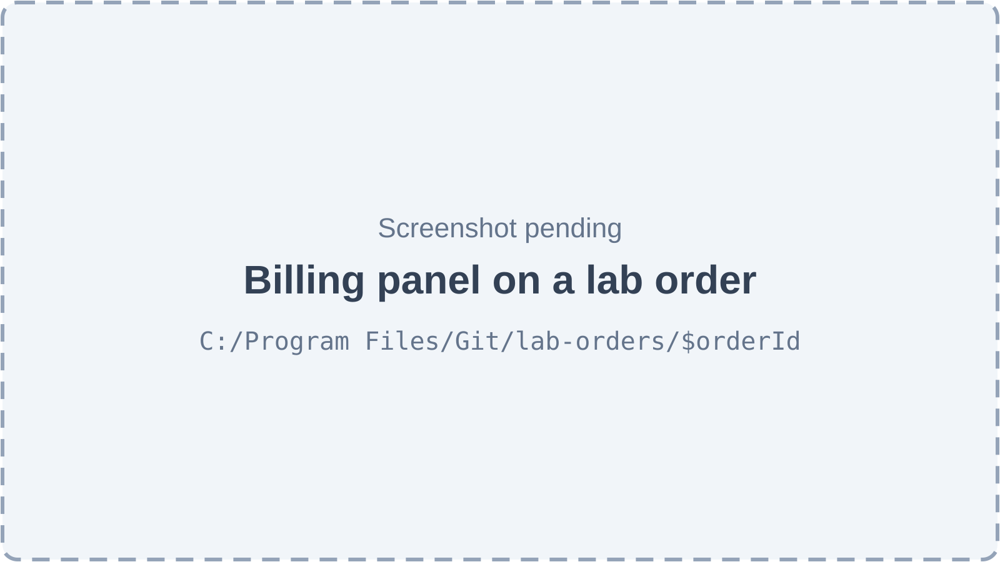

*Figure 42.4 — Billing panel on a lab order (screenshot pending).*

On the lab order detail page (Chapter 40) the Billing panel shows Billed, Paid, Credited, Balance and the patient's advance, lists the order's invoices, and offers **Bill N item(s)** (opens the invoice sheet) and **Collect payment**. This is where most lab invoices start.

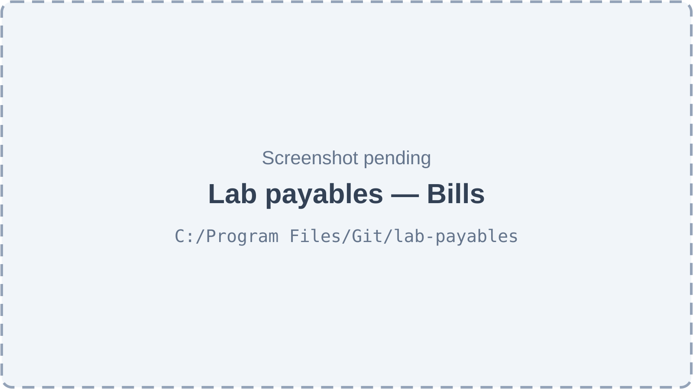

*Figure 42.5 — Lab payables, Bills (screenshot pending).*

Lab payables has the subtitle "Vendor bills from your labs — review, approve, pay." and a tab strip Bills, Payments, Statements and Reports with a lab filter. The Bills tab has a search box (bill, order or lab invoice number), a status filter, a date range and a table with Bill, Lab, Bill date, Status, Total and Balance. Manual bills are marked "Manual".

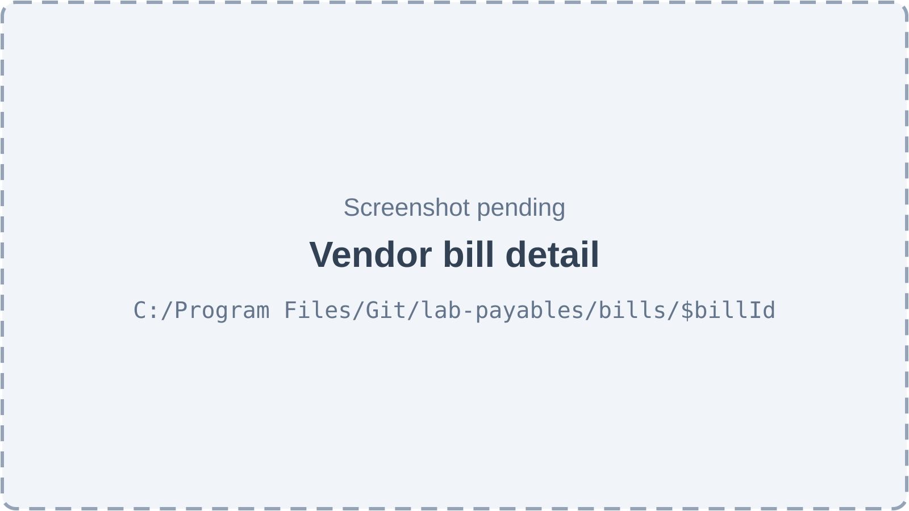

*Figure 42.6 — Vendor bill detail (screenshot pending).*

The bill page shows Total, Paid and Balance, the lines (Description, Kind, Qty, Unit, Total) and the Payments made against the bill. A draft shows a **Re-read costs from the order** icon button, **Approve** and **Void**. An approved or partly paid bill shows **Pay**.

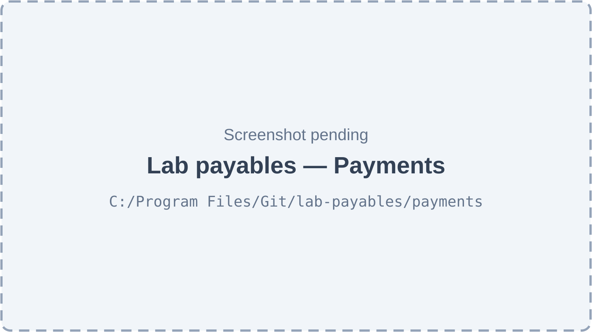

*Figure 42.7 — Payments to labs (screenshot pending).*

The Payments tab ("Payments to labs and advances not yet used.") lists payments with Payment, Amount, Advance left, Paid on and Status, and a **Record payment** button. The button is disabled until a lab is chosen in the filter. Each row has a "Reverse payment" action.

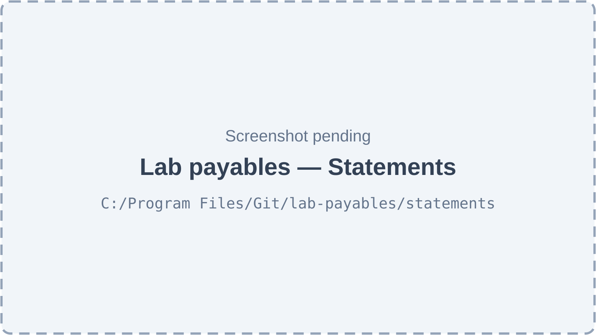

*Figure 42.8 — Lab statements (screenshot pending).*

The Statements tab lists statements with Period, Lab says, To check and Status, and an **Add statement** button.

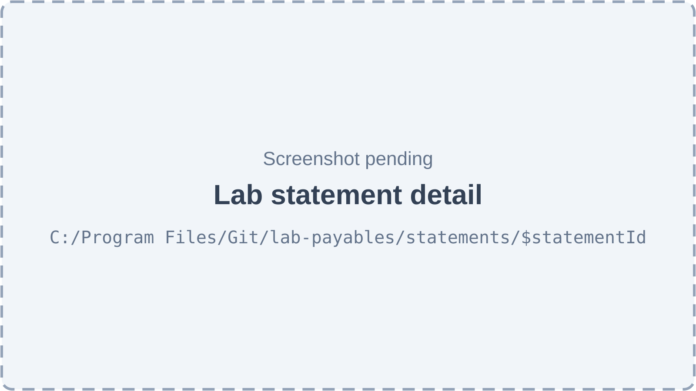

*Figure 42.9 — Reconcile one lab statement (screenshot pending).*

The statement page lists each line with Lab reference, Lab says, Our bill, Our bills say and Result (Matched, Amount differs, Not in our bills, Not on statement). Buttons **Dispute** and **Mark reconciled** appear depending on the current status.

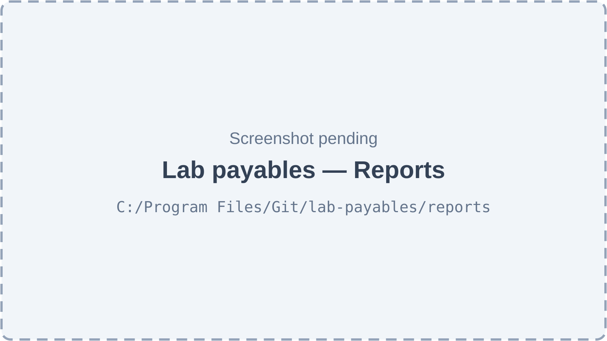

*Figure 42.10 — Payables reports (screenshot pending).*

The Reports tab has three sub-tabs: Payables aging (owed per lab by days overdue), Lab cost by month (with a Year selector) and Case profit (Order, Patient, Invoiced, Collected, Lab cost, Expenses, Commission, Profit).

## 42.3 Features

### 42.3.1 Estimate and invoice lab work for a patient

**Status:** [Implemented]

**What it does.** Creates a lab invoice from a submitted lab order, or from manual lines. A new invoice starts as a draft, called an estimate: it is editable, has no number and nothing is owed. Issuing it gives it a number and a due date.

**How the user does it.**
1. Open a submitted lab order and click **Bill N item(s)** in the Billing panel (or create from Lab billing).
2. In the "Bill lab work" sheet, tick the items and charges to bill. Prices are the patient prices fixed when the order was submitted. Optionally add manual lines, a discount and a tax percentage.
3. Click **Save estimate**, or switch on **Issue now** and click **Issue invoice**.
4. Later, open the estimate, click **Edit** to change it, or **Issue invoice**.

**Behind the scenes — in simple terms.** Each line copies the price the order froze when it was submitted, so a later change to the lab's price list never changes what the patient is billed. A piece of work can be on only one live invoice. Issuing takes the next number in a gapless counter, sets the due date from the clinic's setting and then uses the patient's advance if there is any.

**Behind the scenes — technically.** `POST /lab-billing/invoices` → `LabInvoicesService.create`; `PATCH /lab-billing/invoices/:id` → `update`; `POST /lab-billing/invoices/:id/issue` → `issue` / `issueIn`. Each runs in one transaction under a row lock on the invoice (`LabBillingLocks`). Three line kinds exist: `lab_item` (an order item at its frozen patient line price; if quantity times unit price differs from the frozen total, one line with quantity 1 is used), `lab_charge` (an approved charge request of the order) and `manual`. Line math (`lineMath`, `spreadDiscount`) is integer paisa with the tax rate in basis points; an order-wide discount is spread over the lines. Issue sets `invoice_no` (sequence `lab_invoice`, prefix `LINV`), `issued_on` (the location's today via `ClockService`), `due_on`, then calls `LabBillingTotals.recomputeInvoices`, writes a status-history row and emits `invoiceIssued`, then `LabAllocations.applyAdvance` and `advanceApplied`. The estimate's update replaces all its lines and bumps `version`. Optimistic locking uses `version`.

**Rules and validations.**
- A patient or an order is required; an order's patient must match the given patient.
- The order must be submitted (a draft order cannot be billed).
- Items in state cancelled or rejected cannot be billed.
- An item or charge already on another non-void invoice cannot be billed again. The partial unique indexes `uq_lab_invoice_lines_item` and `uq_lab_invoice_lines_charge` decide races.
- Only an approved charge request can be billed.
- A manual line needs a description (1 to 200 characters) and a price.
- At least one line before issue; at most 100 lines; quantity 1 to 1000; tax 0 to 10,000 basis points.
- Only a draft can be edited or issued, and the `version` sent must match.

**Who can do it.** `lab.billing.manage` (no scope), feature `dental.lab_orders`. Default: Admin and Accountant.

**Data read and written.** Reads `lab_orders`, `lab_order_items`, `order_charge_requests`, `patients`, `lab_billing_settings`, `number_sequences`. Writes `lab_invoices`, `lab_invoice_lines`, `status_history`, `audit_logs`; on issue also journal and commission rows (42.3.12, 42.3.13).

**Effects on other modules.** Issuing creates the receivable journal and the commission snapshot. The order's Billing panel updates.

**Error cases.** `LAB_BILLING_INVALID` (missing patient, empty invoice, draft order); `LAB_BILLING_ITEM_NOT_BILLABLE`; `LAB_BILLING_ALREADY_BILLED`; `LAB_BILLING_INVOICE_NOT_DRAFT` ("Only an estimate can be changed"); `LAB_BILLING_VERSION_CONFLICT` ("Someone else changed this invoice — reload and try again"); `LAB_BILLING_NOT_FOUND`.

**Technical references:** `backend/src/lab-billing/services/lab-invoices.service.ts` · `LabInvoicesService` · `backend/src/lab-billing/common/lab-billing-math.ts` · `web-app/src/features/lab-billing/components/InvoiceSheet.tsx`

### 42.3.2 Browse lab invoices and see one in full

**Status:** [Implemented]

**What it does.** Lists lab invoices with filters and opens one invoice with its lines, payments, credit notes, refunds and history.

**How the user does it.**
1. Open **Lab billing**, tab **Invoices**.
2. Search, filter by status (including Overdue), or set a date range.
3. Click a row to open the detail page.

**Behind the scenes — in simple terms.** The server reads the invoices and works out "overdue" on the fly: an issued or partly paid invoice whose due date is before today in the location's timezone.

**Behind the scenes — technically.** `GET /lab-billing/invoices` → `LabBillingQueries.listInvoices` (raw SQL, page default 1, limit default 20, maximum 100); `GET /lab-billing/invoices/:id` → `invoice`. The `status=overdue` filter is not a stored status; it expands to `status IN ('issued','partially_paid') AND due_on < today`. Search uses `ILIKE` on invoice number, patient name, patient number and order number.

**Rules and validations.** Always limited to the active organization. The list is not limited by location.

**Who can do it.** `lab.billing.manage`. Default: Admin, Accountant.

**Data read and written.** Reads `lab_invoices`, `lab_invoice_lines`, `lab_payment_allocations`, `lab_payments`, `lab_credit_notes`, `lab_refunds`, `status_history`, `patients`, `lab_orders`. Writes nothing.

**Effects on other modules.** None.

**Error cases.** 403 `NO_PERMISSION`; `LAB_BILLING_NOT_FOUND` for an unknown id.

**Technical references:** `backend/src/lab-billing/services/lab-billing-queries.service.ts` · `LabBillingQueries.listInvoices` / `invoice` · `web-app/src/features/lab-billing/components/InvoicesList.tsx`

### 42.3.3 Void an estimate or an unpaid invoice

**Status:** [Implemented]

**What it does.** Cancels a draft, or an issued invoice that has no payment and no credit note. The invoice stays on record as void and its lab work can be billed again.

**How the user does it.**
1. Open the invoice and click **Void**.
2. Enter a reason (3 to 500 characters) in the "Void" dialog and confirm.

**Behind the scenes — in simple terms.** A void is a cancellation, not a deletion. All its lines are marked void so the items are free again. If the invoice had been issued, the receivable entry is reversed.

**Behind the scenes — technically.** `POST /lab-billing/invoices/:id/void` → `LabInvoicesService.void`: locks the invoice, checks `version`, sets status `void` with reason, time and user, marks all lines `is_void`, writes a status-history row and emits `invoiceVoided` (with `wasIssued`). `LabFinanceListeners` mirrors the receivable journal for an issued invoice.

**Rules and validations.**
- Refused when payments (`paid_paisa > 0`) or credit notes exist; use a payment reversal or a credit note instead.
- Refused if already void.

**Who can do it.** `lab.billing.manage` **and** `billing.invoice.void` (both required; the second belongs to feature `billing.invoices`). Default: Admin, Accountant.

**Data read and written.** Writes `lab_invoices`, `lab_invoice_lines`, `status_history`, `audit_logs`, `ledger_journals`.

**Effects on other modules.** Receivable reversed in the journals; billed items become billable again.

**Error cases.** `LAB_BILLING_INVOICE_HAS_MONEY`; `LAB_BILLING_INVOICE_NOT_OPEN` ("This invoice is already void"); `LAB_BILLING_VERSION_CONFLICT`.

**Technical references:** `backend/src/lab-billing/lab-billing.controller.ts` · `LabInvoicesService.void` · `web-app/src/features/lab-billing/pages/LabInvoiceDetailPage.tsx`

### 42.3.4 Collect a payment for lab work

**Status:** [Implemented]

**What it does.** Records money received from a patient, and splits it over one or more open lab invoices. Whatever is not allocated stays as the patient's **advance**.

**How the user does it.**
1. Open an invoice (or the order's Billing panel) and click **Collect payment**.
2. Enter Amount, Method (cash, card, bank transfer or wallet), Reference and Notes.
3. Choose "Put it on" (which invoices), or keep "Oldest unpaid invoices first", or keep the money as advance.
4. Confirm. A toast says "Payment received" and a receipt number appears.

**Behind the scenes — in simple terms.** One click creates one payment with a receipt number. The system locks the invoices so two desks cannot pay the same balance twice, allocates the amounts, recomputes each invoice's paid amount and status, and records the cash in the journals. The page sends a unique key with each click, so a retry after a network error never creates a second payment.

**Behind the scenes — technically.** `POST /lab-billing/payments` → `LabPaymentsService.collect` (header `Idempotency-Key` required). A replay is found first by `byKey`; the unique index `uq_lab_payments_org_idempotency` settles parallel retries. `runCollect` does, in one transaction: patient check → lock invoices → validate → receipt number (sequence `lab_receipt`, prefix `LRC`) → insert payment → insert `lab_payment_allocations` → `LabBillingTotals.recomputeInvoices` / `recomputePayments` → audit → `paymentCollected` event → `payment.receipt` notification to the outbox. Event listeners post the cash journal and the commission (42.3.12, 42.3.13). Invoice status is written only by `LabBillingTotals` (partially_paid when something is allocated, paid when the balance is zero).

**Rules and validations.**
- Amount 1 to `MAX_PAISA`, in paisa; at most 50 allocations.
- An invoice may appear once; it must belong to the same patient and be open (issued or partly paid, not a draft or void).
- Each allocation is at most the invoice's balance; the allocations together are at most the payment.
- Without allocations, the payment is spread over the patient's open invoices, oldest first (`autoAllocate`, default true); with `autoAllocate` false the whole amount is advance. Any rest is advance.

**Who can do it.** `lab.billing.manage`. Default: Admin, Accountant.

**Data read and written.** Writes `lab_payments`, `lab_payment_allocations`, `lab_invoices` (cached totals and status), `number_sequences`, `audit_logs`, `idempotency` records, `ledger_journals`, `commission_entries`, notification outbox rows. Reads `patients`.

**Effects on other modules.** Doctor commission (Chapter 35); the patient notification `payment.receipt` is queued but the patient audience is switched off by default, so it is recorded as skipped (Chapter 44).

**Error cases.** `IDEMPOTENCY_KEY_REQUIRED`; `IDEMPOTENCY_KEY_REUSED` (same key, different body; 422); `LAB_BILLING_INVOICE_NOT_OPEN`; `LAB_BILLING_ALLOCATION_EXCEEDS_BALANCE`; `LAB_BILLING_ALLOCATION_EXCEEDS_PAYMENT`; `LAB_BILLING_INVALID`.

**Technical references:** `backend/src/lab-billing/services/lab-payments.service.ts` · `LabPaymentsService.collect` / `runCollect` · `web-app/src/features/lab-billing/components/MoneySheets.tsx`

### 42.3.5 Use a patient's advance on an invoice

**Status:** [Implemented]

**What it does.** Puts money the patient already paid in advance onto an open invoice. No new money arrives and no receipt is made.

**How the user does it.**
1. Open an open invoice. If the patient has advance, the button **Use advance (amount)** appears.
2. Click it. A toast says "Advance applied".

**Behind the scenes — in simple terms.** The system takes from the patient's oldest advance first, never more than the invoice balance. This also happens automatically when an invoice is issued.

**Behind the scenes — technically.** `POST /lab-billing/invoices/:id/apply-advance` → `LabPaymentsService.applyAdvance` → `LabAllocations.applyAdvance` (header `Idempotency-Key` required; optional `amountPaisa`). It locks the invoice, then the advance payments (lock order: invoices before payments), inserts allocations, recomputes totals and emits `advanceApplied`.

**Rules and validations.** The invoice must be open with a balance; the patient must have advance.

**Who can do it.** `lab.billing.manage`. Default: Admin, Accountant.

**Data read and written.** Writes `lab_payment_allocations`, `lab_invoices`, `lab_payments` (cached allocated amount), journals and commission.

**Effects on other modules.** Commission is accrued on the allocated amount; the journal moves Patient Advances to Patient Receivable.

**Error cases.** `LAB_BILLING_INVOICE_NOT_OPEN`; `LAB_BILLING_NOTHING_TO_APPLY`; `IDEMPOTENCY_KEY_REQUIRED`.

**Technical references:** `backend/src/lab-billing/services/lab-allocations.service.ts` · `LabAllocations.applyAdvance` · `web-app/src/features/lab-billing/pages/LabInvoiceDetailPage.tsx`

### 42.3.6 Reverse a lab payment

**Status:** [Implemented]

**What it does.** Undoes a wrong payment. The payment stays on record as reversed, a mirror row with a negative amount is added, and the money comes off every invoice it paid.

**How the user does it.**
1. On the Payments tab, click the "Reverse payment" icon of a posted payment.
2. Enter a reason and confirm. A toast says "Payment reversed".

**Behind the scenes — in simple terms.** Nothing is deleted. The original is flagged, a negative twin is created with its own number, and the invoices' paid amounts are recalculated. Once any part of a payment was refunded, it cannot be reversed.

**Behind the scenes — technically.** `POST /lab-billing/payments/:id/reverse` → `LabPaymentsService.reverse` / `runReverse` (header `Idempotency-Key`). The service reads the touched invoice ids, locks them, then the payment; sets the original to `reversed`; inserts the mirror row (`reversal_of_id`, sequence `lab_payment_reversal`, prefix `LRV`); sets `reversed_at` on the allocations with reason `payment_reversed`; recomputes totals; emits `paymentReversed`. The ledger posts the exact opposite of what the payment still holds, not a plain mirror, because a credit note may have moved part of it into advance.

**Rules and validations.** A reversal cannot be reversed; an already reversed payment cannot be reversed again; a payment with `refunded_paisa > 0` cannot be reversed; reason 3 to 500 characters.

**Who can do it.** `lab.billing.manage` **and** `billing.refund.issue`. Default: Admin, Accountant.

**Data read and written.** Writes `lab_payments`, `lab_payment_allocations`, `lab_invoices`, journals, commission entries (negative), audit.

**Effects on other modules.** Commission earned on the payment is taken back by a negative entry.

**Error cases.** `LAB_BILLING_PAYMENT_REVERSED`; `LAB_BILLING_PAYMENT_REFUNDED`; `LAB_BILLING_INVALID`; `LAB_BILLING_VERSION_CONFLICT`; `IDEMPOTENCY_KEY_REUSED`.

**Technical references:** `backend/src/lab-billing/services/lab-payments.service.ts` · `LabPaymentsService.reverse` · `web-app/src/features/lab-billing/components/PaymentsList.tsx`

### 42.3.7 Issue a credit note

**Status:** [Implemented]

**What it does.** Lowers an issued invoice by an amount. If the patient had already paid more than the new total, the excess becomes advance again.

**How the user does it.**
1. On an issued invoice click **Credit note**.
2. Enter Amount and Reason and confirm. A toast says "Credit note issued".
3. If money was released, the invoice shows "Moved to advance", and a refund can follow (42.3.8).

**Behind the scenes — in simple terms.** The credit note reduces what the invoice is worth. If the invoice was fully paid, the newest payments are released first and go back into the patient's advance. The credit note remembers how much was released, so it can later be paid out.

**Behind the scenes — technically.** `POST /lab-billing/invoices/:id/credit-notes` → `LabCreditsService.creditNote` (header `Idempotency-Key`, claim by request hash). Locks the invoice; `creditable = total − credited`; `excess = max(0, amount − balance)`; releases allocations newest first with reason `credit_note`; a row only partly needed stays allocated for the rest; creates the note (sequence `lab_credit_note`, prefix `LCN`) with status `applied` (fully absorbed) or `issued` (waiting for refund); emits `creditNoteIssued`.

**Rules and validations.** Only issued or partly paid or paid invoices can be credited; the amount is at most what is left to credit; reason 3 to 500 characters.

**Who can do it.** `lab.billing.manage` **and** `billing.invoice.void`. Default: Admin, Accountant.

**Data read and written.** Writes `lab_credit_notes`, `lab_payment_allocations`, `lab_invoices`, `lab_payments`, journals, commission entries.

**Effects on other modules.** Commission is adjusted on the invoice's lines.

**Error cases.** `LAB_BILLING_INVOICE_NOT_OPEN` ("Only an issued invoice can be credited"); `LAB_BILLING_CREDIT_EXCEEDS_INVOICE`.

**Technical references:** `backend/src/lab-billing/services/lab-credits.service.ts` · `LabCreditsService.creditNote` · `web-app/src/features/lab-billing/components/MoneySheets.tsx`

### 42.3.8 Refund a patient's advance

**Status:** [Implemented]

**What it does.** Pays money back to the patient out of their advance, optionally as the payout of a credit note.

**How the user does it.**
1. Click "Refund advance" on a payment row, or choose the refund option next to a credit note.
2. Enter Amount, Method, Reason, Reference and "Paid back by".
3. Confirm "Pay this refund?". A toast says "Refund recorded".

**Behind the scenes — in simple terms.** The refund is taken from the patient's advance payments, oldest first. A payment that was partly refunded can no longer be reversed.

**Behind the scenes — technically.** `POST /lab-billing/refunds` → `LabCreditsService.refund` (header `Idempotency-Key`, unique on the refund's own key). It locks the credit note (if any) and the advance payments, writes one `lab_refunds` row (sequence `lab_refund`, prefix `LRF`) and one `lab_refund_sources` row per payment, raises each payment's `refunded_paisa`, updates the credit note's refunded total and status (`refunded` when fully paid out), and emits `refundPaid`. The response carries the patient's updated billing summary.

**Rules and validations.** The credit note must belong to the patient; the amount is at most what is left on the credit note, and at most the patient's advance.

**Who can do it.** `lab.billing.manage` **and** `billing.refund.issue`. Default: Admin, Accountant.

**Data read and written.** Writes `lab_refunds`, `lab_refund_sources`, `lab_payments`, `lab_credit_notes`, journals, audit.

**Effects on other modules.** Cash or bank goes down in the journals.

**Error cases.** `LAB_BILLING_REFUND_EXCEEDS_CREDIT`; `LAB_BILLING_REFUND_EXCEEDS_ADVANCE`; `LAB_BILLING_INVALID`; `IDEMPOTENCY_KEY_REUSED`.

**Technical references:** `backend/src/lab-billing/services/lab-credits.service.ts` · `LabCreditsService.refund` · `web-app/src/features/lab-billing/components/MoneySheets.tsx` (`RefundSheet`)

### 42.3.9 Send a payment reminder

**Status:** [Partial]

**What it does.** Queues a reminder message for the patient about the balance of an invoice.

**How the user does it.**
1. On an open invoice click **Send reminder**.
2. The toast says "Reminder queued", or "Reminder logged — patient messages are off for this event".

**Behind the scenes — in simple terms.** The reminder is written to the notification outbox. The Platform sends in-app notifications only, and the patient audience is off by default, so in practice the reminder is recorded as skipped.

**Behind the scenes — technically.** `POST /lab-billing/invoices/:id/remind` → `LabInvoicesService.remind` → `LabPatientNotifier.reminder` → `NotificationService.enqueue` with event `payment.outstanding_reminder`. The decision order is: patient audience off → `skipped_disabled`; patient opt-out → `skipped_opt_out`; quiet hours → held. The result rows are returned (channel, status, reason). Nothing is sent from lab billing itself.

**Rules and validations.** The invoice must be open with a balance greater than zero.

**Who can do it.** `lab.billing.manage`. Default: Admin, Accountant.

**Data read and written.** Writes notification outbox rows and `audit_logs`.

**Effects on other modules.** Notifications (Chapter 44).

**Error cases.** `LAB_BILLING_INVOICE_NOT_OPEN` ("Nothing is owed on this invoice").

**Technical references:** `backend/src/lab-billing/notifications/patient-notifier.service.ts` · `LabPatientNotifier` · `web-app/src/features/lab-billing/pages/LabInvoiceDetailPage.tsx`

### 42.3.10 See billing for one order and one patient

**Status:** [Implemented]

**What it does.** Shows the Billing panel on a lab order (billed, paid, credited, balance, advance, invoice list) and gives a per-patient summary used by the sheets.

**How the user does it.** Open a lab order; the panel is at the bottom of the detail page.

**Behind the scenes — in simple terms.** The numbers are read from the cached amounts on the invoices and payments, which only the billing totals service writes.

**Behind the scenes — technically.** `GET /lab-billing/orders/:orderId` → `LabBillingQueries.order` (includes which items are still unbilled); `GET /lab-billing/patients/:patientId/summary` → `patientSummary` (invoiced, credited, collected, refunded, advance).

**Rules and validations.** Organization-scoped.

**Who can do it.** `lab.billing.manage`.

**Data read and written.** Reads `lab_orders`, `lab_order_items`, `lab_invoices`, `lab_payments`, `lab_credit_notes`, `lab_refunds`.

**Effects on other modules.** Shown inside Lab Management (Chapter 40).

**Error cases.** `LAB_BILLING_NOT_FOUND`.

**Technical references:** `backend/src/lab-billing/services/lab-billing-queries.service.ts` · `LabBillingQueries.order` / `patientSummary` · `web-app/src/features/lab-billing/components/LabBillingPanel.tsx`

### 42.3.11 Lab billing settings

**Status:** [Implemented]

**What it does.** Sets the default tax rate and the number of days until payment is due for new lab invoices. Issued invoices keep the values they were issued with.

**How the user does it.**
1. On Lab billing click **Settings**.
2. Set "Tax on lab work (%)" and "Payment due after (days)" and save. A toast says "Settings saved".

**Behind the scenes — in simple terms.** One settings row per organization. With no row, tax is 0 and due days are 0.

**Behind the scenes — technically.** `GET /lab-billing/settings` and `PATCH /lab-billing/settings` → `LabInvoicesService.readSettings` / `updateSettings`; saves `lab_billing_settings` and writes an audit row with before and after. Tax is stored in basis points.

**Rules and validations.** Tax 0 to 10,000 basis points; due days an integer from 0.

**Who can do it.** Read: `lab.billing.manage`. Change: `lab.billing.manage` **and** `admin.settings.manage`. Default: Admin both; Accountant read only unless the settings permission is added.

**Data read and written.** `lab_billing_settings`, `audit_logs`.

**Effects on other modules.** None.

**Error cases.** 403 `NO_PERMISSION`; 400 for an out-of-range value.

**Technical references:** `backend/src/lab-billing/lab-billing.controller.ts` · `LabInvoicesService.updateSettings` · `web-app/src/features/lab-billing/components/SettingsSheet.tsx`

### 42.3.12 Doctor commission on lab work

**Status:** [Implemented]

**What it does.** When lab work is invoiced and collected, the ordering doctor earns commission according to their compensation plan. It is recorded as `commission_entries` that settlements and payroll pick up unchanged.

**How the user does it.** Nothing to click. It runs when an invoice is issued, a payment is collected, an advance is applied, a payment is reversed or a credit note is issued.

**Behind the scenes — in simple terms.** At issue, each line remembers which doctor, which plan and which rate applied that day. As money is collected, the doctor earns a share proportional to the money collected, after subtracting the lab's cost (so the doctor is paid on the clinic's margin). Reversals and credit notes give commission back.

**Behind the scenes — technically.** `LabFinanceListeners` (an `OnModuleInit` hook on `LabBillingEvents`) calls `LabCommissionService.snapshot` on `invoiceIssued` and `recordForInvoices` on the money events. The snapshot is skipped when the feature `billing.commissions` is off for the organization. Per line it stores `performing_assignment_id`, `commission_plan_id` and the rate or fixed amount, resolved with `resolveCommissionRate` (lab work is treated as a procedure unless the mapped service says otherwise). `labLineCommissionTarget` (pure function) computes a cumulative target per line; because lab allocations are per invoice, each line's share is proportional to its pre-tax amount. The service inserts the difference between target and what is already recorded, so installments never drift. Lab cost per line comes from approved vendor bill lines, otherwise the order item's frozen snapshot. Source types used: allocation, unapply, charge adjust.

**Rules and validations.** Only lines with a doctor earn; a doctor with no assignment at the invoice's location or no plan in force on the issue date earns nothing. The commission basis is the "collected" basis net of lab cost.

**Who can do it.** Automatic; no permission. Commission screens follow Chapter 35.

**Data read and written.** Reads `employee_org_location_assignments`, compensation plans, `vendor_bill_lines`, `lab_order_items`. Writes `lab_invoice_lines` (snapshot columns), `commission_entries` (with `lab_invoice_line_id`), journals.

**Effects on other modules.** Commissions (Chapter 35), payroll (Chapter 38).

**Error cases.** None shown to the user; a failure rolls back the whole money operation.

**Technical references:** `backend/src/lab-finance/lab-finance.listeners.ts` · `LabFinanceListeners` · `backend/src/lab-finance/lab-commission.service.ts` · `backend/src/lab-finance/lab-commission-math.ts`

### 42.3.13 Receivables journals (general ledger)

**Status:** [Partial]

**What it does.** Posts balanced double-entry journals for every lab money event. Backend only: no screen or report reads these journals.

**How the user does it.** Nothing; it is automatic.

**Behind the scenes — in simple terms.** Each event produces a journal with equal debits and credits. A correction is a new mirror journal, never an edit.

**Behind the scenes — technically.** `LabReceivablesLedger` posts through `GeneralLedgerService` in the operation's own transaction. Patient side: invoice issue debits Patient Receivable and credits Lab Revenue (and Tax Payable); payment debits Cash or Bank and credits Receivable (allocated part) and Patient Advances (rest); advance applied moves Advances to Receivable; credit note debits Lab Revenue and credits Receivable, and moves released money from Receivable to Advances; refund debits Advances and credits Cash or Bank; commission debits Commission Expense and credits Commission Payable; void and reversal post the opposite. Payables side (42.3.15, 42.3.19) uses Lab Cost, Lab Payable and Lab Advances. Tables: `ledger_journals`, `ledger_journal_lines`. Account codes are constants in code, not a table.

**Rules and validations.** Journals balance; a reversal journal points at the original (`reversal_of_id`, unique); journal lines are never updated or deleted.

**Who can do it.** Automatic.

**Data read and written.** Writes `ledger_journals`, `ledger_journal_lines`.

**Effects on other modules.** None visible. The clinic profit-and-loss report (Chapter 36) does not read these lab journals.

**Error cases.** An unbalanced journal fails the whole operation.

**Technical references:** `backend/src/lab-finance/lab-receivables-ledger.service.ts` · `LabReceivablesLedger` · `backend/src/billing/ledger/journal/general-ledger.service.ts`

### 42.3.14 A vendor bill drafts itself when the lab accepts work

**Status:** [Implemented]

**What it does.** As soon as a lab accepts an item of an order, the Platform creates, or updates, one draft vendor bill for that order, priced at the frozen lab costs.

**How the user does it.** Nothing. The draft appears in **Lab payables** → **Bills**. The empty-state text says a draft appears as soon as a lab accepts an order.

**Behind the scenes — in simple terms.** The bill is a mirror of what the order says the clinic owes: each accepted item at its lab cost (approved item charges are already inside), plus approved order-level charges. Running it again changes nothing. If a cost rises after approval, the difference goes onto a new draft.

**Behind the scenes — technically.** `CreateVendorBillDraftEffect` (effect code `create_vendor_bill_draft`, financial) registers an item-transition listener: on every item reaching state `accepted` it calls `BillDraftsService.sync(m, orderId)` inside the transition's transaction. The effect can also be listed in a workflow version; the sync is idempotent. `sync` locks the order, reads expected costs, reads what approved, partly paid or paid bills already hold, locks the open draft, and `planDraftLines` returns inserts and updates. A zero cost (a lab-fault remake) is listed on an open draft for the record but never opens a draft alone. A cost that went down after approval is left to a manual correction. Numbers: sequence `vendor_bill`, prefix `VB`. A system audit row is written on creation. Bill date is the location's today.

**Rules and validations.** The order must be submitted (have an order number); otherwise the effect fails with `WORKFLOW_MISCONFIGURED`.

**Who can do it.** Automatic.

**Data read and written.** Reads `lab_orders`, `lab_order_items`, `order_charge_requests`, remake requests. Writes `vendor_bills`, `vendor_bill_lines`, `audit_logs`.

**Effects on other modules.** Lab Management's accept action triggers it (Chapters 40 and 41).

**Error cases.** `WORKFLOW_MISCONFIGURED` for an unsubmitted order.

**Technical references:** `backend/src/lab-payables/workflow/vendor-bill-draft.effect.ts` · `CreateVendorBillDraftEffect` · `backend/src/lab-payables/services/bill-drafts.service.ts` · `BillDraftsService.sync`

### 42.3.15 Review, edit, approve and void a vendor bill

**Status:** [Partial]

**What it does.** The accountant reviews a draft, re-reads costs from the order, approves it (this makes it a real debt to the lab) or voids it. Header edits and manual lines exist in the API but the screen does not offer them.

**How the user does it.**
1. Open **Lab payables** → **Bills**, click a draft.
2. Optionally click the **Re-read costs from the order** icon.
3. Click **Approve**; in the sheet set the lab's invoice number, due date and tax %, and see "Total owed".
4. Or click **Void** with a reason.

**Behind the scenes — in simple terms.** Before approval the bill is re-synced from the order. If anything changed, the approval is refused with a stale-version message, so the accountant approves exactly what they saw. Approval books the cost and the debt in one step. A voided approved bill gets a mirror journal.

**Behind the scenes — technically.** `GET /lab-payables/bills`, `GET /lab-payables/bills/:id`; `PATCH /lab-payables/bills/:id` (`VendorBillsService.update`: vendor invoice number, bill date, due date, tax in basis points, notes); `POST /lab-payables/bills/:id/lines` (`addLine`: kind, description, quantity, unit cost; creates a manual line); `POST /lab-payables/orders/:orderId/sync` (`syncOrder`); `POST /lab-payables/bills/:id/approve` (`approve`); `POST /lab-payables/bills/:id/void` (`void`). Approve: sync in its own transaction, then one transaction: lock draft and check `version`, recompute totals with `billTotals` (tax rounded half up on integer paisa), refuse total 0, set `due_on` (the given date, else bill date plus the lab link's `payment_terms_days`, default 30), post journal debit Lab Cost / credit Lab Payable, set status `approved`, balance = total, store `journal_id`, audit. Void: refused when `paid_paisa > 0` or already void; a draft is closed without a journal; an approved bill is reversed with a mirror journal. The web screen calls approve, void, sync, list and read; `updateBill` and `addLine` exist in `lab-payables.api.ts` but no page uses them.

**Rules and validations.**
- Only a draft can be edited, have lines added or be approved.
- A bill of 0 cannot be approved ("Void it instead").
- The lab's invoice number is unique per lab among bills (`uq_vendor_bills_vendor_invoice`).
- Line kinds: service, rush, shipping, material, remake, other.
- `version` must match on every write.

**Who can do it.** `lab.payables.manage` (class-level on the controller), feature `dental.lab_orders`. Default: Admin, Accountant.

**Data read and written.** Reads `vendor_bills`, `vendor_bill_lines`, `lab_orders`, `lab_clinic_links`. Writes `vendor_bills`, `vendor_bill_lines`, `ledger_journals`, `audit_logs`.

**Effects on other modules.** Lab cost enters the journals; the case-profit report reads bill totals.

**Error cases.** `PAYABLES_BILL_NOT_FOUND`; `PAYABLES_INVALID`; `PAYABLES_NOT_ALLOWED` ("Reverse the payments on this bill before voiding it"); `PAYABLES_DUPLICATE_INVOICE`; stale `version` error.

**Technical references:** `backend/src/lab-payables/services/vendor-bills.service.ts` · `VendorBillsService` · `web-app/src/features/lab-payables/pages/VendorBillDetailPage.tsx`

### 42.3.16 Pay a lab

**Status:** [Implemented]

**What it does.** Records a payment to a lab and splits it over the lab's approved bills. An unallocated rest is kept as an advance to the lab.

**How the user does it.**
1. On **Payments** (choose the lab first) click **Record payment**, or click **Pay** on an approved bill.
2. Enter Amount, Method (cash, bank transfer, cheque, other), Reference, Paid on and Notes.
3. Under "Split over bills" enter an amount per bill ("Never more than a bill's balance").
4. Save. A toast says "Payment recorded".

**Behind the scenes — in simple terms.** The payment is split over bills, never more than the payment and never more than a bill's balance. Bills are locked while this happens, and each bill's paid amount and status are recomputed.

**Behind the scenes — technically.** `POST /lab-payables/payments` → `VendorPaymentsService.create` (header `Idempotency-Key` optional; when given, replays return the stored response). One transaction: the lab must be linked to the clinic; allocations merged per bill; sum at most amount; `lockBills` (id order; same lab; status approved or partly paid; amount at most balance); number from sequence `vendor_payment` (prefix `VP`); insert payment and allocations; recompute each bill (`settledStatus`); journal debit Lab Payable (allocated), debit Lab Advances (rest), credit Cash or Bank by method; audit. The payment is recorded at the active location.

**Rules and validations.** Amount at least 1; at most 200 allocations; the bills must belong to the chosen lab.

**Who can do it.** `lab.payables.manage`. Default: Admin, Accountant.

**Data read and written.** Writes `vendor_payments`, `vendor_payment_allocations`, `vendor_bills`, `ledger_journals`, `audit_logs`, `number_sequences`.

**Effects on other modules.** Cash or bank reduces in the journals.

**Error cases.** `PAYABLES_LAB_NOT_FOUND` ("Lab not linked to this clinic"); `PAYABLES_ALLOCATION_LIMIT`; `PAYABLES_BILL_NOT_FOUND`; `PAYABLES_NOT_ALLOWED`.

**Technical references:** `backend/src/lab-payables/services/vendor-payments.service.ts` · `VendorPaymentsService.create` · `web-app/src/features/lab-payables/components/PayablesSheets.tsx` (`PayLabSheet`)

### 42.3.17 Use a lab advance on bills

**Status:** [Partial]

**What it does.** Applies the unallocated rest of a payment already made to approved bills of the same lab.

**How the user does it.** The Payments tab shows "Advance left", but no button on any page calls this action.

**Behind the scenes — in simple terms.** It moves money from the lab advance to the lab payable.

**Behind the scenes — technically.** `POST /lab-payables/payments/:id/allocations` → `VendorPaymentsService.allocate`: locks the payment, checks `version`, `adding ≤ amount − allocated`, locks bills, writes allocations, posts a journal (debit Lab Payable, credit Lab Advances). `labPayablesApi.allocate` exists in the web client; no component uses it.

**Rules and validations.** The payment must be posted; the sum must fit the unallocated rest.

**Who can do it.** `lab.payables.manage`.

**Data read and written.** Writes `vendor_payment_allocations`, `vendor_payments`, `vendor_bills`, journals.

**Effects on other modules.** Journals only.

**Error cases.** `PAYABLES_NOT_ALLOWED` ("This payment is reversed"); `PAYABLES_ALLOCATION_LIMIT`.

**Technical references:** `backend/src/lab-payables/services/vendor-payments.service.ts` · `VendorPaymentsService.allocate` · `web-app/src/features/lab-payables/services/lab-payables.api.ts`

### 42.3.18 Reverse a payment to a lab

**Status:** [Implemented]

**What it does.** Corrects a wrong entry: the payment becomes reversed, its allocations are cancelled, the bills get their balance back and every journal of the payment is mirrored. The payment stays on record.

**How the user does it.** Click "Reverse payment" on the row, enter a reason, confirm. A toast says "Payment reversed".

**Behind the scenes — technically.** `POST /lab-payables/payments/:id/reverse` → `VendorPaymentsService.reverse`: lock payment, check `version` and that it is posted, lock the touched bills in id order, set `reversed_at` on active allocations, set status `reversed`, recompute the bills, reverse the journals.

**Rules and validations.** Only a posted payment; `version` must match.

**Who can do it.** `lab.payables.manage`. Default: Admin, Accountant.

**Data read and written.** Writes `vendor_payments`, `vendor_payment_allocations`, `vendor_bills`, journals, audit.

**Effects on other modules.** Journals.

**Error cases.** `PAYABLES_NOT_ALLOWED` ("This payment is already reversed"); `PAYABLES_PAYMENT_NOT_FOUND`.

**Technical references:** `backend/src/lab-payables/services/vendor-payments.service.ts` · `VendorPaymentsService.reverse` · `web-app/src/features/lab-payables/pages/LabPaymentsPage.tsx`

### 42.3.19 Check a lab's monthly statement

**Status:** [Implemented]

**What it does.** The clinic types in the lines of the lab's monthly statement. The Platform matches them to the clinic's bills for the period and shows what differs.

**How the user does it.**
1. On **Statements** click **Add statement**.
2. Choose the lab, the period (From, To), the statement reference and enter the lines (lab reference, date, description, amount).
3. Save. If everything matches, the toast says "Statement saved and reconciled"; otherwise the statement is "Needs review".
4. Open the statement and click **Mark reconciled** or **Dispute** (add a note).

**Behind the scenes — in simple terms.** Each statement line is matched by reference (the lab's invoice number, the clinic's bill number or the order number) and amount. Each bill is used once. A bill the statement left out is added as a "Not on statement" row.

**Behind the scenes — technically.** `POST /lab-payables/statements` → `LabStatementsService.create`; `POST /lab-payables/statements/:id/status` → `setStatus`; `GET /lab-payables/statements`, `/:id`. `reconcile()` (pure) returns per line one of `matched`, `amount_mismatch`, `missing_in_system` and a list `missingInStatement`. Period bills are those of the lab that are not void, have a total greater than 0 and a bill date inside the period, drafts included. When all lines match and none is missing, the statement starts as `reconciled`; otherwise `reconciling` (default column value is `uploaded`, which the code never writes on create). Matched bills get `statement_id`. The status endpoint accepts only `reconciled` or `disputed`, with `version`.

**Rules and validations.** The period end must not be before the start; the lab must be linked; the total defaults to the sum of the lines.

**Who can do it.** `lab.payables.manage`. Default: Admin, Accountant.

**Data read and written.** Reads `vendor_bills`, `lab_orders`, `lab_clinic_links`. Writes `lab_statements`, `lab_statement_lines`, `vendor_bills.statement_id`, `audit_logs`.

**Effects on other modules.** The lab admin sees statements in the lab portal.

**Error cases.** `PAYABLES_INVALID`; `PAYABLES_LAB_NOT_FOUND`; `PAYABLES_STATEMENT_NOT_FOUND`; stale `version`.

**Technical references:** `backend/src/lab-payables/services/lab-statements.service.ts` · `LabStatementsService` · `backend/src/lab-payables/common/payables-math.ts` · `web-app/src/features/lab-payables/pages/LabStatementDetailPage.tsx`

### 42.3.20 Payables reports

**Status:** [Implemented]

**What it does.** Three reports: what is owed to each lab by age, approved lab cost per lab per month, and profit per lab case.

**How the user does it.** Open **Lab payables** → **Reports**, choose Payables aging, Lab cost by month (and a Year) or Case profit; optionally filter by lab and dates.

**Behind the scenes — in simple terms.** Aging buckets are Not due, 1 to 30, 31 to 60, 61 to 90 and over 90 days past due. Case profit is revenue minus lab cost minus case expenses minus doctor commission. Invoiced and collected are shown apart.

**Behind the scenes — technically.** `GET /lab-payables/reports/aging` (`PayablesReportsService.aging`: approved and partly paid bills with a balance, bucketed by days past `due_on`, or bill date when no due date, in the active location's today), `GET /lab-payables/reports/monthly-cost` (`monthlyCost`: approved bills by bill month plus what was paid) and `GET /lab-payables/reports/case-profit` (`caseProfit`: revenue from issued lab invoices net of credit notes, or the frozen patient price while nothing is invoiced; lab cost is the frozen item costs plus approved order charges; commission is the signed lab commission entries). A helper `forItems` gives other modules an item's lab cost: approved bill lines, else the frozen snapshot.

**Rules and validations.** Organization-scoped; aging uses the active location's timezone.

**Who can do it.** `lab.payables.manage`.

**Data read and written.** Reads `vendor_bills`, `vendor_payments`, `lab_orders`, `lab_invoices`, `commission_entries`. Writes nothing.

**Effects on other modules.** None. These are not part of the 37 clinic reports (Chapter 36).

**Error cases.** 403 `NO_PERMISSION`.

**Technical references:** `backend/src/lab-payables/services/payables-reports.service.ts` · `PayablesReportsService` · `web-app/src/features/lab-payables/pages/PayablesReportsPage.tsx`

### 42.3.21 The lab sees its bills, payments and statements

**Status:** [Implemented]

**What it does.** A lab member can read, but not change, the approved bills, payments and statements that clinics recorded for their lab.

**How the user does it.** On the lab portal, open the lab billing page (`/lab-portal/billing`).

**Behind the scenes — in simple terms.** The lab never sees drafts. It sees only its own data.

**Behind the scenes — technically.** `LabPortalPayablesController` under the lab portal path `payables`: `GET bills`, `bills/:id`, `payments`, `statements`, `statements/:id`, guarded by `LabPortalGuard` and `@LabActor`. `LabPortalPayablesService` excludes bills in status `draft`.

**Rules and validations.** Read-only; scoped to the member's lab.

**Who can do it.** A lab member (lab admin or technician); no clinic permission.

**Data read and written.** Reads `vendor_bills`, `vendor_payments`, `lab_statements`.

**Effects on other modules.** Lab portal (Chapter 41).

**Error cases.** 403 for a non-member; 404 for another lab's record.

**Technical references:** `backend/src/lab-payables/controllers/lab-portal-payables.controller.ts` · `LabPortalPayablesService` · `web-app/src/features/lab-portal/payables/LabBillingPage.tsx`

## 42.4 Entities and data model

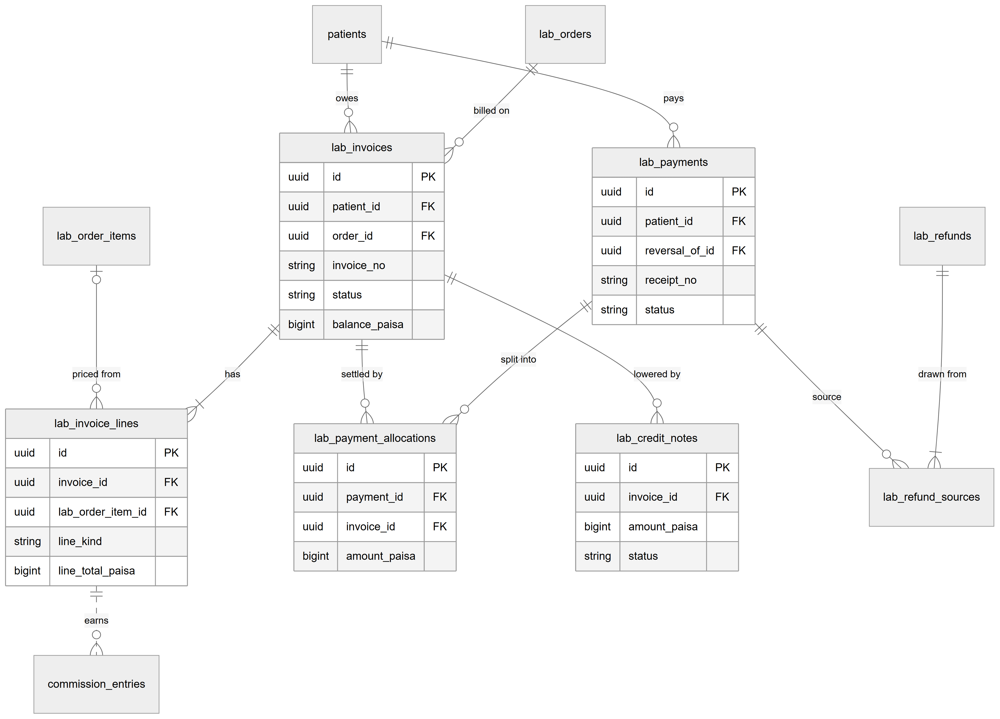

*Figure 42.11 — Tables for patient lab billing.*

The figure shows `lab_invoices` with a patient and an optional lab order, owning `lab_invoice_lines`. A `lab_invoice_lines` row may point at a `lab_order_items` row (dotted: optional). `lab_payments` belong to a patient and are split by `lab_payment_allocations` over invoices. `lab_credit_notes` belong to an invoice. `lab_refunds` draw from payments through `lab_refund_sources`. A dotted line shows that an invoice line earns `commission_entries`.

Each invoice belongs to exactly one patient and optionally to one lab order; deleting either is blocked (`ON DELETE RESTRICT`, as for every foreign key in these tables). An invoice has one or more lines. A payment belongs to one patient; a reversal row points at the payment it reverses (`reversal_of_id`). An allocation links one payment to one invoice with an amount and, once released, a `reversed_at` time and reason. Credit notes point at one invoice. A refund has one or more sources, each a payment. `lab_billing_settings` holds one row per organization. Amounts are integer paisa in `bigint` columns; tax rates are basis points. The Labs data chapter (Chapter 25) describes the columns in full.

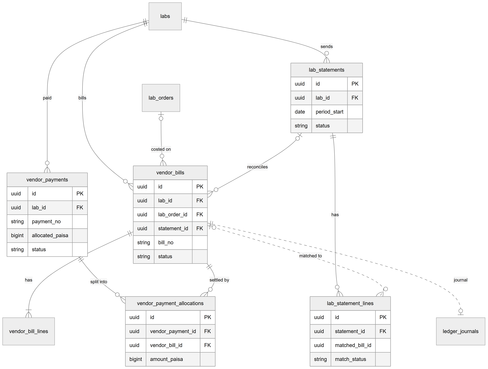

*Figure 42.12 — Tables for lab payables.*

The figure shows `labs` linked to `vendor_bills`, `vendor_payments` and `lab_statements`. A bill has lines, may point at a lab order and at a statement, and has an optional journal (dotted). Payments are split into `vendor_payment_allocations` over bills. A statement has `lab_statement_lines`; a line points at the bill it matched through `matched_bill_id` (dotted, logical link without a foreign key constraint in this diagram).

Each vendor bill belongs to one lab and usually to one lab order (a manual bill has none). A bill's `statement_id` is set when a statement matches it. A payment belongs to one lab; each allocation ties one payment to one bill. The lab's invoice number is unique per lab among bills. The journals live in `ledger_journals` and `ledger_journal_lines` (Chapter 21).

## 42.5 Status lifecycles

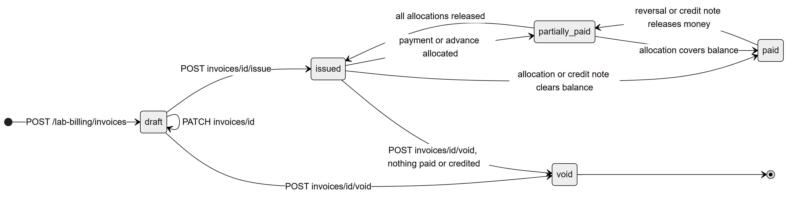

*Figure 42.13 — Lab invoice: draft, issued, partially paid, paid, void.*

A lab invoice is created as `draft` (an estimate) and can be edited any number of times. `POST invoices/id/issue`, or creating with `issue: true`, moves it to `issued`. Payments or advance allocated move it to `partially_paid`, and to `paid` when the balance is zero (a credit note can also clear the balance). A reversal or credit note that releases money can move `paid` back to `partially_paid`, and a `partially_paid` invoice whose allocations are all released goes back to `issued`. A draft, or an issued invoice with no payment and no credit note, can be voided. `void` is final. The status is written only by the totals service, never directly.

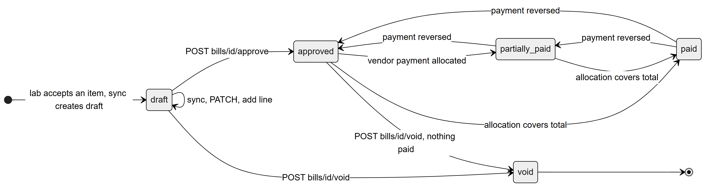

*Figure 42.14 — Vendor bill: draft, approved, partly paid, paid, void.*

A vendor bill starts as `draft` when a lab accepts work, and stays a draft while syncs, edits and manual lines change it. Approve makes it `approved`. Allocations move it to `partially_paid` and then `paid`. Reversing a payment moves it back. Void is allowed for a draft, or for an approved bill with nothing paid. `void` is final.

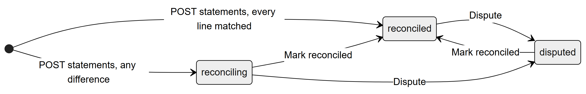

*Figure 42.15 — Lab statement: reconciling, reconciled, disputed.*

A statement is created as `reconciled` when every line matched and no bill is missing, otherwise as `reconciling` (shown as "Needs review"). The accountant can mark it `reconciled` or `disputed` at any time, and move between the two. The enum also has `uploaded`, the column default, but no code path writes it.

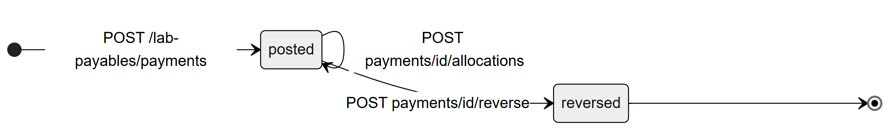

*Figure 42.16 — Vendor payment: posted, reversed.*

A vendor payment is `posted` on creation. More allocations can be added while it stays posted. Reversal makes it `reversed`, which is final.

Patient lab payments follow the same two states, `posted` and `reversed`. Credit notes have three: `issued` (money released, waiting for refund), `applied` (fully absorbed by the invoice balance) and `refunded`.

## 42.6 Connections to other modules

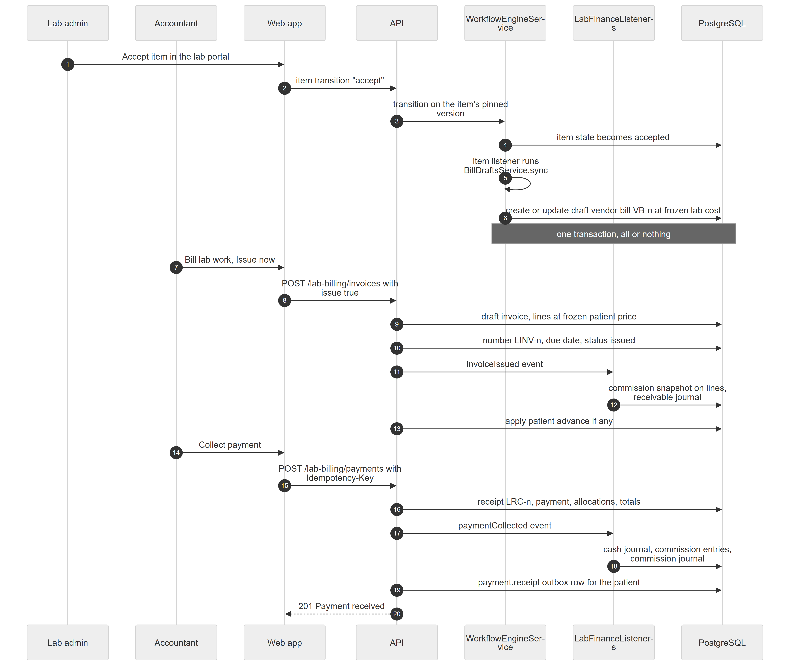

*Figure 42.17 — A lab accepts work, a vendor bill drafts, the clinic invoices and collects, commission follows.*

The diagram has seven participants: Lab admin, Accountant, Web app, API, WorkflowEngineService, LabFinanceListeners and PostgreSQL. In steps 1 to 6, the lab admin accepts an item in the lab portal; the web app calls the item transition `accept`; the API asks the workflow engine to run it on the item's pinned workflow version; the engine writes the new state, runs the item listener `BillDraftsService.sync` and creates or updates the draft vendor bill at the frozen lab cost. A note marks that all of this is one transaction. In steps 7 to 13, the accountant bills the lab work with Issue now; the API creates the draft with lines at the frozen patient price, numbers it and sets the due date, emits `invoiceIssued`, the listeners snapshot the commission on the lines and post the receivable journal, then any patient advance is applied. In steps 14 to 20, the accountant collects a payment with an `Idempotency-Key`; the API writes receipt, payment, allocations and totals, emits `paymentCollected`, the listeners post the cash journal, commission entries and the commission journal, a receipt notification is queued and the API answers 201.

Links to other modules:
- **Lab Management (Chapter 40)** creates and submits orders, freezes prices, and hosts the Billing panel.
- **Lab Portal (Chapter 41)** lets the lab accept work and read its bills.
- **Workflow Engine (Chapter 43)** runs the accept transition and the vendor bill effect.
- **Commissions (Chapter 35)** and **Payroll (Chapter 38)** use the lab commission entries.
- **Billing (Chapter 34)**: lab invoices are separate from clinic invoices; only the number sequences, journals and the void and refund permissions are shared.
- **Notifications (Chapter 44)** receive the receipt and reminder events.

## 42.7 Limitations and known gaps

- The journals (`ledger_journals`) are written for every lab money event, but no screen or report reads them. The clinic profit-and-loss report does not include them.
- Vendor bill header edit (`PATCH bills/:id`) and manual lines (`POST bills/:id/lines`) exist in the API only. The screen has no form for them, so a lab's partial charge on a cancelled item cannot be entered from the UI.
- "Use advance" on a lab payment (`POST payments/:id/allocations`) has no button.
- Payment reminders and receipts are queued but not delivered to patients, because only in-app notifications exist and the patient audience is off by default.
- A cost that goes down after bill approval is not corrected automatically; it needs a manual credit that the UI cannot enter.
- Statement lines are typed in by hand; there is no file upload even though the initial status is called `uploaded`.
- Lab invoices are not limited by location in the list; the permissions have no scope.
- There is no print layout for lab invoices or receipts in the code reviewed. [Unverified]: whether a PDF exists elsewhere.

## 42.8 Owner's FAQ

**Can a receptionist collect a lab payment?** Not by default. `lab.billing.manage` is held by Admin and Accountant. You can add it to a custom role.

**What if the patient paid more than the invoice?** The rest stays as the patient's advance, usable on the next lab invoice or refundable.

**Can an invoice be deleted?** No. A draft or unpaid issued invoice can be voided; paid ones need a payment reversal or a credit note.

**Why can the Accountant not change the tax rate?** Settings need `admin.settings.manage` in addition to lab billing; add it to the role if wanted.

**What happens if two people click Collect payment together?** The invoices are row-locked and the unique key stops duplicates; the second sees an allocation error if the balance is gone.

**Where do I see what we owe a lab?** Lab payables → Reports → Payables aging, or Bills filtered by lab.

**Does the lab's price change alter a patient's invoice?** No. Prices are frozen when the order is submitted.

**Is there a general ledger screen?** No. The journals exist in the database only.

**Does the doctor earn commission on lab work?** Yes, when the commissions feature is on and the doctor has a plan; it is calculated on collected money net of lab cost.
