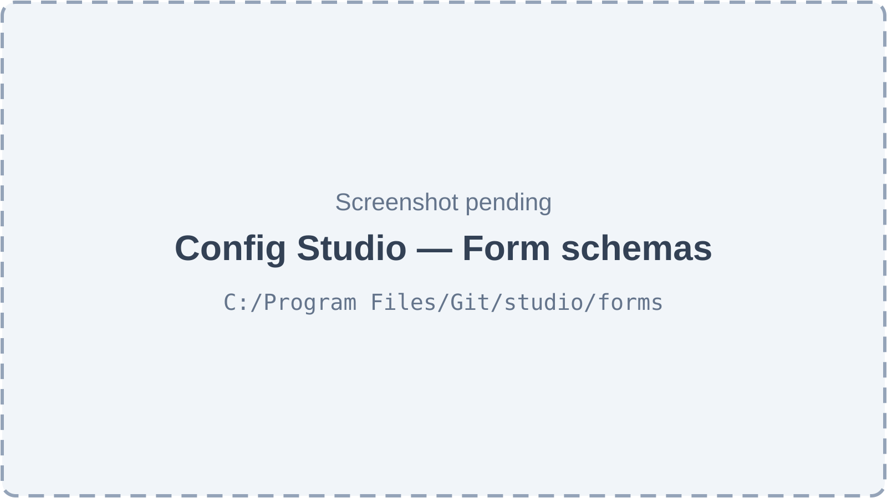
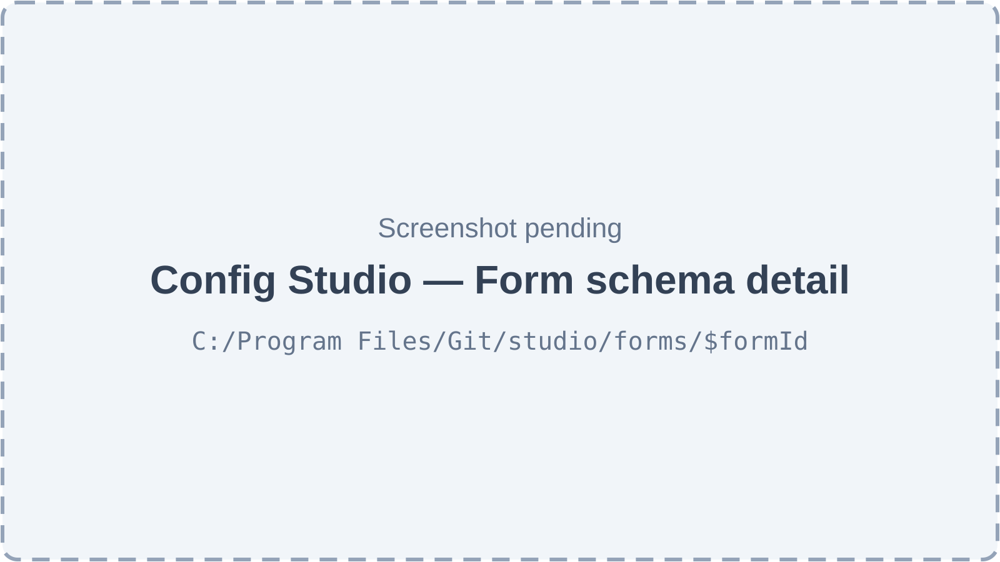
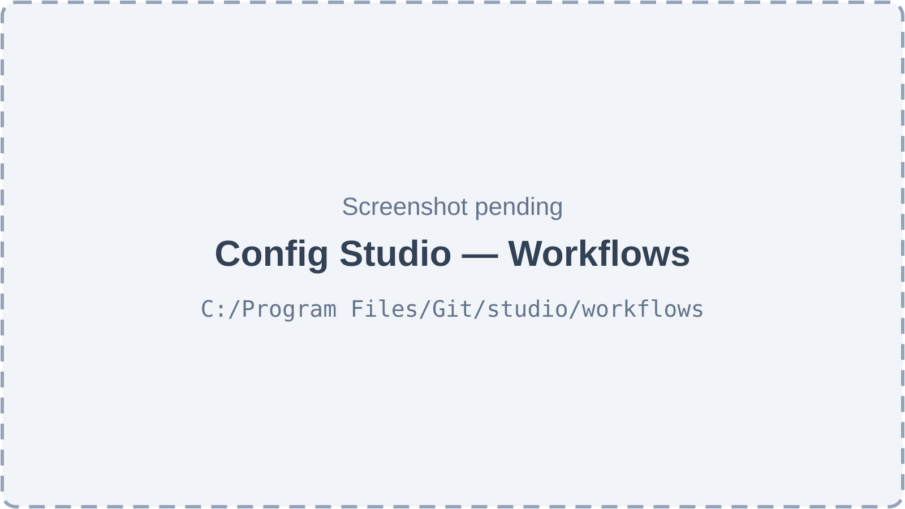
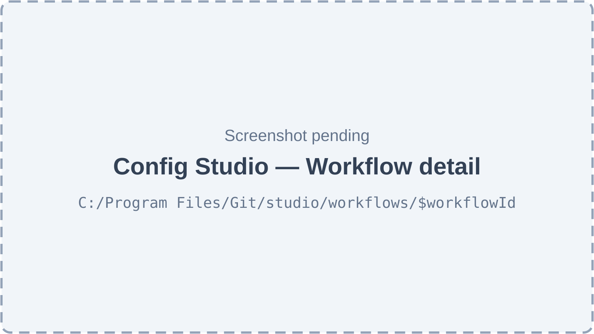
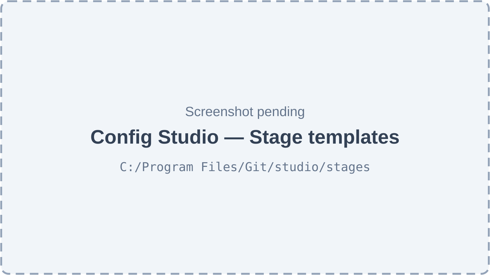
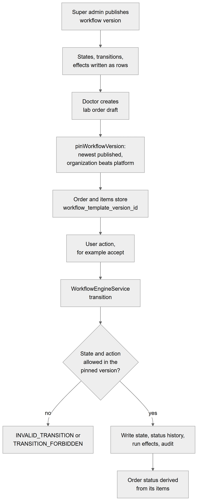
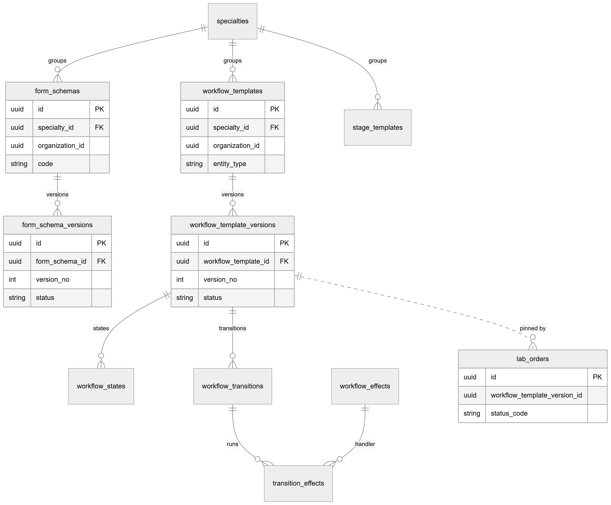
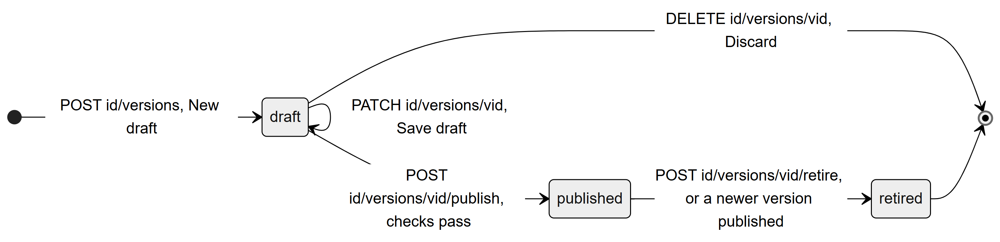

# Chapter 43 — Workflow Engine (Config Studio)

This chapter describes the workflow engine and its editing tool, Config Studio. The engine stores order forms, try-in stage templates and status state machines as versioned data, so that the Lab Management module can run on them. The chapter is written for the product owner, who needs to know what the super admin can configure without a code change, what the engine enforces at run time and what cannot be configured. The data tables are described in Chapter 26; the lab module that uses the engine is described in Chapters 40 and 41.

## 43.1 What this module is for

The engine answers three questions for lab work: what does the doctor fill in when ordering an item (a **form schema**), which try-in rounds does the item go through (a **stage template**), and which status changes are allowed, by whom and with what side effects (a **workflow template**). All three belong to a **specialty** (the seed has one, DENTAL). Forms and workflows are versioned. A version is a draft while edited, becomes published when it passes the checks, and is retired when replaced.

Who uses it: only the **super admin**. Every editing endpoint is restricted to super admins, and the web routes send everyone else to the dashboard. Clinic users never open Config Studio; they only meet its results (the order form, the status names, the allowed actions). Two read-only endpoints serve clinic members: the forms an organization currently uses, and the specialties it works in.

Where it appears: the **Admin** sidebar group, under **Config Studio**, with three items: **Form schemas** (`/studio/forms`), **Workflows** (`/studio/workflows`) and **Stage templates** (`/studio/stages`). All three are `superAdminOnly` entries. The route `/studio` redirects to `/studio/forms`. The studio routes declare no `staticData.can`; they rely on the super admin check in the route component and on the API. Config Studio is not tied to a feature key; it is platform-level.

## 43.2 Screens

*Figure 43.1 — Config Studio, Form schemas (screenshot pending).*

The page is titled "Form schemas" with the subtitle "Order forms per specialty — JSON definition with a live preview. Platform admins only." and a **New form** button. It has a search box ("Search by code or name…"), filters by specialty and owner (All owners, Platform defaults, or one organization) and a list of cards or rows showing code, name, specialty, owner, number of versions, and an "Enter" action. An empty list shows "No form schemas yet".

*Figure 43.2 — Form schema detail (screenshot pending).*

The detail page has a "Back to form schemas" link, the code and name, an "Inactive" badge when switched off, and tabs **Editor** and **Activity**. The editor has a Versions panel (Version, Status, Created, Published, Retired; icon buttons to open, compare, make a new draft from, or retire a version) and, for a draft, three JSON areas: `schemaJson` (fields), `uiJson` (layout) and `promotions`, each with a format button. Beside it is a live "Form preview" that shows the form as a doctor would see it, with a button to reset answers, and a list "Fix before publishing" that names every problem. Buttons are **Save draft**, **Publish** and **Discard draft**. A compare view marks fields Added, Removed or Changed. The Activity tab lists every change of the form.

*Figure 43.3 — Config Studio, Workflows (screenshot pending).*

The Workflows list is titled "Workflows" with the subtitle "States and transitions for orders, items and stages. Platform admins only." It has a **New workflow** button, the same search and owner filters, and a filter by entity (order, item, stage). The empty state says workflows define which status changes are allowed, by whom, and what they trigger.

*Figure 43.4 — Workflow detail (screenshot pending).*

The detail page has the same header and Versions panel. A draft is edited as tables: States (Code, Name, Category, Order) and Transitions (From, Action, To, Sides, Roles, Required input, Reason, Effects), with "Any role" and "None" placeholders. Beside the tables is a **Test run** panel that lists the shortest path from the initial state to each end state. Buttons are **Save draft**, **Publish** and **Discard draft**; a compare view shows States and Transitions that changed.

*Figure 43.5 — Config Studio, Stage templates (screenshot pending).*

The page lists stage templates (Template, Specialty, Owner, Steps, Active) with an edit icon per row and a "New stage template" sheet. The sheet has Code, Name, Specialty, Owner, Active and a list of steps (code, name, lab days, whether a patient visit and doctor approval are needed), with move and remove icon buttons.

## 43.3 Features

### 43.3.1 Manage form schemas

**Status:** [Implemented]

**What it does.** Creates a form schema (for example CROWN), renames it, lists and searches them, and shows its history. A schema without an owner is the platform default, used by every organization. A schema owned by one organization overrides the default with the same code for that organization.

**How the user does it.**
1. Open **Config Studio → Form schemas**, click **New form**.
2. Fill Code, Name, Description, Specialty, Owner ("Platform default (everyone)" or an organization) and "Start from" (empty definition or a copy of an existing version).
3. Save, then open the card with "Enter".

**Behind the scenes — in simple terms.** A form schema is the stable identity; the actual fields live in its versions. Creating one makes the schema and its first draft.

**Behind the scenes — technically.** `GET /platform/form-schemas`, `POST /platform/form-schemas`, `GET /platform/form-schemas/:id`, `PATCH /platform/form-schemas/:id`, `GET /platform/form-schemas/:id/history`, all behind `@RequireSuperAdmin()` (`PlatformFormSchemasController`). `FormSchemasService.create` / `createInTx` / `update` / `history`. Updates carry `version` for optimistic locking. Changes are written to `audit_logs` (entity `form_schema`); history reads them as a timeline.

**Rules and validations.**
- Code is unique per specialty and per owner (one platform schema and one per organization for each code).
- The specialty must exist; the owner organization must exist.
- Copying a version needs a version of the same kind.

**Who can do it.** Super admin only. No permission key, no feature key. No system role holds it.

**Data read and written.** Reads and writes `form_schemas`, `form_schema_versions`, `audit_logs`; reads `specialties`, `organizations`.

**Effects on other modules.** New schemas appear in the order form of Lab Management once a version is published (43.3.3).

**Error cases.** `FORM_SCHEMA_EXISTS` (409); `FORM_SCHEMA_NOT_FOUND` (404); `SPECIALTY_NOT_FOUND`; `ORGANIZATION_NOT_FOUND`; 403 for a non-super-admin.

**Technical references:** `backend/src/engine/forms/form-schemas.controller.ts` · `FormSchemasService` · `web-app/src/features/engine-studio/pages/DefinitionsListPage.tsx`

### 43.3.2 Edit a form version and preview it

**Status:** [Implemented]

**What it does.** Creates a draft version, edits its JSON (fields, layout, promotions), saves it, previews it with sample answers and discards it.

**How the user does it.**
1. Open a form schema and, in the Versions panel, click "New draft" (or "New draft from vN").
2. Edit `schemaJson`, `uiJson` and `promotions`. The preview on the side updates, and "Fix before publishing" lists problems.
3. Click **Save draft**. An "Unsaved changes" marker shows pending edits.
4. Click **Discard draft** to throw it away.

**Behind the scenes — in simple terms.** Saving never needs a clean form: problems are shown but do not block saving. The preview runs the same server rules that real orders use, so it tells the truth about what would be accepted.

**Behind the scenes — technically.** `POST /platform/form-schemas/:id/versions` (`createDraft`, optionally from a version), `GET .../versions/:versionId`, `PATCH .../versions/:versionId` (`updateDraft`: saves, returns issues), `DELETE .../versions/:versionId` (`discardDraft`), `POST .../versions/:versionId/validate` (`validateData`: tries answers against any version, drafts included). The checker `checkDefinition` and the answer validator `FormDataValidator` are pure code. Field types: `tooth_chart`, `select`, `multi_select`, `text`, `textarea`, `number`, `date`, `boolean`, `file`. Promotions copy chosen answers into typed columns of `dental_item_details` (shade system, shade, material code, implant system, platform, diameter, margin type), and only to targets whose field type fits.

**Rules and validations.**
- Only a draft's content can change; a published or retired version cannot.
- At most one draft per form at a time (`FORM_DRAFT_EXISTS`).
- A discarded draft is deleted, and an audit row on the schema keeps its content.
- `version` must match on save.
- Answer validation rejects unknown keys, so a client typo never silently loses data; a field hidden by `visibleIf` is neither required nor stored.

**Who can do it.** Super admin only.

**Data read and written.** `form_schema_versions` (`schema_json`, `ui_json`, `promotions`), `audit_logs`.

**Effects on other modules.** None until published.

**Error cases.** `FORM_VERSION_NOT_FOUND`; `FORM_VERSION_NOT_DRAFT`; `FORM_DRAFT_EXISTS`; stale `version`.

**Technical references:** `backend/src/engine/forms/form-schemas.service.ts` · `FormSchemasService.updateDraft` · `backend/src/engine/forms/form-definition.checker.ts` · `web-app/src/features/engine-studio/components/FormVersionEditor.tsx`

### 43.3.3 Publish and retire a form version

**Status:** [Implemented]

**What it does.** Publishing makes a draft the live version that new lab orders use. Retiring stops offering a published version to new orders; orders already pinned to it keep working.

**How the user does it.**
1. In the editor with a clean draft, click **Publish**, confirm "Publish version N".
2. To retire, click the retire icon in the Versions panel and confirm "Retire vN".

**Behind the scenes — in simple terms.** The system checks the whole definition first. If anything is wrong, nothing is published. Publishing stores exactly what was checked, in cleaned form. The previous published version is retired by the same step, so there is only ever one live version.

**Behind the scenes — technically.** `POST .../versions/:versionId/publish` → `FormSchemasService.publish`: locks the schema and the draft, checks `version`, runs `checkDefinition` and throws `FORM_DEFINITION_INVALID` with an `issues` list on any problem, then `publishInTx`. `POST .../retire` → `retire`: only the published version can be retired. Status changes are written to `status_history` and `audit_logs`. A database check constraint requires a publish date on every non-draft version. Immutability of published versions is enforced by the service, not by a trigger.

**Rules and validations.**
- Valid JSON shape, unique field keys, known types and properties, consistent options and limits, conditions that point back to fields placed before them only (so no cycles), a layout that names only real fields, promotions to registered columns of a matching type.
- At most one published version per form.
- Retire needs a published version.

**Who can do it.** Super admin only.

**Data read and written.** `form_schema_versions`, `status_history`, `audit_logs`.

**Effects on other modules.** Clinics see the newly published form on their next lab order (43.3.4). Drafts are never shown to clinics.

**Error cases.** `FORM_DEFINITION_INVALID` (422, with issues); `FORM_VERSION_NOT_DRAFT`; `FORM_VERSION_NOT_PUBLISHED`; stale `version`.

**Technical references:** `backend/src/engine/forms/form-schemas.service.ts` · `FormSchemasService.publish` / `retire` · `web-app/src/features/engine-studio/components/VersionsPanel.tsx`

### 43.3.4 Clinics read the forms they use

**Status:** [Implemented]

**What it does.** Lets any clinic member read the current published form per code for their organization's specialties, and test answers against a pinned version.

**How the user does it.** Nothing directly. The lab order form and the lab price list load these forms.

**Behind the scenes — in simple terms.** An organization sees the platform defaults and its own forms. Its own form with the same code wins. It never sees drafts or another organization's forms.

**Behind the scenes — technically.** `GET /form-schemas` (`@AnyMember`), `GET /form-schemas/versions/:versionId`, `POST /form-schemas/versions/:versionId/validate` → `FormResolverService.current` / `version` / `validate`. A retired version still validates answers, so orders pinned to it keep working. Specialty enablement is respected (`SPECIALTY_NOT_ENABLED` when an organization does not work in the specialty).

**Rules and validations.** Another organization's version answers 404.

**Who can do it.** Any member of the active organization (`@AnyMember`).

**Data read and written.** Reads `form_schemas`, `form_schema_versions`, `organization_specialties`.

**Effects on other modules.** Lab orders (Chapter 40) and the lab catalog.

**Error cases.** `FORM_VERSION_NOT_FOUND`; `FORM_DATA_INVALID` (422); `SPECIALTY_NOT_ENABLED` (403).

**Technical references:** `backend/src/engine/forms/form-resolver.service.ts` · `FormResolverService` · `web-app/src/features/lab-catalog/services/lab-catalog.api.ts`

### 43.3.5 Manage workflow templates

**Status:** [Implemented]

**What it does.** Creates a workflow template for one kind of record (order, item or stage), lists and searches them, and renames them.

**How the user does it.**
1. Open **Config Studio → Workflows**, click **New workflow**.
2. Fill Code, Name, Description, Specialty, "Runs on" (order, item or stage), Owner, and "Start from" (empty or a copy of an existing version of the same kind).
3. Save and open the workflow.

**Behind the scenes — in simple terms.** A template is the identity; the state machine is in its versions. A copy keeps the definition but starts a new template.

**Behind the scenes — technically.** `GET/POST /platform/workflow-templates`, `GET/PATCH /platform/workflow-templates/:id` → `WorkflowTemplatesService.list / create / get / update`, all super admin only. Copying checks that the source's entity type equals the requested one (`WORKFLOW_DEFINITION_INVALID` otherwise). The new template gets a draft version 1.

**Rules and validations.** Code unique per specialty, entity type and owner (`WORKFLOW_TEMPLATE_EXISTS`); specialty and organization must exist.

**Who can do it.** Super admin only.

**Data read and written.** `workflow_templates`, `workflow_template_versions`, `audit_logs`.

**Effects on other modules.** None until a version is published.

**Error cases.** `WORKFLOW_TEMPLATE_EXISTS`; `WORKFLOW_TEMPLATE_NOT_FOUND`; `WORKFLOW_VERSION_NOT_FOUND`; `SPECIALTY_NOT_FOUND`; `ORGANIZATION_NOT_FOUND`.

**Technical references:** `backend/src/engine/workflows/workflow-templates.controller.ts` · `WorkflowTemplatesService` · `web-app/src/features/engine-studio/pages/DefinitionsListPage.tsx`

### 43.3.6 Edit a workflow draft and run a test

**Status:** [Implemented]

**What it does.** Edits the states and transitions of a draft, and shows a test run: the shortest route from the start to each end state, computed without touching data.

**How the user does it.**
1. In the Versions panel click "New draft" or "New draft from vN".
2. Edit States (code, name, category initial, active, waiting, done or cancelled) and Transitions (from, action, to, sides, roles, required input, reason, effects). The effect dropdown lists only handlers that exist in code.
3. Click **Save draft**. Problems appear in "Fix before publishing"; the Test run panel updates.

**Behind the scenes — in simple terms.** The definition is JSON while it is a draft. It is not used by any order. The effects list is a menu of code that already exists: configuration can pick among them but cannot add new behaviour.

**Behind the scenes — technically.** `POST /platform/workflow-templates/:id/versions`, `GET .../versions/:versionId`, `PATCH .../versions/:versionId` (`updateDraft`, returns `issues` and a `simulation`), `DELETE .../versions/:versionId` (`discardDraft`), `GET /platform/workflow-effects` (`PlatformWorkflowEffectsController`, lists `EffectRegistry` handlers). The simulation is `simulateWorkflow`. Registered effect codes in this build: `recompute_order_status`, `init_stages`, `notify`, `start_warranty`, `check_warranty_on_remake`, `create_vendor_bill_draft`.

**Rules and validations.**
- At most one draft per template (`WORKFLOW_DRAFT_EXISTS`); only a draft can be edited or discarded.
- Limits: 60 states, 300 transitions.
- Checks at publish time are in 43.3.7.

**Who can do it.** Super admin only.

**Data read and written.** `workflow_template_versions.definition_json`, `audit_logs`.

**Effects on other modules.** None until published.

**Error cases.** `WORKFLOW_VERSION_NOT_DRAFT`; `WORKFLOW_DRAFT_EXISTS`; `WORKFLOW_VERSION_NOT_FOUND`; stale `version`.

**Technical references:** `backend/src/engine/workflows/workflow-templates.service.ts` · `WorkflowTemplatesService.updateDraft` · `backend/src/engine/workflows/workflow-definition.checker.ts` · `web-app/src/features/engine-studio/components/WorkflowVersionEditor.tsx`

### 43.3.7 Publish and retire a workflow version

**Status:** [Implemented]

**What it does.** Publishing turns the JSON draft into real rows (states, transitions, effects) and makes it the version that new orders and items pin. The previous published version is retired in the same transaction.

**How the user does it.** Click **Publish** and confirm "Publish version N"; or use the retire icon and confirm "Retire vN".

**Behind the scenes — in simple terms.** The checker is strict: it refuses any machine that could trap work. Rows are written once and never change. Work already in progress stays on the version it started with.

**Behind the scenes — technically.** `POST .../versions/:versionId/publish` → `publishInTx`: runs `checkWorkflow(definition, effects.codes())`; on any issue throws `WORKFLOW_DEFINITION_INVALID` with `issues`. Otherwise inserts `workflow_states` (with `is_terminal` from the category and `sort_order`), `workflow_transitions` (from, to, action, `allowed_sides`, `allowed_roles`, `required_fields`, `requires_reason`) and `transition_effects` (in order, with params), retires the current published version, sets `published_at` and `published_by`, and records status history and audit. `POST .../retire` → `retire` (only a published version).

**Rules and validations.** The checks (lab ERD section 18):
- Exactly one initial state; at least one done and one cancelled end state.
- Every state reachable from the initial state; every non-terminal state has a way forward (no dead end).
- Nothing leaves a terminal state; no self-loop.
- Unique state codes; each (state, action) leads to one target (except derived changes).
- Only registered effects (no duplicates in one transition) and only existing roles.
- Valid sides (clinic, lab, system) and required fields.

**Who can do it.** Super admin only.

**Data read and written.** `workflow_template_versions`, `workflow_states`, `workflow_transitions`, `transition_effects`, `status_history`, `audit_logs`.

**Effects on other modules.** New lab orders and items pin the new version (43.3.9). Existing ones are unchanged.

**Error cases.** `WORKFLOW_DEFINITION_INVALID` (422, with issues); `WORKFLOW_VERSION_NOT_DRAFT`; `WORKFLOW_VERSION_NOT_PUBLISHED`; stale `version`.

**Technical references:** `backend/src/engine/workflows/workflow-templates.service.ts` · `WorkflowTemplatesService.publishInTx` · `web-app/src/features/engine-studio/components/VersionsPanel.tsx`

### 43.3.8 Manage stage templates

**Status:** [Implemented]

**What it does.** Defines the try-in rounds of a kind of work, for example metal, bisque, final. Not versioned: changing a template affects only work that starts later.

**How the user does it.**
1. Open **Config Studio → Stage templates**, click to create ("New stage template"), or the edit icon on a row.
2. Enter Code, Name, Specialty, Owner, Active, and steps: code, name, lab days, whether a patient visit and doctor approval are needed. Reorder or remove steps with the icon buttons.
3. Click **Create template** or **Save changes**.

**Behind the scenes — in simple terms.** When an order item starts, the system copies the steps into the item's own stage rows. Editing a template later cannot damage running work.

**Behind the scenes — technically.** `GET/POST /platform/stage-templates`, `GET/PATCH /platform/stage-templates/:id` → `StageTemplatesService` (`PlatformStageTemplatesController`, super admin only). Steps are in `stage_template_steps` (cascade delete with the template). Seeded templates: `SINGLE_STAGE`, `PFM_3_STAGE` and `COMPLETE_DENTURE`.

**Rules and validations.** Code unique per specialty and owner; step codes unique within a template; lab days 0 to 365; the last step must require doctor approval. There is no delete endpoint; a template is switched inactive.

**Who can do it.** Super admin only.

**Data read and written.** `stage_templates`, `stage_template_steps`, `audit_logs`.

**Effects on other modules.** The `init_stages` effect creates an item's stage rows from the template (Chapter 40).

**Error cases.** `STAGE_TEMPLATE_EXISTS`; `STAGE_TEMPLATE_NOT_FOUND`; `STAGE_TEMPLATE_INVALID` (422).

**Technical references:** `backend/src/engine/stages/stage-templates.service.ts` · `StageTemplatesService` · `web-app/src/features/engine-studio/components/StageTemplateSheet.tsx`

### 43.3.9 A lab order's state machine comes from a published workflow version

**Status:** [Implemented]

**What it does.** Every lab order, item and try-in stage stores the id of the workflow version it started on. Every status change is then checked against that version.

**How the user does it.** Nothing special: a doctor creates a lab order draft; later the doctor, the lab or the system performs actions such as submit, accept or approve.

**Behind the scenes — in simple terms.** Think of the workflow version as the rule book printed on the day the case opened. The case keeps its copy. If the super admin publishes a new rule book tomorrow, old cases still follow the old one. A referee (the engine) is the only way to change a status: a direct status update is not allowed. The order's status is not set by hand; it is derived from its items.

**Behind the scenes — technically.** `OrderWorkflowService.pinWorkflowVersion` chooses the newest published version of the given template, or, without one, of the specialty's default template for the entity type; the organization's own template beats the platform's (`ORDER BY organization_id IS NOT NULL DESC`). It is stored in `workflow_template_version_id` on `lab_orders` and `lab_order_items`. If no published workflow exists, the order fails with `LAB_ORDER_WORKFLOW_MISSING`. `WorkflowEngineService.transition` runs in one transaction: idempotency claim, lock the subject, find the (state, action) pair in its pinned version, check side and role, check required input and reason, write the state, write status history, run the effects in order, run the after-transition hook (derive the order status from its items), audit. `transitionIn` runs the same inside a larger transaction (for example order submit). `applyDerived` sets a status the engine computed, which is not looked up as a user transition. `compiled` loads and caches a version's states and transitions and refuses a draft version. A clinic user can act for a lab (proxy) only with the lab-coordinator capability, and the action is recorded as proxy.

*Figure 43.6 — From publishing a version to a checked transition.*

The flowchart reads top to bottom. "Super admin publishes workflow version" leads to "States, transitions, effects written as rows". "Doctor creates lab order draft" leads to "pinWorkflowVersion: newest published, organization beats platform", then to "Order and items store workflow_template_version_id". A "User action, for example accept" goes to "WorkflowEngineService transition", then to a decision "State and action allowed in the pinned version?". If no, the result is `INVALID_TRANSITION` or `TRANSITION_FORBIDDEN`. If yes, the engine writes state, status history, runs effects and audit, and the order status is derived from its items.

The seeded dental workflows show what a version holds. The item workflow (`DENTAL_ITEM`) has states such as Waiting for lab (initial), Accepted, In production, At clinic for try-in, Quality check, Ready, Dispatched, Received, Approved, Delivered (done), and Rejected by lab, Cancelled and Remake required (cancelled). Its transition `accept` is allowed on the lab side for the lab admin role and requires the field `lab_expected_on`; `reject` and `qc_fail` require a reason; `send_tryin` and `dispatch` are system-driven. The order workflow (`DENTAL_ORDER`) runs Draft, Submitted, Clarification needed, Accepted, In progress, On hold, Partially ready, Ready, Completed and Cancelled, among others. The stage workflow (`DENTAL_STAGE`) covers one try-in round.

**Rules and validations.**
- A subject pinned to a draft version is refused (`WORKFLOW_MISCONFIGURED`).
- A user action needs the right side (clinic, lab or system) and, if the transition lists roles, a matching role.
- Required fields and reasons are enforced per transition.
- Derived order status never overrides terminal states.

**Who can do it.** The permissions are those of the lab order actions (Chapters 40 and 41), not Config Studio. Super admin configures the version only.

**Data read and written.** Reads `workflow_template_versions`, `workflow_states`, `workflow_transitions`, `transition_effects`. Writes the subject's `status_code`, `status_history`, `audit_logs`.

**Effects on other modules.** Effects fire in Lab Management (stages, warranty, notifications), Lab Finance (the `create_vendor_bill_draft` effect creates a vendor bill draft when a lab accepts an item, Chapter 42) and order status.

**Error cases.** `INVALID_TRANSITION` (422), `TRANSITION_FORBIDDEN` (403), `TRANSITION_INPUT_REQUIRED` (422), `TRANSITION_REASON_REQUIRED` (422), `WORKFLOW_SUBJECT_NOT_FOUND` (404), `WORKFLOW_MISCONFIGURED` (500), `REQUEST_IN_FLIGHT` (409), `IDEMPOTENCY_KEY_REUSED` (422), `LAB_ORDER_WORKFLOW_MISSING`.

**Technical references:** `backend/src/engine/runtime/workflow-engine.service.ts` · `WorkflowEngineService.transition` · `backend/src/lab-orders/workflow/order-workflow.service.ts` · `OrderWorkflowService.pinWorkflowVersion` · `backend/src/engine/workflows/order-status.ts`

### 43.3.10 Compare versions and read the activity log

**Status:** [Implemented]

**What it does.** Shows what changed between two versions of a form or workflow, and lists every change to a form.

**How the user does it.** In the Versions panel click the compare icon, pick the compare version; the diff marks Added, Removed, Changed. Open the Activity tab on a form for the timeline.

**Behind the scenes — in simple terms.** Comparison happens in the browser on two loaded versions. The activity log is a view of the audit trail.

**Behind the scenes — technically.** `FormCompare`, `WorkflowCompare` and `DiffView` in the web app. `GET /platform/form-schemas/:id/history` → `FormSchemasService.history` reads the audit timeline of the schema and of each of its versions. There is no history endpoint for workflows or stage templates; the Activity tab exists only on forms.

**Rules and validations.** Read-only.

**Who can do it.** Super admin only.

**Data read and written.** Reads `audit_logs`.

**Effects on other modules.** None.

**Error cases.** `FORM_SCHEMA_NOT_FOUND`.

**Technical references:** `backend/src/engine/forms/form-schemas.service.ts` · `FormSchemasService.history` · `web-app/src/features/engine-studio/components/StudioActivity.tsx`

### 43.3.11 Specialties and which organizations use them

**Status:** [Partial]

**What it does.** Lists specialties, creates or edits one, and switches a specialty on or off per organization. The seed creates DENTAL, enabled by default.

**How the user does it.** The Studio only reads the specialty list (to fill the Specialty filters and dropdowns). No screen creates a specialty or switches it per organization.

**Behind the scenes — in simple terms.** An organization's specialty rows are created on first use from the "enabled by default" flag. A super admin's later on/off choice always wins.

**Behind the scenes — technically.** `GET /platform/specialties`, `POST /platform/specialties`, `PATCH /platform/specialties/:id`, `GET /platform/specialties/:id/organizations`, `PUT /platform/specialties/:id/organizations/:organizationId` (`PlatformSpecialtiesController`, super admin only) and `GET /specialties` (`@AnyMember`, the organization's enabled specialties) → `SpecialtiesService`. The web client calls only `GET /platform/specialties`.

**Rules and validations.** Specialty code unique (`SPECIALTY_EXISTS`); an organization change is audited only when the value changes.

**Who can do it.** Super admin (platform endpoints); any member for `GET /specialties`.

**Data read and written.** `specialties`, `organization_specialties`, `audit_logs`.

**Effects on other modules.** A specialty that is off for an organization hides its forms (`SPECIALTY_NOT_ENABLED`).

**Error cases.** `SPECIALTY_NOT_FOUND`; `SPECIALTY_EXISTS`; `ORGANIZATION_NOT_FOUND`.

**Technical references:** `backend/src/engine/specialties/specialties.service.ts` · `SpecialtiesService` · `web-app/src/features/engine-studio/services/studio.api.ts`

### 43.3.12 Built-in seed of dental defaults

**Status:** [Implemented]

**What it does.** On every start, the engine registers the code effect handlers and creates the dental starter data if it is missing: the DENTAL specialty, five forms (CROWN, BRIDGE, IMPLANT_CROWN, DENTURE, REPAIR), the three dental workflows and three stage templates.

**How the user does it.** Nothing.

**Behind the scenes — in simple terms.** The seed only adds what is missing. It never edits existing rows, so published versions stay exactly as they were and a super admin's changes are not overwritten.

**Behind the scenes — technically.** `EngineSeedService` (`OnApplicationBootstrap`, after every effect handler has registered). One advisory lock stops an API and a worker that boot together from both inserting. It syncs `workflow_effects` from the in-memory registry (a handler removed from code is marked unavailable, old versions that mention it remain).

**Rules and validations.** Insert-if-missing only.

**Who can do it.** Automatic.

**Data read and written.** `specialties`, `form_schemas`, `form_schema_versions`, `workflow_templates`, `workflow_template_versions`, `workflow_states`, `workflow_transitions`, `transition_effects`, `stage_templates`, `stage_template_steps`, `workflow_effects`.

**Effects on other modules.** Without this seed no lab order could be created.

**Error cases.** A failure is logged at start.

**Technical references:** `backend/src/engine/seeds/engine-seed.service.ts` · `EngineSeedService.seed` · `backend/src/engine/seeds/dental-workflows.seed.ts`

## 43.4 Entities and data model

*Figure 43.7 — Specialties, forms, workflows and the lab orders that pin versions.*

The figure shows `specialties` at the top, with `form_schemas`, `workflow_templates` and `stage_templates` under it. `form_schemas` own `form_schema_versions`. `workflow_templates` own `workflow_template_versions`, which own `workflow_states` and `workflow_transitions`. `workflow_transitions` link to `workflow_effects` through `transition_effects`. A dotted line goes from `workflow_template_versions` to `lab_orders`, labelled "pinned by".

Each form, workflow and stage template belongs to one specialty; deleting a specialty is blocked. Each version belongs to one template or schema. A published version's states and transitions are written once. A transition's effects are listed in order. The link from a lab order to its version is a stored id (`workflow_template_version_id`); it is drawn as a logical link. Stage steps are removed when their template is removed (cascade). `organization_id` empty on a schema or template means the platform default. Chapter 26 describes every column and constraint.

## 43.5 Status lifecycles

*Figure 43.8 — A form or workflow version: draft, published, retired.*

A version is created as `draft`. Saving keeps it a draft. Discarding deletes the row (an audit entry keeps its content). Publishing, which requires a clean definition, makes it `published` and retires the previously published version. Retiring a published version makes it `retired` with no replacement, so new orders find no published version until another is published (lab orders then fail with `LAB_ORDER_WORKFLOW_MISSING`). `retired` is final. At most one draft and one published version exist per template at any time. Stage templates have no versions, only an Active switch.

## 43.6 Connections to other modules

- **Lab Management (Chapter 40)**: order forms, try-in stages and every status change.
- **Lab Portal (Chapter 41)**: lab-side actions are transitions with side `lab`.
- **Lab Finance (Chapter 42)**: the `create_vendor_bill_draft` effect.
- **Notifications (Chapter 44)**: the `notify` effect.
- **Audit (Chapter 60)**: every definition change and every transition is recorded.
- **Access control (Chapter 57)**: Config Studio uses the super admin check, not permission keys.

## 43.7 Limitations and known gaps

- Config Studio is for super admins only. Clinics cannot create their own forms or workflows, although the data model supports organization-owned ones.
- Effects are fixed in code. Configuration can choose and order them, not create new ones.
- Specialty management and per-organization enablement have no screen.
- Stage templates are not versioned and have no delete.
- Workflows and stage templates have no activity tab.
- The role names in transitions (for example `lab_admin`, `doctor`, `clinic_admin`) are legacy role names derived from permissions; they do not match the five system role templates one to one.
- Studio routes declare no `staticData.can`; protection is the super admin check in the route component plus the API.
- Published versions are immutable by service logic only; no database trigger enforces it.

## 43.8 Owner's FAQ

**Can a clinic owner change the lab order form?** No. Only the super admin, in Config Studio. An organization-owned override exists in the data model.

**If I publish a new workflow, what happens to open lab orders?** Nothing. Each order keeps the version it started on.

**What if I retire the only published workflow?** New orders cannot be created until another version is published.

**Can I add a new action, such as "send SMS to patient"?** Only by choosing an existing effect; a new kind of effect needs code.

**Can I undo a publish?** Not directly. Create a draft from the old version and publish it; the engine retires the one in use.

**Where do I see who changed a form?** Form schemas → Activity tab.

**Why does a workflow fail to publish?** The checker lists each problem: a state that cannot be reached, a dead end, a missing end state, an unknown effect or role.

**Is the Studio tied to a feature flag?** No. It is platform-level and visible only to super admins.
