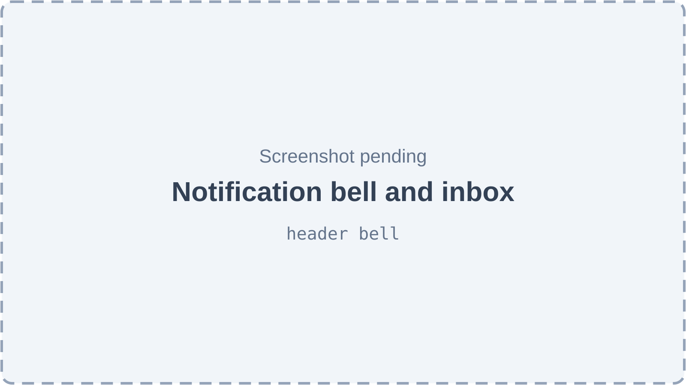
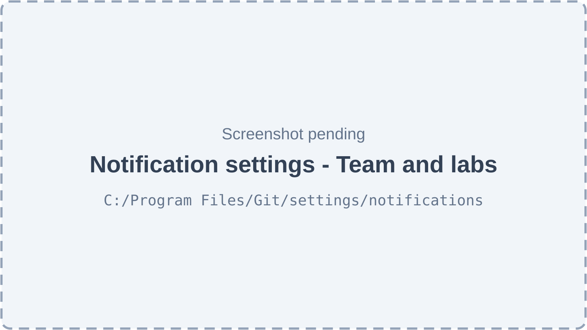
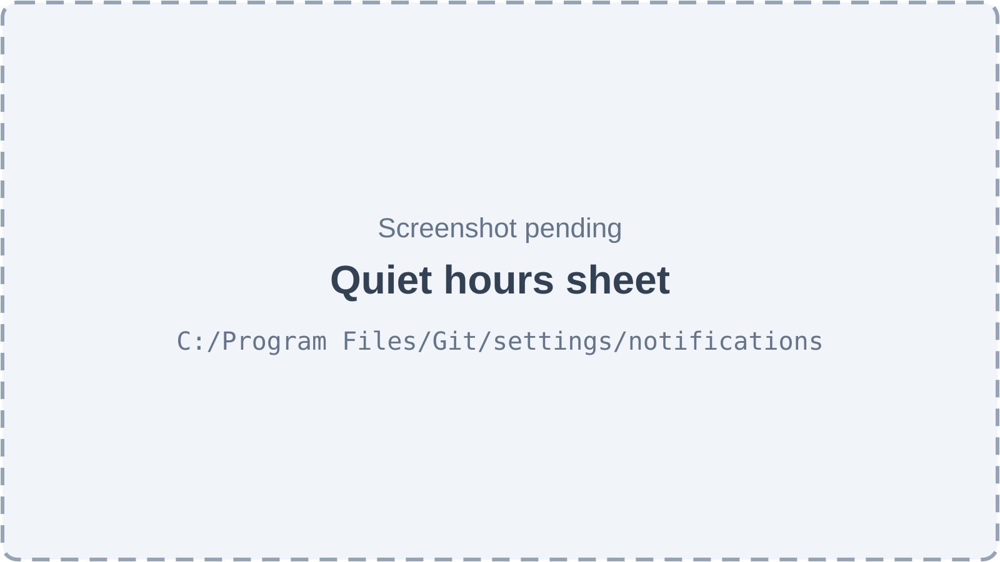
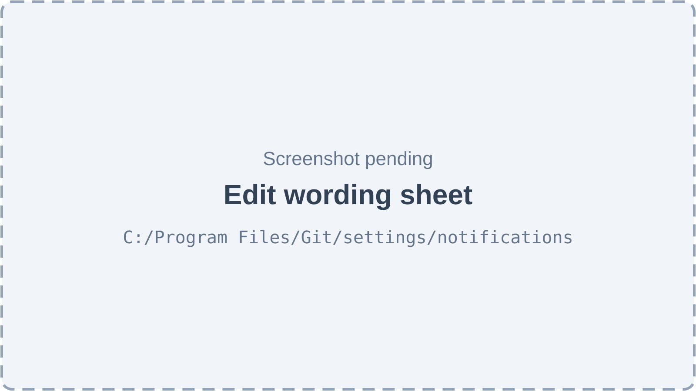
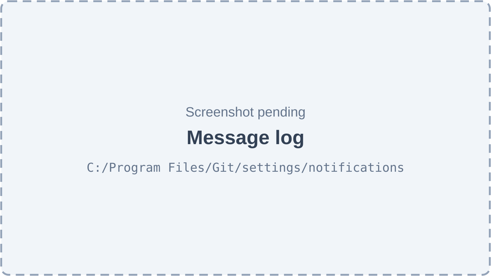
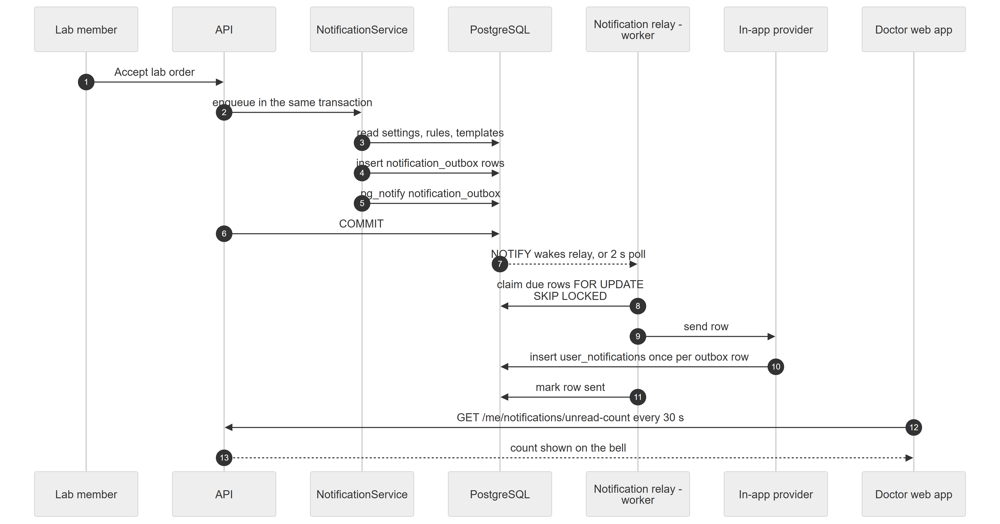
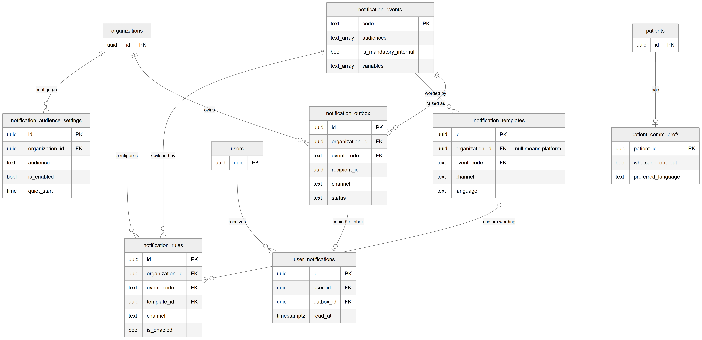
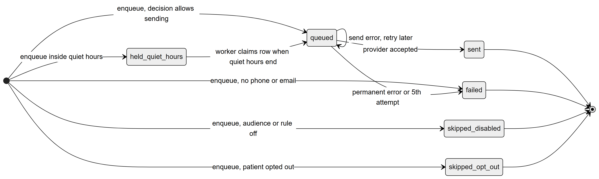
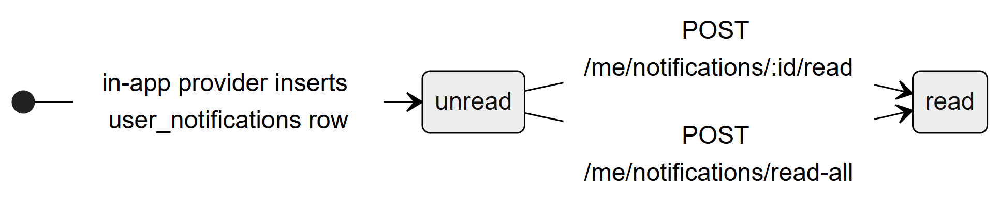

# Chapter 44 — Notifications

This chapter describes the Notifications module of the Platform: the in-app inbox that staff and lab members see behind the bell icon, and the clinic settings that decide who is told about which event. It is written for the product owner, who needs to know what is built, what is only prepared, and how a message travels from a business event to a screen. Today the module delivers in-app messages only. Messages to patients by WhatsApp, SMS or email are prepared in the code but switched off.

## 44.1 What this module is for

A **notification event** is a named business happening that someone should hear about, for example "New lab order" or "Payment receipt". The Platform ships 21 of them. When one happens, the module decides, for each person concerned, whether to tell them and on which channel, writes the message to an outbox table inside the same database transaction as the business change, and a background worker delivers it. For staff and lab members, delivery means a row in their personal inbox, shown behind the bell in the page header.

Who uses it:

- **Every signed-in user** (doctor, receptionist, lab member and others): sees the bell, the unread badge and the inbox list. No permission is needed, because the inbox is always the user's own.
- **Admin** (and the **owner**): opens the notification settings page. This needs the permission `notifications.settings.manage`, which only the Admin system role holds by default.
- **Receptionist**: in the backend, can read and change a patient's messaging opt-outs through `patients.view` and `patients.edit`. No screen shows this today (see 44.7).

Where it appears: there is no sidebar entry. The bell sits in the header on every dashboard page. The settings page is reached from Settings, through the link **Notifications**, which is shown only to users with `notifications.settings.manage`. The route is `/settings/notifications`.

Feature keys: `comms.in_app` ("In-App Notifications", enabled by default) and `comms.whatsapp` ("WhatsApp", disabled by default) exist in the feature catalog, but no code checks either of them. The keys `comms.sms` and `comms.email` are commented out. Notifications run regardless of feature switches, and the notification endpoints carry no feature requirement.

## 44.2 Screens

*Figure 44.1 — Notification bell and inbox (screenshot pending).*

The bell is an outlined icon button in the page header, next to the theme and location controls. When the user has unread items, a small badge shows the count (capped at "99+") and the tooltip reads "Notifications (N unread)". Clicking the bell opens a popover headed "Notifications" with a **Mark all read** button, disabled when nothing is unread or while saving. The list shows the 20 newest items. Each item is a clickable row with a title, a body and a time. Unread rows have a tinted background and a coloured dot. Clicking a row marks it read and, when the item has a link (for example a lab order), closes the popover and opens that page. While loading, three skeleton rows show. On failure the popover shows "Couldn’t load notifications." and a **Try again** button. When empty it shows "You’re all caught up" and "Updates about lab orders and your patients appear here."

*Figure 44.2 — Notification settings, Team & labs tab (screenshot pending).*

The settings page has the title "Notifications", the subtitle "In-app notifications for your team — and the log of every message.", and a back button to Settings. It has two tabs: **Team & labs** and **Message log**. A **Patients** tab exists in the code but is commented out, because patients have no working channel. The Team & labs tab has a "Master switches" section with one card per audience (doctor, coordinator, lab). Each card has an on/off switch, a description line such as "Updates about the doctor’s own lab orders.", the current quiet-hours summary ("No quiet hours" or "Quiet hours 22:00 – 08:00") and a **Quiet hours** button. The "Events" section is a table with the columns Event and Sent to, one switch per audience and channel, and an action column. Events flagged mandatory show a lock and a "Mandatory" badge, and their in-app switch is locked on with the tooltip "Mandatory — always sent in-app". Each row has an icon button with the tooltip "Edit wording — <event name>".

*Figure 44.3 — Quiet hours sheet (screenshot pending).*

The quiet-hours sheet slides in from the side. It explains: "Messages that fall inside quiet hours are held and sent when they end. In-app notifications are never held." It has a "Use quiet hours" switch, a start time, an "Until" time (the hint says it may be the next morning, for example 22:00 → 08:00) and a Timezone field with the placeholder "Asia/Karachi" and the hint "Leave empty to use each location's own timezone." Save is disabled until the form is valid and changed.

*Figure 44.4 — Edit wording sheet (screenshot pending).*

The wording sheet lets the clinic replace the platform text of one event: "Your clinic's own message. Placeholders in {braces} are filled in for each recipient." It has a Channel selector, a Language selector (English, Urdu, Roman Urdu), a Subject or Title field, a Message field, and, for WhatsApp, a "WhatsApp template ID" field. It shows the platform default for comparison ("No default yet" when none exists). Buttons are Save and Reset. Reset asks "Reset to the default wording?" and, when confirmed, deletes the clinic's own wording. Closing with edits asks "Discard changes?".

*Figure 44.5 — Message log (screenshot pending).*

The Message log tab lists every notification the clinic has produced, including the ones that were skipped or held. It has a search box ("Search by name, number or text…"), a status filter ("All statuses" and the seven statuses), a channel filter ("All channels"), and a table with the columns Recipient, Message, Channel and Status, paged with a page-size selector (default 20). Status badges read Queued, Held (quiet hours), Sent, Delivered, Failed, Skipped — off and Skipped — opted out. The empty state is "No messages yet" with "Every notification — sent, held or skipped — is listed here with the reason." A filter with no hits shows "No messages match your filters."

## 44.3 Features

### 44.3.1 See notifications in the header bell

**Status:** [Implemented]

**What it does.** Shows the signed-in user's in-app notifications, with an unread count that refreshes by itself.

**How the user does it.**
1. Look at the bell in the header. A badge shows the unread count.
2. Click the bell to open the popover.
3. Click an item to open the linked page.

**Behind the scenes — in simple terms.** Each person has their own inbox. It spans every clinic the person works at, because it is tied to the user and not to a location. The badge asks the server for the count every 30 seconds and when the browser window regains focus. There is no live push.

**Behind the scenes — technically.** `GET /me/notifications?page&limit&unreadOnly` (limit 1–50, default 20) and `GET /me/notifications/unread-count` in `MyNotificationsController`, which is `@ContextFree()`: no organization or location headers are needed, and lab users have none. `UserNotificationsService.list` reads `user_notifications` for the user, newest first. The web hook `useUnreadNotificationCount` polls with `refetchInterval` 30 000 ms; the popover loads `useMyNotifications({ limit: 20 })` only while open.

**Rules and validations.**
- Always scoped to the signed-in user; there is no way to read another user's inbox.
- The list is paged; the bell shows only the first 20.

**Who can do it.** Any signed-in user; no permission key and no feature key.

**Data read and written.** Reads `user_notifications`.

**Effects on other modules.** None. Links in items point to pages such as `/lab-orders/<id>`.

**Error cases.** A 401 when no user is resolved; the popover shows "Couldn’t load notifications." on any load failure.

**Technical references:** `backend/src/notifications/controllers/my-notifications.controller.ts` · `MyNotificationsController`, `UserNotificationsService` · `web-app/src/features/notifications/components/NotificationBell.tsx`, `hooks/useMyNotifications.ts`

### 44.3.2 Mark notifications as read

**Status:** [Implemented]

**What it does.** Marks one notification, or all of them, as read.

**How the user does it.**
1. Click an item (marks it read and follows its link), or click **Mark all read**.

**Behind the scenes — in simple terms.** Reading sets a time stamp on the inbox row. Nothing is ever deleted from the inbox, and there is no "mark as unread".

**Behind the scenes — technically.** `POST /me/notifications/:id/read` and `POST /me/notifications/read-all` (declared first so the route does not clash). `markRead` loads the row by id and user and sets `read_at` if it is empty; it is idempotent. `markAllRead` updates every row of the user where `read_at IS NULL` and returns `{ updated }`. The web mutations invalidate the inbox queries on completion.

**Rules and validations.** `:id` must be a UUID. Only the owner's rows are touched.

**Who can do it.** Any signed-in user.

**Data read and written.** Writes `user_notifications.read_at`.

**Effects on other modules.** None.

**Error cases.** `NOTIFICATION_NOT_FOUND` (404) when the id does not exist for this user.

**Technical references:** `UserNotificationsService.markRead`, `markAllRead` · `web-app/src/features/notifications/hooks/useMyNotifications.ts`

### 44.3.3 Raise a notification event (how messages are created)

**Status:** [Implemented]

**What it does.** Any module can notify people about a business event. The module decides who is told, on which channel, with what wording and when, and records the result for every recipient and channel.

**How the user does it.** Users do not do this directly. It happens as a side effect of actions such as submitting a lab order or recording a lab payment (see 44.6).

**Behind the scenes — in simple terms.** For each person concerned and each channel their audience uses, the module asks six questions in a fixed order and the first match decides:

1. Is this a mandatory event for an internal audience, on the in-app channel? Then send, whatever the settings say.
2. Is the audience's master switch off? Then skip.
3. Is the rule for this event, audience and channel off? Then skip.
4. Has the patient opted out of this channel? Then skip.
5. Is it inside quiet hours (not in-app)? Then hold until quiet hours end.
6. Otherwise send.

A row is written for every outcome, so the message log can explain why something was not sent. Defaults when the clinic has changed nothing: internal audiences (doctor, coordinator, lab) are on with in-app on; the patient audience and every rule for it are off.

**Behind the scenes — technically.** `NotificationService.enqueue(manager, input)` runs inside the caller's transaction. It loads the event, de-duplicates recipients by type and id, rejects an audience the event does not allow (`NOTIFICATION_AUDIENCE_INVALID`), reads audience settings, rules, templates, contact details and patient preferences, and calls the pure function `decide()` for each recipient and channel in `channelsFor()`. A template is chosen by rule, then by channel and language (clinic override before platform default; language from the recipient, then the patient preference, then English), and `renderTemplate` fills `{placeholders}`; unknown placeholders become empty. Rows are inserted into `notification_outbox` in one statement, then `pg_notify('notification_outbox')` is issued in the same transaction, so listeners wake only on commit. A recipient with no phone or email on an external channel gets a `failed` row with reason `no_address`. Because the work is inside the caller's transaction, a rollback removes the messages too.

**Rules and validations.**
- Unknown event code: `NOTIFICATION_EVENT_UNKNOWN` (422); a typo fails the business action instead of silently dropping messages.
- Mandatory in-app messages ignore master switches and rules.
- Quiet hours never hold in-app messages.
- The same person listed twice (or under two audiences) gets one row per channel.

**Who can do it.** Internal service call; no permission.

**Data read and written.** Reads `notification_events`, `notification_audience_settings`, `notification_rules`, `notification_templates`, `patient_comm_prefs`, `users`, `patients`, `organizations`; writes `notification_outbox`.

**Effects on other modules.** 44.6 lists the emitters.

**Error cases.** `NOTIFICATION_EVENT_UNKNOWN`, `NOTIFICATION_AUDIENCE_INVALID`, `PATIENT_NOT_FOUND` (404). All abort the caller's transaction.

**Technical references:** `backend/src/notifications/services/notification.service.ts` · `NotificationService.enqueue` · `decision/notification-decision.ts` · `decide`, `quietHoursEnd` · `templates/template-render.ts`

### 44.3.4 Deliver messages in the background

**Status:** [Implemented] (in-app channel only)

**What it does.** A worker sends committed outbox rows, retries failures and releases rows held for quiet hours.

**How the user does it.** Nothing; it is automatic. The user sees the result in the bell, and the clinic admin sees it in the message log.

**Behind the scenes — in simple terms.** The worker wakes the moment a database message arrives, and also checks every two seconds in case it missed one. It takes a batch of due messages, sends each one and records the outcome. If a send fails it waits and tries again, up to five times, then marks the message failed.

**Behind the scenes — technically.** `NotificationRelayService` runs only where background jobs run (`NotificationsRuntimeModule.forRole`; never on a second API process). It opens a dedicated `LISTEN notification_outbox` connection and a 2 000 ms `setInterval`; if the listen connection fails it logs a warning and polls only. Each tick calls `NotificationDispatcher.drain()`, which coalesces concurrent calls. `claim()` is one `UPDATE … WHERE id IN (SELECT … status IN ('queued','held_quiet_hours') AND scheduled_for <= now() ORDER BY scheduled_for LIMIT 50 FOR UPDATE SKIP LOCKED) RETURNING …` that also increments `attempts` and pushes `scheduled_for` forward by a 5-minute lease, so a crashed worker's rows reappear. The provider is called with no transaction open. The result is written back only when `attempts` is unchanged. Failures wait 30 s, 2 min, 10 min, then 1 h; a `PermanentSendError` or the fifth attempt gives `failed`. Delivery is at-least-once. Providers are chosen per channel by `ChannelProviderRegistry`: `InAppChannelProvider` for in-app, and `DevLogChannelProvider` for WhatsApp, SMS and email, which only writes a log line and reports success. A `PayloadFinalizers` hook lets an event fill in data that must never be stored, used by the lab magic-link event.

**Rules and validations.** Batch size 50; at most 5 attempts; in-app copies are unique per outbox row (`ON CONFLICT (outbox_id) DO NOTHING`), so a retry never shows twice. An in-app message to a non-user recipient fails permanently.

**Who can do it.** Automatic; job role only.

**Data read and written.** Reads and updates `notification_outbox`; inserts `user_notifications`.

**Effects on other modules.** None. If the worker is not running, no message is delivered, although rows are still recorded.

**Error cases.** Failures are stored in `last_error` and shown in the message log. A lost listen connection is logged once and polling continues.

**Technical references:** `backend/src/notifications/delivery/notification-relay.service.ts` · `NotificationRelayService` · `notification-dispatcher.service.ts` · `NotificationDispatcher` · `in-app.provider.ts` · `dev-log.provider.ts` · `channel-provider.registry.ts` · `notifications-runtime.module.ts`

*Figure 44.6 — A lab member accepts an order and the ordering doctor sees it behind the bell.*

The diagram has seven participants: Lab member, API, NotificationService, PostgreSQL, Notification relay (worker), In-app provider and Doctor web app. The Lab member asks the API to accept a lab order. In the same transaction the API calls NotificationService, which reads settings, rules and templates, inserts outbox rows and issues a database notify. The API then commits. The commit wakes the relay (or its two-second poll), which claims due rows with a skip-locked update, hands each row to the In-app provider, which inserts one inbox row per outbox row, and the relay marks the outbox row sent. Separately, the Doctor web app asks the API for the unread count every 30 seconds and shows it on the bell.

### 44.3.5 Choose who is notified (master switches and rules)

**Status:** [Implemented]

**What it does.** The clinic admin switches an audience on or off and turns individual event rules on or off.

**How the user does it.**
1. Open **Settings → Notifications**, tab **Team & labs**.
2. Use the switch on an audience card to turn the whole audience on or off.
3. In the Events table, use the switch in the audience and channel column of an event.

**Behind the scenes — in simple terms.** A switch the admin never touched uses the default (internal on, patient off). Mandatory events keep their in-app switch locked on. Only in-app switches appear, because the other channels are not offered to any audience.

**Behind the scenes — technically.** `GET /notification-settings` returns audiences, events with their rules (defaults filled in, `isDefault`, `locked`), `channelsByAudience` and languages. `PATCH /notification-settings/audiences/:audience` (body `isEnabled`, `quietStart`, `quietEnd`, `timezone`) upserts `notification_audience_settings` under a `pessimistic_write` row lock. `PUT /notification-settings/rules` takes 1–500 `{eventCode, audience, channel, isEnabled}` changes and upserts `notification_rules`, skipping unchanged ones and returning `{changed}`. Both write an audit entry in the same transaction (`notification_audience_setting`, `notification_rule`).

**Rules and validations.**
- The event must exist, include the audience, and the audience must be reachable on the channel (`NOTIFICATION_EVENT_UNKNOWN`, `NOTIFICATION_AUDIENCE_INVALID`, `NOTIFICATION_CHANNEL_INVALID`).
- Switching a locked mandatory in-app rule off is refused with `NOTIFICATION_RULE_LOCKED`; switching it on is accepted and ignored.
- Audience must be one of patient, doctor, coordinator, lab.

**Who can do it.** `notifications.settings.manage` (feature `core`, no scope); Admin by default. No feature key.

**Data read and written.** `notification_events`, `notification_audience_settings`, `notification_rules`, `audit_logs`.

**Effects on other modules.** Changes apply to the next event raised by any module.

**Error cases.** The codes above, all HTTP 422; 403 without the permission.

**Technical references:** `backend/src/notifications/controllers/notification-settings.controller.ts` · `NotificationSettingsService.overview`, `updateAudience`, `updateRules` · `web-app/src/features/notifications/pages/NotificationSettingsPage.tsx`, `components/AudienceSwitchCard.tsx`, `EventRulesTable.tsx`, `RuleSwitch.tsx`

### 44.3.6 Set quiet hours

**Status:** [Partial]

**What it does.** Lets an audience have a daily window in which messages are held. The setting is saved and applied by the decision step, but it has no visible effect today, because quiet hours never hold in-app messages and in-app is the only channel in use.

**How the user does it.**
1. On an audience card, click **Quiet hours**.
2. Switch on "Use quiet hours", set the start and "Until" times, and optionally a timezone.
3. Save.

**Behind the scenes — in simple terms.** The window may cross midnight (22:00 to 08:00). Without a timezone, the location's own timezone is used. A held message is released when the window ends.

**Behind the scenes — technically.** Same endpoint as 44.3.5. `quietHoursEnd(now, quiet)` compares local `HH:MM` and returns the end instant, or null outside the window; start equal to end means no window. A held row has status `held_quiet_hours` and `scheduled_for` set to the end.

**Rules and validations.** Times are 24-hour `HH:MM`. Start and end are required together (`NOTIFICATION_QUIET_HOURS_INVALID`), they must differ, and a non-empty timezone must be a valid IANA zone. Without a location, UTC is used.

**Who can do it.** `notifications.settings.manage`.

**Data read and written.** `notification_audience_settings`.

**Effects on other modules.** None today.

**Error cases.** `NOTIFICATION_QUIET_HOURS_INVALID` (422): one time missing, equal times, or unknown timezone.

**Technical references:** `NotificationSettingsService.updateAudience` · `decision/notification-decision.ts` · `web-app/src/features/notifications/components/QuietHoursSheet.tsx`, `hooks/useQuietHoursForm.ts`

### 44.3.7 Edit message wording in several languages

**Status:** [Implemented]

**What it does.** Lets the clinic replace the platform text of an event, per channel and language (English, Urdu, Roman Urdu).

**How the user does it.**
1. In the Events table, click the edit-wording icon on a row.
2. Pick a channel and a language.
3. Edit the title and message, using placeholders such as `{clinic_name}`.
4. Save, or choose Reset to return to the platform text.

**Behind the scenes — in simple terms.** The platform keeps default wording for each event. A clinic's own wording overrides it for that clinic only. The page shows the placeholders the event allows. Resetting deletes the clinic's own text.

**Behind the scenes — technically.** `GET /notification-settings/templates?eventCode` returns platform rows (organization null) and the clinic's (`isOverride`). `PUT /notification-settings/templates` upserts by organization, event, channel and language under a row lock, and stores the placeholders used. `DELETE /notification-settings/templates/:id` clears `notification_rules.template_id` values that point to it, deletes the row and audits a void. Platform defaults are seeded on boot, insert-if-missing, under an advisory lock.

**Rules and validations.** Body required, at most 1 000 characters; subject at most 200; template reference at most 200. Every `{placeholder}` must be a common one (`clinic_name`, `recipient_name`) or one of the event's variables (`NOTIFICATION_TEMPLATE_INVALID` lists the unknown ones). The channel must be one the event's audiences can use.

**Who can do it.** `notifications.settings.manage`.

**Data read and written.** `notification_templates`, `notification_rules`, `audit_logs`.

**Effects on other modules.** Changes the text of future messages only; existing inbox rows keep the text they were created with.

**Error cases.** `NOTIFICATION_TEMPLATE_INVALID`, `NOTIFICATION_TEMPLATE_NOT_FOUND` (404 on reset), `NOTIFICATION_CHANNEL_INVALID`, `NOTIFICATION_EVENT_UNKNOWN`.

**Technical references:** `NotificationSettingsService.templates`, `upsertTemplate`, `resetTemplate` · `templates/template-render.ts` · `seeds/notification-seed.service.ts` · `web-app/src/features/notifications/components/TemplateSheet.tsx`, `hooks/useTemplateForm.ts`

### 44.3.8 Review the message log

**Status:** [Implemented]

**What it does.** Shows every notification the clinic generated, with status, reason and error.

**How the user does it.**
1. Open **Settings → Notifications → Message log**.
2. Search by recipient name, address or text, and filter by status or channel.
3. Page through results.

**Behind the scenes — in simple terms.** Skipped and held messages are listed too, so an admin can see why someone was not told.

**Behind the scenes — technically.** `GET /notification-settings/log?page&limit&status&eventCode&channel&audience&search` (limit 1–100, default 20) over `notification_outbox` for the active organization, newest first. Search matches recipient name, address or body inside the JSON payload. Rows expose status, reason, attempts, `last_error`, `sent_at` and the cause entity.

**Rules and validations.** Status, channel and audience must be valid enum values.

**Who can do it.** `notifications.settings.manage`.

**Data read and written.** Reads `notification_outbox`.

**Effects on other modules.** None.

**Error cases.** 403 without the permission; 400 on an invalid filter value.

**Technical references:** `NotificationSettingsService.log` · `web-app/src/features/notifications/components/MessageLogPanel.tsx`

### 44.3.9 Record a patient's messaging opt-outs and language

**Status:** [Partial]

**What it does.** Stores whether a patient has opted out of WhatsApp, SMS or email and their preferred message language. The backend works and the decision step honours it. No screen is reachable: the card that would show it is commented out in the patient page while notifications are in-app only.

**How the user does it.** Not available in the web app. The component `PatientMessagesCard` exists but is not rendered.

**Behind the scenes — in simple terms.** If a patient opts out of a channel, messages on that channel are recorded as skipped. The first time any opt-out is switched on, the time is stored.

**Behind the scenes — technically.** `GET` and `PUT /notification-settings/patients/:patientId/prefs`. `PUT` upserts `patient_comm_prefs` under a row lock and audits it. The patient must belong to the organization.

**Rules and validations.** `preferredLanguage` is `en`, `ur`, `roman_ur` or null.

**Who can do it.** `patients.view` to read, `patients.edit` to change; the Receptionist holds both by default.

**Data read and written.** `patient_comm_prefs`, `patients`, `audit_logs`.

**Effects on other modules.** Would suppress patient messages once patient channels exist.

**Error cases.** `PATIENT_NOT_FOUND` (404).

**Technical references:** `NotificationSettingsService.patientPrefs`, `updatePatientPrefs` · `web-app/src/features/notifications/components/PatientMessagesCard.tsx` (unused) · `web-app/src/features/patients/components/PatientDetailTabs.tsx`

### 44.3.10 Notify through a workflow transition

**Status:** [Partial]

**What it does.** A workflow transition can carry a `notify` effect that raises an event inside the transition's transaction. The effect and the recipient registry are built, but the shipped lab code paths raise their events directly through the service, and the repository contains no transition definition that uses the effect.

**How the user does it.** A workflow author adds the effect with the event code (and optionally a narrower list of audiences) in the Config Studio.

**Behind the scenes — in simple terms.** The engine does not know any table. Each module registers how to find the doctor, lab and patient of its own record type.

**Behind the scenes — technically.** `NotifyEffect` (code `notify`) validates `params.event` and `params.audiences`, looks up the resolver for `request.entityType` in `NotificationRecipientsRegistry`, and calls `enqueue` with the resolved recipients. A missing resolver or malformed params raises `WORKFLOW_MISCONFIGURED`. The lab-order workflow registers its resolver.

**Rules and validations.** Unknown event codes fail the transition.

**Who can do it.** Whoever may perform the transition.

**Data read and written.** `notification_outbox`.

**Effects on other modules.** The Workflow engine chapter (Chapter 43) describes effects.

**Error cases.** `WORKFLOW_MISCONFIGURED`; `NOTIFICATION_EVENT_UNKNOWN`.

**Technical references:** `backend/src/notifications/effects/notify.effect.ts` · `NotifyEffect` · `effects/notification-recipients.registry.ts` · `NotificationRecipientsRegistry` · `backend/src/lab-orders/workflow/order-workflow.service.ts`

### 44.3.11 Send to patients by WhatsApp, SMS or email

**Status:** [Not implemented]

**What it does.** Nothing reaches a patient. Patients have no in-app inbox, and the audience-to-channel table gives the patient audience no channels (WhatsApp and SMS are commented out). No patient row is ever queued. The WhatsApp, SMS and email code path exists only as a development stand-in that writes a log line. The seeded events addressed to patients (such as "Payment receipt") are recorded in the catalog, but produce no patient message.

**How the user does it.** Not available. The Patients tab on the settings page is commented out.

**Behind the scenes — technically.** `CHANNELS_BY_AUDIENCE[patient]` is empty; `DevLogChannelProvider` covers the three channels but would only log. No real provider is registered. The WhatsApp template ID field in the wording sheet is stored but never used.

**Rules and validations.** None active.

**Who can do it.** Not applicable.

**Data read and written.** None.

**Effects on other modules.** Lab events that list the patient audience produce no patient message.

**Error cases.** None.

**Technical references:** `backend/src/notifications/notifications.enums.ts` · `CHANNELS_BY_AUDIENCE`, `CHANNELS_BY_RECIPIENT` · `delivery/dev-log.provider.ts` · `backend/src/feature-flags/feature-catalog.seed.ts`

### 44.3.12 Appointment reminders

**Status:** [Not implemented]

**What it does.** Nothing. No notification event exists for appointment reminders. The location settings carry reminder fields, but no job reads them, and the location settings page hides its reminder card until delivery exists. The seeded events "Try-in appointment reminder" and "Appointment moved (lab delay)" have no emitter either (44.6).

**How the user does it.** Not available.

**Behind the scenes — technically.** No `@Cron` or listener in the appointments or notifications modules raises a reminder.

**Rules and validations.** None.

**Who can do it.** Not applicable.

**Data read and written.** None.

**Effects on other modules.** The Appointments chapter (Chapter 29) lists reminders as a gap.

**Error cases.** None.

**Technical references:** `backend/src/notifications/seeds/notification-events.seed.ts` · `web-app/src/features/locations/LocationSettingsFeature.tsx`

## 44.4 Entities and data model

*Figure 44.7 — The notification tables and the tables around them.*

The diagram shows seven notification tables and three neighbours. `notification_events` (key `code`, `audiences`, `is_mandatory_internal`, `variables`) is the catalog. `notification_rules` (organization, event, audience, channel, `is_enabled`, optional template) holds one on/off decision per event, audience and channel. `notification_templates` holds wording per event, channel and language; `organization_id` is null for platform defaults. `notification_audience_settings` holds one row per organization and audience with the master switch and quiet hours. `notification_outbox` records every message decision per recipient and channel. `user_notifications` is the inbox copy. `patient_comm_prefs` holds a patient's opt-outs and language. `organizations`, `users` and `patients` are the owners.

The relationships in words:

- Audience settings and rules belong to one organization; deleting the organization deletes them (ON DELETE CASCADE). A rule is unique per organization, event, audience and channel; a setting is unique per organization and audience.
- Each rule and each template points to exactly one event; an event cannot be deleted while they exist (RESTRICT).
- A rule may point to one template for custom wording. Deleting the template sets the rule's pointer to NULL.
- A template belongs to an organization or to nobody (platform default). Deleting the organization deletes its templates.
- Each outbox row belongs to one organization and one event, both RESTRICT. Its recipient is a user, a patient or a lab, identified by `recipient_type` and `recipient_id`. These are logical links with no foreign key.
- An outbox row has at most one inbox row (`outbox_id` is unique, RESTRICT). Each inbox row belongs to one user; deleting the user deletes their inbox.
- Each patient has at most one preferences row; deleting the patient deletes it.

Key outbox columns: `audience`, `recipient_type`, `channel`, `status`, `scheduled_for`, `attempts` (5 at most), `provider_message_id`, `last_error`, `sent_at`, `entity_type` and `entity_id` (what caused it) and a `payload` JSON (title, body, link, language, address, reason). A partial index covers rows with status queued or held. Identifiers are time-ordered UUID v7. Settings, rules, templates and preferences use a version column.

## 44.5 Status lifecycles

*Figure 44.8 — Lifecycle of a `notification_outbox` row.*

An outbox row starts in one of five states, chosen by the decision step at enqueue time. `queued` means it is due for the worker. `held_quiet_hours` means it must wait for the end of quiet hours (`scheduled_for` is set to that moment). `skipped_disabled` means the audience or the rule was off. `skipped_opt_out` means the patient opted out. `failed` at creation means the recipient had no phone number or email address. A skipped or failed row is final. A held row becomes eligible when its time arrives, and the worker claims it just as it claims a queued row. From `queued`, a successful send moves the row to `sent`. A transient error keeps it `queued` with a later `scheduled_for` (30 s, 2 min, 10 min, 1 h). A permanent error, or the fifth attempt, moves it to `failed`. The status `delivered` exists in the enum and in the web labels, but no code sets it, so it is never reached.

*Figure 44.9 — Read state of a `user_notifications` row.*

An inbox row is created unread when the in-app provider delivers an outbox row. It becomes read, by setting `read_at`, either when one notification is marked read or when all are marked read. There is no way back to unread and no deletion.

## 44.6 Connections to other modules

All current emitters are in the lab modules. The 21 seeded events and who raises them:

| Event | Audiences | Raised by |
|---|---|---|
| order.submitted | lab (mandatory) | lab-orders, order submit |
| order.accepted | doctor, coordinator | lab-access, order actions |
| order.rejected, order.clarification_requested, order.expected_date_changed | doctor, coordinator (mandatory) | lab-access, order actions |
| order.magic_link | lab | lab-access, magic links |
| item.ready | doctor, coordinator, patient | lab-production, lab work |
| stage.sent_to_clinic | doctor, coordinator | lab-production, shipments |
| stage.approved, stage.correction | lab | lab-production, clinic production |
| shipment.received | lab | lab-production, shipments |
| shipment.lost | lab, doctor (mandatory) | lab-production, shipments |
| remake.requested | lab (mandatory) | lab-production, workflow |
| remake.agreed | lab (mandatory) | lab-production, clinic production |
| order.completed | doctor, patient | lab-billing, when an order reaches completed |
| payment.receipt | patient | lab-billing, lab payments |
| payment.outstanding_reminder | patient | lab-billing, lab invoices, on request |
| order.overdue, shipment.dispatched, tryin.appointment_due, appointment.rescheduled_lab_delay | various | no emitter found |

The table groups the events by emitter. Every audience listed as patient produces no message today (44.3.11). The events with no emitter exist only in the catalog. Billing for clinic treatments (the Billing chapter, Chapter 34) raises no notification at all: the two "payment" events belong to lab patient invoices. Lab members receive messages as users in the audience `lab`, except the magic-link event, which is addressed to the lab itself. The Dental lab chapter (Chapter 40) and the Lab portal chapter (Chapter 41) describe the screens that trigger them. The Notification mechanics chapter (Chapter 59) covers the cross-cutting design. Notification settings changes are audited (the Audit logging chapter, Chapter 60). The Patients chapter (Chapter 28) owns the patient page where the messaging card is hidden.

## 44.7 Limitations and known gaps

- Only the in-app channel works. WhatsApp, SMS and email are not delivered, and the patient audience has no channel.
- Appointment reminders do not exist.
- Four seeded events have no emitter; billing for clinic treatments emits nothing.
- The status `delivered` is never set.
- The patient opt-out screen is hidden, so the opt-out backend cannot be used from the web app.
- Quiet hours are saved but cannot hold any message today.
- The inbox updates by 30-second polling, not by live push, and the bell shows only the latest 20.
- No sidebar entry; the settings page is reached only from Settings.
- Feature keys `comms.in_app` and `comms.whatsapp` do not control anything.
- Delivery needs the worker process. Without it, messages stay queued.
- The inbox has no delete and no mark-as-unread.

## 44.8 Owner's FAQ

**Can I message patients about appointments?** No. No patient channel is active and there is no reminder event.

**A doctor says they never got a lab notification. Where do I look?** Open Settings → Notifications → Message log, search for the doctor, and read the status and reason. Check that the doctor's audience is switched on and that the doctor has a staff login linked to the employee record.

**Can I switch off a notification?** Optional events yes, using the event table. Events marked Mandatory (for example a rejected order) cannot be switched off in-app.

**Who can change notification settings?** Users with `notifications.settings.manage`, which is the Admin role by default, and the owner.

**What happens if a business action fails after a message was queued?** The message disappears with the rolled-back transaction, because it is written in the same transaction.

**Will a message be sent twice?** Delivery is at-least-once, but the inbox copy is unique per outbox row, so the user sees it once.

**Can I change the wording?** Yes, per event, channel and language, using only the placeholders the editor allows. Reset returns the platform text.

**Where are messages stored?** In `notification_outbox` (the record of every decision) and `user_notifications` (the inbox).

**Is it live?** The bell updates every 30 seconds and on window focus, not instantly.
